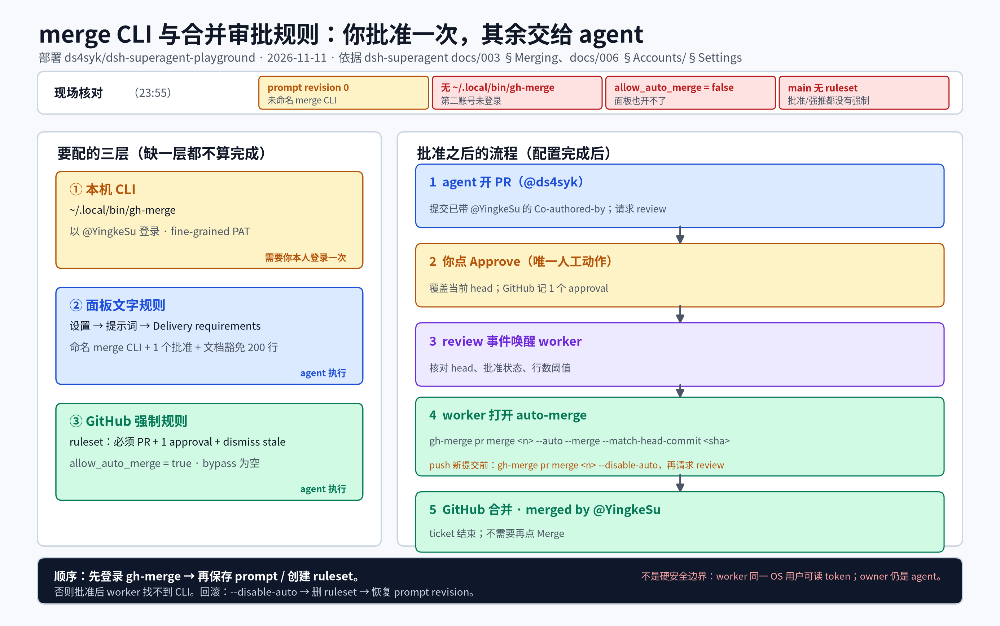

# 配置 merge CLI 与合并审批规则（2026-11）

> **结论先行**：可以在这个部署里配置。文字规则在 superagent 面板的 **设置 → 提示词 → 团队约定 → Delivery requirements** 里改；强制规则在 GitHub 的 **ruleset** 里配。唯一不能在面板里完成的是**第二个 GitHub 账号（@YingkeSu）的登录**：需要你本人在服务器终端做一次，或把 fine-grained token 粘进自己的终端（不要发到聊天里）。

**如果只记三件事**

1. `gh-merge` 是以 @YingkeSu 身份、只用于合并的 gh 包装器；agent 账号（@ds4syk）绝不使用它。
2. Delivery requirements 写明：每个 PR 需要 @YingkeSu 对当前 head 的 1 个批准；agent 只在批准存在后打开 auto-merge。
3. GitHub ruleset 强制“必须走 PR + 1 个批准 + 新提交作废旧批准”，所以 auto-merge 不是绕过评审；它只是把“你点 Merge”变成“你点 Approve”。



## 0. 口径

- 现场数据来自 2026-11-11 23:45–23:55（Asia/Shanghai）对 `http://127.0.0.1:3092/orchestrator/api`、`gh-agent` 和本机文件系统的实测。
- 依据：dsh-superagent 的 `docs/003-execution.md` §Merging、`docs/006-deployment.md` §Accounts / §Settings、`docs/004-prompts.md`，以及 `SETUP.md` 第 9 问（Auto-merge）。
- “配置完成”要同时满足三层：**本机 CLI 登录**、**面板文字规则**、**GitHub 强制规则**。只改 prompt 不会让自动合并真正可用。

## 1. 现状（实测）

| 项目 | 当前值 | 含义 |
| --- | --- | --- |
| Prompt revision | `0`（`source: defaults`） | Delivery requirements 还是默认文本，未命名 merge CLI |
| Merge CLI | 不存在 | `~/.local/bin/gh-merge`、`~/.config/gh-merge` 均不存在 |
| 仓库 auto-merge | `allow_auto_merge=false` | 面板和 agent 都无法开启 auto-merge |
| main 保护 | 无 branch protection，ruleset 列表为空 | 没有审批、没有禁止强推的强制规则 |
| 协作者 | `ds4syk`（owner/admin，id 350989528）；`YingkeSu`（write，id 264377619） | 人类评审者已有写权限，不需要再加 |
| 未合并 PR | #16–#25 共 10 个 | 见下文的 200 行阈值影响 |

按默认的“少于 200 行”条件，这 10 个 PR 里只有 #17（172+20=192 行）能走自动合并；#23 是 586 行，#18 是 962 行，#19 是 839 行，#16 是 2429 行……其余都要人工合并。所以配置完成后，**历史积压不会自动清空**，只有新开的小 PR 或文档类 PR 会受益。

另一个现场细节：worker shell 的 `PATH` 把 `~/.local/bin` 排在 `worker-bin` 前，`gh` 实际落到未登录的 conda 包装器；本机查询用的是 `/home/syk/.local/bin/gh-agent`。本方案里所有合并命令都写绝对路径，不受这个影响；如果希望 `gh` 也自动指向 agent，需要单独调整 PATH 顺序（不在本工单范围）。

## 2. 设计

### 2.1 账号与凭据

用 **@YingkeSu（致远星）** 作为合并账号，而不是 agent 账号。原因是 GitHub 把 auto-merge 的合并归到“开启 auto-merge 的账号”：用 @ds4syk 开 auto-merge 等于 agent 合并自己的 PR，和“人工评审后合并”的意图相反。@YingkeSu 已经是仓库的 write 协作者，也是目前唯一的人类评审者，不需要新增账号。

凭据用 **fine-grained PAT**，不要用 OAuth 全量授权：

- 只选仓库 `ds4syk/dsh-superagent-playground`；
- 权限只要 `Contents: Read and write`、`Pull requests: Read and write`、`Metadata: Read`；
- 有效期 90 天（或 1 年），到期前换；
- token 只粘进自己的终端，不写进仓库、文档、聊天或命令历史。

`gh` 会把 token 存在 `~/.config/gh-merge/hosts.yml`；目录设为 `700`，文件设为 `600`。

### 2.2 包装器

```sh
mkdir -p ~/.local/bin
cat > ~/.local/bin/gh-merge <<'EOF'
#!/bin/sh
GH_CONFIG_DIR="$HOME/.config/gh-merge" exec gh "$@"
EOF
chmod +x ~/.local/bin/gh-merge
```

包装器本身不限制参数；能做什么由 fine-grained PAT 的范围和 prompt 共同约束。`scripts/merge-cli/setup-gh-merge.sh` 会创建这个包装器并检查登录身份，`--check` 只检查不写入。它不会替你登录，也不会读取或打印 token。

### 2.3 登录与验证（一次性，人工）

在服务器终端执行：

```sh
umask 077
mkdir -p ~/.config/gh-merge
read -rs TOKEN
printf '%s\n' "$TOKEN" | ~/.local/bin/gh-merge auth login --hostname github.com --with-token
unset TOKEN

~/.local/bin/gh-merge api user --jq .login   # 必须输出 YingkeSu
/home/syk/.local/bin/gh-agent api user --jq .login  # 必须输出 ds4syk
```

`read -rs` 不回显 token；`auth login --with-token` 从标准输入读。两条 `api user` 的输出必须不同，这是“不是拿 agent 账号在合并”的最低验证。

### 2.4 面板里的文字规则

在面板 **设置 → 提示词 → 团队约定 → Delivery requirements** 中，把两处 `<merge CLI>` 替换成 `/home/syk/.local/bin/gh-merge`，并在段落末尾追加下面这段（英文，和内置提示词保持一致）：

```text
**Merge rule for this deployment:** The merge CLI is `/home/syk/.local/bin/gh-merge`, signed in as @YingkeSu (GitHub id 264377619), never as the agent account. Request @YingkeSu's review on every pull request you open. Every pull request needs one approving review from @YingkeSu that covers its current head commit; a bot review, your own review, or an approval of an earlier commit does not count. This includes pull requests that change what users see or read, such as UI, rendered documents and published artifacts.

Because this deployment fixes the reviewer, credit @YingkeSu when you open the pull request rather than after approval: put `Co-authored-by: YingkeSu <264377619+YingkeSu@users.noreply.github.com>` on every commit of the branch, then request @YingkeSu's review. Do not rewrite the branch after @YingkeSu approves it; a rewrite changes the head commit and GitHub dismisses the approval. If a later push is needed, add the trailer to the new commits too, withdraw auto-merge first, and request review again.

For this deployment, a pull request that only adds or edits documentation, research notes, knowledge-base pages, images or generated documents, with no executable code, configuration or scripts, does not count against the 200-line limit; keep the limit for code, automation, configuration and scripts.
```

也可以用 `scripts/merge-cli/apply-prompt.py`：默认只读、打印 diff 并调 `POST /prompts/preview` 校验；确认后加 `--apply` 才保存新 revision。保存前它不会改线上配置。

**为什么要把 reviewer 署名提前**：默认 Delivery 要求“在第一次评估人类 reviewer 反馈时重写提交，加上 `Co-authored-by`”。但重写会改变 head commit；GitHub 的 “Dismiss stale approvals on push” 会把刚拿到的批准作废，auto-merge 就永远差一个批准。这个部署的 reviewer 固定是 @YingkeSu，所以把署名提前到开 PR 前，批准就覆盖最终 head。若你更想保留默认的“批准后再署名”，就必须关掉 GitHub 的 stale approval 作废（见 2.6 的替代方案）。

**为什么文档类豁免 200 行**：默认阈值是给代码改动的安全带。本仓库大量是知识库、报告和 DOCX，动辄上千行；按 200 行执行，auto-merge 几乎用不上。文档类豁免后，你批准即可自动合并；代码/自动化改动仍保留 200 行限制。这个阈值是可调的，见第 4 节。

### 2.5 GitHub 强制规则

先打开仓库的 auto-merge 和合并后删分支：

```sh
gh-agent api -X PATCH repos/ds4syk/dsh-superagent-playground \
  -F allow_auto_merge=true -F delete_branch_on_merge=true
```

再创建 ruleset（完整 JSON 在 `scripts/merge-cli/ruleset.json`）：

```sh
gh-agent api -X POST repos/ds4syk/dsh-superagent-playground/rulesets \
  --input scripts/merge-cli/ruleset.json
```

规则内容和理由：

| 规则 | 值 | 理由 |
| --- | --- | --- |
| `deletion` / `non_fast_forward` | 禁止删 main、禁止强推 | 保护主分支历史 |
| `pull_request`：required approvals | `1` | agent 不能批准自己的 PR；只有人类能补上 |
| `dismiss_stale_reviews_on_push` | `true` | 新提交作废旧批准；配合“批准前不重写” |
| `require_last_push_approval` | `true` | 最近一次 push 之后必须有批准 |
| `required_review_thread_resolution` | `true` | review 讨论未解决不能合并 |
| `allowed_merge_methods` | `["merge"]` | 和 prompt 的 `--merge` 一致，保留 merge commit |
| `bypass_actors` | `[]` | 不设白名单，对 admin/owner 也生效 |

当前仓库没有 CI workflow，所以 ruleset 不设 required status checks；以后加 CI 时再把 check 名加进 ruleset。`bypass_actors` 为空意味着 ruleset 对仓库 owner 也生效，但 **owner 仍然可以编辑/删除 ruleset**：当前 owner 是 @ds4syk（agent），所以这是“流程约束”，不是防恶意的硬边界（见第 5 节）。

### 2.6 批准与“重写提交”的兼容性

默认 Delivery 规则和 GitHub 的 stale approval 机制有一个真实冲突：

- 默认：人类批准后，agent 重写提交加 `Co-authored-by`；
- GitHub：新提交 push 后，旧批准作废；
- 结果：批准 → 重写 → 批准作废 → auto-merge 无法合并，还要再批准一次。

本方案用 **2.4 的“开 PR 前署名”** 解决：批准发生时，提交已经是最终形态，不会再重写。代价是“credit”发生在 review 之前；因为本部署的 reviewer 固定是 @YingkeSu，这是确定性的，不存在“猜错 reviewer”的问题。

如果不想改默认的署名时机，有两个替代：

1. 把 ruleset 的 `dismiss_stale_reviews_on_push` 设为 `false`；批准后重写不会作废批准，但内容改动也不会自动作废旧批准，安全性依赖 agent 在 push 前主动 `--disable-auto`。**不推荐**。
2. 删掉 Delivery 里的 reviewer 署名段落，保持 `dismiss_stale_reviews_on_push=true`。最安全、最简单，但不再给 reviewer 加 co-author credit。**如果你不在乎署名，这是最省事的选项。**

## 3. 执行顺序

1. **你**：创建 fine-grained PAT，按 2.2/2.3 建包装器并登录；确认 `gh-merge api user` 是 `YingkeSu`。
2. **Agent**：按 2.5 打开 auto-merge、创建 ruleset；再按 2.4 保存 Delivery requirements（`apply-prompt.py --apply`）。
3. **验证**：用一个小 PR（例如 #17，192 行；或之后新开的小 PR）走一遍：你 Approve → agent 收到 review 事件 → `gh-merge pr merge <n> --auto --merge --match-head-commit <sha> --repo ...` → 合并；确认 merged by 是 @YingkeSu，而不是 @ds4syk。
4. **反向验证**：在未批准时，agent 账号执行 `gh-agent pr merge <n> --merge` 应被 ruleset 拒绝；`gh-merge` 也不应被用来批准。
5. **回滚**：`gh-merge pr merge <n> --disable-auto`；删除 ruleset；`PATCH allow_auto_merge=false`；在面板历史里把 Prompts 恢复到 revision 0（或重新 PUT 旧 config）。

**不要先保存 prompt 再登录**：prompt 一旦命名了不存在的 `gh-merge`，后续 worker 在批准后尝试合并会失败。顺序必须是“先登录，再改 prompt”。

## 4. 需要你决定或操作

| 事项 | 推荐 | 说明 |
| --- | --- | --- |
| 登录第二账号 | 你本人在服务器终端做一次 | token 不进聊天；agent 无法代你输入 |
| 行数阈值 | 文档类豁免、代码类 200 行 | 否则 10 个积压 PR 里只有 #17 能自动合并 |
| Reviewer 署名 | 开 PR 前加 `Co-authored-by` | 和 stale approval 兼容；见 2.6 |
| 仓库 owner | 可选：转给 @YingkeSu，agent 降为 write | 让 ruleset 不能被 agent 修改；会改 Source 的 `owner/name`，不建议现在做 |
| 是否现在执行 | 你登录后 agent 按第 3 节执行 | 未登录前只完成了方案与脚本 |

## 5. 风险与边界

- **不是硬安全边界**：worker 以同一个 OS 用户运行，能读取 `~/.config/gh-merge` 的 token，也能直接 `GH_CONFIG_DIR=... gh ...` 绕过包装器。fine-grained PAT 把爆炸半径限制在这个仓库的 contents/PR，但 prompt 仍是主要的行为约束。
- **仓库 owner 是 agent**：@ds4syk 有 admin，能改/删 ruleset。要防这一点，需要把仓库转给人类账号或组织，并给 agent 只留 write；这是部署层变更，不在本方案内自动执行。
- **Review bot 不是批准**：ruleset 只数人类批准；如果以后加 GitHub App 审查，仍不能替代 @YingkeSu 的 approve。
- **升级会冻结 team section**：Delivery requirements 是整段覆盖，dsh-superagent 升级后默认文本更新不会自动合并；面板会显示“已改”，需要人工对比后重新应用。建议保留 2.4 的三段文本，升级后逐段对照。

## 6. 验收清单

- [ ] `~/.local/bin/gh-merge api user --jq .login` 输出 `YingkeSu`；
- [ ] `gh-agent api user --jq .login` 输出 `ds4syk`，两者不同；
- [ ] `gh-agent api repos/... --jq .allow_auto_merge` 为 `true`；
- [ ] `gh-agent api repos/.../rulesets` 有 `main: review before merge`，enforcement 为 `active`；
- [ ] Prompt revision > 0，且 `POST /prompts/preview` 的 worker 文本包含 “Merge rule for this deployment”；
- [ ] 测试 PR：批准前不能合并；批准后 agent 能用 `gh-merge` 打开 auto-merge，GitHub 自动合并，merged by 为 @YingkeSu；
- [ ] 回滚命令可用（至少演练 `--disable-auto`）。

## 7. 参考

- dsh-superagent `docs/003-execution.md` §Merging：auto-merge 由 Delivery requirements 决定，host 没有合并决策逻辑。
- dsh-superagent `docs/006-deployment.md` §Accounts：第二个账号的 CLI 和 `auth login`；§Settings：Prompts 的 team sections。
- dsh-superagent `docs/004-prompts.md`：team section 的覆盖方式、`Delivery requirements` 的内容边界。
- dsh-superagent `SETUP.md` 第 9 问：auto-merge 需要另一个能合并的账号的 GitHub CLI，并在 Delivery requirements 里命名。
