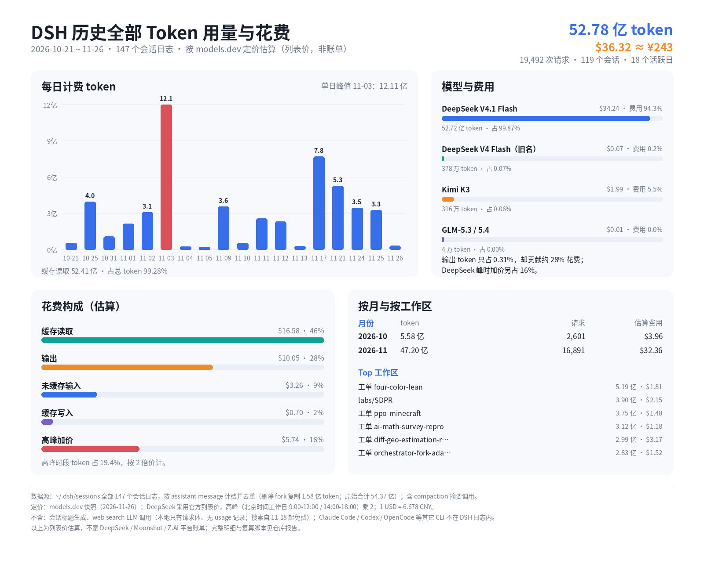

# DSH 历史全部 Token 用量与花费（2026-10-21 ~ 2026-11-26）

> **结论先行**：自 2026-10-21 DSH 有记录以来，本机共产生 **5,278,482,342（52.78 亿）计费 token**、**19,492 次模型请求**；按 models.dev 列表价估算 **$36.32（≈¥242.53）**。缓存读取占 99.28%，输出只占 0.31% 却贡献约 28% 花费；11-03 单日 12.11 亿是全期峰值。

**如果只记三件事**：

1. 5 周共 **52.78 亿 token**、19,492 次请求、119 个会话，估算 **$36.32 / ¥242.53**；DeepSeek V4.1 Flash 占 99.87%。
2. 平均每百万 token 约 **0.69 美分**（¥0.05），因为 99.28% 是缓存读取；单次请求平均 27.1 万 token。
3. 10 月 5.58 亿（$3.96），11 月 47.20 亿（$32.36）；花费里输出占 28%、峰时加价占 16%。



## 0. 口径

- **数据源**：`~/.dsh/sessions` 下全部 147 个 `session.v4.jsonl.zstd` 会话日志（本机所有 DSH profile），逐条读取 `assistant/message` 的 `usage`；同时纳入 5 次 `compaction/summary` 摘要调用。
- **计费 token** = 未缓存输入 + 缓存读取 + 缓存写入 + 输出，与 DSH 的 `tokenUsage` 投影同口径。
- **去重**：按 assistant message id 去重。两个 seeded fork 会话把父会话历史复制进了自己的日志，共 495 条消息、158,478,330 token；不去重会把同一批 API 响应算两次。原始合计 5,436,960,672 token，去重后 5,278,482,342。
- **归日**：按每一步 `step/start` 的本地时间（Asia/Shanghai）归入日期。
- **定价**：models.dev 快照（2026-11-26）。DeepSeek 的 models.dev 价即官方 off-peak 价，官方高峰价为其 2 倍（北京时间工作日 09:00–12:00、14:00–18:00），本文对 DeepSeek 请求按峰/谷分别计价；该区间无中国法定节假日。
- **汇率**：1 USD = 6.678 CNY（2026-11-25 取数）。
- **性质**：列表价估算，不是 DeepSeek / Moonshot / Z.AI 的平台账单。

## 1. 总量

| 指标 | 数值 |
|-|-|
| 计费 token | 5,278,482,342（52.78 亿） |
| 未缓存输入 | 21,523,858（0.41%） |
| 缓存读取 | 5,240,622,656（99.28%） |
| 缓存写入 | 232,702（0.004%） |
| 输出 | 16,103,126（0.31%） |
| 模型请求 | 19,492 |
| 会话 | 119（147 个日志，28 个空会话） |
| 活跃天 | 18（2026-10-21 ~ 2026-11-26） |
| 估算费用 | $36.32 / ¥242.53 |
| 高峰 token / 加价 | 1,025,828,385（19.4%）/ $5.74 |
| 缓存命中率 | 99.59% |

首条有 usage 的请求在 **2026-10-21 11:19:34**，末条在 **2026-11-26 01:59:59**（含本报告生成会话截至 02:00 的用量）。

## 2. 按月

| 月份 | 计费 token | 请求 | 费用 | 人民币 | 费用占比 |
|-|-|-|-|-|-|
| 2026-10 | 558,291,242 | 2,601 | $3.96 | ¥26.43 | 10.9% |
| 2026-11 | 4,720,191,100 | 16,891 | $32.36 | ¥216.10 | 89.1% |

## 3. 按日

| 日期 | 计费 token | 请求 | 费用 | 占比 |
|-|-|-|-|-|
| 2026-10-21 | 52,738,781 | 505 | $0.80 | 2.2% |
| 2026-10-25 | 398,390,208 | 1,928 | $2.59 | 7.1% |
| 2026-10-31 | 107,162,253 | 168 | $0.57 | 1.6% |
| 2026-11-01 | 215,468,501 | 1,299 | $1.59 | 4.4% |
| 2026-11-02 | 309,289,745 | 1,186 | $1.78 | 4.9% |
| 2026-11-03 | 1,211,473,660 | 3,722 | $7.40 | 20.4% |
| 2026-11-04 | 22,866,539 | 85 | $0.14 | 0.4% |
| 2026-11-05 | 15,708,681 | 26 | $0.09 | 0.2% |
| 2026-11-09 | 358,901,440 | 1,700 | $3.04 | 8.4% |
| 2026-11-10 | 52,677,344 | 246 | $0.58 | 1.6% |
| 2026-11-11 | 258,316,416 | 1,302 | $2.01 | 5.5% |
| 2026-11-12 | 234,012,700 | 848 | $1.55 | 4.3% |
| 2026-11-13 | 28,134,369 | 87 | $0.34 | 0.9% |
| 2026-11-17 | 777,289,160 | 2,337 | $3.95 | 10.9% |
| 2026-11-21 | 530,002,227 | 1,680 | $2.38 | 6.5% |
| 2026-11-24 | 346,891,235 | 1,040 | $3.46 | 9.5% |
| 2026-11-25 | 329,513,615 | 1,196 | $3.79 | 10.4% |
| 2026-11-26 | 29,645,468 | 137 | $0.25 | 0.7% |

## 4. 模型与价格

| 模型 | Provider | 计费 token | 请求 | 输入 / 缓存读 / 输出（USD/M） | 费用 | 占比 | 说明 |
|-|-|-|-|-|-|-|-|
| deepseek-flash | deepseek | 5,271,503,046 | 19,309 | 0.15 / 0.003 / 0.6 | $34.24 | 94.3% | 高峰 ×2 |
| deepseek-v4-flash | deepseek | 3,782,444 | 108 | 0.15 / 0.003 / 0.6 | $0.07 | 0.2% | 高峰 ×2 |
| kimi-k3 | moonshotai-cn | 3,158,407 | 71 | 2.9879 / 0.2988 / 14.9395 | $1.99 | 5.5% |  |
| glm-5.4 | zhipuai | 19,290 | 2 | — | $0.00 | 0.0% | 订阅内 |
| glm-5.3-flash | zhipuai | 9,578 | 1 | 0.11952 / 0.03436 / 0.41831 | $0.00 | 0.0% | 列表价 |
| glm-5.3 | zhipuai | 9,577 | 1 | 1.19516 / 0.29879 / 4.18306 | $0.01 | 0.0% | 列表价 |

价格取自 models.dev；DeepSeek 的峰时价为上表 2 倍。GLM 走 Z.AI 编程套餐（订阅制），表中按其公开列表价折算，实际不按 token 另计。

## 5. 花费构成

| 项目 | 金额 | 人民币 | 占比 | 说明 |
|-|-|-|-|-|
| 缓存读取 | $16.58 | ¥110.70 | 45.6% | off-peak 基价，峰时另计 |
| 输出 | $10.05 | ¥67.09 | 27.7% | 16.07M token，单价最高 |
| 未缓存输入 | $3.26 | ¥21.78 | 9.0% | 21.51M token |
| 缓存写入 | $0.70 | ¥4.64 | 1.9% | Kimi 少量 cache write |
| 高峰加价 | $5.74 | ¥38.31 | 15.8% | 19.4% token 落峰时，×2 的增量 |
| **合计** | **$36.32** | **¥242.53** | 100% | |

## 6. 工作区与会话

| 工作区 | 计费 token | 请求 | 费用 | 占比 |
|-|-|-|-|-|
| 工单 four-color-lean-09ced558eaa5 | 519,176,006 | 1,356 | $1.81 | 5.0% |
| labs/SDPR | 389,659,574 | 1,273 | $2.15 | 5.9% |
| 工单 ppo-minecraft-f942b789b4ce | 374,927,358 | 973 | $1.48 | 4.1% |
| 工单 ai-math-survey-repro-3877d01b7b12 | 311,615,106 | 781 | $1.18 | 3.2% |
| 工单 diff-geo-estimation-research-944391794a79 | 299,193,502 | 821 | $3.17 | 8.7% |
| 工单 orchestrator-fork-adapt-9d591cc8a18c | 283,358,361 | 868 | $1.52 | 4.2% |
| 工单 resume-dreamer-session-91165e4a84d2 | 275,621,540 | 661 | $1.84 | 5.1% |
| 工单 jamba-world-model-fdd0e082a6b1 | 230,056,352 | 693 | $1.65 | 4.5% |

| 会话 | 类型 | 计费 token | 请求 | 费用 |
|-|-|-|-|-|
| four-color-lean-09ced558eaa5 | main | 519,176,006 | 1,356 | $1.81 |
| ppo-minecraft-f942b789b4ce | main | 372,402,101 | 941 | $1.41 |
| ai-math-survey-repro-3877d01b7b12 | main | 311,615,106 | 781 | $1.18 |
| diff-geo-estimation-research-944391794a79 | main | 287,239,924 | 715 | $2.52 |
| resume-dreamer-session-91165e4a84d2 | main | 275,621,540 | 661 | $1.84 |
| orchestrator-fork-adapt-9d591cc8a18c | main | 251,272,729 | 649 | $1.23 |

## 7. 数据质量与对账

- **与 DSH 投影对账**：`session_projcache` 中 119 个有量会话的 `tokenUsage` 合计为 5,438,579,863 token；本文未去重的原始合计为 5,436,960,672，相差 1,619,191（0.03%），来自两份快照的取数时刻不同（仍在写入的活跃会话），属预期差异。
- **重复事件**：495 条 assistant message 同时出现在父子会话，usage 完全一致；去重后恰好移除 158,478,330 token（占原始 2.92%）。
- **缺失 usage**：3 条 `assistant/message` 没有 usage（中断）；41 次会话标题生成、385 次 DeepSeek web search LLM 调用只有请求体日志、没有 usage 记录，未计入（搜索自 2026-11-18 起免费，标题调用规模很小）。

## 8. 局限

- 仅覆盖本机 DSH 会话；Claude Code、Codex、OpenCode（omo）等其它 CLI 的历史用量不在 `~/.dsh/sessions` 内。
- DSH 在本机的第一条会话日志是 2026-10-20，因此“历史全部”实际从 10-21 的首条请求算起。
- 峰谷按 `step/start` 近似；跨峰谷边界的单步会被归到开始时刻。
- 费用按列表价与 2 倍峰时规则估算，订阅套餐（GLM）按等价列表价折算，均不等于平台实收。

## 9. 复算方法

```bash
python3 analysis/token_usage/aggregate.py \
  --prices analysis/token_usage/prices-2026-11-26.json \
  --out /tmp/usage.json \
  --cutoff-ms 1795629600000        # 2026-11-26 02:00:00 +08:00
python3 analysis/token_usage/render.py /tmp/usage.json \
  docs/visuals/2026-11-26-lifetime-token-usage.png
```

`aggregate.py` 输出逐日 / 逐月 / 逐模型 / 逐工作区 / 逐会话的 JSON，价格快照单独存放以便复核。

## 参考

- models.dev API：<https://models.dev/api.json>（2026-11-26T01:52Z 快照）
- DeepSeek 官方定价：<https://api-docs.deepseek.com/quick_start/pricing>
