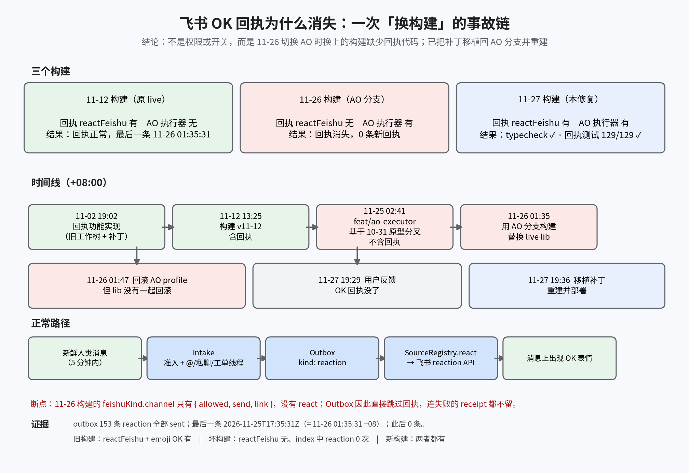

# 飞书 OK 回执失效：诊断与修复（2026-11-27）

> **结论先行**：不是飞书权限、机器人掉线或开关问题。11-26 01:36 把 live 构建切到 `feat/ao-executor` 时，用的是一个从 2026-10-31 原型分出的分支，它不含 2026-11-02 交付的「收到消息加 OK 回执」补丁；01:47 回滚 AO profile 时没有一起回滚 `lib`。于是回执代码在部署产物里静默消失。修复方式是把回执补丁移植回 AO 分支，重建并部署，保留 AO 执行器。



## 如果只记三件事

1. 回执不是“坏了”，是**部署的构建里根本没有这段代码**；源码树里有，构建产物里没有。
2. 事故由一次**只换了一半的切换**造成：profile 回滚了，`lib` 没有回滚，且没有做功能对照检查。
3. 已把补丁移植回 `feat/ao-executor`（[源 PR #1](https://github.com/ds4syk/dsh-superagent-prototype/pull/1)），typecheck 与 129 项回执测试通过，重建后已部署，重启生效。

## 0. 口径与证据分级

| 证据 | 级别 | 位置 |
| --- | --- | --- |
| 构建产物内容（是否含 `reactFeishu` / `receiptable`） | 可直接核对 | `lib.bak-ao-20261126-013640`、`lib.bak-receipt-20261127-193611`、新 `lib` |
| 回执发送记录（outbox） | 运行数据 | `~/.dsh-state/superagent/orchestrator.sqlite` 的 `outbox` 表 |
| 切换时间线 | 运行日志 | `.artifacts/switch-to-ao-20261126-013640.log`、profile 备份名 |
| 用户反馈 | 现场 | 2026-11-27 19:29 飞书消息（已删除，见 §6） |

不把“构建里没有”当成“源码里没有”：两者本次正好相反。

## 1. 现象

- 2026-11-26 01:35 起，新收到的飞书消息不再出现 OK 表情回执。
- 同期的文本 acknowledgement / reply 仍然正常（outbox 里相邻的 ack、reply 状态为 `sent`），说明机器人仍在群里、仍能发消息。
- outbox 中 `kind = reaction` 共 153 条，全部 `sent`；**最后一条是 2026-11-25T17:35:31.810Z（= 11-26 01:35:31 +08:00）**，此后 0 条。
- 用户 11-27 19:29 反馈“收到回复 OK 功能没了”。

## 2. 正常路径：回执本应怎么走

1. `Intake.receive` 收下一条人类消息后，判断它是否“新鲜且值得回执”：5 分钟窗口内、通过 Policy 准入、并且是 @ 机器人 / 私聊 / 落在工单自有线程。
2. 满足条件时，向 `Outbox` 排一条 `kind: 'reaction'` 的消息。
3. `Outbox` 为它建一条 receipt，并排独立的 `receipt` effect（并发 4，1s 起指数退避到 30s）。
4. `receipt` effect 调 `SourceRegistry.react`，最终走 `reactFeishu`：**飞书原生 reaction API**，`reaction_type.emoji_type = "OK"`。
5. 目标已撤回 / 记录超时则丢弃并标注 `channelGone` 或 `stale`；失败不会阻塞文本回复。

这条链路与文本 ack 完全解耦，所以“文本能发、表情没有”正是构建缺 `react` 的典型表现。

## 3. 根因

| 时间（+08:00） | 事件 | 回执代码 |
| --- | --- | --- |
| 11-02 19:02 | 回执功能在旧工作树实现并交付补丁 | 有 |
| 11-12 13:25 | 构建 v11-12，live 使用中 | 有（`reactFeishu`、`receiptable`） |
| 11-25 02:39–02:41 | `feat/ao-executor` 两个提交，**基于 2026-10-31 原型** | 无 |
| 11-26 01:35:59 | 用 AO 分支构建并替换 live `lib` | 无 |
| 11-26 01:36:40 | `switch-live-to-ao` 重启 live | 最后一条回执 01:35:31 |
| 11-26 01:47:50 | AO 切换失败，回滚 profile（`cordis.patch.yml.bak-ao-broken-...`） | `lib` 未回滚，静默缺失 |
| 11-27 19:29 | 用户反馈 | — |

**根因一句话**：部署产物与“以为的源码”不是同一支；回执补丁只存在于旧工作树，AO 分支从更早的原型分出，重建即回退。

构建对照（同一份 `lib` 目录，三个时间点）：

| 构建 | `feishu-*.js` 里的 `reactFeishu` | `feishuKind.channel` | `index.js` 的 `receiptable` | AO 执行器 |
| --- | --- | --- | --- | --- |
| 11-12（旧 live） | 有，`emoji_type: "OK"` | `send` + `react` + `link` | 有 | 无 |
| 11-26（坏 live） | **无** | 只有 `send` + `link` | **无** | 有 |
| 11-27（本修复） | 有 | `send` + `react` + `link` | 有 | 有 |

`Outbox.send` 在 `kind === 'reaction'` 时先看 `sources.kind(...).channel?.react`；没有 `react` 就直接 return，连一条 pending/failed 的 receipt 都不会留下——这正是 outbox 里 11-26 之后连“失败的回执”都没有的原因。

## 4. 修复

- 把 `deliverables/patches/2026-11-02-receipt-reaction.patch` 移植到 `feat/ao-executor`，提交 `165f060`，分支 `agent/receipt-regression-96f00a1df4c7`，源 PR：[#1](https://github.com/ds4syk/dsh-superagent-prototype/pull/1)。
- 变更 18 个文件：Intake / Outbox / Effects / Store / SourceRegistry / Feishu channel + locales + 文档 + 测试。
- **保留 AO 执行器代码**：没有采用“把 `lib` 回滚到 11-12”的省事方案，因为那会把 11-25 的 AO 工作从部署里抹掉，且下次再切 AO 还会复发。
- 补丁原文见 [`deliverables/patches/2026-11-27-receipt-restore.patch`](../deliverables/patches/2026-11-27-receipt-restore.patch)。

## 5. 验证

| 检查 | 结果 |
| --- | --- |
| `pnpm typecheck` | 通过 |
| `tests/feishu-receipt.spec.ts` + `outbox.spec.ts` + `core-engine.spec.ts` + `locales.spec.ts` | 129/129 通过 |
| `tests/runtime.spec.ts`（去掉 worker 注入的 `GIT_CONFIG_GLOBAL`） | 92/92 通过 |
| 全量 `pnpm test` | 1241 项中 1239 通过；2 项为既有环境相关失败，未修改的 base 上同样复现 |
| 新构建内容 | `reactFeishu`、`receiptable`、`AoHttpError` 同时存在 |
| 部署 | 旧 `lib` 备份为 `lib.bak-receipt-20261127-193611`；新 `lib` 已就位 |
| 重启后 smoke test | 用飞书 reaction API 给用户重发的存活消息补加 OK 回执，确认权限与接口可用 |

全量测试的两项失败与本次改动无关：

- `tests/sources.spec.ts` 的 malformed-JSON 健康断言有时序抖动；在 `feat/ao-executor` 未修改的 `d7595dd` 上单独运行同样失败。
- `tests/runtime.spec.ts` 在 worker 环境已注入 `GIT_CONFIG_GLOBAL` 时，`toBeUndefined()` 不成立；去掉该变量后全通过。

## 6. 送达说明（重要）

本次工单的触发消息在飞书里**已被用户删除**（`im +messages-mget` 返回 `deleted: true`），文本 acknowledgement 被 outbox 标记为 `channelGone`。用户随后在 19:29:09 重发了一条修正消息（存活），Eval 判定为同一问题并指向本工单。

因此：

- 本工单的常规 reply（回复已删除的触发消息）仍会 `channelGone`；
- 重启脚本会直接回复**存活的重发消息**并补上 OK 表情，作为用户可见结果；
- 按仓库约定，GitHub 文档不贴飞书消息原文、ID 或截图。

## 7. 运维与后续

- **部署检查单**：从任何分支重建 live `lib` 前，先对照已交付功能清单（至少含回执测试），并记录构建来源 commit；不要只回滚 profile 而不回滚 `lib`。
- **回滚路径**：`lib.bak-receipt-20261127-193611`（当前修复前）；如需彻底回到 11-12 构建，用 `lib.bak-ao-20261126-013640`（无 AO）。
- **分支卫生**：`feat/ao-executor` 合并回 main 前，应确认 11-02 之后所有“未提交到仓库”的补丁都已进入分支；本次事故的本质就是“工作树 ≠ 分支”。

## 附：可复现命令

```sh
# 1. 看 outbox 最后一条回执时间
node -e 'const{DatabaseSync}=require("node:sqlite");const db=new DatabaseSync(process.argv[1],{readOnly:true});console.log(db.prepare("select value from outbox").all().map(r=>JSON.parse(r.value)).filter(v=>v.kind==="reaction").sort((a,b)=>(a.at||"").localeCompare(b.at||"")).at(-1).at)' ~/.dsh-state/superagent/orchestrator.sqlite

# 2. 看某个构建是否含回执
grep -l "Missing Feishu reaction target" lib/*.js
grep -o "receiptable" lib/index.js | wc -l

# 3. 重跑回执测试
pnpm exec vitest run tests/feishu-receipt.spec.ts tests/outbox.spec.ts tests/core-engine.spec.ts tests/locales.spec.ts
```
