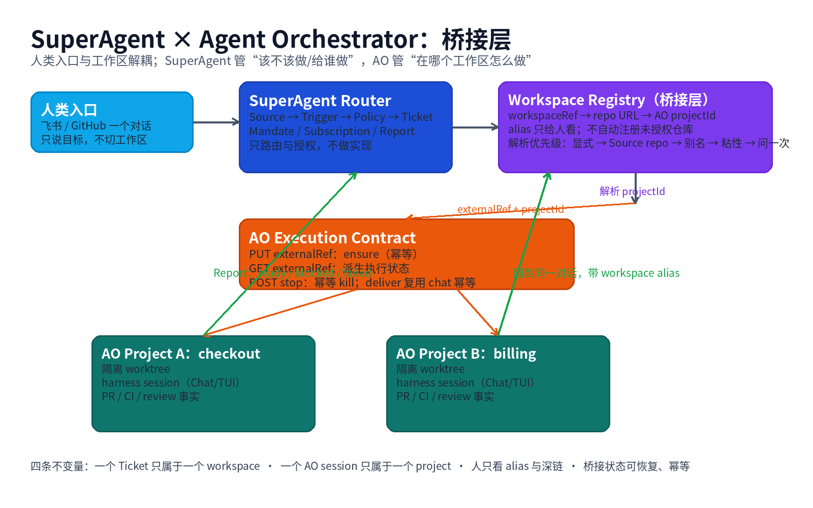

# SuperAgent × Agent Orchestrator：桥接层两套方案（GLM-5.4 / Kimi K3.1 Pro）

> 需求原话：人类入口与工作区解耦，工作区不必成为人的认知负担；人通过一个对话 agent 管理多个工作区；单个工作区内用 AO。问题在桥接层。
>
> 两个模型各自独立给出了一套完整方案。下面是原文（标题层级已降级以保持目录结构）+ 对照 + 我的综合建议。



## 0. 一句话对照

- **GLM-5.4**：桥接层持有 workspace registry 与执行映射；AO 只加 **session labels + label 过滤**，用 `sa/{ticketId}/{attempt}` 命名与 label 查询做幂等；轮询 + 持久 watermark；人只看到 alias。
- **Kimi K3.1 Pro**：桥接层是一个独立 `WorkspaceBridge`（registry + ticket_binding + attempt + outbox）；AO 的 `POST /sessions` 持久化 **externalRef 幂等键**，GET 返回 externalRef/revision/结构化阻塞；轮询 + revision 去重；新 Assignment = 新 session，旧 attempt fencing。
- 共同点：Bridge 拥有 workspace registry；一个 Ticket 只属于一个 workspace；AO 不引入 Ticket/Policy；MVP 用轮询而非 SSE；对人只显示 alias；只在 ready/blocked/failed 时说话。

## 1. GLM-5.4 方案

**结论**：桥接层 = SuperAgent 侧实现现有 `Executor` 接口的 `AoExecutor` + 桥接自有的 workspace registry，AO 只需一个支持 session labels 的小 PR。workspace 是 Assignment 级字段，人类全程只见 alias；解析顺序为 Source repo > 显式别名 > 线程粘性 > 问一次。执行状态 MVP 用带持久 watermark 的轮询归一化为 Report 事件，session 以 `sa/{ticketId}/{attempt}` + label 保证幂等与重启 reconcile。

#### 1. workspace 的表示

- 字段加在 **Assignment** 而非 intake：`Ticket.workspaceRef?`（可空），Decision 阶段解析后写入 `Assignment.workspaceRef`（必填）。一个 Ticket 只在一个 workspace 下产生 attempt 递增的 Assignment 链，天然满足"一 Ticket 一 workspace"。
- Source 不改造为 workspace-scoped：GitHub Source 的 repoURL 是确定性映射输入；飞书 Source 本就 workspace 无关，强行 scope 会把认知负担推回给人。
- 防泄漏：面向人的文案只出现 `Workspace.alias`（如"checkout 服务"），ref/id 仅存在于内部字段与深链。模板固定为 `[{alias}] {一句话}`。

```ts
interface Workspace {
  ref: string; alias: string; repoURL: string;
  aoProjectId?: string;                          // 惰性解析缓存
  harness: { primary: string; fallback?: string };
  model?: string;
}
interface Assignment {
  ticketId: string; workspaceRef: string; attempt: number;
  executionRef?: string;                         // "ao:{projectId}:{sessionId}"
  watermark?: { sessionId: string; bootEpoch: string; lastSeq: number };
}
```

#### 2. registry 放哪

- 放**桥接配置**（`workspaces.yaml`，SuperAgent 域），不放 AO project 表。理由：alias、授权、默认 harness/model 是路由/策略概念；放进 AO 会让 AO 滑向 ticket 系统。
- 启动与每次 reconcile 用 `GET /projects` 按 repoURL 校验；`aoProjectId` 缺省时惰性解析并写回缓存。
- 注册：MVP 由人改配置 + 热加载；**不做自动发现**（会把未授权仓库暴露给 Router，权限模型失控）。P1 给 Router 加受 policy 保护的 admin 注册命令。

#### 3. workspace 解析

优先级，命中即停：

1. 上游已带 `workspaceRef` → 直接用。
2. Ticket 来自 Source 且 repoURL 命中 registry → 确定性绑定，**不问**。
3. 文本显式别名精确且唯一命中 → 绑定并更新线程粘性。
4. 线程粘性上下文（该 thread 最近一次 workspace，TTL 30min，切换即失效）→ 绑定，但消息带 `[{alias}]` 供人一眼纠正。
5. 唯一候选启发（关键词仅匹配一个 workspace）→ 采用并标注。
6. 其余 → **问一次**：编号列出 ≤3 个候选 + "其他"；答复写入线程粘性。

歧义规则：≥2 候选且无粘性时禁止猜测；破坏性操作（stop、合并类指令）即使有粘性也强制确认 workspace。

#### 4. Ticket ↔ AO session 映射

- 命名：`Name = sa/{ticketId}/{attempt}`，`Labels = {sa.ticket: id, sa.attempt: n}`，`executionRef = ao:{projectId}:{sessionId}`。
- 幂等键 `(ticketId, attempt)`。`start` 流程：先 `GET /sessions?label=sa.ticket={id}` → 活着且 attempt 匹配则 adopt；死了且 attempt 相同则标记 failed 等新 attempt；不存在才 `POST /sessions`。
- **attempt 内复用**（`deliver` 以 `clientMessageId = inputId` 幂等投递）；**重试 = attempt+1 = 新 session**（干净 worktree，语义清晰）。取舍代价：丢会话上下文，用注入 ticket 上下文包（mandate + 历次 Report 摘要）缓解。
- Reconcile：Assignment 是意图真相，session 是执行事实。重启后列出所有 `sa.` label 的 session：有 open Assignment → 重绑 watcher、恢复 watermark；对应 Assignment 已终态 → kill；Assignment open 但 session 缺失 → 按情况报 failed 或重建。

```go
// AO 侧唯一改动
type CreateSessionReq struct {
    ProjectID string            `json:"projectId"`
    Name      string            `json:"name"`   // sa/{ticketID}/{attempt}
    Labels    map[string]string `json:"labels"`
    Harness   string            `json:"harness"`
}
// GET /sessions?label=sa.ticket%3D{id}
```

#### 5. 执行状态回传

- **MVP 轮询**（AO 现有 API 无 SSE）：`GET /sessions/{id}`，自适应间隔 running 3s / idle 20s / blocked 稳态 60s。桥接内部归一化为 `ExecutionEvent`，映射层不感知传输，后续换 webhook 不动下游。代价：秒级延迟 + 轮询负载。
- 映射：running→`progress`（合并）；awaiting_approval/question→`blocked`（带 question + actions）；exited 且有 PR→`ready`（带 PR URL、CI 结论）；error/非零退出→`failed`；killed/lost→`dropped`。
- 防重防丢：每 session 持久 `watermark{bootEpoch,lastSeq}` 于 Assignment；`dedupeKey = {ticket}:{attempt}:{kind}:{seq}`，存储侧 upsert。AO 重启 seq 归零时按 bootEpoch 识别并重置，避免丢/重。
- blocked 透传：立即推回**原始 Thread**，附内联审批/回答 action；人的回复经 Subscription → `deliver` → `POST /sessions/{id}/conversation/messages`；解决后状态变化自然产生后续 Report。

```ts
type ReportKind = "progress" | "ready" | "blocked" | "failed" | "dropped";
interface Report {
  ticketId: string; attempt: number; workspaceAlias: string;
  kind: ReportKind; dedupeKey: string;
  question?: string; actions?: Action[]; prURL?: string;
  deepLink?: string; // ao://p/{projectId}/s/{sessionId}
}
interface AoExecutor extends Executor { reconcile(): Promise<void>; }
```

#### 6. 人类注意力

- 只在 blocked（需人）、failed、ready 时开口；progress 静默，仅当人问"进度"或超 SLA（30min 无事件）时给摘要。
- 合并：每 Thread 一个发送缓冲。blocked 立即发；ready/failed 60s 窗口合并为一条 digest，排序 blocked > failed > ready。
- 每条带 `[{alias}]` 与深链；"进入该工作区"只切换线程粘性 + 给深链，不强制跳转。
- 配额：每 workspace 每小时主动消息 ≤5，超出并入下一条 digest。

#### 7. 失败与权限

| 场景 | 对人报告 | 自动重试 |
|---|---|---|
| workspace 未注册 | blocked：给出注册方法 / 候选别名纠正 | 否 |
| 无权限 | blocked + 升级；Router 禁止自授权 | 否 |
| worktree 创建失败 | 静默换新 worktree 重试 1 次，败则 failed | 1 次 |
| harness 不可用 | 按 policy 降级 fallback harness 1 次，否则 blocked | 1 次 |
| AO 离线 | 告知一次"N 个任务排队"，Assignment=scheduled，指数退避 | 无限退避 |
| session 意外消失 | dropped，自动新 attempt 1 次 | 1 次 |

#### 8. MVP

- **AO**：一个 PR——`POST /sessions` 支持 `labels` + `GET /sessions?label=` 过滤。不加 ticket 概念、不改 UI。
- **SuperAgent**：`workspaces.yaml` + resolver + `AoExecutor`（start/deliver/stop/轮询/mapper/reconcile）+ Assignment 新增 `workspaceRef/attempt/executionRef/watermark`。
- **不做**：SSE/webhook、自动注册 workspace、跨 workspace Ticket、Router 内嵌会话管理（kill 除外）、移动端改动。

验收标准：

1. **Given** GitHub Source 命中已注册 repo，**When** 生成 Ticket，**Then** Assignment 自动绑定 workspaceRef，全程无人类提问。
2. **Given** 飞书请求有 2 个候选且无粘性，**When** 解析，**Then** Router 问一次且 ≤3 选项；答复后 30min 内同 thread 免问。
3. **Given** 同 `(ticket, attempt)` 调 `start` 两次，**Then** AO 中恰有一个 session，`executionRef` 相同。
4. **Given** AO 与桥接重启，**When** reconcile 运行，**Then** 60s 内 open Assignment 重绑、无重复 session、blocked 状态不丢。
5. **Given** session 进入 awaiting_approval，**Then** 10s 内原始 Thread 收到带 alias 与审批按钮的 blocked 消息；批准后恢复并最终 ready。
6. **Given** AO 离线，**Then** 人只收到一条排队通知；恢复后自动启动且无重复 session。
7. **Given** 单 Ticket 正常推进 30min，**Then** 主动消息 ≤1 条（SLA 摘要除外）。
8. **Given** `stop` 被调用，**Then** 10s 内 session 被 kill，恰产生一条 dropped Report。

#### 9. TDD 清单（按 red→green→refactor 顺序）

1. resolver：repoURL 命中优先于粘性上下文。
2. resolver：双候选无粘性 → 产出 ask 而非绑定。
3. resolver：粘性 TTL 过期失效；切换 workspace 立即失效。
4. registry 加载：alias 重复 / repoURL 缺失即报错。
5. `start` 幂等：同 `(ticket,attempt)` 两次 → label 查询命中 adopt，仅一次 create。
6. attempt+1 → 新 session，旧 session 收到 kill。
7. `deliver` 以 `inputId` 作 clientMessageId，重放不产生第二条消息。
8. mapper 表驱动：全量 status×activity → ReportKind（含 exited 无 PR → failed）。
9. watermark：重放同一快照 → 0 条新 Report；bootEpoch 变化 → 重置且不重复。
10. reconcile：孤儿 session 被 kill；open Assignment 重绑并恢复 watermark。
11. 离线退火：断言 start 调用间隔递增、有上限。
12. attention：窗口内 5 条 ready → 1 条 digest，排序正确。

最易写错的边界：**start/stop 竞态**（create 未返回时 stop 到达，需登记 pending stop 后置 kill）；AO 重启 seq 归零（丢事件或重复，靠 bootEpoch）；adopt 时 attempt 不匹配却错误复用；粘性上下文在切换瞬间的过期判定。

#### 10. 风险（按严重度）

1. **轮询漏瞬态**（短暂 blocked 窗口被跳过）→ 依赖 activity log 带 seq 可回放、活跃期缩至 3s；webhook 列 P1。
2. **双真相漂移**（Assignment vs session）→ label 强约定 + 启动/周期 reconcile；Assignment 永远是意图唯一真相，session 只是执行事实。
3. **粘性误路由**（人在聊 A 却发到 B）→ 每条执行消息强制 `[{alias}]` 标注 + 破坏性操作强制确认。
4. **AO labels PR 被拒**→ 退化为 `sa/` name 前缀 + 桥接侧索引；代价：用户改名即失联，需声明该前缀为保留。
5. **workspace 增多后注意力仍爆炸**→ 现在做 per-workspace 配额 + 60s digest；P1 做按 workspace 分级的摘要模式。

## 2. Kimi K3.1 Pro 方案

桥接层定位为独立的 `WorkspaceBridge`：SuperAgent 管 Ticket、授权与注意力，AO 管 project/session/worktree，Bridge 只持有注册表、执行映射和 outbox。Ticket 创建后永久绑定一个 `workspaceRef`，人只使用自然语言别名，所有结果回到原 Thread。MVP 采用持久化 HTTP 轮询而非 SSE，代价是活跃任务约 5 秒状态延迟，换取重启可恢复和不丢终态。

#### 1. workspace 在 SuperAgent 域里的表示

在 `Ticket` 增加必填、不可变的 `workspaceRef`；`Assignment` 冗余携带它便于执行校验。Source 仍只表示来源与证据，不改成 workspace-scoped，但 GitHub repo 可作为解析提示。Router Prompt、Ticket 标题均不要求人理解 projectId；对人的输出只显示 registry 中的短别名，如“支付”。

#### 2. workspace registry 放哪

**Bridge 是唯一权威，AO project 表不是。** 注册项为：

```ts
type Workspace = {
  ref: string; aliases: string[]; repoUrl: string;
  aoUrl: string; projectId: string;
  harness: string; model?: string; credentialRef: string;
}
```

`ref`、`aliases`、`(aoUrl,projectId)` 唯一。由运维通过 `bridge workspaces register` 显式注册；Bridge 幂等创建/校验 AO project，并缓存发现结果。Router 可以建议注册，不能自动注册或修改执行配置。

#### 3. workspace 解析

优先级固定为：

1. 对既有 Ticket/Thread 的回复，继承原 workspace；
2. 本消息中的显式别名、repo URL；
3. GitHub Source 的 repo 唯一映射；
4. 当前人类会话由人显式设置的 pin；
5. 仅存在一个已注册 workspace 时默认使用。

否则列出至多 5 个别名问一句，**不创建 Assignment**。语义相似度和最近使用只用于候选排序，绝不自动跨 workspace 执行；别名冲突按配置错误拒绝启动。

#### 4. Ticket ↔ AO session 映射

Bridge 持久化 `ticket_binding(ticketId,workspaceRef,currentAssignmentId)` 与 `attempt(assignmentId,sessionId,externalRef,state)`。`externalRef=sa/{ticketId}/{assignmentId}`，同时作为 `POST /sessions` 的持久化幂等键；同一 Assignment 的 `deliver` 复用 session，新 Assignment/重试一律新建 session，旧 attempt 的事件和 stop 全部 fencing。消息键为 `sha256(ticketId/assignmentId/inputId)`。

```go
func (s *SessionService) CreateIdempotent(
  ctx context.Context, req CreateSessionRequest, // ProjectID, ExternalRef, Harness, Model
) (Session, error)
```

```ts
interface AoExecutor extends Executor { reconcile(): Promise<void> }
```

重启后扫描非终态 attempt，通过 AO 列表按 `externalRef` 找回或补建绑定；AO 离线则指数退避。崩溃在“AO 已创建、Bridge 未提交”之间时，重试必须得到同一 session。

#### 5. 执行状态回传

MVP 对活跃 session 每 5 秒、稳定 session 每 60 秒拉取完整状态；AO 增加单调 `revision`。映射为：

- queued/running、CI pending：`waiting`
- question/approval：`blocked`
- worker 完成且 PR 就绪、必需检查通过：`ready`
- 终态错误：`failed`
- kill/supersede：`dropped`

Bridge 在本地事务中写 observation 与 outbox，Report 带 `ticketId、assignmentId、workspaceRef、revision、summary、pr/ci、actions`；以 `assignmentId + revision + 状态指纹` 去重，SuperAgent 再幂等消费，轮询保证终态不丢。未来 SSE 只作唤醒信号，不作权威日志。

`blocked.actions` 含 `approvalId/questionId、sessionId、revision`。人回复原 Thread 后，Router 先做 Policy 授权；问题经幂等 conversation message 下发，审批调用 AO 审批接口。revision 已变化则返回 409、重新轮询，不执行过期审批。统一记录 ticket/workspace/assignment/session 关联日志及 `outbox_lag、reconcile_lag、ao_errors`。

#### 6. 人类注意力

Router 按原 Thread 维护一张可更新的 attention card：60 秒窗口合并所有需行动的 ready/blocked/failed，`waiting` 不推送；按 workspace 分组、blocked 优先，每项一行“别名｜Ticket｜状态｜下一动作”。提供“展开支付”“回复 #123”“绑定支付”“打开 AO”按钮；切换只是设置 Thread pin 或查看详情，不是执行前置条件。

#### 7. 失败与权限

| 失败 | 对人的报告 | 自动处理 |
|---|---|---|
| 未注册/解析歧义 | 给出可选别名或要求管理员注册 | 不重试 |
| 无权限 | `blocked`，说明缺少哪项授权 | 不重试，不绕权 |
| worktree 创建失败且尚未执行 | 首次不打扰人 | 新 attempt 重试一次；再失败报 `failed` |
| harness 不存在/配置不支持 | `failed`，指向 workspace 配置 | 不盲目重试 |
| AO 离线、网络错误、5xx | 先排队；持续 15 分钟才聚合告警 | outbox 指数退避，最大间隔 5 分钟 |

#### 8. 最小可行桥接层（MVP）

**AO 第一个 PR：** create session 支持 `externalRef` 持久化幂等；GET 返回 externalRef/revision、结构化阻塞、PR/CI 摘要；增加审批响应接口。**SuperAgent/Bridge：** 增加 Ticket 字段、静态 registry、上述解析器、AoExecutor、映射表、outbox/reconcile、状态映射和 Thread 聚合。不做 SSE、自动注册、跨 workspace Ticket/DAG、语义自动选仓库或新 UI。

验收：

1. **Given** 两个 workspace，**When** 人说“修登录”，**Then** 只追问候选，不启动 session。
2. **Given** GitHub repo 已唯一映射，**When** issue 触发，**Then** Ticket 绑定对应 ref 且之后不可改。
3. **Given** start 在 AO 创建后崩溃，**When** 重启重试，**Then** 仅有一个 AO session。
4. **Given** 同一 Input 重投，**When** deliver 重试，**Then** AO 只收到一条消息。
5. **Given** 新 Assignment，**When** 旧 session 迟到上报，**Then** 不覆盖当前状态。
6. **Given** Bridge 错过 ready 后重启，**When** reconcile，**Then** 原 Thread 收到且只收到一次结果。
7. **Given** 两个 workspace 同时 blocked，**When** 聚合窗口结束，**Then** 产生一张分行标注的卡片。
8. **Given** AO 离线，**When** start/deliver 后恢复，**Then** 操作按序送达且无重复。

#### 9. TDD 清单

按顺序逐项 red→green：

1. registry 唯一性与别名冲突；
2. 五级解析优先级及歧义零副作用；
3. Ticket workspace 不可变；
4. create 崩溃窗口的幂等恢复；
5. deliver 重试与跨 Assignment 的幂等键；
6. 重试新建 session、旧 attempt fencing；
7. 状态矩阵，尤其“PR 存在但 CI 未绿不得 ready”；
8. outbox 重复投递、乱序 revision 与终态去重；
9. 过期审批 409、有效回答回到原 Thread；
10. AO 离线恢复及跨 workspace 聚合不串线。

随后 refactor 出纯函数 resolver/state-mapper，以 fake clock、AO contract fake 重跑全部测试。**最易写错的是创建后的崩溃窗口、旧 attempt 的迟到事件，以及把 CI pending 错报为 ready。**

#### 10. 风险

1. **重复 session 造成真实副作用**：AO 服务端持久化幂等，不能只靠 Bridge 去重。
2. **选错 workspace 导致越权修改**：禁止语义自动路由，绑定不可变，执行与审批分别过 Policy。
3. **乱序状态或过期审批误操作**：revision、assignment fencing、动作令牌三重校验。
4. **AO 离线造成静默丢失**：持久 outbox、全量 reconcile、延迟指标和单次告警。
5. **多 workspace 重新制造认知负担**：只在需行动时聚合到原 Thread，AO UI 永远是可选下钻。

## 3. 并排对照

| 维度 | GLM-5.4 | Kimi K3.1 Pro |
|---|---|---|
| workspace 表示 | Ticket 可空，Assignment 必填 | Ticket 必填、不可变；Assignment 冗余 |
| registry | Bridge 配置 `workspaces.yaml` | Bridge 唯一权威，运维显式注册 |
| 解析优先级 | Source repo > 显式别名 > 线程粘性 > 唯一启发 > 问 | 回复继承 > 显式别名/repo > Source repo > 人工 pin > 唯一 workspace > 问 |
| AO 侧改动 | `POST /sessions` 加 labels；`GET /sessions?label=` | `POST /sessions` 持久化 externalRef 幂等；GET 返回 externalRef/revision/阻塞；审批响应接口 |
| 幂等键 | `(ticketId, attempt)` + label 查询 adopt | `externalRef = sa/{ticketId}/{assignmentId}`，DB 幂等 |
| 新 Assignment | 新 attempt = 新 session | 新 Assignment = 新 session，旧 attempt fencing |
| 状态回传 | 轮询 3s/20s/60s + watermark | 轮询 5s/60s + monotonic revision |
| blocked 透传 | 立即推原 Thread + 审批按钮 | 结构化 blocked + actions + 过期 409 |
| 注意力 | 60s digest，blocked 优先，每 workspace 每小时 ≤5 | 60s attention card，按 workspace 分组，blocked 优先 |
| AO 代码量 | 小（labels） | 中（幂等 create + revision + 阻塞投影） |
| 主要风险 | label 无唯一约束，并发 start 可能双创建；改名即失联 | AO 需要改 create 路径；revision 语义要稳定 |

## 4. 我的综合建议

**采用 Kimi 的 AO 幂等模型 + GLM 的解析/注意力细节**，理由：

1. **幂等必须由数据库唯一约束兜底**，不能只靠 label 查询。桥接崩溃在“AO 已创建、Bridge 未提交”之间时，重试必须得到同一个 session；`externalRef` 上的唯一约束是唯一可靠的做法。GLM 的 label 方案需要桥接侧额外加锁，跨进程/重启仍可能双创建。
2. **AO 侧只需一个很小的执行契约**：`externalRef` 幂等 + `GET` 返回 externalRef/派生状态/revision + `stop`。不需要 labels、不需要 Ticket 概念、不需要新 UI。
3. **workspace registry 放 Bridge**：GLM 的 `workspaces.yaml` 与五级解析、Kimi 的“回复继承 > 显式 > repo > pin > 唯一”都很实用；合并为一套优先级即可。
4. **注意力用 GLM 的 digest**：60s 窗口、blocked 优先、每 workspace 配额，比逐条推送更符合“工作区不成为认知负担”。
5. **新 Assignment = 新 session**：干净 worktree + 旧 attempt fencing，语义清晰；代价是丢会话上下文，用 Ticket 上下文包 + 历次 Report 摘要补偿。
6. **MVP 不做 SSE/自动注册/跨 workspace Ticket**；轮询 + revision 去重足够跑通，后续把 SSE 当唤醒信号，不当权威日志。

落地拆分：

- **AO PR 1**：`POST /sessions` 支持 `externalRef` 持久化幂等；`GET /sessions/{id}/execution` 返回 externalRef、派生状态、needsPerson、PR/CI、revision；`POST .../stop`。这一步让 AO 成为合格的 Executor，不引入 Ticket。
- **Bridge PR 2**：`WorkspaceBridge`（registry + resolver + ticket_binding + attempt + outbox + poller + attention digest）；SuperAgent 侧 `AoExecutor`。
- **Phase 2**：SSE 唤醒、审批动作透传、自动注册、跨 workspace 汇总。

## 5. 需要你拍板

1. 选 GLM（AO 加 labels，桥接更重）还是 Kimi（AO 加 externalRef 幂等，桥接更薄）？我建议 Kimi。
2. 新 Assignment 是复用 session 还是新建 session？两个模型都倾向新建；如果你希望保留对话上下文，我们可以改成复用 + 清空 worktree。
3. `workspace` 由谁注册：MVP 运维改配置（两个模型一致），还是让 Router 在授权后自动注册？
