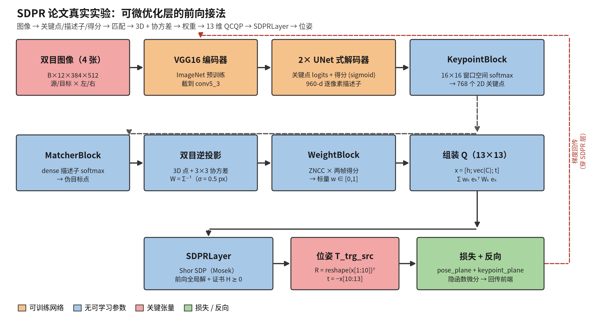

> **结论先行**：SDPR 层本身没有可学习参数，也不是一个“网络”；论文的真实实验里，接在它前面的是
> **VGG16（ImageNet 预训练，截到 conv5_3）+ 两个 UNet 式解码器** 的关键点前端，输出关键点、描述子和
> 得分，经匹配、双目三角化与矩阵权重后，把 **13 维 QCQP** 的 Q 矩阵送进 `SDPRLayer`；前向解 Shor
> SDP，反向做隐式微分，位姿损失穿过该层回传到前端。数据集是 **UTIAS In-The-Dark**（UTIAS Long-Term
> Localization and Mapping Dataset 的夜间子集），论文用 10 万训练 + 2 万验证样本，测试用 runs
> 2/11/16/17/23/28/35。

**如果只记三件事**：

1. **网络** = VGG16 编码器 + 两个 UNet 式解码器（关键点热图、得分），描述子是四层编码器特征拼成的
   960 维；`SDPRLayer` 本身无参数。
2. **接法** = 双目图像 → 关键点/描述子/得分 → 描述子匹配 → 3D 点 + 协方差 → 标量权重 → 13 维
   QCQP → `SDPRLayer`（Mosek）→ 相对位姿；位姿损失经隐函数微分回传。
3. **数据** = In-The-Dark（39 条 260 m 路线、约 30 小时每小时一条、Grizzly 机器人 + Bumblebee XB3
   双目）；数据不在 SDPRLayers 仓库里，要从 ASRL 数据集网站下载。

## 0. 口径

| 项目 | 出处 |
|-|-|
| 论文 | C. Holmes, F. Dümbgen, T. D. Barfoot, *SDPRLayers: Certifiable Backpropagation Through Polynomial Optimization Problems in Robotics*, IEEE T-RO, 2025；[arXiv:2405.19309v3](https://arxiv.org/abs/2405.19309)，DOI [10.1109/TRO.2025.3578228](https://doi.org/10.1109/TRO.2025.3578228) |
| 层代码 | [`utiasASRL/sdprlayer`](https://github.com/utiasASRL/sdprlayer)（SDPR 前向/反向、测试、论文 `_scripts`） |
| 真实管线代码 | [`utiasASRL/deep_learned_visual_features`](https://github.com/utiasASRL/deep_learned_visual_features)，分支 `mat-weight-sdp-version`；本文按 commit `ba66e408` 的 `src/model/sdpr_block.py` 说明（HEAD 缺文件，见 §5） |
| 数据集 | [UTIAS Long-Term Localization and Mapping Dataset](http://asrl.utias.utoronto.ca/datasets/2020-vtr-dataset/)（In-The-Dark / Multiseason） |
| 证据分级 | **论文声称**；**代码核对**（读源码/提交，不运行数值）；**未验证**（未跑训练/测试） |

本页回答的是一句 Feishu 提问：“看一下 SDPR 那篇文章的代码和论文，它的可微分优化层的前向网络是怎么接的，
是个什么网络？数据集是哪里来的？”因此把“网络结构/接法”和“数据来源”分开讲，最后给出代码地图和复现注意。

## 1. 前向链路：从图像到 SDPR 层

### 1.1 一张图



### 1.2 逐段说明

1. **输入**：一次前向吃 4 张双目图（源左/右、目标左/右），张量 `B×12×384×512`；`pipeline.py`
   取其中的左源、左目标两张，变成 `B×6×384×512`。双目视差图 `B×2×384×512` 也一并输入。
2. **VGG16 编码器**：`torchvision` 的 VGG16（ImageNet 预训练），截到 `conv5_3`。五级特征图分别约为
   64@384×512、128@192×256、256@96×128、512@48×64、512@24×32。
3. **两个 UNet 式解码器**：都从 `conv5_3` 开始，逐级双线性上采样、与编码器同级特征拼接、再做
   DoubleConv/TripleConv。一个解码器输出 **关键点 logits**（`B×1×384×512`），另一个输出 **得分**
   （`B×1×384×512`，过 sigmoid）。论文 Fig. 5 把这两个可训练模块标成 “VGG16 network and UNet
   Decoder network”。
4. **描述子**：不是单独的头，而是把编码器四个层级的特征双线性插值回 `384×512` 后按通道拼接：
   `64+128+256+512 = 960` 维，得到 `B×960×384×512` 的逐像素描述子；使用时再 L2 归一化。
5. **关键点提取**（`KeypointBlock`）：把 `384×512` 切成 `16×16` 的窗口（24×32 = **768** 个窗口），
   每个窗口对关键点 logits 做空间 softmax，取坐标期望，得到每帧 `B×2×768` 的 2D 关键点。
6. **采样关键点信息**（`get_keypoint_info`）：在描述子图上双线性采样 `B×960×768` 描述子并在通道维
   L2 归一化；采样得分；用左目视差和双目模型做逆投影，得到相机系 3D 点 `B×4×768` 和有效性掩码。
7. **匹配**（`MatcherBlock`）：源帧 768 个关键点的描述子与**目标帧所有像素**的描述子（`512×384 =
   196,608` 个候选）做点积，除以描述子维度后加 1，再以温度 `0.01` 做 softmax；把目标像素坐标按
   softmax 权重加权平均，得到“伪目标点” `B×2×768`。这是 dense matching；随后在伪目标点处再采样
   目标描述子、得分、视差，得到目标 3D 点。
8. **标量权重**（`WeightBlock`）：源/伪目标描述子的点积（ZNCC 形式）映射到 `[0,2]`，再乘两端的得分，
   得到 `w ∈ [0,1]`、形状 `B×1×768`。
9. **矩阵权重**（`get_inv_cov_weights`）：由双目相机模型（像素噪声 `σ = 0.5 px`，协方差含视差与
   `u` 的相关项）线性化得到每个 3D 点的 `3×3` 协方差，Cholesky 求逆得到 `W = Σ⁻¹`；按平均迹归一化，
   形状 `B×768×3×3`。最终每个匹配的权重是“标量 `w_k` × 矩阵 `W_k`”。
10. **SDPR 层**：`SDPRBlock` 用源 3D 点 `m_k`、目标 3D 点 `ỹ_k`、`W_k`、`w_k` 组装 13×13 的 Q 矩阵
    （`B×13×13`），调用 `SDPRLayer`，用 Mosek 解 Shor SDP；松弛紧时直接读出全局最优的 13 维向量
    `x = [h; vec(C); t]`，还原成 `T_trg_src`，再从传感器系变换到车体系。
11. **损失与反向**：配置 `train_vgg16_sdpr_v3.json` 用 `pose_plane`（平面 x/y/heading 加权）+
    `keypoint_plane`（平面重投影）两项；前 10 个 epoch 只算关键点损失（warm-up）。位姿损失对 `x`
    的梯度经 `SDPRLayer` 的隐函数微分回传到 Q，再回传到关键点/权重，最终训练 VGG16 和两个解码器。

### 1.3 关键张量

| 阶段 | 张量 | 形状 |
|-|-|-|
| 输入（4 张双目） | `images` | `B×12×384×512` |
| 左源 + 左目标 | `images[:, im_channels]` | `B×6×384×512` |
| 关键点 logits / 得分 | `detector_scores` / `scores` | `B×1×384×512` |
| 逐像素描述子 | `descriptors` | `B×960×384×512` |
| 2D 关键点 | `kpt_2D` | `B×2×768` |
| 关键点描述子 | `kpt_desc_norm` | `B×960×768` |
| 3D 点（齐次） | `kpt_3D` | `B×4×768` |
| 伪目标点 | `kpt_2D_pseudo` | `B×2×768` |
| 标量权重 | `weights` | `B×1×768` |
| 逆协方差权重 | `inv_cov_weights` | `B×768×3×3` |
| QCQP 目标矩阵 | `Q` | `B×13×13` |
| SDPR 解向量 | `x` | `B×13` |
| 相对位姿 | `T_trg_src` | `B×4×4` |

## 2. 到底“是个什么网络”

### 2.1 两段式，不要混为一谈

| 段 | 内容 | 是否可训练 | 作用 |
|-|-|-|-|
| 前端 | VGG16 编码器 + 两个 UNet 式解码器 | 是 | 从图像出关键点、描述子、得分 |
| 优化层 | `SDPRLayer`（QCQP / Shor SDP + 隐函数微分） | **否** | 把匹配和权重变成全局最优位姿 |

所以“SDPR 的前向网络”严格说不存在：SDPR 是一个**无参数的可微优化层**，它的“前向”是解一个 SDP；
真正的可学习网络是前面的特征提取器。

### 2.2 VGG16 编码器

- 来源：`torchvision.models.vgg16(weights="DEFAULT")`，ImageNet 预训练；论文说截断在 `conv5_3`。
- 代码把 `features` 切成五段（`layer1`–`layer5`），`layer5` 到 `conv5_3` 为止；训练时整段
  fine-tune，不是冻结特征。
- 输出不是分类 logits，而是五个尺度的特征图；`conv5_3` 的特征同时供两个解码器使用。

### 2.3 UNet 式双解码器

- 结构：`Up` 块 = 双线性上采样（或转置卷积）+ 与编码器同级特征拼接 + 2–3 层 `3×3` 卷积 +
  BatchNorm + ReLU；最后 `1×1` 卷积出单通道。
- 两个解码器权重独立：`up1_pts`–`outc_pts` 出关键点热图，`up1_score`–`outc_score` 出得分。
- 关键点热图不过 sigmoid（空间 softmax 在 `KeypointBlock` 里做）；得分过 sigmoid。
- 这一套来自 Gridseth & Barfoot 的 RAL 2022 管线；SDPR 论文的改动是**把编码器换成 VGG16**，并把
  末端的 SVD 位姿估计换成矩阵加权的 `SDPRLayer`。为公平比较，基线（SVD）也换成同样的 VGG16。

### 2.4 描述子

- 四层编码器特征（`conv1_2`/`conv2_2`/`conv3_3`/`conv4_3` 级别）插值到原图大小后拼接，960 维。
- 用逐像素描述子做 dense matching：源帧 768 个关键点各对目标帧 196,608 个像素做 softmax，因此
  匹配是“软”的、可微的；不是先检测再暴力最近邻。
- 代码里有一处过时注释写 `Bx248xHxW`，那是早期 UNet 版本的通道数；VGG16 版本实际是 960，以
  `UNetVGG16.forward` 的 `torch.cat([f1, f2, f3, f4], dim=1)` 为准。

### 2.5 训练设置（论文与配置对照）

| 项 | 论文 | 配置 `train_vgg16_sdpr_v3.json` |
|-|-|-|
| epoch | 30 | `max_epochs: 30` |
| 每 epoch 样本 | 10,000 | `num_samples_train: 10000` |
| 优化器 / lr | Adam / `1e-4` | Adam / `0.0001` |
| 位姿损失 warm-up | 前 10 epoch 只用关键点损失 | `start_pose_estimation: 10` |
| 关键点窗口 | 未在正文展开 | `window_h/w: 16` |
| 匹配 | 描述子匹配 | `dense_matching: true` |
| 权重 | 矩阵权重 × 标量权重 | `use_inv_cov_weights: true`，`detach_weights: false` |
| 位姿层 | SDPR + Mosek | `localization: "sdpr"` |

## 3. SDPR 层是怎么接的

### 3.1 它接收什么

`pipeline.py` 在算完匹配、3D 点和权重后，按 `localization` 配置调用：

```python
T_trg_src = self.sdpr_block(kpt_3D_src, kpt_3D_pseudo, weights, inv_cov_weights)
```

`SDPRBlock` 的接口是 `(keypoints_3D_src, keypoints_3D_trg, weights, inv_cov_weights)`。它内部：

1. 把每个匹配的误差写成 `e_k = ỹ_k − C(m_k + t)`；
2. 用 `W_k` 加权、`w_k` 缩放，组装成齐次 QCQP：

```text
min_{C,t}   Σ_k  w_k · e_kᵀ W_k e_k
s.t.        C ∈ SO(3)
```

3. 把 `C` 展成 9 维、`t` 3 维，加一个齐次变量 `h`，得到 13 维 `x = [h; vec(C); t]`；目标矩阵
   `Q` 是 13×13，满足 `xᵀ Q x = Σ_k w_k e_kᵀ W_k e_k`。
4. 调用 `SDPRLayer(n_vars=13, constraints=constraints)`；约束由 6 个正交约束、9 个 handedness 约束、
   9 个行列范数约束组成（共 24 个；发布版 `SDPPoseEstimator` 把后 18 个标为冗余约束）。
5. `SDPRLayer` 前向解 Shor 松弛（`X ⪰ 0` 的 SDP），Mosek 作为内层求解器，调用形如
   `X, x = self.sdprlayer(Qs, solver_args={"solve_method": "mosek", ...})`；返回 `X` 和秩一解 `x`。
6. 从 `x` 取出 `C`、`t`：`R = reshape(x[1:10]).T`，平移取反，拼成 `T_trg_src`，再用 `T_s_v`
   从传感器系换到车体系。

### 3.2 前向与反向

- **前向**：解 SDP 松弛；松弛紧（rank-1）时，`x` 就是原非凸 QCQP 的全局最优解，同时得到对偶证书
  `H ⪰ 0`。论文的保证是“tight + 正则条件 ⇒ 前向全局最优、反向 Jacobian 是全局最优解的 Jacobian”。
- **反向**：不展开 SDP 迭代，也不对松弛解做 autograd；用 QCQP 的 KKT 条件做隐函数微分（默认
  SDPR-IS，复用 SDP 求解顺带得到的乘子和证书矩阵）。因此梯度可以穿过这一层回到 Q，再回到
  关键点、权重和前端网络。
- **数值**：管线把默认 dtype 设为 `float64`（`run_pipeline.py`），SDPR 层在 CPU 上调用 Mosek；
  这也是它比 SVD 慢、但能给出矩阵加权全局解的原因。
- **紧性风险**：若松弛不紧，`SDPRLayer` 的秩一解为 `None`，管线需要退回 SDP 解或局部解；论文的
  位姿问题（P6）在实验中被认为有紧松弛，但复现时仍应显式检查 rank-1/证书，而不是假定一定紧。

## 4. 数据集是哪里来的

### 4.1 真实实验：UTIAS In-The-Dark

| 项 | 事实 |
|-|-|
| 全称 | UTIAS Long-Term Localization and Mapping Dataset（网页路径 `2020-vtr-dataset`） |
| 子集 | **In the Dark**（夜间/光照变化子集）；另有 Multiseason 子集，本文实验未用 |
| 采集 | 多伦多大学航空航天研究院（UTIAS ASRL）；Visual Teach & Repeat（VT&R） |
| 平台 | Clearpath Grizzly 机器人 + Point Grey Bumblebee XB3 双目相机（基线 0.24 m，512×384） |
| 规模 | In the Dark：39 条 runs，260 m 闭环，约 30 小时内每小时一条；两个数据集合计 159,549 对双目图 |
| 采集频率 | 双目视频 16 Hz，关键帧约每 0.2 m 一帧；夜间开前灯 |
| 真值 | VT&R 的 Multi-Experience Localization（MEL）把每帧对齐回 Teach run，给出相对位姿 |
| 特点 | 一天内完整光照循环、太阳眩光、黄昏/黎明阴影、建筑/围栏/道路/植被混合场景 |

论文的使用方式（§VI-C）：

- **训练**：100,000 个训练样本 + 20,000 个验证样本，均来自 In-The-Dark；30 epoch，每 epoch 10,000
  样本；VGG16 从 ImageNet 权重 fine-tune，解码器从零训练。
- **测试**：使用 runs **2、11、16、17、23、28、35** 的所有源-目标组合，且这些 run 不参与训练/验证；
  另外构造了一个更难的测试集，强制源-目标相对位移 > 0.5 m 或旋转 > 4°。
- **结果**：论文 Table VI/VII 报告矩阵加权 SDPR 的纵向/横向误差低于 SVD 基线（例如普通测试集
  0.125/0.049 m → 0.035/0.021 m；这些是**论文声称**，本页未复现）。

### 4.2 数据怎么拿到

1. 图像与位姿：从 ASRL 数据集网站下载（http://asrl.utias.utoronto.ca/datasets/2020-vtr-dataset/），
   按 run 组织，页面提供每对双目图的相对变换文本。
2. 采样 id 与标签：`deep_learned_visual_features` 仓库的 `download_datasets.sh` 会从 Google Drive
   下载已经生成的训练/验证/测试样本 id 与位姿标签；图像仍需单独下载。
3. 重新生成：`python -m data.build_train_test_dataset_loc --config config/data.json`，从 VT&R 位姿图
   采样图像对；`config/data.json` 里就是本文用到的 100k/20k 与 test runs 配置。

### 4.3 仿真实验的数据

论文还有两组不依赖外部数据集的实验：

- **多项式 toy 例**（§VI-A）：随机生成的低阶多项式 QCQP，用来展示局部求解器会困在局部极小；
- **双目定位/标定仿真**（§VI-B）：8×8 特征网格（1 m×1 m，原点），相机随机放在半径 3 m、90° 锥内；
  标定实验再随机扰动 baseline。数据由 `_scripts/poly6_example.py`、`_scripts/stereo_cal.py` 生成。

所以“数据集哪里来的”要分两种：真实关键点实验用 In-The-Dark；仿真实验的数据是脚本现场生成的，没有
外部数据集。

## 5. 代码地图与复现注意

### 5.1 两个仓库各管什么

| 仓库 / 路径 | 内容 |
|-|-|
| `sdprlayer/src/sdprlayers/layers/sdprlayer.py` | `SDPRLayer`：QCQP→SDP、前向求解、隐函数反向 |
| `sdprlayer/src/sdprlayers/layers/pose_est.py` | `SDPPoseEstimator`：13 维矩阵加权位姿 QCQP 的封装（可直接复用） |
| `sdprlayer/_test/` | 多项式、位姿、本质矩阵等单元测试 |
| `sdprlayer/_scripts/` | 论文的 toy / 标定仿真脚本 |
| `deep_learned_visual_features/src/model/unet.py` | `UNetVGG16`：VGG16 编码器 + 两个解码器 + 960 维描述子 |
| `.../src/model/keypoint_block.py` | 16×16 窗口空间 softmax → 768 关键点 |
| `.../src/model/matcher_block.py` | dense 描述子 softmax → 伪目标点 |
| `.../src/model/weight_block.py` | ZNCC × 得分 → 标量权重 |
| `.../src/utils/keypoint_tools.py` | 关键点采样、逆协方差权重 |
| `.../src/model/pipeline.py` | 整条管线、损失、RANSAC/GT 外点剔除 |
| `.../src/model/sdpr_block.py`（旧版） | 13 维 QCQP + `SDPRLayer` + Mosek（论文管线使用） |
| `.../config/train_vgg16_sdpr_v3.json` | 论文对应的训练配置 |

### 5.2 一个具体的上游坑：HEAD 缺 pose_sdp_block.py

`mat-weight-sdp-version` 分支的 HEAD（`a9f0dc2`，提交信息 “renamed sdpr block for clarity.”）把
`src/model/sdpr_block.py` 删掉了，`pipeline.py` 和 `_test/test_pose_est.py` 改成 `from
src.model.pose_sdp_block import PoseSDPBlock`，但仓库里**没有提交** `pose_sdp_block.py`。直接 clone
HEAD 会在 import 阶段失败。

复现时有两个选择：

1. 用 `ba66e408`（删除前的最后一个可用提交）的 `src/model/sdpr_block.py`，把 import 改回
   `sdpr_block.SDPRBlock`；或
2. 直接用 `sdprlayer` 包里的 `SDPPoseEstimator` 替换 `PoseSDPBlock`，接口基本一致
   （`(keypoints_3D_src, keypoints_3D_trg, weights, inv_cov_weights)`）。

### 5.3 其它容易踩的点

- `redun_list` 差异：发布版 `SDPPoseEstimator` 显式把 6 之后的 18 个约束标为冗余；旧版
  `sdpr_block.py` 没有传 `redun_list`。README 明确警告“冗余约束识别错误会导致梯度错误”，复现时
  建议按发布版设置并对梯度做有限差分抽查。
- **dense matching 的代价**：768 个源关键点 × 196,608 个目标像素的 softmax，显存/时间都不小；
  论文的配置是每 batch 1 个样本。
- **描述子维度**：以代码的 960 为准，不要被 `unet.py` 里旧的 `248` 注释误导。
- **训练成本**：论文用 V100，30 epoch × 10k 样本；SDPR 前向/反向在 CPU，Mosek 需要 license。
- **权重是否 detach**：`train_vgg16_sdpr_v3.json` 是 `detach_weights: false`（梯度会穿过逆协方差
  权重）；如果改成 `true`，实验含义会变，比较时不要混。
- `diff_qcqp` 默认值：发布版 `SDPPoseEstimator` 默认 `diff_qcqp=False`（SDPR-SDP，反向对 SDP 的
  KKT 微分）；论文管线旧版 `SDPRBlock` 用 `SDPRLayer` 默认 `diff_qcqp=True`（SDPR-IS，复用乘子/证书）。
  复现时先对齐这个开关，否则梯度与耗时都会不同。

## 6. 未验证与边界

- 本页的架构、张量形状、数据划分均来自**读论文 + 读代码**，没有实际下载 In-The-Dark、没有 Mosek
  license、没有跑训练/测试；Table VI/VII 的数字是**论文声称**，不是本页复现结果。
- “SDPR 层无参数”是代码事实（`SDPRLayer` 只做优化与微分），但“端到端训练一定优于基线”是论文
  结论，依赖具体数据与训练细节。
- 数据集网页与仓库 README 对规模的描述存在口径差异（39 runs / 159,549 对是网页口径）；论文只
  报告了自己采样的 100k/20k，不矛盾但不要混用。
- 代码在持续变动；本文固定到 `ba66e408` 与 `sdprlayer` 当前 main 的 `pose_est.py`，后续提交可能
  已修复 `pose_sdp_block.py` 缺失问题。

## 参考

1. C. Holmes, F. Dümbgen, T. D. Barfoot. *SDPRLayers: Certifiable Backpropagation Through
   Polynomial Optimization Problems in Robotics.* IEEE T-RO, 2025.
   [arXiv:2405.19309](https://arxiv.org/abs/2405.19309) ·
   [DOI](https://doi.org/10.1109/TRO.2025.3578228)
2. `utiasASRL/sdprlayer`：[github.com/utiasASRL/sdprlayer](https://github.com/utiasASRL/sdprlayer)
3. `utiasASRL/deep_learned_visual_features`（`mat-weight-sdp-version` 分支）：
   [deep_learned_visual_features（mat-weight-sdp-version）](https://github.com/utiasASRL/deep_learned_visual_features/tree/mat-weight-sdp-version)
4. UTIAS Long-Term Localization and Mapping Dataset：
   [asrl.utias.utoronto.ca/datasets/2020-vtr-dataset](http://asrl.utias.utoronto.ca/datasets/2020-vtr-dataset/)
5. M. Gridseth, T. D. Barfoot. *Keeping an Eye on Things: Deep Learned Features for Long-Term
   Visual Localization.* IEEE RA-L, 7(2):1016–1023, 2022.
   [arXiv:2109.04041](https://arxiv.org/abs/2109.04041)
