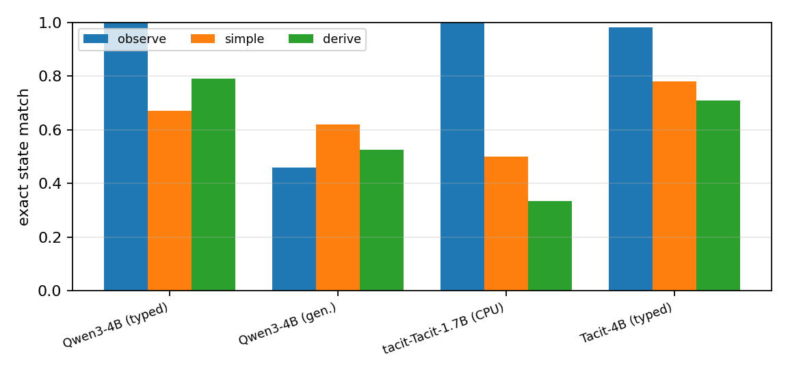
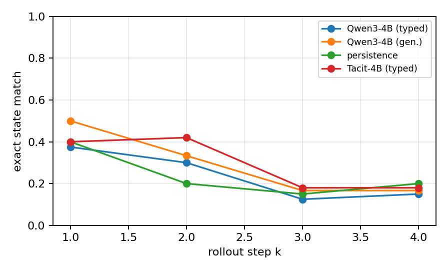

# 04 预实验一：JEV 世界模型的一步/四步精度与成本

> **结论先行**：Tacit-4B 一步精确匹配 **0.754**，Qwen3-4B typed **0.790**，生成式 **0.540**，persistence **0.745**。读状态很强（observe 0.981–1.000），推后果变弱（derive 0.709–0.791），4 步开环降到 **0.15–0.18**。所有数字为**本实验独立复现**，不是 KIIS 的数字。

**如果只记三件事**：

1. 设置：24 个未见词表测试世界、1,683 条引擎标注转移、7 个状态变量 + 1 个「是否执行」问题。
2. 指标：一步精确匹配、按动作类型（observe/simple/derive）拆分、4 步开环 rollout、每样本延迟。
3. 对照：Tacit-4B、Qwen3-4B typed readout、Qwen3-4B 生成式、persistence。

## 0. 口径

| 项 | 设置 |
|-|-|
| 环境 | 自建确定性文本网格世界（两房间、门/箱子/钥匙/目标食物/诱饵），非 TextWorld 本体；规则见 `jev-wm/jevwm/world.py` |
| 训练/验证/测试 | 40 / 4 / 24 个世界；世界按词表拆分，测试世界物体名未在训练中出现 |
| 转移数 | 2,727 / 289 / 1,683 |
| 采样 | 随机游走 + 解路径分支；每个状态问 3 个可执行动作 + look + 4 个不可执行动作 |
| 问题 | 8 个/转移：是否执行 + 玩家房间/钥匙/苹果/蘑菇位置/门/箱子/持有物 |
| 选项 | 每个变量枚举所有类型合法值（位置 5、门 3、箱子 2、持有 8、房间 2） |
| 模型 | Tacit-4B（AnyJev 自蒸馏，冻结）；Qwen3-4B-Instruct-2507 typed readout（AnyJev raw，零样本）；Qwen3-4B 生成式（JSON，零样本）；persistence |
| 硬件 | RTX 5090 32GB，Slurm 单卡 |

**证据分级**：本页所有模型数字为「独立复现」；KIIS 的 93.4% 等为「论文声称」，仅作对照，不混入本表。

---

## 1. 为什么这样设计

KIIS 2026 的核心操作是：**不问「下一状态是什么」，而问「下一状态里每个变量取哪个选项」**。这样做的好处是输出格式不会坏、概率可读；代价是选项必须覆盖真值，且变量要能枚举。

我们把同一操作搬到一个更小、更可控的世界里，原因有三：

1. 可以在**同一候选集、同一预算**下比较不同模型，而不是拿不同论文的数字对比；
2. 可以按动作类型拆分误差：`look` 只需读当前状态（observe），`open_box` 是单步简单规则（simple），`take/unlock/go` 需要检查前置条件（derive）。这直接检验 JEV-as-a-Judge 提出的「可读出 vs 需推导」边界[15]；
3. 可以测 4 步开环 rollout——把模型自己的预测喂回去，观察误差累积。

## 2. 结果

<!-- EXP1_TABLE_START -->
| 模型 | 一步精确匹配 | 执行判断 | 变量宏平均 | observe | simple | derive | 4 步精确匹配 | 延迟/样本 |
|-|-|-|-|-|-|-|-|-|
| Qwen3-4B (typed) | 0.790 | 0.703 | 0.966 | 1.000 | 0.671 | 0.791 | 0.150 | 107.8 ms |
| Qwen3-4B (gen.) | 0.540 | 0.740 | 0.881 | 0.459 | 0.620 | 0.526 | 0.167 | 338.7 ms |
| persistence | 0.745 | 0.620 | 0.950 | — | — | — | 0.200 | 0.0 ms |
| tacit-Tacit-1.7B (CPU) | 0.500 | 0.667 | 0.905 | 1.000 | 0.500 | 0.333 | — | 6657.0 ms |
| Tacit-4B (typed) | 0.754 | 0.696 | 0.952 | 0.981 | 0.781 | 0.709 | 0.180 | 105.8 ms |
<!-- EXP1_TABLE_END -->

图 1/2 见 `results/figures/`。

## 3. 解释与限制

**主结果（Tacit-4B，500 条测试转移）**：一步精确匹配 **0.754**，执行判断 **0.696**，变量宏平均 **0.952**；按动作类型：observe **0.981**、simple **0.781**、derive **0.709**。开环 rollout 的精确匹配从 1 步 **0.40** 掉到 4 步 **0.18**，说明误差会累积；真实使用必须每步重规划。500 条转移耗时 52.9s（约 75.6 次决策/s），按 JEV API 单价估算约 **$0.036 / 1,000 条转移**。

**与基线对比**：persistence（状态不变）一步精确匹配 **0.745**，Tacit-4B **0.754**，Qwen3-4B typed readout **0.790**，生成式 Qwen3-4B **0.540**。Tacit-4B 只比 persistence 高 0.009，原因是 500 条转移里有 318 条是「执行失败、状态不变」，persistence 天然答对；在真正执行的转移上，Tacit-4B 精确匹配 **0.566**（182 条），Qwen3-4B typed 为 **0.481**（154 条），persistence 为 0。Qwen 的整体精确匹配更高，主要来自更好的「执行判断」和玩家房间/变量一致性；Tacit 在执行后的状态效果上略好。生成式的执行判断更高（0.740），但状态内容更差，说明「会判断能不能执行」不等于「会预测执行后的状态」。

**先看动作类型**。`observe`（look）只需要把当前状态读出来；`simple`（open）需要应用一条单步规则；`derive`（take/unlock/go）需要检查前置条件并组合多条规则。如果 observe 高、derive 低，说明模型的主要瓶颈不是「读状态」而是「推后果」，这与 JEV-as-a-Judge 的边界一致[15]。

**再看规模**。我们在 CPU 上跑了一个 6 条转移的 Tacit-1.7B 探针（表 2）：observe 1.00、simple 0.50、derive 0.33，overall 0.50。它暴露了典型失败：模型回答 `open_box`「执行成功」，但箱子状态仍预测为 closed——它知道动作会发生，却没有把效果写进状态。4B 是否修复这一点，是表 1 要回答的。

**最后看误差累积**。开环 rollout 把模型自己的预测喂回去；如果 4 步后精确匹配明显低于 1 步，说明错误会沿轨迹放大，实际使用必须每步重规划或加置信度升级。

**与 KIIS 的关系**。KIIS 在 TextWorld 上报告 JEV 4 步 77.9%、生成式 6.2%、persistence 15.6%；我们的世界与问题集不同，数字不能直接对比，但可以检验同一机制是否在另一个 harness 上复现。KIIS 的 JEV 是托管模型，我们的是开放代理；如果代理明显更差，说明「模型质量」而不是「机制」是瓶颈。

- 本实验是**开放代理**，不是托管 JEV；Tacit/Qwen 的零样本能力不能直接等同于 JEV。
- 世界是确定性、完全可观测的；真实 agent 环境有随机性、部分可观测、开放状态。
- 测试世界只是换词表，结构相同；新结构泛化未测。
- 生成式基线的解析失败处理会影响结果；我们采用「解析失败=按当前状态不变」的保守规则，并单独报告 parse fail 率。

