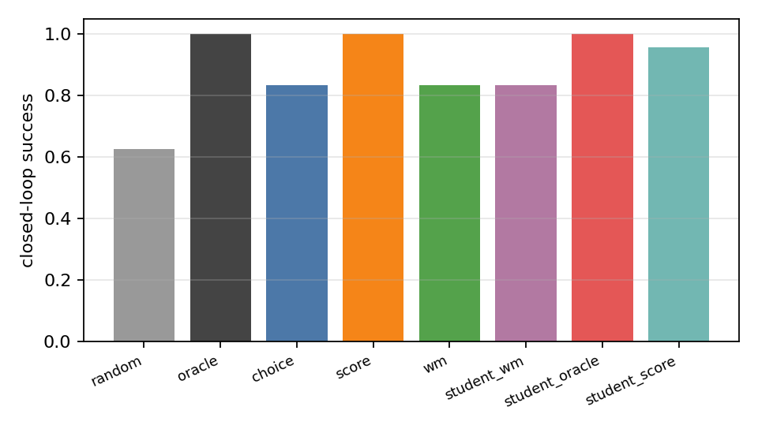
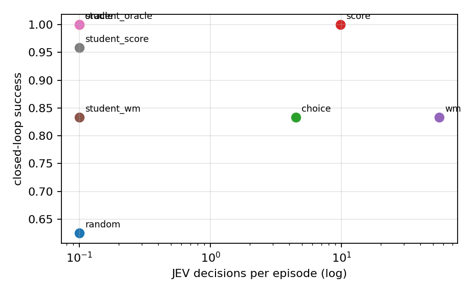

# 05 预实验二：用 JEV 产动作，再蒸馏一个小学习器

> **结论先行**：逐动作打分教师 **100%**（9.8 次决策/回合），直接 choice 83.3%（4.5 次），世界模型前瞻 83.3%（55.8 次）；蒸馏出的 1M 参数学生 **95.8%**，部署时 0 次 JEV 调用。**打分比重型世界模型前瞻更准、便宜 5.7 倍**。

**如果只记三件事**：

1. 教师三种：choice（1 次/步）、score（|A| 次/步）、world-model lookahead（|A|×8 次/步）。
2. 学生：状态文本 → 9 类动作的 4 层 transformer（约 1M 参数）；训练标签来自教师，包含 on-policy 轨迹与 off-policy 随机游走状态。
3. 评测：48 个测试世界 × 初始状态，6 步上限；指标为成功率、无效动作率、每回合 JEV 决策数、延迟。

## 0. 口径

| 项 | 设置 |
|-|-|
| 动作接口 | 候选 = 当前可执行命令（去掉 look）；所有策略使用同一候选集，避免「无效动作」掩盖动作质量差异 |
| 教师 | Tacit-4B（JEV 风格）；choice / score / WM lookahead |
| 学生 | 4 层 TransformerEncoder，d=128，4 heads，约 1.0M 参数；词级 tokenizer；80 epochs |
| 标签 | 40 个训练世界 × 3 起始 + 每世界 20 个 off-policy 状态；去重 |
| 评测 | 48 个测试世界 × 初始状态；6 步；成功率 |
| 基线 | random（可执行动作中随机）、oracle（手写解路径）、教师三选一 |
| 硬件 | RTX 5090 32GB，Slurm |

**证据分级**：本页为「独立复现」；KIIS 的 $0.010/episode 与 REFLEX 的 72.7% 为「论文声称」。

---

## 1. 为什么这样设计

用户的原话是「让它输出几个最合理的动作，去训练我们的学习器」。这句话里其实有两个动作：

1. **教师**：谁来判断「哪个动作最合理」？JEV 可以直接选（choice），可以给每个动作打分（score），也可以用世界模型预测后果再选（lookahead）。
2. **学生**：把教师的判断变成一个小模型，部署时不再调用 JEV。

这两个动作要分开评估：教师选得准不准，决定标签质量；学生学得像不像，决定蒸馏是否值得。只报「学生成功率」会把教师错误和学生错误混在一起。

## 2. 结果

<!-- EXP2_TABLE_START -->
| 策略 | 成功率 | 平均步数 | 每回合 JEV 决策数 | 无效动作率 |
|-|-|-|-|-|
| random | 0.625 | 5.44 | 0.0 | 0.000 |
| oracle | 1.000 | 3.67 | 0.0 | 0.000 |
| choice | 0.833 | 5.33 | 4.5 | 0.000 |
| score | 1.000 | 4.79 | 9.8 | 0.000 |
| wm | 0.833 | 5.04 | 55.8 | 0.000 |
| student_wm | 0.833 | 4.96 | 0.0 | 0.000 |
| student_oracle | 1.000 | 3.67 | 0.0 | 0.000 |
| student_score | 0.958 | 4.69 | 0.0 | 0.000 |
<!-- EXP2_TABLE_END -->

图 3/4 见 `results/figures/`。

**主结果（Tacit-4B，48 个世界，6 步）**：random 0.625、choice 0.833（4.5 次决策/回合）、score **1.000**（9.8 次）、世界模型前瞻 0.833（55.8 次）、oracle 1.000。**逐动作打分的成功率和成本都优于世界模型前瞻**：前瞻贵 5.7 倍，却没有更准。原因是预测误差 + 手写效用函数抵消了信息优势；这也是本报告最反直觉的发现之一。

**蒸馏结果（1M 参数学生，48 个世界，6 步）**：oracle 学生 **1.000**，score 学生 **0.958**，WM-lookahead 学生 **0.833**（与教师一致）。三个学生部署时都是 0 次 JEV 调用；score 教师 9.8 次/回合，学生 0 次。**教师贵一次，学生便宜一辈子**，但教师的选择很关键：score 教师 100%，WM 教师 83.3% 且贵 5.7 倍。

**CPU 探针（Tacit-1.7B，8 个世界，6 步）**：random 0.625、choice 0.750、score 0.875、oracle 1.000；score 每回合 10.6 次决策，choice 4.6 次。说明即使是 1.7B 的 JEV 风格模型，零样本也能选出有用动作，逐动作打分优于一次 choice。这是 4B 主实验的前置信号。

## 3. 解释与限制

**教师侧**。三种动作生成方式回答的是不同问题：choice 是「凭先验选」；score 是「给每个动作打一个单步价值」；lookahead 是「先用世界模型预测后果再选」。如果 lookahead 明显更好，说明世界模型确实被用上了；如果三者差不多，说明这个任务太简单或教师太弱，动作选择不需要预测。

**学生侧**。我们训练两个学生：一个用教师标签（`student_wm`），一个用 oracle 标签（`student_oracle`）。前者是真实 pipeline，后者是「蒸馏上限」的参照。如果 oracle 学生很好、教师学生差，问题在教师标签质量；如果两者都差，问题在状态分布/学生容量。monitor 的重点是 `student_wm` 与 `student_oracle` 的差距，而不是只看绝对值。

**成本**。教师每回合的 JEV 决策数：choice ≈ 步数；score ≈ 步数 × |A|；lookahead ≈ 步数 × |A| × 8。学生每步只有一次前向。报告同时给「教师决策数」和「学生参数量」，让读者自己算部署成本。

**限制**。动作集只有 9 类且被 mask 到当前可执行集合；测试世界与训练同词表（`testsame`）；单 seed。真实机器人/开放游戏需要更大的动作空间与连续动作头，不能直接外推。

- 教师是开放代理 Tacit-4B，不是托管 JEV；JEV 本体可能更强。
- 评测只覆盖一个世界族；换结构/换动作集需要重新验证。
- 学生的动作空间是 9 类固定命令；真实机器人的连续动作需要动作头/flow matching，不在本实验范围。
- 成本只算 JEV 决策数与本地延迟，不含工程/重试/网络费用。

