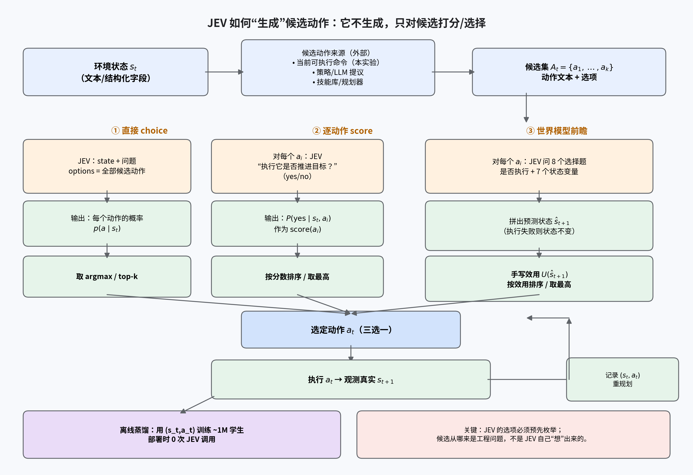

# 10 JEV 如何生成候选动作：端到端输入输出流程

> **结论先行**：JEV **不生成候选动作**。候选集由外部系统提供（当前可执行命令、策略/LLM 提议、技能库、规划器），JEV 只做「给定 state + 问题 + 选项 → 每个选项的概率」的打分与选择。所谓「让 JEV 输出动作」，准确说是：**先把动作枚举成 options，再让 JEV 对 options 排序/取 top-k**。

**如果只记三件事**：

1. 候选来源是工程问题：本实验用「当前可执行命令」，真实系统可以用策略/LLM/技能库；JEV 不会凭空发明动作。
2. 三种用法：① 直接把动作列表当 options，读概率；② 对每个动作问「是否推进目标」的 yes/no，按概率排序；③ 对每个动作问 8 个状态转移选择题，拼出预测状态再用效用排序。
3. 输出不是文本：是 `{option: probability}`；选 `argmax` 或 `top-k`，执行后再从真实状态重规划。

## 0. 口径

| 项 | 说明 |
|-|-|
| 本文的 JEV | TypeSafe 的 System One 决策模型；输入 state + typed questions，输出选项概率 |
| 本文的代理 | Tacit-4B / Tacit-1.7B（AnyJev 自蒸馏，开源）；接口契约与 JEV 一致 |
| 动作空间 | 本实验 9 类文本命令（go/open/take/unlock/look） |
| 候选集 | 当前可执行命令，去掉 `look`；只有一个候选时直接执行，不调用 JEV |

---

## 1. 端到端流程（对应图 5）



1. **观测状态 \(s_t\)**：环境给出一段文本/结构化 state，例如「你在 rotunda，黑曜石箱关着，门锁着，玉钥匙在箱子里，手里没东西」。
2. **构造候选集 \(A_t\)**：外部系统给出 \(k\) 个动作文本。本实验是「当前可执行命令」；生产系统可以是策略网络提议、LLM 生成、技能库枚举、规则模板。**这一步不经过 JEV。**
3. **构造 typed question**：把「选哪个动作」或「这个动作会怎样」写成 JEV 能回答的选择题；选项就是候选动作或状态变量的可能取值。
4. **调用 JEV**：一次请求可包含多个问题；返回每个问题的选项概率。无文本生成、无解析。
5. **选动作 \(a_t\)**：直接 `argmax`、top-k，或按分数/效用排序。
6. **执行并观测**：环境执行 \(a_t\)，返回真实 \(s_{t+1}\)；记录 \((s_t,a_t)\)。
7. **重规划**：每步从真实状态重新构造候选与问题；不要把多步预测一路开环跑到底。
8. **离线蒸馏（可选）**：把 \((s_t,a_t)\) 日志蒸进 ~1M 学生；部署时只跑学生，不再调用 JEV。

## 2. 三条路：真实输入/输出（Tacit-1.7B 实测）

以下示例来自本仓库 `results/example_flow.json`，是**真实模型输出**（1.7B CPU 探针），不是示意数字。

### 2.1 直接 choice：一次请求，选项=候选动作

**输入**（AnyJev / Tacit 接口，JEV API 等价于 `type=choice` + `criteria`）：

```json
{
  "state": "You are in the rotunda. ... You are holding nothing.",
  "question": "Which command should the agent execute next to achieve the goal?",
  "options": [
    "open the obsidian casket",
    "take the crimson fig from the ebony console",
    "take the violet shroom from the ebony console"
  ],
  "kind": "choice"
}
```

**输出**：

```json
{
  "answer": "open the obsidian casket",
  "probs": {
    "open the obsidian casket": 0.911,
    "take the crimson fig from the ebony console": 0.058,
    "take the violet shroom from the ebony console": 0.031
  }
}
```

> 这是 Tacit-1.7B 的真实输出（`results/example_flow.json`）；`answer` 是 argmax，`probs` 是完整分布。

**特点**：1 次决策/步；最便宜；没有显式预测后果。

### 2.2 逐动作 score：每个候选问一个 yes/no

**输入**（对每个候选动作各一次；共享同一 state）：

```json
{
  "state": "You are in the rotunda. ... Goal: Get to the crypt while holding the crimson fig, with the onyx gate open.",
  "question": "Would executing `take the crimson fig from the ebony console` next make progress toward the goal?",
  "options": ["Yes", "No"],
  "kind": "noul"
}
```

**输出**：

```json
{"answer": "Yes", "probs": {"Yes": 0.852, "No": 0.148}}
```

同一状态下三个候选的 `P(Yes)` 是：`open the obsidian casket` **0.562**、`take the crimson fig` **0.852**、`take the violet shroom` **0.321**；score 会选「拿无花果」，与 choice 的「开箱子」不同。

把每个动作的 `P(Yes)` 当分数，排序取最高。**特点**：\(|A_t|\) 次决策/步；比一次 choice 更细；仍然是单步启发式，不做多步预测。

### 2.3 世界模型前瞻：每个候选问 8 个状态转移问题

**输入**（对每个候选动作 \(a_i\)，问「执行后是否执行 + 7 个状态变量」）：

```json
{
  "state": "You are in the rotunda. ...",
  "question": "After the command `open the obsidian casket` is attempted, what is the state of the obsidian casket?",
  "options": ["closed", "open"],
  "kind": "choice"
}
```

8 个问题分别是：`executes`（yes/no）、`player_room`、`key_location`、`apple_location`、`mushroom_location`、`door_mode`、`box_mode`、`holding`。

**输出**：

```json
{
  "executes": "Yes",
  "player_room": "rotunda",
  "key_location": "inside the obsidian casket",
  "apple_location": "on the ebony console",
  "mushroom_location": "on the ebony console",
  "door_mode": "locked",
  "box_mode": "closed",
  "holding": "the jade token"
}
```

这个真实输出暴露了典型错误：动作是「开箱子」，模型却说 `box_mode=closed`，还把 `holding` 预测成「玉钥匙」（当前是空手）。用这样的 \(\hat s_{t+1}\) 算效用，前瞻可能反而选错——这正是 Exp2 里世界模型前瞻没有跑赢逐动作打分的原因之一。

把 argmax 拼成预测状态 \(\hat s_{t+1}\)，再用效用函数（目标达成 + 进度 − 无效动作惩罚）排序。**特点**：\(|A_t|\times 8\) 次决策/步；最贵；真正用上了世界模型，但预测误差会直接变成错误动作。

## 3. 候选动作到底从哪来？

| 来源 | 例子 | 优点 | 风险 |
|-|-|-|-|
| 环境可执行命令 | 本实验：`admissible_actions(state)` 去掉 `look` | 保证合法、集合小 | 只适用于有动作接口的环境 |
| 策略网络提议 | 小策略/PPO 给出 top-k | 与现有系统兼容 | 策略偏差会限制 JEV |
| LLM 提议 | 让强 LLM 生成候选动作 | 开放、可组合 | 需要解析/去重/合法性检查 |
| 技能库/规划器 | 预定义技能、HTN、PDDL | 可解释、可验证 | 覆盖有限 |
| JEV 自己 | **不行**：JEV 只能在给定 options 上打分 | – | 不能发明未枚举的动作 |

> 如果动作空间是开放的（自然语言命令、机器人连续动作），正确做法是「外部提议 + JEV 排序」，或者用 JevSpawn 这类把动作空间动态展开的工作；不要让 JEV 直接「生成」动作文本。

## 4. 本实验的实际代码路径

| 步骤 | 代码 |
|-|-|
| 候选集 | `jevwm/world.py::admissible_actions`；`jevwm/policies.py::BasePolicy.candidates` |
| 直接 choice | `jevwm/questions.py::policy_question` + `ChoicePolicy` |
| 逐动作 score | `progress_question` + `ScorePolicy` |
| 世界模型前瞻 | `transition_questions` + `WorldModelPolicy` + `TacitBackend.predict_transitions` |
| 执行/闭环 | `jevwm/policies.py::run_episode`；`scripts/exp2_teachers.py` |
| 蒸馏 | `scripts/collect_labels.py` / `scripts/exp2_train.py` / `jevwm/student.py` |

## 5. 常见坑

1. **候选里没有真值**：JEV 只能在选项里选；选项设计错了，答案必错。
2. **把「是否执行」和状态变量混在一个问题里**：KIIS 实测会漂移（0.285 → 0.576），应单独问。
3. **动作集太大**：一次 choice 的准确率会随 \(|A_t|\) 下降；>20 个动作时优先用 score/前瞻或分层筛选。
4. **不重规划**：4 步开环精确匹配会掉到 0.15–0.18；每步从真实状态重来。
5. **不做合法性过滤**：本实验把候选 mask 到可执行集合；否则无效动作率会掩盖动作质量差异。
6. **把 JEV 当生成模型**：它不生成文本/动作，只输出选项概率；需要生成时用 LLM，JEV 只做判断。

## 6. 一句话总结

**JEV 的动作生成 = 外部枚举候选 + JEV 打分/选择 + 执行后重规划（+ 可选蒸馏）。** 它不负责「想出」动作，负责「在候选里选得便宜、稳、带概率」。
