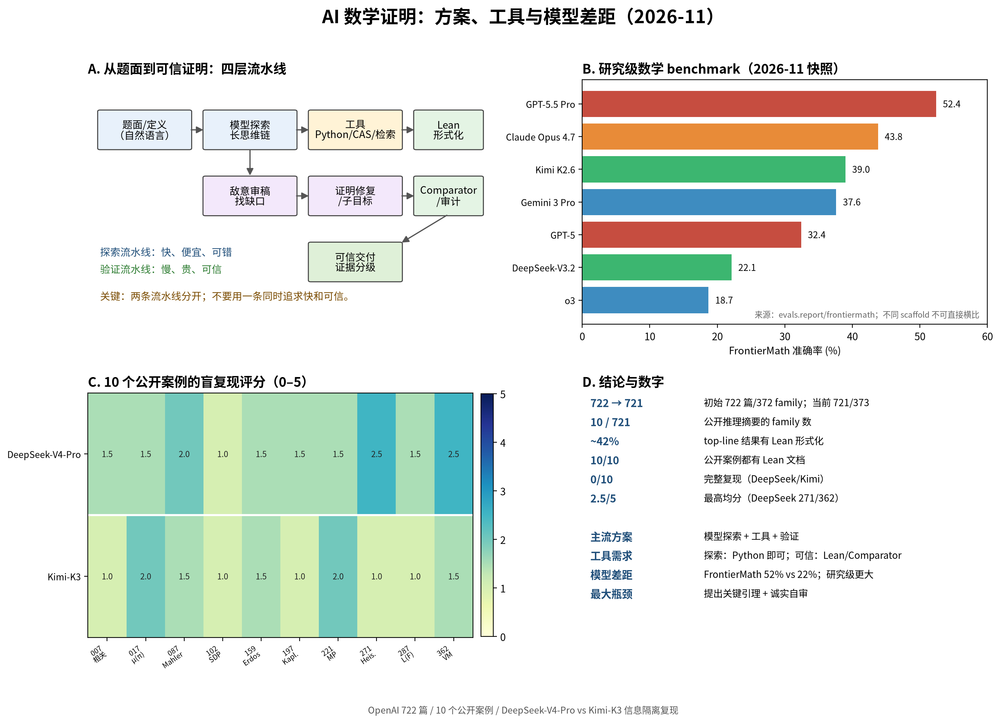

# 00 总览：AI 数学证明与 OpenAI 722 篇（2026-11）

> **范围**：本知识库回答四个问题：(1) 当前用 AI 做科研/数学证明的主流方案是什么；
> (2) 需不需要客制化工具或 Skill；(3) 不同模型的差距有多大；(4) OpenAI 2026-10 发布的
> 722 篇中 10 个公开案例是什么，DeepSeek/Kimi 能否在信息隔离下复现。

## 资料索引

| 页面 | 内容 |
|---|---|
| 01 主流方案地图 | 通用长思维链、形式化证明、智能体、自动形式化、工具增强、人机协作 |
| 02 工具与 Skill | 需不需要客制化；10 个公开案例的 Lean 覆盖；最小可信工具链 |
| 03 模型差距 | FrontierMath、IMO、PutnamBench、MiniF2F；研究级差距的来源 |
| 04 722 篇事实核查 | 722/372 → 719/721/373；撤回/修订；10 个公开案例 |
| 05 盲复现：DeepSeek vs Kimi | 实验设计、结果、失败模式、评分 |
| 06 结论与行动清单 | 给团队的建议：流水线、Skill、评估、下一步 |
| 复现工程 | `repro/openai-10/`（题面、harness、transcripts、评分） |
| 可视化 | `docs/visuals/2026-11-21-ai-math-survey.png` |

## 一句话结论

1. **主流方案是“模型探索 + 工具 + 验证”的组合**，不是单一模型端到端。
2. **可信交付需要客制化工具链**：Lean/Mathlib + Comparator + 自动形式化/证明修复 + 领域工具 +
   隔离编排 + 审计；只做探索则通用模型 + Python 沙箱即可。
3. **模型差距在公开 benchmark 上约 10–30 个百分点，在研究级证明上更大**；竞赛题饱和不等于
   研究能力，厂商声明需要独立验证。
4. **722 篇是 722 篇不同验证阶段的手稿**，不是 722 个已独立验证的定理；只有 10 个 family 公开
   推理摘要，约 42% 的 top-line 结果有 Lean 形式化。
5. **本票的盲复现实验**用 DeepSeek-V4-Pro 与 Kimi-K3 在信息隔离下尝试 10 个公开案例；结果与
   失败模式见 05 页。核心结论：公开模型能给出有价值的部分结果/路线，但在有限预算内未能完整
   复现任何一个研究级主定理（具体分数以 05 页为准）。

## 证据分级

| 等级 | 含义 | 本知识库中的例子 |
|---|---|---|
| 论文/官方声称 | 作者/厂商给出的数字或结论 | OpenAI 722 篇的官方结论；FrontierMath 厂商分数 |
| 独立复现 | 本仓库可追溯地跑出/检查过 | 本票 10 案例盲测；Lean 构建（若跑过） |
| 未验证 | 只读摘要/文档/代码，未独立跑 | 大部分官方论文的证明细节；未重跑的 Lean |

不把“论文声称”冒充“独立复现”。05 页的评分只判断“是否复现官方声称的方向与主定理”，
不把官方结论当作已独立验证的真理。

## 维护约定

- 数据快照日期：2026-11-21；`openai/math` 的 `main` 会继续变化，引用时注明 commit/日期。
- 新增案例/模型时，更新 04 的表格与 05 的评分；保留原始 transcripts。
- 不把官方结论/评分 key 放进求解上下文；隔离协议见 `repro/openai-10/README.md`。
- 图片源文件在 `kb/ai-math-survey/assets/`，导出到 `docs/visuals/`。
