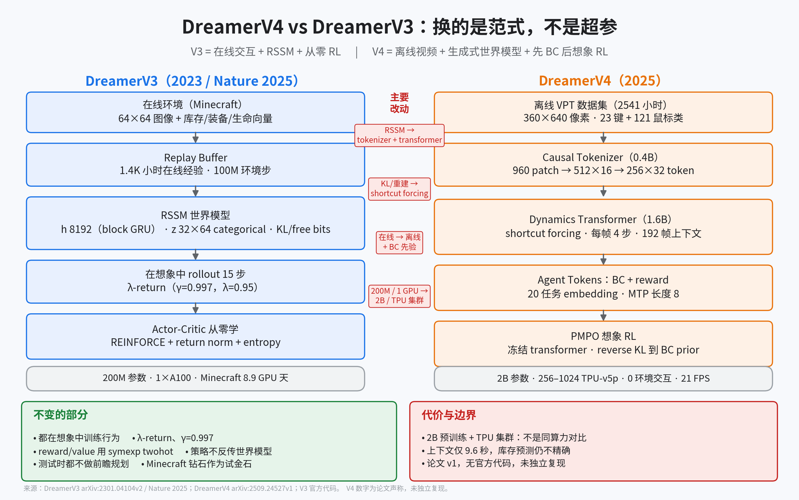

# 01 一页看懂：12 项关键改动

> **结论先行**：把 V4 的改动按“数据/世界模型/智能体/规模”四层拆开，真正改变能力边界的是前三层；第四层是前三层可行之后的结果，而不是原因。

**如果只记三件事**：

1. 世界模型从“把历史压缩成一个小状态”改为“高容量、可实时生成的视频模拟器”。
2. 智能体从“在线从零 RL”改为“离线先模仿、再在想象里 RL”。
3. 两者叠加，才让“只用离线视频拿到 Minecraft 钻石”成立；单独换任何一层都不够。

## 0. 口径

| 论文/数据 | 出处 | 本页用途 |
|-|-|-|
| DreamerV3 | arXiv:2301.04104v2；Nature 2025；`danijar/dreamerv3` | 基线 |
| DreamerV4 | arXiv:2509.24527v1；项目页 | 对比对象 |
| 改动清单 | 由两篇论文正文、V4 附录 F 与 V3 配置交叉整理 | 本页主体 |

**证据分级**：V3 的结构与超参有官方代码核对；V4 的结构与数字均为论文声称，无官方代码。表中“影响”一列是机制解释，不是实验结论。

## 1. 12 项改动

按“数据与任务 / 世界模型 / 智能体 / 规模”分四组；每组的“影响”是机制解释，不是实验结论。

### 1.1 数据与任务

| 改动 | DreamerV3 | DreamerV4 | 影响 |
|-|-|-|-|
| 1. 数据来源 | 在线交互，Minecraft 约 1.4K 小时 | 离线 VPT 约 2.5K 小时；0 环境交互 | 不需要可重置、可给奖励的模拟器；适合在线交互危险/昂贵的场景 |
| 2. 观测与动作 | 64×64 图像 + 库存/装备/生命向量；MineRL 抽象动作（含抽象合成） | 360×640 像素，仅图像；23 个按键二值 + 121 类鼠标；合成走游戏 UI | 更接近人类玩家的原始接口，但控制难度和动作序列长度大幅上升 |
| 3. 任务设定 | 单任务/单奖励，训练一个策略 | 20 个任务 + one-hot task embedding；评估时用 prompt 序列引导 | 一个世界模型 + 一个策略可切换任务，不必每任务重训 |

### 1.2 世界模型

| 改动 | DreamerV3 | DreamerV4 | 影响 |
|-|-|-|-|
| 4. 世界模型骨架 | RSSM：CNN 编解码 + block GRU + categorical latent | Causal tokenizer + block-causal 2D transformer（时间/空间分离注意力） | 从“窄环境够用的小模型”转向“能拟合复杂视频分布的大模型” |
| 5. 隐状态 | 确定性 `h_t`（8192）+ 随机 `z_t`（32 个变量 × 64 类） | 连续 token：tokenizer 瓶颈 512×16，reshape 为 256×32 给 dynamics | 去掉离散随机变量与 KL；随机性交给生成过程 |
| 6. 世界模型目标 | 重建 + reward + continue + KL（free bits 1 nat、1% unimix、KL balancing） | tokenizer：MSE + 0.2×LPIPS + MAE；dynamics：shortcut forcing（流匹配 + bootstrap，x-prediction） | 不再用“重建像素 + 变分”训练动力学；用扩散式目标直接学 token 分布 |
| 7. 生成/推理 | 单步采样 prior，测试时不解码像素 | 每帧 4 次网络前向；单 H100 21 FPS；9.6 秒上下文 | 世界模型可以实时被人玩，也可以作为想象训练器；代价是推理更重 |
| 8. 动作条件 | 动作拼进 GRU 输入 | 每个动作分量编码为 `S_a` 个 token 后求和；无动作视频用 learned embedding | 支持“大量无动作视频 + 少量有动作视频”的预训练 |

### 1.3 智能体

| 改动 | DreamerV3 | DreamerV4 | 影响 |
|-|-|-|-|
| 9. 训练流程 | 单阶段：世界模型与 actor-critic 交替/联合训练 | 三阶段：WM 预训练 → 任务条件 BC + reward → PMPO 想象 RL | 先获得通用世界知识，再学任务与策略；RL 只做微调 |
| 10. 策略目标 | REINFORCE + return normalization（5–95 百分位）+ entropy（3e-4） | PMPO：只看 advantage 符号，正/负样本分开平均，reverse KL 到 BC prior | 不需要按任务调 return 归一化；BC prior 约束行为空间 |
| 11. 奖励来源 | 环境稀疏奖励，reward head 与世界模型一起训 | 数据集事件标注的稀疏二值奖励；task-conditioned reward head，MTP 长度 8 | 离线数据没有在线奖励，必须从事件/标签学 reward |

### 1.4 规模与算力

| 改动 | DreamerV3 | DreamerV4 | 影响 |
|-|-|-|-|
| 12. 规模与算力 | 200M 参数；1×A100；Minecraft 8.9 GPU 天；100M 环境步 | 2B 参数（0.4B tokenizer + 1.6B dynamics）；256–1024 TPU-v5p；训练时长未报告 | 高容量模型是拟合复杂交互的前提；不是同算力对比 |

## 2. 变与不变

**变的是“怎么学”和“用什么学”**：数据从在线变离线，世界模型从 RSSM 变生成式 transformer，策略从从零 RL 变“模仿 + RL 微调”，规模从 200M 变 2B。

**不变的是“想象训练”这件事本身**：

| 不变量 | V3 | V4 |
|-|-|-|
| 在想象中训练行为 | 从 replay 状态出发，rollout 15 步 | 从数据上下文出发，rollout 若干步 |
| λ-return | λ=0.95，γ=0.997 | λ-return，γ=0.997 |
| symexp twohot | reward head 与 critic | reward head 与 value head |
| 策略不反传世界模型 | `ac_grads: False` | RL 阶段冻结 transformer |
| 测试时不做前瞻规划 | actor 直接采样动作 | 策略头直接采样动作 |
| Minecraft 钻石作为试金石 | 首个在线从零拿到 | 首个纯离线拿到 |

## 3. 常见误解

- **“V4 只是把 RSSM 换成 Transformer”**：不只。数据、动作接口、奖励来源、策略目标、训练阶段全变了；只换骨架复现不出 V4 的离线钻石。
- **“V4 是 V3 的 drop-in 替代”**：不是。V4 需要大规模视频预训练、离线数据管线、任务嵌入和 BC 阶段；V3 的在线小模型路线仍然更便宜。
- **“V4 不需要 reward”**：需要。只是 reward 不再由环境实时给，而是从数据集事件标注里学一个任务条件 reward 模型。
- **“Decoder 没用了”**：tokenizer 的 decoder 仍用于训练 tokenizer 和可视化；但 dynamics 与 agent 的训练回路不依赖像素重建，V4 也不需要在想象 RL 时解码。
- **“2B 一定比 200M 好”**：论文只证明在 Minecraft/机器人/厨房这些高维视频任务上，V4 的规模路线可行；没有重跑 V3 的 150+ 任务，不能外推成全面占优。

## 4. 一页图

## 图集

图 1：左为 V3 的在线小模型闭环，右为 V4 的离线大模型三阶段；中间四条是主要改动，底部是“不变”的部分与代价。
