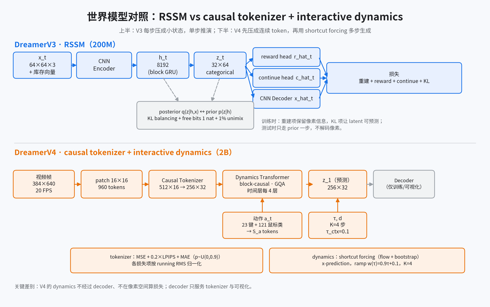

# 02 世界模型：从 RSSM 到 tokenizer + shortcut forcing

> **结论先行**：V3 的世界模型是“把历史压成一个小状态”的 RSSM：`h_t` 负责记忆、`z_t` 负责当前不确定性，用重建 + KL 训练，单步就能推演。V4 把它换成“先压成连续 token，再用大 transformer 生成下一帧 token”的两段式模型：tokenizer 负责压缩，dynamics 负责在动作条件下做 shortcut forcing，每帧 4 步采样。两者不是同一类模型，不能只替换一个模块。

**如果只记三件事**：

1. V3 的瓶颈是 **categorical latent + KL**；V4 的瓶颈是 **tokenizer 的连续 token**，动力学不再有 KL。
2. V3 的动力学是 **GRU 单步**；V4 的动力学是 **block-causal transformer + 扩散式多步生成**。
3. V4 的 decoder 只用于训练 tokenizer 和可视化；dynamics 与策略训练都在 latent/token 空间完成，不重建像素。

## 0. 口径

| 论文/数据 | 出处 | 本页用途 |
|-|-|-|
| V3 世界模型 | arXiv:2301.04104v2 §World model learning；`dreamerv3/rssm.py`；`configs.yaml` | 基线的公式、维度与超参 |
| V4 世界模型 | arXiv:2509.24527v1 §3.1–3.2、§3.4、附录 A | 对比对象的结构与维度 |
| V4 设计消融 | 同上 Table 2、Figure 8 | 说明每个设计选择的增益 |

**证据分级**：V3 的公式与默认维度有论文 + 官方代码；V4 的结构与消融均为论文声称，没有官方代码可核对。

## 1. V3：RSSM 怎么工作

RSSM 把状态拆成两部分：

- **确定性循环态 `h_t`**：block GRU 的记忆，默认 8192 维（8 个 block × 1024）。
- **随机隐变量 `z_t`**：32 个 categorical 变量，每个 64 类（200M 默认配置）。

每步的生成与推断：

$$
h_t = f_\phi(h_{t-1}, z_{t-1}, a_{t-1})
$$

$$
z_t \sim q_\phi(z_t \mid h_t, x_t)
$$

（posterior，看当前观测）

$$
\hat z_t \sim p_\phi(\hat z_t \mid h_t)
$$

（prior，想象时用）

$$
\hat r_t \sim p_\phi(\hat r_t \mid h_t, z_t), \quad
\hat c_t \sim p_\phi(\hat c_t \mid h_t, z_t), \quad
\hat x_t \sim p_\phi(\hat x_t \mid h_t, z_t)
$$

训练损失是三项：

$$
\mathcal{L}(\phi)=\mathbb{E}_{q_\phi}\left[\sum_{t=1}^{T}
\beta_{pred}\mathcal{L}_{pred}
+\beta_{dyn}\mathcal{L}_{dyn}
+\beta_{rep}\mathcal{L}_{rep}\right]
$$

其中 `β_pred = β_dyn = 1`，`β_rep = 0.1`。

- `L_pred`：解码重建 + reward + continue 的预测损失。
- `L_dyn`、`L_rep`：posterior 与 prior 的 KL，分别用 stop-gradient 与不同尺度；free bits 截断在 1 nat。
- 编码器/动力学的 categorical 都做 **1% uniform mix（unimix）**，防止分布变成确定性、KL 爆炸。
- 重建项让 latent 保留像素信息；KL 项让 latent 可预测，方便在想象中单步推演。

**关键点**：V3 的“世界模型”是一个**小状态、单步、变分**模型。它的强项是便宜、稳定、可在单卡上跑；弱点是容量有限，难以拟合复杂视频分布——V4 附录 F 正是这样描述 V3 的。

## 2. V4：两段式世界模型

### 2.1 Causal tokenizer：把视频压成连续 token

- 输入：360×640 图像，零填充到 384×640，按 16×16 patch 切成 **24×40=960** 个 patch token。
- 编码器：block-causal transformer；每个时间步由当前帧 patch token + 可学习 latent token 组成；latent token 可以 attend 所有模态，但每个模态只在自己内部 attend。
- 瓶颈：latent token 经线性投影压到较小通道，再过 `tanh`；Minecraft 设置为 **512×16**（8192 个数）。
- 解码器：把 512×16 投影回模型维度，拼可学习 token 后读出 patch。
- 时间因果：编码器和解码器都在时间上因果，因此可以逐帧解码，支持交互式推理。
- 训练：MSE + 0.2×LPIPS；对输入 patch 做 masked autoencoding，dropout 概率 `p ~ U(0, 0.9)`；各损失项用 running RMS 归一化。
- 给 dynamics 用之前，把 512×16 reshape 成 **256×32** 的空间 token。

注意：tokenizer 的 decoder **只服务于 tokenizer 训练和可视化**；dynamics 不经过 decoder，也不在像素空间算损失。

### 2.2 Interactive dynamics：在动作条件下生成下一帧 token

- 输入 token：256 个空间 token（每个 32 维）+ `S_r` 个 register token + 1 个 shortcut（信号水平/步长）token。
- 动作：每个分量单独编码为 `S_a` 个 token 后求和；键盘是 23 个二值分量，鼠标是 121 类 categorical；没有动作标签的视频只用 learned embedding。
- 目标：给定带噪的 `z̃`、信号水平 `τ`、步长 `d` 和动作 `a`，预测干净表示 `z_1`：

$$
\tilde z=(1-\tau)z_0+\tau z_1,\quad z_0\sim\mathcal{N}(0,I),\quad
\hat z_1=f_\theta(\tilde z,\tau,d,a)
$$

- 损失：`d = d_min` 时用 flow matching；更大的步长用 bootstrap，把两个半步的结果蒸馏进一步。V4 在 **x-space** 算损失，并给 bootstrap 项乘 `(1-τ)^2` 对齐尺度。
- **x-prediction**：网络直接预测 `z_1`，而不是速度 `v`；作者说这样长序列 rollout 的高频误差更小。
- **ramp loss weight**：`w(τ)=0.9τ+0.1`，把容量集中在学习信号更强的高 τ 区域。
- 推理：时间上自回归，每帧用 **K=4** 步、步长 `d=1/4`；对过去帧加 `τ_ctx=0.1` 的轻微扰动，提升对自身生成误差的鲁棒性。

### 2.3 Efficient transformer：为什么能实时

- 2D transformer：空间注意力和时间注意力分开做（axial）。
- 时间注意力每 4 层才做一次；空间层更便宜，也带来“聚焦当前帧”的归纳偏置。
- 所有注意力用 GQA 缩小 KV cache；pre-RMSNorm、RoPE、SwiGLU、QKNorm、attention logit soft capping。
- 训练时交替短/长 batch（Minecraft：64 与 256 帧），最后在长 batch 上微调；上下文长度 192 帧（20 FPS 下 9.6 秒），空间 256 token。
- 结果：单 H100 上 21 FPS，达到 Minecraft 的 20 FPS 实时门槛；作为对比，朴素 diffusion forcing + 64 步只有 0.8 FPS。

### 2.4 一张表对照

| 维度 | V3 RSSM | V4 tokenizer + dynamics |
|-|-|-|
| 状态 | `h_t` 8192 + `z_t` 32×64 categorical | 每帧 256×32 连续 token |
| 时序骨架 | block GRU + CNN 编解码 | block-causal 2D transformer |
| 随机性来源 | categorical 采样 + KL | 扩散/流匹配的噪声 |
| 世界模型损失 | 重建 + reward + continue + KL | tokenizer 重建；dynamics flow + bootstrap |
| 是否用像素重建训练动力学 | 是（decoder 在损失里） | 否（dynamics 只在 token 空间） |
| 动作条件 | 拼进 GRU 输入 | 动作分量编码为 token |
| 推理 | 单步 prior | 每帧 4 步 |
| 上下文 | 循环状态隐式携带 | 192 帧显式上下文 |
| 参数量 | 约 200M（整体） | 0.4B tokenizer + 1.6B dynamics = 2B |

## 3. 三个容易误解的点

1. **“V4 只是把 CNN 换成 Transformer”**：不准确。V4 还去掉了 KL 和离散 latent，把单步预测换成多步扩散，把 decoder 移出动力学训练回路；这些是同一个设计的不同侧面。
2. **“V4 的 tokenizer 就是 V3 的 encoder/decoder”**：结构上相似（都是图像编解码），但 V4 的 tokenizer 是**因果、可逐帧解码、带 MAE、用 LPIPS** 的 transformer，且输出连续 token；V3 的 CNN decoder 是给 RSSM 的重建损失用的。
3. **“没有 KL 就没有随机性”**：V4 的随机性在扩散过程里；给定同一上下文和动作，模型仍可通过噪声采样出不同未来。V3 的随机性在 categorical `z_t` 里。

## 4. 设计消融说明了什么

V4 Table 2 从朴素 diffusion forcing transformer（64 空间 token、64 步）出发，逐项加到最终模型：shortcut（4 步）、x-prediction、x-loss、ramp weight、交替 batch、时间层每 4 层、GQA、register token、更多空间 token。FVD 从 306 降到 57，推理从 0.8 FPS 升到 21.4 FPS。

这说明 V4 的“实时 + 高质量”不是单个技巧，而是**目标（shortcut/x-pred/ramp）+ 架构（axial/GQA/时间稀疏）+ 规模（更多空间 token）**共同作用的结果。单独抄一个模块，很难得到同样的数字。

## 图集

图 2：上半部分是 V3 的 RSSM 单步闭环（h、z、KL、重建）；下半部分是 V4 的两段式世界模型（tokenizer 压缩、dynamics 在动作/τ/d 条件下做 shortcut forcing）。维度按 Minecraft 设置标注。
