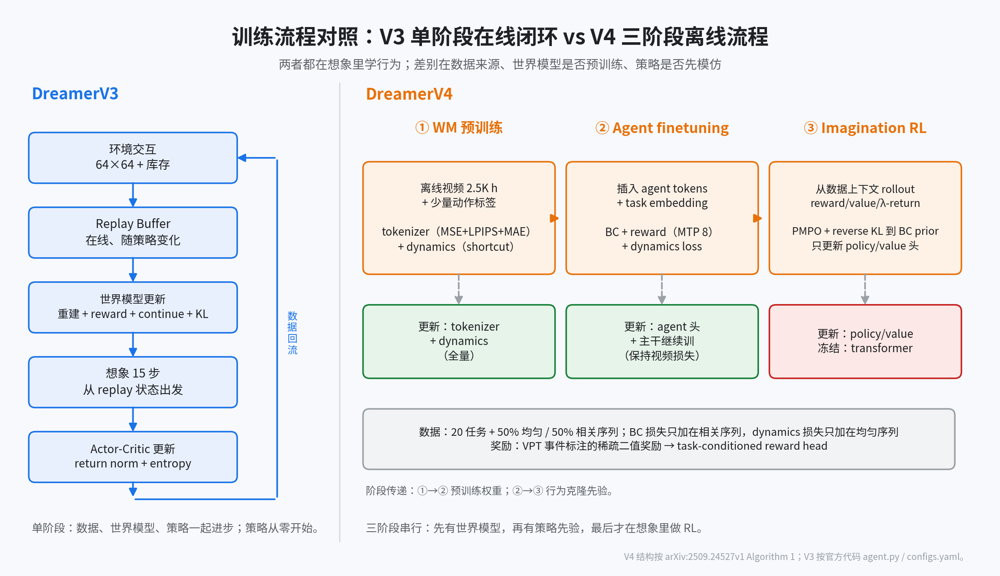

# 03 智能体：从在线 RL 到离线三阶段

> **结论先行**：V3 和 V4 都在“想象”里训练行为，但两件事不同：V3 的世界模型是**在线**学的，策略是**从零**学的；V4 的世界模型先在海量视频上**离线预训练**，策略先**行为克隆**、再用 PMPO 在想象里**微调**。V4 的 RL 是“在模拟器里做 on-policy RL”，不是“在真实环境里做 RL”。

**如果只记三件事**：

1. V3 是一个单阶段闭环：环境 → replay → 世界模型 → 想象 → actor-critic，世界模型和策略一起进步。
2. V4 是三个阶段：世界模型预训练 → 任务条件 BC + reward → PMPO 想象 RL；后两个阶段可以只训小头，主干冻结。
3. V4 用 **BC prior + PMPO** 替代 V3 的 **return normalization + entropy**；奖励不再来自环境，而来自数据集事件标注。

## 0. 口径

| 论文/数据 | 出处 | 本页用途 |
|-|-|-|
| V3 actor-critic | arXiv:2301.04104v2 §Critic learning / §Actor learning；`dreamerv3/agent.py`；`configs.yaml` | 基线 |
| V4 三阶段 | arXiv:2509.24527v1 Algorithm 1、§3.3、Eq. 9–11 | 对比对象 |
| V4 与 V3 的直接对照 | 同上附录 F | 作者自己给出的差异说明 |

**证据分级**：V3 的目标、超参与实现有官方代码；V4 的流程与目标为论文声称，无官方代码。

## 1. V3：单阶段在线 actor-critic

V3 的循环可以写成：

```
环境交互 → replay buffer → 采样序列 → 更新世界模型（重建 + reward + continue + KL）
                              ↓
                    从 replay 状态出发，想象 15 步
                              ↓
                    λ-return → 更新 actor / critic
```

关键设计：

- **世界模型与策略交替训练**，但策略梯度不穿过世界模型（官方配置 `ac_grads: False`）；世界模型只由预测/KL 损失训练。
- **actor/critic 从零开始**，输入是世界模型的 `(h_t, z_t)`；actor 是 3 层 MLP，离散动作用 categorical，连续动作用 bounded normal；critic 是 3 层 MLP + symexp twohot（255 bins）。
- **想象长度 15 步**，λ=0.95，γ=0.997（折扣 horizon 333）；critic 除了想象损失，还在 replay 轨迹上以 0.3 的权重训练（用想象起点的 λ-return 作 on-policy 值标注）。
- **return normalization**：把 λ-return 按 batch 的 5–95 百分位范围归一化，EMA 平滑（0.99），下限 1；这样 entropy 系数可以固定为 3e-4。
- **critic 稳定化**：slow critic（EMA 0.98）作为正则；reward/critic 输出层零初始化。
- **探索**：actor 的 entropy 正则 + 1% unimix；没有 BC prior。

这套设计的强项是“一个算法、一套超参、150+ 任务”；弱点是必须能在线交互，且策略从零学，样本效率受环境步数限制。

## 2. V4：三阶段离线流程

V4 论文 Algorithm 1 把训练分成三个阶段：

### Phase 1：世界模型预训练

- 在视频（可选动作）上训练 tokenizer（Eq. 5）和 dynamics（Eq. 7）。
- 这一阶段没有 reward、没有 policy、没有 value；世界模型只学“视频 + 动作 → 下一帧 token”。
- 动作可以只覆盖一小部分视频；没有动作的视频用 learned embedding，模型学“无条件/弱条件”的预测。
- 结果是一个可实时 rollout 的生成式模拟器。

### Phase 2：Agent finetuning（BC + reward）

- 把 **agent tokens** 插入 dynamics transformer，与图像 token、动作 token、register token 交错。
- agent token 接收 **task embedding**（20 个任务 one-hot；论文说 text embedding 也可以），用 MLP 头输出策略和奖励。
- 关键掩码：agent token 可以 attend 所有模态，但**其他模态不能 attend 回 agent token**。这样任务信息不会泄漏进世界模型预测，避免 causal confusion。
- 损失：多 token 预测（MTP，L=8），同时预测未来 8 步的动作和奖励（Eq. 9）；策略头是 categorical 或 vectorized binary，奖励头是 symexp twohot。
- 数据混合：50% 均匀序列 + 50% 与任务相关的序列；**BC 损失只加在相关序列上，dynamics 损失只加在均匀序列上**，避免“为了让 BC 好看而生成乐观未来”。
- 这一阶段 transformer 仍参与训练（不是冻结），并继续加视频预测损失以保持世界模型能力。

### Phase 3：Imagination training（PMPO）

- 初始化 value head，并冻结一份当前策略作为 **behavioral prior**。
- 从数据上下文出发，在想象中 rollout；动作由策略头采样，奖励由 reward head 标注，价值由 value head 标注。
- **只更新 policy head 和 value head，transformer 冻结**。论文说全量微调有小幅额外收益，但算力更高，且需要同时保留 dynamics/policy prior/reward 损失。
- 每个上下文只开 **一条** rollout（V3 会开多条），优先数据多样性、降低显存。
- value head 用 TD 学习 λ-return（Eq. 10），γ=0.997；输出 symexp twohot。
- policy head 用 **PMPO**（Eq. 11）：

```
L(θ) = (1-α)/N_neg · Σ_{i∈D_neg} ln π_θ(a_i | s_i)
     − α/N_pos · Σ_{i∈D_pos} ln π_θ(a_i | s_i)
     + (β/N) · Σ_{i=1..N} KL(π_θ ‖ π_prior)
```

  - `D_pos` / `D_neg`：advantage ≥0 / <0 的想象状态；α=0.5 让正负样本等权。
  - 只用 advantage 的**符号**，不用大小，因此不需要 return/advantage normalization。
  - β=0.3，KL 方向是 `π_θ || π_prior`（reverse KL），比原始 PMPO 更紧地约束在 BC 行为附近。

## 3. 一张表对照

| 维度 | DreamerV3 | DreamerV4 |
|-|-|-|
| 数据 | 在线环境交互 | 固定离线数据集 |
| 世界模型训练 | 与策略交替、在线 | 先独立预训练，再在 agent finetuning 中继续 |
| 策略初始化 | 随机 | 行为克隆（BC） |
| 策略目标 | REINFORCE + return norm + entropy | PMPO + reverse KL 到 BC prior |
| 奖励来源 | 环境稀疏奖励 | 数据集事件标注 + task-conditioned reward head |
| 任务 | 单任务/单奖励 | 20 任务 + task embedding |
| 想象 rollout | 每上下文多条 | 每上下文一条 |
| RL 阶段更新范围 | actor/critic + 世界模型（交替） | 只更新 policy/value 头，transformer 冻结 |
| 探索 | entropy + unimix | BC prior + 策略采样 |
| 是否需要 return normalization | 是（5–95 百分位） | 否（PMPO 只看符号） |

## 4. 为什么 V4 能“离线”

三个条件缺一不可：

1. **世界模型足够准**：能根据动作预测复杂的物体交互；否则想象出的轨迹没有学习价值。这是 V4 把世界模型做到 2B、实时、长上下文的原因。
2. **奖励可学**：离线数据没有在线奖励，但 VPT 数据带有事件标注（挖到木头、做出石镐等），可以训练 task-conditioned reward head。
3. **有行为先验**：BC 先给策略一个“像人”的起点，PMPO 再在想象里改进；没有 BC prior，纯 RL 在离线想象里很容易跑偏。

这也解释了为什么 V4 的 RL 不是“从零探索”：它是在一个已经会模仿的策略上做局部改进。论文的消融显示，任务越难，imagination training 相对 BC 的提升越大（钻石 0.0% → 0.7%，铁镐 16.9% → 29.0%）。

## 5. V3 和 V4 的“想象”差在哪

- **V3 的想象是“策略训练器”**：世界模型是小的、任务无关的，想象 15 步，主要解决 credit assignment。
- **V4 的想象是“模拟器里的 on-policy RL”**：世界模型是大视频生成器，想象可以很长（上下文 9.6 秒），策略在模拟器里采样、拿 reward、算 λ-return。
- 两者都不在测试时做 MPC/前瞻规划；都是学一个反应式策略。区别在于世界模型的容量、训练数据的来源，以及策略是否先模仿。

## 图集



图 3：左为 V3 的在线单阶段闭环；右为 V4 的 WM 预训练 → BC + reward → PMPO 三阶段。颜色区分“训练/冻结”和“数据/模型”。
