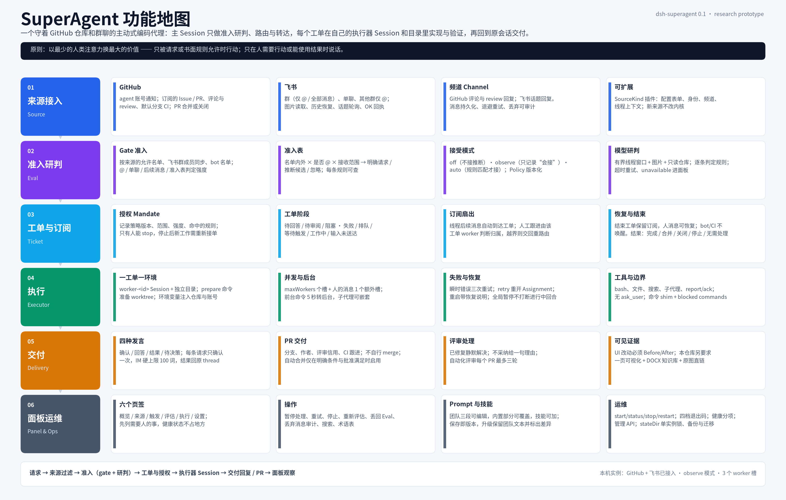

# 00 总览：SuperAgent 功能清单（2026-11）

> **结论先行**：SuperAgent（代码名 `dsh-superagent`）是一个绑定在**一个 GitHub 仓库**上的主动式编码代理。它从 GitHub（可选加飞书）接收被允许的人提出的请求，先做准入研判，再变成一张有明确授权范围的**工单**；每张工单在自己的执行器 Session 和目录里完成调查、实现与验证，最后回到**原会话**交付，通常是一个 PR。它把自己定位为"团队里的一名自动化同事"：**只在该行动时行动，只在该说话时说话**。

**如果只记三件事**：

1. **它是"请求 → 授权 → 工单 → 执行 → 交付"的一条流水线**，不是聊天机器人，也不是无人值守的批量代码生成器。
2. **授权是核心**：谁可以发起、能做什么范围、依据哪条策略，都记录在 Policy 与 Mandate 里；消息和引用文档只能作为判断材料，不能改写权限。
3. **交付以人的注意力为预算**：每条请求只确认一次，工作过程保持安静，只在结果可用、需要决定或无法完成时发言。

## 0. 口径

| 项目 | 说明 |
|-|-|
| 对象 | `dsh-superagent` 0.1（DeepSeek Harness bundle），研究原型，非 DeepSeek 官方产品 |
| 范围 | SuperAgent 这一层的能力：接入、准入、工单、执行、交付、面板与运维；不展开 DSH 本体的模型、工具和 Web 框架 |
| 依据 | 仓库源码 `src/`、设计文档 `docs/000`–`008`、提示词 `prompts/`、本机部署的只读 API 快照（2026-11-25） |
| 读者 | 想知道"这套东西能做什么、边界在哪、怎么用"的团队成员与运维者 |

**证据分级**：

- **源码/文档**：仓库中的实现与设计文档，可逐条核对；本清单的主要依据。
- **部署实测**：本机正在运行的实例（来源、策略、并发、健康状态），只代表这一套部署。
- **未验证**：本清单不包含未在实现中出现的路线图能力；文中若提到"原型未实现"会显式标注。

## 1. 功能地图

## 2. 分层速查

| 层 | 它解决的问题 | 关键能力 | 详见 |
|-|-|-|-|
| 01 来源接入 | 请求从哪里来、怎样可靠地进入系统 | GitHub 通知/Issue/PR/评论/review/CI；飞书群/单聊/图片/回执；频道回写；插件化来源 | [01](01-来源接入.md) |
| 02 准入研判 | 这条消息算不算"要做的事"，谁授权、做到什么程度 | 允许名单、成员同步、准入表、bot 名单；off/observe/auto；两层评估与主动规则 | [01](01-来源接入.md) |
| 03 工单与订阅 | 把一次授权变成可跟踪、可续接的工作 | Mandate、工单阶段、线程订阅扇出、人工跟进归属、恢复与结束 | [02](02-研判与工单.md) |
| 04 执行 | 真正读代码、改代码、验证并交付 | 一工单一 Session/目录、prepare worktree、并发槽、后台作业与子代理、重试与恢复 | [03](03-执行.md) |
| 05 交付与评审 | 结果怎样回到人，且不制造噪音 | 四种回复、100 词上限、PR 与评审、自动合并条件、Before/After 证据 | [04](04-交付与运维.md) |
| 06 面板与运维 | 人怎样监督、配置、排障和扩展 | 六个页签、Prompt 版本、健康与暂停、CLI/API、部署与安全边界 | [04](04-交付与运维.md) |

## 3. 一句话结论

1. **一个仓库、两种来源、两类角色。** 一个部署只守一个 GitHub 仓库；来源是 GitHub 加可选飞书；角色是"只研判路由"的主 Session 和"只做技术工作"的执行器 Session。
2. **准入是确定性的，研判是模型的。** 名单、准入表和 bot 名单先做硬判定；模型只在有界上下文里判断"这条讨论是否真的要求做这个改动、方向是否已定"。
3. **工单是唯一的授权单位。** 工单记住策略版本、范围、强度和命中的规则；人能停止，停止后需要重新接单；结束的工单还能被人的新消息唤醒。
4. **执行环境是"一工单一 Session 一目录"。** prepare 命令准备 worktree，worker 用 `gh`/`lark-cli` 以代理账号行事，前台命令 5 秒转后台，最多 `maxWorkers` 个并发槽。
5. **交付按结果而非过程说话。** 确认一次、工作中沉默、结果或问题才出现；IM 硬上限 100 词；UI 改动必须有 Before/After；PR 存在不等于 ready。
6. **面板只展示需要人的事。** 概览先列待人工，健康状态不占空间；设置、Prompt、历史和系统问题都能在面板里定位。

## 4. 资料索引

| 页面 | 内容 | 主要来源 |
|-|-|-|
| [01 来源接入](01-来源接入.md) | Source、GitHub/飞书能力、频道、准入表、模式与规则 | `docs/001`、`docs/002`、`docs/006`、`src/sources/` |
| [02 研判与工单](02-研判与工单.md) | 两层 Eval、Decision、Mandate、工单阶段、订阅与恢复 | `docs/002`、`docs/003`、`src/core/` |
| [03 执行](03-执行.md) | Executor、目录与 prepare、并发与后台、失败恢复、工具边界 | `docs/003`、`docs/007`、`src/executor/` |
| [04 交付与运维](04-交付与运维.md) | 沟通契约、PR/评审、可见证据、面板、Prompt、CLI/API、部署与扩展 | `docs/004`–`006`、`prompts/`、`src/client/` |
| 本页 | 范围、结论、功能地图、索引与维护约定 | 全部 |

## 5. 维护约定

- 本知识库跟随 `dsh-superagent` 的源码与设计文档更新；行为变化时先改对应子页，再同步总览的速查表与结论。
- 功能地图的源文件是 `scripts/make_superagent_map.py`，输出 `docs/visuals/2026-11-25-superagent-features.png`；改版后同时更新 DOCX 与飞书文档中的图片。
- 部署相关的数字（并发、模式、来源数量）只代表 2026-11-25 的本机实例，换部署时以面板 **Settings** 与 `scripts/dsh-superagent status` 为准。
- 本清单描述的是研究原型的能力与边界，不构成产品承诺；未实现的设计方向不写入"功能"。
