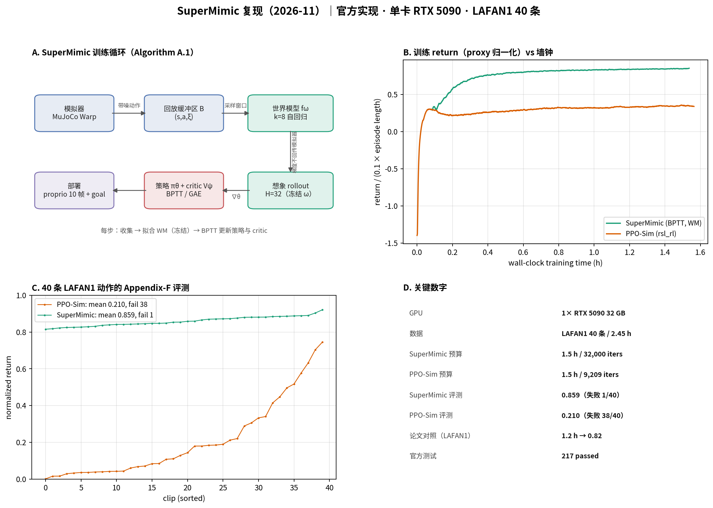

# 00 总览：SuperMimic 复现（2026-11）

> **结论先行**：官方实现单卡 1.5 h 得到 LAFAN1 40 条动作的 Appendix-F 归一化回报 **0.859**（论文 LAFAN1 对照 0.82），同预算 PPO-Sim 只有 **0.210**（38/40 失败）；训练链路、数据转换与 217 项官方测试全部跑通。

**如果只记三件事**：

1. 复现对象是 CoRL 2026 的 SuperMimic（arXiv:2610.28480），官方代码 `HybridRobotics/supermimic`，仿真底座 mjlab / MuJoCo Warp。
2. 本复现用 LAFAN1 的 40 条 G1 动作（2.45 h）做单卡（RTX 5090）受控实验，对照 PPO-Sim；不覆盖 BONES-SEED 全量与真机。
3. 结果按「论文声称 / 独立复现 / 未验证」分级，数值与结论见 `03 复现结果与差距`。

## 范围

- **在**：官方训练链路、世界模型 + BPTT 策略、LAFAN1 数据转换、PPO-Sim 基线、Appendix-F 检查点评测、世界模型损失诊断。
- **不在**：BONES-SEED 129,514 条动作全量、SONIC 检查点、128 卡训练、真机 G1、多卡、下游速度接口、sim2real。

## 资料索引

| 页面 | 内容 |
|-|-|
| `01 方法拆解` | 训练循环、世界模型、BPTT、超参数、代码映射 |
| `02 实验设计` | 环境、数据、两个训练器、协议、与论文设置差异 |
| `03 复现结果与差距` | 训练曲线、检查点评测、世界模型诊断、差距归因 |

外部资料：

- 论文：<https://arxiv.org/abs/2610.28480>
- 项目页：<https://supermimic.github.io>
- 官方代码：<https://github.com/HybridRobotics/supermimic>
- 仿真：<https://github.com/HybridRobotics/mjlab_research>、<https://github.com/mujocolab/mjlab>
- 数据：LAFAN1 G1 retarget（HF `lvhaidong/LAFAN1_Retargeting_Dataset`）
- 复现目录（数据盘）：`/mnt/storage1/syk/VLA/SuperMimic/`
- 仓库目录：`vla/SuperMimic/`

## 一句话结论

1. **论文声称**：单卡 3 h 超过 SONIC（128×L40、7 天）的归一化回报，GPU-hours 降低 >1000×。
2. **论文声称**：LAFAN1 40 条动作上，单卡 1.2 h 达到 0.82 归一化回报；PPO-Sim 在 18 h 预算内未达到。
3. **独立复现**：官方链路在 RTX 5090 单卡上跑通；LAFAN1 评测 0.859（1/40 失败），同预算 PPO-Sim 0.210（38/40 失败）；详见 `03`。
4. **未验证**：与 SONIC 的对比、129,514 条动作的失败数、真机迁移。

## 证据分级

| 等级 | 含义 | 本知识库中的位置 |
|-|-|-|
| **论文声称** | 论文正文/图表数字 | `01`、`03` 中标注 |
| **独立复现** | 本仓库代码跑出、可追溯 | `03` 的结果表与图 |
| **未验证** | 只读代码/摘要，未跑数值 | `03` 的「未覆盖」列表 |

## 维护约定

- 结果更新时同步更新 `03` 与 `results/`，并注明 Slurm job id 与日志路径。
- 论文数字与复现数字分表呈现，不混用。
- 复现脚本以 `vla/SuperMimic/repro/` 为准；数据盘目录只放数据、日志和检查点。
- 每次训练运行记录：命令、环境变量、GPU、数据版本、最大迭代数、实际耗时。
