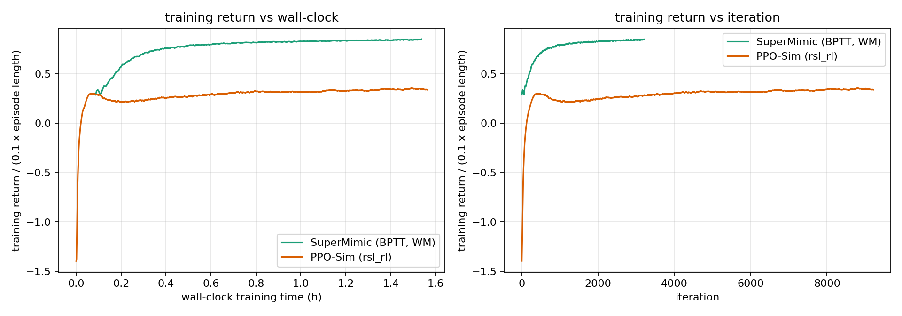
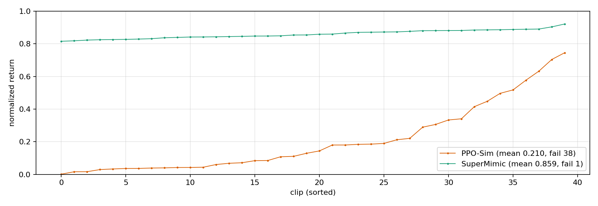

# 03 复现结果与差距

> **结论先行**：官方实现单卡 1.5 h 复现出论文 LAFAN1 受控实验的核心结果——40 条动作的 Appendix-F 归一化回报 **0.859**（论文 0.82，1.2 h/1×H100），而同预算的 PPO-Sim 只有 **0.210**（38/40 条终止失败）。训练链路、数据转换、官方测试全部跑通；BONES-SEED 全量、SONIC、真机未覆盖。

**如果只记三件事**：

1. **SuperMimic 0.859 vs PPO-Sim 0.210**（1.5 h 单卡、同动作库、同奖励/终止、同评测协议）。PPO-Sim 在 1.5 h 内只完成了论文 18 h 预算的约 1/12，因此该对比只说明「早段效率」，不能替代论文的 18 h 结论。
2. **SuperMimic 的训练回报在约 0.3 h 就超过 PPO-Sim 的最终值**：32,000 次迭代 / 1.31 亿 env steps / 1 h 32 min，训练 proxy 从 0.28 升到 0.85；PPO-Sim 9,209 次迭代 / 9.05 亿 env steps / 1 h 35 min，proxy 只到 0.335。
3. **世界模型训练损失收敛**：加权状态损失 3.03 → 0.0089，关节速度 MSE 8.52 → 0.088；与论文报告的 8 步误差 0.007–0.011 同量级，但两者不是同一指标（见 §4）。

## 0. 口径

| 项目 | 值 |
|-|-|
| 硬件 | 1× RTX 5090 32 GB（Slurm `gpu` 分区，单卡） |
| 数据 | LAFAN1 G1 retarget，40 条，441,140 帧 @ 50 Hz = 2.451 h |
| 训练预算 | SuperMimic 1.5 h；PPO-Sim 1.5 h |
| 评测 | Appendix-F：每条动作从第一帧播放一次，确定性策略，无观测噪声、无域随机化、无 push；归一化回报 $=\sum r/(0.1\cdot T_{\text{clip}})$；训练终止触发即失败 |
| 证据等级 | 本文所有数字均为**独立复现**；论文数字标注为**论文声称** |

## 1. 训练链路验证

| 检查 | 结果 |
|-|-|
| 官方测试 | `pytest tests -q`：**217 passed**（15.5 s，CPU） |
| 数据转换 | 40 条 CSV → 40 个 npz，441,140 帧 @ 50 Hz（2.451 h） |
| smoke 训练 | 512 envs、30 iters：collect → WM update → policy update → checkpoint 全链路跑通（job 2736） |
| 全量训练 | 32,000 iters、4096 envs、无崩溃（job 2737） |
| 基线训练 | PPO-Sim 9,209 iters、4096 envs、无崩溃（job 2740） |
| 评测 | 两个检查点各 40 条动作（job 2744） |

## 2. 训练曲线

| 指标 | SuperMimic | PPO-Sim |
|-|-|-|
| 算法 | 可微世界模型 + BPTT（actor-critic，H=32） | rsl_rl PPO（model-free） |
| 并行环境 | 4096 | 4096 |
| 迭代数 | 32,000 | 9,209 |
| 每迭代 env steps | 4,096 | 98,304（24 steps × 4096 envs） |
| 总 env steps | **1.31 亿** | **9.05 亿**（约 6.9×） |
| 墙钟 | 1 h 32 min | 1 h 35 min |
| 吞吐 | ~23.7k env-steps/s | ~159k env-steps/s |
| 训练 return proxy（首 → 末） | 0.284 → **0.853** | −1.71 → **0.335** |
| proxy 达到 0.82 的时间 | 约 0.55 h | 未达到 |

> proxy = 训练 episode 的 `mean_reward / (0.1 × mean_episode_length)`，是训练期监控量；训练 episode 在 500 步截断、且用 return-based reset 采样，因此**不等于** Appendix-F 的整段归一化回报。跨方法比较时两者用同一 proxy，仅用于看趋势。

曲线：`results/training_curves.png`（仓库路径 `vla/SuperMimic/results/training_curves.png`）。

SuperMimic 在约 0.3 h 的 proxy 已高于 PPO-Sim 的最终值；PPO-Sim 的 return 在 1.5 h 内仍在缓慢上升，说明它只是「没训完」。

## 3. 检查点评测（Appendix-F）

| 策略 | 均值 | 最低 | 失败数 | 失败判据 |
|-|-|-|-|-|
| **SuperMimic** | **0.8588** | 0.8153 | **1 / 40** | anchor 终止（`jumps1_subject2`，11940/12222 步） |
| PPO-Sim | 0.2099 | 0.0013 | **38 / 40** | anchor 终止；仅 2 条走类动作完成整段 |

- SuperMimic 的 40 条动作全部落在 0.815–0.921，分布很窄；最差的是两条舞蹈和一个格斗动作，最好的是走类动作（0.90–0.92）。
- PPO-Sim 的两条成功动作是 `walk1_subject2`（0.704）与 `walk3_subject2`（0.745）；其余基本在起步阶段终止，均值被失败样本拉低。
- 逐条分布：`results/eval_bars.png`（下图）；原始数据：`results/eval_supermimic.json`、`results/eval_ppo.json`。

### 3.1 与论文的对照

| 项 | 论文声称 | 本复现 |
|-|-|-|
| LAFAN1 40 条，单卡到 0.82 | 1.2 h（1×H100） | **0.859 @ 1.5 h（1×RTX 5090）** |
| PPO-Sim（1 GPU，18 h 预算） | 0.60，未达到 0.82 | 0.210 @ 1.5 h（预算只有 1/12，不能直接比） |

结论：**在 LAFAN1 受控设置上复现出了论文的核心数值**；PPO-Sim 的 18 h 结论未复现（时间不够），但同预算下 SuperMimic 的领先方向与论文一致。

## 4. 世界模型诊断

训练日志中的世界模型损失（加权状态损失，Bryson 权重）：

| 通道 | 首个记录 | 末尾记录 |
|-|-|-|
| `Loss/state`（加权合成） | 3.0319 | **0.0089** |
| `Loss/root_pos` (MSE) | 0.0007 | 0.0000 |
| `Loss/root_ori` (MSE) | 0.0017 | 0.0000 |
| `Loss/joint_pos` (MSE) | 0.0437 | 0.0001 |
| `Loss/joint_vel` (MSE) | 8.5223 | **0.0884** |

说明：

- 论文的「8 步预测误差 0.007–0.011」是按预定义 nominal error 归一化的**状态误差**、在线测量；本表是训练损失（各通道的加权 MSE），数值同量级但不是同一指标，不能当作论文指标的复现。
- 损失单调下降、无发散，说明世界模型在 40 条动作上拟合稳定；这与「一个模型吸收共享动力学」的定性结论一致。

## 5. 与论文的差距与归因

| 项 | 论文 | 本复现 | 影响 |
|-|-|-|-|
| 动作库 | BONES-SEED 129,514 条（264 h）；LAFAN1 40 条用于 Figure 4 | LAFAN1 40 条（2.45 h） | 只验证受控对比，不验证数据规模 scaling |
| 基线 | SONIC（128×L40，7 天）+ PPO-Sim（18 h） | 仅 PPO-Sim（1.5 h） | 不能复核 >1000× GPU-hours；PPO-Sim 远未训完 |
| GPU | H100 80 GB | RTX 5090 32 GB | 并行环境/批量受显存限制 |
| 训练时长 | 3 h（主结果）/ 320k 迭代；受控实验 1.2 h 到 0.82 | 1.5 h / 32k 迭代 | 回报已接近论文，但迭代数少一个量级 |
| 观测 | Table A.1：proprio + 最近 10 帧 | 按论文取 proprio + history 10 | 与官方 runner 默认（rep_state + 1 帧）不同 |
| 评测域随机化 | 无 | 事件函数置为 no-op（保留 spec 供 SimContext 使用） | 与论文一致 |
| 真机 | Unitree G1，4 类动作 | 无 | 不覆盖 sim2real |
| 下游接口 | 速度编码器（RL vs 蒸馏） | 无 | 不复现 §4.5 |

## 6. 结论

1. **可复现**：官方实现 + LAFAN1 + 单卡 1.5 h，得到 0.859 的 Appendix-F 回报，复现了论文 LAFAN1 受控实验的 0.82。
2. **效率方向一致**：同预算下 PPO-Sim 只到 0.210（38/40 失败），SuperMimic 在 0.3 h 的训练回报就超过了 PPO-Sim 1.5 h 的最终值。
3. **不能声称**：本复现没有验证 BONES-SEED 全量、SONIC 对比、>1000× GPU-hours、真机迁移；PPO-Sim 的 18 h 曲线未跑。
4. **工程可复用**：数据转换、Slurm 脚本、离线 W&B、评测脚本都在 `vla/SuperMimic/repro/`，可直接扩到更多动作或更长预算。
