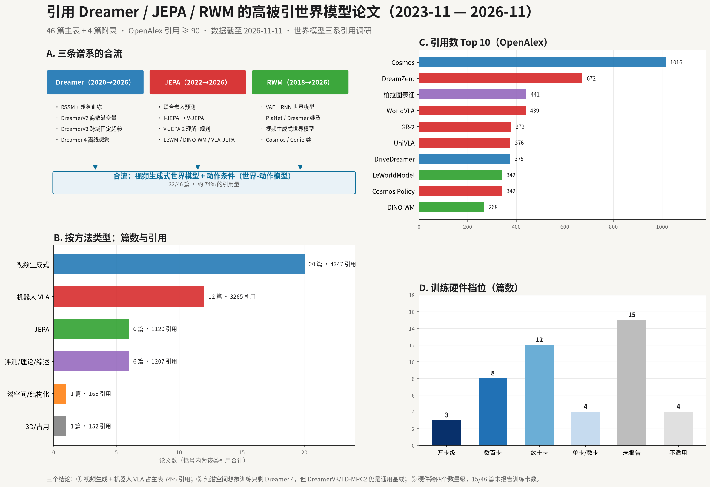

# 00 总览：引用 Dreamer / JEPA / RWM 的高被引论文（2023-11 至 2026-11）

> 本知识库回答一个具体问题：**近三年里，哪些高被引论文在 Dreamer、JEPA、RWM 三条世界模型谱系上继续做研究？它们的动机、贡献、方法和硬件是什么？** 共筛出 46 篇主表论文 + 4 篇窗口外奠基工作，按 6 种方法类型与 7 类创新点双重归类。

**如果只记三件事**

1. **三条线正在合流为“视频生成式世界模型 + 动作条件”**：46 篇主表中视频生成式 20 篇（4347 次引用）、机器人视频-动作/VLA 12 篇（3265 次引用），合计约占主表引用量的 74%。
2. **Dreamer 的“想象训练”被保留、被规模化**：Dreamer 4 用纯离线数据在 Minecraft 拿到钻石；TD-MPC2、WorldVLA、机器人/驾驶工作普遍把 Dreamer 系当基线或骨架。纯 RSSM 新论文很少，说明这条线已进入“被复用”而非“被改进”的阶段。
3. **JEPA 从“表征预训练”变成“世界模型骨架”**：LeWM 把端到端 JEPA 做到单卡数小时，DINO-WM 用预训练特征做零样本规划，VLA-JEPA / FLARE 把 JEPA 潜空间接到机器人策略上；RWM（2018）则以“世界模型”概念源头的方式，主要影响视频生成式世界模型。

## 范围

- **三条谱系（种子）**：
  - **Dreamer**：Dreamer（2020）、DreamerV2（2021）、DreamerV3（2023 arXiv / 2025 Nature）；
  - **JEPA**：I-JEPA（2023）、V-JEPA（2024）、V-JEPA 2（2025），以及 LeCun 2022 立场论文（未被 OpenAlex 收录，仅作概念源头）；
  - **RWM**：World Models（2018）、Recurrent World Models Facilitate Policy Evolution（NeurIPS 2018）；PlaNet（2019）作为 Dreamer 前身一并检索。
- **时间窗口**：2023-11-11 至 2026-11-11（严格三年，按 OpenAlex 出版日期）。2023 年上半年的 4 篇奠基工作（TD-MPC2、UniSim、UniPi、Structured World Models from Human Videos）放在附录 A，避免“近三年”口径被稀释。
- **“高被引”定义**：OpenAlex 引用数 ≥ 90 且主题与世界模型/基于模型的决策/具身策略相关；主表中位数 174 次，最高 1016 次（Cosmos）。
- **不覆盖**：纯 LLM 规划、仅把“世界模型”当背景词的通用综述、医疗/遥感/物联网等跨域引用（见 07 排除清单）。

## 资料索引

| 页面 | 内容 |
|-|-|
| [01 方法与口径](01.md) | 种子论文、检索流程、纳入/排除标准、引用数来源与偏差 |
| [02 主表](02.md) | 46 篇主表论文 × 动机/贡献/方法/硬件（按方法类型分组） |
| [03 按方法类型分类](03.md) | 6 类方法的定义、判别特征、代表论文、适用场景与局限 |
| [04 按创新点分类](04.md) | 7 类创新点的定义、代表论文与为什么重要 |
| [05 三条谱系的演化](05.md) | Dreamer / JEPA / RWM 各自的影响路径与横向对比 |
| [06 硬件与算力](06.md) | 训练/推理硬件、算力量级分布与两条路线 |
| [07 排除清单与局限](07.md) | 只被背景引用的高被引论文、口径偏差与未验证项 |
| [08 参考文献](08.md) | 50 条论文条目 + 9 篇种子论文，含 arXiv 链接 |
| [09 复现与维护](09.md) | 数据文件、脚本、更新方法与维护约定 |

## 一句话结论

1. **2024–2026 的世界模型研究由“生成”主导**：视频生成式世界模型 20 篇、机器人视频-动作模型 12 篇，两者合计 32/46 篇（篇数约占 70%，引用量约占 74%）；纯潜空间动力学（Dreamer/TD-MPC2 式）新工作只剩 1 篇主表。
2. **高被引集中在“把世界模型变成基础模型”与“把世界模型接到机器人”两端**：Cosmos（1016）、DreamZero（672）、WorldVLA（439）、GR-2（379）、UniVLA（376）分别代表这两端。
3. **JEPA 的关键转折是“可训练性”与“可规划性”**：LeWM 用两个损失项解决坍缩与超参问题；DINO-WM 证明不重建像素也能零样本规划；VLA-JEPA 证明 JEPA 潜空间可以直接服务动作。
4. **RWM 的遗产是“世界模型”这一概念框架**，其 2018 年的 VAE+RNN 架构已被视频扩散/自回归 Transformer 取代；近三年引用它的高被引论文绝大多数是视频生成式世界模型。
5. **硬件两极分化**：一端是万卡级基础模型（Cosmos 约 1 万张 H100、Cosmos 3 用 2048 张 GB200），另一端是单卡/数卡高效方案（LeWM 单卡数小时、WorldMem 4 卡、OccWorld 8 张 4090）；15/46 篇未给出具体训练卡数，说明“硬件”仍不是该领域的标准报告项。
6. **“高被引”与“核心贡献”不完全重合**：DINOv2（7769）、扩散模型综述（2274）等引用数远超所有世界模型论文，但只是背景引用，已排除（见 07）。

## 证据分级

| 等级 | 含义 | 本知识库中的例子 |
|-|-|-|
| **论文声称** | 论文摘要/正文自报的数字与结论 | 成功率、FPS、引用数对应的贡献描述 |
| **数据库统计** | OpenAlex 元数据（2026-11-11 抓取） | 引用数、出版年份、引用谱系 |
| **人工判读** | 作者对摘要与全文的归类与概括 | 方法类型、创新点标签、动机/贡献提炼 |
| **未验证** | 未逐篇精读全文的细节 | 个别论文的硬件与实验设置 |

## 维护约定

- 引用数会持续变化：更新时重跑 `analysis/wm-citation/fetch_citations.py`，再跑 `gen_tables.py`，最后同步 02/03/04/06 与 00 的结论。
- 新增论文先进入 `data/entries.py`（人工字段），再经 `normalize.py` 生成 `data/entries.json`；不要在生成的 Markdown 里手改。
- 方法类型与创新点标签是**人工判读**，不是论文自报；改标签时在 03/04 说明理由。
- 论文声称与数据库统计不得混写；引用数一律标注来源与抓取日期。

## 图集

