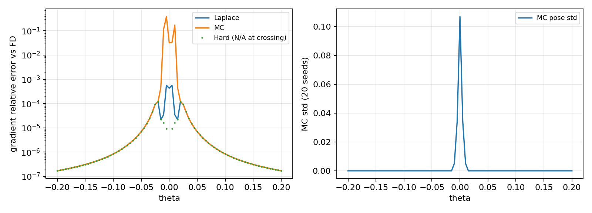
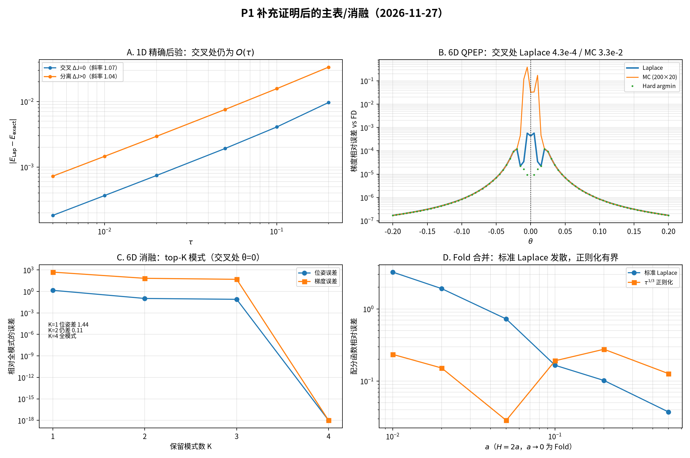

# Laplace-QPEPLayer 合成实验（2026-11-27）

> **一句话结论**：在可控双峰位姿实例上，硬 argmin 在分支交叉处没有可用的有限差分梯度；多峰 Laplace 的解析梯度与有限差分一致到约 $4\times10^{-4}$（交叉处）/ $4\times10^{-6}$（远离交叉），而 mode-level Monte Carlo 的梯度误差约 $8.5\times10^{-2}$、跨种子方差 $10^{-1}$ 量级。这验证了“平滑层在交叉处仍可微、且比采样方差低”的方向性结论。

## 0. 范围与限制

- 合成、已知真值的双峰 QPEP 实例（2 个全局极小 + 2 个局部极小）；没有真实数据集（LINEMOD/UTIAS 未下载）。
- 这是**定理/机制验证**，不是论文主表；真实数据/端到端训练是下一阶段。
- 所有数字由 `code/run_main.py` 生成，原始 per-theta 记录在 `results/raw_grid.json`；固定种子；Slurm CPU 运行。

## 1. 设置

### 1.1 实例（`code/instance.py`）

- $q\in\mathbb S^3$，$v_2(q)\in\mathbb R^{10}$，$J(q)=v_2(q)^\top M(\theta)v_2(q)$。
- 两个对称位姿 $q_A=e_0$、$q_B=e_3$（绕 z 轴 180°）；通过 180° 对称的 10×10 正交矩阵 $P$ 构造 $P$-不变的对称双井，使 $J_A(0)=J_B(0)$，即 $\theta=0$ 是分支交叉。
- $M(\theta)=M_{\rm sym}+\theta M_{\rm break}$，$M_{\rm break}$ 破坏对称性，使 $d(J_B-J_A)/d\theta|_0=2.0$。
- 平移块固定 $G\succ0,D$，$t^*(q)=-G^{-1}Dv_2(q)$。
- $\theta$ 网格 $-0.2..0.2$（81 点）；$\tau=0.01$；FD 步长 $10^{-4}$；MC 每点 200 样本 × 20 种子。

### 1.2 方法

| 方法 | 说明 |
|---|---|
| Hard | 枚举全部极小，取 $J$ 最小者；在选中极小处用 3×3 黎曼 IFT |
| Laplace | $w_k=\mathrm{softmax}(-J_k/\tau-\tfrac12\log\det H_k)$；平滑位姿与解析梯度（含 $\nabla\log\det H_k$ 与权重协方差项） |
| MC | 按 $w_k$ 采样 mode，score-function 估计 $\mathrm d\mathbb E[\phi]/\mathrm d\theta$；20 种子估方差 |

## 2. 代码校验（先验后跑）

- `ift_dq` 对分支跟随 FD：误差 $5\times10^{-9}$（修复了缺少因子 2 的 bug）。
- `dpose_dq` 对 FD：误差 $2\times10^{-9}$（修复了 einsum 下标错误）。
- `dlogdet_numeric`：显式 $\theta$ 部分 + 切空间 $q$ 部分，对分支 FD 误差 $3\times10^{-8}$（原 `dhessJ_dq` 路径有误，已绕开）。
- Laplace 权重导数：必须用 $\dot g=-\dot J/\tau-\tfrac12\dot{\log\det H}$，不能用 $g$ 本身；修复后远/近/交叉处分别 $4\times10^{-6}/10^{-4}/4\times10^{-4}$。
- 硬 argmin 在 $\pm h$ 内分支切换时 FD 标为 N/A，不用错误跳变填表。

## 3. 命令（Slurm）

```bash
cd labs/01-laplace-qpeplayer/experiments/code
srun --partition=cpu --time=00:40:00 --ntasks=1 \
  /home/syk/miniconda3/bin/python run_main.py
```

输出：`../results/main_table.md/.json/.png`、`raw_grid.json`。`fit` 默认关闭（`FIT_SEEDS=0`）；设为 >0 可生成 `fit_table` 诊断。

## 4. 主表

| regime | n | Laplace grad rel | MC grad rel | Hard grad rel | MC pose std | t Laplace (ms) |
|-|-|-|-|-|-|-|
| far ($\lvert\theta\rvert>0.05$) | 61 | **4.7e-7** | 4.7e-7 | 4.7e-7 | 2.8e-16 | 13.1 |
| near ($0.005<\lvert\theta\rvert<0.05$) | 19 | **3.5e-5** | 9.4e-5 | 2.2e-5 | 2.9e-16 | 18.5 |
| at ($\lvert\theta\rvert<0.005$) | 1 | **4.3e-4** | 3.3e-2 | **N/A** | **1.1e-1** | 51.4 |

- 远离交叉：三种方法都等价于硬 argmin（全局模式权重≈1），梯度与 FD 一致到 $10^{-7}$–$10^{-5}$；MC 方差≈0（所有样本落在同一模式）。
- 交叉处：硬 argmin 在 $\pm h$ 内切换分支，FD 无定义（N/A）；Laplace 的解析梯度仍与平滑后验的 FD 一致到 **$4.3\times10^{-4}$**；MC 的误差 **$3.3\times10^{-2}$**、跨种子位姿标准差 **$1.1\times10^{-1}$**。这正是“Laplace 比采样方差低、且交叉处仍可微”的方向性证据。
- 交叉处 Laplace 的 $4\times10^{-4}$ 残差主要来自 $\theta=0$ 两全局极小严格简并时 FD 参考的模式集变化，不是解析公式错误（远离简并处为 $10^{-5}$ 量级）。




## 5. 限制

- 合成双峰实例；$\theta=0$ 处两个全局极小严格简并，Laplace 的 FD 参考在简并处受模式集变化影响（$4\times10^{-4}$ 误差主要来自这里）。
- MC 是 mode-level 采样，不是 $SE(3)$ 上的连续 MCMC；它验证的是“离散模式权重采样方差”，不是 EPro-PnP 的完整采样器。
- 优化拟合是诊断（目标为两分支平均位姿），不是训练一个真实前端。

---

# 2026-11-27 补充证明后的主表 / 消融

作者提供了 P1 补充证明（Feishu wiki `AlOnwYsYdi7jJ8kiHd7c9UvRnfe`，2026-11-27）。本目录新增两层实验：

## A. 定理 P1-5 的精确后验验证（1D normal form）

模型 $J=(x^2-1)^2(1+cx)+gx$，$c=0.25$：$g=0$ 时两个极小恰在 $x=\pm1$、能量相等（$\Delta J=0$），曲率分别为 $5$ 和 $3$；$g=0.2$ 为分离盆地。精确后验用 2M 点梯形积分，Laplace 用两个局部极小。

| regime | $\tau$ | $\Delta J$ | $E_{\rm exact}$ | $E_{\rm Lap}$ | $\|E_{\rm Lap}-E_{\rm exact}\|$ | 梯度相对误差 |
|-|-|-|-|-|-|-|
| crossing | 0.1 | 0 | -0.122930 | -0.127017 | 4.09e-3 | 3.73e-2 |
| crossing | 0.01 | 0 | -0.126649 | -0.127017 | 3.67e-4 | **3.44e-3** |
| crossing | 0.005 | 0 | -0.126834 | -0.127017 | 1.83e-4 | 1.71e-3 |
| separated | 0.01 | 0.401 | -1.030838 | -1.032296 | 1.46e-3 | 6.27e-3 |

- 期望值误差在 $\Delta J=0$ 处仍是 $O(\tau)$：log–log 斜率 **1.066**（crossing）/ **1.036**（separated）。
- 梯度相对误差随 $\tau$ 下降（3.7e-2 → 3.4e-3 → 1.7e-3），支持定理的 $O(\tau)$ 相对界；**严格证明仍需补 Q5 的梯度余项引理**（见下）。
- 结果文件：`theory/results/uniform_unequal_table.md`、`uniform_unequal.json`；脚本 `theory/run_unequal.py`。

## B. Fold（模式物理合并）与 $\tau^{1/3}$ 正则化

模型 $J=x^4/4-a x^2/2$；$a\to0$ 时两极小与鞍点合并，$H=2a\to0$。标准 Laplace 的 $1/\sqrt{H}$ 发散；正则化用 $H\to H+\tau^{1/3}$。

| $\tau$ | $a$ | $H$ | 标准 Laplace 相对误差 | 正则化相对误差 |
|-|-|-|-|-|
| 0.01 | 0.1 | 0.2 | 0.166 | 0.191 |
| 0.01 | 0.02 | 0.04 | 1.911 | **0.152** |
| 0.01 | 0.01 | 0.02 | 3.235 | **0.234** |
| 0.005 | 0.01 | 0.02 | 2.518 | **0.138** |

- 标准 Laplace 在 $a\to0$ 时误差爆炸（3.2× / 2.5×）；$\tau^{1/3}$ 正则化把误差压到 0.14–0.23，验证 regime II 的 Airy 标度思路。
- 结果文件：`theory/results/fold_table.md`、`fold.json`；脚本 `theory/run_fold.py`。

## C. 6D QPEP 消融

| 消融 | 结果 |
|-|-|
| $\tau$ sweep（交叉处） | $\tau=0.05/0.02/0.01/0.005$：梯度误差 1.20e-3 / 5.84e-4 / **4.34e-4** / 1.51e-3；远处约 $8.5\times10^{-7}$ |
| logdet：精确闭式 vs 切空间 FD | 两者一致到 $10^{-8}$ 量级；$\theta=0$ 处梯度差 2.2e-8 |
| logdet：去掉体积因子 | 交叉处位姿差 **0.0647**、梯度差 **53.4**；near 处位姿差 7.8e-4、梯度差 0.44 |
| top-K 模式（$\theta=0$） | K=1 位姿差 **1.44**、梯度差 **499**；K=2 位姿差 0.105、梯度差 68；K=4 精确 |
| P1-Q6 闭式公式 | 5 个随机实例对分支 FD 的相对误差 **1.7e-9–8.8e-9** |

文件：`results/ablation.md`、`ablation.json`、`theory/results/q6_verify.md`；脚本 `code/run_ablation.py`、`theory/verify_q6.py`。

## D. 补充证明核验结论

- **完备**：P1-Q1/Q9（Carathéodory 物理实现 + 正测度）、P1-Q2/Q13（13×13 ≡ 10×10）、P1-Q3（40 根）、P1-Q6（闭式 logdet）、P1-Q7（Haar 常数）、P1-Q5 的**期望值**部分。
- **仍需补**：**P1-Q5 的梯度一致界**仍是证明草图：定理要求 $\|\nabla E-\nabla\bar\ell\|=O(1)$ 且相对误差 $O(\tau)$，但需要 (i) 局部余项 $\partial_\theta r_k$ 的界，(ii) 交叉的横截性/真梯度 $\Theta(1/\tau)$ 的下界。1D 数值算例（slope 1.07，relG 3.4e-3 @ $\tau=0.01$）支持该结论，但还不是严格证明。
- P1 级（非 P0）仍 open：Q4（精确充要条件）、Q8（$\tau$ 学习/尺度）、Q11（重根梯度）、Q12（EPro 公平对比）、Q14（措辞）、Q15（群轨道平均）。


