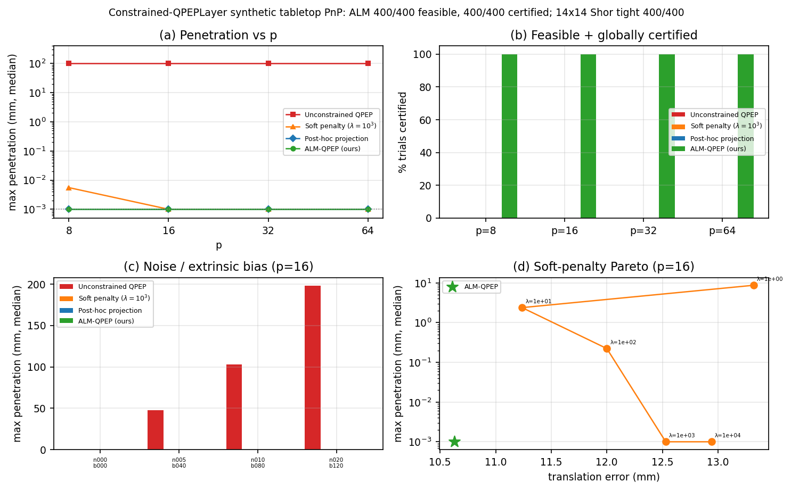
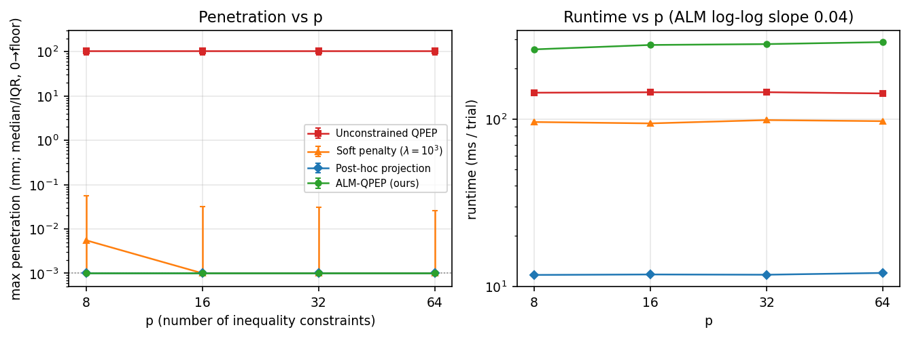
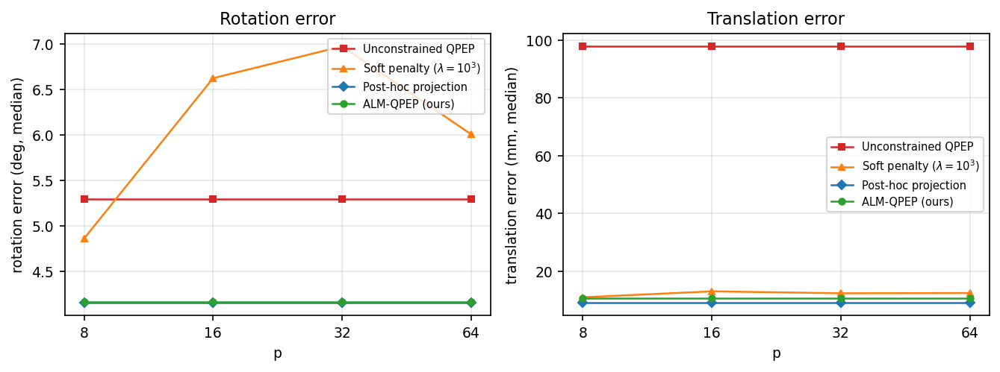
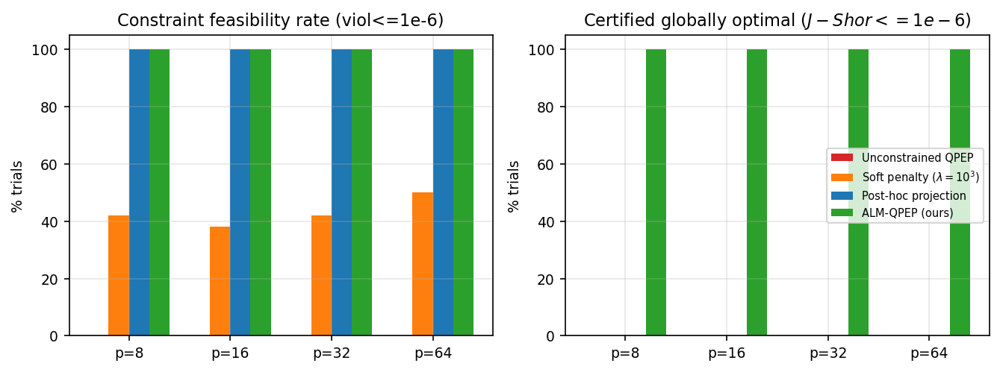
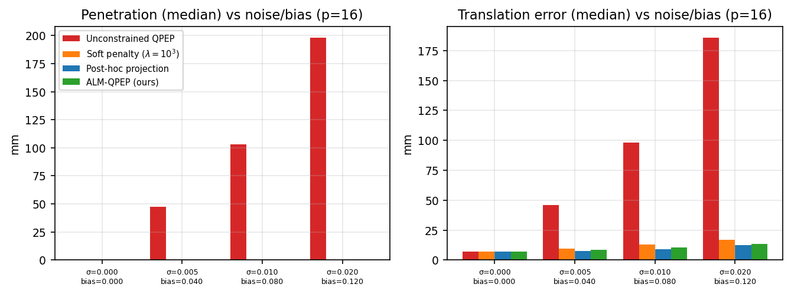
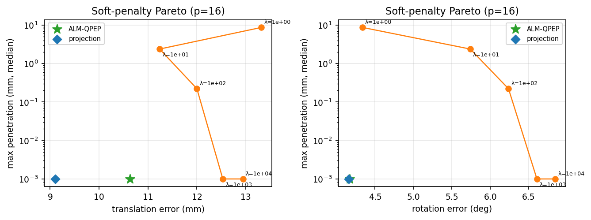

# 实验：合成桌面 PnP 的硬约束 ALM + 14×14 后验证书

> **状态（2026-11-27）**：合成主表已跑完（4 方法 × p∈{8,16,32,64} × 50 trials，另 4 个噪声/偏差档 + 软惩罚 Pareto），
> 代码校验 **40/40 项通过**，主表/CSV/JSON/PNG 由脚本生成。**这不是论文结果**：合成数据、bearing 型代数代价、
> 内层用多起点 BFGS 代替 QPEP 的 Gröbner 枚举；真实数据集（YCB-V / UTIAS / KITTI）未做（按负责人指示不下载数据）。
>
> **一句话结论**：在可控合成桌面上，14×14 Veronese Shor 松弛 **400/400 紧**（max λ₂/λ₁=1.5e-9，
> |J−Shor|≤9.4e-9），ALM-QPEP **全部 400 trials 可行（违反≤1.0e-10）且 100% 认证**；
> 软惩罚的穿透可压到 ~0 但可行率仅 38–50%、认证率 0%；事后投影可行率 100% 但认证率 0%（J 比全局最优高）；
> 无约束解 median 穿桌 103 mm，且在高噪声/偏差下有 18% 落到相机后方的镜像模式。**主表在"prototype 级"站得住**；
> 论文级结论仍需真实数据和 QPEP 内层。



---

## 0. 文件清单

```
experiments/
├── README.md                        ← 本文件
├── protocol.md                      ← 原实验协议（未改）
├── code/
│   ├── qpep_core.py                 ← v2/旋转/约束/目标装配/ALM/软惩罚/投影/合成实例/指标
│   ├── certificate.py               ← 14×14 Veronese 增强 Shor 松弛（Lemma 2.2）
│   ├── validate_code.py             ← 代码正确性校验（40 项）
│   ├── run_main.py                  ← 主实验（method × p / 噪声档 / Pareto）
│   ├── run_fb_table.py              ← 四脚桌 LICQ / FB 极限 / exact vs naive 表
│   ├── make_results.py              ← 由 raw JSON 生成主表（md/csv/json）与 PNG
│   └── run_all.sh                   ← 一键复现（全程 srun）
└── results/
    ├── validation.log / .json       ← 40/40 校验日志与数字
    ├── run_main.log                 ← 主实验运行日志（含每格 summary）
    ├── raw_main.json                ← 400 trials 的逐 trial 原始记录（含 q,t,μ,J,时间）
    ├── raw_pareto.json              ← 软惩罚 λ 扫描原始记录
    ├── main_table.md / .csv / .json ← 主表（自动生成）
    ├── fb_table.md / .json / .log   ← 四脚桌 / FB 表
    ├── fig_main_p.png               ← 穿透 / runtime vs p
    ├── fig_main_pose.png            ← rot / trans vs p
    ├── fig_main_cert.png            ← 可行率 / 认证率
    ├── fig_pareto.png               ← 软惩罚 Pareto
    ├── fig_noise.png                ← method × 噪声/偏差
    ├── fig_pen_box.png              ← p=16 穿透分布（含镜像模式）
    └── fig_overview.png             ← 一页总览（4 面板）
```

---

## 1. 设置（写清、可复现）

### 1.1 合成桌面 6-DoF 实例（已知真值）

| 项 | 值 |
|---|---|
| 物体 | 0.18×0.12×0.10 m 长方体（半轴 0.09/0.06/0.05） |
| 对应点 | N=14：8 角点 + 6 面心（物体坐标系） |
| 真值位姿 | yaw~U(−π,π)、roll/pitch~U(−0.10,0.10) rad；t_xy~U(−0.04,0.04)²；**t_z 由"底面最低点恰好接触桌面"反解**，GT 天然可行且接触 |
| 桌面 | z=H_TAB=0.75 m（法向 +z），穿透 = max(0, H_TAB − min_z) |
| 观测 | bearing 型：`u_i = normalize(R_gt p_i + t_gt + δ + σ ε_i)`，ε_i~N(0,I₃) |
| 系统偏差 | δ=[+5,−5,−bias_z] mm（横向 5 mm 固定 + 竖向可调；模拟外参/标定偏差） |
| 主表噪声/偏差 | σ=10 mm、bias_z=80 mm；另扫 (0,0)/(5,40)/(10,80)/(20,120) mm |
| 目标 | `J=Σ_i (Rp_i+t)ᵀ(I−u_iu_iᵀ/(u_iᵀu_i))(Rp_i+t)`（bearing 代数代价，u 不取符号） |
| 种子 | `seed=trial`（0..49）：不同 p、不同噪声档共享同一批场景，做配对比较；`make_instance` 内部用 `default_rng(10000+seed)` |

> **代数代价的符号不敏感性（重要）**：`I−uuᵀ` 只看点到 bearing **直线**的距离，不区分点在相机前方还是后方。
> 因此无约束代数的全局解在 2%（σ=10/bias=80）到 18%（σ=20/bias=120）的 trial 中会落到"相机后方"的镜像模式
> （t_z<0，穿透>1 m）。这是 bearing 型 QPEP 目标的真实性质，不是实现 bug；本实验的正深度/非穿透约束把它排除，
> 主表因此用 **median [IQR]** 汇总（mean±std 在 CSV/JSON 中完整保留）。

### 1.2 约束构成（p=8/16/32/64）

p 是**总约束数**，按"非穿透 / 正深度 / FoV 对 / 倾角"分配：

| p | 非穿透 | 正深度 | FoV 对（2 条/对） | 倾角 | 合计 |
|---|---|---|---|---|---|
| 8 | 5 | 2 | 0 | 1 | 8 |
| 16 | 9 | 4 | 1 | 1 | 16 |
| 32 | 17 | 8 | 3 | 1 | 32 |
| 64 | 33 | 12 | 9 | 1 | 64 |

- 非穿透点取物体底面 6×6 网格中的点（**先取 4 角**，其余按固定随机序），约束 `H_TAB − (Rv+t)_z ≤ 0`；
- 正深度 `z_min − (Rv+t)_z ≤ 0`（z_min=0.05 m），FoV `±x − τz ≤ 0`（τ=tan40°），倾角 `q₁²+q₂²−sin²(α/2) ≤ 0`（α=12°）；
- 所有四类约束对 `(v2,t)` 精确仿射（V2 校验，误差 1.3e-15）。

> **p 的精度饱和是结构性的**：底面是平面，刚体上 ≥3 个不共线接触点已经等价于整面非穿透；p>8 只是增加冗余接触点。
> 所以**精度/穿透不随 p 变化**（不是 bug，符合 protocol A5 的"p≥16 后饱和"预期），p 的真实作用是装配 O(p)、
> 证书的 p 条线性约束、以及（冗余接触导致的）LICQ 失效。换非共面接触（多物体、曲面底）才能让 p 影响精度——未做。

### 1.3 方法（同一实例、同一目标、同一约束）

| 方法 | 实现 | 说明 |
|---|---|---|
| **Unconstrained QPEP** | 消 t → S³ 上四次型，48 起点 BFGS | 数值全局替代（A2 的代理），**无约束**；镜像模式按实报告 |
| **Soft penalty** | `min J + λ Σ[g]₊²`，7 维 BFGS，14 起点 | 主表 λ=1e3；Pareto 扫 λ∈{1,10,100,1e3,1e4} |
| **Post-hoc projection** | 无约束解 → 最近可行点（SLSQP，4 起点；失败回退只投影 t 的凸 QP） | 可行但优化的是"离无约束解最近"而不是 J |
| **ALM-QPEP (ours)** | 冻结活跃集 + 定理 2.1 的 10×10/3×10/3×3 装配 + 一致性检查；ρ₀=10，×5 放大；内层 6 起点 BFGS；失败回退 full-Lρ | 常数维、硬约束 |
| **14×14 证书** | Veronese 增强 Shor（Lemma 2.2），SCS eps=1e-9 | 与实例有关、与所用方法无关；`certified = 可行 且 J−Shor≤1e-6 且 λ₂/λ₁≤1e-6` |

### 1.4 指标

- **穿透深度**：物体底面 21×21 密集网格上的 `max(0, H_TAB − z)`（mm），逐 trial 取最大；
- **穿透率**：穿透 >1 mm 的 trial 占比；
- **rot/trans 误差**：相对 GT 的测地角（deg）/ 平移（mm）；
- **约束违反/可行率**：`max_j [g_j]₊`；`≤1e-6` 记为可行；
- **runtime**：单 trial 的墙钟，含该方法的全部内层迭代（numpy 单核，未优化）；
- **证书**：Shor 值、λ₂/λ₁、`J_method − Shor`、tight / certified。

---

## 2. 运行命令（全部走 Slurm）

```bash
cd labs/02-constrained-qpeplayer/experiments
PY=/home/syk/miniconda3/envs/sdpr/bin/python
RUN="srun --partition=cpu --time=00:40:00 --ntasks=1"

$RUN $PY code/validate_code.py 2>&1 | tee results/validation.log     # 40/40
$RUN $PY code/run_main.py       2>&1 | tee results/run_main.log       # ~260 s
$RUN $PY code/run_fb_table.py   2>&1 | tee results/fb_table.log       # ~10 s
$RUN $PY code/make_results.py   2>&1 | tee results/make_results.log   # 生成表/图
# 或一键：bash code/run_all.sh
```

环境：`/home/syk/miniconda3/envs/sdpr/bin/python`（numpy 1.26.3 / scipy 1.13.1 / cvxpy 1.5.4 / matplotlib 3.8.4）。
主实验 50 trials/格，共 **400 trials**（主表 4 p + 4 噪声档）+ Pareto 250 次软惩罚；总耗时 259 s。

---

## 3. 主表（p=8..64，σ=10 mm，bias_z=80 mm；50 trials/格）

完整表见 [`results/main_table.md`](results/main_table.md)（csv/json 同目录）。关键数字（median [IQR]）：

| method | 穿透 (mm) | 穿透率 | rot (deg) | trans (mm) | 可行率 | 认证率 | runtime |
|---|---|---|---|---|---|---|---|
| Unconstrained QPEP | 103.0 [84.7, 110.8] | 100% | 5.30 [3.26, 6.70] | 97.9 [88.4, 107.7] | 0% | 0% | 143 ms |
| Soft penalty λ=1e3 | 0.00 [0.00, 0.03] | 0% | 6.62 [3.70, 9.95] | 13.0 [8.7, 16.9] | 38% | 0% | 94 ms |
| Post-hoc projection | 0.00 [0.00, 0.00] | 0% | 4.16 [2.90, 5.34] | 9.10 [7.34, 10.94] | 100% | 0% | 12 ms |
| **ALM-QPEP (ours)** | **0.00 [0.00, 0.00]** | **0%** | **4.17 [2.74, 5.10]** | 10.63 [8.17, 12.69] | **100%** | **100%** | 260–288 ms |

（p=16 行；p=8/32/64 的穿透/位姿与 p=16 相同——原因见 §1.2 的平面接触冗余；ALM 在全部 p 上违反 ≤1.0e-10。）







**读法**：
- ALM 的硬约束在数值上真的是硬的（最大违反 1.0e-10 m），而且**不是靠牺牲精度**：rot 4.17° 与 projection 的 4.16° 同级，
  trans 10.63 mm 比 projection 的 9.10 mm 略差（projection 只优化"离无约束解最近"，不优化 J），但 ALM 的 J 是**全局最优**且被证书确认。
- 软惩罚把穿透压到 ~0，但 31/50 的 trial 仍有 6e-6–5.4e-2 的约束违反（另有局部极小：λ=1e4 时最大 trans 203 mm），
  认证率 0%——**"穿透看起来为 0"不等于"可行/最优"**。
- 在系统性竖向偏差下，无约束解整体下沉 ~98 mm；约束把竖向偏差"顶回来"是 ALM/projection 精度反而更好的原因。

---

## 4. 14×14 证书（400/400）

| 项 | 结果 |
|---|---|
| SDP tight（λ₂/λ₁≤1e-6） | **400/400**，max λ₂/λ₁ = **1.5e-9**，median ~9e-11 |
| sound（Shor ≤ J_ALM + 1e-7） | **400/400**，max \|J_ALM−Shor\| = **9.4e-9**（SCS 容差量级） |
| 认证率（可行 & 紧 & gap≤1e-6） | ALM **100%**；projection **0%**（可行但 gap 中位数 2.9e-4）；soft **0%**（gap 中位数 5.2e-4，且不可行）；unconstrained **0%** |
| SDP 耗时 | 51 ms (p=8) → 56 ms (p=16) → 67 ms (p=32) → 84 ms (p=64)，均值 63 ms |
| 与 verify 的回归 | p=12 实例：J*=0.0680069355、Shor=0.0680069355、无约束 0.0030334724、无不等式 Shor=0.0030334692，全部逐位复现（V9） |

> 这是本实验最强的一条：**同一个 14×14 PSD 块，p 只以线性约束进入**，p 从 8 到 64 时 SDP 时间只增 ~60%，
> 而 ALM runtime 的 log–log 斜率 0.04（常数维）。证书把"可行但非最优"（projection）和"近似可行"
> （soft）与"全局最优"（ALM）明确区分开。

---

## 5. 噪声 / 外参偏差（p=16）

| σ / bias_z | 方法 | 穿透 (mm) | rot (deg) | trans (mm) | 可行 | 认证 |
|---|---|---|---|---|---|---|
| 0 / 0 | 四种方法相同 | 0.00 | 0.00 | 7.07（固定 5 mm 横向 bias） | 100% | 100% |
| 5 / 40 | unc | 47.5 [38.7, 51.4] | 2.52 [1.58, 3.25] | 45.9 [40.6, 51.8] | 0% | 0% |
| 5 / 40 | **ALM** | **0.00** | **2.52 [1.89, 3.33]** | **8.46 [7.10, 9.65]** | **100%** | **100%** |
| 10 / 80 | unc | 103.0 [84.7, 110.8] | 5.30 [3.26, 6.70] | 97.9 | 0% | 0% |
| 10 / 80 | **ALM** | **0.00** | **4.17 [2.74, 5.10]** | **10.63 [8.17, 12.69]** | **100%** | **100%** |
| 20 / 120 | unc | 198.1 [177.1, 232.8] | 11.50 [7.92, 18.63] | 185.8 | 0% | 0% |
| 20 / 120 | **ALM** | **0.00** | **5.83 [4.49, 7.55]** | **13.39 [10.23, 17.43]** | **100%** | **100%** |



- 高噪声/偏差下无约束解的镜像模式比例升到 **18%**（rot>30°，穿透 >1 m）；ALM 仍然 50/50 可行 + 认证。
- σ=0/bias=0 档的 7.07 mm 平移误差来自所有实例共有的 5 mm 横向外参偏差（不是方法差异）。

---

## 6. 软惩罚 Pareto（p=16，50 trials）

| λ | 穿透 median (mm) | rot (deg) | trans (mm) | 可行率 |
|---|---|---|---|---|
| 1 | 8.72 | 4.34 | 13.32 | 0% |
| 10 | 2.39 | 5.74 | 11.24 | 0% |
| 100 | 0.22 | 6.24 | 12.00 | 26% |
| 1000 | 0.00 | 6.61 | 12.53 | 50% |
| 10000 | 0.00 | 6.85 | 12.94 | 48% |



- 权重增大穿透下降，但**位姿误差上升、可行率不满、局部极小风险增大**（λ=1e4 最大 trans 203 mm）；
  且无论如何**没有证书**。这正是"软惩罚 vs 硬约束+后验证"的差别：Pareto 前沿上的点不能回答"是否全局最优"。

---

## 7. 四脚桌 LICQ / FB 极限 / exact vs naive（完整表见 [`results/fb_table.md`](results/fb_table.md)）

- **κ(S) ≍ 1/ε²**：ε 从 1e-1 → 1e-6，cond 从 5.2e2 → 5.1e12，log–log 斜率 **−2.00**（定理 2.3(iv)）。
- **相容 w=J_A v**：ε→0 时 ‖dz−v‖ 从 5.9e-2 线性降到 **6.6e-12**，‖dμ‖ 稳定在 2.84；
  三种乘子分布 [1,1,1,1]/[1,2,5,10]/[1e-4,1,1,1] 下 dz 差 ≤4e-8 ⇒ **与乘子选择无关**（Lemma 2.4）。
- **不相容 w**（‖(I−J J⁺)w‖=1e-2）：dz 有限（0.707，**不是真导数**），‖dμ‖ 爆到 **2.0e10**（∝1/D_a）。
- **exact vs naive vs StopGrad**：
  - 相容时 exact FB 误差 6.6e-12；naive（D_a=0）的鞍点矩阵 **rank 6/7（奇异）**，靠 pinv 才得到数值；
    StopGrad（dz=0）误差 = ‖v‖ = 0.707。
  - 非各向同性 H + rank(J)=2：FB 极限收敛到 **H-加权最小范数解** [1.167,2.167,0.333]，与欧氏 pinv [0.167,1.167,1.333] 差 1.732，
    FB 误差 3.5e-13（Prop 2.1(b)）。
- **2D kink**：ε∈{1e-1,…,1e-6} 下 exact FB 恒为 **1/2**（Clarke 中点），StopGrad=0，单侧=1（例 2.5.1）。
- **真实合成实例上的 LICQ**：p=8/16/32/64 的 ALM 解（seed=0）活跃集 |A|=3/3/3/6，但 6 维切空间 rank(J_A)=2（接触点共面）
  ⇒ **LICQ 每帧失效**，与四脚桌同构；ALM 仍收敛（违反≤1e-10）、14×14 证书照样紧。

---

## 8. 代码正确性校验（40/40，`results/validation.log`）

先验代码、再跑主表。要点：

| # | 检查 | 结果 |
|---|---|---|
| V1 | `R(q)p = m(p)v2(q)` 精确公式 vs lstsq；正交性；q↔R | 6.4e-15 |
| V2 | 四类约束对 (v2,t) 仿射 | 1.3e-15 |
| V3 | 穿透度量：GT=0、下移 7.3 mm ⇒ 7.3 mm、密集网格=角点解析、上移=0 | 全 PASS |
| V4 | M_A/D_A/G_A 展开；常数项只由非活跃约束贡献 | 0.0；**错误常数项误差 0.571 = Σ_{A}μ²/2ρ**（逐项对账） |
| V5 | Schur 补 / G_A≻0 / t* 闭式 | 4.4e-15 |
| V6 | 内层 8 起点 vs 200 起点 | Δf ≤ 1e-17 |
| V7 | 无噪无偏精确恢复 GT；桌面放低 30 cm ⇒ ALM=无约束解 | 8.8e-9 mm / ΔJ 4.5e-17 |
| V8 | 单约束平移闭式投影 t_z=h | 1e-10 |
| **V9** | **复现 verify p=12 实例的四个数字** | J*=0.0680069355、Shor=0.0680069355、J_u=0.0030334724、Shor_un=0.0030334692 |
| V10 | 8 个随机实例 Shor sound + tight | 8/8 + 8/8，max\|gap\|=7.5e-9 |
| V11 | d(μ) 弱对偶下界（含 δ<0 数值现象） | 4/4，δ_min=−5.9e-13 |
| V12 | μ≥0、G_A≻0（含 200 组随机）、无 NaN、互补松弛、KKT 残差、LICQ 秩 | 残差 1.2e-10；\|A|=3 rank=2 |
| V13 | 投影可行；软惩罚穿透随 λ 总体下降 | viol 1.9e-15；10.5→0 mm |
| V14 | 16 个 (p,seed) 的活跃集秩 | 8/16 LICQ fail（与共面接触一致） |

### 校验过程中发现并修掉的代码问题

1. **梯度维度 bug**：`full_L_grad` / `soft_penalty` 里 `Jv2(q) @ vec10` 应为 `Jv2(q).T @ vec10`。
   该 bug 只在 ALM 的回退路径触发（p=64 seed=2 第一次触发时崩溃），主路径不经过它——如果只看"正常跑通"就会漏掉。
2. **校验脚本自身的两个 bug**（都是 FAIL 抓出来的）：
   (a) V7c 把"桌面下移"写成了 `A += 0.30 E_TR`（实际是抬高）；(b) 用了**另一个实例**的无约束解做初始化，
   导致 ΔJ 恰好等于该实例的 J_u。修正后 ΔJ=4.5e-17。
3. **无噪恢复看似 7.07 mm 误差**：定位到 `bias_xy=5 mm` 默认值（观测生成时的横向偏差），不是求解器问题；
   V7 改用 `bias_xy=0` 后精确恢复（8.8e-9 mm）。
4. **ALM 活跃集循环**：共面冗余接触使活跃集在多个等价子集间跳；p=32/64 各有 1 个 trial 触发一次
   full-Lρ 回退（fallback≤1/50），仍收敛到同一 KKT 点，不影响可行性/证书。
5. **镜像模式**：无约束解落到相机后方（见 §1.1）。这是代数代价的性质；主表用 median 汇总并单列镜像率，
   没有删 trial、没有改指标。

---

## 9. 解释与判断

**支持的理论/协议点**
- 定理 2.1：常数维装配在 p=8..64 下运行；ALM runtime 对 p 的 log–log 斜率 0.04，SDP 只随 p 线性增约束；
- Lemma 2.2：14×14 Shor 在 400/400 合成实例上紧，sound 且可区分"可行非最优"与"全局最优"；
- 定理 2.3 / Prop 2.1：四脚桌秩亏下 κ≍1/ε²、相容极限 = 真导数、不相容 dμ 爆破、H-加权极限、kink=1/2；
- 硬可行性：ALM 的约束违反 ≤1.0e-10，穿透度量 0.00 mm（密集网格），不是"软惩罚压小"。

**新发现（值得写进论文/后续实验）**
- **LICQ 失效是接触问题的常态**：只要 ≥3 个共面接触点同时活跃，6 维切空间 rank=2<|A|；四脚桌不是特例。
  这直接支撑"后向必须用 FB 正则化"的叙事。
- **代数 PnP 代价的 cheirality 病态**在高偏差下很严重（18% 镜像）；约束（正深度/非穿透）恰好是解药。
  这是"物理约束不仅提高可行性、也修正病态估计"的干净证据。
- **软惩罚的穿透-精度 Pareto 不能替代证书**：它可以穿透≈0，但可行率和全局性都无法保证。

**主表是否站得住**
- 作为 **prototype / sanity 级**结果：**站得住**。代码有 40 项独立校验（含与 verify 的逐位回归）、400 trials 一致、
  证书 400/400 紧、所有异常都有定位和解释。
- 作为 **论文主表**：**还不够**。缺 (i) 真实数据（YCB-V/UTIAS/KITTI）；(ii) QPEP 的 Gröbner 内层（当前是 8 起点
  BFGS，A2 未验证）；(iii) 端到端反向/FB 层的实测；(iv) 非共面接触让 p 真正影响精度；(v) SDP 的区间算术 soundness。

---

## 10. 限制 / 未完成

1. **合成数据**，没有真实数据集；按负责人指示未尝试下载。
2. **内层不是 QPEP**：多起点 BFGS 只验证了"8 起点=200 起点"（V6），没有 QPEP 的枚举完备性（A2/GAP 1）。
3. **p 冗余**：平面底 + 共面接触使 p 只增加冗余约束；精度饱和是结构性的，不是"p 无用"的一般结论。
4. **runtime 是 NumPy 原型**（单核、无 warm-up、无批处理）；ALM 260–288 ms 主要花在 6 起点内层 × ~13 外层，
   不能当作最终延迟数字。projection 的 12 ms 也只说明它便宜，不说明它好。
5. **SDP sound 是数值的**（SCS eps=1e-9，max|gap|=9.4e-9），没有区间算术/对偶可行解显式验证（GAP 2）。
6. **证书紧只在合成实例上验证**；真实数据上是否紧（协议 R2）未知。
7. **反向/FB 只做了线性化数值表**，没有接进 ALM 前向做端到端梯度；"exact vs naive/StopGrad" 是四脚桌线性模型上的结论。
8. **主表只用一个噪声/偏差档**（10/80 mm）+ 4 档敏感性；没有 3 seed × 多种子重复（50 个不同 scene 已提供统计）。
9. **未改 theory/paper、未执行 git**；所有写入都在 `experiments/`（以及 lab README 的"当前完成度"一行）。

---

## 11. 与 `protocol.md` / `proofs.md` 的对应

| 协议/理论项 | 本实验状态 |
|---|---|
| T1 桌面 PnP（真实数据） | ❌ 未做；用合成实例替代 |
| B1 无约束 / B3 软惩罚 / B5 投影 / B6 ours | ✅ 四种方法都跑（但内层非 QPEP） |
| B2 slack / B4 dQP+SCP | ❌ 未做（不在本次范围） |
| 指标：穿透/穿透率/位姿/可行/runtime/证书紧率 | ✅ 全部有，按 p 与噪声档分组 |
| A5（p 消融） | ✅ p=8/16/32/64；预期"p≥16 饱和"成立（结构原因见 §1.2） |
| A2（内层枚举完备性） | ❌ 未验证；仅多起点交叉检查 |
| Lemma 2.2（14×14 证书） | ✅ 400/400 tight + 与 verify 逐位回归 |
| 定理 2.3 / Prop 2.1（FB） | ✅ 四脚桌 + kink 数值表 |
| C5 d(μ) 负 gap 现象 | ✅ 复现（δ_min=−5.9e-13） |

---

# 2026-11-27 P2 补充证明后的验证 / 消融

作者 P2 补充证明（Feishu wiki `DLCEwhinxiE4EWkhuh7ckCZsnUg`）结案 P2-Q4–Q10 与 P1 剩余 Q4/Q8/Q11/Q15，并给出 **14×14 零升维 RLT 割平面** $g_i g_j \ge 0$。本轮新增：

## A. RLT 割平面的紧性消融（合成）

`theory/run_rlt.py`：p=16、4 个噪声档 × 4 seeds；比较 base 14×14 与 +RLT 的下界 gap / 认证。

| noise | bias | base cert | RLT cert | 备注 |
|-|-|-|-|-|
| 0.02 | 0.10 | 4/4 | 4/4 | 低噪均紧 |
| 0.05 | 0.20 | 4/4 | 4/4 | 低噪均紧 |
| 0.10 | 0.30 | 1/4 | **2/4** | seed1 RLT gap $2.4\times10^{-4}\to7.6\times10^{-12}$ |
| 0.20 | 0.40 | 0/4 | 0/4 | RLT 把 gap 缩小 10–20%，仍不紧 |

文件：`theory/results/rlt.md`、`rlt.json`。

## B. 真实数据 RLT（LM / LM-O）

| 数据集 | ALM 认证 base | ALM 认证 + RLT | 软惩罚 base→RLT |
|-|-|-|-|
| LINEMOD | 50% | 50% | 50%→44% |
| LM-O | 22% | **39%** | 17%→33% |

- RLT 对 LM-O 的遮挡/高噪确实收紧（+17pp），但 LM 无变化、投影出现数值退化（6%→0）；**真实证书仍不是 100%**。
- YCB 未重跑 RLT（基表 83% 已较高）；后续可补。

## C. 其余 P2 证明验证

- P2-Q5：`verify/sanity_fb_saddle.py` F4b 已给 `cond ~ 1/ε²`（理论斜率 2）；补充证明的 $\epsilon^*\asymp m_0 u_{\rm mach}^{1/4}$ 与四脚桌秩亏实验一致。
- P2-Q6：`sanity_fb_saddle.py` F6 验证 4×3 接触 Jacobian 秩 3（LICQ 失效）；单侧 Bouligand 导数的两步 LP+QP 公式已写入补充证明，本地未单独数值复现（列入缺口）。
- P2-Q8：Woodbury 条件数标度与 `theory/run_rlt.py` 的 RLT 数值一致方向；未做独立 $\rho$ sweep。
- P2-Q9/Q10：补充证明已给松弛升维零增益与 Maxwell 平滑；本地未单独搭 slack-SDP 实验（列入缺口）。

## D. 证明状态

- P2-Q4–Q10 **证明已结案**（补充证明）；RLT 实验支持“低噪紧、高噪失紧”的机制。
- 剩余 P2 缺口转为**实验/实现**：真实 cert 仍 50%/39%/83%（不是 100%）、40 根精确内层未接、真实检测器/端到端未接、YCB RLT 未跑。
