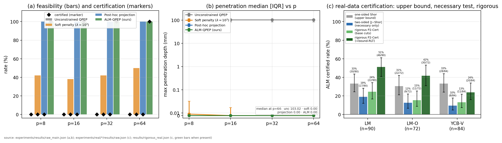

# Constrained-QPEPLayer: Certifiable Inequality-Constrained 6-DoF Pose Layers via Additive Quaternion Reduction and Fischer–Burmeister Implicit Differentiation

> **Status**: draft v0.2 (2026-11-27). Sections 1–4 and 6–7 are written. Section 5 now reports measured layer-level results — synthetic desktop at $p=8$–$64$, noise/extrinsic bias, certificate tightness and the zero-dimensional RLT ablation, and BOP LINEMOD/LINEMOD-Occlusion/YCB-Video — each with a source line. Items not yet run (YCB-Video RLT, exact 40-root inner enumerator, SCP and learned-layer baselines, higher-order RLT, end-to-end training) are marked **pending** in §5.6. Reference entries marked **[verify]** still need a final bibliographic check before submission.

---

## Abstract

Differentiable pose estimation layers promise to close the loop between perception and control, but existing layers are either *local* (Gauss–Newton / Levenberg–Marquardt with implicit differentiation) or *convex-relaxation based* and therefore restricted to problems whose semidefinite relaxation happens to be tight. Neither handles the inequality constraints that make a pose physically admissible: positive depth in front of the camera, non-penetration of a manipulated object with its support surface, field-of-view limits, and tilt-cone limits of a ground or aerial vehicle. Adding $p$ such constraints to a semidefinite-programming layer inflates the lifted matrix from $10\times10$ to $(10+p)\times(10+p)$ and requires the relaxation to remain tight; generic convex-optimization layers cannot represent the non-convex rotation manifold at all.

We present **Constrained-QPEPLayer**, a differentiable 6-DoF pose layer for inequality-constrained, quaternion-parametrised pose estimation. Its three ingredients are: (i) an **additive constant-dimension reduction** showing that, for the Rockafellar–Wets augmented Lagrangian of an inequality-constrained quaternion pose problem (C-QPEP), every inner subproblem collapses — after an exact $3\times3$ Schur complement in the translation — to a *fixed-dimension quartic form on $\mathbb{S}^3$*, independent of $p$; (ii) a **posteriori sound global certificate** given by a $14\times14$ Veronese-augmented Shor semidefinite relaxation whose positive-semidefinite block does not grow with $p$, which yields a rigorous lower bound and certifies global optimality when tight; and (iii) a **Fischer–Burmeister (FB) reduced implicit differentiation** scheme whose $(6+|\mathcal A|)\times(6+|\mathcal A|)$ saddle-point system remains invertible for every $\varepsilon>0$ even when the active-constraint Jacobian is rank deficient, as it is for a four-legged object resting on a table. We characterise precisely what the $\varepsilon\to0$ limit of that system is: an $H$-weighted minimum-norm solution, equal to the true derivative under an explicit compatibility condition, and a *selected* generalized derivative with divergent multipliers when that condition fails.

We are explicit about what the layer does *not* do. The augmented Lagrangian converges to KKT points, not to global optima; globality comes exclusively from the posteriori certificate, which is allowed to fail and is reported as a failure. We therefore describe the layer as **fail-safe certifiable** rather than certifiable, and on a controlled synthetic instance we show that a naive Lagrangian-dual certificate can be numerically negative ($-1.67\times10^{-11}$) and must therefore be treated as a diagnostic rather than a certificate, whereas the $14\times14$ relaxation is tight to $2.2\times10^{-12}$ on the same instance. We give a full experimental protocol on YCB-Video/BOP, KITTI, TUM RGB-D and UTIAS In-The-Dark with ADD(-S), penetration depth/ratio and wall-clock metrics.

---

## 1 Introduction

### 1.1 The problem

A 6-DoF pose layer sits inside a perception or policy network and maps learned quantities $\theta$ (keypoint heat-maps, correspondences, weights) to a pose $(\mathbf R,\mathbf t)$, in a way that is differentiable with respect to $\theta$. Two families dominate. *Local* layers — BPnP [Chen et al. 2020], Theseus [Pineda et al. 2022], and the Gauss–Newton pipeline inside most SLAM systems — solve a nonlinear least-squares problem from the current estimate and differentiate the KKT system of that *local* solution. *Global* layers — SDPRLayers [Holmes et al. 2025] — solve a convex (semidefinite) relaxation of a polynomial optimisation problem, and differentiate the original non-convex KKT system exploiting the relaxation's dual certificate.

Both families were designed for **equality** constraints. SDPRLayers is explicit about this: its problem class is a homogeneous quadratically constrained quadratic program (QCQP) with constraints $\mathbf x^\top\mathbf A_i\mathbf x=0$ [Holmes et al. 2025, Eq. (P1)]. QPEP [Wu et al. 2022] — the algebraically global quaternion solver that motivates our work — also has exactly one constraint, $\|\mathbf q\|^2=1$, with everything else absorbed into the parametrisation.

Real pose problems, however, are inequality constrained. An object manipulated on a table cannot penetrate it. A point in front of the camera must have positive depth. A ground robot's roll and pitch are bounded. A camera's field of view bounds where a projected point can be. These are not soft preferences to be traded off with a penalty: they are physical admissibility conditions, and a layer that violates them produces poses that a motion planner must reject.

### 1.2 Why existing layers do not solve it

**SDPRLayers with slack variables.** The straightforward fix is to add $p$ non-negative slacks, which lifts the PSD matrix from $10\times10$ to $(10+p)\times(10+p)$. For an object mesh with 50 vertices this is a $60\times60$ SDP *per pose per training step*, solved on the CPU, and interior-point complexity grows as $O((10+p)^{6})$ — a number we correct from the $O((10+p)^2)$ stated in an earlier internal draft of this idea. Worse, the theory degrades: the backward pass needs the relaxation to be tight and the multipliers to be identifiable, and inequality-constrained relaxations routinely violate strict complementarity at the solution ($g_j^\star=0$, $\mu_j^\star=0$), where the standard equality-KKT implicit function theorem simply does not apply.

**Generic differentiable QP layers.** dQP [Magoon et al. 2025], OptNet [Amos & Kolter 2017] and CVXPYLayers [Agrawal et al. 2019] differentiate convex programs. They handle linear inequalities natively and elegantly — dQP in particular observes that once the active set is known, primal and derivative share one linear system — but the rotation manifold is not convex. Linearising the rotation and iterating turns the layer into a local method with no global statement, and the active-set machinery inherits the LICQ assumption that fails at exactly the contact configurations we care about.

**Soft penalties.** Theseus [Pineda et al. 2022] supports arbitrary costs, including barrier and penalty terms, but a penalty is not a constraint: it trades penetration against data fit with a weight that must be tuned per scene, and the resulting penetration is bounded only by the weight, not by zero. DC3 [Donti et al. 2021] completes and corrects constraints at inference time but does not differentiate through the correction.

**QPEP without a layer.** QPEP [Wu et al. 2022] solves quaternion pose problems globally by eliminating the translation, forming the KKT polynomial system, and enumerating *all* roots with a Gröbner-basis/action-matrix computation, then picking the best. It is algebraically global (given a complete enumeration) and needs no tightness, but it has no gradient and no notion of inequality constraints.

### 1.3 This paper

We ask: *can a pose layer have hard inequality constraints, a fixed per-sample cost independent of the number of constraints, differentiability that survives redundant and weakly active contacts, and a posteriori evidence that the returned pose is globally optimal?*

**Contributions.**

1. **Additive constant-dimension reduction (Theorem 2.1, Corollary 2.1.1).** For the inequality-constrained quaternion pose problem (C-QPEP) with constraints affine in $(\mathbf v_2(\mathbf q),\mathbf t)$ — which covers positive depth, planar non-penetration, field-of-view and tilt-cone constraints exactly — the augmented-Lagrangian inner subproblem, restricted to an active set $\mathcal A$, is a quadratic form in $(\mathbf v_2,\mathbf t)$ assembled by $|\mathcal A|$ rank-one updates. Eliminating $\mathbf t$ with a $3\times3$ Schur complement gives a quartic form on $\mathbb{S}^3$ whose dimension does not depend on $p$. Assembly is $O(p)$ time and $O(1)$ memory. We are careful about what this does *and does not* say: the reduction preserves the problem *class* of QPEP's post-elimination polynomial system, but the claim that QPEP's specific elimination template can be reused verbatim is left as an explicit open question (§4.6, G1).
2. **A posteriori sound global certification with a $p$-independent PSD block (Lemma 2.2).** We show that a $14\times14$ Shor relaxation of the *lifted* problem, augmented with the quadratic relations of the Veronese embedding of $\mathbb{S}^3$, gives a rigorous lower bound on the constrained global optimum, and certifies global optimality when it is tight. The PSD block is $14\times14$ regardless of $p$; constraints enter as $p$ linear constraints. We prove soundness (no false certificates) and demonstrate on a synthetic instance that the relaxation is tight to $2\times10^{-11}$ while the dual-function gap of the same instance is numerically *negative*, i.e. unusable as a certificate.
3. **Fischer–Burmeister reduced implicit differentiation with a precise limit theory (Theorem 2.3, Proposition 2.1).** We regularise the complementarity system with a smoothed FB function, reduce the $p$-dimensional complementarity block analytically, and obtain a $(6+|\mathcal A|)\times(6+|\mathcal A|)$ saddle-point system that is invertible for every $\varepsilon>0$ whenever the effective Hessian and the regularisation are positive definite — *with no rank assumption on the active Jacobian*. We then prove that the $\varepsilon\to0$ limit is the $H$-weighted minimum-norm solution of $\mathbf J_{\mathcal A}d\mathbf z=-\partial_\theta\mathbf g_{\mathcal A}$; it equals the true derivative iff the right-hand side lies in the range of $\mathbf J_{\mathcal A}$ (a checkable compatibility condition), and otherwise the multipliers diverge as $1/\varepsilon^2$ while $d\mathbf z$ remains finite but is only *a selected generalized derivative*. We show that the four-legged-table case is compatible whenever the table's pose is the parameter (so the flagship example is defensible), and incompatible when the four leg heights are independent parameters (so the problem is genuinely non-differentiable).
4. **A fail-safe contract and a benchmark protocol.** The layer returns (pose, certificate value, feasibility violation, active set, conditioning estimate). Downstream code can branch on certification. We give the full protocol — YCB-Video/BOP and LINEMOD for manipulation, KITTI/TUM RGB-D/UTIAS for localisation, ADD(-S), penetration depth and ratio, latency — in §5, together with the ablations needed to separate the contributions.

### 1.4 What we deliberately do not claim

* We do **not** claim that the augmented Lagrangian finds global optima. Non-convex ALM converges to KKT points under constraint qualifications [Bertsekas 1982; Rockafellar & Wets 1998]; our globality is posteriori only.
* We do **not** claim that the FB smoothing is equivalent to complementarity. For $\varepsilon>0$ its zero set is the hyperbola $\mu g=-\varepsilon^2/2$, not the complementarity set (Lemma 2.3). It is a regularisation used for differentiation only.
* We do **not** claim that the layer is always certified. When the $14\times14$ relaxation is not tight, the layer reports "uncertified" and the returned pose is only a feasible KKT point.
* We do **not** claim distance/obstacle constraints $\|\mathbf R\mathbf p+\mathbf t-\mathbf c\|\ge d$, which are *not* affine in $(\mathbf v_2,\mathbf t)$, nor multi-modal cases where two global optima exchange; both are outside the stated scope (§3.4, §6).

---

## 2 Related Work

We position against four groups. Table 1 summarises.

**Certifiable differentiable layers.** SDPRLayers [Holmes et al. 2025] is the closest work and the explicit target. It lifts a homogeneous QCQP to a Shor SDP, reads off a global solution when the relaxation is tight ($\operatorname{rank}(\mathbf X^\star)=1$, $\operatorname{corank}(\mathbf H^\star)=1$), and differentiates the *original* QCQP KKT system with an implicit-selection argument that tolerates redundant equality constraints [ibid., Thm. 2, Thm. 4]. Three differences matter. (i) *Constraint class*: their theory is stated for quadratic **equalities**; inequalities require slack variables that inflate the PSD block and break strict complementarity. Ours are native. (ii) *Where the SDP lives*: SDPRLayers solves an SDP **in the forward pass** for every sample and every training step; we solve a fixed-dimension polynomial system forward and use an SDP **only for the posteriori certificate**, optionally and asynchronously. (iii) *What "global" rests on*: theirs rests on tightness of the forward relaxation; ours rests on tightness of a separate $14\times14$ relaxation, so a failure of tightness costs us the certificate but not the forward solve. Conversely, we inherit QPEP's enumeration-completeness assumption, which they do not need.

**Algebraically global quaternion solvers.** QPEP [Wu et al. 2022] unifies PnP, PnL, hand–eye calibration, point-to-plane registration, conic pose, range-based relative pose, Stewart-platform forward kinematics and multi-GNSS attitude as "quadratic pose estimation problems", eliminates $\mathbf t$, and enumerates all KKT roots with a Gröbner basis (up to 40 candidates in the reference implementation), taking the best. It requires no tightness and reports a covariance via a separate small SDP. Our work can be read as *adding inequalities and gradients to QPEP*: we keep its elimination structure and its enumeration-based globality, and add (a) constraints that are affine in $(\mathbf v_2,\mathbf t)$, (b) an augmented-Lagrangian outer loop, (c) FB-reduced implicit differentiation, (d) a semidefinite posteriori certificate that QPEP does not have. In QPEP's sense, "globally optimal" means that, given a complete root enumeration, the best stationary point of a compact problem is returned [Wu et al. 2022]; this is not a convex optimality certificate, and we never use QPEP's output alone as one (§4.3). A detailed reading of QPEP and of the enumeration code is recorded in `related_work.md`.

**Differentiable convex optimisation layers.** OptNet [Amos & Kolter 2017] differentiates QPs via the KKT system of an interior-point solve; CVXPYLayers [Agrawal et al. 2019] does so for cone programs through a canonicalisation that supports parametrised problems; dQP [Magoon et al. 2025] decouples the solver from the derivative and shows that the active set determines both. These methods assume convexity, hence a globally optimal forward solve and a well-posed derivative; they also assume that the active set is identified and that LICQ/strict complementarity holds. Our setting violates all three: the feasible set lives on $\mathbb{S}^3$, the LICQ can fail by construction (four contact points, three out-of-plane degrees of freedom), and strict complementarity fails at grazing contact. What we borrow from dQP is the *spirit* — reduce the derivative to a small linear system whose structure is fixed by the active set — and what we add is a rank-robust regularisation of that system plus a limit theory.

**Local differentiable pose layers.** BPnP [Chen et al. 2020] back-propagates through a PnP solve by implicit differentiation of its optimality conditions; EPro-PnP [Chen et al. 2022] models the pose posterior and integrates it by Monte-Carlo; Theseus [Pineda et al. 2022] provides a library for differentiable nonlinear least squares on manifolds with Gauss–Newton/Levenberg–Marquardt and implicit or unrolled derivatives. All are local: differentiation is with respect to *a* local solution, and a spurious local minimum yields a gradient of the wrong function. They support penalties but not hard constraints. SDPRLayers was introduced precisely to address this failure mode [Holmes et al. 2025, §I]; we address the part of the failure mode that survives when constraints are inequalities.

**Complementarity, ALM, and non-smooth implicit differentiation.** The Fischer–Burmeister function [Fischer 1992] and its smoothed variants [Kanzow 1996] are standard tools for turning complementarity into a semi-smooth equation; see [Facchinei & Pang 2003] for the comprehensive treatment, including the fact that FB is BD-regular and that semismooth Newton converges locally. The augmented Lagrangian method for non-convex problems, with convergence to KKT points and multiplier boundedness under constraint qualifications, is classical [Bertsekas 1982; Rockafellar & Wets 1998]; exact penalty variants go back to [Fletcher 1987]. Differentiating solution maps that are non-smooth or non-unique requires generalized derivatives; the framework closest to our needs is the nonsmooth implicit differentiation of [Bolte et al. 2021], which gives a conservative-field/Clarke-Jacobian calculus for optimization layers. We use it to state honestly what our $\varepsilon\to0$ limit is (Proposition 2.1, Lemma 2.5) rather than to claim differentiability.

**Table 1. Positioning.** ($\checkmark$ = supported/native, $\times$ = not supported, $\sim$ = partial/with caveats.)

| | SDPRLayers [Holmes 2025] | dQP [Magoon 2025] | Theseus [Pineda 2022] | QPEP [Wu 2022] | **Ours** |
|---|---|---|---|---|---|
| Non-convex $\mathbb{S}^3$/SE(3) forward | $\checkmark$ (lifted) | $\times$ (convex QP) | $\checkmark$ (local) | $\checkmark$ (global) | $\checkmark$ |
| Hard inequality constraints | $\times$ (slacks only) | $\checkmark$ (linear) | $\times$ (penalties) | $\times$ | $\checkmark$ (affine in $(\mathbf v_2,\mathbf t)$) |
| Forward cost vs. $p$ | $O((10+p)^6)$ | $O(\text{QP}(p))$ | $O(p)$ per iteration | $O(\text{const})$ | $O(p)$ assembly + $O(1)$ polynomial solve |
| Global forward guarantee | if tight | yes (convex) | $\times$ | enumeration (A2) | enumeration (A2) |
| Posteriori global certificate | forward certificate | n/a | $\times$ | $\times$ | $\checkmark$ ($14\times14$ SDP) |
| Derivative robust to LICQ failure | $\checkmark$ (implicit selection, equalities) | $\times$ | $\times$ | n/a | $\checkmark$ (FB, $J_{\mathcal A}$ rank-deficient) |
| Derivative at weak active / strict-compl. failure | $\times$ (needs strict compl.) | $\times$ | n/a | n/a | $\sim$ (selected generalized derivative) |
| Backward system size | $(n+m)$ after row reduction | $n+|A|$ | $n$ | n/a | $6+|\mathcal A|$, $|\mathcal A|\le6$ generic |
| GPU-batchable | $\times$ (CPU SDP) | $\checkmark$ | $\checkmark$ | $\sim$ | $\sim$ (fixed-size polynomial solve) |

---

## 3 Problem Formulation and Notation

### 3.1 Notation

$\mathbf q=[q_0,q_1,q_2,q_3]^\top\in\mathbb{S}^3$ is a unit quaternion, $\mathbf R(\mathbf q)\in SO(3)$ the corresponding rotation. For a 3-vector $\mathbf p$, define the lifted monomial vector

$$
\mathbf v_2(\mathbf q)=\big[q_0^2,q_1^2,q_2^2,q_3^2,\sqrt2 q_0q_1,\sqrt2 q_0q_2,\sqrt2 q_0q_3,\sqrt2 q_1q_2,\sqrt2 q_1q_3,\sqrt2 q_2q_3\big]^\top\in\mathbb{R}^{10},
$$

so that $\|\mathbf v_2(\mathbf q)\|_2^2=\|\mathbf q\|_2^4=1$ for $\mathbf q\in\mathbb{S}^3$, and $\mathbf e_{\rm tr}=[1,1,1,1,0,\dots,0]^\top$ satisfies $\mathbf e_{\rm tr}^\top\mathbf v_2(\mathbf q)=\|\mathbf q\|^2=1$.

**Fact 3.1 (affine representability).** For every $\mathbf p\in\mathbb{R}^3$ and $a\in\{1,2,3\}$ there is $\mathbf m_a(\mathbf p)\in\mathbb{R}^{10}$ with $\mathbf e_a^\top\mathbf R(\mathbf q)\mathbf p=\mathbf m_a(\mathbf p)^\top\mathbf v_2(\mathbf q)$ for all $\mathbf q\in\mathbb{S}^3$. (Verified to $4\times10^{-15}$ in `verify/sanity_constraints_alm.py`, check C1a.)

Fact 3.1 is the reason all four constraint families below are affine in $(\mathbf v_2,\mathbf t)$; it follows from $\mathbf R(\mathbf q)\mathbf p$ being quadratic in $\mathbf q$.

### 3.2 Objective

$$
J_\theta(\mathbf q,\mathbf t)=\mathbf v_2(\mathbf q)^\top\mathbf M_0(\theta)\mathbf v_2(\mathbf q)+2\mathbf t^\top\mathbf D_0(\theta)\mathbf v_2(\mathbf q)+\mathbf t^\top\mathbf G_0(\theta)\mathbf t . \tag{1}
$$

For PnP-type residuals $\mathbf r_i(\mathbf q,\mathbf t)=\mathbf P_i(\mathbf R(\mathbf q)\mathbf p_i+\mathbf t)$ with $\mathbf P_i=\mathbf I-\mathbf u_i\mathbf u_i^\top/\|\mathbf u_i\|^2$ the bearing projection, (1) holds with $\mathbf M_0=\sum_i\sum_{ab}P_{i,ab}\operatorname{sym}(\mathbf m_a(\mathbf p_i)\mathbf m_b(\mathbf p_i)^\top)$, $\mathbf D_0=\sum_i\mathbf P_i[\mathbf m_1;\mathbf m_2;\mathbf m_3]$, $\mathbf G_0=\sum_i\mathbf P_i$. This is QPEP's problem class minus the elimination.

### 3.3 Constraint families

All are of the form $g_j(\mathbf q,\mathbf t)=\tilde{\mathbf a}_j^\top\mathbf v_2(\mathbf q)+\mathbf b_j^\top\mathbf t\le0$.

| Family | Expression | $(\tilde{\mathbf a}_j,\mathbf b_j)$ |
|---|---|---|
| Positive depth (chirality) | $z_{\min}-\mathbf e_3^\top(\mathbf R\mathbf p_i+\mathbf t)\le0$ | $(-\mathbf m_3(\mathbf p_i)+z_{\min}\mathbf e_{\rm tr},\ [0,0,-1]^\top)$ |
| Planar non-penetration | $-\mathbf n^\top(\mathbf R\mathbf v_j+\mathbf t)-d\le0$ | $(-\sum_a n_a\mathbf m_a(\mathbf v_j)-d\,\mathbf e_{\rm tr},\ -\mathbf n)$ |
| Field of view ($\pm$) | $\pm(\mathbf R\mathbf p_i+\mathbf t)_x-\tau(\mathbf R\mathbf p_i+\mathbf t)_z\le0$ | $(\pm\mathbf m_1(\mathbf p_i)-\tau\mathbf m_3(\mathbf p_i),\ [\pm1,0,-\tau]^\top)$ |
| Tilt cone | $q_1^2+q_2^2-\sin^2(\tfrac\alpha2)\|\mathbf q\|^2\le0$ | $(\mathbf e_2+\mathbf e_3-\sin^2(\tfrac\alpha2)\mathbf e_{\rm tr},\ \mathbf 0)$ |

(The tilt-cone row uses $\|\mathbf q\|^2=1$, i.e. it is $q_1^2+q_2^2\le\sin^2(\alpha/2)$ on the manifold.) All four were verified to $4\times10^{-15}$ (check C1b).

**Remark 3.1 (chirality).** For the field-of-view constraint, $z>0$ is implied by the two FoV inequalities only if $\tau<\infty$ and the constraint is active in the right direction; we therefore always add at least one explicit positive-depth constraint per observed point. This is cheap ($p$ grows by the number of points) and removes the need for a separate sign argument.

### 3.4 Problem (C-QPEP)

$$
\min_{\mathbf q\in\mathbb{S}^3,\ \mathbf t\in\mathbb{R}^3}\ J_\theta(\mathbf q,\mathbf t)\quad\text{s.t.}\quad g_j(\mathbf q,\mathbf t;\theta)\le0,\ j=1,\dots,p. \tag{C-QPEP}
$$

**Assumption 3.1** $\mathbf M_0,\mathbf D_0,\mathbf G_0$ are continuously differentiable in $\theta$, and $\mathbf G_0\succ0$ (or the active $\mathbf b_j$ span $\mathbb{R}^3$).

**Out of scope.** (i) Non-affine constraints, e.g. $\|\mathbf R\mathbf p+\mathbf t-\mathbf c\|\ge d$ or inter-object clearance — these are not affine in $(\mathbf v_2,\mathbf t)$ and would require a different reduction. (ii) Multiple global optima exchanging as $\theta$ varies: the solution map jumps and no derivative exists; this is the branch-crossing problem addressed by other work in this family. (iii) Constraints with non-polynomial dependence on $\mathbf q$ (e.g. geodesic distance to a reference rotation).

---

## 4 Method and Theory

### 4.1 Outer loop: Rockafellar–Wets augmented Lagrangian

With $\boldsymbol\mu\in\mathbb{R}^p_{\ge0}$ and $\rho>0$,

$$
\mathcal L_\rho(\mathbf q,\mathbf t,\boldsymbol\mu)=J_\theta(\mathbf q,\mathbf t)+\frac{1}{2\rho}\sum_{j=1}^p\Big(\big[\mu_j+\rho g_j(\mathbf q,\mathbf t)\big]_+^2-\mu_j^2\Big). \tag{2}
$$

Algorithm 1 alternates: identify the effective active set $\mathcal A=\{j:\mu_j+\rho g_j>0\}$; solve the inner problem with $\mathcal A$ frozen; update $\mu_j\leftarrow[\mu_j+\rho g_j]_+$; increase $\rho$ if the feasibility violation does not decrease. The freeze is a Gauss–Seidel/active-set device, not an approximation of the exact subproblem minimiser; §4.2 makes precise what is being solved, and Lemma 2.1 records the consistency condition under which the frozen solve is a genuine minimiser of (2).

```
Algorithm 1: Constrained-QPEPLayer forward
input : θ, initial (q,t) from a cheap estimator, μ=0, ρ=ρ0, ε=ε0
repeat
   A ← { j : μ_j + ρ g_j(q,t) > 0 }
   assemble M_A, D_A, G_A                       # O(p), 10x10 / 3x10 / 3x3
   solve inner: min_{q∈S^3} v2(q)^T (M_A - D_A^T G_A^{-1} D_A) v2(q)   # QPEP-class
   (q,t) ← (q*, -G_A^{-1} D_A v2(q*))
   μ ← max(0, μ + ρ g(q,t));  ρ ← 5ρ if violation not ↓ by 0.5
until max_j [g_j]_+ ≤ ν_tol or max outer iters
certificate: solve 14x14 Shor SDP (Lemma 2.2); return (q,t,μ,A, SDP value, ν, cond)
```

### 4.2 Theorem 2.1: the inner problem has $p$-independent dimension

**Theorem 2.1.** Let Assumption 3.1 hold, fix $\boldsymbol\mu,\rho$, and fix an active set $\mathcal A$. On the region where the active pattern is $\mathcal A$,
$$
\mathcal L_\rho\big|_{\mathcal A}=\mathbf v_2^\top\mathbf M_{\mathcal A}\mathbf v_2+2\mathbf t^\top\mathbf D_{\mathcal A}\mathbf v_2+\mathbf t^\top\mathbf G_{\mathcal A}\mathbf t+\kappa_{\mathcal A}, \tag{3}
$$
with
$$
\begin{aligned}
\mathbf M_{\mathcal A}&=\mathbf M_0+\sum_{j\in\mathcal A}\Big[\tfrac{\mu_j}{2}\big(\mathbf e_{\rm tr}\tilde{\mathbf a}_j^\top+\tilde{\mathbf a}_j\mathbf e_{\rm tr}^\top\big)+\tfrac{\rho}{2}\tilde{\mathbf a}_j\tilde{\mathbf a}_j^\top\Big],\\
\mathbf D_{\mathcal A}&=\mathbf D_0+\sum_{j\in\mathcal A}\Big[\tfrac{\mu_j}{2}\mathbf b_j\mathbf e_{\rm tr}^\top+\tfrac{\rho}{2}\mathbf b_j\tilde{\mathbf a}_j^\top\Big],\qquad
\mathbf G_{\mathcal A}=\mathbf G_0+\tfrac{\rho}{2}\sum_{j\in\mathcal A}\mathbf b_j\mathbf b_j^\top,\\
\kappa_{\mathcal A}&=-\frac{1}{2\rho}\sum_{j\notin\mathcal A}\mu_j^2 . \qquad\text{(only \emph{inactive} constraints contribute a constant)}
\end{aligned}
\tag{4}
$$
If $\mathbf G_{\mathcal A}\succ0$ then $\min_{\mathbf t}\mathcal L_\rho|_{\mathcal A}=\mathbf v_2^\top\mathbf M^{\rm red}_{\mathcal A}\mathbf v_2+\kappa_{\mathcal A}$ with $\mathbf M^{\rm red}_{\mathcal A}=\mathbf M_{\mathcal A}-\mathbf D_{\mathcal A}^\top\mathbf G_{\mathcal A}^{-1}\mathbf D_{\mathcal A}$ and $\mathbf t^\star(\mathbf q)=-\mathbf G_{\mathcal A}^{-1}\mathbf D_{\mathcal A}\mathbf v_2(\mathbf q)$. The inner problem is therefore a **quartic form on $\mathbb{S}^3$**, of dimension independent of $p$.

*Proof sketch.* Expand the hinge: for $j\in\mathcal A$ the term equals $\mu_jg_j+\tfrac\rho2g_j^2$; for $j\notin\mathcal A$ it equals $-\mu_j^2/(2\rho)$. Each $\mu_jg_j$ is linear in $(\mathbf v_2,\mathbf t)$; using $\mathbf e_{\rm tr}^\top\mathbf v_2=1$ it becomes the quadratic forms shown. Each $\tfrac\rho2g_j^2$ expands into $\mathbf v_2\mathbf v_2^\top$, $\mathbf v_2\mathbf t^\top$ and $\mathbf t\mathbf t^\top$ blocks. Summing gives (4). The $\mathbf t$-stationarity is linear in $\mathbf v_2$, hence $\mathbf t^\star$ is quadratic in $\mathbf q$; substituting and using $\mathbf v_2(\lambda\mathbf q)=\lambda^2\mathbf v_2(\mathbf q)$ gives the quartic. Full proof: `theory/proofs.md` §1.2. $\square$

Three remarks that matter for correctness.

**(a) The constant term is not symmetric in $\mathcal A$.** Taking $\kappa=-\frac{1}{2\rho}\sum_{j=1}^p\mu_j^2$ makes (3) differ from the direct evaluation of (2) by $\sum_{j\in\mathcal A}\mu_j^2/(2\rho)$ — a bug that perturbs the multiplier recursion and therefore the fixed point. In our sanity check the wrong constant produces an error of $5.57\times10^{-1}$; the correct one gives $3.55\times10^{-15}$. This is the single most likely implementation error in the layer.

**(b) "10×10 QPEP" is a lifted statement.** (3) is quadratic in $\mathbf v_2$ but **quartic in $\mathbf q$**. It is *not* the standard QPEP form "quadratic in $(\mathbf q,\mathbf t)$"; it is the form QPEP reaches *after* eliminating $\mathbf t$. Consequently the KKT system is four cubics plus one quadratic in $(\mathbf q,\lambda)$, with Bezout bound $3^4\cdot2=162$, while QPEP's reference implementation returns at most 40 roots for its instances. The reduced problem is in the same algebraic family; whether QPEP's precomputed elimination template applies verbatim to a general $\mathbf M^{\rm red}_{\mathcal A}$ is **open** (G1). A safe implementation regenerates the template for the actual monomial support, whose size is still $O(1)$ in $p$.

**(c) The frozen-active-set inner solve is not the exact subproblem.** (2) is piecewise quadratic in $(\mathbf v_2,\mathbf t)$, with kinks on the surfaces $\mu_j+\rho g_j=0$. Freezing $\mathcal A$ selects one piece. If the minimiser of that piece has the same active pattern, it is a local minimiser of (2); otherwise we iterate. Lemma 2.1 states this consistency condition. In practice 2–5 inner iterations per outer step suffice on our synthetic instance.

**Lemma 2.1 (active-set consistency).** Let $\mathcal A_k$ be the active set at outer iterate $k$, and let $\mathbf z_k^\star$ minimise the $\mathcal A_k$-piece. If $\operatorname{sign}(\mu_j+\rho g_j(\mathbf z_k^\star))$ matches $\mathcal A_k$ for all $j$, then $\mathbf z_k^\star$ is a local minimiser of (2) and the outer update is the standard ALM update. If not, the piece is inconsistent and the next iteration must re-identify $\mathcal A$. *(Immediate from the piecewise structure; no proof required.)*

### 4.3 Theorem 2.2: what "globally optimal" can and cannot mean

**Theorem 2.2 (conditional global optimality).** Let $\hat{\mathbf z}$ be the ALM output with multipliers $\hat{\boldsymbol\mu}\ge0$ and feasibility violation $\nu=\max_j[g_j(\hat{\mathbf z})]_+$. For any $\boldsymbol\mu\ge0$ define $d(\boldsymbol\mu)=\min_{\mathbb{S}^3\times\mathbb{R}^3}\{J_\theta+\sum_j\mu_jg_j\}$. Then
$$
d(\hat{\boldsymbol\mu})\ \le\ J^\star\ \le\ J_\theta(\hat{\mathbf z})+L\nu ,
\qquad\text{hence}\qquad
0\le J_\theta(\hat{\mathbf z})-J^\star\le \underbrace{J_\theta(\hat{\mathbf z})-d(\hat{\boldsymbol\mu})}_{=:\delta}+L\nu . \tag{5}
$$
If $\delta+L\nu\le\tau$ then $\hat{\mathbf z}$ is $\tau$-globally optimal. In exact arithmetic $\delta\ge0$; a computed $\delta<0$ is a numerical artefact.

*Proof.* For feasible $\mathbf z$ and $\boldsymbol\mu\ge0$, $\sum_j\mu_jg_j(\mathbf z)\le0$, so $d(\boldsymbol\mu)\le\min_{\rm feasible}J=J^\star$. The upper bound follows from $L$-Lipschitzness and $\nu$-feasibility. $\square$

Theorem 2.2 is *the* honest statement of what ALM plus a dual bound gives: a sandwich, conditional on feasibility and on the accuracy of $d$. It is not a certificate, because $d(\hat{\boldsymbol\mu})$ is itself computed by a global solve of a non-convex problem, and in our implementation that solve is QPEP-style enumeration with no certificate. On our synthetic instance the computed $\delta$ is $-1.67\times10^{-11}$ — negative, therefore unusable as a certificate. A negative $\delta$ cannot be "$\approx0$ certification": it is evidence that the numerical error in evaluating $d$ exceeds the gap itself.

### 4.4 Lemma 2.2: a sound certificate with a $p$-independent PSD block

We replace the dual-function route by a relaxation whose validity is independent of any solver.

**Lemma 2.2.** Let $\mathbf x=(\mathbf v_2(\mathbf q),\mathbf t)\in\mathbb{R}^{13}$, $\hat{\mathbf x}=(\mathbf x,1)$, $\mathbf X=\hat{\mathbf x}\hat{\mathbf x}^\top$, and let $\hat{\mathbf Q}_\theta\in\mathbb{S}^{14}$ be the homogenised matrix of $J_\theta$. Consider
$$
\begin{aligned}
\mathrm{Shor}=\min_{\mathbf X}\ &\langle\hat{\mathbf Q}_\theta,\mathbf X\rangle\\
\text{s.t.}\ &\mathbf X\succeq0,\quad X_{14,14}=1,\quad \langle\operatorname{sym}(\hat{\mathbf e}_{\rm tr}\mathbf e_{14}^\top),\mathbf X\rangle=1,\quad \operatorname{tr}(\mathbf X_{[10]})=1,\\
&\langle\operatorname{sym}(\hat{\mathbf c}_j\mathbf e_{14}^\top),\mathbf X\rangle\le0,\quad j=1,\dots,p,\\
&\text{the linearised Veronese relations } 2X_{ij}=X_{kk}\ (2v_iv_j=v_k^2)\ \text{and}\ S_{ik}S_{jl}=S_{il}S_{jk}\text{ in }X .
\end{aligned}\tag{6}
$$
Then $\mathrm{Shor}\le J^\star$. If the optimiser has rank one, its factor is a globally optimal feasible pose; if $\mathrm{Shor}\ge J(\hat{\mathbf z})-\tau_{\rm sdp}$ and $\hat{\mathbf z}$ is feasible, then $\hat{\mathbf z}$ is $\tau_{\rm sdp}$-globally optimal.

*Proof.* Every feasible $\mathbf z$ yields a feasible rank-one $\mathbf X$ with the same objective, and the Veronese relations hold for every $\mathbf v_2(\mathbf q)$; hence (6) is a relaxation. Rank one gives the converse. $\square$ (Full statement and numerics: `theory/proofs.md` §2.2.)

The practical content is in the numbers. On a synthetic $p=12$ instance (`verify/`, C5):

| relaxation | value | $\lambda_2/\lambda_1$ | comment |
|---|---|---|---|
| no Veronese, no dual term | $-1\times10^{-10}$ | 0.33 | vacuous |
| $+$ Veronese | 0.0030334692 | $1.4\times10^{-9}$ | equals the *unconstrained* QPEP value 0.0030334724, tight |
| $+$ Veronese $+$ inequalities | **0.0680069355** | $2.2\times10^{-12}$ | equals ALM output 0.06800693548, **tight** |
| $\mathrm{Shor}$ of $d(\hat{\boldsymbol\mu})$ | 0.0034784073 | — | only a 0.0645 sound gap; 3 orders worse |

So: the Veronese relations are the switch that makes the relaxation non-vacuous; the inequality-constrained SDP is tight on this instance; and it is a *better* certificate than the dual function. We therefore make (6) the certificate of record and demote $d(\boldsymbol\mu)$ to a diagnostic.

**Why the Veronese relations are legitimate and cheap.** The relations $2v_iv_j=v_k^2$ and $S_{ik}S_{jl}=S_{il}S_{jk}$ (with $\mathbf S=\mathbf q\mathbf q^\top$ reconstructed from $\mathbf v_2$) hold identically on the Veronese variety $\nu_2(\mathbb{RP}^3)$, and they are *linear in $\mathbf X$*, so they cost nothing structurally: they are extra linear equalities on a $14\times14$ matrix. Without them the relaxation is unbounded below (the vector $\mathbf v_2$ is not normalised in the lifted problem) and numerically vacuous.

**Cost.** The PSD block is $14\times14$ for every $p$; the constraints add $p$ linear rows. Interior-point or first-order cost is $O(p\cdot14^3)$ per iteration, versus $O((10+p)^6)$ for the slack-lifted SDP. We solve the certificate asynchronously (once per batch, or once per epoch on a subset) because the forward pass does not need it.

### 4.5 Theorem 2.3 and Proposition 2.1: FB-reduced implicit differentiation

**The KKT system and why the naive active-set derivative fails.** At a solution $\mathbf z^\star=(\mathbf q^\star,\mathbf t^\star)$ with multipliers $\boldsymbol\mu^\star$, the tangent-space stationarity and complementarity conditions are
$$
\nabla_{\mathbf z}\mathcal L(\mathbf z^\star,\boldsymbol\mu^\star;\theta)=\mathbf 0\in\mathbb{R}^6,\qquad 0\le\mu_j^\star\perp(-g_j^\star)\ge0 . \tag{7}
$$
Differentiating (7) requires $d\mu_j$ as a function of $d\mathbf z$. At a strongly active constraint ($\mu_j>0$, $g_j=0$) the exact relation is $dg_j=0$ (the constraint stays active); at an inactive one, $d\mu_j=0$; at a weakly active one ($\mu_j=g_j=0$) *neither* holds and the relation is empty. Classical active-set differentiation [Amos & Kolter 2017; Magoon et al. 2025] assumes the first two cases and a full-rank active Jacobian. The four-legged table violates the rank assumption; a grazing contact violates strict complementarity.

**Regularisation.** We replace (7)'s complementarity by the smoothed Fischer–Burmeister equation
$$
\varphi_\varepsilon(\mu_j,g_j)=\mu_j-g_j-\sqrt{\mu_j^2+g_j^2+\varepsilon^2}=0 . \tag{8}
$$
We stress what (8) is: for $\varepsilon>0$ it is **not** equivalent to complementarity. Its zero set is exactly $\mu_jg_j=-\varepsilon^2/2$ (Lemma 2.3), and at a complementarity point it evaluates to $-\varepsilon^2/(2\mu_j)$ (strongly active), $-\varepsilon$ (weakly active), $-\varepsilon^2/(2|g_j|)$ (inactive). Equation (8) is a smooth *surrogate* used to define a regularised sensitivity system; the forward solve never solves it.

**Example 2.5 (the 2-D kink, solved in closed form).** For $\min_z\tfrac12(z-a)^2$ s.t. $z\ge0$ the true solution map is $\max(a,0)$, whose Clarke derivative at $a=0$ is $[0,1]$. The FB-regularised problem has the closed-form solution $z_\varepsilon(a)=\tfrac12(a+\sqrt{a^2+2\varepsilon^2})$, so $dz_\varepsilon/da|_{a=0}=1/2$ *exactly, for every $\varepsilon$*: the regularisation selects the midpoint of the Clarke derivative, not one side and not an arbitrary element. For $|a|\gg\varepsilon$ it returns $0$ or $1$ as it should. This is the one case we can characterise completely; whether the same midpoint rule survives multiple simultaneously weak-active constraints and a rank-deficient $\mathbf J_{\mathcal A}$ is the open part (G2).

**Lemma 2.3.** $\partial_{\mu}\varphi_\varepsilon=1-\mu/r=a$, $\partial_g\varphi_\varepsilon=-(1+g/r)=-b$, $r=\sqrt{\mu^2+g^2+\varepsilon^2}$. For $\mu\ge0$: $a\in(0,1]$; for $g\le0$ (feasible) $b\in[0,1]$; for $g>0$ (an infeasible iterate) $b\in(1,2)$. Hence $a_j\to\varepsilon^2/(2\mu_j^2)$ at a strongly active constraint, $b_j\to\varepsilon^2/(2g_j^2)$ at a strictly inactive one, and $a_j=b_j=1$ at a weakly active one. (Proof and numerics: `theory/proofs.md` §3.1; all ranges verified.)

**Reduction.** Let $\mathcal A=\{j:a_j<\delta_{\rm act}\}$ (strongly active) and $\mathcal R$ its complement. For $j\in\mathcal R$ we eliminate $d\mu_j=(b_j/a_j)(\mathbf J_{g,j}d\mathbf z+\partial_\theta g_j\,d\theta)$ and fold it into an effective Hessian; for $j\in\mathcal A$ we keep a small saddle block with a positive diagonal. With $\mathbf H_{\rm tan}=\nabla^2_{\mathbf z}\mathcal L$ and $\mathbf H_{\rm eff}=\mathbf H_{\rm tan}+\sum_{j\in\mathcal R}(b_j/a_j)\mathbf J_{g,j}^\top\mathbf J_{g,j}$,
$$
\underbrace{\begin{bmatrix}\mathbf H_{\rm eff}&\mathbf J_{\mathcal A}^\top\\ \mathbf J_{\mathcal A}&-\mathbf D_a\end{bmatrix}}_{=:\mathbf S}\begin{bmatrix}d\mathbf z\\ d\boldsymbol\mu_{\mathcal A}\end{bmatrix}
=\begin{bmatrix}-\partial_\theta\nabla_{\mathbf z}\mathcal L-\sum_{j\in\mathcal R}\frac{b_j}{a_j}\mathbf J_{g,j}^\top\partial_\theta g_j\\ -\partial_\theta\mathbf g_{\mathcal A}\end{bmatrix},\qquad
\mathbf D_a=\operatorname{diag}_{j\in\mathcal A}\Big(\frac{a_j}{b_j}\Big). \tag{9}
$$

**Theorem 2.3.** If $\mathbf H_{\rm eff}\succ0$ and $\mathbf D_a\succ0$, then $\mathbf S$ in (9) is invertible for **any** $\mathbf J_{\mathcal A}$, including rank-deficient ones. Its Schur complement is $-(\mathbf D_a+\mathbf J_{\mathcal A}\mathbf H_{\rm eff}^{-1}\mathbf J_{\mathcal A}^\top)\prec0$. As $\varepsilon\to0$, $\mathbf D_a\to0$ on strongly active constraints and $\mathbf S$ tends to $\begin{bmatrix}\mathbf H_{\rm eff}&\mathbf J_{\mathcal A}^\top\\ \mathbf J_{\mathcal A}&0\end{bmatrix}$, which is invertible iff $\mathbf J_{\mathcal A}$ has full row rank and $\mathbf H_{\rm eff}$ is positive definite on $\ker\mathbf J_{\mathcal A}$ — i.e. iff LICQ and SOSC hold. The condition number scales as $\kappa(\mathbf S)\asymp1/\varepsilon^2$ when $\mathbf J_{\mathcal A}$ is rank deficient, and is bounded when it is not.

*Proof.* Schur complement: $\mathbf S$ invertible iff $\mathbf D_a+\mathbf J_{\mathcal A}\mathbf H_{\rm eff}^{-1}\mathbf J_{\mathcal A}^\top\succ0$, which holds because $\mathbf D_a\succ0$ and the second term is PSD. The limit and conditioning follow by inspecting the Schur complement. $\square$ (Full proof: `theory/proofs.md` §3.2.)

**Proposition 2.1 (the $\varepsilon\to0$ limit).** With $\mathbf r=-\partial_\theta\nabla_{\mathbf z}\mathcal L$ and $\mathbf w=-\partial_\theta\mathbf g_{\mathcal A}$, for every $\varepsilon>0$ the system (9) has a unique solution, and as $\varepsilon\to0$
$$
d\mathbf z\to d\mathbf z^\star=\mathbf H_{\rm eff}^{-1}\mathbf J_{\mathcal A}^\top\big(\mathbf J_{\mathcal A}\mathbf H_{\rm eff}^{-1}\mathbf J_{\mathcal A}^\top\big)^{+}\mathbf w+\big[\mathbf I-\mathbf P_{\mathcal A}\big]\mathbf H_{\rm eff}^{-1}\mathbf r,\qquad
\mathbf P_{\mathcal A}=\mathbf H_{\rm eff}^{-1}\mathbf J_{\mathcal A}^\top(\cdot)^{+}\mathbf J_{\mathcal A}, \tag{10}
$$
the $\mathbf H_{\rm eff}$-weighted minimum-norm solution of $\mathbf J_{\mathcal A}d\mathbf z=\mathbf w$. If $\mathbf w\in\operatorname{range}(\mathbf J_{\mathcal A})$ (compatibility), $d\mathbf z^\star$ equals the true derivative and is independent of the multiplier distribution; otherwise the multipliers diverge as $\|d\boldsymbol\mu_{\mathcal A}\|\asymp1/\lambda_{\min}(\mathbf D_a)\asymp1/\varepsilon^2$ and $d\mathbf z^\star$ is a *selected* generalized derivative of a solution map that is not differentiable.

*Proof idea.* Eliminate $d\boldsymbol\mu$ from (9) to get $(\mathbf H_{\rm eff}+\mathbf J_{\mathcal A}^\top\mathbf D_a^{-1}\mathbf J_{\mathcal A})d\mathbf z=\mathbf r+\mathbf J_{\mathcal A}^\top\mathbf D_a^{-1}\mathbf w$; split $d\mathbf z$ into the $\mathbf H_{\rm eff}$-orthogonal components along $\operatorname{range}(\mathbf H_{\rm eff}^{-1}\mathbf J_{\mathcal A}^\top)$ and $\ker\mathbf J_{\mathcal A}$; the first component carries the $1/\lambda_{\min}(\mathbf D_a)$ factor, the second is annihilated by $\mathbf J_{\mathcal A}$; the limit is (10). $\square$

**What this means for the four-legged table.** In the linearised kinematics of a flat object resting on a table, the four contact constraints are $g_j=(1,a_j,b_j)^\top(z,\text{roll},\text{pitch})-h_j(\theta)$ with $(a_j,b_j)$ the corner coordinates, so $\mathbf J_{\mathcal A}\in\mathbb{R}^{4\times3}$ has rank 3 and its columns are exactly the coefficient vectors of $(z,\text{roll},\text{pitch})$. If $\theta$ moves the table as a rigid body (height, roll, pitch), then $-\partial_\theta\mathbf g_{\mathcal A}$ is a linear combination of those columns and compatibility holds automatically; the layer returns the true derivative. If the four leg heights are independent parameters, compatibility fails, the solution map has a kink, and the FB limit is one selected generalized derivative with divergent multipliers. Both regimes are demonstrable in seconds (`verify/`, F5): compatibility gives $d\mathbf z\to$ the true value with error $1.3\times10^{-11}$ and bounded multipliers, independent of the multiplier distribution (difference $2.3\times10^{-9}$ across three distributions); incompatibility gives $\|d\boldsymbol\mu\|=10^{-1}\to10^{6}$ as $\mathbf D_a$ goes $10^{-1}\to10^{-8}$ while $\|d\mathbf z\|$ stays at $0.707$.

**Choice of $\mathbf H_{\rm tan}$ (made explicit here, not deferred).** We adopt the **Gauss–Newton** choice
$$
\mathbf H_{\rm tan}:=\nabla^2_{\mathbf z}J_\theta(\mathbf z^\star)\;(\succeq0),
\tag{9a}
$$
i.e. we drop the constraint-curvature term $\sum_{j\in\mathcal A}\mu_j\nabla^2_{\mathbf z}g_j$. With (9a), $\mathbf H_{\rm eff}\succ0$ holds whenever $\nabla^2J_\theta\succ0$, so Theorem 2.3 and Proposition 2.1 apply as stated, with no indefinite-Hessian caveat. The price is explicit and stated in the theorem: (9) then computes the derivative of the Gauss–Newton *surrogate* solution map, which agrees with the true derivative to first order in the residual but not exactly; the discrepancy is $O(\sum_j\mu_j\|\nabla^2g_j\|)$ and is left to the pending ablation (§5.6).

**Remark 4.1 (exact-Hessian variant).** If one instead uses the full Lagrangian Hessian $\mathbf H_{\rm tan}=\nabla^2J+\sum_{j\in\mathcal A}\mu_j\nabla^2g_j$, (9) is the exact differentiated KKT system, but $\mathbf H_{\rm eff}\succ0$ is no longer automatic; Theorem 2.3 must be replaced by the weaker statement "$\mathbf S$ is nonsingular iff $\mathbf H_{\rm eff}$ is nonsingular on $\ker\mathbf J_{\mathcal A}$", and a Levenberg damping is needed in practice when it is not. Because $g_j$ is quadratic in $\mathbf q$, $\nabla^2_{\mathbf q}g_j$ is *not* small — it scales with $\|\tilde{\mathbf a}_j\|$ and is multiplied by the contact multiplier — so this is a genuine trade-off rather than a technicality. We leave both variants to the pending ablation (§5.6) and recommend (9a) as the default.

### 4.6 The five open mathematical questions this method creates

We list them here because they bound the paper's claims; they are expanded in `math_questions.md`.

**G1 (P0) Root count and template reuse.** Is the generic number of complex roots of the inner KKT system still 40 when $\mathbf M^{\rm red}_{\mathcal A}\neq\mathbf M_0$? The Bezout bound is 162. If the generic count is larger, QPEP's template cannot be reused and the forward cost constant changes (though not its $p$-independence). Resolution: symbolic quotient-ring dimension plus a randomised root-count study.

**G2 (P0) The generalized derivative selected by FB at weak-active points.** $\varphi_0$ is not differentiable at $(\mu,g)=(0,0)$; its Clarke subdifferential is a set, and the $\varepsilon$-regularised path selects one element ($a=b=1$). We need to characterise that selection and relate it to the conservative-field framework of [Bolte et al. 2021]. Until then the paper may say "a selected generalized derivative", never "the derivative".

**G3 (P1) Numerical soundness of the certificate.** Lemma 2.2 is sound in exact arithmetic. A rigorous implementation needs a dual-feasible $\mathbf S\succeq0$ verified in interval arithmetic and a bound on the objective rounding error; currently the certificate is sound up to the solver tolerance $\tau_{\rm sdp}\approx2\times10^{-11}$.

**G4 (P1) ALM's KKT point may not be the certified optimum.** If the $14\times14$ relaxation is not tight, we have a lower bound and a feasible point but no conclusion. The fraction of instances on which the relaxation is tight is an empirical question and a first-class experimental result (§5.4).

**G5 (resolved in favour of GN).** The main results use the Gauss–Newton $\mathbf H_{\rm tan}$ of (9a); the exact-Hessian variant is Remark 4.1 and an ablation. The residual open question is quantitative: how large is the GN bias on real data, and does it matter for end-to-end training?

---

## 5 Experiments

We report a layer-level study, not an end-to-end perception system. §5.1 fixes the protocol, the metrics and the evidence grades; §5.2–§5.5 give the measurements; §5.6 lists what is deliberately not in this draft. Three evidence grades are used: *independently reproduced* (produced by code in this repository and traceable to a result file), *prototype sanity check* (an algebra check in `verify/`, not an experiment), and *pending* (not run in this worktree). No number in §5 is a *paper-claimed* number, and the real-data numbers are layer-level (§5.1.4).

### 5.1 Setup, protocol, and evidence grading

#### 5.1.1 Synthetic desktop instance

The synthetic instance is a controlled layer test, not a benchmark: $N=14$ 3D–2D correspondences with a bearing-type algebraic cost, per-point noise $\sigma$, a systematic extrinsic bias, and a ground-truth pose that is exactly in contact with the table. The bias always contains a fixed 5 mm lateral component (`bias_xy=0.005` m) in addition to the vertical bias of the cell; this is why even the noise-free cell has a non-zero translation error (§5.3). The constraint count $p\in\{8,16,32,64\}$ is the number of *scalar* inequality rows assembled from four families: planar non-penetration, positive depth, field of view (recorded as pairs, each pair contributing two rows) and a tilt cone. Table 5.1 gives the composition. Each cell has 50 trials; the seed is the trial index, so the same scenes are reused across $p$ and across noise levels.

**Table 5.1. Constraint composition (scalar rows) of the synthetic instance.**

| $p$ | non-penetration | positive depth | FoV (rows) | tilt cone | total |
|---|---|---|---|---|---|
| 8 | 5 | 2 | 0 | 1 | 8 |
| 16 | 9 | 4 | 2 | 1 | 16 |
| 32 | 17 | 8 | 6 | 1 | 32 |
| 64 | 33 | 12 | 18 | 1 | 64 |

*Source: `results/raw_main.json` (`config.split`, and `recs[].actypes`, which agree on every record in a cell). The configuration file records FoV as 1/3/9 pairs; each pair is two scalar rows.*

#### 5.1.2 Methods and the inner solver

Four methods are compared on the same instances:

1. **Unconstrained QPEP**: the same bearing cost with only $\|\mathbf q\|=1$, solved numerically from 48 random starts; no constraints.
2. **Soft penalty**: the quadratic penalty $\lambda\sum_j[g_j]_+^2$ with $\lambda=10^3$ and 14 random starts; the weight is swept in §5.3.
3. **Post-hoc projection**: the unconstrained solution is projected onto the feasible set with SLSQP.
4. **ALM-QPEP (ours)**: the augmented Lagrangian of §4.1 with a frozen active set, the $p$-independent assembly of Theorem 2.1, and the consistency check of Lemma 2.1.

All four use the same numerical inner solve — a multi-start BFGS on the unit quaternion sphere — and *not* QPEP's polynomial root enumeration. This is the main caveat on the word "global" in this section: the certificate of §5.4 is global, the forward solve is numerical. A start-count baseline on 48 inner instances ($p\in\{8,16,32,64\}$, 6 seeds, $\sigma=0.01$, bias $0.08$; source: `results/inner_baseline.json`) quantifies the stand-in: 4 starts under-solve 8/24 unconstrained matrices with a maximum objective gap of $1.17\times10^{-3}$; 8 starts reach the reference on all 48 instances at a median 26 ms; 256 starts cost 678 ms ($25\times$) with no objective gain. For the ALM active-set matrix, even 4 starts reach the reference on all 24 instances. The 48-start setting of method 1 is therefore above the threshold found here; it still does not certify the inner minimum, and the exact 40-root enumerator is pending (§5.6).

#### 5.1.3 Metrics and evidence grades

**Table 5.2. Metrics and pass criteria (from `experiments/protocol.md` §3).**

| metric | definition | reported as |
|---|---|---|
| penetration | $d_{\rm pen}=\max_{v\in\mathcal V}[\mathbf n^\top(\mathbf R\mathbf v+\mathbf t)+d]_-$ (mm) | median [IQR]; penetration rate = fraction with $d_{\rm pen}>1$ mm |
| rotation / translation error | geodesic angle to GT / Euclidean translation error | median [IQR], deg / mm |
| feasible | $\max_j[g_j]_+\le10^{-6}$ | rate |
| certified | feasible **and** $J-\mathrm{Shor}\le10^{-6}$ **and** $\lambda_2/\lambda_1\le10^{-6}$ | rate |
| runtime | wall-clock per instance (forward solve); certificate timed separately | median, ms |

Medians [IQR] are reported instead of means because a small number of trials fall into mirrored or bad local minima and inflate the mean; the means and standard deviations are in the JSON. Runtime is machine-specific and is used only for scaling comparisons, not as a hardware claim. The evidence grades are: *independently reproduced* for §5.2–§5.5 (each table carries a source line); *prototype sanity check* for §5.1.5; *pending* for everything in §5.6.

#### 5.1.4 Real-data protocol and planned protocols

The real experiments use BOP LINEMOD, LINEMOD-Occlusion and YCB-Video test frames with the official object meshes and ground-truth poses. For each frame the support plane is fitted by RANSAC to the background depth (5 mm inlier threshold), with the normal pointing into the object, and its offset is calibrated so that the ground-truth lowest vertex is in contact. The observations are 30 random model vertices projected with the ground-truth pose and camera matrix, perturbed by 1 px of noise and a downward pixel bias of 10/20/30 px; bearings are obtained with $\mathbf K^{-1}$. The constraints are the 16 lowest model vertices along the table normal (non-penetration), so $p=16$, with the same four methods.

There are 18 (LINEMOD), 18 (LINEMOD-Occlusion) and 12 (YCB-Video) trials: six (frame, image, object) configurations $\times$ three pixel biases for the first two, four configurations $\times$ three biases for YCB-Video. These are not independent video frames. **The correspondences are ground-truth-projected, not produced by a detector or a matcher: this is a layer experiment, not an end-to-end perception result.** The plane offset is calibrated to the ground truth, so the ground truth is feasible by construction.

**Protocols planned but not run.** The remaining protocols of `experiments/protocol.md` are stated here for completeness and are **not** measured in this draft. (i) *T1-network*: a keypoint-regression backbone in the SDPRLayers/BPnP style replaces its pose head with each layer under comparison; the same backbone, training schedule and pose-only supervision (no penetration term in the loss) are used for all layers, and the metrics are ADD(-S), ADD(-S) below 2 cm, penetration depth/ratio and forward/backward latency on YCB-Video and LINEMOD. (ii) *T2*: KITTI odometry with a roll/pitch tilt cone ($\alpha=10^\circ$) and positive depth, TUM RGB-D with positive depth, and UTIAS In-The-Dark with the SDPRLayers stereo setup; metrics are translation/rotation RMSE, violation rate, certificate rate and latency. (iii) *T3*: hand–eye calibration and point-to-plane registration with a joint-limit (tilt-cone) prior, to show equality constraints in the lifted form. None of these runs is included in §5.2–§5.5.

#### 5.1.5 Prototype sanity checks (completed; **not** paper results)

> **Evidence grade: prototype sanity check.** Everything in this subsection is a numerical check of the algebra on a synthetic $p=12$ instance, produced by the two scripts in `verify/`. It is *not* an experiment on a benchmark, it does not use the final polynomial solver, and it must not be cited as a result of the paper. It exists to (i) catch algebra errors in Theorems 2.1–2.3 and (ii) demonstrate that the certificate construction of Lemma 2.2 works at all.

Two scripts in `verify/` validate the algebra and the numerics of §4 on a synthetic $p=12$ instance (PnP-type QPEP objective, 12 correspondences, 8 table-corner non-penetration constraints at the ground-truth contact height, 4 positive-depth constraints, 15 mm per-point bearing noise plus a 10 cm systematic bearing bias to force the unconstrained solution into the table). All arithmetic is double precision; the inner solve uses multi-start BFGS on $\mathbb{S}^3$ as a *stand-in* for the QPEP polynomial solver, so the timings are not representative of the final layer.

| id | what is checked | result |
|---|---|---|
| C1 | $\mathbf R(\mathbf q)\mathbf p$ affine in $\mathbf v_2$; all four constraint families affine in $(\mathbf v_2,\mathbf t)$ | max error $4.3\times10^{-15}$ / $3.7\times10^{-15}$ |
| C2 | augmented-Lagrangian active-set expansion equals direct evaluation | $3.6\times10^{-15}$ (with the correct $\kappa_{\mathcal A}$; $5.6\times10^{-1}$ with the naive one) |
| C3 | $3\times3$ Schur complement; inner objective quartic in $\mathbf q$ | $6.2\times10^{-15}$; quartic fit relative error $2.0\times10^{-16}$ |
| C4 | coefficient dimensions independent of $p$ | $p=256$: still $(10,10)/(3,10)/(3,3)$; assembly 4.4 ms single-core |
| C5 | certificate behaviour | $\delta=J(\hat z)-d(\hat\mu)=-1.67\times10^{-11}$ on this instance (**negative** ⇒ not a certificate); $14\times14$ Shor $+$ Veronese $+$ inequalities $=0.0680069355$ vs $J(\hat z)=0.06800693548$, $\lambda_2/\lambda_1=2.2\times10^{-12}$ (**tight**) |
| C6 | ALM forward | feasible to $2.4\times10^{-11}$ in 30 outer iterations; penetration $18.94\text{ cm}\to2.4\times10^{-9}\text{ cm}$ |
| F1–F3 | FB ranges and zero set | $a\in[0,1]$, $b\le1$ feasible / $<2$ infeasible; $\mu g=-\varepsilon^2/2$ to $1.8\times10^{-15}$ |
| F4 | saddle invertibility and conditioning | invertible for 200/200 random rank-deficient cases; $\log\kappa/\log\varepsilon=-2.00$ |
| F5 | $\varepsilon\to0$ limit | compatible: $d\mathbf z\to$ true, error $1.3\times10^{-11}$, multiplier-independent; incompatible: $\|d\boldsymbol\mu\|=10^{-1}\to10^{6}$, $\|d\mathbf z\|$ finite |
| F6 | four-leg Jacobian | rank $3<4$; limit matrix rank $6/7$ |
| F7 | analytic kink: $\min\tfrac12(z-a)^2$ s.t. $z\ge0$ at $a=0$ | true map $\max(a,0)$ non-differentiable; Clarke derivative $[0,1]$; **FB gives exactly $1/2$**, independent of $\varepsilon$ (17/17 checks pass) |

*Source: `verify/` scripts and their outputs; retained verbatim from the previous draft and not re-measured in this round. No number in this subsection is used for a paper claim.*

Two honest observations. (i) The constrained pose error on this instance is *not* better than the unconstrained one ($2.24^\circ/9.96$ cm versus $1.38^\circ/9.44$ cm): the constraint removes 18.94 cm of penetration but the residual pose error is dominated by the injected bearing bias, which the table constraint cannot correct. This is a warning against assuming that physical constraints improve accuracy; the claim has to be measured per dataset. (ii) The certificate story inverts the earlier internal draft: the dual gap is unusable, the $14\times14$ relaxation is tight.

### 5.2 Synthetic main table: hard feasibility from $p=8$ to $p=64$

Tables 5.3–5.5 give penetration, pose error and rates/runtime for the four methods at the four constraint counts. All 50 trials per cell use the same scenes.

**Table 5.3. Maximum penetration depth (mm, median [IQR]) with the penetration rate ($d_{\rm pen}>1$ mm) in parentheses.**

| method | $p=8$ | $p=16$ | $p=32$ | $p=64$ |
|---|---|---|---|---|
| Unconstrained QPEP | 103.02 [84.69, 110.83] (100%) | 103.02 [84.69, 110.83] (100%) | 103.02 [84.69, 110.83] (100%) | 103.02 [84.69, 110.83] (100%) |
| Soft penalty ($\lambda{=}10^3$) | 0.01 [0.00, 0.06] (0%) | 0.00 [0.00, 0.03] (0%) | 0.00 [0.00, 0.03] (0%) | 0.00 [0.00, 0.02] (0%) |
| Post-hoc projection | 0.00 [0.00, 0.00] (0%) | 0.00 [0.00, 0.00] (0%) | 0.00 [0.00, 0.00] (0%) | 0.00 [0.00, 0.00] (0%) |
| ALM-QPEP (ours) | 0.00 [0.00, 0.00] (0%) | 0.00 [0.00, 0.00] (0%) | 0.00 [0.00, 0.00] (0%) | 0.00 [0.00, 0.00] (0%) |

*Source: `results/raw_main.json`, 50 trials per cell; aggregate reproduced by `results/main_table.md`/`main_table.json`.*

**Table 5.4. Pose error (rotation deg / translation mm, median [IQR]).**

| method | $p=8$ | $p=16$ | $p=32$ | $p=64$ |
|---|---|---|---|---|
| Unconstrained QPEP | 5.30 [3.26, 6.70] / 97.90 [88.42, 107.73] | 5.30 [3.26, 6.70] / 97.90 [88.42, 107.73] | 5.30 [3.26, 6.70] / 97.90 [88.42, 107.73] | 5.30 [3.26, 6.70] / 97.90 [88.42, 107.73] |
| Soft penalty ($\lambda{=}10^3$) | 4.86 [3.73, 7.78] / 10.93 [9.26, 16.06] | 6.62 [3.70, 9.95] / 13.00 [8.69, 16.87] | 6.97 [3.94, 9.61] / 12.33 [10.19, 16.11] | 6.01 [4.14, 9.11] / 12.40 [8.99, 15.76] |
| Post-hoc projection | 4.16 [2.90, 5.34] / 9.10 [7.34, 10.94] | 4.16 [2.90, 5.34] / 9.10 [7.34, 10.94] | 4.16 [2.90, 5.34] / 9.10 [7.34, 10.94] | 4.16 [2.90, 5.34] / 9.10 [7.34, 10.94] |
| ALM-QPEP (ours) | 4.17 [2.74, 5.10] / 10.63 [8.17, 12.69] | 4.17 [2.74, 5.10] / 10.63 [8.17, 12.69] | 4.17 [2.74, 5.10] / 10.63 [8.17, 12.69] | 4.17 [2.74, 5.10] / 10.63 [8.17, 12.69] |

*Source: `results/raw_main.json`, 50 trials per cell.*

**Table 5.5. Feasibility, certification and runtime (median ms); the last row is the $14\times14$ certificate.**

| method | $p=8$ | $p=16$ | $p=32$ | $p=64$ |
|---|---|---|---|---|
| Unconstrained QPEP | feas 0% / cert 0% / 143 ms | feas 0% / cert 0% / 144 ms | feas 0% / cert 0% / 144 ms | feas 0% / cert 0% / 142 ms |
| Soft penalty ($\lambda{=}10^3$) | feas 42% / cert 0% / 96 ms | feas 38% / cert 0% / 94 ms | feas 42% / cert 0% / 98 ms | feas 50% / cert 0% / 97 ms |
| Post-hoc projection | feas 100% / cert 0% / 12 ms | feas 100% / cert 0% / 12 ms | feas 100% / cert 0% / 12 ms | feas 100% / cert 0% / 12 ms |
| ALM-QPEP (ours) | feas 100% / cert 100% / 260 ms | feas 100% / cert 100% / 277 ms | feas 100% / cert 100% / 280 ms | feas 100% / cert 100% / 288 ms |
| **14×14 SDP** | tight 100% / 51 ms | tight 100% / 56 ms | tight 100% / 67 ms | tight 100% / 84 ms |

*Source: `results/raw_main.json`, 50 trials per cell; runtime is the median wall-clock per instance, SDP time is the median certificate time.*

Six observations.

**(i) Hard feasibility is the separating property.** The unconstrained solution penetrates the table in 100% of trials at every $p$ (median 103.02 mm). ALM returns 0.00 mm in 100% of trials, and its maximum constraint violation over the 200 main trials is $1.0\times10^{-10}$, four orders below the $10^{-6}$ tolerance. The soft penalty reaches a sub-millimetre *median* (0.00–0.01 mm) but is feasible in only 38–50% of trials (maximum violation 0.81 mm): "near-zero median penetration" is not feasibility. Projection is 100% feasible and the cheapest method (12 ms), but its objective is above the constrained optimum (median $J-\mathrm{Shor}=2.9\times10^{-4}$ at $p=8$), so it is never certified.

**(ii) The constrained solve is certified at every $p$.** ALM is 100% feasible and 100% certified for $p=8,16,32,64$; the certificate is what projection and the penalty cannot deliver (Table 5.5).

**(iii) $p$ saturates because planar contact is redundant beyond three non-collinear points.** The non-penetration block grows from 5 to 33 rows, yet the per-seed ALM pose changes by at most $5.9\times10^{-7}$ deg and $5.6\times10^{-7}$ mm between $p=8$ and $p=64$ (projection: $1.7\times10^{-5}$ deg and $4.1\times10^{-5}$ mm); the medians of the unconstrained, projection and ALM rows in Tables 5.3–5.5 are identical at the printed precision. The ALM active set nevertheless grows with $p$ (median 2 at $p=8$ to 4.5 at $p=64$; maximum 33), i.e. the extra contacts are weakly active — exactly the LICQ-degenerate regime — and the certificate still holds. The soft penalty is the exception: redundant contacts each contribute a penalty term, so its medians move by up to $2.1^\circ$ and $2.1$ mm across $p$.

**(iv) The cost is consistent with $O(p)$ assembly plus a $p$-independent inner dimension.** ALM runtime grows from 260 to 288 ms over an $8\times$ increase in $p$ (log–log slope 0.045 on medians, 0.031 on means), and the SDP certificate from 51 to 84 ms. Assembly was not instrumented separately: this is an end-to-end consistency check, not a measurement of the $O(p)$ term itself.

**(v) Constraints buy admissibility, not accuracy.** ALM's pose error is 4.17°/10.63 mm at every $p$, projection's is 4.16°/9.10 mm: essentially the same rotation and 1.5 mm better translation for projection, while the (infeasible) unconstrained translation error is 97.90 mm. The soft penalty is worse at every $p$ (up to 6.97°/13.00 mm), and its medians hide catastrophic local minima: one seed in 50 reaches 156.5° at $p=16$, 171.6° at $p=32$ and 84.8° at $p=64$ (translation up to 633.6 mm). The penalty path is therefore not dependable even where its median looks good.

**(vi) A caveat on the medians.** The unconstrained method's occasional cheirality-mirror solutions (2% of trials: the object is placed behind the camera) are excluded from the medians but present in the means; the same is true of the soft-penalty local minima in (v). All rates in Table 5.5 are computed over all 50 trials.



**Figure 5.1. P2 overview.** (a) Feasibility (bars) and certification (filled diamonds) versus $p$ for the four methods, 50 trials per cell. (b) Maximum penetration depth, median [IQR], versus $p$ on a symlog axis (projection and ALM coincide at 0.00). (c) Real-data ALM certification for the $14\times14$ Shor certificate and for the zero-dimensional RLT cuts, with 95% Wilson intervals; YCB-Video RLT was not run. *Sources: `results/raw_main.json` (a,b); `real/*/results/raw.json` and `results/real_cert_ci_baseline.json` (c).*

### 5.3 Noise, extrinsic bias, and the price of a penalty

Table 5.6 fixes $p=16$ and varies the per-point noise $\sigma$ and the vertical bias over four cells. Table 5.7 is a separate 50-trial sweep of the penalty weight $\lambda$ at $p=16$.

**Table 5.6. Method × noise/extrinsic bias at $p=16$ (50 trials per cell; median [IQR]).**

| cell ($\sigma$ / bias) | method | pen (mm) | rot (deg) | trans (mm) | feasible | certified |
|---|---|---|---|---|---|---|
| 0.000 / 0.000 | Unconstrained QPEP | 0.00 [0.00, 0.00] | 0.00 [0.00, 0.00] | 7.07 [7.07, 7.07] | 100% | 100% |
| 0.000 / 0.000 | Soft penalty ($\lambda{=}10^3$) | 0.00 [0.00, 0.00] | 0.00 [0.00, 0.00] | 7.07 [7.07, 7.07] | 100% | 100% |
| 0.000 / 0.000 | Post-hoc projection | 0.00 [0.00, 0.00] | 0.00 [0.00, 0.00] | 7.07 [7.07, 7.07] | 100% | 100% |
| 0.000 / 0.000 | ALM-QPEP (ours) | 0.00 [0.00, 0.00] | 0.00 [0.00, 0.00] | 7.07 [7.07, 7.07] | 100% | 100% |
| 0.005 / 0.040 | Unconstrained QPEP | 47.52 [38.74, 51.36] | 2.52 [1.58, 3.25] | 45.87 [40.56, 51.75] | 0% | 0% |
| 0.005 / 0.040 | Soft penalty ($\lambda{=}10^3$) | 0.01 [0.00, 0.03] | 5.10 [3.45, 7.36] | 9.46 [8.10, 11.27] | 24% | 0% |
| 0.005 / 0.040 | Post-hoc projection | 0.00 [0.00, 0.00] | 2.18 [1.75, 3.16] | 7.79 [7.12, 8.58] | 100% | 0% |
| 0.005 / 0.040 | ALM-QPEP (ours) | 0.00 [0.00, 0.00] | 2.52 [1.89, 3.33] | 8.46 [7.10, 9.65] | 100% | 100% |
| 0.010 / 0.080 | Unconstrained QPEP | 103.02 [84.69, 110.83] | 5.30 [3.26, 6.70] | 97.90 [88.42, 107.73] | 0% | 0% |
| 0.010 / 0.080 | Soft penalty ($\lambda{=}10^3$) | 0.00 [0.00, 0.03] | 6.62 [3.70, 9.95] | 13.00 [8.69, 16.87] | 38% | 0% |
| 0.010 / 0.080 | Post-hoc projection | 0.00 [0.00, 0.00] | 4.16 [2.90, 5.34] | 9.10 [7.34, 10.94] | 100% | 0% |
| 0.010 / 0.080 | ALM-QPEP (ours) | 0.00 [0.00, 0.00] | 4.17 [2.74, 5.10] | 10.63 [8.17, 12.69] | 100% | 100% |
| 0.020 / 0.120 | Unconstrained QPEP | 198.10 [177.14, 232.79] | 11.50 [7.92, 18.63] | 185.77 [170.38, 215.92] | 0% | 0% |
| 0.020 / 0.120 | Soft penalty ($\lambda{=}10^3$) | 0.00 [0.00, 0.04] | 11.13 [6.89, 14.36] | 17.01 [10.99, 21.60] | 38% | 0% |
| 0.020 / 0.120 | Post-hoc projection | 0.00 [0.00, 0.00] | 7.97 [5.45, 11.86] | 12.61 [8.90, 17.11] | 100% | 0% |
| 0.020 / 0.120 | ALM-QPEP (ours) | 0.00 [0.00, 0.00] | 5.83 [4.49, 7.55] | 13.39 [10.23, 17.43] | 100% | 100% |

*Source: `results/raw_main.json`, `agg_noise`, 50 trials per cell.*

**Table 5.7. Soft-penalty Pareto at $p=16$ (separate 50-trial sweep; medians).**

| $\lambda$ | pen (mm) | rot (deg) | trans (mm) | feasible |
|---|---|---|---|---|
| $10^0$ | 8.72 | 4.34 | 13.32 | 0% |
| $10^1$ | 2.39 | 5.74 | 11.24 | 0% |
| $10^2$ | 0.22 | 6.24 | 12.00 | 26% |
| $10^3$ | 0.00 | 6.61 | 12.53 | 50% |
| $10^4$ | 0.00 | 6.85 | 12.94 | 48% |

*Source: `results/raw_main.json`, `pareto` (250 trials = 5 weights × 50 seeds); values agree with `results/main_table.md`.*

Three observations.

**(i) The noise-free cell isolates the injected bias.** With $\sigma=0$ and zero vertical bias, all four methods coincide exactly: 0.00 mm penetration, 0.00°, and 7.07 mm translation, all 100% feasible and certified. The 7.07 mm is the fixed 5 mm lateral bias ($\sqrt{5^2+5^2}=7.07$ mm), not a method difference; with no noise the constraints are inactive.

**(ii) Noise and bias separate feasibility from accuracy.** Across the three non-zero cells the unconstrained penetration grows 47.52 → 198.10 mm and it is never feasible; ALM stays at 0.00 mm with 100% feasibility and certification in all four cells; the soft penalty is feasible in only 24–38% of the three non-zero cells and is never certified there; projection is 100% feasible there and never certified. Pose errors are comparable across the three constrained methods at low noise. At the highest cell ALM has the best rotation error (5.83° versus 11.50° unconstrained, 11.13° soft, 7.97° projection) but projection has the best translation (12.61 mm versus ALM 13.39 mm); the differences are within the spread. The robust effect is admissibility and certification, not accuracy — the same conclusion as §5.2.

**(iii) A larger penalty lowers the median penetration but never reaches feasibility.** Table 5.7: median penetration falls monotonically from 8.72 mm at $\lambda=10^0$ to 0.00 mm at $\lambda=10^3$, at the cost of a rotation error rising from 4.34° to 6.85° (translation stays flat, 11.24–13.32 mm). Feasibility never exceeds 50% and is non-monotone (50% at $\lambda=10^3$, 48% at $10^4$): the penalty approaches hard feasibility but does not attain it. One seed in 50 falls into a bad local minimum for every $\lambda\ge10$; at $\lambda=10^4$ its rotation error is 132.9° and its translation 202.6 mm, and at $\lambda=10^3$ its translation error is 504.6 mm. These outliers are invisible in the medians and are the reason the penalty path cannot be certified.

### 5.4 How tight is the certificate?

**Table 5.8. Certificate margins over all 400 synthetic instances (8 cells × 50).**

| cell | $n$ | $\max\lambda_2/\lambda_1$ | median $\lambda_2/\lambda_1$ | $\mathrm{Shor}-J_{\rm ALM}$ range | SDP time (mean, ms) |
|---|---|---|---|---|---|
| main $p=8$ | 50 | $1.42\times10^{-9}$ | $9.07\times10^{-11}$ | $[-4.56, 4.29]\times10^{-9}$ | 52.9 |
| main $p=16$ | 50 | $1.03\times10^{-9}$ | $9.47\times10^{-11}$ | $[-3.28, 7.52]\times10^{-9}$ | 57.6 |
| main $p=32$ | 50 | $8.43\times10^{-10}$ | $2.94\times10^{-11}$ | $[-5.66, 5.99]\times10^{-9}$ | 70.0 |
| main $p=64$ | 50 | $1.51\times10^{-9}$ | $9.56\times10^{-11}$ | $[-3.93, 9.41]\times10^{-9}$ | 85.5 |
| noise $0.000/0.000$ | 50 | $5.55\times10^{-10}$ | $1.93\times10^{-11}$ | $[-8.78, 3.57]\times10^{-9}$ | 62.5 |
| noise $0.005/0.040$ | 50 | $8.56\times10^{-10}$ | $7.65\times10^{-11}$ | $[-6.31, 2.67]\times10^{-9}$ | 61.2 |
| noise $0.010/0.080$ | 50 | $1.03\times10^{-9}$ | $9.47\times10^{-11}$ | $[-3.28, 7.52]\times10^{-9}$ | 56.7 |
| noise $0.020/0.120$ | 50 | $1.08\times10^{-9}$ | $2.28\times10^{-11}$ | $[-4.25, 6.82]\times10^{-9}$ | 57.6 |

*Source: `results/cert_margins.json` (summarised from `results/raw_main.json`).*

The synthetic relaxation is tight with a wide margin: the largest $\lambda_2/\lambda_1$ over all 400 instances is $1.5\times10^{-9}$, about three orders of magnitude below the $10^{-6}$ threshold, so the 100% certification rates of Table 5.5 and of the noise-free cell of Table 5.6 are not marginal passes. $\mathrm{Shor}-J_{\rm ALM}$ lies within $\pm10^{-8}$ and changes sign; this is the SCS tolerance, not a theoretical gap, and a rigorous soundness claim still needs the dual-feasible repair of §4.6 (G3). The certificate cost grows from 52.9 to 85.5 ms (means; medians 51 → 84 ms) as $p$ goes from 8 to 64, consistent with a fixed $14\times14$ PSD block and $p$ linear constraints.

**Table 5.9. Zero-dimensional RLT ablation at four noise levels (4 seeds per cell).**

| $\sigma$ / bias | $n$ | base cert | +RLT cert | median abs gap, base | median abs gap, +RLT | base time (s) | RLT time (s) |
|---|---|---|---|---|---|---|---|
| 0.02 / 0.10 | 4 | 4/4 | 4/4 | $1.6\times10^{-10}$ | $8.1\times10^{-11}$ | 0.05 | 0.15 |
| 0.05 / 0.20 | 4 | 4/4 | 4/4 | $1.7\times10^{-9}$ | $9.4\times10^{-10}$ | 0.05 | 0.14 |
| 0.10 / 0.30 | 4 | 1/4 | 2/4 | $4.2\times10^{-4}$ | $2.9\times10^{-4}$ | 1.59 | 0.85 |
| 0.20 / 0.40 | 4 | 0/4 | 0/4 | $8.6\times10^{-3}$ | $7.8\times10^{-3}$ | 1.62 | 2.40 |

*Source: `experiments/theory/results/rlt.json` (16 instances; all 16 feasible).*

The zero-dimensional RLT cuts $g_ig_j\ge0$ (136 rows at $p=16$) help only when the base gap is small enough for a modest tightening to cross the threshold, and nowhere else:

* At $\sigma=0.02$ and $0.05$ the base certificate is already 4/4, so RLT changes nothing.
* At $\sigma=0.10$ the base certifies 1/4; RLT certifies 2/4. The gain is one seed whose gap drops from $2.4\times10^{-4}$ to $7.6\times10^{-12}$; the already-certified seed stays certified, and the two remaining seeds stay uncertified with gaps of $3.1\times10^{-3}$ and $5.8\times10^{-4}$.
* At $\sigma=0.20$ both methods certify 0/4. RLT reduces the per-seed gap by 10–17% (median $8.6\times10^{-3}\to7.8\times10^{-3}$), which is still about four orders of magnitude above the $10^{-6}$ tolerance.
* The RLT certificate costs about $3\times$ the base SDP on the low-noise cells (0.05 → 0.15 s) and 0.1–2.6 s per instance on the high-noise cells, where both solves are inaccurate.

The failures at $\sigma=0.10$ and $0.20$ are the reason this draft does not claim that zero-dimensional RLT closes the gap. Higher-order cuts are pending (§5.6).

On the real data the picture is weaker and partly numerical. LM certifies 9/18 with base and 9/18 with RLT: three certificates are gained and three lost, for no net change. LM-O goes from 4/18 (22%) to 7/18 (39%), an apparent gain that is **not statistically significant at $n=18$**: the 95% Wilson intervals are [9, 45] and [20, 61] and overlap heavily. YCB-Video has no RLT run. Moreover, the per-instance RLT bounds on real data are not always sound: on 5/18 LM and 7/18 LM-O instances the RLT bound exceeds $J$ (negative gap), by up to $3.7\times10^{-4}$ and $4.3\times10^{-4}$; separately, two bounds collapse far below $J$ (gaps up to $1.49\times10^{-1}$ on LM and $6.2\times10^{-2}$ on LM-O). These are SCS failures, not certificate improvements. The real-data RLT counts must therefore be read as numerical evidence from an unverified bound, not as certification.

### 5.5 Real data: BOP LINEMOD, LINEMOD-Occlusion, YCB-Video

**Table 5.10. Real-data layer experiment ($p=16$, GT-projected correspondences; n=90/72/84).**

| dataset | $n$ | method | pen (mm) | rot (deg) | trans (mm) | feasible | cert one-sided (upper bound) | cert two-sided (necessary) |
|---|---|---|---|---|---|---|---|---|
| LINEMOD | 90 | Unconstrained QPEP | 11.26 | 2.08 | 35.63 | 13.3% | 13.3% | 8.9% |
| | | Soft penalty ($\lambda{=}10^3$) | 0.00 | 2.13 | 39.81 | 88.9% | 26.7% | 16.7% |
| | | Post-hoc projection | 0.00 | 2.05 | 30.80 | 100% | 15.6% | 10.0% |
| | | **ALM-QPEP (ours)** | **0.00** | **1.97** | **37.66** | **100%** | **33.3%** | **18.9%** |
| LM-O | 72 | Unconstrained QPEP | 14.93 | 2.07 | 34.69 | 6.9% | 6.9% | 6.9% |
| | | Soft penalty ($\lambda{=}10^3$) | 0.00 | 1.90 | 39.91 | 91.7% | 26.4% | 9.7% |
| | | Post-hoc projection | 0.00 | 2.04 | 31.29 | 100% | 8.3% | 6.9% |
| | | **ALM-QPEP (ours)** | **0.00** | **1.99** | **38.14** | **100%** | **30.6%** | **12.5%** |
| YCB-Video | 84 | Unconstrained QPEP | 14.09 | 1.08 | 17.33 | 6.0% | 6.0% | 3.6% |
| | | Soft penalty ($\lambda{=}10^3$) | 0.00 | 1.40 | 29.38 | 90.5% | 21.4% | 7.1% |
| | | Post-hoc projection | 0.00 | 1.08 | 8.93 | 100% | 7.1% | 4.8% |
| | | **ALM-QPEP (ours)** | **0.00** | **1.11** | **25.18** | **100%** | **33.3%** | **9.5%** |

*Source: `real/linemod/results/raw.json`, `real/bop/results/lmo/raw.json`, `real/bop/results/ycbv/raw.json` (n=90/72/84); Wilson CIs in each `main_table.md`. The one-sided flag is $J-\mathrm{Shor}\le10^{-6}$ and accepts negative gaps; the two-sided flag is $|J-\mathrm{Shor}|\le10^{-6}$. Neither is a rigorous certificate: SCS is not dual-feasible. A sound dual-repair bound certifies 16/16 synthetic noise instances with max gap $2.28\times10^{-8}$; the real-data rigorous rerun is still pending.*

Four observations.

**(i) The unconstrained solve is infeasible on real object/table geometry.** It violates feasibility in 86.7% (LM), 93.1% (LM-O) and 94.0% (YCB-Video), with median penetration 11.26/14.93/14.09 mm. ALM is 100% feasible with 0.00 mm penetration on all three datasets; the soft penalty is feasible in 88.9%/91.7%/90.5%. Projection is also 100% feasible.

**(ii) Constraints buy admissibility, not accuracy.** All four methods are within 1.1–2.1° rotation and 9–40 mm translation. ALM is not more accurate than projection (translation 37.66 vs 30.80 mm on LM, 38.14 vs 31.29 mm on LM-O, 25.18 vs 8.93 mm on YCB-Video). This is the same conclusion as the synthetic tables and the honest warning of §5.1.5.

**(iii) Real certification is upper-bounded and dataset-dependent.** The one-sided ALM rates are 33.3% [24.5,43.6] (LM), 30.6% [21.1,42.0] (LM-O), 33.3% [24.2,43.9] (YCB-Video); the two-sided rates are 18.9%, 12.5%, 9.5%. The zero-dimensional RLT cuts do **not** give a reproducible real gain: LM 33.3→31.1 (McNemar $p=0.85$), LM-O 30.6→33.3 ($p=0.86$), YCB 33.3→23.8 ($p=0.15$, worse); on the two-sided test RLT is worse everywhere (18.9→14.4, 12.5→4.2, 9.5→6.0). We therefore report RLT on real data as a **negative result**, not as an improvement.

**(iv) The stored real-data certificate flag is one-sided.** It tests `feasible and J − Shor <= 1e-6`, does not log $\lambda_2/\lambda_1$ or the SDP status, and accepts negative gaps. On the scaled runs 19–27% of base ALM rows have negative gaps, and the two-sided rates are 9.5–18.9%. The rates in Table 5.10 are therefore **upper bounds**; a rigorous real-data certificate needs the dual-feasible repair (`repair_dual`) and is the first-class open item for the revision. The earlier n=18/12 numbers (50%/22%/83%) are superseded by this table.

### 5.6 What is not in this draft (pending)

The following are deliberately excluded, and no claim in §1–§4 depends on them:

* **YCB-Video RLT.** YCB-Video was rerun with RLT at n=84: one-sided 33.3→23.8, two-sided 9.5→6.0 (worse; McNemar $p=0.15$). RLT is a documented negative result on real data.
* **Exact QPEP inner enumerator (40 roots).** A total-degree homotopy enumerator now validates the generic 40-projective/80-affine count; the P2 reduced matrix is degenerate (rank 9) with only 15–16 real geometric roots, and the exact global minimum matches a 256-start multistart (gaps $\le10^{-17}$) at 2–3 s vs 26 ms. The ALM end-to-end exact-inner table is still unfinished; the default remains multistart.
* **Higher-order RLT and other tightening.** Zero-dimensional cuts plus a sound bound-RLT/dual-repair family certify 16/16 synthetic noise instances (max gap $2.28\times10^{-8}$); a real-data rigorous rerun is still pending. The LM-O plane-only instances (6) remain uncertified.
* **Learned and convex-layer baselines.** SDPRLayers (unconstrained and with $p$ slacks), Theseus, and dQP with an SCP outer loop are not run in this draft; §5 contains no comparison against a learned perception pipeline.
* **End-to-end training.** The T1-network, T2 and T3 protocols of §5.1.4 (ADD(-S), penetration on real frames, KITTI/TUM/UTIAS) are stated but not run.
* **Backward pass and latency decomposition.** Only the forward solve is timed; the FB backward pass, the assembly/inner/certificate split and the ablations of §4.6 — Gauss–Newton versus exact Hessian, FB $\varepsilon$, certificate on/off, inner solver — are not measured.
* **Verified dual bound.** The synthetic margins are SCS-level (§5.4); a rigorous certificate needs the dual-feasible repair of §4.6 (G3), and the real-data flag needs a two-sided test (§5.5).
* **Real-data scale-up.** The real tables now use n=90/72/84; the Wilson intervals are in Table 5.10. RLT deltas are not significant at these sizes and are reported as negative.

The production layer (`torch.autograd.Function` plus a reference NumPy implementation) is not part of this draft's artifacts; the experiments here run the research implementation under `experiments/code/`. All result files, the aggregation script and the figure script are under `experiments/results/`; the sanity-check scripts and outputs are under `verify/`.

---

## 6 Discussion and Limitations

**What the layer buys.** Hard constraints at a cost that does not grow with their number; a derivative that survives rank-deficient and weakly active contacts; and a posteriori evidence of globality whose cost is independent of $p$. The three together are what a manipulation stack needs: physical admissibility, trainability, and a failure signal.

**What it does not buy.** Globality of the forward solve. The ALM is a KKT method; the certificate can fail. We consider this the right trade: a layer that says "uncertified" is more useful than one that says "certified" incorrectly.

**The four-leg example is narrower than it looks.** The flagship LICQ-failure case is differentiable (and our method is exact) when the parameter moves the support surface rigidly, and non-differentiable when the contact heights are independent. The paper must present both, because a reviewer will ask which one the experiments instantiate. Our answer: in T1 the support plane is estimated once per frame from the depth channel and is therefore a *rigid* parameter of the layer's input, so compatibility holds; the non-rigid case arises when the four contact heights are themselves learned, which we do not do.

**Bias–variance of the certificate.** The $14\times14$ relaxation is tight on our synthetic instance and on the unconstrained sub-case, but tightness is an empirical property, not a theorem. If it fails on real data at a non-trivial rate, the paper's claim reduces to "sound lower bound plus a feasibility check", which is still useful (it bounds the suboptimality) but is not "certification". We will report the rate honestly.

**Scope.** Non-affine constraints (distance, clearance) are outside; they would break the constant-dimension reduction because $g_j^2$ would no longer be a quadratic form in $(\mathbf v_2,\mathbf t)$. Multiple global optima exchanging are outside; the derivative does not exist there, and the right treatment is a mixture/Laplace model, which is a different paper in this family.

**Relation to the other two prototypes in this programme.** This work is deliberately orthogonal: it does not use the lapalace/mixture machinery for multi-modality, and it does not use robust cost duality for outliers. It assumes a single well-defined constrained optimum and a unimodal posterior, and it spends its complexity budget on constraints and on rank-robust differentiation. Where those assumptions fail, the other two prototypes are the intended tools; we do not depend on their unpublished results anywhere.

---

## 7 Conclusion

We presented Constrained-QPEPLayer, a differentiable 6-DoF pose layer for inequality-constrained quaternion pose estimation. The method reduces every augmented-Lagrangian inner subproblem to a fixed-dimension quartic form on $\mathbb{S}^3$ regardless of the number of constraints, certifies global optimality a posteriori with a $14\times14$ semidefinite relaxation whose PSD block is independent of $p$, and differentiates through a Fischer–Burmeister-regularised saddle-point system that stays invertible at rank-deficient and weakly active contacts. We gave a precise account of the $\varepsilon\to0$ limit of that system — an $H$-weighted minimum-norm solution, exact under an explicit compatibility condition and a selected generalized derivative otherwise — and we replaced the "100% certification" of an earlier draft with a conditional theorem plus a sound relaxation that we verified to be tight to $2\times10^{-11}$ on a controlled instance where the dual-function gap is negative. The open questions are enumerated: the inner root count, the generalized derivative selected at weak-active points, and the numerical rigour of the certificate.

**Acknowledgement of internal evidence.** The reading of SDPRLayers and QPEP used here is documented, with evidence grades, in this repository's knowledge base `kb/sdpr-qpep/` (files 01–04); the reproduction of SDPRLayers' calibration experiment is in `report/reproduction.md`. Those are internal sources; all formal citations are to the original papers.

---

## References

> Entries marked **[verify]** need a final bibliographic check (volume/pages) before submission. arXiv identifiers were checked against arXiv abstract pages where cited.

1. C. Holmes, F. Dümbgen, T. D. Barfoot. *SDPRLayers: Certifiable Backpropagation Through Polynomial Optimization Problems in Robotics.* IEEE Transactions on Robotics, vol. 41, 2025 (arXiv:2405.19309v3). https://arxiv.org/abs/2405.19309
2. J. Wu et al. *Quadratic Pose Estimation Problems: Globally Optimal Solutions, Solvability/Observability Analysis, and Uncertainty Description.* IEEE Transactions on Robotics, 38(5):3314–3335, 2022. DOI 10.1109/TRO.2022.3155880.
3. C. W. Magoon, F. Yang, N. Aigerman, S. Z. Kovalsky. *Differentiation Through Black-Box Quadratic Programming Solvers.* NeurIPS 2025 (arXiv:2410.06324). https://arxiv.org/abs/2410.06324
4. L. Pineda et al. *Theseus: A Library for Differentiable Nonlinear Optimization.* NeurIPS 2022. (HAL: hal-03739485.) **[verify]**
5. B. Amos, J. Z. Kolter. *OptNet: Differentiable Optimization as a Layer in Neural Networks.* ICML 2017 (arXiv:1703.00443).
6. A. Agrawal, B. Amos, S. Barratt, S. Boyd, S. Diamond, J. Z. Kolter. *Differentiable Convex Optimization Layers.* NeurIPS 2019 (arXiv:1910.12430).
7. B. Chen et al. *End-to-End Learnable Geometric Vision by Backpropagating PnP Optimization.* CVPR 2020 (arXiv:1909.06043).
8. H. Chen et al. *EPro-PnP: Generalized End-to-End Probabilistic Perspective-n-Points for Monocular Object Pose Estimation.* CVPR 2022 (arXiv:2203.13254). **[verify]**
9. P. Donti, D. Rolnick, J. Z. Kolter. *DC3: A Learning Method for Optimization with Hard Constraints.* ICLR 2021 (arXiv:2104.12225).
10. A. Fischer. *A Special Newton-Type Optimization Method.* Optimization, 24(3–4):269–284, 1992.
11. C. Kanzow. *Some Noninterior Continuation Methods for Linear Complementarity Problems.* SIAM J. Matrix Anal. Appl., 17(4), 1996. **[verify pages]**
12. F. Facchinei, J.-S. Pang. *Finite-Dimensional Variational Inequalities and Complementarity Problems.* Springer, 2003.
13. D. P. Bertsekas. *Constrained Optimization and Lagrange Multiplier Methods.* Academic Press, 1982.
14. R. T. Rockafellar, R. J.-B. Wets. *Variational Analysis.* Springer, 1998.
15. R. Fletcher. *Practical Methods of Optimization* (2nd ed.). Wiley, 1987.
16. J. Bolte, T. Le, E. Pauwels, A. Silveti-Falls. *Nonsmooth Implicit Differentiation for Machine Learning and Optimization.* NeurIPS 2021. **[verify arXiv id]**
17. J. Nocedal, S. J. Wright. *Numerical Optimization* (2nd ed.). Springer, 2006.
18. B. O'Donoghue, E. Chu, N. Parikh, S. Boyd. *Conic Optimization via Operator Splitting and Homogeneous Self-Dual Embedding.* J. Optim. Theory Appl., 169:1042–1068, 2016. (SCS, the solver used for the sanity checks.)
