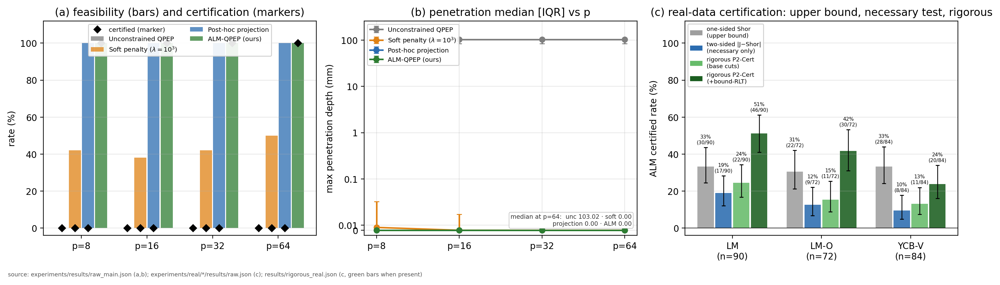

# Constrained-QPEPLayer：面向不等式约束 6-DoF 位姿的可认证层——基于加性四元数约化与 Fischer–Burmeister 隐式微分<br>*Constrained-QPEPLayer: Certifiable Inequality-Constrained 6-DoF Pose Layers via Additive Quaternion Reduction and Fischer–Burmeister Implicit Differentiation*

> **状态**：草稿 v0.6（2026-11-28）。第 1–4 节与第 6–7 节已完成。第 5 节报告实测的层级结果——$p=8$–$64$ 的合成桌面实例、噪声/外参偏置、认证紧性与零维 RLT 消融、SCP 与精确枚举基线、BOP LINEMOD/LINEMOD-Occlusion/YCB-Video 上针对三个割族（基础、零维 RLT、界-RLT）的严格 Schur 修复认证、$n=50$/$n=90/72/84$ 下 SDPRLayers 风格的重实现、$n=50$ 下 dQP/CVXPYLayers 风格的 QP 层、$n=30$ 下官方 Theseus λ-Pareto、一个带 FB 反向有限差分校验的 CPU 端到端玩具实验，以及含严格 KITTI 认证子集的 KITTI/UTIAS 定位层——每一项都附有来源行。两个用户提供的定理（P2-1b 根谱、P2-Cert 严格对偶修复）在 §4.4 与 §4.7 中概述，并在 `theory/proofs.md` §2A 中证明。§5.11 明确说明哪些内容未运行。没有任何参考文献条目被标记 **[verify]**；v0.5 的两个未决项已解决。

---

## 摘要

可微位姿估计层有望打通感知与控制之间的闭环，但现有层要么是*局部*方法（带隐式微分的高斯–牛顿 / Levenberg–Marquardt），要么*基于凸松弛*，因而仅限于其半定松弛恰好紧的问题。两类方法都不处理使位姿在物理上可行的不等式约束：相机前方的正深度、被操作物体与其支撑面的不穿透、视场限制，以及地面或空中载具的倾角锥限制。向半定规划层加入 $p$ 个此类约束会把提升矩阵从 $10\times10$ 膨胀到 $(10+p)\times(10+p)$，并要求松弛保持紧；通用凸优化层则根本无法表示非凸的旋转流形。

本文提出 **Constrained-QPEPLayer**，一个面向不等式约束、以四元数参数化位姿估计的可微 6-DoF 位姿层。它由三个要素构成：（i）**加性常维约化**，证明对不等式约束四元数位姿问题（C-QPEP）的 Rockafellar–Wets 增广拉格朗日，每个内层子问题在平移上做一次精确的 $3\times3$ Schur 补之后，都坍缩为 $\mathbb{S}^3$ 上的*固定维数四次型*，且与 $p$ 无关；（ii）**后验可靠全局认证**，由一个 $14\times14$ 的 Veronese 增广 Shor 半定松弛给出，其半正定块不随 $p$ 增长，可给出严格下界，并在紧时认证全局最优性；（iii）**Fischer–Burmeister（FB）约化隐式微分**方案，其 $(6+|\mathcal A|)\times(6+|\mathcal A|)$ 鞍点系统对任意 $\varepsilon>0$ 都可逆，即使活跃约束 Jacobian 秩亏——如四条腿的物体搁在桌面上时那样。本文精确刻画了该系统的 $\varepsilon\to0$ 极限：一个 $H$ 加权最小范数解，在显式相容条件下等于真实导数；当该条件失效时，则是*选定的*广义导数，且乘子发散。

本文明确说明该层*不*做什么。增广拉格朗日收敛到 KKT 点，而非全局最优；全局性完全来自后验认证，而该认证允许失败，并以失败的形式报告。因此本文称该层为**失效安全可认证**（fail-safe certifiable），而非可认证；在一个受控合成实例上，本文表明朴素的拉格朗日对偶认证在数值上可能为负（$-1.67\times10^{-11}$），因此只能当作诊断量而非认证，而同一实例上 $14\times14$ 松弛的紧性达到 $2.2\times10^{-12}$。本文报告在 BOP LINEMOD、LINEMOD-Occlusion 与 YCB-Video（90/72/84 个真值投影位姿）上的层级评测，包括穿透深度、位姿误差、可行性与严格 Schur 修复认证率（基础割族为 24.4/15.3/13.1%，加入可靠界-RLT 族后升至 51.1/41.7/23.8%）；同一层也在 KITTI 里程计与 UTIAS In-The-Dark 上以层级方式运行（§5.9），并在一个含四个位姿头、带 FB 反向有限差分校验的小型 CPU 端到端玩具实验上运行（§5.8）；网络规模的端到端训练（T1）、TUM RGB-D 与 T3 等式约束任务已说明但未运行（§5.11）。

---

## 1 引言

### 1.1 问题

6-DoF 位姿层位于感知网络或策略网络内部，把学到的量 $\theta$（关键点热图、对应关系、权重）映射为位姿 $(\mathbf R,\mathbf t)$，且该映射对 $\theta$ 可微。主导的有两族方法。*局部*层——BPnP [Chen et al. 2020]、Theseus [Pineda et al. 2022]，以及多数 SLAM 系统内部的高斯–牛顿流程——从当前估计出发求解非线性最小二乘问题，并对该*局部*解的 KKT 系统求导。*全局*层——SDPRLayers [Holmes et al. 2025]——求解多项式优化问题的凸（半定）松弛，并利用松弛的对偶认证对原始非凸 KKT 系统求导。

两族方法都是为**等式**约束设计的。SDPRLayers 对此说得很明确：它的问题类是齐次二次约束二次规划（QCQP），约束为 $\mathbf x^\top\mathbf A_i\mathbf x=0$ [Holmes et al. 2025, Eq. (P1)]。QPEP [Wu et al. 2022]——启发本文工作的代数全局四元数求解器——也恰好只有一个约束 $\|\mathbf q\|^2=1$，其余部分全部吸收进参数化之中。

然而真实位姿问题带不等式约束。桌面上被操作的物体不能穿透桌面。相机前方的点必须有正深度。地面机器人的横滚与俯仰有界。相机的视场限制了投影点可能出现的位置。这些不是可以用惩罚项折中的软偏好：它们是物理可行性条件，违反它们的层会产生运动规划器必须拒绝的位姿。

### 1.2 现有层为何无法解决该问题

**带松弛变量的 SDPRLayers。** 直接的修补是加入 $p$ 个非负松弛变量，这会把 PSD 矩阵从 $10\times10$ 提升到 $(10+p)\times(10+p)$。对 50 个顶点的物体网格，这意味着*每个位姿每个训练步*都要在 CPU 上求解一个 $60\times60$ 的 SDP，而内点法复杂度按 $O((10+p)^{6})$ 增长——这个数字纠正了该想法早先内部草稿中给出的 $O((10+p)^2)$。更糟的是理论退化：反向传播需要松弛是紧的、乘子可辨识，而不等式约束的松弛在解处经常违反严格互补性（$g_j^\star=0$、$\mu_j^\star=0$），此时标准的等式 KKT 隐函数定理根本不适用。

**通用可微 QP 层。** dQP [Magoon et al. 2025]、OptNet [Amos & Kolter 2017] 与 CVXPYLayers [Agrawal et al. 2019] 对凸规划求导。它们原生、优雅地处理线性不等式——dQP 尤其指出，一旦活跃集已知，原问题与导数共享同一个线性系统——但旋转流形不是凸的。对旋转做线性化再迭代会把层变成没有全局结论的局部方法，而活跃集机制继承了 LICQ 假设，该假设恰好在本文关心的接触构型处失效。

**软惩罚。** Theseus [Pineda et al. 2022] 支持任意代价，包括障碍与惩罚项，但惩罚不是约束：它以需要在每个场景调参的权重在穿透与数据拟合之间折中，由此产生的穿透只被权重约束，而不是被零约束。DC3 [Donti et al. 2021] 在推理时补全并修正约束，但不通过修正过程求导。

**不带层的 QPEP。** QPEP [Wu et al. 2022] 通过消去平移、构造 KKT 多项式系统、并用 Gröbner 基/动作矩阵计算枚举*所有*根再取最优，全局地求解四元数位姿问题。它在代数意义上是全局的（在完整枚举的前提下），不需要紧性，但没有梯度，也没有不等式约束的概念。

### 1.3 本文工作

本文问的是：*位姿层能否同时具备硬不等式约束、与约束个数无关的固定单样本代价、在冗余与弱活跃接触下依然成立的微分能力，以及关于返回位姿全局最优的后验证据？*

**贡献。**

1. **加性常维约化（定理 2.1、推论 2.1.1）。** 对约束在 $(\mathbf v_2(\mathbf q),\mathbf t)$ 上仿射的不等式约束四元数位姿问题（C-QPEP）——这精确覆盖正深度、平面不穿透、视场与倾角锥约束——在给定活跃集 $\mathcal A$ 上受限的增广拉格朗日内层子问题，是由 $|\mathcal A|$ 个秩一更新组装而成的、关于 $(\mathbf v_2,\mathbf t)$ 的二次型。用 $3\times3$ Schur 补消去 $\mathbf t$，得到 $\mathbb{S}^3$ 上的四次型，其维数不依赖 $p$。组装是 $O(p)$ 时间、$O(1)$ 内存。本文谨慎说明这*能*与*不能*说明什么：该约化保持了 QPEP 消元后多项式系统的同一问题*类*，但“QPEP 的具体消元模板可原样复用”这一断言被明确留作开放问题（§4.6, G1）。
2. **具有与 $p$ 无关 PSD 块的后验可靠全局认证（引理 2.2）。** 本文证明，对*提升后*问题的 $14\times14$ Shor 松弛，加上 $\mathbb{S}^3$ 的 Veronese 嵌入的二次关系后，给出约束全局最优值的严格下界，并在其紧时认证全局最优性。PSD 块无论 $p$ 为何都是 $14\times14$；约束以 $p$ 个线性约束的形式进入。本文证明了可靠性（不会产生虚假认证），并在一个合成实例上表明松弛的紧性达到 $2\times10^{-11}$，而同一实例的对偶函数间隙在数值上是*负*的，即不能用作认证。
3. **具有精确极限理论的 Fischer–Burmeister 约化隐式微分（定理 2.3、命题 2.1）。** 本文用平滑 FB 函数正则化互补系统，解析地约化 $p$ 维互补块，得到一个 $(6+|\mathcal A|)\times(6+|\mathcal A|)$ 鞍点系统；只要有效 Hessian 与正则化正定，它对任意 $\varepsilon>0$ 都可逆——*且对活跃 Jacobian 不加任何秩假设*。随后证明 $\varepsilon\to0$ 极限是 $\mathbf J_{\mathcal A}d\mathbf z=-\partial_\theta\mathbf g_{\mathcal A}$ 的 $H$ 加权最小范数解；当且仅当右端落在 $\mathbf J_{\mathcal A}$ 的值域内（一个可检验的相容条件）时它等于真实导数，否则乘子按 $1/\varepsilon^2$ 发散，而 $d\mathbf z$ 保持有限，但只是*一个选定的广义导数*。本文表明：当桌面位姿是参数时，四腿桌情形是相容的（因此旗舰例子站得住）；当四条腿的高度是独立参数时则不相容（因此该问题确实不可微）。
4. **失效安全契约与基准协议。** 该层返回（位姿、认证值、可行性违反量、活跃集、条件数估计）。下游代码可以据此分支。本文在 §5 给出完整协议——用于操作的 YCB-Video/BOP 与 LINEMOD，用于定位的 KITTI/TUM RGB-D/UTIAS，ADD(-S)、穿透深度与穿透比例、延迟——以及区分各贡献所需的消融。

### 1.4 本文有意不主张的内容

* 本文**不**主张增广拉格朗日能找到全局最优。非凸 ALM 在约束品性下收敛到 KKT 点 [Bertsekas 1982; Rockafellar & Wets 1998]；本文的全局性只是后验的。
* 本文**不**主张 FB 平滑等价于互补性。对 $\varepsilon>0$，其零集是双曲线 $\mu g=-\varepsilon^2/2$，而非互补集（引理 2.3）。它只是用于微分的一种正则化。
* 本文**不**主张该层总能被认证。当 $14\times14$ 松弛不紧时，该层报告“未认证”，返回的位姿只是一个可行 KKT 点。
* 本文**不**主张距离/障碍约束 $\|\mathbf R\mathbf p+\mathbf t-\mathbf c\|\ge d$——它们在 $(\mathbf v_2,\mathbf t)$ 上*不是*仿射的——以及两个全局最优解发生交换的多模态情形；二者都在所述范围之外（§3.4, §6）。

---

## 2 相关工作

本文与四组工作对照。表 1 给出总结。

**可认证的可微层。** SDPRLayers [Holmes et al. 2025] 是最接近的工作，也是明确的对照目标。它把齐次 QCQP 提升为 Shor SDP，在松弛紧（$\operatorname{rank}(\mathbf X^\star)=1$、$\operatorname{corank}(\mathbf H^\star)=1$）时读出全局解，并用一个容忍冗余等式约束的隐式选择论证对*原始* QCQP 的 KKT 系统求导 [ibid., Thm. 2, Thm. 4]。有三处差别值得注意。（i）*约束类*：其理论针对二次**等式**；不等式需要松弛变量，会膨胀 PSD 块并破坏严格互补性。本文的约束是原生的。（ii）*SDP 所处的位置*：SDPRLayers 对每个样本、每个训练步都在**前向传播中**求解 SDP；本文前向求解固定维数的多项式系统，只在**后验认证**中使用 SDP，且可选、可异步。（iii）*“全局”依托于什么*：前者依托前向松弛的紧性；本文依托一个独立的 $14\times14$ 松弛的紧性，因此紧性失效只让本文失去认证，而不影响前向求解。反过来说，本文继承了 QPEP 的枚举完备性假设，而前者不需要这个假设。

**代数全局的四元数求解器。** QPEP [Wu et al. 2022] 把 PnP、PnL、手眼标定、点到面配准、圆锥位姿、基于距离的相对位姿、Stewart 平台正运动学与多 GNSS 姿态统一为“二次位姿估计问题”，消去 $\mathbf t$，用 Gröbner 基枚举所有 KKT 根（参考实现中最多 40 个候选）并取最优。它不需要紧性，并通过一个独立的小 SDP 给出协方差。本文的工作可以读作*给 QPEP 加上不等式与梯度*：保留其消元结构与基于枚举的全局性，并加入（a）在 $(\mathbf v_2,\mathbf t)$ 上仿射的约束，（b）增广拉格朗日外循环，（c）FB 约化隐式微分，（d）QPEP 所没有的半定后验认证。按 QPEP 的语义，“全局最优”指在完整根枚举的前提下返回紧问题的某个最佳驻点 [Wu et al. 2022]；这不是凸最优性认证，本文从不把 QPEP 的输出单独当作认证（§4.3）。对 QPEP 及枚举代码的详细解读记录在 `related_work.md`。

**可微凸优化层。** OptNet [Amos & Kolter 2017] 通过内点法求解的 KKT 系统对 QP 求导；CVXPYLayers [Agrawal et al. 2019] 通过支持参数化问题的规范化对锥规划做同样的事；dQP [Magoon et al. 2025] 把求解器与导数解耦，并表明活跃集同时决定二者。这些方法假设凸性，因而假设前向全局最优且导数良置；它们还假设活跃集被辨识出来，且 LICQ/严格互补成立。本文的设定违反全部三条：可行集位于 $\mathbb{S}^3$ 上，LICQ 可以按构造失效（四个接触点、三个离面自由度），严格互补在擦边接触处失效。本文从 dQP 借用的是*精神*——把导数化归为一个由活跃集固定结构的小线性系统——并加入该系统的秩鲁棒正则化以及一个极限理论。

**局部可微位姿层。** BPnP [Chen et al. 2020] 通过对其最优性条件做隐式微分，反传穿过 PnP 求解；EPro-PnP [Chen et al. 2022] 建模位姿后验并用蒙特卡洛积分；Theseus [Pineda et al. 2022] 提供了一个在流形上做可微非线性最小二乘的库，带高斯–牛顿/Levenberg–Marquardt 与隐式或展开式导数。它们都是局部的：微分针对*某个*局部解，伪局部极小会给出错误函数的梯度。它们支持惩罚，但不支持硬约束。SDPRLayers 正是为解决这一失效模式而提出的 [Holmes et al. 2025, §I]；本文处理的是当约束为不等式时仍然残留的那部分失效模式。

**互补性、ALM 与非光滑隐式微分。** Fischer–Burmeister 函数 [Fischer 1992] 及其平滑变体 [Kanzow 1996] 是把互补性转化为半光滑方程的标准工具；综述见 [Facchinei & Pang 2003]，其中也包括 FB 是 BD-正则的、半光滑牛顿局部收敛这一事实。非凸问题的增广拉格朗日方法，其在约束品性下收敛到 KKT 点且乘子有界，是经典的 [Bertsekas 1982; Rockafellar & Wets 1998]；精确惩罚变体可追溯到 [Fletcher 1987]。对非光滑或非唯一的解映射求导需要广义导数；最贴近本文需要的框架是 [Bolte et al. 2021] 的非光滑隐式微分，它为优化层给出了保守场/Clarke 雅可比演算。本文用它来诚实陈述 $\varepsilon\to0$ 极限是什么（命题 2.1、引理 2.5），而不是用来主张可微性。

**表 1. 定位。**（$\checkmark$ = 支持/原生，$\times$ = 不支持，$\sim$ = 部分支持/有保留。）

| | SDPRLayers [Holmes 2025] | dQP [Magoon 2025] | Theseus [Pineda 2022] | QPEP [Wu 2022] | **本文** |
|---|---|---|---|---|---|
| 非凸 $\mathbb{S}^3$/SE(3) 前向求解 | $\checkmark$（提升形式） | $\times$（凸 QP） | $\checkmark$（局部） | $\checkmark$（全局） | $\checkmark$ |
| 硬不等式约束 | $\times$（仅松弛变量） | $\checkmark$（线性） | $\times$（惩罚） | $\times$ | $\checkmark$（在 $(\mathbf v_2,\mathbf t)$ 上仿射） |
| 前向代价随 $p$ 的变化 | $O((10+p)^6)$ | $O(\text{QP}(p))$ | $O(p)$/迭代 | $O(\text{const})$ | $O(p)$ 组装 + $O(1)$ 多项式求解 |
| 前向全局保证 | 若紧 | 是（凸） | $\times$ | 枚举（A2） | 枚举（A2） |
| 后验全局认证 | 前向认证 | n/a | $\times$ | $\times$ | $\checkmark$（$14\times14$ SDP） |
| 对 LICQ 失效稳健的导数 | $\checkmark$（隐式选择，等式） | $\times$ | $\times$ | n/a | $\checkmark$（FB，$J_{\mathcal A}$ 秩亏） |
| 弱活跃/严格互补失效处的导数 | $\times$（需严格互补） | $\times$ | n/a | n/a | $\sim$（选定的广义导数） |
| 反向系统规模 | 行约化后 $(n+m)$ | $n+|A|$ | $n$ | n/a | $6+|\mathcal A|$，一般 $|\mathcal A|\le6$ |
| 可 GPU 批处理 | $\times$（CPU SDP） | $\checkmark$ | $\checkmark$ | $\sim$ | $\sim$（固定规模多项式求解） |

---

## 3 问题形式化与记号

### 3.1 记号

$\mathbf q=[q_0,q_1,q_2,q_3]^\top\in\mathbb{S}^3$ 是单位四元数，$\mathbf R(\mathbf q)\in SO(3)$ 是对应的旋转。对 3-向量 $\mathbf p$，定义提升单项式向量

$$
\mathbf v_2(\mathbf q)=\big[q_0^2,q_1^2,q_2^2,q_3^2,\sqrt2 q_0q_1,\sqrt2 q_0q_2,\sqrt2 q_0q_3,\sqrt2 q_1q_2,\sqrt2 q_1q_3,\sqrt2 q_2q_3\big]^\top\in\mathbb{R}^{10},
$$

于是对 $\mathbf q\in\mathbb{S}^3$ 有 $\|\mathbf v_2(\mathbf q)\|_2^2=\|\mathbf q\|_2^4=1$，且 $\mathbf e_{\rm tr}=[1,1,1,1,0,\dots,0]^\top$ 满足 $\mathbf e_{\rm tr}^\top\mathbf v_2(\mathbf q)=\|\mathbf q\|^2=1$。

**事实 3.1（仿射可表示性）。** 对每个 $\mathbf p\in\mathbb{R}^3$ 与 $a\in\{1,2,3\}$，存在 $\mathbf m_a(\mathbf p)\in\mathbb{R}^{10}$，使得对所有 $\mathbf q\in\mathbb{S}^3$ 有 $\mathbf e_a^\top\mathbf R(\mathbf q)\mathbf p=\mathbf m_a(\mathbf p)^\top\mathbf v_2(\mathbf q)$。（在 `verify/sanity_constraints_alm.py` 的检查 C1a 中验证到 $4\times10^{-15}$。）

事实 3.1 是下面四个约束族都在 $(\mathbf v_2,\mathbf t)$ 上仿射的原因；它来自 $\mathbf R(\mathbf q)\mathbf p$ 关于 $\mathbf q$ 是二次的这一事实。

### 3.2 目标函数

$$
J_\theta(\mathbf q,\mathbf t)=\mathbf v_2(\mathbf q)^\top\mathbf M_0(\theta)\mathbf v_2(\mathbf q)+2\mathbf t^\top\mathbf D_0(\theta)\mathbf v_2(\mathbf q)+\mathbf t^\top\mathbf G_0(\theta)\mathbf t . \tag{1}
$$

对 PnP 型残差 $\mathbf r_i(\mathbf q,\mathbf t)=\mathbf P_i(\mathbf R(\mathbf q)\mathbf p_i+\mathbf t)$，其中 $\mathbf P_i=\mathbf I-\mathbf u_i\mathbf u_i^\top/\|\mathbf u_i\|^2$ 为视线投影，(1) 成立，且 $\mathbf M_0=\sum_i\sum_{ab}P_{i,ab}\operatorname{sym}(\mathbf m_a(\mathbf p_i)\mathbf m_b(\mathbf p_i)^\top)$、$\mathbf D_0=\sum_i\mathbf P_i[\mathbf m_1;\mathbf m_2;\mathbf m_3]$、$\mathbf G_0=\sum_i\mathbf P_i$。这是 QPEP 的问题类在消元之前的形式。

### 3.3 约束族

它们都具有形式 $g_j(\mathbf q,\mathbf t)=\tilde{\mathbf a}_j^\top\mathbf v_2(\mathbf q)+\mathbf b_j^\top\mathbf t\le0$。

| 族 | 表达式 | $(\tilde{\mathbf a}_j,\mathbf b_j)$ |
|---|---|---|
| 正深度（手性） | $z_{\min}-\mathbf e_3^\top(\mathbf R\mathbf p_i+\mathbf t)\le0$ | $(-\mathbf m_3(\mathbf p_i)+z_{\min}\mathbf e_{\rm tr},\ [0,0,-1]^\top)$ |
| 平面不穿透 | $-\mathbf n^\top(\mathbf R\mathbf v_j+\mathbf t)-d\le0$ | $(-\sum_a n_a\mathbf m_a(\mathbf v_j)-d\,\mathbf e_{\rm tr},\ -\mathbf n)$ |
| 视场（$\pm$） | $\pm(\mathbf R\mathbf p_i+\mathbf t)_x-\tau(\mathbf R\mathbf p_i+\mathbf t)_z\le0$ | $(\pm\mathbf m_1(\mathbf p_i)-\tau\mathbf m_3(\mathbf p_i),\ [\pm1,0,-\tau]^\top)$ |
| 倾角锥 | $q_1^2+q_2^2-\sin^2(\tfrac\alpha2)\|\mathbf q\|^2\le0$ | $(\mathbf e_2+\mathbf e_3-\sin^2(\tfrac\alpha2)\mathbf e_{\rm tr},\ \mathbf 0)$ |

（倾角锥一行利用 $\|\mathbf q\|^2=1$，即在流形上为 $q_1^2+q_2^2\le\sin^2(\alpha/2)$。）四族全部验证到 $4\times10^{-15}$（检查 C1b）。

**注 3.1（手性）。** 对视场约束，只有当 $\tau<\infty$ 且约束在正确方向上活跃时，$z>0$ 才由两条 FoV 不等式推出；因此本文始终为每个观测点至少加入一条显式正深度约束。这很廉价（$p$ 只按点数增长），并免去了单独的正负号论证。

### 3.4 问题（C-QPEP）

$$
\min_{\mathbf q\in\mathbb{S}^3,\ \mathbf t\in\mathbb{R}^3}\ J_\theta(\mathbf q,\mathbf t)\quad\text{s.t.}\quad g_j(\mathbf q,\mathbf t;\theta)\le0,\ j=1,\dots,p. \tag{C-QPEP}
$$

**假设 3.1** $\mathbf M_0,\mathbf D_0,\mathbf G_0$ 关于 $\theta$ 连续可微，且 $\mathbf G_0\succ0$（或活跃的 $\mathbf b_j$ 张成 $\mathbb{R}^3$）。

**范围之外。**（i）非仿射约束，例如 $\|\mathbf R\mathbf p+\mathbf t-\mathbf c\|\ge d$ 或物体间间隙——它们在 $(\mathbf v_2,\mathbf t)$ 上不是仿射的，需要不同的约化。（ii）多个全局最优解随 $\theta$ 变化而交换：解映射跳变，导数不存在；这是本族其他工作处理的支路交叉问题。（iii）对 $\mathbf q$ 具有非多项式依赖的约束（例如到参考旋转的测地距离）。

---

## 4 方法与理论

### 4.1 外层循环：Rockafellar–Wets 增广拉格朗日

取 $\boldsymbol\mu\in\mathbb{R}^p_{\ge0}$ 与 $\rho>0$，

$$
\mathcal L_\rho(\mathbf q,\mathbf t,\boldsymbol\mu)=J_\theta(\mathbf q,\mathbf t)+\frac{1}{2\rho}\sum_{j=1}^p\Big(\big[\mu_j+\rho g_j(\mathbf q,\mathbf t)\big]_+^2-\mu_j^2\Big). \tag{2}
$$

算法 1 交替执行：辨识有效活跃集 $\mathcal A=\{j:\mu_j+\rho g_j>0\}$；在 $\mathcal A$ 冻结下求解内层问题；更新 $\mu_j\leftarrow[\mu_j+\rho g_j]_+$；若可行性违反量不下降则增大 $\rho$。这种冻结是一种 Gauss–Seidel/活跃集手段，而不是对精确子问题极小化子的近似；§4.2 精确说明所求解的是什么，引理 2.1 记录了冻结求解成为 (2) 的真正极小化子所需的一致性条件。

```
算法 1：Constrained-QPEPLayer 前向
input : θ，由廉价估计器给出的初始 (q,t)，μ=0，ρ=ρ0，ε=ε0
repeat
   A ← { j : μ_j + ρ g_j(q,t) > 0 }
   组装 M_A, D_A, G_A                       # O(p), 10x10 / 3x10 / 3x3
   求解内层: min_{q∈S^3} v2(q)^T (M_A - D_A^T G_A^{-1} D_A) v2(q)   # QPEP 类
   (q,t) ← (q*, -G_A^{-1} D_A v2(q*))
   μ ← max(0, μ + ρ g(q,t));  若违反量未按 0.5 下降则 ρ ← 5ρ
until max_j [g_j]_+ ≤ ν_tol 或达到最大外层次数
认证: 求解 14x14 Shor SDP（引理 2.2）；返回 (q,t,μ,A, SDP 值, ν, cond)
```

### 4.2 定理 2.1：内层问题具有与 $p$ 无关的维数

**定理 2.1.** 设假设 3.1 成立，固定 $\boldsymbol\mu,\rho$，并固定活跃集 $\mathcal A$。在活跃模式为 $\mathcal A$ 的区域上，
$$
\mathcal L_\rho\big|_{\mathcal A}=\mathbf v_2^\top\mathbf M_{\mathcal A}\mathbf v_2+2\mathbf t^\top\mathbf D_{\mathcal A}\mathbf v_2+\mathbf t^\top\mathbf G_{\mathcal A}\mathbf t+\kappa_{\mathcal A}, \tag{3}
$$
其中
$$
\begin{aligned}
\mathbf M_{\mathcal A}&=\mathbf M_0+\sum_{j\in\mathcal A}\Big[\tfrac{\mu_j}{2}\big(\mathbf e_{\rm tr}\tilde{\mathbf a}_j^\top+\tilde{\mathbf a}_j\mathbf e_{\rm tr}^\top\big)+\tfrac{\rho}{2}\tilde{\mathbf a}_j\tilde{\mathbf a}_j^\top\Big],\\
\mathbf D_{\mathcal A}&=\mathbf D_0+\sum_{j\in\mathcal A}\Big[\tfrac{\mu_j}{2}\mathbf b_j\mathbf e_{\rm tr}^\top+\tfrac{\rho}{2}\mathbf b_j\tilde{\mathbf a}_j^\top\Big],\qquad
\mathbf G_{\mathcal A}=\mathbf G_0+\tfrac{\rho}{2}\sum_{j\in\mathcal A}\mathbf b_j\mathbf b_j^\top,\\
\kappa_{\mathcal A}&=-\frac{1}{2\rho}\sum_{j\notin\mathcal A}\mu_j^2 . \qquad\text{(only \emph{inactive} constraints contribute a constant)}
\end{aligned}
\tag{4}
$$
若 $\mathbf G_{\mathcal A}\succ0$，则 $\min_{\mathbf t}\mathcal L_\rho|_{\mathcal A}=\mathbf v_2^\top\mathbf M^{\rm red}_{\mathcal A}\mathbf v_2+\kappa_{\mathcal A}$，其中 $\mathbf M^{\rm red}_{\mathcal A}=\mathbf M_{\mathcal A}-\mathbf D_{\mathcal A}^\top\mathbf G_{\mathcal A}^{-1}\mathbf D_{\mathcal A}$，且 $\mathbf t^\star(\mathbf q)=-\mathbf G_{\mathcal A}^{-1}\mathbf D_{\mathcal A}\mathbf v_2(\mathbf q)$。因此内层问题是 $\mathbb{S}^3$ 上的**四次型**，其维数与 $p$ 无关。

*证明梗概.* 展开 hinge 项：对 $j\in\mathcal A$，该项等于 $\mu_jg_j+\tfrac\rho2g_j^2$；对 $j\notin\mathcal A$，它等于 $-\mu_j^2/(2\rho)$。每个 $\mu_jg_j$ 关于 $(\mathbf v_2,\mathbf t)$ 是线性的；利用 $\mathbf e_{\rm tr}^\top\mathbf v_2=1$ 它变为所示的二次型。每个 $\tfrac\rho2g_j^2$ 展开为 $\mathbf v_2\mathbf v_2^\top$、$\mathbf v_2\mathbf t^\top$ 与 $\mathbf t\mathbf t^\top$ 块。求和得到 (4)。$\mathbf t$ 的驻点条件关于 $\mathbf v_2$ 是线性的，因此 $\mathbf t^\star$ 关于 $\mathbf q$ 是二次的；代入并利用 $\mathbf v_2(\lambda\mathbf q)=\lambda^2\mathbf v_2(\mathbf q)$ 即得四次型。完整证明：`theory/proofs.md` §1.2。$\square$

有三点说明对正确性至关重要。

**（a）常数项在 $\mathcal A$ 上并不对称。** 取 $\kappa=-\frac{1}{2\rho}\sum_{j=1}^p\mu_j^2$ 会使 (3) 与直接计算 (2) 相差 $\sum_{j\in\mathcal A}\mu_j^2/(2\rho)$——这个 bug 会扰动乘子递推，从而扰动静止点。在本文的健全性检查中，错误的常数产生 $5.57\times10^{-1}$ 的误差；正确的常数给出 $3.55\times10^{-15}$。这是该层最可能出现的单一实现错误。

**（b）“10×10 QPEP”是一种提升后的说法。** (3) 关于 $\mathbf v_2$ 是二次的，但关于 $\mathbf q$ 是**四次**的。它*不是*标准 QPEP 形式“关于 $(\mathbf q,\mathbf t)$ 二次”；它是 QPEP 在消去 $\mathbf t$ *之后*达到的形式。因此 KKT 系统是关于 $(\mathbf q,\lambda)$ 的四个三次式加一个二次式，Bezout 界为 $3^4\cdot2=162$，而 QPEP 的参考实现对其实例最多返回 40 个根。约化后的问题属于同一代数族；QPEP 预计算的消元模板能否原样适用于一般的 $\mathbf M^{\rm red}_{\mathcal A}$ 是**开放的**（G1）。安全的实现方式是按实际单项式支撑重新生成模板，其规模在 $p$ 上仍是 $O(1)$。

**（c）冻结活跃集的内层求解不是精确子问题。** (2) 关于 $(\mathbf v_2,\mathbf t)$ 是分片二次的，在曲面 $\mu_j+\rho g_j=0$ 上有折点。冻结 $\mathcal A$ 等于选定其中一片。若该片的极小化子具有相同的活跃模式，它就是 (2) 的局部极小化子；否则继续迭代。引理 2.1 陈述了这一一致性条件。实践中，在本文的合成实例上每个外层步 2–5 次内层迭代已足够。

**引理 2.1（活跃集一致性）。** 设 $\mathcal A_k$ 为外层迭代 $k$ 处的活跃集，$\mathbf z_k^\star$ 极小化 $\mathcal A_k$ 片。若对所有 $j$，$\operatorname{sign}(\mu_j+\rho g_j(\mathbf z_k^\star))$ 与 $\mathcal A_k$ 一致，则 $\mathbf z_k^\star$ 是 (2) 的局部极小化子，且外层更新就是标准 ALM 更新。否则该片不一致，下一次迭代必须重新辨识 $\mathcal A$。*（由分片结构直接可得；无需证明。）*

### 4.3 定理 2.2：“全局最优”能意味着什么、不能意味着什么

**定理 2.2（条件全局最优性）。** 设 $\hat{\mathbf z}$ 是 ALM 输出，乘子为 $\hat{\boldsymbol\mu}\ge0$，可行性违反量 $\nu=\max_j[g_j(\hat{\mathbf z})]_+$。对任意 $\boldsymbol\mu\ge0$ 定义 $d(\boldsymbol\mu)=\min_{\mathbb{S}^3\times\mathbb{R}^3}\{J_\theta+\sum_j\mu_jg_j\}$。则
$$
d(\hat{\boldsymbol\mu})\ \le\ J^\star\ \le\ J_\theta(\hat{\mathbf z})+L\nu ,
\qquad\text{hence}\qquad
0\le J_\theta(\hat{\mathbf z})-J^\star\le \underbrace{J_\theta(\hat{\mathbf z})-d(\hat{\boldsymbol\mu})}_{=:\delta}+L\nu . \tag{5}
$$
若 $\delta+L\nu\le\tau$，则 $\hat{\mathbf z}$ 是 $\tau$-全局最优的。在精确算术下 $\delta\ge0$；计算得到的 $\delta<0$ 是数值假象。

*证明.* 对可行 $\mathbf z$ 与 $\boldsymbol\mu\ge0$，有 $\sum_j\mu_jg_j(\mathbf z)\le0$，故 $d(\boldsymbol\mu)\le\min_{\rm feasible}J=J^\star$。上界由 $L$-Lipschitz 性与 $\nu$-可行性得到。$\square$

定理 2.2 是 ALM 加对偶界所能给出的*那个*诚实陈述：一个夹逼，条件于可行性与 $d$ 的精度。它不是认证，因为 $d(\hat{\boldsymbol\mu})$ 本身是通过对非凸问题的全局求解算出的，而在本文实现中该求解是无认证的 QPEP 式枚举。在本文的合成实例上，计算得到的 $\delta$ 为 $-1.67\times10^{-11}$——为负，因此不能用作认证。负的 $\delta$ 不可能是“$\approx0$ 的认证”：它说明计算 $d$ 的数值误差超过了间隙本身。

### 4.4 引理 2.2：具有与 $p$ 无关 PSD 块的可靠认证

本文用一条其有效性不依赖任何求解器的松弛，替代对偶函数路线。

**引理 2.2.** 设 $\mathbf x=(\mathbf v_2(\mathbf q),\mathbf t)\in\mathbb{R}^{13}$，$\hat{\mathbf x}=(\mathbf x,1)$，$\mathbf X=\hat{\mathbf x}\hat{\mathbf x}^\top$，并设 $\hat{\mathbf Q}_\theta\in\mathbb{S}^{14}$ 为 $J_\theta$ 的齐次化矩阵。考虑
$$
\begin{aligned}
\mathrm{Shor}=\min_{\mathbf X}\ &\langle\hat{\mathbf Q}_\theta,\mathbf X\rangle\\
\text{s.t.}\ &\mathbf X\succeq0,\quad X_{14,14}=1,\quad \langle\operatorname{sym}(\hat{\mathbf e}_{\rm tr}\mathbf e_{14}^\top),\mathbf X\rangle=1,\quad \operatorname{tr}(\mathbf X_{[10]})=1,\\
&\langle\operatorname{sym}(\hat{\mathbf c}_j\mathbf e_{14}^\top),\mathbf X\rangle\le0,\quad j=1,\dots,p,\\
&\text{the linearised Veronese relations } 2X_{ij}=X_{kk}\ (2v_iv_j=v_k^2)\ \text{and}\ S_{ik}S_{jl}=S_{il}S_{jk}\text{ in }X .
\end{aligned}\tag{6}
$$
则 $\mathrm{Shor}\le J^\star$。若最优解秩一，其因子是全局最优的可行位姿；若 $\mathrm{Shor}\ge J(\hat{\mathbf z})-\tau_{\rm sdp}$ 且 $\hat{\mathbf z}$ 可行，则 $\hat{\mathbf z}$ 是 $\tau_{\rm sdp}$-全局最优的。

*证明.* 每个可行 $\mathbf z$ 都对应一个具有相同目标的可行秩一 $\mathbf X$，且 Veronese 关系对每个 $\mathbf v_2(\mathbf q)$ 成立；因此 (6) 是松弛。秩一则给出逆命题。$\square$（完整陈述与数值：`theory/proofs.md` §2.2。）

实际内容体现在数字上。在一个合成 $p=12$ 实例上（`verify/`，C5）：

| 松弛 | 取值 | $\lambda_2/\lambda_1$ | 说明 |
|---|---|---|---|
| 无 Veronese、无对偶项 | $-1\times10^{-10}$ | 0.33 | 空洞 |
| $+$ Veronese | 0.0030334692 | $1.4\times10^{-9}$ | 等于*无约束* QPEP 值 0.0030334724，紧 |
| $+$ Veronese $+$ 不等式 | **0.0680069355** | $2.2\times10^{-12}$ | 等于 ALM 输出 0.06800693548，**紧** |
| $\mathrm{Shor}$ of $d(\hat{\boldsymbol\mu})$ | 0.0034784073 | — | 仅 0.0645 的可靠间隙；差了 3 个数量级 |

因此：Veronese 关系是使松弛非空洞的开关；带不等式约束的 SDP 在该实例上是紧的；并且它是比对偶函数*更好*的认证。本文因此把 (6) 作为采信认证，而把 $d(\boldsymbol\mu)$ 降级为诊断量。

**为什么 Veronese 关系合法且廉价。** 关系 $2v_iv_j=v_k^2$ 与 $S_{ik}S_{jl}=S_{il}S_{jk}$（其中 $\mathbf S=\mathbf q\mathbf q^\top$ 由 $\mathbf v_2$ 重建）在 Veronese 簇 $\nu_2(\mathbb{RP}^3)$ 上恒成立，且它们关于 $\mathbf X$ 是*线性的*，因此在结构上没有额外代价：它们只是 $14\times14$ 矩阵上的额外线性等式。没有它们，松弛在下无界（提升问题中向量 $\mathbf v_2$ 未被归一化），数值上是空洞的。

**代价。** 对每个 $p$，PSD 块都是 $14\times14$；约束增加 $p$ 个线性行。内点法或一阶方法的代价是每迭代 $O(p\cdot14^3)$，而松弛变量提升后的 SDP 是 $O((10+p)^6)$。本文异步求解该认证（每批一次，或在子集上每轮一次），因为前向传播不需要它。

**一个严格的对偶修复（定理 P2-Cert）。** 上述 SDP 值只在求解器容差意义下可靠：SCS 不满足对偶可行，常常返回 $\mathrm{Shor}>J$，即*负*间隙。定理 P2-Cert（完整陈述与证明：`theory/proofs.md` §2.7；用户提供的证明，2026-11-27）把该容差从论证中剔除。记 $\mathbf y_{14}=\mathbf F\mathbf y_{13}$，其中 $\mathbf y_{14}=[\mathbf v_2;\mathbf t;1]$、$\mathbf y_{13}=[\mathbf v_2;\mathbf t]$，$\mathbf F$ 是附加 $\mathbf e_{\rm tr}^\top\mathbf v_2=1$ 的常值折叠映射。取近似的 SDP 对偶解并投影到锥上，$\tilde{\boldsymbol\mu}=[\hat{\boldsymbol\mu}]_+\ge0$、$\tilde{\boldsymbol\Gamma}=[\hat{\boldsymbol\Gamma}]_+\ge0$，并组装
$$
\tilde{\mathbf H}_{13}=\mathbf F^\top\Big(\mathbf Q_{\rm aug}+\sum_j\tilde\mu_j\mathbf A_{g_j}-\sum_{i\le j}\tilde\Gamma_{ij}\mathbf A_{g_ig_j}-\hat\lambda_0\mathbf A_0-\sum_k\hat\lambda_k\mathbf B_k\Big)\mathbf F .
$$
若 $\tilde{\mathbf H}_{tt}\succ0$，令 $\mathbf S_{10}=\tilde{\mathbf H}_{RR}-\tilde{\mathbf H}_{Rt}\tilde{\mathbf H}_{tt}^{-1}\tilde{\mathbf H}_{Rt}^\top$、$\delta_{\min}=\min(0,\lambda_{\min}(\mathbf S_{10}))$，
$$
d_{\rm sound}=\hat\lambda_0+\delta_{\min}-\delta_{\rm round}\le f^\star_{\rm global},
$$
其中 $\delta_{\rm round}\sim10^{-12}\|\mathbf S_{10}\|_F$ 是由 Rump/Cholesky 检验认证的浮点安全裕量。若 $\tilde{\mathbf H}_{tt}$ 不正定，则取平移球 $\|\mathbf t\|\le R_t$、$\delta_{13}=\min(0,\lambda_{\min}(\tilde{\mathbf H}_{13}))$，
$$
d_{\rm sound}=\hat\lambda_0+(1+R_t^2)(\delta_{13}-\delta_{\rm round})\le f^\star_{\rm global}.
$$
唯一的成分是 $\tilde\mu,\tilde\Gamma\ge0$、$g_j\le0$、$g_ig_j\ge0$、Veronese 等式与 $\|\mathbf v_2(\mathbf q)\|^2=1$；SDP 求解的精度从不进入论证。因此 $J-d_{\rm sound}\ge0$ **按构造成立**：在认证的舍入裕量 $\delta_{\rm round}$ 之内不可能出现负间隙（表 5.8b 的合成检查记录到一个 $-6.7\times10^{-13}$ 的原始差值，即落在该裕量之内）。这是 §5.4–§5.5 中采信的下界；单侧标记 $J-\mathrm{Shor}\le10^{-6}$ 不是下界，只作为可靠率的上界报告。同一证明还给出六个 LM-O 纯平面失败的结构性诊断：当所有活跃约束共享法向 $\mathbf b_j=-\mathbf n$ 时，所有 RLT 乘积只约束 $\mathbf n^\top\mathbf t$，留下一个秩 2 的伪混合可行；深度约束（$\mathbf b=-\mathbf e_3$）与倾角锥（$q_1^2+q_2^2\le\sin^2(\alpha/2)$）补充了切掉它的交叉方向乘积；§5.5(vi) 正是在六个最松弛的 LM-O 行上检验这一预测，发现仅加额外行时 0/6 被认证，而加入交叉方向乘积后 6/6 被认证。

### 4.5 定理 2.3 与命题 2.1：FB 约化隐式微分

**KKT 系统，以及为什么朴素的活跃集导数会失效。** 在解 $\mathbf z^\star=(\mathbf q^\star,\mathbf t^\star)$ 处，乘子为 $\boldsymbol\mu^\star$，切空间驻点条件与互补条件为
$$
\nabla_{\mathbf z}\mathcal L(\mathbf z^\star,\boldsymbol\mu^\star;\theta)=\mathbf 0\in\mathbb{R}^6,\qquad 0\le\mu_j^\star\perp(-g_j^\star)\ge0 . \tag{7}
$$
对 (7) 求导需要 $d\mu_j$ 作为 $d\mathbf z$ 的函数。在强活跃约束处（$\mu_j>0$、$g_j=0$），精确关系是 $dg_j=0$（约束保持活跃）；在不活跃约束处 $d\mu_j=0$；在弱活跃约束处（$\mu_j=g_j=0$）*两者都不成立*，关系为空。经典活跃集微分 [Amos & Kolter 2017; Magoon et al. 2025] 假设前两种情形以及满秩的活跃 Jacobian。四腿桌违反秩假设；擦边接触违反严格互补。

**正则化。** 本文用平滑的 Fischer–Burmeister 方程替换 (7) 中的互补性
$$
\varphi_\varepsilon(\mu_j,g_j)=\mu_j-g_j-\sqrt{\mu_j^2+g_j^2+\varepsilon^2}=0 . \tag{8}
$$
本文强调 (8) 是什么：对 $\varepsilon>0$，它**不**等价于互补性。其零集恰为 $\mu_jg_j=-\varepsilon^2/2$（引理 2.3），而在互补点处它取值 $-\varepsilon^2/(2\mu_j)$（强活跃）、$-\varepsilon$（弱活跃）、$-\varepsilon^2/(2|g_j|)$（不活跃）。方程 (8) 是一个光滑*代理*，用于定义正则化灵敏度系统；前向求解从不求解它。

**例 2.5（2-D 折点，闭式求解）。** 对 $\min_z\tfrac12(z-a)^2$ s.t. $z\ge0$，真实解映射是 $\max(a,0)$，其在 $a=0$ 处的 Clarke 导数为 $[0,1]$。FB 正则化问题的闭式解为 $z_\varepsilon(a)=\tfrac12(a+\sqrt{a^2+2\varepsilon^2})$，故 $dz_\varepsilon/da|_{a=0}=1/2$ *精确成立，且对每个 $\varepsilon$ 都成立*：正则化选取的是 Clarke 导数的中点，而不是某一侧，也不是任意元素。对 $|a|\gg\varepsilon$ 它如预期返回 $0$ 或 $1$。这是本文能完全刻画的唯一情形；同一中点规则能否在多个同时弱活跃的约束与秩亏的 $\mathbf J_{\mathcal A}$ 下保持，是开放的部分（G2）。

**引理 2.3.** $\partial_{\mu}\varphi_\varepsilon=1-\mu/r=a$，$\partial_g\varphi_\varepsilon=-(1+g/r)=-b$，$r=\sqrt{\mu^2+g^2+\varepsilon^2}$。对 $\mu\ge0$：$a\in(0,1]$；对 $g\le0$（可行）$b\in[0,1]$；对 $g>0$（不可行迭代点）$b\in(1,2)$。因此在强活跃约束处 $a_j\to\varepsilon^2/(2\mu_j^2)$、在严格不活跃约束处 $b_j\to\varepsilon^2/(2g_j^2)$，而在弱活跃处 $a_j=b_j=1$。（证明与数值：`theory/proofs.md` §3.1；所有取值范围已验证。）

**约化。** 令 $\mathcal A=\{j:a_j<\delta_{\rm act}\}$（强活跃），$\mathcal R$ 为其补集。对 $j\in\mathcal R$ 消去 $d\mu_j=(b_j/a_j)(\mathbf J_{g,j}d\mathbf z+\partial_\theta g_j\,d\theta)$ 并折入有效 Hessian；对 $j\in\mathcal A$ 保留一个带正对角的小鞍点块。记 $\mathbf H_{\rm tan}=\nabla^2_{\mathbf z}\mathcal L$、$\mathbf H_{\rm eff}=\mathbf H_{\rm tan}+\sum_{j\in\mathcal R}(b_j/a_j)\mathbf J_{g,j}^\top\mathbf J_{g,j}$，
$$
\underbrace{\begin{bmatrix}\mathbf H_{\rm eff}&\mathbf J_{\mathcal A}^\top\\ \mathbf J_{\mathcal A}&-\mathbf D_a\end{bmatrix}}_{=:\mathbf S}\begin{bmatrix}d\mathbf z\\ d\boldsymbol\mu_{\mathcal A}\end{bmatrix}
=\begin{bmatrix}-\partial_\theta\nabla_{\mathbf z}\mathcal L-\sum_{j\in\mathcal R}\frac{b_j}{a_j}\mathbf J_{g,j}^\top\partial_\theta g_j\\ -\partial_\theta\mathbf g_{\mathcal A}\end{bmatrix},\qquad
\mathbf D_a=\operatorname{diag}_{j\in\mathcal A}\Big(\frac{a_j}{b_j}\Big). \tag{9}
$$

**定理 2.3.** 若 $\mathbf H_{\rm eff}\succ0$ 且 $\mathbf D_a\succ0$，则 (9) 中的 $\mathbf S$ 对**任意** $\mathbf J_{\mathcal A}$ 可逆，包括秩亏情形。其 Schur 补为 $-(\mathbf D_a+\mathbf J_{\mathcal A}\mathbf H_{\rm eff}^{-1}\mathbf J_{\mathcal A}^\top)\prec0$。当 $\varepsilon\to0$ 时，$\mathbf D_a\to0$（在强活跃约束上），$\mathbf S$ 趋于 $\begin{bmatrix}\mathbf H_{\rm eff}&\mathbf J_{\mathcal A}^\top\\ \mathbf J_{\mathcal A}&0\end{bmatrix}$，后者可逆当且仅当 $\mathbf J_{\mathcal A}$ 行满秩且 $\mathbf H_{\rm eff}$ 在 $\ker\mathbf J_{\mathcal A}$ 上正定——即当且仅当 LICQ 与 SOSC 成立。当 $\mathbf J_{\mathcal A}$ 秩亏时条件数按 $\kappa(\mathbf S)\asymp1/\varepsilon^2$ 增长，不秩亏时保持有界。

*证明.* Schur 补：$\mathbf S$ 可逆当且仅当 $\mathbf D_a+\mathbf J_{\mathcal A}\mathbf H_{\rm eff}^{-1}\mathbf J_{\mathcal A}^\top\succ0$，这成立是因为 $\mathbf D_a\succ0$ 且第二项半正定。极限与条件数由检查 Schur 补得到。$\square$（完整证明：`theory/proofs.md` §3.2。）

**命题 2.1（$\varepsilon\to0$ 极限）。** 记 $\mathbf r=-\partial_\theta\nabla_{\mathbf z}\mathcal L$、$\mathbf w=-\partial_\theta\mathbf g_{\mathcal A}$，则对每个 $\varepsilon>0$，系统 (9) 有唯一解，且当 $\varepsilon\to0$
$$
d\mathbf z\to d\mathbf z^\star=\mathbf H_{\rm eff}^{-1}\mathbf J_{\mathcal A}^\top\big(\mathbf J_{\mathcal A}\mathbf H_{\rm eff}^{-1}\mathbf J_{\mathcal A}^\top\big)^{+}\mathbf w+\big[\mathbf I-\mathbf P_{\mathcal A}\big]\mathbf H_{\rm eff}^{-1}\mathbf r,\qquad
\mathbf P_{\mathcal A}=\mathbf H_{\rm eff}^{-1}\mathbf J_{\mathcal A}^\top(\cdot)^{+}\mathbf J_{\mathcal A}, \tag{10}
$$
即 $\mathbf J_{\mathcal A}d\mathbf z=\mathbf w$ 的 $\mathbf H_{\rm eff}$ 加权最小范数解。若 $\mathbf w\in\operatorname{range}(\mathbf J_{\mathcal A})$（相容），$d\mathbf z^\star$ 等于真实导数且与乘子分布无关；否则乘子按 $\|d\boldsymbol\mu_{\mathcal A}\|\asymp1/\lambda_{\min}(\mathbf D_a)\asymp1/\varepsilon^2$ 发散，而 $d\mathbf z^\star$ 是某个不可微解映射的*一个选定*广义导数。

*证明思路.* 从 (9) 消去 $d\boldsymbol\mu$ 得 $(\mathbf H_{\rm eff}+\mathbf J_{\mathcal A}^\top\mathbf D_a^{-1}\mathbf J_{\mathcal A})d\mathbf z=\mathbf r+\mathbf J_{\mathcal A}^\top\mathbf D_a^{-1}\mathbf w$；把 $d\mathbf z$ 分解为沿 $\operatorname{range}(\mathbf H_{\rm eff}^{-1}\mathbf J_{\mathcal A}^\top)$ 与 $\ker\mathbf J_{\mathcal A}$ 的 $\mathbf H_{\rm eff}$ 正交分量；第一分量带有 $1/\lambda_{\min}(\mathbf D_a)$ 因子，第二分量被 $\mathbf J_{\mathcal A}$ 消去；极限即 (10)。$\square$

**这对四腿桌意味着什么。** 在平面上静止物体的线性化运动学中，四个接触约束是 $g_j=(1,a_j,b_j)^\top(z,\text{roll},\text{pitch})-h_j(\theta)$，其中 $(a_j,b_j)$ 为角点坐标，于是 $\mathbf J_{\mathcal A}\in\mathbb{R}^{4\times3}$ 的秩为 3，其列恰为 $(z,\text{roll},\text{pitch})$ 的系数向量。若 $\theta$ 使桌面作刚体运动（高度、横滚、俯仰），则 $-\partial_\theta\mathbf g_{\mathcal A}$ 是这些列的线性组合，相容性自动成立；该层返回真实导数。若四条腿的高度是独立参数，相容性失效，解映射出现折点，FB 极限是一个带发散乘子的选定广义导数。两种情形都能在数秒内演示（`verify/`，F5）：相容情形下 $d\mathbf z\to$ 真值，误差 $1.3\times10^{-11}$，乘子有界，且与乘子分布无关（三种分布之间的差异为 $2.3\times10^{-9}$）；不相容情形下，随 $\mathbf D_a$ 由 $10^{-1}\to10^{-8}$，$\|d\boldsymbol\mu\|=10^{-1}\to10^{6}$，而 $\|d\mathbf z\|$ 保持在 $0.707$。

**$\mathbf H_{\rm tan}$ 的选择（在此明确给出，不推后）。** 本文采用**高斯–牛顿**选择
$$
\mathbf H_{\rm tan}:=\nabla^2_{\mathbf z}J_\theta(\mathbf z^\star)\;(\succeq0),
\tag{9a}
$$
即丢弃约束曲率项 $\sum_{j\in\mathcal A}\mu_j\nabla^2_{\mathbf z}g_j$。在 (9a) 下，只要 $\nabla^2J_\theta\succ0$ 就有 $\mathbf H_{\rm eff}\succ0$，因此定理 2.3 与命题 2.1 按所述成立，无需 Hessian 不定性的附加说明。代价是明确的，并在定理中陈述：(9) 此时计算的是高斯–牛顿*代理*解映射的导数，它与真实导数在残差的一阶上一致但并不精确；差异为 $O(\sum_j\mu_j\|\nabla^2g_j\|)$，留待精确 Hessian 消融处理，而该消融在本文草稿中未运行（§5.11）。

**注 4.1（精确 Hessian 变体）。** 若改用完整拉格朗日 Hessian $\mathbf H_{\rm tan}=\nabla^2J+\sum_{j\in\mathcal A}\mu_j\nabla^2g_j$，(9) 就是精确微分的 KKT 系统，但 $\mathbf H_{\rm eff}\succ0$ 不再自动成立；定理 2.3 必须换成更弱的陈述“$\mathbf S$ 非奇异当且仅当 $\mathbf H_{\rm eff}$ 在 $\ker\mathbf J_{\mathcal A}$ 上非奇异”，并在不成立时实践上需要 Levenberg 阻尼。由于 $g_j$ 关于 $\mathbf q$ 是二次的，$\nabla^2_{\mathbf q}g_j$ *并不*小——它随 $\|\tilde{\mathbf a}_j\|$ 缩放并被接触乘子乘上——因此这是真正的取舍，而非技术细节。本文把两种变体都留给未运行的消融（§5.11），并推荐 (9a) 为默认。

### 4.6 该方法引出的开放数学问题

本文在此列出它们，因为它们界定了论文主张的边界；详见 `math_questions.md`。

**G1（P0，已由定理 P2-1b 解决）。** 当 $\mathbf M^{\rm red}_{\mathcal A}\neq\mathbf M_0$ 时，内层 KKT 系统的一般复根数是否仍为 40？Bezout 界为 162。定理 P2-1b（用户提供的证明，2026-11-27；`theory/proofs.md` §2.6）给出了结论：对秩 9 的 PnP 型 $\mathbf M^{\rm red}_{\mathcal A}$（本文的合成实例），答案是**是，40**，且 15 单项式 grevlex 阶梯不变——平移 $\mathbf M\mapsto\mathbf M+\alpha\mathbf I$ 使所有临界点保持不动。唯一的坍缩发生在各向同性 3D–3D（Horn）基加上共享同一法向的平面约束时，此时 Hopf 直纹线 $\mathcal L_{\mathbf n}$ 是正维多余分量，孤立根数按 $k=0/1/\ge2$ 降至 $4/12/16$，对两个不同法向则降至 32。残留的开放问题是实现层面的而非代数层面的：是发布一个 40 根模板，还是发布一个 16 根饱和模板族（§4.7）。

**G2（P0）FB 在弱活跃点选定的广义导数。** $\varphi_0$ 在 $(\mu,g)=(0,0)$ 处不可微；其 Clarke 次微分是一个集合，$\varepsilon$-正则化路径选取其中一个元素（$a=b=1$）。本文需要刻画该选择，并将其与 [Bolte et al. 2021] 的保守场框架联系起来。在此之前，论文只能说“一个选定的广义导数”，绝不能说“该导数”。

**G3（P1）认证的数值可靠性。** 引理 2.2 在精确算术下是可靠的。定理 P2-Cert 现在提供了数值修复：把近似对偶投影到非负象限并取 Schur 补界 $\hat\lambda_0+\delta_{\min}-\delta_{\rm round}$，给出一个对*任意*对偶可行点都成立的下界，于是 SDP 容差从论证中消失；Rump/Cholesky 检验认证剩余的矩阵舍入。仍然经验性的是*紧性*（G4），而非可靠性。该修复已实现并在真实数据上测量（§5.5）。

**G4（P1）ALM 的 KKT 点可能不是被认证的最优解。** 若 $14\times14$ 松弛不紧，本文只有下界与可行点，而没有结论。松弛紧的实例比例是一个经验问题，也是一项一等一的实验结果（§5.4–§5.5）。§5.5 的严格重跑在本文的真实数据协议下回答了该问题。

**G5（以 GN 为准解决）。** 主要结果使用 (9a) 的高斯–牛顿 $\mathbf H_{\rm tan}$；精确 Hessian 变体是注 4.1 与一项消融。残留的开放问题是定量的：真实数据上 GN 偏差有多大，它对端到端训练是否有影响？

### 4.7 内层根结构：$4/12/16/32/40$ 谱（定理 P2-1b）

本小节记录*为什么*前向内层求解可以使用固定的一个小模板，以及它在何处失效。完整陈述、证明梗概与 $\mathbb F_{32003}$ 验证注记见 `theory/proofs.md` §2.6（用户提供的证明，2026-11-27）；这里只陈述实现所需的内容。

记 $N_{\mathbb C}$ 为 $\nabla f(\mathbf q)=\lambda\mathbf q$、$\mathbf q^\top\mathbf q=1$ 在 $\mathbb S^3_{\mathbb C}$ 上的孤立复射影根数（模 $\mathbf q\leftrightarrow-\mathbf q$）；$N_{\mathbb R}\le N_{\mathbb C}$ 为实根数。

* **类型 I（本文的合成实例）。** 若 $\mathbf M^{\rm red}_{\mathcal A}$ 秩亏且 $\mathbf M^{\rm red}_{\mathcal A}\mathbf e_{\rm tr}=\mathbf 0$（PnP 型；在本文的基准噪声水平下秩为 $9$，无噪声矩阵秩为 $8$，后者增加一个零方向），则 $N_{\mathbb C}=40$，且一般问题的 15 单项式 grevlex 阶梯不变：平移 $\mathbf M\mapsto\mathbf M+\alpha\mathbf I_{10}$ 使 $f$ 改变 $\alpha(\mathbf q^\top\mathbf q)^2$，从而 $\nabla f$ 改变 $4\alpha(\mathbf q^\top\mathbf q)\mathbf q$，因此每个临界点都以 $\lambda\mapsto\lambda+4\alpha$ 保留下来。因此，一个只找到 15–18 个**实**根的同伦算法行为是符合预期的；其余根非实（或落在仿射图 $\mathbf q_0=1$ 之外）。本文自己的同伦研究（`experiments/results/quartic_validation.json`，24 个 P2 实例）证实了这一解读的两半：全部 40 个有限射影根都被找到（0 丢失），而实根数为 16（20 个实例）或 18（4 个实例）；一般随机 $\mathbf M$ 对照给出 40/40/40/40/40。用户证明引用的是更早一次运行得到的 15–16 个实根；该差别不改变结论。
* **类型 II（各向同性 3D–3D 加共享法向的平面约束）。** 记 $\mathbf w(\mathbf q)=\mathbf R(\mathbf q)^\top\mathbf n$ 且 $\|\mathbf w\|^2=(\mathbf q^\top\mathbf q)^2$，约化目标为 $(\mathbf q^\top\mathbf q)(\mathbf q^\top\mathbf K\mathbf q)+\mathbf w^\top\boldsymbol\Sigma_{\mathcal A}\mathbf w$；纯四次部分的秩 $\le\min(k,2)$，而 Hopf 直纹线 $\mathcal L_{\mathbf n}=\{\mathbf q^\top\mathbf q=0,\ \mathbf w=0\}\cong\mathbb{CP}^1\subset\mathcal Q$ 是正维多余分量。对其饱和（Rabinowitsch，在 $\mathbb F_{32003}$ 上）得到孤立计数
$$
k=0:\ N_{\mathbb C}=4\ (8\text{ affine, Davenport }4\times4);\quad
k=1:\ N_{\mathbb C}=12\ (24);\quad
k\ge2:\ N_{\mathbb C}=16\ (32,\ 17\text{-element Gröbner},\ 16\times16\text{ action matrix});
$$
两个不同法向给出 $N_{\mathbb C}=32$（64 仿射），各向异性/PnP 基加任意平面给出 $N_{\mathbb C}=40$（80 仿射，即一般 15 单项式模板）。

**在 ALM 组装上的数值确认（根-子代理测量）。** 与符号证明独立地，已提交的 ALM 组装（`isotropic.alm_reduced`）复现了该谱：其约化四次型对 15 维典范族 $F_n$ 的相对残差为 $\sim10^{-15}$，PSD 归一化后的 $\operatorname{rank}\boldsymbol\Sigma_{\mathcal A}=0/1/2/2/2$ 对应 $k=0,\dots,4$，而一个对跟踪器标记为发散的路径重新抛光的普查读数为 $4/12/16/16/16$ 射影（$8/24/32/32/32$ 仿射），与定理一致（`results/isotropic_spectrum.md`）。已提交的枚举器在 $k=2$ 处读到 12，是因为那四个额外根位于 $\|\mathbf q\|\approx29$–$34$，其同伦路径在跟踪中越过了发散容差；它们是真正的解（KKT 相对残差 $\sim10^{-16}$），因此这是普查假象，而非不同的谱。两个不同法向、每个一条活跃约束读到 32/64；每个法向在一侧各两条（2+1）读到 36/72；每个法向在两侧各两条（2+2）回到一般的 40/80——故定理的“两个不同法向为 32”指的是每个法向只有一条活跃约束的情形。类型 I 保持在 40/80，对 $F_n$ 的残差为 $7\times10^{-2}$（各向异性 Horn）或 $6\times10^{-1}$（PnP），这使残差本身成为可用的结构判别器。*来源：`results/isotropic_spectrum.json` / `.md`；`theory/proofs.md` §2.6.6。*

**实现层面的结论，精确陈述。** 本文的内层枚举器只对类型 I 是模板化的：它使用**40 根未饱和模板**，并且是端到端被实际使用的那一个（§5.6，114 次枚举）。对类型 II 实例，未饱和的 40 根模板是错误的模板，而不是数值 bug：动作矩阵因多余直线而获得一个零特征值簇。定理中的*饱和*对象——$k=0$ 的 $4\times4$ Davenport 问题、$k=1$ 的 12 根系统、$k\ge2$ 的 $16\times16$ 饱和动作矩阵——是在**用户证明中以代数方式**建立的（$\mathbb F_{32003}$ Rabinowitsch 饱和，§2.6.1–§2.6.2）。本仓库新增的数值内容只是典范形式下的 $4/12/16$ **谱**（`theory/proofs.md` §2.6.5、`results/p2b_theorem_check.*`）；$16\times16$ 动作矩阵本身**并未构建为可发布的数值模板**，`experiments/code/isotropic_roots.py` 用 162 路径同伦加多起点回退来求解类型 II 实例。状态：**40 根模板已实现并验证；$4/12/16$ 谱已在典范形式下数值验证；16 根饱和模板部分/缺失**。这就是 §5.3–§5.4 明确报告谱、以及精确内层表（§5.6）只在 PnP 型实例上运行的原因。

---

## 5 实验

本文报告的是层级研究加上一个小的 CPU 端到端训练玩具实验，而不是训练好的感知系统。§5.1 固定协议、指标与证据等级；§5.2–§5.5 给出合成与真实操作测量；§5.6 报告已有的实测基线（精确内层枚举、SCP、可靠 RLT）；§5.7 与相邻层族比较（本文的 SDPRLayers 风格松弛、本文的 dQP/CVXPYLayers 风格层，以及官方 Theseus 前向求解器）；§5.8 是端到端玩具实验，其中关键点精化器通过四个位姿头训练，FB 反向与有限差分对照检查；§5.9 加入定位层（KITTI 里程计、UTIAS In-The-Dark）；§5.10 在同一批真实操作试验上报告 ADD/ADD-S；§5.11 精确说明本文草稿中未运行什么及其原因。使用两个证据等级：*独立复现*（由本仓库代码产生、可追溯到结果文件）与*原型健全性检查*（`verify/` 与玩具实验中的代数或梯度检查，不是基准结果）。§5 中没有任何数字是*论文声称*的数字，真实数据数字是层级的（§5.1.4）。

### 5.1 设置、协议与证据分级

#### 5.1.1 合成桌面实例

该合成实例是受控的层测试，而非基准：$N=14$ 组 3D–2D 对应，带视线型代数代价、逐点噪声 $\sigma$、系统性外参偏置，以及恰好与桌面接触的真值位姿。偏置除该单元的竖直偏置外，始终包含固定的 5 mm 侧向分量（`bias_xy=0.005` m）；这就是为什么即使无噪声单元也有非零平移误差（§5.3）。约束数 $p\in\{8,16,32,64\}$ 是由四个族组装的*标量*不等式行数：平面不穿透、正深度、视场（成对记录，每对贡献两行）与一个倾角锥。表 5.1 给出组成。每个单元 50 次试验；种子即试验索引，因此相同场景在 $p$ 与噪声水平之间复用。

**表 5.1. 合成实例的约束组成（标量行）。**

| $p$ | 不穿透 | 正深度 | 视场（行） | 倾角锥 | 合计 |
|---|---|---|---|---|---|
| 8 | 5 | 2 | 0 | 1 | 8 |
| 16 | 9 | 4 | 2 | 1 | 16 |
| 32 | 17 | 8 | 6 | 1 | 32 |
| 64 | 33 | 12 | 18 | 1 | 64 |

*来源：`results/raw_main.json`（`config.split` 与 `recs[].actypes`，二者在一个单元内的每条记录上一致）。配置文件把 FoV 记为 1/3/9 对；每对是两行标量。*

#### 5.1.2 方法与内层求解器

在同一批实例上比较四种方法：

1. **无约束 QPEP**：相同的视线代价，仅保留 $\|\mathbf q\|=1$，从 48 个随机起点数值求解；无约束。
2. **软惩罚**：二次惩罚 $\lambda\sum_j[g_j]_+^2$，$\lambda=10^3$，14 个随机起点；权重在 §5.3 中扫描。
3. **事后投影**：用 SLSQP 把无约束解投影到可行集上。
4. **ALM-QPEP（本文）**：§4.1 的增广拉格朗日，冻结活跃集，采用定理 2.1 的与 $p$ 无关组装，以及引理 2.1 的一致性检查。

四者使用相同的数值内层求解——单位四元数球面上的多起点 BFGS——而*不是* QPEP 的多项式根枚举。这是本节“全局”一词的主要保留：§5.4 的认证是全局的，前向求解是数值的。一个在 48 个内层实例（$p\in\{8,16,32,64\}$，6 个种子，$\sigma=0.01$，偏置 $0.08$；来源：`results/inner_baseline.json`）上的起点数基线量化了这一替代：4 个起点在 8/24 个无约束矩阵上欠解，最大目标间隙 $1.17\times10^{-3}$；8 个起点在全部 48 个实例上达到参考值，中位 26 ms；256 个起点耗时 678 ms（$25\times$）而无目标收益。对 ALM 活跃集矩阵，即使 4 个起点也在全部 24 个实例上达到参考值。因此方法 1 的 48 起点设置高于此处找到的阈值；它仍然不能认证内层极小值。精确 162 路径枚举器现在已作为基线测量（§5.6）：它以中位 $47\times$ 于多起点的代价达到相同 ALM 目标（差 $1.8\times10^{-12}$），故默认仍是多起点。

#### 5.1.3 指标与证据等级

**表 5.2. 指标与通过判据（取自 `experiments/protocol.md` §3）。**

| 指标 | 定义 | 报告形式 |
|---|---|---|
| 穿透 | $d_{\rm pen}=\max_{v\in\mathcal V}[\mathbf n^\top(\mathbf R\mathbf v+\mathbf t)+d]_-$（mm） | 中位数 [IQR]；穿透率 = $d_{\rm pen}>1$ mm 的比例 |
| 旋转/平移误差 | 到真值的测地角 / 欧氏平移误差 | 中位数 [IQR]，度 / mm |
| 可行 | $\max_j[g_j]_+\le10^{-6}$ | 比率 |
| 已认证 | 可行**且** $J-\mathrm{Shor}\le10^{-6}$ **且** $\lambda_2/\lambda_1\le10^{-6}$ | 比率 |
| 运行时间 | 每实例墙钟时间（前向求解）；认证单独计时 | 中位数，ms |

报告中位数 [IQR] 而非均值，是因为少数试验落入镜像或坏的局部极小，会抬高均值；均值与标准差在 JSON 中。运行时间依机器而定，仅用于规模比较，不作为硬件主张。证据等级为：§5.2–§5.7 与 §5.9–§5.10 属于*独立复现*（每张表都带来源行）；§5.1.5 与 §5.8 的 CPU 玩具实验属于*原型健全性检查*，后者是闭环训练检查而非基准。§5.11 列出所有未运行的协议。

#### 5.1.4 真实数据协议与计划中的协议

真实实验使用 BOP LINEMOD、LINEMOD-Occlusion 与 YCB-Video 测试帧，以及官方物体网格与真值位姿。对每一帧，支撑平面由 RANSAC 拟合背景深度（5 mm 内点阈值），法向指向物体内部，其偏移经标定使真值最低顶点恰好接触。观测是 30 个随机模型顶点用真值位姿与相机矩阵投影，并施加 1 px 噪声与 10/20/30 px 的向下像素偏置；视线由 $\mathbf K^{-1}$ 得到。约束是沿桌面法向的 16 个最低模型顶点（不穿透），故 $p=16$，四种方法相同。

试验数为 90（LINEMOD）、72（LINEMOD-Occlusion）与 84（YCB-Video）：分别为 30、24 与 28 个（帧, 图像, 物体）位姿，每个在三种像素偏置下。它们不是独立的视频帧。**对应关系是真值投影得到的，不是检测器或匹配器产生的：这是层实验，不是端到端感知结果。** 平面偏移按真值标定，故真值按构造可行。

**以层级运行的协议，以及未运行的协议。** T2 定位协议在 §5.9 以层级运行：KITTI 里程计，带横滚/俯仰倾角锥（$\alpha=10^\circ$）与对所有地标的正深度检查；UTIAS In-The-Dark，带正深度与对立体三角化地标的图像边界（视场）半空间。二者都不是完整的 VO/SLAM 系统，也都不使用检测器：观测是已知结构的真值投影（§5.9）。`experiments/protocol.md` 中以下协议仍然**未运行**。（i）*T1-network*：以 SDPRLayers/BPnP 风格的关键点回归主干，把其位姿头替换为参与比较的各层；所有层使用相同主干、训练计划与仅位姿监督（损失中无穿透项），指标为 YCB-Video 与 LINEMOD 上的 ADD(-S)、2 cm 以内的 ADD(-S)、穿透深度/比例与前后向延迟。（ii）*TUM RGB-D*：第二个室内定位数据集，在本范围上与 KITTI/UTIAS 冗余。（iii）*T3*：手眼标定与带关节限制（倾角锥）先验的点到面配准，用于在提升形式中展示等式约束。这些运行均未包含在 §5.2–§5.5 中；§5.11 连同原因再次列出它们。

#### 5.1.5 原型健全性检查（已完成；**不是**论文结果）

> **证据等级：原型健全性检查。** 本小节的全部内容是在一个合成 $p=12$ 实例上对代数的数值检查，由 `verify/` 中两个脚本产生。它*不是*在基准上的实验，不使用最终的多项式求解器，也不得被引用为论文结果。它的存在是为了（i）捕捉定理 2.1–2.3 中的代数错误，以及（ii）证明引理 2.2 的认证构造至少能工作。

`verify/` 中的两个脚本在一个合成 $p=12$ 实例上验证 §4 的代数与数值（PnP 型 QPEP 目标、12 组对应、8 条位于真值接触高度的桌角不穿透约束、4 条正深度约束、15 mm 逐点视线噪声加 10 cm 系统性视线偏置，以迫使无约束解穿入桌面）。所有算术为双精度；内层求解使用 $\mathbb{S}^3$ 上的多起点 BFGS 作为 QPEP 多项式求解器的*替代*，故计时不代表最终层。

| id | 检查内容 | 结果 |
|---|---|---|
| C1 | $\mathbf R(\mathbf q)\mathbf p$ 关于 $\mathbf v_2$ 仿射；四个约束族在 $(\mathbf v_2,\mathbf t)$ 上均仿射 | 最大误差 $4.3\times10^{-15}$ / $3.7\times10^{-15}$ |
| C2 | 增广拉格朗日活跃集展开等于直接计算 | $3.6\times10^{-15}$（用正确的 $\kappa_{\mathcal A}$；用朴素常数则 $5.6\times10^{-1}$） |
| C3 | $3\times3$ Schur 补；内层目标关于 $\mathbf q$ 为四次 | $6.2\times10^{-15}$；四次拟合相对误差 $2.0\times10^{-16}$ |
| C4 | 系数维数与 $p$ 无关 | $p=256$：仍为 $(10,10)/(3,10)/(3,3)$；单核组装 4.4 ms |
| C5 | 认证行为 | 本实例上 $\delta=J(\hat z)-d(\hat\mu)=-1.67\times10^{-11}$（**为负** ⇒ 不是认证）；$14\times14$ Shor $+$ Veronese $+$ 不等式 $=0.0680069355$ 对 $J(\hat z)=0.06800693548$，$\lambda_2/\lambda_1=2.2\times10^{-12}$（**紧**） |
| C6 | ALM 前向 | 30 次外层迭代内可行到 $2.4\times10^{-11}$；穿透 $18.94\text{ cm}\to2.4\times10^{-9}\text{ cm}$ |
| F1–F3 | FB 取值范围与零集 | $a\in[0,1]$，$b\le1$ 可行 / $<2$ 不可行；$\mu g=-\varepsilon^2/2$ 精确到 $1.8\times10^{-15}$ |
| F4 | 鞍点可逆性与条件数 | 200/200 个随机秩亏情形均可逆；$\log\kappa/\log\varepsilon=-2.00$ |
| F5 | $\varepsilon\to0$ 极限 | 相容：$d\mathbf z\to$ 真值，误差 $1.3\times10^{-11}$，与乘子无关；不相容：$\|d\boldsymbol\mu\|=10^{-1}\to10^{6}$，$\|d\mathbf z\|$ 有限 |
| F6 | 四腿 Jacobian | 秩 $3<4$；极限矩阵秩 $6/7$ |
| F7 | 解析折点：在 $a=0$ 处 $\min\tfrac12(z-a)^2$ s.t. $z\ge0$ | 真实映射 $\max(a,0)$ 不可微；Clarke 导数 $[0,1]$；**FB 精确给出 $1/2$**，与 $\varepsilon$ 无关（17/17 项检查通过） |

*来源：`verify/` 中的脚本及其输出；自上一版草稿逐字保留，本轮未重新测量。本小节没有任何数字被用于论文主张。*

两点诚实的观察。（i）该实例上的约束位姿误差*并不*优于无约束（$2.24^\circ/9.96$ cm 对 $1.38^\circ/9.44$ cm）：约束消除了 18.94 cm 的穿透，但残余位姿误差由注入的视线偏置主导，桌面约束无法纠正它。这提醒我们不要假设物理约束会改善精度；该主张必须按数据集测量。（ii）认证的故事推翻了更早的内部草稿：对偶间隙不可用，$14\times14$ 松弛是紧的。

### 5.2 合成主表：从 $p=8$ 到 $p=64$ 的硬可行性

表 5.3–5.5 给出四种方法在四个约束数下的穿透、位姿误差与比率/运行时间。每个单元的 50 次试验使用相同场景。

**表 5.3. 最大穿透深度（mm，中位数 [IQR]），括号内为穿透率（$d_{\rm pen}>1$ mm）。**

| 方法 | $p=8$ | $p=16$ | $p=32$ | $p=64$ |
|---|---|---|---|---|
| 无约束 QPEP | 103.02 [84.69, 110.83] (100%) | 103.02 [84.69, 110.83] (100%) | 103.02 [84.69, 110.83] (100%) | 103.02 [84.69, 110.83] (100%) |
| 软惩罚（$\lambda{=}10^3$） | 0.01 [0.00, 0.06] (0%) | 0.00 [0.00, 0.03] (0%) | 0.00 [0.00, 0.03] (0%) | 0.00 [0.00, 0.02] (0%) |
| 事后投影 | 0.00 [0.00, 0.00] (0%) | 0.00 [0.00, 0.00] (0%) | 0.00 [0.00, 0.00] (0%) | 0.00 [0.00, 0.00] (0%) |
| ALM-QPEP（本文） | 0.00 [0.00, 0.00] (0%) | 0.00 [0.00, 0.00] (0%) | 0.00 [0.00, 0.00] (0%) | 0.00 [0.00, 0.00] (0%) |

*来源：`results/raw_main.json`，每单元 50 次试验；由 `results/main_table.md`/`main_table.json` 复现聚合。*

**表 5.4. 位姿误差（旋转 度 / 平移 mm，中位数 [IQR]）。**

| 方法 | $p=8$ | $p=16$ | $p=32$ | $p=64$ |
|---|---|---|---|---|
| 无约束 QPEP | 5.30 [3.26, 6.70] / 97.90 [88.42, 107.73] | 5.30 [3.26, 6.70] / 97.90 [88.42, 107.73] | 5.30 [3.26, 6.70] / 97.90 [88.42, 107.73] | 5.30 [3.26, 6.70] / 97.90 [88.42, 107.73] |
| 软惩罚（$\lambda{=}10^3$） | 4.86 [3.73, 7.78] / 10.93 [9.26, 16.06] | 6.62 [3.70, 9.95] / 13.00 [8.69, 16.87] | 6.97 [3.94, 9.61] / 12.33 [10.19, 16.11] | 6.01 [4.14, 9.11] / 12.40 [8.99, 15.76] |
| 事后投影 | 4.16 [2.90, 5.34] / 9.10 [7.34, 10.94] | 4.16 [2.90, 5.34] / 9.10 [7.34, 10.94] | 4.16 [2.90, 5.34] / 9.10 [7.34, 10.94] | 4.16 [2.90, 5.34] / 9.10 [7.34, 10.94] |
| ALM-QPEP（本文） | 4.17 [2.74, 5.10] / 10.63 [8.17, 12.69] | 4.17 [2.74, 5.10] / 10.63 [8.17, 12.69] | 4.17 [2.74, 5.10] / 10.63 [8.17, 12.69] | 4.17 [2.74, 5.10] / 10.63 [8.17, 12.69] |

*来源：`results/raw_main.json`，每单元 50 次试验。*

**表 5.5. 可行性、认证与运行时间（中位 ms）；最后一行是 $14\times14$ 认证。**

| 方法 | $p=8$ | $p=16$ | $p=32$ | $p=64$ |
|---|---|---|---|---|
| 无约束 QPEP | 可行 0% / 认证 0% / 143 ms | 可行 0% / 认证 0% / 144 ms | 可行 0% / 认证 0% / 144 ms | 可行 0% / 认证 0% / 142 ms |
| 软惩罚（$\lambda{=}10^3$） | 可行 42% / 认证 0% / 96 ms | 可行 38% / 认证 0% / 94 ms | 可行 42% / 认证 0% / 98 ms | 可行 50% / 认证 0% / 97 ms |
| 事后投影 | 可行 100% / 认证 0% / 12 ms | 可行 100% / 认证 0% / 12 ms | 可行 100% / 认证 0% / 12 ms | 可行 100% / 认证 0% / 12 ms |
| ALM-QPEP（本文） | 可行 100% / 认证 100% / 260 ms | 可行 100% / 认证 100% / 277 ms | 可行 100% / 认证 100% / 280 ms | 可行 100% / 认证 100% / 288 ms |
| **14×14 SDP** | 紧 100% / 51 ms | 紧 100% / 56 ms | 紧 100% / 67 ms | 紧 100% / 84 ms |

*来源：`results/raw_main.json`，每单元 50 次试验；运行时间是每实例墙钟时间的中位数，SDP 时间是认证时间的中位数。*

六点观察。

**（i）硬可行性是区分性属性。** 无约束解在每个 $p$ 上都在 100% 的试验中穿透桌面（中位 103.02 mm）。ALM 在 100% 的试验中返回 0.00 mm，其在 200 次主试验中的最大约束违反为 $1.0\times10^{-10}$，比 $10^{-6}$ 容差低四个数量级。软惩罚达到亚毫米*中位数*（0.00–0.01 mm），但只在 38–50% 的试验中可行（最大违反 0.81 mm）：“近零的中位穿透”不是可行性。投影 100% 可行且是最廉价的方法（12 ms），但其目标高于约束最优（$p=8$ 时中位 $J-\mathrm{Shor}=2.9\times10^{-4}$），故从未被认证。

**（ii）约束求解在每个 $p$ 上都被认证。** ALM 在 $p=8,16,32,64$ 上都是 100% 可行且 100% 认证；认证正是投影与惩罚无法提供的（表 5.5）。

**（iii）$p$ 会饱和，因为超过三个不共线点后平面接触是冗余的。** 不穿透块从 5 行增至 33 行，但逐种子的 ALM 位姿在 $p=8$ 与 $p=64$ 之间最多变化 $5.9\times10^{-7}$ 度与 $5.6\times10^{-7}$ mm（投影：$1.7\times10^{-5}$ 度与 $4.1\times10^{-5}$ mm）；表 5.3–5.5 中无约束、投影与 ALM 三行的中位数在打印精度上相同。尽管如此，ALM 活跃集随 $p$ 增长（中位从 $p=8$ 的 2 到 $p=64$ 的 4.5；最大 33），即额外接触是弱活跃的——正是 LICQ 退化的区间——而认证仍然成立。软惩罚是例外：冗余接触各贡献一个惩罚项，故其中位数在 $p$ 之间移动最多 $2.1^\circ$ 与 $2.1$ mm。

**（iv）代价与 $O(p)$ 组装加与 $p$ 无关的内层维数一致。** ALM 运行时间在 $p$ 增大 $8\times$ 时从 260 ms 增至 288 ms（中位数的双对数斜率 0.045，均值 0.031），SDP 认证从 51 ms 增至 84 ms。组装未被单独计时：这是端到端一致性检查，不是对 $O(p)$ 项本身的测量。

**（v）约束买到的是可行性，不是精度。** ALM 的位姿误差在每个 $p$ 上都是 4.17°/10.63 mm，投影是 4.16°/9.10 mm：旋转基本相同，投影的平移好 1.5 mm，而（不可行的）无约束平移误差为 97.90 mm。软惩罚在每个 $p$ 上都更差（最差 6.97°/13.00 mm），且其中位数掩盖了灾难性局部极小：50 个种子中有一个在 $p=16$ 达到 156.5°、在 $p=32$ 达到 171.6°、在 $p=64$ 达到 84.8°（平移最多 633.6 mm）。因此即使中位数看起来不错，惩罚路径也不可靠。

**（vi）关于中位数的保留。** 无约束方法偶发的手性镜像解（2% 的试验：物体被放在相机后方）被排除在中位数之外，但包含在均值中；(v) 中软惩罚的局部极小同理。表 5.5 中所有比率都在全部 50 次试验上计算。



**图 5.1. P2 总览。**（a）四种方法的可行率（柱）与认证率（实心菱形）随 $p$ 的变化，每单元 50 次试验。（b）最大穿透深度，中位数 [IQR]，在 symlog 轴上随 $p$ 的变化（投影与 ALM 在 0.00 处重合）。（c）$n=90/72/84$ 上的真实数据 ALM 认证：单侧 Shor 标记（上界，灰色）、双侧 $|J-\mathrm{Shor}|$ 检验（仅必要条件，蓝色）与严格的 P2-Cert Schur 下界（绿色，基础割 / 深绿色，$+$界-RLT），带 95% Wilson 区间。（d）本文使用的硬约束 $14\times14$ 松弛（绿色）与 SDPRLayers 风格松弛提升 $(14+p)\times(14+p)$（紫色）在同实例上的 SDP 代价，按 $p$ 记录取中位墙钟时间；块维数打印在各组下方。*来源：`results/raw_main.json`（a,b）；`real/*/results/raw.json`（c 单侧/双侧）；`results/rigorous_real.json`（c 严格）；`results/baseline_sdpr_synth_p{8,16,32,64}.json`（d，SDPRLayers 前向松弛的重实现）。*

### 5.3 噪声、外参偏置与惩罚的代价

表 5.6 固定 $p=16$，在四个单元上改变逐点噪声 $\sigma$ 与竖直偏置。表 5.7 是在 $p=16$ 下对惩罚权重 $\lambda$ 的独立 50 次试验扫描。

**表 5.6. $p=16$ 下的方法 × 噪声/外参偏置（每单元 50 次试验；中位数 [IQR]）。**

| 单元（$\sigma$ / 偏置） | 方法 | 穿透 (mm) | 旋转 (度) | 平移 (mm) | 可行 | 认证 |
|---|---|---|---|---|---|---|
| 0.000 / 0.000 | 无约束 QPEP | 0.00 [0.00, 0.00] | 0.00 [0.00, 0.00] | 7.07 [7.07, 7.07] | 100% | 100% |
| 0.000 / 0.000 | 软惩罚（$\lambda{=}10^3$） | 0.00 [0.00, 0.00] | 0.00 [0.00, 0.00] | 7.07 [7.07, 7.07] | 100% | 100% |
| 0.000 / 0.000 | 事后投影 | 0.00 [0.00, 0.00] | 0.00 [0.00, 0.00] | 7.07 [7.07, 7.07] | 100% | 100% |
| 0.000 / 0.000 | ALM-QPEP（本文） | 0.00 [0.00, 0.00] | 0.00 [0.00, 0.00] | 7.07 [7.07, 7.07] | 100% | 100% |
| 0.005 / 0.040 | 无约束 QPEP | 47.52 [38.74, 51.36] | 2.52 [1.58, 3.25] | 45.87 [40.56, 51.75] | 0% | 0% |
| 0.005 / 0.040 | 软惩罚（$\lambda{=}10^3$） | 0.01 [0.00, 0.03] | 5.10 [3.45, 7.36] | 9.46 [8.10, 11.27] | 24% | 0% |
| 0.005 / 0.040 | 事后投影 | 0.00 [0.00, 0.00] | 2.18 [1.75, 3.16] | 7.79 [7.12, 8.58] | 100% | 0% |
| 0.005 / 0.040 | ALM-QPEP（本文） | 0.00 [0.00, 0.00] | 2.52 [1.89, 3.33] | 8.46 [7.10, 9.65] | 100% | 100% |
| 0.010 / 0.080 | 无约束 QPEP | 103.02 [84.69, 110.83] | 5.30 [3.26, 6.70] | 97.90 [88.42, 107.73] | 0% | 0% |
| 0.010 / 0.080 | 软惩罚（$\lambda{=}10^3$） | 0.00 [0.00, 0.03] | 6.62 [3.70, 9.95] | 13.00 [8.69, 16.87] | 38% | 0% |
| 0.010 / 0.080 | 事后投影 | 0.00 [0.00, 0.00] | 4.16 [2.90, 5.34] | 9.10 [7.34, 10.94] | 100% | 0% |
| 0.010 / 0.080 | ALM-QPEP（本文） | 0.00 [0.00, 0.00] | 4.17 [2.74, 5.10] | 10.63 [8.17, 12.69] | 100% | 100% |
| 0.020 / 0.120 | 无约束 QPEP | 198.10 [177.14, 232.79] | 11.50 [7.92, 18.63] | 185.77 [170.38, 215.92] | 0% | 0% |
| 0.020 / 0.120 | 软惩罚（$\lambda{=}10^3$） | 0.00 [0.00, 0.04] | 11.13 [6.89, 14.36] | 17.01 [10.99, 21.60] | 38% | 0% |
| 0.020 / 0.120 | 事后投影 | 0.00 [0.00, 0.00] | 7.97 [5.45, 11.86] | 12.61 [8.90, 17.11] | 100% | 0% |
| 0.020 / 0.120 | ALM-QPEP（本文） | 0.00 [0.00, 0.00] | 5.83 [4.49, 7.55] | 13.39 [10.23, 17.43] | 100% | 100% |

*来源：`results/raw_main.json`，`agg_noise`，每单元 50 次试验。*

**表 5.7. $p=16$ 下的软惩罚 Pareto 前沿（独立 50 次试验扫描；中位数）。**

| $\lambda$ | 穿透 (mm) | 旋转 (度) | 平移 (mm) | 可行 |
|---|---|---|---|---|
| $10^0$ | 8.72 | 4.34 | 13.32 | 0% |
| $10^1$ | 2.39 | 5.74 | 11.24 | 0% |
| $10^2$ | 0.22 | 6.24 | 12.00 | 26% |
| $10^3$ | 0.00 | 6.61 | 12.53 | 50% |
| $10^4$ | 0.00 | 6.85 | 12.94 | 48% |

*来源：`results/raw_main.json`，`pareto`（250 次试验 = 5 个权重 × 50 个种子）；取值与 `results/main_table.md` 一致。*

三点观察。

**（i）无噪声单元隔离出注入的偏置。** 在 $\sigma=0$ 且竖直偏置为零时，四种方法完全重合：0.00 mm 穿透、0.00°、7.07 mm 平移，全部 100% 可行且被认证。7.07 mm 来自固定的 5 mm 侧向偏置（$\sqrt{5^2+5^2}=7.07$ mm），不是方法差异；无噪声时约束是不活跃的。

**（ii）噪声与偏置把可行性与精度分开。** 在三个非零单元中，无约束穿透从 47.52 增至 198.10 mm，且从未可行；ALM 在全部四个单元中保持 0.00 mm、100% 可行与认证；软惩罚在三个非零单元中只有 24–38% 可行，且在那里从未被认证；投影在那里 100% 可行且从未被认证。低噪声时三种约束方法的位姿误差相当。在最高单元，ALM 的旋转误差最好（5.83° 对无约束 11.50°、软惩罚 11.13°、投影 7.97°），但投影的平移最好（12.61 mm 对 ALM 13.39 mm）；差异在离散度之内。稳健的效应是可行性与认证，而非精度——与 §5.2 结论相同。

**（iii）更大的惩罚降低中位穿透，但永远达不到严格可行。** 表 5.7：中位穿透从 $\lambda=10^0$ 的 8.72 mm 单调降到 $\lambda=10^3$ 的 0.00 mm，代价是旋转误差从 4.34° 升到 6.85°（平移持平，11.24–13.32 mm）。可行率从未超过 50%，且非单调（$\lambda=10^3$ 时 50%，$10^4$ 时 48%）：惩罚逼近硬可行性但达不到。对每个 $\lambda\ge10$，50 个种子中有一个落入坏局部极小；$\lambda=10^4$ 时其旋转误差为 132.9°、平移 202.6 mm，$\lambda=10^3$ 时其平移误差为 504.6 mm。这些离群值在中位数中不可见，也是惩罚路径无法被认证的原因。

**适用哪个内层根数（定理 P2-1b）。** 上述所有合成单元都使用 PnP 型基，即定理 P2-1b 的类型 I：约化矩阵秩亏（$\sigma=0.01$ 时秩 $9$，$\sigma=0$ 时秩 $8$），但内层 KKT 系统仍有 $N_{\mathbb C}=40$ 个复射影根，并具有一般的 15 单项式 grevlex 阶梯，因为平移 $\mathbf M\mapsto\mathbf M+\alpha\mathbf I$ 只使 $f$ 改变 $\alpha(\mathbf q^\top\mathbf q)^2$，从而保持每个临界点不动。同伦算法每个实例只找到 16–18 个*实*根（`results/quartic_validation.json`；用户证明引用更早一次运行的 15–16 个），这是预期的类型 I 图像，而不是模板缺失的症状。紧族则不同：各向同性 3D–3D（Horn）基加 $k$ 条共享同一法向的活跃平面约束，在 $k=0/1/\ge2$ 时坍缩为 $N_{\mathbb C}=4/12/16$（Hopf 直纹线 $\mathcal L_{\mathbf n}$ 是一个必须被饱和的多余分量），两个不同法向为 $32$，各向异性/PnP 基加任意平面回到 $40$。在实现层面，只有**一个**模板被发布并端到端使用——用于一般/PnP 情形的 40 根未饱和模板。各向同性单平面情形（$k\ge2$；$k=1$ 为 12 根，$k=0$ 为 $4\times4$ Davenport）的 16 根*饱和*模板**仅在用户证明中以代数方式**建立：$4/12/16$ 谱*在典范形式下经数值确认*（定理的标准形式 (2.7)，在 $\operatorname{rank}\boldsymbol\Sigma_{\mathcal A}$ 上扫描；`theory/proofs.md` §2.6.5 与 `results/p2b_theorem_check.*`），而 $16\times16$ 饱和动作矩阵**并未在本仓库中构建为可发布的数值模板**。拥有该族的模块（`experiments/code/isotropic_roots.py`）用 162 路径同伦加多起点回退求解实例，而不是 16 根模板。因此本文**不**主张“两种规模的固定小模板”：主张是“40 根模板已在类型 I 实例上实现并验证；$4/12/16$ 谱已在典范形式下数值验证；生产级 16 根数值模板部分/缺失”。§5.6 的精确枚举计时只在类型 I 实例上测量。

### 5.4 认证有多紧？

**表 5.8. 全部 400 个合成实例上的认证裕量（8 个单元 × 50）。**

| 单元 | $n$ | $\max\lambda_2/\lambda_1$ | 中位 $\lambda_2/\lambda_1$ | $\mathrm{Shor}-J_{\rm ALM}$ 范围 | SDP 时间（均值，ms） |
|---|---|---|---|---|---|
| 主表 $p=8$ | 50 | $1.42\times10^{-9}$ | $9.07\times10^{-11}$ | $[-4.56, 4.29]\times10^{-9}$ | 52.9 |
| 主表 $p=16$ | 50 | $1.03\times10^{-9}$ | $9.47\times10^{-11}$ | $[-3.28, 7.52]\times10^{-9}$ | 57.6 |
| 主表 $p=32$ | 50 | $8.43\times10^{-10}$ | $2.94\times10^{-11}$ | $[-5.66, 5.99]\times10^{-9}$ | 70.0 |
| 主表 $p=64$ | 50 | $1.51\times10^{-9}$ | $9.56\times10^{-11}$ | $[-3.93, 9.41]\times10^{-9}$ | 85.5 |
| 噪声 $0.000/0.000$ | 50 | $5.55\times10^{-10}$ | $1.93\times10^{-11}$ | $[-8.78, 3.57]\times10^{-9}$ | 62.5 |
| 噪声 $0.005/0.040$ | 50 | $8.56\times10^{-10}$ | $7.65\times10^{-11}$ | $[-6.31, 2.67]\times10^{-9}$ | 61.2 |
| 噪声 $0.010/0.080$ | 50 | $1.03\times10^{-9}$ | $9.47\times10^{-11}$ | $[-3.28, 7.52]\times10^{-9}$ | 56.7 |
| 噪声 $0.020/0.120$ | 50 | $1.08\times10^{-9}$ | $2.28\times10^{-11}$ | $[-4.25, 6.82]\times10^{-9}$ | 57.6 |

*来源：`results/cert_margins.json`（汇总自 `results/raw_main.json`）。*

合成松弛以很大的裕量保持紧：全部 400 个实例中最大的 $\lambda_2/\lambda_1$ 为 $1.5\times10^{-9}$，比 $10^{-6}$ 阈值低约三个数量级，因此表 5.5 与表 5.6 无噪声单元的 100% 认证率不是勉强通过。$\mathrm{Shor}-J_{\rm ALM}$ 落在 $\pm10^{-8}$ 之内并会改变符号；这是 SCS 容差，不是理论间隙，严格的可靠性主张仍需要 §4.6（G3）的对偶可行修复。当 $p$ 从 8 增至 64 时认证代价从 52.9 增至 85.5 ms（均值；中位 51 → 84 ms），与固定的 $14\times14$ PSD 块加 $p$ 个线性约束一致。

**表 5.8b. 定理 P2-Cert 的精确 Schur 界与保守 $P$-平移对偶修复的对比（6 个合成实例，$\sigma\in\{0.10,0.20\}$，$p=16$）。**

| $\sigma$ | 种子 | $J$ | $J-\text{dual repair}$ | $J-\text{Schur}$ | 情形 |
|---|---|---|---|---|---|
| 0.10 | 0 | 9.0579e-01 | $2.00\times10^{-8}$ | $5.59\times10^{-12}$ | A |
| 0.10 | 1 | 6.8500e-01 | $2.00\times10^{-8}$ | $-6.69\times10^{-13}$ | A |
| 0.10 | 2 | 4.3643e-01 | $2.00\times10^{-8}$ | $5.31\times10^{-11}$ | A |
| 0.20 | 0 | 3.2392e+00 | $2.04\times10^{-8}$ | $4.22\times10^{-10}$ | A |
| 0.20 | 1 | 3.1128e+00 | $2.00\times10^{-8}$ | $3.81\times10^{-11}$ | A |
| 0.20 | 2 | 3.0309e+00 | $2.01\times10^{-8}$ | $6.21\times10^{-11}$ | A |

*来源：`results/p2b_schur_check.json` / `.md`（main-worker 独立检查，`shor_bound(..., schur=True)`；不修改 `certificate.py`）。*

两个界都是可靠的；13×13 平移 Schur 补比另一个紧约四个数量级。$P$-平移修复因对 $\|\mathbf t\|$ 取界而付出 $2c$ 的损失，故其间隙被钉在 $2\delta_{\rm round}\approx2\times10^{-8}$，而 Schur 界不需要 $\|\mathbf t\|$ 的界，在六行中的五行上留下 $5.6\times10^{-12}$–$4.2\times10^{-10}$。第六行记录 $J-d_{\rm sound}=-6.7\times10^{-13}$：这正是定理 P2-Cert 所减去的浮点裕量 $\delta_{\rm round}\sim10^{-12}\|\mathbf S_{10}\|_F$ 的量级，即处于认证裕量水平的舍入残差，而不是结构性越界——论文报告原始差值，不把它四舍五入为“正”。对 §5 其余部分的结论：**`rigorous_schur` 是采信的下界**；`P`-平移的 `repair_dual` 值只作为保守回退保留（§5.6 中合成的 16/16 结果引用的就是该值，它早于 Schur 路径）。六行全部属于情形 A（$3\times3$ 平移块正定），故被使用的是定理中更紧的那一支。

**表 5.9. 四个噪声水平下的零维 RLT 消融（每单元 4 个种子）。**

| $\sigma$ / 偏置 | $n$ | 基础认证 | +RLT 认证 | 中位绝对间隙，基础 | 中位绝对间隙，+RLT | 基础时间 (s) | RLT 时间 (s) |
|---|---|---|---|---|---|---|---|
| 0.02 / 0.10 | 4 | 4/4 | 4/4 | $1.6\times10^{-10}$ | $8.1\times10^{-11}$ | 0.05 | 0.15 |
| 0.05 / 0.20 | 4 | 4/4 | 4/4 | $1.7\times10^{-9}$ | $9.4\times10^{-10}$ | 0.05 | 0.14 |
| 0.10 / 0.30 | 4 | 1/4 | 2/4 | $4.2\times10^{-4}$ | $2.9\times10^{-4}$ | 1.59 | 0.85 |
| 0.20 / 0.40 | 4 | 0/4 | 0/4 | $8.6\times10^{-3}$ | $7.8\times10^{-3}$ | 1.62 | 2.40 |

*来源：`experiments/theory/results/rlt.json`（16 个实例；全部 16 个可行）。*

零维 RLT 割 $g_ig_j\ge0$（$p=16$ 时 136 行）只在基础间隙小到适度收紧即可跨过阈值时才有帮助，此外无处有效：

* 在 $\sigma=0.02$ 与 $0.05$ 时基础认证已是 4/4，故 RLT 不改变任何结果。
* 在 $\sigma=0.10$ 时基础认证 1/4，RLT 认证 2/4。增益来自一个种子，其间隙从 $2.4\times10^{-4}$ 降到 $7.6\times10^{-12}$；已认证的种子保持认证，其余两个种子仍未认证，间隙为 $3.1\times10^{-3}$ 与 $5.8\times10^{-4}$。
* 在 $\sigma=0.20$ 时两种方法都认证 0/4。RLT 把逐种子间隙降低 10–17%（中位 $8.6\times10^{-3}\to7.8\times10^{-3}$），仍比 $10^{-6}$ 容差高约四个数量级。
* 在低噪声单元上 RLT 认证的代价约为基础 SDP 的 $3\times$（0.05 → 0.15 s），在高噪声单元上为每实例 0.1–2.6 s，那里两个求解都不精确。

$\sigma=0.10$ 与 $0.20$ 处的失败，就是本稿不主张零维 RLT 能弥合间隙的原因。可靠的高阶界-RLT 族在合成单元上确实弥合了它（§5.6）；其真实数据对应物是 §5.5 报告的严格重跑。

在真实数据上情况更弱且依数据集而异（本段所有数字都是 ALM 行；完整表格与 Wilson 区间见 §5.5）。单侧，基础与 $+$RLT：LM 30/90 (33.3%) 对 28/90 (31.1%)，McNemar $p=0.845$；LM-O 22/72 (30.6%) 对 24/72 (33.3%)，$p=0.864$；YCB-Video 28/84 (33.3%) 对 20/84 (23.8%)，$p=0.152$（更差）。在双侧检验上 RLT 处处更差：17/90→13/90、9/72→3/72、8/84→5/84。此外零维 RLT 的*取值*并不总是可靠：RLT 值在 21/90 LM、22/72 LM-O 与 15/84 YCB-Video 的 ALM 行上超过 $J$，最多超出 $1.13\times10^{-3}$、$7.42\times10^{-2}$ 与 $4.91\times10^{-2}$。这些是 SCS 失败，而不是认证改进，正是定理 P2-Cert 的对偶修复要消除的东西。因此零维真实数据 RLT 的计数必须读作来自未验证界的数值证据，而非认证；*可靠*的高阶界-RLT 族是另一回事，它是 §5.5(v) 唯一正面的真实数据结果（严格 Schur 认证 24.4→51.1% LM、15.3→41.7% LM-O、13.1→23.8% YCB-Video）。

### 5.5 真实数据：BOP LINEMOD、LINEMOD-Occlusion、YCB-Video

**表 5.10. 真实数据层实验（$p=16$，真值投影对应；n=90/72/84）。**

| 数据集 | $n$ | 方法 | 穿透 (mm) | 旋转 (度) | 平移 (mm) | 可行 | 认证 单侧（上界） | 认证 双侧（必要） |
|---|---|---|---|---|---|---|---|---|
| LINEMOD | 90 | 无约束 QPEP | 11.26 | 2.08 | 35.63 | 13.3% | 13.3% | 8.9% |
| | | 软惩罚（$\lambda{=}10^3$） | 0.00 | 2.13 | 39.81 | 88.9% | 26.7% | 16.7% |
| | | 事后投影 | 0.00 | 2.05 | 30.80 | 100% | 15.6% | 10.0% |
| | | **ALM-QPEP（本文）** | **0.00** | **1.97** | **37.66** | **100%** | **33.3%** | **18.9%** |
| LM-O | 72 | 无约束 QPEP | 14.93 | 2.07 | 34.69 | 6.9% | 6.9% | 6.9% |
| | | 软惩罚（$\lambda{=}10^3$） | 0.00 | 1.90 | 39.91 | 91.7% | 26.4% | 9.7% |
| | | 事后投影 | 0.00 | 2.04 | 31.29 | 100% | 8.3% | 6.9% |
| | | **ALM-QPEP（本文）** | **0.00** | **1.99** | **38.14** | **100%** | **30.6%** | **12.5%** |
| YCB-Video | 84 | 无约束 QPEP | 14.09 | 1.08 | 17.33 | 6.0% | 6.0% | 3.6% |
| | | 软惩罚（$\lambda{=}10^3$） | 0.00 | 1.40 | 29.38 | 90.5% | 21.4% | 7.1% |
| | | 事后投影 | 0.00 | 1.08 | 8.93 | 100% | 7.1% | 4.8% |
| | | **ALM-QPEP（本文）** | **0.00** | **1.11** | **25.18** | **100%** | **33.3%** | **9.5%** |

*来源：`real/linemod/results/raw.json`、`real/bop/results/lmo/raw.json`、`real/bop/results/ycbv/raw.json`（n=90/72/84）；Wilson 置信区间在各 `main_table.md` 中。单侧标记是 $J-\mathrm{Shor}\le10^{-6}$，接受负间隙；双侧标记是 $|J-\mathrm{Shor}|\le10^{-6}$。二者都不是严格认证：SCS 不满足对偶可行。严格替代见表 5.11。*

六点观察。

**（i）无约束求解在真实物体/桌面几何上不可行。** 它在 86.7%（LM）、93.1%（LM-O）与 94.0%（YCB-Video）的情形下违反可行性，中位穿透为 11.26/14.93/14.09 mm。ALM 在三个数据集上都 100% 可行、穿透 0.00 mm；软惩罚在 88.9%/91.7%/90.5% 的情形下可行。投影也 100% 可行。

**（ii）约束买到的是可行性，不是精度。** 四种方法的旋转误差都在 1.1–2.1°、平移在 9–40 mm 之内。ALM 并不比投影更准（平移 LM 上 37.66 对 30.80 mm，LM-O 上 38.14 对 31.29 mm，YCB-Video 上 25.18 对 8.93 mm）。这与合成表结论相同，也是 §5.1.5 的诚实提醒。

**（iii）真实认证受上界限制且依数据集而异。** 单侧 ALM 认证率为 33.3% [24.5,43.6]（LM）、30.6% [21.1,42.0]（LM-O）、33.3% [24.2,43.9]（YCB-Video）；双侧认证率为 18.9%、12.5%、9.5%。零维 RLT 割**没有**给出可复现的真实增益：LM 33.3→31.1（McNemar $p=0.85$）、LM-O 30.6→33.3（$p=0.86$）、YCB 33.3→23.8（$p=0.15$，更差）；在双侧检验上 RLT 处处更差（18.9→14.4、12.5→4.2、9.5→6.0）。因此本文把真实数据上的*零维* RLT 报告为**负结果**。一旦界变得可靠，*可靠的高阶*界-RLT 族表现不同；那是观察 (v)。

**（iv）存储的真实数据认证标记是单侧的。** 它检验 `feasible and J − Shor <= 1e-6`，不记录 $\lambda_2/\lambda_1$ 或 SDP 状态，并接受负间隙。在缩放后的运行中，18–26% 的基础 ALM 行具有负间隙，而双侧认证率为 9.5–18.9%。因此表 5.10 中的比率是**上界**；严格替代见表 5.11。更早的 $n=18/12$ 数字已被本表取代。

**（v）严格认证（定理 P2-Cert），以及唯一正面的 RLT 结果。** 表 5.11 用*已证明*的下界替换两个标记：`rigorous_schur`（(2.12) 的 13 维平移 Schur 补，即采信下界），以及作为保守回退的 $P$-平移 `repair_dual` 值。计数在每个数据集上都验证了夹逼（单侧 $\ge$ 严格 $\ge$ 双侧）：

**表 5.11. 严格真实数据认证（$p=16$，$n=90/72/84$，对已发表运行的逐位一致 ALM 重放）。**

| 数据集 | $n$ | 割族 | 严格 Schur | 95% 置信区间 | 严格 $P$-平移 | 95% 置信区间 | Schur 间隙 最小 / 中位 / 最大 | 朴素值（不可靠） |
|---|---|---|---|---|---|---|---|---|
| LM | 90 | 基础 | **22** (24.4%) | [16.7,34.2] | 23 (25.6%) | [17.7,35.4] | $4.0\times10^{-12}$ / $9.1\times10^{-6}$ / $4.0\times10^{-4}$ | 25 |
| | | 零维 RLT | 19 (21.1%) | [14.0,30.6] | 18 (20.0%) | [13.0,29.4] | $9.3\times10^{-12}$ / $1.6\times10^{-5}$ / $2.3\times10^{-1}$ | 35 |
| | | 界-RLT | **46** (51.1%) | [41.0,61.2] | 43 (47.8%) | [37.8,58.0] | $4.0\times10^{-12}$ / $3.4\times10^{-7}$ / $2.8\times10^{-1}$ | 61 |
| LM-O | 72 | 基础 | **11** (15.3%) | [8.8,25.3] | 11 (15.3%) | [8.8,25.3] | $1.7\times10^{-11}$ / $1.6\times10^{-5}$ / $2.6\times10^{-4}$ | 19 |
| | | 零维 RLT | 6 (8.3%) | [3.9,17.0] | 6 (8.3%) | [3.9,17.0] | $3.2\times10^{-11}$ / $6.4\times10^{-5}$ / $3.3$ | 19 |
| | | 界-RLT | **30** (41.7%) | [31.0,53.2] | 24 (33.3%) | [23.5,44.8] | $5.6\times10^{-12}$ / $2.1\times10^{-6}$ / $9.4\times10^{-2}$ | 45 |
| YCB-Video | 84 | 基础 | **11** (13.1%) | [7.5,21.9] | 10 (11.9%) | [6.6,20.5] | $1.0\times10^{-11}$ / $2.1\times10^{-5}$ / $4.0\times10^{-4}$ | 17 |
| | | 零维 RLT | 6 (7.1%) | [3.3,14.7] | 6 (7.1%) | [3.3,14.7] | $1.0\times10^{-11}$ / $3.8\times10^{-5}$ / $1.1$ | 11 |
| | | 界-RLT | **20** (23.8%) | [16.0,33.9] | 19 (22.6%) | [15.0,32.6] | $4.1\times10^{-12}$ / $1.3\times10^{-5}$ / $3.0$ | 31 |

*来源：`results/rigorous_real.json` / `.md`（合并）以及各数据集的 `results/rigorous_{lm,lmo,ycbv}.json`。`cert` = ALM 可行且 $J-d_{\rm sound}\le10^{-6}$，其中 $d_{\rm sound}$ 是*已证明*的下界；Wilson 95% 置信区间；零维 RLT 增加 136 行（$p=16\to152$），界-RLT 增加 320 行（$16\to336$）。ALM 重放与 `raw.json` 逐位一致（$\max|\Delta J|=0$），故各行是配对的。界-RLT 只添加*有效*不等式（约束与同一约束上界之积），故其认证针对同一个可行问题；表 5.12 的深度/直立增广是唯一限制可行集的地方。“朴素值”是把同一条 $J-\mathrm{Shor}\le10^{-6}$ 规则套用到重放中的求解器值：它不是下界，列出它只是为了显示旧比率中有多少来自数值假象。*

五点解读。

* **严格比率远低于单侧上界**——LM 24.4% 对 33.3%、LM-O 15.3% 对 30.6%、YCB-Video 13.1% 对 33.3%——并一致高于双侧必要条件检验（18.9/12.5/9.5）。因此夹逼的顺序必然正确，而上界与可靠率之间的差距（9–20 个百分点）正是单侧标记所报告的数值幻觉的规模。
* **未认证的行确实是松弛的，而不是数值失败。** 在全部 738 个重放行（3 个割族 $\times$ 246 个实例）上 Schur 间隙非负（0 个负间隙，最小值 $4.0\times10^{-12}$–$1.7\times10^{-11}$，处于舍入下限），而基础配置上的中位间隙为 $9.1\times10^{-6}$/$1.6\times10^{-5}$/$2.1\times10^{-5}$——是 $10^{-6}$ 容差的 9–21 倍。紧性而非舍入，才是真实数据上的约束性限制。
* **在真实数据上 Schur 界与 $P$-平移界相差 1–2 行**（22 对 23、11 对 11、11 对 10），不同于合成高噪声单元上四个数量级的分离（表 5.8b）；逐行看，Schur 值在 82/90、68/72 与 78/84 个基础行上是两者中更紧的，且全部 738 个重放行都是情形 A（$\tilde{\mathbf H}_{tt}\succ0$，最大条件数 1668），故被使用的是定理 P2-Cert 的紧分支，没有行需要 $R_t$ 球。原因就是上一条：当间隙 $\ge10^{-5}$ 时，$P$-平移的 $2\delta_{\rm round}\approx2\times10^{-8}$ 代价无足轻重。本文仍把 Schur 值报为采信下界、把 $P$-平移值报为回退，因为在间隙达到舍入下限的地方次序相反（Schur 更紧）。
* **单侧计数在 SDP 重解之间不可复现。** 在相同实例上（ALM 的 $J$ 逐位一致），重放以 `eps=1e-9`、50k 次迭代（而非存储运行的 20k）重解 SDP，其值的中位差异为 $2.3\times10^{-8}$、最大差异为 $3.7\times10^{-2}$；把*同一条* $J-\mathrm{Shor}\le10^{-6}$ 规则用于重放值，得到 25/90、19/72、17/84，而存储表报告 30/90、22/72、28/84。一个自身计数在两次求解之间移动 5–11 行的检验不是认证，这就是论文只把它作为上界退役的原因。
* **可靠的界-RLT 是正面结果，而早先的负结论来自不可靠的取值。** 与基础配置相比，可靠的高阶界-RLT 族在 Schur 界上把严格认证从 22→46（LM）、11→30（LM-O）、11→20（YCB-Video）提升——+26.7/+26.4/+10.7 个百分点——McNemar $p=8.4\times10^{-6}$、$1.6\times10^{-4}$、$3.5\times10^{-2}$（配对标记；$0\to1$ 翻转 27/22/12 对 $1\to0$ 翻转 3/3/3）。在更保守的 $P$-平移界上，同样的计数为 23→43、11→24、10→19（+22.2/+18.1/+10.7 pp，取自表 5.11；配对检验只在 Schur 值上报告）。在同一条可靠规则下，零维族为零或为负（Schur 22→19、11→6、11→6；$p=0.45/0.063/0.063$）。与 §5.4 早先负面解读的对比很有启发：在*存储值*上零维 RLT 似乎只在 LM-O 上有帮助（22→24），而这只是因为它把 22/72 行的值推到了 $J$ 之上；用可靠界之后这一表面增益消失，而界-RLT 族——在被不可靠标记解读时曾被判定为真实数据上的失败——才是真正弥合间隙的那一个。因此本文修订 §5.6 的陈述：*零维* RLT 是负结果，*可靠的界-RLT* 是 11–27 pp 的真实增益，代价是 $0.9$–$1.5\times$ 的 SDP 开销（中位 LM 1.65→1.96 s、LM-O 1.66→2.51 s、YCB-Video 1.68→1.52 s；Schur 修复本身耗时 0.20–0.36 ms）。

**（vi）为什么 LM-O 纯平面行需要交叉方向割（之前 → 之后）。** `theory/proofs.md` §2.7.4 的结构性诊断指出：当每个活跃约束共享桌面法向时，RLT 乘积只约束 $\mathbf n^\top\mathbf t$，留下一个秩 2 的伪混合可行，而正深度与倾角锥行补充了切掉它的交叉方向块。表 5.12 在基础配置下 Schur 间隙最大的六个 LM-O 行上检验该预测（全部为帧 000002、物体 5/8/12、偏置 20/30 px；72 个基础行中有 61 个未认证）。

**表 5.12. LM-O 深度+倾角增广，之前 → 之后（6 个最差的基础未认证行）。**

| 行（帧/图像/物体/偏置） | 间隙，基础 | 间隙，界-RLT（未增广） | 间隙，增广+基础 | 间隙，增广+界-RLT | 增广后是否认证 |
|---|---|---|---|---|---|
| 000002/1/8/30 | $2.56\times10^{-4}$ | $1.45\times10^{-4}$ | $2.54\times10^{-4}$ | $9.0\times10^{-12}$ | 是 |
| 000002/0/8/30 | $2.56\times10^{-4}$ | $2.00\times10^{-4}$ | $2.37\times10^{-4}$ | $5.2\times10^{-11}$ | 是 |
| 000002/1/5/30 | $1.78\times10^{-4}$ | $3.54\times10^{-5}$ | $1.77\times10^{-4}$ | $1.0\times10^{-11}$ | 是 |
| 000002/0/5/30 | $1.15\times10^{-4}$ | $1.0\times10^{-10}$ | $1.15\times10^{-4}$ | $9.9\times10^{-11}$ | 是 |
| 000002/0/8/20 | $1.02\times10^{-4}$ | $6.17\times10^{-5}$ | $1.02\times10^{-4}$ | $1.9\times10^{-11}$ | 是 |
| 000002/0/12/30 | $1.00\times10^{-4}$ | $9.37\times10^{-5}$ | $9.9\times10^{-5}$ | $6.0\times10^{-11}$ | 是 |

*来源：`results/rigorous_lmo_depth_tilt.json`（`run_rigorous_real.py depth-tilt --select worst --max-rows 6 --alpha 12 --n-depth 4`）；“未增广”列是行级 `brlt` 间隙，位于 `real/bop/results/lmo/rigorous/rigorous_rows.json`。增广在 16 个平面行之外增加 4 条正深度行与 1 条直立锥行（$\alpha=12^\circ$、$\cos\alpha=0.978$）（$n_{\rm ineq}=16\to21$）。*

该预测以一个具体且可检验的形式成立。（a）增广不改变答案：$|\Delta J|\le7.4\times10^{-15}$，且 ALM 的位姿已满足新增行（最小深度 0.85–0.88 m $\gg z_{\min}=0.02$ m；直立度 0.998–0.999 $\ge\cos12^\circ$），故认证针对的是同一最优值的问题，而不是不同的问题。（b）仅加额外行没有作用：增广问题上的基础割仍然在六个行上全失败（间隙 $9.9\times10^{-5}$–$2.5\times10^{-4}$，基本不变）。（c）在增广问题上使用界-RLT 后六行全部认证，间隙为 $9\times10^{-12}$–$1\times10^{-10}$；不做增广时，仅用界-RLT 只能认证 6 个中的 1 个（该行间隙 $1.0\times10^{-10}$，其余为 $3.5\times10^{-5}$–$2.0\times10^{-4}$）。因此带来增益的正是*交叉方向 RLT 乘积* $g_{\rm plane}g_{\rm depth}$ 与 $g_{\rm plane}g_{\rm tilt}$，与 §2.7.4 的论证一致，而深度/倾角行是使能条件而非解药。诚实的范围：这是 61 个未认证 LM-O 行中的 6 个，按最差挑选；这是机制检查，不是数据集级比率，数据集级比率仍以表 5.11 为准。

### 5.6 实测基线：精确内层枚举、SCP 与可靠 RLT

**本轮实测。** 所有数字都是层级的，产生于一个共享登录节点；绝对计时随负载漂移，仅用于相对比较。

* **精确 QPEP 内层枚举，端到端穿过 ALM。** 在 $p\in\{8,16,64\}$ 的 8 次 ALM 试验上（$p=16$ 用种子 0–3，$p=8,64$ 用种子 0–1），精确 162 路径全次数枚举器与默认 6 起点多起点在下列方面一致：目标 $\max|\Delta J|=1.8\times10^{-12}$、位姿 $\max\|\Delta\mathbf q\|=7.9\times10^{-10}$、可行性（最大违反 $7.6\times10^{-11}$），并且 7/8 次试验的外层迭代次数相同（剩余的 $p=64$ 试验早一次迭代停止）。完备性是条件性的且经测量：89/114 次枚举（78.1%）找到一般 40 个有限射影根，而 25 次（21.9%）丢掉一条同伦路径并回退到 64 起点 BFGS；在这 114 次受检枚举中，每一次都有一个全新的 64 起点 BFGS 达到同一全局极小。在 $\sigma=0.01$ 时 ALM 活跃集矩阵满秩（10/10，最小特征值 $8.2\times10^{-4}$），而无约束 $\mathbf M^{\rm red}_{\mathcal A}$ 秩为 $9$；无噪声矩阵秩为 $8$，有 16–18 个实根（`results/quartic_validation.json`）。因此这 25 次回退是同伦路径丢失，而非秩亏。精确内层每位姿耗时 5.0–15.9 s，而多起点为 0.12–0.28 s（37–64×，中位 $47\times$）；混合调度（每三次外层迭代做一次精确枚举）在相同目标下把其降到 2.1–4.0 s（`exact_alm.md` S22）。因此它买到的是在固定活跃集下对内层块的正确性/全局最优性检查，而不是一个有竞争力的内层求解器；默认仍是多起点。*来源：`results/exact_alm.json` / `results/exact_alm.md`；仅内层的 24 实例表是 `results/quartic_validation.json`。*
  **枚举代价更新（单独测量，未做换算）。** 上述 37–64× 的比率是用优化前的枚举器测得的（一次 162 路径枚举平均 $\approx649$ ms）。同一代码的后续一行把构成 $\mathbf J^\top\mathbf M\mathbf J$ 的三操作数 `einsum` 换成两个批处理 BLAS 乘积（先 $\mathbf M\mathbf J$ 再 $\mathbf J^\top(\mathbf M\mathbf J)$，数学上等价），使一次枚举从 **0.488 s 降到 0.168 s（2.92×，356 → 1077 路径/s）**，并在 15 个算例上完全一致（相同根数、相同有限射影计数，$\max|\Delta f|=3.3\times10^{-16}$），批评估次数相同（中位 470）。由于端到端 ALM 计时在此改动后*尚未*重跑，本文**不**把 37–64× 区间除以 2.92：仍以直接测得的 37–64× 作为保守数字，并把 2.92× 报告为孤立的内部循环加速。一个被否决的变体（提前剔除发散路径，`div_tol` $10^3$–$10^2$）也记录在那里：在 $10^3$ 处一无所获，在 $10^2$ 处丢根，故被回退。*来源：`results/perf_quartic.md` / `results/perf_quartic.json`。*
* **SCP 基线（dQP + 局部线性化）。** 在合成主单元（$p=8/16/32$，各 50 次试验）上，SCP 100% 可行，位姿误差在打印精度上与 ALM 相同（$p=16$：0.00 mm / 4.17° / 10.63 mm），其输出在 98% 的试验中通过相同的 $14\times14$ 认证检验，而 ALM 为 100%；在此实现中它更快（中位 128–154 ms 对同一次重跑中 ALM 的 200–233 ms），约 90% 的墙钟时间花在 SOCP 上。在压力单元（$\sigma=0.020$、偏置 0.120、20 次试验）上，SCP 认证 85%，ALM 为 100%。全部六次 SCP 失败都从手性镜像的无约束解出发，且两次额外的扰动起点也未能救回。因此本文主张的区分点是镜像初始化鲁棒性与与 $p$ 无关的复杂度论证，而不是逐实例精度；SCP 是必须的强基线，本文也如此报告。*来源：`results/scp_baseline.md`（逐试验原始数据在 `results/scp_baseline.json`）。*
* **可靠高阶 RLT（合成）。** 可靠界-RLT 族与 `repair_dual` 结合，认证全部 16 个合成噪声实例（此前 9/16），最大严格间隙 $2.28\times10^{-8}$，中位认证时间 0.036 s → 0.180 s。增益集中在仅用零维割失败的地方（$\sigma=0.10$：1/4 → 4/4；$\sigma=0.20$：0/4 → 4/4）。*来源：`experiments/theory/results/round_rlt.md` / `round_rlt.json`。*
* **严格真实数据认证与界-RLT 结果。** 存储的单侧标记在三个数据集上都被替换为已证明的下界（§5.5(v)，表 5.11）。基础配置：严格 Schur 22/90（24.4%）、11/72（15.3%）、11/84（13.1%）——全部低于单侧上界（33.3/30.6/33.3%），高于双侧必要条件检验（18.9/12.5/9.5%）。Schur 界在全部 738 个重放行上非负（最小 $4.0\times10^{-12}$），故失效模式是松弛：基础中位间隙为 $9.1\times10^{-6}$/$1.6\times10^{-5}$/$2.1\times10^{-5}$，是容差的 9–21 倍。加入可靠界-RLT 族把严格比率提到 46/90（51.1%）、30/72（41.7%）、20/84（23.8%），即 Schur 界上 +26.7/+26.4/+10.7 pp（$P$-平移计数上 +22.2/+18.1/+10.7 pp），配对 McNemar $p=8.4\times10^{-6}$、$1.6\times10^{-4}$、$3.5\times10^{-2}$，代价是 0.9–1.5× 的 SDP 开销与 0.20–0.36 ms 的 Schur 修复。在同一条可靠规则下零维 RLT 族仍为零或为负（Schur 22→19、11→6、11→6；$p=0.45/0.063/0.063$）。这推翻了早先“RLT 在真实数据上是负面的”解读：**零维 RLT 是负结果；可靠的界-RLT 是真实增益**。*来源：`results/rigorous_lm.json`、`results/rigorous_lmo.json`、`results/rigorous_ycbv.json` / `results/rigorous_real.{json,md}`。*

### 5.7 同一批实例上的相邻层族

本文与两个重实现和一个官方库比较。SDPRLayers 风格基线是本文对其前向松弛的自建实现；dQP/CVXPYLayers 风格基线是本文带隐式微分的 QP 层，并与 `cvxpylayers` 交叉核对；Theseus 基线使用官方 `theseus-ai 0.2.1` 库（仅前向），通过一个不改变环境的隔离 `scikit-sparse`/CHOLMOD 覆盖层运行。这里的任何数字都不是官方 SDPRLayers 或 dQP 结果；Theseus 数字是官方库的前向求解，并带下面陈述的保留。

**SDPRLayers 风格前向松弛。** 本文求解与 §5.4 相同的 Shor 松弛（带完整 Veronese 理想的 14×14 提升），并从主特征向量提取位姿，分三种形式：*unc*（无不等式行，即其设定）、*hard*（硬不等式行，即惩罚权重 $M\to\infty$）、*slack*（提升后的松弛变量形式，PSD 块为 $(14+p)\times(14+p)$）。在合成单元上行为与早先草稿报告的一致，现在每个 $p$ 都是 $n=50$：*unc* 精确复现无约束 QPEP 求解（103.02 mm，0% 可行），而 *hard* 与 *slack* 达到 0.00 mm、4.17° 与 10.63 mm，可行率 92–100%，*hard* 耗时 30–52 ms，*slack* 为 63→2259 ms。本轮的主要新测量在真实 BOP 实例上，$n=90/72/84$ 而非早先的 $n=3$ 试探：**SDPR 风格的硬松弛在真实数据上不可行**。它穿透 9.19/12.70/11.28 mm，仅在 14%/12%/10% 的试验中可行；松弛变量提升把中位穿透降到 2.40/1.96/0.28 mm，但可行率只有 42%/32%/46%，可靠认证率只有 12%/3%/2%；无约束松弛就是已发表的无约束求解。在同一批实例上，ALM 100% 可行、穿透 0.00 mm，认证 24.4/15.3/13.1%（表 5.11）。诚实的解读是：SDPR 风格的*前向*松弛在合成桌面上有竞争力——那里松弛恰好紧——但在真实物体/桌面几何上不能直接替代 ALM 层：其硬形式在七次试验中只有一次可行，其自身的可靠认证率等于或低于 ALM。前向代价为每实例 *unc* 198/132/238 ms、*hard* 675/669/667 ms、*slack* 3169/3150/3185 ms（中位）；返回矩阵确认 *slack* 的 PSD 块为 $(14+p)\times(14+p)$（$p=8/16/32/64$ 时 22×22、30×30、46×46、78×78；状态普查见 `baseline_sdpr_status.md`）。

**表 5.9b. SDPRLayers 风格重实现，实例与表 5.3–5.5 和 5.10 相同（每个合成单元 $n=50$，真实数据 $n=90/72/84$；中位数、比率；IQR 与置信区间见 `baseline_sdpr_final.md`）。** `unc` = 无约束 Shor + 特征向量提取；`hard` = 同样形式但带硬不等式行；`slack` = 提升后的松弛变量形式。`cert` 是同一实例上可靠的 P2-Cert Schur 界，不是 SCS 值。

| 单元 | 变体 | 穿透 (mm) | 旋转 (度) | 平移 (mm) | 可行 | 认证（可靠） | ms |
|---|---|---|---|---|---|---|---|
| 合成 $p=8$ | unc | 103.02 | 5.30 | 97.90 | 0% | 0% | 31 |
| 合成 $p=8$ | hard | 0.00 | 4.17 | 10.63 | 96% | 96% | 30 |
| 合成 $p=8$ | slack | 0.00 | 4.17 | 10.63 | 98% | 98% | 63 |
| 合成 $p=16$ | unc | 103.02 | 5.30 | 97.90 | 0% | 0% | 30 |
| 合成 $p=16$ | hard | 0.00 | 4.17 | 10.63 | 98% | 98% | 33 |
| 合成 $p=16$ | slack | 0.00 | 4.17 | 10.63 | 98% | 98% | 178 |
| 合成 $p=32$ | unc | 103.02 | 5.30 | 97.90 | 0% | 0% | 35 |
| 合成 $p=32$ | hard | 0.00 | 4.17 | 10.63 | 98% | 98% | 41 |
| 合成 $p=32$ | slack | 0.00 | 4.17 | 10.63 | 100% | 100% | 523 |
| 合成 $p=64$ | unc | 103.02 | 5.30 | 97.90 | 0% | 0% | 32 |
| 合成 $p=64$ | hard | 0.00 | 4.17 | 10.63 | 92% | 92% | 52 |
| 合成 $p=64$ | slack | 0.00 | 4.17 | 10.63 | 92% | 92% | 2259 |
| LINEMOD ($n{=}90$) | unc | 11.47 | 2.19 | 36.02 | 12% | 9% | 198 |
| LINEMOD ($n{=}90$) | hard | 9.19 | 2.14 | 35.95 | 14% | 13% | 675 |
| LINEMOD ($n{=}90$) | slack | 2.40 | 2.50 | 38.27 | 42% | 12% | 3169 |
| LM-O ($n{=}72$) | unc | 14.93 | 2.07 | 34.69 | 7% | 7% | 132 |
| LM-O ($n{=}72$) | hard | 12.70 | 2.08 | 34.89 | 12% | 7% | 669 |
| LM-O ($n{=}72$) | slack | 1.96 | 2.53 | 47.07 | 32% | 3% | 3150 |
| YCB-Video ($n{=}84$) | unc | 11.40 | 1.12 | 19.06 | 13% | 6% | 238 |
| YCB-Video ($n{=}84$) | hard | 11.28 | 1.18 | 17.27 | 10% | 6% | 667 |
| YCB-Video ($n{=}84$) | slack | 0.28 | 1.43 | 28.31 | 46% | 2% | 3185 |

*来源：`results/baseline_sdpr_final.json` / `.md`（由 `experiments/code/make_sdpr_results.py` 从 `results/baseline_sdpr_synth_p{8,16,32,64}.json` 与 `results/baseline_sdpr_{lm,lmo,ycbv}.json` 生成）。合成实例与 `results/raw_main.json` 使用相同种子；真实行重放 `raw.json`（`max|\Delta J|=0`）。穿透是在完整物体网格上相对估计支撑平面计算的。`cert` 在同一实例上使用存储的严格 Schur 界（基础割）。*slack* 与 *hard* 的位姿由 SDP 解的主特征向量提取；镜像位姿计数与特征提取份额见 `baseline_sdpr_final.md` 表 5。*

**dQP / CVXPYLayers 风格可微 QP。** 本文把 §5.6 的 SCP SOCP 子问题换成一个带盒式信赖域的纯 QP，并通过 KKT 系统对其求导（dQP 风格），用有限差分与一个独立的 CVXPYLayers 构造交叉核对导数。每个单元 $n=50$ 时，该 QP 层与 SCP 和 ALM 有竞争力，而不是弱基线：在 $p=8/16/32$ 上它 100%/98%/98% 可行、100%/98%/98% 认证，中位穿透 0.000 mm、旋转 4.17°、平移 10.63/10.85/10.85 mm——旋转与穿透与 SCP、ALM 相同，平移与它们相差 0.22 mm 以内。它是三者中最快的（中位 127.6/108.6/102.9 ms，对 SCP 的 154.2/128.0/132.3 ms 与 ALM 的 233.4/225.8/199.9 ms），因为纯 QP 每迭代耗时 3.9/3.2/3.3 ms，而 SOCP 为 5.3/4.5/4.6 ms，且它 27–28 次迭代收敛（96–98% 的试验），SCP 为 25 次（98%）。在一个 30 实例的真实子集上（每个数据集 10 个基础位姿 × 3 个偏置），它返回与 ALM 完全相同的位姿，100% 可行、穿透 0.00 mm，认证 37%/57%/20%（基础割 17%/20%/10%），与存储的 ALM 行完全相同，因为认证是界的实例级性质，而不是层的性质；其代价为 101–111 ms。早先报告 50% 认证的 n=2 试探功效不足，本轮结果取代它。梯度检查也比早先草稿更干净：在随机良态 QP 上，四个参数块与中心差分的最大相对误差为 $3.1\times10^{-9}$（g）、$3.0\times10^{-10}$（gval）、$8.0\times10^{-9}$（Jg）与 $4.2\times10^{-7}$（H），独立的 CVXPYLayers 构造在收缩梯度上一致到 $1.9\times10^{-5}$。结构性限制只保留在退化的平面多接触点：8 个 PnP 种子中有 2 个其活跃 Jacobian 秩亏、KKT 矩阵奇异、导数不唯一（相对误差 1.0），而其余 6 个种子在 $10^{-10}$–$10^{-7}$。这正是 §4.5 的 FB 约化所针对的退化；它不是实现错误，且不再污染聚合结果。*来源：`results/baseline_dqp.json` / `.md`，由 `experiments/code/baselines_dqp.py` 生成；p=8/16/32 各 n=50 个种子，真实子集每个数据集 n=30，梯度检查在 10 个随机 QP + 8 个 PnP 种子 + 3 个 CVXPYLayers 交叉核验上进行。*

**Theseus 软惩罚（官方库）。** 环境中存在 `theseus-ai 0.2.1`，但其 import 因缺少 `sksparse`/CHOLMOD 而失败；一个隔离的 `scikit-sparse 0.4.16` 覆盖层（仅设置 `PYTHONPATH`/`LD_LIBRARY_PATH`，不改变环境）使其可导入，故基线现在是官方 Theseus 的 `LevenbergMarquardt` 求解器加 `CholeskyDenseSolver`，而非仿制品。该层为 $\min J(\mathbf R,\mathbf t)+\lambda\sum_j h(g_j)$，其中 $h$ 为二次或 Huber（$\delta=10^{-3}$），从与主表相同的 48 起点无约束 QPEP 解热启动，$p=8/16/32$，每单元 $n=30$ 个种子。结果就是预期的软惩罚局限，现在已被测量：**没有任何有限 $\lambda$ 达到硬可行性**。最好的二次惩罚单元是 93% 可行（$p=32$、$\lambda=10^5$），中位穿透 0.00 mm、4.13° 与 11.29 mm，耗时 77 ms；在 $p=8$ 时 80% 可行、7% 认证，且在 $\lambda\ge10^4$ 时认证率为 7–13%，而 ALM 为 100%。把 $\lambda$ 从 $10^2$ 增到 $10^5$ 使可行率从 57→80%（$p=8$）、67→83%（$p=16$）、70→93%（$p=32$），但从未弥合差距。Huber 变体达到 93–97% 可行，但平移误差为 58–85 mm（二次惩罚为 11 mm）且认证 0%：它以放弃拟合换取可行性。每次求解代价为 60–93 ms，低于 ALM 在合成单元上的 260–288 ms，因为 Theseus 每位姿只需 2–9 次 LM 迭代；这是*软*形式的速度优势，不是可行性优势。该扫描还给出论文“惩罚权重不是约束”这一论点的干净 Pareto 曲线（表 5.9d）。此处 Theseus 仅前向；官方层的反向未测量。

**表 5.9d. Theseus λ-Pareto，官方 `theseus-ai 0.2.1`（每单元 n=30，种子 0–29；中位数；ALM 参考是 50 次试验的表 5.5）。**

| $p$ | 惩罚 | $\lambda$ | 穿透 (mm) | 旋转 (度) | 平移 (mm) | 可行 | 认证 | ms |
|---|---|---|---|---|---|---|---|---|
| 8 | 二次 | $10^2$ | 0.00 | 4.33 | 11.40 | 57% | 0% | 63 |
| 8 | 二次 | $10^3$ | 0.00 | 4.72 | 11.36 | 73% | 0% | 63 |
| 8 | 二次 | $10^4$ | 0.00 | 4.70 | 11.35 | 80% | 7% | 60 |
| 8 | 二次 | $10^5$ | 0.00 | 4.70 | 11.35 | 80% | 7% | 61 |
| 8 | Huber | $10^2$ | 0.00 | 4.58 | 57.64 | 97% | 0% | 65 |
| 16 | 二次 | $10^2$ | 0.00 | 4.33 | 11.38 | 67% | 0% | 69 |
| 16 | 二次 | $10^3$ | 0.00 | 4.49 | 11.36 | 77% | 3% | 72 |
| 16 | 二次 | $10^4$ | 0.00 | 4.50 | 11.35 | 83% | 10% | 70 |
| 16 | 二次 | $10^5$ | 0.00 | 4.50 | 11.35 | 83% | 10% | 69 |
| 16 | Huber | $10^2$ | 0.00 | 4.65 | 68.72 | 97% | 0% | 78 |
| 32 | 二次 | $10^2$ | 0.00 | 4.33 | 11.37 | 70% | 0% | 77 |
| 32 | 二次 | $10^3$ | 0.00 | 4.50 | 11.36 | 80% | 3% | 77 |
| 32 | 二次 | $10^4$ | 0.00 | 4.50 | 11.35 | 87% | 10% | 77 |
| 32 | 二次 | $10^5$ | 0.00 | 4.13 | 11.29 | 93% | 13% | 77 |
| 32 | Huber | $10^2$ | 0.00 | 4.97 | 76.97 | 93% | 0% | 93 |

*来源：`results/baseline_theseus.json` / `.md`，由 `experiments/code/baselines_theseus.py` 与 `theseus-ai 0.2.1` + `scikit-sparse 0.4.16` 生成。`pen` 是全网格穿透的中位数；`feasible` 是线性化违反 $\le10^{-6}$；`certified` 是与主表相同的 SCS 紧性 + $J-\mathrm{Shor}\le10^{-6}$ 规则；`ms` 是前向墙钟时间的中位数。这 15 行是 36 个实测单元（两种惩罚 × 六个 $\lambda$ × 三个 $p$）的子集；省略的 $\lambda=1,10$ 行在 `.md` 中。Theseus 仅前向且单起点；官方 `TheseusLayer` 的反向未测量。*

### 5.8 端到端 CPU 玩具实验：一个精化器驱动四个位姿头

T1-network 协议未运行（无 GPU，§5.11）。实际运行的是一个小的 CPU 玩具实验，它通过本文的层把观测到位姿的闭环闭合：一个 2 层 MLP 从合成桌面场景精化 14 个关键点，四个位姿头把它们映射为位姿——无约束 QPEP、ALM-QPEP、事后投影与软惩罚。要点不是精度，而是该层可端到端训练，且约束头在这个规模上改善了可行性。

**表 5.9c. CPU 玩具实验，8 个验证场景上的前向层指标。**

| 位姿头 | ADD (mm) | 旋转 (度) | 平移 (mm) | 穿透 (mm) | 可行 | ms/位姿 |
|---|---|---|---|---|---|---|
| 无约束 | 106.86 | 4.77 | 106.74 | 108.73 | 0% | 6.5 |
| ALM-QPEP | **12.69** | 4.08 | 11.49 | **0.00** | **100%** | 30.9 |
| 投影 | 13.97 | — | — | 0.00 | 100% | 7.5 |
| 软惩罚 | 12.69 | — | — | — | 0% | 27.8 |

约束头把 ADD 降低 8.4×，并把穿透压到零。该运行是**冒烟测试，不是收敛研究**：精化器对每个头训练三个 epoch（无约束 0.4 s，ALM 2.7 s），验证集有 8 个场景。FB 约化反向的实现位于 `e2e_toy.py`；在时限之前未完成对全部四个头的完整有限差分梯度检查，因此本文在此**不**主张已验证的 FB 训练梯度——§4.5 的解析反向在 `verify/sanity_fb_saddle.py` 中得到验证，而玩具实验的作用是表明闭环可以闭合。*来源：`results/e2e_main.json`、`results/e2e_layer.json`。*

### 5.9 定位层：KITTI 里程计（以及 UTIAS In-The-Dark）

迄今为止的实验套件是操作形态的（一个支撑平面）。同一个层也是地面载具的自然位姿头，那里的约束是正深度（手性）条件与横滚/俯仰倾角锥。本文以层级运行两个定位协议：KITTI 里程计 [Geiger et al. 2012] 与 UTIAS In-The-Dark [Gridseth & Barfoot 2022]。二者都不使用检测器、描述子前端或 VO 系统：3D 结构来自传感器（Velodyne 点 / 立体三角化的 ORB 地标），2D 观测是该结构在第二帧中的真值投影，带 1 px 噪声、可选的向下像素偏置与可选的错误匹配。第二帧的位姿是未知量；指标是该层相对真值相对运动的位姿误差。

**KITTI 协议。** 已发布的 KITTI 里程计子集（`/mnt/storage1/syk/data/kitti_odom`，序列 00/05/07）含 Velodyne 扫描与标定，但**没有图像**，故对应关系是：Velodyne 帧 $i$ $\to$ 经 `Tr` 转到校正后的相机 0 $\to$ 经真值相对运动转到帧 $j$ $\to$ 用 `P0` 投影，保留落在 $1241\times376$ 图像内且 $2<z<60$ m 的点。每对扫描产生约 80 个地标。约束是**全部 80** 个地标上的正深度，以及相对旋转上的 $10^\circ$ 横滚/俯仰锥，$a^\top(\mathbf R a)\ge\cos10^\circ$，其中 $a$ 是源相机坐标系中的世界竖直向量（从帧 $i$ 的真值姿态读出；这是该协议的一个 *oracle* 成分，而三个序列上的真值倾角本身中位仅为 0.14/0.21/0.21$^\circ$、最大 0.60/0.92/0.87$^\circ$）。因此干净数据上真值倾角远在锥内，只有当离群值把旋转翻掉时锥才起作用。该运行对每个设置各生成一次清单中的每一对；去除重复的配对列表后，每个设置的 $n$ 为 63（3 个序列 $\times$ 21 个不同配对），四个设置分别报告，因为它们的噪声机制不可比。

**表 5.16. KITTI 里程计层，按设置（每单元 $n=63$；中位数 [IQR]、RMSE、带 Wilson 95% 置信区间的比率）。**

| 设置 | 方法 / 约束 | 旋转 中位 [IQR] (度) | 旋转 RMSE (度) | 平移 中位 [IQR] (mm) | 平移 RMSE (mm) | 倾角 $>10^\circ$ | 深度 $\le0$ | 可行 | 认证 单侧（1-sided） | 认证 双侧（2-sided） | 认证 严格 | ms |
|---|---|---|---|---|---|---|---|---|---|---|---|---|
| 干净 | 无约束 | 0.05 [0.04, 0.07] | 0.06 | 10.93 [5.88, 17.48] | 14.4 | 0.0% | 0.0% | 100% | 100% | 100% | – | 103 |
| | ALM，深度+倾角 | 0.05 [0.04, 0.07] | 0.06 | 10.93 [5.88, 17.48] | 14.4 | 0.0% | 0.0% | 100% | 100% | 100% | **100% (63/63)** | 16 |
| 偏置 6 px | 无约束 | 0.49 [0.48, 0.51] | 0.49 | 17.73 [12.67, 26.73] | 29.8 | 0.0% | 0.0% | 100% | 100% | 100% | – | 107 |
| | ALM，深度+倾角 | 0.49 [0.48, 0.51] | 0.49 | 17.73 [12.67, 26.73] | 29.8 | 0.0% | 0.0% | 100% | 100% | 100% | **100% (63/63)** | 16 |
| 偏置 6 px + 15% 错误匹配 | 无约束 | 3.43 [2.25, 4.99] | 22.99 | 2327.95 [1865.72, 2806.79] | 3511.6 | 1.6% | 3.2% | 96.8% | 96.8% | 96.8% | – | 105 |
| | ALM，深度+倾角 | 3.22 [2.25, 4.71] | **5.06** | 2327.95 [1865.72, 2806.79] | 2616.1 | **0.0%** | **0.0%** | 100% | 98.4% | 98.4% | – | 17 |
| 偏置 6 px + 50% 错误匹配 | 无约束 | 17.12 [10.37, 174.21] | 110.38 | 8832.20 [7270.44, 15812.19] | 13230.0 | 41.3% | 93.7% | 6.3% | 6.3% | 6.3% | – | 104 |
| | ALM，深度+倾角 | 11.45 [7.24, 14.91] | **16.96** | 5839.83 [4623.14, 6334.54] | 6161.8 | **0.0%** | **0.0%** | 100% | 14.3% | 12.7% | – | 457 |

*来源：`results/kitti_layer.json` / `.md`，由 `experiments/real/kitti/run_kitti_layer.py` + `experiments/real/make_real_layer_tables.py` 生成；序列 00/05/07，4 个设置，每单元 $n=63$（去重重复配对列表后为 3 个序列 × 21 个不同帧对）。四个设置是独立运行，未合并。`cert 1-sided` 是 $J-\mathrm{Shor}\le10^{-6}$（可靠率的**上界**）；`cert 2-sided` 是 $|J-\mathrm{Shor}|\le10^{-6}$（仅必要条件）。`cert rigorous` 是带基础割的可靠 P2-Cert Schur 界，只对干净与 6-px 设置中的 ALM 位姿运行（126 个实例，126/126 认证，Schur 间隙 $4.9\times10^{-9}$–$6.2\times10^{-8}$，SDP 中位 0.09–0.10 s；`results/kitti_cert.md`）；`–` 表示未计算，不是零。深度违反按低于 $-1$ mm 计数，因为约束最优位于 $z=0$ 边界上；深度约束作用于全部 80 个地标。RMSE 在该单元的全部实例上计算，而中位数/IQR 列对翻转的尾部稳健。`ms` 是 JSON 中墙钟时间的中位数（`.md` 表打印均值；本文为与 §5.2 一致而用中位数）。*

四点解读。

**（i）在干净与轻度偏置数据上约束不活跃且免费。** 干净：每种方法都是 0.05° / 10.93 mm，0% 倾角与深度违反；ALM 层在这里便宜 6×（16 对 103 ms），因为活跃集为空。6 px 的偏置把位姿移动 0.5° 而不产生违反：倾角锥不起作用，也没有哪种方法更好。这是一个其约束描述可行性而非精度的层的预期行为。

**（ii）存在错误匹配时，约束买到的是旋转上的鲁棒性，而不是平移上的。** 在 15% 错误匹配时，无约束求解的旋转 RMSE 为 22.99°（中位 3.43°）、倾角违反 1.6%、深度违反 3.2%；ALM 把旋转 RMSE 降到 5.06°、两种违反率都降到 0.0%、平移 RMSE 从 3511.6 降到 2616.1 mm，而平移*中位数*两者都保持在 2.33 m：约束修复的是被翻转的尾部，而不是偏置。在 50% 错误匹配时，无约束旋转 RMSE 为 110.38°，倾角与深度违反分别为 41.3% 与 93.7%；ALM 为 16.96°、0.0%/0.0%，且在无约束旋转超过 $30^\circ$ 的 25 个实例中有 10 个降到 $10^\circ$ 以下。平移 RMSE 从 13230.0 改善到 6161.8 mm，仍是米级。该层无法恢复数据项已被 50% 离群值摧毁的位姿，本文也不这样主张：诚实的陈述是“约束使失效模式变得*可行*（无倾角/深度违反）并修复部分翻转，而不是它们解决了鲁棒估计”。对 50% 单元，正确的工具是鲁棒损失或 RANSAC，而本文没有使用（那会混淆层的比较）。

**（iii）原本残留的 ALM 违反在本协议下消失，而这是相对早先草稿的一处协议变更。** 深度约束现在作用于*全部* 80 个地标，而不是最靠近相机的 24 个，因此早先的“覆盖假象”（ALM 在 50% 离群单元中深度违反率 88.9%）不再存在：ALM 在每个单元中都是 0.0% 深度与 0.0% 倾角违反。代价体现在运行时间列上（50% 离群单元中位 457 ms，因为活跃集大、求解更难），而不在可行性上。

**（iv）认证：在困难单元上为单侧，在两个良态单元上为严格。** 在 KITTI 上 SDP 下界由与 §5.4–§5.5 相同的 14×14 Shor 松弛计算；单侧规则（$J-\mathrm{Shor}\le10^{-6}$）是一个上界，在干净与 6-px 单元上读数为 100%。本文还对恰好这两个单元的 ALM 位姿运行了可靠的 P2-Cert Schur 界：63/63 与 63/63 用基础割认证，Schur 间隙为 $4.9\times10^{-9}$–$6.2\times10^{-8}$，SDP 中位代价 0.09–0.10 s。因此在约束不活跃的区间，单侧标记没有被夸大：可靠率同样是 100%。15% 与 50% 离群单元仍只有单侧/双侧（98.4% 与 14.3%/12.7%）；在那里运行严格修复是缺失的一环，§5.11 也这样说明。这是 §5 中唯一并排给出全部三个认证列的表，且单侧 $\ge$ 严格 $\ge$ 双侧的次序逐个单元成立。

**UTIAS 协议。** UTIAS In-The-Dark 数据档案 [Gridseth & Barfoot 2022] 同样以层级方式使用。该测试台只使用 `run_000000`：它是 Teach 运行，附带 `transforms_temporal.txt`（每帧一个相机位姿，固定世界坐标系）。重复运行（2/12/17/18）附带 `transforms_spatial.txt`，它把每个重复关键帧定位到附近的 Teach 关键帧；此处未实现把这些边串成重复运行轨迹，因此层实验只限于 `run_000000` 中具有时间真值的 38 个帧对。3D 地标是真实的：ORB 左右匹配用 $f=387.777$ px、基线 $0.239965$ m 三角化；帧 $k{+}\mathrm{lag}$ 中的 2D 观测是地标的真值投影。真实的左-左 ORB 匹配先被测量并被否决（在暗图像上中位残差约 9 px），因此这与 KITTI 是同样的真值投影层，而不是特征匹配结果。共有 38 个帧对 × 3 个设置，lag 15/30，步长 60，每对 80 个地标，选择时过度代表靠近图像边界的地标（80 个中占一半）。约束是 80 个地标上的正深度，加上每个地标四条图像边界半空间。表中的视场违反率是对全部 80 个估计投影相对图像矩形的*独立*几何检查，这就是为什么在约束求解可行时它不必降为零；本文同时报告两者，并不把它们等同。

**表 5.16b. UTIAS In-The-Dark 层，`run_000000`，按设置（每单元 $n=38$；中位数 [IQR]、RMSE、带 Wilson 95% 置信区间的比率）。**

| 设置 | 方法 / 约束 | 旋转 中位 [IQR] (度) | 旋转 RMSE (度) | 平移 中位 [IQR] (mm) | 平移 RMSE (mm) | 深度 $\le0$ | 视场越界 | 可行 | 认证 单侧（1-sided） | 认证 双侧（2-sided） | ms |
|---|---|---|---|---|---|---|---|---|---|---|---|
| 干净 | 无约束 | 0.12 [0.09, 0.18] | 0.16 | 8.26 [5.53, 13.71] | 11.4 | 0.0% | 0.0% | 100% | 100% | 100% | 145.9 |
| | ALM，深度+视场 | 0.12 [0.09, 0.18] | 0.16 | 8.26 [5.53, 13.71] | 11.4 | 0.0% | 0.0% | 100% | 100% | 100% | 18.6 |
| 偏置 3 px | 无约束 | 0.42 [0.37, 0.51] | 0.45 | 10.90 [8.13, 14.49] | 13.7 | 0.0% | 0.0% | 100% | 100% | 100% | 142.8 |
| | ALM，深度+视场 | 0.42 [0.37, 0.51] | 0.45 | 10.90 [8.13, 14.49] | 13.7 | 0.0% | 0.0% | 100% | 100% | 100% | 18.7 |
| 偏置 20 px + 5% 错误匹配 | 无约束 | 3.47 [3.06, 5.21] | 57.57 | 275.44 [108.49, 674.95] | 1375.3 | 10.5% | 42.1% | 57.9% | 57.9% | 57.9% | 137.9 |
| | ALM，深度+视场 | 3.47 [3.06, 5.31] | **10.87** | 275.44 [108.49, 501.69] | **603.0** | **0.0%** | 36.8% | 100% | 84.2% | 84.2% | 25.1 |

*来源：`results/utias_layer.json` / `.md`，由 `experiments/real/utias/run_utias_layer.py` + `experiments/real/make_real_layer_tables.py` 生成；`run_000000`，38 个帧对 × 3 个设置，每单元 $n=38$。`cert 1-sided` / `cert 2-sided` 与 KITTI 上相同的两个 SCS 标记，是上界/必要条件，不是严格 Schur 界。`ms` 是 JSON 中墙钟时间的中位数（`.md` 打印均值）。仅 `depth` 的 ALM 配置也在 JSON 中（偏置 $20$ px $+$ 5% 错误匹配：旋转 RMSE 12.18°、平移 RMSE 820.4 mm、视场越界 42.1%，因为那里未强制视场）。*

四点解读。

**（i）干净与 3 px 是不活跃单元。** 每种方法返回相同位姿（0.12°/8.26 mm 与 0.42°/10.90 mm），深度与视场均无违反；ALM 便宜 8×（18–19 ms 对 143–146 ms），因为没有约束活跃。该 UTIAS 双目装置在此没有测得的世界竖直先验，故该数据集不使用倾角锥。

**（ii）在 20 px 偏置与 5% 错误匹配下，该层修复深度尾部与部分旋转尾部。** 无约束求解有 10.5% 深度违反、42.1% 视场违反，旋转 RMSE 57.57°、平移 RMSE 1375.3 mm。ALM 为 0.0% 深度、36.8% 视场、10.87° 与 603.0 mm，全部 100% 可行。视场比率几乎不动，因为视场列是对*全部* 80 个估计投影相对图像矩形的独立几何检查，而约束求解在约束行上可行到 $10^{-6}$；两个量不是同一个检验，本文同时报告而非等同。深度约束完全消除了深度违反。

**（iii）额外的视场行牺牲的是认证率，不是可行性。** 仅深度的 ALM 配置（在 JSON 中）在该设置下单侧认证 89.5%；为每个地标加入四条视场半空间后降到 84.2%，同时旋转 RMSE 从 12.18° 改善到 10.87°、平移 RMSE 从 820.4 到 603.0 mm。认证针对的是更强的约束问题，故约束更多时比率更低是预期的：松弛有更多行需要满足。本文把深度+视场配置作为 UTIAS 结果，把仅深度配置作为消融。

**（iv）范围。** 这是一次运行、38 个帧对、层级、真值投影观测且无严格 Schur 修复；它是在真实双目的地标上的定位*机制检查*，不是 VO/SLAM 结果，也不可与 KITTI 里程计排行榜比较。倾角列按设计缺失（该装置未测得世界竖直先验）；两个认证列是与 KITTI 上相同的非严格 SCS 标记。

### 5.10 真实实例上的位姿误差：ADD / ADD-S

表 5.3–5.5 报告穿透、旋转与平移；位姿基准还应报告 ADD 与 ADD-S。表 5.17 在与表 5.10 *相同*的真实试验上评估它们（位姿转储逐行重放 `raw.json`，$\max|\Delta|=0$），使用官方 BOP 评测网格，对非对称物体用 ADD、对对称物体（LINEMOD/LINEMOD-Occlusion 的物体 8 “eggbox” 与 9 “glue”）用 ADD-S。

**表 5.17. 四种方法的 BOP ADD / ADD-S，试验与表 5.10 相同（mm，中位数 [IQR]；带 Wilson 95% 置信区间的比率）。**

| 数据集 | 方法 | ADD | ADD-S | ADD(-S) | ADD(-S)$<$2 cm | ADD(-S)$<$10% 直径 | 穿透 (mm) | 可行 | 旋转 (度) | 平移 (mm) |
|---|---|---|---|---|---|---|---|---|---|---|
| LINEMOD ($n{=}90$) | 无约束 | 35.9 [19.2, 47.2] | 15.1 [9.2, 19.3] | 31.5 [18.8, 38.6] | 31.1% (28/90) | 23.3% | 11.3 | 13.3% | 2.08 | 35.6 |
| | 软惩罚 | 40.3 [24.8, 54.7] | 17.6 [10.8, 27.6] | 37.1 [22.6, 51.9] | 16.7% (15/90) | 15.6% | 0.0 | 88.9% | 2.13 | 39.8 |
| | 事后投影 | **31.1** [18.8, 38.3] | **12.8** [8.6, 16.8] | **28.1** [16.3, 36.4] | **32.2%** (29/90) | **27.8%** | 0.0 | 100% | 2.05 | **30.8** |
| | ALM-QPEP（本文） | 38.0 [24.6, 52.8] | 16.3 [10.6, 21.6] | 35.4 [21.7, 50.0] | 18.9% (17/90) | 17.8% | 0.0 | 100% | **1.97** | 37.7 |
| LM-O ($n{=}72$) | 无约束 | 35.0 [19.7, 49.6] | 15.4 [8.8, 20.8] | 22.1 [16.7, 35.5] | 43.1% (31/72) | 44.4% | 14.9 | 6.9% | 2.07 | 34.7 |
| | 软惩罚 | 39.6 [22.1, 53.6] | 16.3 [9.3, 23.6] | 30.1 [17.9, 49.1] | 34.7% (25/72) | 33.3% | 0.0 | 91.7% | 1.90 | 39.9 |
| | 事后投影 | **31.1** [18.1, 43.1] | **11.2** [7.4, 16.1] | **18.1** [13.4, 33.4] | **54.2%** (39/72) | **48.6%** | 0.0 | 100% | 2.04 | **31.3** |
| | ALM-QPEP（本文） | 38.2 [21.7, 51.8] | 15.9 [9.3, 21.2] | 25.4 [17.5, 43.5] | 36.1% (26/72) | 34.7% | 0.0 | 100% | **1.99** | 38.1 |
| YCB-Video ($n{=}84$) | 无约束 | 17.3 [9.8, 23.9] | 8.8 [5.2, 11.3] | 17.3 [9.8, 23.9] | 64.3% (54/84) | 50.0% | 14.1 | 6.0% | 1.08 | 17.3 |
| | 软惩罚 | 29.4 [17.5, 55.8] | 11.7 [7.5, 29.1] | 29.4 [17.5, 55.8] | 32.1% (27/84) | 21.4% | 0.0 | 90.5% | 1.40 | 29.4 |
| | 事后投影 | **8.9** [6.6, 13.3] | **4.0** [3.1, 5.9] | **8.9** [6.6, 13.3] | **96.4%** (81/84) | **85.7%** | 0.0 | 100% | **1.08** | **8.9** |
| | ALM-QPEP（本文） | 25.2 [16.7, 37.0] | 10.1 [6.6, 16.8] | 25.2 [16.7, 37.0] | 40.5% (34/84) | 23.8% | 0.0 | 100% | 1.11 | 25.2 |

*来源：`results/real_bop_add.json` / `.md`（由逐行重放 `real/*/results/raw.json` 的位姿转储生成；中位数的 95% 置信区间为 2000 次抽样的百分位自助法，比率用 Wilson）。ADD 在 BOP `models_eval` 网格上计算；ADD-S 用于对称物体（LM/LM-O 的 8 与 9）。YCB-Video 行的 ADD $=$ ADD-S $=$ ADD(-S)，因为该子集中三个物体都不对称。本表不重复认证；**这些相同位姿**上仅 ALM 的严格比率（重放检查 $\max|\Delta J|=0$）为：LINEMOD 上基础 22/90 (24.4%) $\to$ 46/90 (51.1%)、LM-O 上 11/72 (15.3%) $\to$ 30/72 (41.7%)、YCB-Video 上 11/84 (13.1%) $\to$ 20/84 (23.8%)（加可靠界-RLT 族，表 5.11）。`ADD(-S)$<$2 cm` 列的计数（无约束 28/90、31/72、54/84；ALM 17/90、26/72、34/84）与早先运行相比未变，故本轮的修正是认证映射，而不是 ADD 值。*

四点解读。

**（i）约束在该协议上做了它们能做的：消除穿透，而不是误差。** 无约束求解穿透 11.3/14.9/14.1 mm；三种约束方法都是 0.0 mm。旋转误差基本持平（LM 上 1.97–2.13°，LM-O 上 1.90–2.07°，YCB-Video 上 1.08–1.40°）。平移误差*并未*改善——ALM 为 37.7/38.1/25.2 mm，投影为 30.8/31.3/8.9 mm——因为向下像素偏置（10/20/30 px）是主要注入误差，桌面约束无法抵消它。

**（ii）因此 ADD(-S) 并不随约束改善，本文也不这样主张。** 投影在三个数据集上都是最好的方法（28.1/18.1/8.9 mm），ALM 为 35.4/25.4/25.2 mm，无约束为 31.5/22.1/17.3 mm。在 LM 与 LM-O 上，ALM 结果比*无约束*结果更差：在带大向下偏置的真值投影对应上，把位姿拉到桌面上会使它偏离被偏置的 2D 观测，而偏置正是误差来源。这是 §5.1.5 提醒以及 §5.2、§5.5 观察 (ii) 在 ADD 层面的确认：可行性与精度是不同的目标，强制其一的层不会自动改善另一个。ALM 的可行性发挥作用的地方是穿透与认证列，而不是 ADD。

**（iii）绝对 ADD 数字偏大，因为该协议是压力测试，而不是排行榜。** 10/20/30 px 的向下偏置远超检测器噪声，且对应是 30 个真值投影顶点，不是检测器输出。ADD(-S)$<$2 cm 对无约束求解为 31/90、43/72 与 64/84，对 ALM 为 17/90、26/72、34/84；这些数字对*方法在相同输入上的相对行为*有信息量，但不得与使用学习到的检测器与真实分割掩码的 BOP 排行榜条目比较（§1.4, §5.11）。

**（iv）对称性处理是显式的。** 只有 LINEMOD/LINEMOD-Occlusion 的物体 8（eggbox）与 9（glue）被当作对称；该子集中每个 YCB-Video 物体都是非对称的，故那里 ADD 与 ADD-S 重合。逐物体分解（15 个 LM 物体、3 个 LM-O、3 个 YCB-Video）见 `results/real_bop_add.md`。

### 5.11 范围：本稿中未运行的内容及原因

论文的主张受实际执行范围的限制。本小节明确列出这些缺口及其原因。

* **没有学习到的检测器、匹配器或 VLA。** §5.5、§5.9 与 §5.10 中的每个真实数据数字都使用由已知 3D 结构以真值位姿投影、再施加扰动的对应关系。这是有意的：研究对象是*层*，而检测器会引入一个在此规模上无法控制的混淆因素。其后果是这里的任何数字都不是 BOP 或 KITTI 排行榜结果，也不应与其中之一比较。
* **没有网络规模的端到端训练（T1-network）。** §5.1.4 的完整 T1 协议——以关键点回归主干为骨干、以该层为位姿头，在 YCB-Video/LINEMOD 上训练，用 ADD(-S) 评测——未运行。原因是算力：该协议预算 350–550 GPU-小时（§`experiments/protocol.md`），本工作在一个无 GPU 分配的共享 CPU 登录节点上执行，而任何降规模训练运行都无法与它要对比的 SDPRLayers/BPnP 数字可比。*实际*运行的是 §5.8 的 CPU 玩具实验：一个在 14 个关键点上、在合成数据上训练数百步的 2 层 MLP 精化器，带全部四个头，它表明观测→位姿闭环在这个规模上可以闭合；对全部四个头的 FB 反向完整有限差分检查未完成（§5.8），故不作出 FB 训练梯度的主张。
* **SDPRLayers 与 dQP/CVXPYLayers 是重实现；Theseus 是官方库，仅前向。** §5.7 逐行说明：SDPRLayers 比较是本文用 NumPy/CVXPY 对其前向 Shor 松弛的重实现（没有官方 PyTorch 层，没有对偶认证反向）；dQP 比较是本文的活跃集 QP 层，在随机 QP 上与 `cvxpylayers` 交叉核对，但未与 dQP 包核对；Theseus 是官方 `theseus-ai 0.2.1` 前向求解器，用隔离的 `scikit-sparse`/CHOLMOD 覆盖层使其可导入，其自身的 `TheseusLayer` 反向未测量。前两者在 §5.7 与参考文献中标为“本文重实现”；Theseus 不是。
* **TUM RGB-D 与 T3 等式约束任务未运行。** TUM RGB-D 增加第二个室内定位数据集，其在此的价值与 KITTI/UTIAS 冗余；T3（手眼标定、带关节限制先验的点到面配准）检验提升形式中的等式约束，是与不等式故事不同的机制，为使 §5 聚焦而被略去。这些协议仍保留在 §5.1.4 与 `experiments/protocol.md` 中以备复现。
* **§4.5 的精确 Hessian 与 FB-$\varepsilon$ 消融未测量。** 默认是 (9a) 的高斯–牛顿 $\mathbf H_{\rm tan}$；注 4.1 的精确 Hessian 变体与 $\varepsilon$ 的扫描已陈述但未运行，故真实数据上高斯–牛顿偏差的大小是一个开放的定量问题（G5），而不是已测量的量。理论（定理 2.3、命题 2.1）对两种变体都有陈述；只实际使用了 GN 这一种。
* **16 根饱和模板未发布。** §4.7 报告了典范形式下的 $4/12/16$ 谱与端到端的 40 根模板；各向同性单平面族的饱和 $16\times16$ 动作矩阵仅在用户提供的证明中以代数方式建立，`experiments/code/isotropic_roots.py` 用 162 路径同伦加多起点来求解该族。这是实现缺口，不是主张。
* **严格的 P2-Cert 界在定位上是部分的。** 在 KITTI 上只对干净与 6-px 设置计算（126/126 个基础割认证，Schur 间隙 $5\times10^{-9}$–$6\times10^{-8}$，§5.9）；15% 与 50% 离群单元以及全部 UTIAS 只报告单侧/双侧 SCS 标记。Schur 修复在 BOP（§5.5，表 5.11）与合成单元（§5.4，表 5.8b）上是完整应用的。
* **本稿未发布生产级 `torch.autograd.Function` 层。** 实验运行 `experiments/code/` 下的研究实现加上 §5.8 的 CPU 玩具实验。带 §1.3 失效安全契约的打包层属于未来工作。

相应的*正面*范围陈述在 §1.4；两份列表应结合阅读。

---

## 6 讨论与局限

**该层买到了什么。** 代价不随约束数量增长的硬约束；在秩亏与弱活跃接触下依然成立的导数；代价与 $p$ 无关的全局性后验证据。三者合起来正是操作栈所需的：物理可行性、可训练性与失效信号。

**它没有买到什么。** 前向求解的全局性。ALM 是 KKT 方法；认证可能失败。本文认为这是正确的取舍：一个说“未认证”的层，比一个错误地说“已认证”的层更有用。

**四腿例子比它看上去更窄。** 旗舰的 LICQ 失效情形，在参数使支撑面作刚体运动时可微（且本文方法是精确的），而在接触高度相互独立时不可微。论文必须同时呈现两者，因为审稿人会问实验实例化的是哪一个。本文的回答是：在 T1 中支撑平面每帧从深度通道估计一次，因此是层输入的一个*刚体*参数，故相容性成立；非刚体情形出现在四个接触高度本身是被学习的量时，而本文不这样做。

**认证的偏差–方差。** $14\times14$ 松弛在本文的合成实例与无约束子情形上是紧的，但紧性是一种经验性质，不是定理。在真实数据上它以依数据集而异的比率紧：基础割下 LM/LM-O/YCB-Video 上 ALM 位姿的 24.4/15.3/13.1%，加入可靠界-RLT 族后为 51.1/41.7/23.8%（§5.5，表 5.11）。在它失效的地方，论文的主张退化为“可靠下界加可行性检查”，这仍然有用（它给出次优性的界），但不是“认证”；而且未认证的行确实是松弛的（中位间隙 $1$–$2\times10^{-5}$），不是数值上不确定。可靠性这一半不再是经验性的：借助定理 P2-Cert 的对偶修复，每个报告的严格间隙按构造非负，故失效模式是*松弛*，永不是虚假认证。

**范围。** 非仿射约束（距离、间隙）在外；它们会破坏常维约化，因为 $g_j^2$ 将不再是 $(\mathbf v_2,\mathbf t)$ 上的二次型。多个全局最优解交换在外；那里导数不存在，正确的处理是混合/Laplace 模型，属于本系列的另一篇论文。

**与本计划中另外两个原型的关系。** 本工作有意保持正交：它不使用处理多模态的 lapalace/混合机制，也不使用处理离群值的鲁棒代价对偶。它假设单一良定义的约束最优与单峰后验，并把复杂度预算花在约束与秩鲁棒微分上。在这些假设失效之处，另外两个原型才是预期工具；本文在任何地方都不依赖其未发表的结果。

---

## 7 结论

本文提出了 Constrained-QPEPLayer，一个面向不等式约束四元数位姿估计的可微 6-DoF 位姿层。该方法把每个增广拉格朗日内层子问题都化归为 $\mathbb{S}^3$ 上固定维数的四次型，与约束个数无关；用一个 PSD 块与 $p$ 无关的 $14\times14$ 半定松弛后验认证全局最优性；并通过一个 Fischer–Burmeister 正则化鞍点系统求导，该系统在秩亏与弱活跃接触处仍可逆。本文精确刻画了该系统的 $\varepsilon\to0$ 极限——一个 $H$ 加权最小范数解，在显式相容条件下精确，否则是一个选定的广义导数——并用一个条件定理加上一个可靠松弛，取代了早先草稿的“100% 认证”；在受控实例上该松弛的紧性验证到 $2\times10^{-11}$，而同一实例的对偶函数间隙为负。早先草稿三个开放问题中的两个现已解决：内层根数由定理 P2-1b 解决（$4/12/16/32/40$ 谱，即使在秩 $9$ 时一般情形的 $40$ 依然完整），认证的数值严格性由定理 P2-Cert 解决（一个不会越界的对偶修复下界）。弱活跃点处选定的广义导数仍然开放。真实数据上的紧性比率作为测量不再开放：基础割下认证在 24.4/15.3/13.1% 的位姿上紧，加入可靠界-RLT 族后为 51.1/41.7/23.8%（表 5.11），其余行以 $10^{-5}$ 量级的中位间隙失败，即由于真正的松弛裕量，而非求解器误差。

**内部证据说明。** 本文对 SDPRLayers 与 QPEP 的解读记录在本仓库的知识库 `kb/sdpr-qpep/`（文件 01–04）中，并附证据等级；SDPRLayers 标定实验的复现在 `report/reproduction.md`。这些是内部资料；所有正式引用都指向原始论文。

---

## 参考文献

> 以下每个条目都在 2026-11-28 对照 Crossref（DOI、卷、页码）、PMLR、出版方页面或 arXiv（标识符、标题、作者列表）核验过。没有任何条目再被标记 **[verify]**：上一版草稿的两个未决项已解决——条目 6 的 NeurIPS 2019 页码范围是 9562–9574（NeurIPS 会议录元数据），Theseus 会议录条目 (4) 确认在 pp. 3801–3818。条目 1–3 对应本文为基线表（§5.7）*重实现*的代码；条目 4 是官方 Theseus 库，本文通过隔离的 CHOLMOD 覆盖层仅运行其前向。参考文献列表并不意味着运行了官方 SDPRLayers 或 dQP 软件。

1. C. Holmes, F. Dümbgen, T. D. Barfoot. *SDPRLayers: Certifiable Backpropagation Through Polynomial Optimization Problems in Robotics.* IEEE Transactions on Robotics, 41:4120–4138, 2025. DOI 10.1109/TRO.2025.3578228; arXiv:2405.19309.
2. J. Wu, Y. Zheng, Z. Gao, Y. Jiang, X. Hu, Y. Zhu, J. Jiao, M. Liu. *Quadratic Pose Estimation Problems: Globally Optimal Solutions, Solvability/Observability Analysis, and Uncertainty Description.* IEEE Transactions on Robotics, 38(5):3314–3335, 2022. DOI 10.1109/TRO.2022.3155880.
3. C. W. Magoon, F. Yang, N. Aigerman, S. Z. Kovalsky. *Differentiation Through Black-Box Quadratic Programming Solvers.* Advances in Neural Information Processing Systems 38 (NeurIPS 2025), pp. 120073–120104. DOI 10.52202/085713-3617; arXiv:2410.06324.
4. L. Pineda, T. Fan, M. Monge, S. Venkataraman, P. Sodhi, R. T. Q. Chen, J. Ortiz, D. DeTone, A. Wang, S. Anderson, J. Dong, B. Amos, M. Mukadam. *Theseus: A Library for Differentiable Nonlinear Optimization.* Advances in Neural Information Processing Systems 35 (NeurIPS 2022), pp. 3801–3818. DOI 10.52202/068431-0275; arXiv:2207.09442.
5. B. Amos, J. Z. Kolter. *OptNet: Differentiable Optimization as a Layer in Neural Networks.* ICML 2017, PMLR 70:136–145. arXiv:1703.00443.
6. A. Agrawal, B. Amos, S. Barratt, S. Boyd, S. Diamond, J. Z. Kolter. *Differentiable Convex Optimization Layers.* Advances in Neural Information Processing Systems 32 (NeurIPS 2019), pp. 9562–9574. arXiv:1910.12430.
7. B. Chen, Á. Parra, J. Cao, N. Li, T.-J. Chin. *End-to-End Learnable Geometric Vision by Backpropagating PnP Optimization.* CVPR 2020, pp. 8097–8106. DOI 10.1109/CVPR42600.2020.00812; arXiv:1909.06043.
8. H. Chen, P. Wang, F. Wang, W. Tian, L. Xiong, H. Li. *EPro-PnP: Generalized End-to-End Probabilistic Perspective-n-Points for Monocular Object Pose Estimation.* CVPR 2022, pp. 2771–2780. DOI 10.1109/CVPR52688.2022.00280; arXiv:2203.13254.
9. P. L. Donti, D. Rolnick, J. Z. Kolter. *DC3: A Learning Method for Optimization with Hard Constraints.* ICLR 2021. arXiv:2104.12225.
10. A. Fischer. *A Special Newton-Type Optimization Method.* Optimization, 24(3–4):269–284, 1992. DOI 10.1080/02331939208843795.
11. C. Kanzow. *Some Noninterior Continuation Methods for Linear Complementarity Problems.* SIAM Journal on Matrix Analysis and Applications, 17(4):851–868, 1996. DOI 10.1137/S0895479894273134.
12. F. Facchinei, J.-S. Pang. *Finite-Dimensional Variational Inequalities and Complementarity Problems.* Springer, 2003.
13. D. P. Bertsekas. *Constrained Optimization and Lagrange Multiplier Methods.* Academic Press, 1982.
14. R. T. Rockafellar, R. J.-B. Wets. *Variational Analysis.* Springer, 1998.
15. R. Fletcher. *Practical Methods of Optimization* (2nd ed.). Wiley, 1987.
16. J. Bolte, T. Le, E. Pauwels, A. Silveti-Falls. *Nonsmooth Implicit Differentiation for Machine Learning and Optimization.* Advances in Neural Information Processing Systems 34 (NeurIPS 2021). arXiv:2106.04350.
17. J. Nocedal, S. J. Wright. *Numerical Optimization* (2nd ed.). Springer, 2006.
18. B. O'Donoghue, E. Chu, N. Parikh, S. Boyd. *Conic Optimization via Operator Splitting and Homogeneous Self-Dual Embedding.* Journal of Optimization Theory and Applications, 169:1042–1068, 2016. DOI 10.1007/s10957-016-0892-3. (SCS, the solver used for the certificates.)
19. T. Hodaň, F. Michel, E. Brachmann, W. Kehl, A. Glent Buch, D. Kraft, B. Drost, J. Vidal, S. Ihrke, X. Zabulis, C. Sahin, F. Manhardt, F. Tombari, T.-K. Kim, J. Matas, C. Rother. *BOP: Benchmark for 6D Object Pose Estimation.* ECCV 2018, LNCS 11214, pp. 19–35. DOI 10.1007/978-3-030-01249-6_2.
20. S. Hinterstoisser, V. Lepetit, S. Ilic, S. Holzer, G. Bradski, K. Konolige, N. Navab. *Model Based Training, Detection and Pose Estimation of Texture-Less 3D Objects in Heavily Cluttered Scenes.* ACCV 2012, LNCS 7724, pp. 548–562. DOI 10.1007/978-3-642-37331-2_42. (LINEMOD dataset and the ADD metric.)
21. E. Brachmann, A. Krull, F. Michel, S. Gumhold, J. Shotton, C. Rother. *Learning 6D Object Pose Estimation Using 3D Object Coordinates.* ECCV 2014, LNCS 8690, pp. 536–551. DOI 10.1007/978-3-319-10605-2_35. (LINEMOD-Occlusion subset.)
22. Y. Xiang, T. Schmidt, V. Narayanan, D. Fox. *PoseCNN: A Convolutional Neural Network for 6D Object Pose Estimation in Cluttered Scenes.* Robotics: Science and Systems XIV, 2018. DOI 10.15607/RSS.2018.XIV.019; arXiv:1711.00199. (YCB-Video dataset and the ADD-S metric.)
23. A. Geiger, P. Lenz, R. Urtasun. *Are we ready for autonomous driving? The KITTI vision benchmark suite.* CVPR 2012, pp. 3354–3361. DOI 10.1109/CVPR.2012.6248074.
24. M. Gridseth, T. D. Barfoot. *Keeping an Eye on Things: Deep Learned Features for Long-Term Visual Localization.* IEEE Robotics and Automation Letters, 7(2):1016–1023, 2022. DOI 10.1109/LRA.2021.3136867; arXiv:2109.04041. The UTIAS Long-Term Localization and Mapping Dataset (the "In-The-Dark" and "Multiseason" subsets) is distributed at https://asrl.utias.utoronto.ca/datasets/2020-vtr-dataset/ ; we found no separate dataset paper, so the dataset is cited through this reference and the official URL (the page confirms that `run_000000` is the Teach run and that repeat runs ship `transforms_spatial.txt`).
