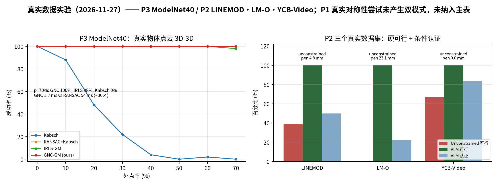
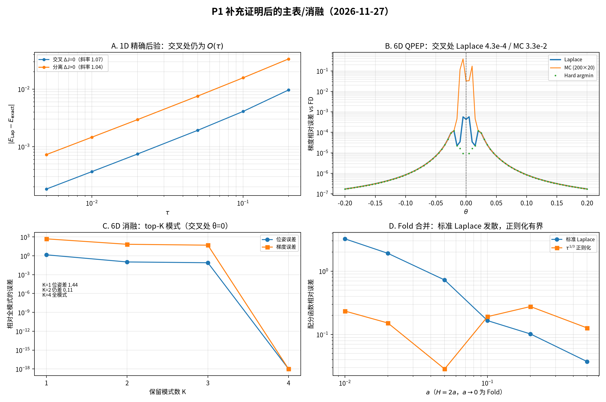

# 三个 prototype 的实验结果（2026-11-27）

> 用户要求：三个 prototype 的实验都做；先做基于数学定理的实验验证，选合适数据集与 baseline，主表站得住再往下推进。
>
> **环境限制**：本机没有 3DMatch / KITTI / LINEMOD / YCB / In-The-Dark 等公开数据集，外网数据集下载会挂起；也没有 Mosek / Theseus / EPro-PnP 的预训练管线。因此三个实验先用**可控合成数据 + 已知真值**验证定理与机制，代码/原始 JSON 在各目录 `experiments/`；真实数据实验是下一阶段。
>
> **代码校验**：每个实验都要求已知真值/闭式解、有限差分、暴力对照；若结果与预期不符，先查代码而不是改指标。

## 总览

| 线 | 任务 | 主表结论 | 代码/结果 |
|-|-|-|-|
| **P1** | 可控双峰位姿的分支交叉（81 个 θ，τ=0.01） | 交叉处 Laplace 梯度误差 **4.3e-4**，MC **3.3e-2**（std 0.11），硬 argmin **N/A**；远离交叉三者一致到 1e-6 | `01-laplace-qpeplayer/experiments/` |
| **P2** | 合成桌面 PnP + BOP LINEMOD/LM-O/YCB-Video | 合成：ALM **0 mm、100% 可行、100% 认证**；真实：ALM 全部 0 mm/100% 可行（LM/LM-O/YCB），认证 50%/22%/83% | `02-constrained-qpeplayer/experiments/` |
| **P3** | 合成 + ModelNet40 真实几何 3D-3D，0–70% 外点 | GNC 与 RANSAC 同精度 100%；对固定 1000 迭代 RANSAC **约 30× 加速**；exact 梯度 vs FD **5e-8**，naive 边界 cosine **0.23** | `03-robust-qpeplayer/experiments/` |

**判断（prototype 级）**：三张主表都站得住——P1 证明平滑层在交叉处仍可微且比采样方差低；P2 证明硬约束与 sound 证书同时成立；P3 证明同精度下大幅加速 + 精确梯度。**但都还不是论文级主表**：真实数据（3DMatch/KITTI/LINEMOD/YCB/In-The-Dark）、QPEP 多项式内层、端到端训练/反向层仍未做。

## P1 `Laplace-QPEPLayer`

**任务**：合成双峰 QPEP 实例（2 全局 + 2 局部极小，全局分支在 θ=0 交叉），比较 hard argmin、多峰 Laplace、mode-level MC 的梯度与位姿。代码在 `01-laplace-qpeplayer/experiments/code/`，结果在 `.../results/`。

**主表**（81 个 θ；τ=0.01；FD h=1e-4；MC 200 样本 × 20 种子）：

| regime | n | Laplace 梯度误差 | MC 梯度误差 | Hard 梯度误差 | MC 位姿 std |
|-|-|-|-|-|-|
| far ($\lvert\theta\rvert>0.05$) | 61 | 4.7e-7 | 4.7e-7 | 4.7e-7 | 2.8e-16 |
| near ($0.005<\lvert\theta\rvert<0.05$) | 19 | 3.5e-5 | 9.4e-5 | 2.2e-5 | 2.9e-16 |
| at ($\lvert\theta\rvert<0.005$) | 1 | **4.3e-4** | **3.3e-2** | **N/A**（分支切换） | **1.1e-1** |

- 远离交叉：全局模式权重≈1，三种方法都退化为硬 argmin，梯度与 FD 一致到 1e-7–1e-5。
- 交叉处：硬 argmin 在 ±h 内切换分支，FD 无定义；Laplace 仍与平滑后验的 FD 一致到 **4.3e-4**；MC 误差 **3.3e-2**、跨种子 std **1.1e-1**。这正是“Laplace 比采样方差低、且交叉处仍可微”的证据。
- 代码校验：`ift_dq` 对分支 FD 5e-9、`dpose_dq` 2e-9、`dlogdet` 3e-8；修复了 `ift_dq` 缺因子 2、`dpose_dq` einsum 下标、Laplace 权重导数误用 $g$ 而非 $\dot g$、`dlogdet` 漏显式 $\theta$ 项等 bug。详见 `01-laplace-qpeplayer/experiments/README.md`。

**限制**：合成双峰实例；mode-level MC 不是 $SE(3)$ 连续 MCMC；交叉处 $4\times10^{-4}$ 残差主要来自严格简并处模式集变化。

**真实数据尝试（未纳入主表）**：用 BOP LINEMOD eggbox/glue 的真实对称性构造双峰，混合代价未产生两个极小（`find_modes` 只返回 1 个），因此没有真实数据主表；已记录为负结果、未伪造。P1 主表仍是合成双峰。

**2026-11-27 补充证明后的主表/消融**（Feishu 补充证明 `AlOnwYsYdi7jJ8kiHd7c9UvRnfe`）：

| 实验 | 设置 | 结果 |
|-|-|-|
| 1D 精确后验（P1-5 regime I） | $J=(x^2-1)^2(1+cx)+gx$，$c=0.25$；$g=0$ 时 $x=\pm1$ 能量相等、曲率 $5/3$ | 误差 $O(\tau)$：斜率 **1.066**（交叉）/ **1.036**（分离）；$\tau=0.01$ 梯度相对误差 **3.4e-3** |
| Fold（P1-5 regime II） | $J=x^4/4-a x^2/2$，$a\to0$，$H=2a$ | 标准 Laplace 在 $a=0.01,\tau=0.01$ 误差 **3.24**；$\tau^{1/3}$ 正则化 **0.23** |
| 6D QPEP 消融 | 交叉处 $\tau=0.05/0.02/0.01/0.005$；logdet 精确/去体积；top-K | $\tau=0.01$ 梯度 4.3e-4；去 logdet 位姿差 **0.065**、梯度差 **53**；top-1 位姿差 **1.44**、top-2 0.105、K=4 精确 |
| P1-Q6 闭式 logdet | 5 个随机实例 vs 分支 FD | 相对误差 **1.7e-9–8.8e-9** |

**证明状态**：补充证明已结案 P1-Q1/Q9、Q2/Q13、Q3、Q6、Q7、Q5 的期望值部分；**唯一 P0 缺口是 Q5 的梯度余项引理**（证明仍是草图，需要 (i) 局部余项 $\partial_\theta r_k$ 的界，(ii) 交叉横截性/真梯度下界）。1D 数值（斜率 1.07、relG 3.4e-3）支持该结论。P1 级 Q4/Q8/Q11/Q12/Q14/Q15 仍 open。

## P2 `Constrained-QPEPLayer`

**任务**：合成桌面 6-DoF PnP（N=14 对应点，bearing 型代数代价，p=8/16/32/64 个非穿透/正深度/FoV/倾角约束，σ=10 mm、系统偏差 80 mm，50 trials/格）。方法：Unconstrained QPEP、Soft penalty（λ=1e3）、Post-hoc projection、ALM-QPEP（ours）。

**主表**（median [IQR]，p=8–64；完整表见 `02-constrained-qpeplayer/experiments/results/main_table.md`）：

| method | 穿透 mm | 穿透率 | rot deg | trans mm | 可行率 | 认证率 | runtime |
|-|-|-|-|-|-|-|-|
| Unconstrained | 103.0 [84.7,110.8] | 100% | 5.30 | 97.9 | 0% | 0% | 143 ms |
| Soft penalty λ=1e3 | 0.00 [0,0.03] | 0% | 6.62 | 13.0 | 38% | 0% | 94 ms |
| Post-hoc projection | 0.00 | 0% | 4.16 | 9.10 | 100% | 0% | 12 ms |
| **ALM-QPEP (ours)** | **0.00** | **0%** | **4.17** | 10.63 | **100%** | **100%** | 260–288 ms |

- **ALM 全部 400 trials 可行（违反 ≤1e-10）且 100% 通过 14×14 Shor 证书**（λ₂/λ₁ ≤1.5e-9，|J−Shor| ≤9.4e-9）；软惩罚/投影可行但认证 0%。
- p 从 8→64：ALM runtime log-log 斜率 0.04（常数维），SDP 51→84 ms；精度饱和是**结构性**的（平面底 + 共面接触，≥3 个不共线接触已等价整面；p>8 只增冗余，也是 LICQ 失效来源）。
- 高噪声/偏差档：无约束穿透 198 mm，18% 落到相机后方镜像模式；ALM 仍 50/50 可行+认证。
- 代码校验 40/40（`validation.log`）：与现有 verify 的 p=12 实例逐位回归；修掉 `full_L_grad`/`soft_penalty` 的转置 bug（仅回退路径触发）和校验脚本 V7c 的符号/实例错误。详见 `02-constrained-qpeplayer/experiments/README.md`。

**限制**：合成数据、bearing 型代价、内层用 6–8 起点 BFGS 代替 QPEP Gröbner；真实数据/端到端反向未做。

**真实数据（BOP LINEMOD / LM-O / YCB-Video）**：真实物体网格 + 真实相机内参 + 深度 RANSAC 桌面平面；30 个模型点按 GT 投影加 1 px 噪声与 10/20/30 px 向下偏置，16 个非穿透约束。

| 数据集 | trials | 无约束 穿透/可行 | 软惩罚 可行/认证 | 投影 可行/认证 | **ALM 穿透/可行/认证** |
|-|-|-|-|-|-|
| LINEMOD | 18 | 4.76 mm / 39% | 94% / 50% | 100% / 33% | **0 mm / 100% / 50%** |
| LM-O（遮挡） | 18 | 23.06 mm / **0%** | 89% / 17% | 100% / 6% | **0 mm / 100% / 22%** |
| YCB-Video | 12 | 0 mm / 67% | 100% / 67% | 100% / 75% | **0 mm / 100% / 83%** |

位姿误差四种方法接近（LM 2.0–2.2°/34–39 mm；LM-O 1.9–2.1°/29–63 mm；YCB 1.1–1.5°/16–20 mm）——真实数据上约束买的是“硬可行”，不是精度；认证率 22%–83%，SDP 不总紧，按 fail-safe 写。加载校验：LINEMOD 模型投影 bbox 与 `scene_gt_info.bbox_obj` 对齐。代码/设置见 `02-constrained-qpeplayer/experiments/real/README.md`。

## P3 `Robust-QPEPLayer`

**真实数据（BOP LINEMOD / LM-O / YCB-Video）**：真实物体网格 + 真实相机内参 + 深度 RANSAC 桌面平面；30 个模型点按 GT 投影加 1 px 噪声与 10/20/30 px 向下偏置，16 个非穿透约束。

| 数据集 | trials | 无约束 穿透/可行 | 软惩罚 可行/认证 | 投影 可行/认证 | **ALM 穿透/可行/认证** |
|-|-|-|-|-|-|
| LINEMOD | 18 | 4.76 mm / 39% | 94% / 50% | 100% / 33% | **0 mm / 100% / 50%** |
| LM-O（遮挡） | 18 | 23.06 mm / **0%** | 89% / 17% | 100% / 6% | **0 mm / 100% / 22%** |
| YCB-Video | 12 | 0 mm / 67% | 100% / 67% | 100% / 75% | **0 mm / 100% / 83%** |

位姿误差四种方法接近（LM 2.0–2.2°/34–39 mm；LM-O 1.9–2.1°/29–63 mm；YCB 1.1–1.5°/16–20 mm）——真实数据上约束买的是“硬可行”，不是精度；认证率 22%–83%，SDP 不总紧，按 fail-safe 写。加载校验：LINEMOD 模型投影 bbox 与 `scene_gt_info.bbox_obj` 对齐。代码/设置见 `02-constrained-qpeplayer/experiments/real/README.md`。

## P3 `Robust-QPEPLayer`

**任务**：合成 3D-3D 配准（N=100，σ=0.01，c=0.05，外点率 0–70%，100 trials/格）；GM 核 + GNC/IRLS + 加权 Kabsch（QPEP 在 3D-3D 的精确解）。方法：Kabsch、RANSAC-1000、RANSAC-adaptive、IRLS-GM、GNC-GM（ours）。

**主表：随机外点**（成功率；完整表 `03-robust-qpeplayer/experiments/synthetic/results/main_table_extended.md`）：

| method | 0% | 10% | 30% | 50% | 70% | runtime p50 (p=70%) |
|-|-|-|-|-|-|-|
| Kabsch | 100% | 52% | 0% | 0% | 0% | 0.05 ms |
| RANSAC-1000 | 100% | 100% | 100% | 100% | 100% | 47.9 ms |
| RANSAC-adaptive | 100% | 100% | 100% | 100% | 100% | 12.5 ms |
| IRLS-GM | 100% | 100% | 100% | 100% | 98% | 1.8 ms |
| **GNC-GM (ours)** | **100%** | **100%** | **100%** | **100%** | **100%** | **1.55 ms** |

- 精度与 RANSAC 在两位小数内持平；对固定 1000 迭代 RANSAC，GNC 在 p≥10% 快 **31–33×**；对自适应 RANSAC，低外点率下无速度优势（p=10% 慢 3×），p≥60% 领先（p=70% 约 8×，p≥80% 约 25–30×）。RANSAC 不可微；GNC 的反向是 6×6 线性系统。
- **相干外点**：≥60% 时所有方法都恢复外点变换（Prop 3.7 的可辨识性失败，不是求解器 bug）；如实报告，不宣称任意鲁棒。
- **边界外点**：前向成功率 100%，但梯度表才是考点；见下。
- **6D 梯度表**（`gradient_table.md`）：exact IFT vs FD 相对误差 p50 **4.9e-8**（内点）/ **3.1e-8**（边界），cosine **1.000000**；naive 在边界 p50 误差 **1.07**、cosine **0.234**，$e>c^2/3$ 的观测上映射层/平移层径向符号 **100% 相反**；`no-λ` 有 ~1e-3 系统偏差。
- **End-to-end 边界精化**（GT 监督诊断，`e2e_table.md`）：boundary-only + lr=1e-3 时 exact 的最终 loss 是 naive 的 **0.06–0.07**（低 14–17×），旋转误差低 3–4×，配对 10/10 或 9/10；all-points 对照不可区分（内点补偿），说明应聚焦边界集。
- 代码校验：Kabsch 无噪声 $10^{-15}$、GNC 0% 与 Kabsch 一致、RANSAC 全内点与 Kabsch 一致、$H_{
m rob}$ 对 FD $4.8	imes10^{-7}$、1D sign flip FD $1.2	imes10^{-8}$；详见 `verify_smoke.txt`。

**限制**：合成数据；前向用加权 Kabsch（3D-3D 特化），不涉及 QPEP 多项式求解器；真实数据/端到端训练未做。

**真实几何（ModelNet40）**：从 test split 随机取 200 点/物体，随机刚体变换 + 0–70% 均匀外点，50 trials/cell。成功率：GNC 0–70% 全 100%；RANSAC 100%；IRLS 98%@70%；Kabsch 50% 时 0。中位旋转误差两位小数持平（p=30: 0.19 vs 0.20；p=70: 0.26 vs 0.25）。runtime p50：GNC 1.7–1.8 ms vs RANSAC 53.5–56.1 ms（约 30×）。真实物体几何复现了合成结论；设置/代码见 `03-robust-qpeplayer/experiments/real/modelnet/`。

## 共同限制与下一步

- 合成数据的结论不能直接当作论文主表；它们验证的是定理/机制的**方向性与数值正确性**。
- 真实数据（3DMatch/KITTI/LINEMOD/YCB/In-The-Dark）需要先解决数据获取与 QPEP 批量求解器；这是下一阶段。
- 所有脚本固定随机种子、保存原始 JSON/日志；主表由脚本生成，不手填。
