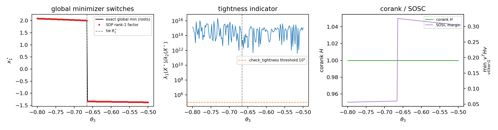
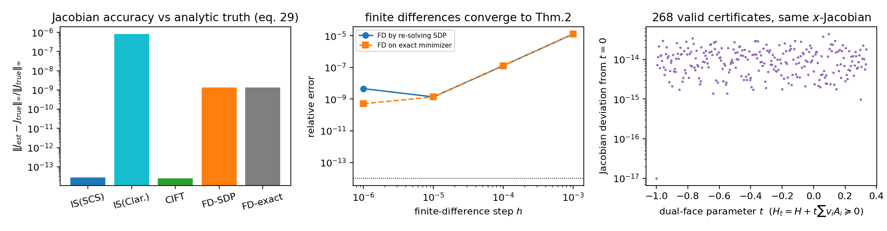
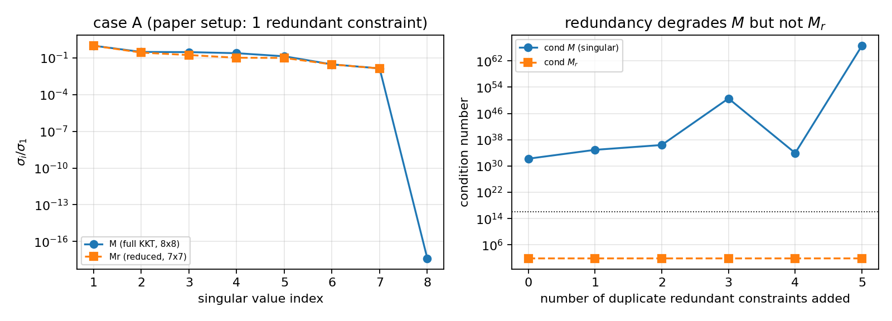

# SDPRLayers (TRO 2025) 理论笔记：Q1–Q3

**论文**：C. Holmes, F. Dümbgen, T. D. Barfoot, *SDPRLayers: Certifiable Backpropagation Through Polynomial Optimization Problems in Robotics*, IEEE T-RO, 2025. DOI 10.1109/TRO.2025.3578228（作者版 pdftotext 文本：`paper/sdpr.txt`，PDF：`references/Holmes2025_SDPRLayers.pdf`）。
**作者/日期**：theory teammate，2026-10-25。
**引用约定**：论文内引用给出行号 `paper/sdpr.txt:L###` / 定理号；外部文献给作者-年份-venue（本文参考文献编号沿用论文自己的 `[n]`）；数值结论一律来自本机脚本输出（`../analysis/theory/results/*.json`），**没有编造数字**。

---

## 0. 速览（先给结论）

> **路径说明**：下文 `paper/sdpr.txt:L###` 指原工作区的论文提取文本行号；该文本与 PDF 因版权
> 不随本仓库分发。读者可按 `[Holmes2025, §X]`/定理号对照 arXiv:2405.19309。数值结果在
> `../analysis/theory/results/*.json`，脚本可复跑。

| 问题 | 一句话答案 |
|---|---|
| Q1 可信最优 | 候选解 $x̄$ 附带一个**可多项式时间检验的证书**：存在乘子 $λ̄$ 使证书矩阵 $H̄=Q+\sum λ̄_i A_i\succeq0$ 且 $H̄x̄=0$（等价于 SDP 对偶可行 + 互补松弛 + $\mathrm{rank}(X^*)=1$），则 $x̄$ 是**全局**最优解。它与"局部最优/驻点"是本质不同的概念；与 SDP tightness、强对偶、Slater 条件的关系见 §1。 |
| Q2 SDPR | 目的：让可微优化层在**非凸**问题上回传"全局最优解的梯度"而不是伪局部极小的梯度。手段：POP→齐次 QCQP→Shor SDP 松弛；tight 时 rank-1 恢复 + 用对偶证书矩阵隐式微分（Thm.2）；非 tight 时回退/rounding/作局部解初值。理论：ACQ + SOSC + 光滑可行集 + $H̄\succeq0$ ⇒ Jacobian 唯一且属于全局最优（Thm.2）；corank$\,H̄=1$ ⇒ SOSC（Lemma 3）且 tightness 在参数扰动下稳定（§IV-C）。代价：SDP 前向/反向都在 CPU、稠密 SDP 规模 $O(n^2)$ 变量、$10^{-1}$ s 级反向、需 tight 松弛/冗余约束、商用 solver。 |
| Q3 微分与存在性 | 前向解 SDP 得 $X^*,λ^*$；反向对原 QCQP 的 KKT 条件微分 $Mdz+Ndθ=0$；有冗余约束时 $G$ 行相关 ⇒ $M$ 奇异，经典 IFT 不能用；论文改用 **Dontchev–Rockafellar 的隐选择定理（Thm.6）**：取 $G_r$ 极大无关行，用 SOSC 证 $M_r$ 行满秩，得到局部选择的 Jacobian $J=-PM_r^\dagger N_r$；再证任意两个局部选择的 $dx$ 之差被 SOSC 逼为 0 ⇒ $x$ 的 Jacobian **唯一**（乘子不唯一、$x$ 的导数唯一）。 |

---

## 1. Q1：什么是"可信最优"（certifiably optimal）

### 1.1 问题与松弛

论文考虑参数化在 $θ\in\mathbb R^d$ 上的标准齐次 QCQP（`paper/sdpr.txt:L193-L196`）：

$$
\min_{x\in\mathbb R^n}\ x^\top Q_θx\quad\text{s.t.}\quad x^\top A^θ_i x=0\ (i\in[m]),\qquad x^\top A_0x=1 .\tag{P1}
$$

其中 $A_0$ 是齐次化矩阵（保证某个 $x_i=1$，论文中 $x_0=1$），可行集 $Ω_θ$ 见式 (1)（L208-209）。用 $X=xx^\top$ 改写并去掉秩约束即得 Shor 松弛（`L214-L220` 为 (P2)，`L241-L246` 为 (P3)）：

$$
\min_{X\in\mathbb S^n}\ \langle Q_θ,X\rangle\quad\text{s.t.}\quad \langle A^θ_i,X\rangle=0,\ \langle A_0,X\rangle=1,\ X\succeq0 .\tag{P3}
$$

(P1) 与 (P3) 共用同一个 Lagrange 对偶（式 (2)(3)，L250-272）：

$$
L(x,λ,θ)=x^\top\Big(Q_θ+A_0λ_0+\sum_{i=1}^m A^θ_iλ_i\Big)x-λ_0
=x^\top H(λ,θ)x-λ_0 .\tag{2}
$$

论文把 $H$ 称为**证书矩阵**（certificate matrix），"构造出这样一个矩阵即可证明解的全局最优性"（L274-277；引 Carlone et al. 2015 [14]）。

> 小注（论文式 (3) 的符号瑕疵）：由 (2)，对偶目标应为 $-λ_0$（当 $H\succeq0$ 时 $\inf_x L=-λ_0$），故对偶问题是 $\max(-λ_0)$，而不是式 (3)（L264-272）字面写的 $\min λ_0$。本机数值验证：SCS 解出 $p^*=1.8068698$，CVXPY 给 $λ_0=-1.8068698=-p^*$（`../analysis/theory/results/exp1_certificate.json`），且 $H=Q+λ_0A_0+\sumλ_iA_i$ 恰为 CVXPY 的 PSD 约束对偶（即 $Z\succeq0$）。这只是一个笔误，不影响方法。

### 1.2 严格定义（本笔记采用的"可信最优"）

> **定义（最优性证书）**：给定 (P1) 的一个可行点 $x̄$。若存在乘子 $λ̄=(λ̄_0,λ̄_1,\dots,λ̄_m)\in\mathbb R^{m+1}$，使得
> 1. **对偶可行**：$H̄:=H(λ̄,θ)=Q_θ+\sum_{i=0}^mλ̄_iA^θ_i\ \succeq0$（$A^θ_0$ 的乘子记 $λ̄_0$）；
> 2. **互补松弛**：$H̄x̄=0$；
>
> 则称 $x̄$ 是**可信全局最优（certifiably globally optimal）**，$H̄$ 是它的**最优性证书**。

**为什么充分（一行证明）**：对任意可行 $x$，由 $x^\top A_0x=1,\ x^\top A_ix=0$ 得
$$x^\top Q_θx+\lambda_0=x^\top Hx\ \ge 0 .$$
在 $x̄$ 处，$x̄^\top H̄x̄=f(x̄)+\lambda_0=0\Rightarrow f(x̄)=-\lambda_0$。于是对一切可行 $x$：$f(x)\ge-λ_0=f(x̄)$。∎

**为什么"多项式时间可验证"**：验证 (1)(2) 本身只需一次特征值分解（$O(n^3)$）+ 残差检查；若只给了 $x̄$ 而没有 $λ̄$，"是否存在 $λ$ 使 $H(λ)\succeq0$ 且 $H(λ)x̄=0$"是一个**SDP 可行性问题**（变量数 $m+1$），同样多项式时间可解。换言之：可信最优 = **解 + 可在多项式时间内独立核验的证书**。这正好对应 Rosen et al. 2021 [61, §2.2] 所说的 "certifiably correct methods" 与 Yang & Carlone 2023 [76] 的 "certifiable algorithms"（论文 L89-L102 明确采用此说法）。

**"certifiable algorithm" vs "certified solution"**：前者指算法**有能力**同时产出解与证书（例如 SDP 求解器返回 $X^*$ 与对偶 $Z$）；后者指证书**已经算出来并被检验**过。本报告 §4 的数值验证就是后者的一个实例：先解 SDP，再用对偶 $Z$（=证书 $H$）检验 $H\succeq0,Hx^*=0$。

### 1.3 与 rank-1 tightness、强对偶、Slater 条件的关系

- **tightness 的定义**：当 (P3) 的最优解 $X^*$ 满足 $\operatorname{rank}(X^*)=1$ 时，称松弛对原 QCQP 是 **tight**；此时 $X^*=x^*x^{*\top}$ 给出 (P1) 的全局最优解（`L279-L285`；严格证明归功于 Cifuentes et al. 2022 [17]，并依赖 SDP 一般成立强对偶，`L287-L295`）。
- **tight ⇒ 证书存在**：若 $X^*=x^*x^{*\top}$ 且 $Z^*$ 是一个对偶最优解，互补松弛 $\langle Z^*,X^*\rangle=0$ 与 $Z^*\succeq0$ 给出 $Z^*x^*=0$；而 $Z^*=Q+\sumλ_iA_i$（对偶可行性）恰是证书。论文的 $H$ 就是 $Z^*$（L269-277）。
- **证书 ⇒ 全局最优，但不必 rank-1**：定义 1.2 只要求 $H̄\succeq0$ 且 $H̄x̄=0$；若 $x̄$ 可行，则全局最优。若把 $X^*=x̄x̄^\top$ 代入 (P3)，它也是 (P3) 的最优解（因为对偶值相等），所以**只要能构造出证书，$(X^*,Z^*)$ 就构成一对互补的 primal-dual 最优解**。反过来，tight + 强对偶通常就能构造证书。因此在实际问题里"tight"与"可信最优"几乎等价，但**定义上证书更本质**：它不预设 $X^*$ 的秩，只要求存在 $λ$。
- **强对偶与 Slater**：SDP 的 Slater 条件（存在严格可行点 $X\succ0$）保证强对偶（论文脚注 9，`L306-L307` 转引 Boyd & Vandenberghe [10]）；强对偶 ⇒ $p^*_{\rm SDP}=p^*_{\rm QCQP}$，此时若再有 rank-1 最优解即可恢复。
- **与 corank / 严格互补的关系**（`L499-L507`）：在**严格互补**（$\operatorname{rank}X^*+\operatorname{rank}Z^*=n$）下，"corank $H=1$" 与"$X^*$ 秩 1"等价；corank$\,H=1$ 还能保证 tightness 在目标/约束矩阵小扰动下**稳定**（Cifuentes et al. [17]，论文 L465-470、L296-308）。本文所有实验报告 corank 为 1（`L618-L619`）。
- **$H$ 与 Lagrangian Hessian**：$\nabla_x^2 L(z,θ)=2H(λ,θ)$（`L393-L394`），因此二阶充分条件 (6)（`L303`）正好是 "$\forall 0\ne v\in\ker G:\ v^\top Hv>0$"。

### 1.4 与局部最优/驻点的区别；反例

可信最优是**全局**性质。仅满足 KKT 的局部解（甚至驻点）**不是**可信的：它没有证书，其"梯度"只是该局部解的梯度，可能与被训练目标真正想要的全局解梯度完全不同。

论文给出两个反例：
1. **六次多项式（§VI-A）**：内层用梯度下降时，初值 $x_0=2$ 会让整个 bilevel 优化收敛到并停留在局部极小，外层的梯度把**局部极小**推向目标，而全局极小几乎不变（`L694-L706`，Fig.2 左；`L677-L683`）。
2. **双目定位（§VI-B）**：Theseus 随机初始化时**约 60%** 收敛到差的局部极小（`L810-L816`，Fig.3b）；由此得到的 Jacobian 与真值差 $1.02\times10^{-2}$（Table III 的 Theseus-RND，`L838-L844`），而 SDPR 的 Jacobian 差 $3.1\times10^{-6}$。标定实验（Table V，`L912-L921`）进一步显示随机初始化导致最终 baseline 误差 $1.132\times10^{-1}$，而 SDPR 与 GT 初始化都是 $3.45\times10^{-4}$。

**本机额外反例（§4 数据）**：在论文初始参数 $θ_0$ 下，多项式有两个局部极小：
$$x=-1.48705\ (y=1.80687,\ y''=27.166),\qquad x=+1.59960\ (y=7.62479,\ y''=12.765).$$
$y=1.8069$ 是全局最小，$y=7.6248$ 是伪局部极小。两者对 $θ_1$ 的导数 $dx_1^*/dθ_1=-1/y''$ 分别为 $-0.03681$ 与 $-0.07834$——**同一问题、同一个参数，伪局部解的"梯度"与全局解相差 2.1 倍**。这正是论文脚注 3（`L71-L76`）所持立场要解决的问题（论文承认有些应用只要求驻点，但本文取"优化目标就是全局最优"的立场）。

### 1.5 文献定义谱系（以论文引用为准，外部文献只作定位）

| 文献 | 术语/贡献 | 与本笔记定义的关系 |
|---|---|---|
| Rosen et al. 2021, *Annu. Rev. Control Robot. Auton. Syst.* 4:215–242 [61, §2.2] | 综述，称此类方法为 **certifiably correct methods** | 论文 L89-L96 直接采用：用凸 SDP 松弛" либо找到全局最优，要么为给定解提供全局最优性证书" |
| Yang & Carlone 2023, *TPAMI* 45(3):2816–2834 [76] | 称 **certifiable algorithms**；用 SDP 对偶证书做 outlier-robust 感知的全局优化 | 与本文同一证书框架；也是论文推荐的入门材料（L245-L247） |
| Rosen, Carlone, Bandeira, Leonard 2019, *IJRR* 38(2-3):95–125（SE-Sync）[60] | **certifiably correct algorithm**：松弛精确时全局最优，并可 **a posteriori** 验证精确性 | 原论文（arXiv:1611.00128）摘要明确写 "recover certifiably globally optimal solutions … whenever exactness obtains, it is possible to verify this fact a posteriori, thereby certifying the optimality"；这是"证书"思想最标准的机器人学出处 |
| Carlone et al. 2015, *IROS* [14] | 用 Lagrangian 对偶构造**证书矩阵**验证全局最优 | 论文 L274-L277 以此界定 $H$ 为 certificate matrix |
| Cifuentes et al. 2022, *Math. Program.* 193(2):629–663 [17] | rank-1 恢复定理；**corank=1 时 tightness 局部稳定**；SDP 的局部稳定性 | 论文 §IV-C、Lemma 3、Thm.2 证明的灵感来源（L289-L295, L462-L470, L1201-L1203） |
| Henrion, Korda, Lasserre 2021 [36]；Nie 2014 [52] | Moment-SOS 层级；Archimedean 条件下 Lasserre 层级有限收敛 | 论文 L96-L109 / L1330-L1339：SDPR 与 Moment-SOS 同源，但前者用为机器人定制的、只需一级的松弛 |
| Bandeira（作为 SE-Sync 共同作者等） | SDP 松弛/全局最优性的系列工作 | 本笔记未独立核对 Bandeira 单独论文的原始定义；**仅按文献 [60] 归属**，不额外发挥 |

> 存疑标注：以上外部文献的**具体定义措辞**我只对 SE-Sync 摘要（arXiv:1611.00128）做了直接核对；其余按论文自身的转述（`L89-L102`、`L245-L247`、`L274-L277`）引用其术语，未逐篇核对原文。

### 1.6 在 SDPRLayers 语境下 "certifiable gradients" 指什么

论文的 "certified gradients"（摘要 L25-L34；结论 L1117-L1125）不是指"对某个驻点求导"。它指：**梯度是全局最优解的梯度**，且这一事实由 (a) 松弛 tight（$X^*$ 秩 1，可恢复 $x^*$）+ (b) Thm.2 的条件（ACQ、SOSC、光滑可行集、$H̄\succeq0$）共同保证。论文 L381-L385 说得很直接："如果解的全局最优性可以被证明，那么与该解对应的梯度也是可信的。" 反过来，L119-L128：现有可微求解器只能保证局部最优，其导数可能不对应优化问题的解。

---

## 2. Q2：SDPR 方法的目的、手段、效果、代价

### 2.1 目的

论文指出可微优化（把优化问题作为网络层）的一个**未被解决的根本问题**：机器人中的优化问题大多非凸，若优化层收敛到**伪局部极小**，反向回传的梯度就不是全局最优解的梯度，会污染训练/优化过程，导致训练变慢甚至失败（`L57-L63`；脚注 3 L71-76 明确本文立场）。SDPR 的目标就是：**在训练全程提供"可信的"解与梯度**——即全局最优解及其梯度（摘要 L23-L38；L119-L128）。

### 2.2 手段（方法链条）

1. **POP → 齐次 QCQP (P1)**（`L189-L208`）：任意 POP 都可用 [17] 的方法化成标准齐次 QCQP 形式。
2. **(P1) → Shor SDP 松弛 (P3)**（`L214-L248`）：去掉唯一的非凸秩约束；SDP 用内点法多项式时间求解（`L249-L258`）。
3. **tight 时 rank-1 恢复**（`L279-L295`）：$X^*=x^*x^{*\top}$ 给全局最优解。
4. **非 tight 时的退路**（§V-C，`L628-L663`）：
   - 把 $X$ rounding 到原问题可行点 $\hat x$（问题相关，常用 SVD+投影）；
   - 计算**次优间隙** $\mu(\hat x,X)=\dfrac{\langle Q_θ,\hat x\hat x^\top\rangle-\langle Q_θ,X\rangle}{\langle Q_θ,X\rangle}$（式 (25)，`L635-L640`）：小则解可接受；
   - 大则把 $\hat x$ 作为**局部求解器的初值**（类似 Yang & Carlone [76] 的做法）；
   - 之后可回传局部求解器/rounding 的梯度，或把解交回 SDPRLayer 用 SDPR-CIFT 求梯度——但**此时理论不保证梯度正确**（`L582-L590`；论文把它列为 future work 的一个开放问题）。
5. **冗余约束 / tightening**：多数机器人问题需要加**冗余约束**才能把松弛变 tight（`L143-L147`、`L296-L308`）。冗余约束对原 QCQP 冗余、但对 SDP 松弛不冗余，能收紧松弛；论文的 `check_tightness` + Dümbgen et al. [25] 的自动找约束流程（App.C `L1311-L1339`，Fig.7）用于诊断/改进 tightness；更一般地可用 Moment-SOS 层级，但可能导致 SDP 规模爆炸（`L1336-L1339`）。
6. **三层反向模式**（§V-B，详见 Q3）：SDPR-IS（默认，Thm.2 + LSQR）、SDPR-CIFT（重算乘子 + 经典 IFT）、SDPR-SDP（CVXPYLayers 对 SDP KKT 微分）。

### 2.3 理论效果

- **Thm.2（`L475-L486`）**：在 ACQ + SOSC + 参数→可行集光滑 + $H̄\succeq0$ 下，$x̄$ 是全局最优，且它对 $θ$ 的 Jacobian **唯一**并等于 $J=-PM_r^\dagger N_r$（式 (16)(17)）。这给出"证书矩阵/乘子可以复用（由解 SDP 免费得到）来高效算梯度"的保证（`L452-L459`）。
- **Lemma 3（`L474-L486`）**：$H̄\succeq0$ 且 $\operatorname{corank}H̄=1$ ⇒ SOSC 成立。证明用 $\ker H̄=\operatorname{im}\bar x$（corank 1 + $H̄\bar x=0$）与 $x̄^\top A_0 v=v_h=0$ ⇒ $v^\top H̄v=0$ 只可能 $v=0$。
- **§IV-C（`L462-L470`）**：corank$\,H̄=1$ ⇒ tightness 在目标/约束矩阵小扰动下**稳定** ⇒ "只要从 tight 出发，调参不会让 tightness 丢失"。
- **严格互补 ⇒ rank-1 ⇔ corank 1**（`L499-L507`）。
- **覆盖范围 / 未覆盖的情况**（论文自述 + 本笔记补充）：
  - **非 tight**：没有梯度正确性理论（`L582-L590`；§VII `L1140-L1154`："目前理论局限于恰好 tight 的松弛"）。
  - **corank>1**：Lemma 3 只给充分条件；§IV-C 的稳定性保证要求 corank 1。多全局最优的**重合点（tie）**处 SDP 通常是秩 2（本笔记 §4.5 给出数值实例），此时连 $x^*$ 都无法从 $X^*$ 恢复。
  - **解映射多值/不连续**：$x^*(θ)$ 在全局极小切换处可以**不连续**（Fig.2 的 "discontinuously switch"，`L682-L683`；本笔记 §4.5 复现了这一跳变）——这种情况下不存在一个全局的单值可微解映射，Thm.2 只对每个"局部选择/分支"给出梯度。
  - **参数化约束**：Thm.2 允许 cost 和 constraints 都依赖 $θ$（`L624-L627`），但论文所有实验只参数化 cost（"our examples focus on cases where the constraints are fixed"，`L626-L627`）。
  - **乘子不唯一**：冗余约束下对偶解不唯一（脚注 13 L397-L403），这正是 Thm.2 要处理的技术难点；结论是"$x$ 的 Jacobian 唯一，乘子不必唯一"。

### 2.4 实验效果（论文数字，均给行号/表号）

**§VI-A 多项式（`L686-L752`，Fig.2）**：目标全局极小 $(x̄,ȳ)=(1.7,7.3)$（`L687-L689`），初值系数见表 I（`L690-L692`），外层 GD 终止于 loss $<1\times10^{-4}$（`L692-L693`）。
- 内层 GD 初始化 $x_0=2$：收敛到局部极小并**一直停在那里**，外层把局部极小移向目标，全局极小基本不动 ⇒ **梯度永远是错的**（`L699-L706`，Fig.2 左）；
- $x_0=-2$：先到全局解、中途被困在局部极小，梯度暂时错误，之后才恢复 ⇒ 需要更多迭代（`L706-L716`，Fig.2 中；"初始化好并不能保证不陷入局部极小"）；
- SDPRLayer：**不需要初始化、总能得到全局解、梯度始终正确**，并能不连续地切换到新的极小区域（`L749-L752`，Fig.2 右）。

**§VI-B 双目定位（`L754-L970`）**
- Jacobian 对比（相对式 (29) 的 $\|\cdot\|_\infty$ 相对误差，`L872-L877`）：
  - **Table III（scalar-weighted，`L835-L844`）**：SDPR-SDP $1.88\times10^{-5}$，SDPR-CIFT $1.29\times10^{-6}$，**SDPR-IS $3.10\times10^{-6}$**；Theseus-GT $1.02\times10^{-2}$，Theseus-GT-UR $8.28\times10^{-6}$，Theseus-RND $1.02\times10^{-2}$。反向时间：SDPR-IS $0.208$ s、CIFT $0.389$ s、SDP $0.136$ s、Theseus-GT $0.186$ s、Theseus-RND $0.180$ s、GT-UR $0.774$ s。
  - **Table IV（matrix-weighted，`L847-L860`）**：SDPR-SDP $1.49\times10^{-4}$、CIFT $3.11\times10^{-5}$、**IS $3.95\times10^{-5}$**；Theseus-GT $2.07\times10^{-2}$、Theseus-RND $1.95\times10^{-1}$。时间：SDP $0.133$ s、CIFT $0.427$ s、IS $0.231$ s、Theseus-GT $0.142$ s、RND $0.179$ s。
  - 结论：矩阵加权下 Theseus 随机初始化会陷入局部（误差 $1.95\times10^{-1}$）；SDPR 总是全局、Jacobian 准确（`L885-L890`）。
- **标定（§VI-B4，`L883-L970`；Table V `L912-L921`；Fig.4 `L932-L938`）**：50 次实验 × 20 个位姿，$b$ 初值误差 0.003 m，SGD lr $1\times10^{-4}$，SCS tol $10^{-9}$（`L941-L957`）。结果：Theseus-RND 最终 baseline 误差（均值）$1.132\times10^{-1}$（std $3.191\times10^{-2}$，外层迭代 80.34，外层 loss 138.4）；Theseus-GT $3.463\times10^{-4}$（std $4.901\times10^{-4}$，35.40，$9.854\times10^{-3}$）；**SDPR-IS $3.454\times10^{-4}$（std $4.907\times10^{-4}$，34.22，$9.857\times10^{-3}$）**。SDPR-IS 与 GT 初始化几乎重合（`L960-L970`）。

**§VI-C 真实数据（In-The-Dark，`L937-L1104`）**：VGG16 + UNet 关键点网络，用 SDPRLayer 做 matrix-weighted 位姿估计；30 epochs × 10000 样本，V100，Adam lr $1\times10^{-4}$（`L1007-L1019`）。
- **Table VI（原测试集，`L1055-L1067`）**：Ours 纵向误差 $0.035$ m、横向 $0.021$ m、heading $0.288^\circ$、推理 $0.243$ s；Baseline(w. VGG16) $0.125/0.049/0.301$ m/deg、$0.133$ s；原 Baseline $0.209/0.134/0.414$、$0.052$ s。inliers：535.6 / 541.6 / 547.6。
- **Table VII（挑战集，位移 $\ge0.5$ m 或旋转 $\ge4^\circ$，`L1055-L1067`）**：Ours $0.053/0.027/0.316$、$0.327$ s；Baseline(w. VGG16) $0.213/0.072/0.318$、$0.182$ s；Baseline $0.432/0.144/0.377$、$0.089$ s。
- 推理时间约为闭式 SVD 的 2 倍（`L1026-L1030`）；作者归因于深度不确定性建模带来的纵向/横向精度提升（`L1089-L1104`）。

### 2.5 代价（尽量定量）

| 代价 | 量化/依据 |
|---|---|
| SDP 前向复杂度 | 内点法多项式时间（`L249-L258`）；(P3) 的 primal/slack 变量数 $O(n^2)$（脚注 20，`L661-L663`），故**稠密 SDP 的存储/每步线性代数大致 $O(n^4)$/$O(n^6)$ 量级**（$n$ 为 PSD 块维数；本笔记的量级估计，未做复杂度实验；参见 Vandenberghe & Boyd 1996 [70] 的 SDP 综述与 Boyd & Vandenberghe 2004 [10, §11.5]）。论文明确：小问题很快、上千变量尚可、实时则不可行（`L250-L258`） |
| 不能靠低秩技巧 | 论文聚焦"需要冗余约束"的问题，而这类问题"迄今必须直接解 SDP"，无法直接用 Burer–Monteiro/Riemannian Staircase 降复杂度（`L256-L258`） |
| 前向/反向都在 CPU | §VII 自述：forward 和 backward 目前都在 CPU 上，与 GPU 训练结合时有昂贵的内存拷贝（`L1155-L1169`） |
| 反向单次时间（论文实测） | Table III：IS $0.208$ s（Theseus $0.186$ s，GT-UR 为 $0.774$ s）；Table IV：IS $0.231$ s（SDP 模式 $0.133$ s、Theseus $0.142$–$0.179$ s）。SDPR-SDP 反而最快，作者推测是 CVXPYLayers 后端为优化过的 C++ 而 QCQP 反向用 Python（`L877-L882`） |
| 需 tight 松弛 | 否则理论上无梯度保证，只剩 rounding/局部初值/次优间隙（`L628-L663`）；非 tight 时 SDP 矩阵解仍可微（SDPR-SDP），但其唯一性假设常被违反（脚注 13 L397-L403，脚注 18 L653-L654） |
| 需冗余约束 ⇒ SDP 变大 | 冗余约束是收紧松弛的主要手段，但增大 SDP；自动找约束/层级可能使 SDP 变得不可解（`L1336-L1339`） |
| 商用 solver | 高精度实验用 Mosek（`L864`、`L992`、`L1303`+App.D `L1278-L1304`）；无 license 时只能用 SCS/Clarabel，精度受限（本笔记 §4 实测 SCS/Clarabel 的 Jacobian 误差差 7 个量级：$2.7\times10^{-14}$ vs $8.3\times10^{-7}$） |
| 规模 | 论文自称大问题不可行（§VII `L1155-L1169`），"瓶颈是求解 SDP 的计算代价"（`L1100-L1104`） |
| 实现细节 | 默认前向用修改版 CVXPYLayers（默认 SCS）或 Mosek，也可注入用户自己的 primal-dual 解（`L541-L556`、App.D）；所有操作支持 batch（`L536-L538`） |

### 2.6 与相关可微优化工具的区别

| 工具 | 处理的问题类 | 全局性/证书 | 与 SDPR 的关键区别 |
|---|---|---|---|
| Theseus [57]（`L129-L132`） | 无约束/李群约束的非线性最小二乘 | **局部**求解器；无全局证书 | 快、支持 SO(3)/SE(3)；对非凸问题可能落到伪局部极小（论文 Fig.3b、Table III/IV/V 的实验对象） |
| CVXPYLayers [1]（`L210-L213`） | 一般 **凸** DCP | 凸问题下 KKT 充分必要 ⇒ 全局 | 只对凸问题成立；被 SDPR 用作 SDP 前向/反向后端；要求 primal/dual **唯一**，与低秩 SDP 的退化性冲突（脚注 13） |
| OptNet [4]（`L145-L149`） | 二次规划（QP，凸） | 凸 ⇒ 全局 | 只处理 QP；SDPR 处理非凸 POP 的 SDP 松弛 |
| SATNet [72]（`L176-L180`） | MAXSAT 的 SDP 松弛 | 近似、非精确 | SDPR 强调"精确 + 可证书"的全局解；SATNet 是近似可微松弛 |
| CALIPSO [39]（`L135-L138`） | 含锥/互补约束的轨迹优化 | 内点法局部解 | 局部；SDPR 用 SDP 松弛换全局性 |
| **SDPRLayers**（本文） | POP/QCQP，且 SDP 松弛 tight（或可加冗余约束变 tight） | **全局最优 + 可检验证书**；梯度对应全局解（Thm.2） | 代价是 SDP 求解与 tight 假设；非 tight 时退化为启发式 |

---

## 3. Q3：SDPRLayer 怎么求微分？怎样证明微分存在？

### 3.1 前向

输入是（向量化的）代价/约束矩阵参数
$$\nu^\top=\big[\operatorname{vec}(Q_θ)^\top\ \operatorname{vec}(A^{θ,1})^\top\ \cdots\ \operatorname{vec}(A^{θ,m})^\top\big]\tag{18}$$
（`L499-L503`）。前向解 (P3) 得 $X^*$ 与对偶 $(λ^*,H^*)$（$H^*=Z^*\succeq0$），tight 时取 $x^*$ 使 $X^*=x^*x^{*\top}$；matrix 解与 vector 解都作为可微 tensor 返回（`L541-L556`）。

### 3.2 反向的出发点：KKT 微分

原 QCQP 的 KKT 系统（式 (11)，`L384-L392`）：
$$
k(z,θ)=\begin{bmatrix}2H(λ,θ)x\\ g(x,θ)\end{bmatrix}=0,\qquad
g(x,θ)=\begin{bmatrix}x^\top A^θ_1x\\ \vdots\\ x^\top A^θ_mx\\ x^\top A_0x-1\end{bmatrix},\qquad z=\begin{bmatrix}x\\λ\end{bmatrix}\in\mathbb R^{n+m+1}.
$$
（这里 $H=Q_θ+A_0λ_0+\sum_{i=1}^m A^θ_iλ_i$，$\nabla_x^2L=2H$。）用 Magnus–Neudecker 微分记号（App.A，`L1094-L1199`）：
$$
dk(z,θ)=M\,dz+N\,dθ=0,\qquad
M=\frac{\partial k}{\partial z}=\begin{bmatrix}2H & G^\top\\ G & 0\end{bmatrix},\qquad
G=\nabla_xg=\big[A^θ_1x\ \cdots\ A^θ_mx\ A_0x\big]^\top\in\mathbb R^{(m+1)\times n}.
\tag{8,9,13,14}
$$
（式 (13) 见 `L424-L427`；$G$ 见式 (14) `L433-L434`。）$N=\partial k/\partialθ$ 的显式形式在 App.A（式 (30)-(35)，`L1103-L1199`）。记 $\nu$ 为 (18)，则
$$
N=\begin{bmatrix}
2(I\otimes x^\top) & \lambda'^\top\otimes(2I\otimes x^\top)\\[2pt]
0 & I_m\otimes\operatorname{vec}(xx^\top)^\top\\[2pt]
0 & 0
\end{bmatrix},\qquad
\lambda'=(\lambda_1,\dots,\lambda_m),
\tag{35}
$$
其中第一块来自 $d(2Hx)=2(I\otimes x^\top)\big[\operatorname{vec}(dQ)+\sum_iλ_i\operatorname{vec}(dA_i)\big]$（用 Prop.4：$d(Bx)=(I\otimes x^\top)\operatorname{vec}(dB)$，式 (31) `L1109`），第二块来自 $d(x^\top A_ix)=\operatorname{vec}(xx^\top)^\top\operatorname{vec}(dA_i)$（式 (30)），最后一行对应不随 $θ$ 变化的齐次化约束。**注意 $H$、$λ$ 在这里按 KKT 的"当前点"固定**（对 $θ$ 求偏导时 $z$ 固定）。

**无冗余约束、LICQ 且 SOSC 时**：$M$ 可逆，经典 IFT 给
$$\nabla_θS(θ)=J=-M^{-1}N,\qquad \text{即 } J=-PM^{-1}N,\ P=\begin{bmatrix}I_n&0\end{bmatrix}.\tag{10}$$
（`L357`；$M$ 可逆性见 `L437-L440` 与 Fiacco–McCormick [30]。）

### 3.3 为什么经典 IFT 在冗余约束下失效

冗余约束 ⇒ $G$ 的行线性相关 ⇒ $M$ 奇异（`L443-L459`）。此时：
- KKT 的零水平集不再唯一确定 $(x,λ)$（$S(θ)$ 是**集值**映射，乘子不唯一）；
- 经典 IFT 的"$M$ 可逆 ⇒ 局部单值且 $\nabla S=-M^{-1}N$"整套结论不成立；
- 更实际地：当冗余很多时 $\operatorname{cond}(M)$ 可爆炸到 $10^{17}$–$10^{66}$（本笔记 §4.4 数值），直接对 $M$ 做 LU 求解的 $dx$ 不可靠（我们在 7 个随机 $θ$ 中见到 1 例误差 $1.14$，见 §4.4）。注意 $M$ 的零空间**完全落在 $λ$ 方向**（$\ker M$ 中 $x$ 分量为 0，本笔记数值 $\|v_x\|=2.3\times10^{-15}$），所以"直接解奇异系统"有时凑巧给出正确 $dx$——但这没有理论保证。

### 3.4 存在性证明链条（App.B，`L1201-L1308`）

论文用 Dontchev–Rockafellar 的**隐选择（implicit selections）**理论（[23, Exercise 1F.9]，Thm.6 `L1225-L1244`）替换经典 IFT。核心链路：

**Step 0（ACQ + 光滑可行集）**：定义 1（ACQ，`L460-L470`）要求 $Ω$ 局部是光滑流形且 $\operatorname{rank}\nabla g=\operatorname{codim}Ω$；Remark 1（`L443-L451`）要求 $θ\mapstoΩ_θ$ 局部光滑（引用 Cifuentes et al. [17, Def.4.1]）。ACQ 比 LICQ/MFCQ 弱（脚注 15 `L482-L486`），允许冗余约束，是本文能处理冗余约束的入口。

**Step 1（约化 KKT 系统，式 (39) `L1204`）**：取 $g$ 的一个**极大线性无关子集** $g_r$（$r=\operatorname{rank}G$，对应 $G_r$），由 [17, Lemma A.8] 知 $g_r=0$ 与 $g=0$ 局部等价，于是解映射可写成
$$S:\ θ\mapsto\{z\in\mathbb R^{n+r}\mid \bar Hx=0,\ g_r(x,θ)=0\},\tag{39}$$
其对 $z$ 的 Jacobian 恰是
$$M_r=2\begin{bmatrix}\bar H & G_r^\top\\ G_r & 0\end{bmatrix}\in\mathbb R^{(n+r)\times(n+r)}.\tag{17}$$

**Step 2（$M_r$ 行满秩，用 SOSC）**：设 $t^\top=(v^\top,u^\top)$ 满足 $M_r^\top t=0$，即
$$\bar Hv+G_r^\top u=0,\qquad G_rv=0 .$$
第二式给 $v\in\ker G_r=\ker G$；第一式左乘 $v^\top$ 并用 SOSC（式 (6)：$v^\top\bar Hv>0$ 对 $0\ne v\in\ker G$）得 $v=0$；再由 $G_r^\top u=0$ 与 $G_r$ 行无关（列满秩）得 $u=0$。故 $M_r$ 的转置零空间平凡 ⇒ **$M_r$ 行满秩**（`L1211-L1229`）。关键点：这里只要求 **SOSC**（不是 LICQ），因此冗余约束被允许。

**Step 3（对约化系统用 Thm.6）**：$k$ 对 $(z,θ)$ 连续可微（$Q_θ,A^θ_i$ 连续可微、问题二次型），$\nabla_zk=M_r$ 秩为 $p=n+r$，Thm.6 给出：存在 $S$ 在 $\barθ$ 附近对 $\bar z$ 的局部选择 $w$，且
$$\nabla w(\barθ)=M_r^\top(M_rM_r^\top)^{-1}N\equiv M_r^{\dagger}N .\tag{37}$$
（`L1242`；$M_r^\dagger$ 为右伪逆——只要行满秩即可，无需方阵可逆！）取 $w^\top=(x^\top,λ^\top)$，则 $x$ 的 Jacobian 为
$$J=-PM_r^{\dagger}N,\qquad P=\begin{bmatrix}I_n\\0\end{bmatrix}.\tag{16}$$

**Step 4（唯一性：任意两个局部选择的 $dx$ 相同）**：设 $w_1,w_2$ 是任意两个局部选择，$dx_1-dx_2=v$、$dλ_1-dλ_2=u$。两式都满足 (8)，相减得
$$M_r\begin{bmatrix}v\\u\end{bmatrix}=0\ \Longrightarrow\ v\in\ker G,\quad \bar Hv+G_r^\top u=0 .$$
左乘 $v^\top$ 并用 SOSC：$v^\top\bar Hv=0\Rightarrow v=0$。故 $dx$ 唯一、$J$ 唯一（`L1244-L1305`）。
> 这正是本定理的**核心价值**：冗余约束使**乘子不唯一**（$S(θ)$ 集值），但 $x$ 的 Jacobian **唯一**。核心机制：$M_r$ 的零空间只落在 $λ$ 方向，而 SOSC 保证 $x$ 方向没有零空间。我们的数值实验直接验证了这一点：在同一个对偶最优面上取 268 个不同的有效证书 $H_t=H+t\sum v_iA_i\succeq0$（$t\in[-1,0.335]$），它们给出的 $x$-Jacobian 彼此相对偏差 $\le4.4\times10^{-14}$（`../analysis/theory/results/exp2_jacobian.json`）。

**Step 5（全局最优性）**：$H̄\succeq0$ 足以保证 $x̄$ 全局最优（[17]，`L1306-L1308`）。结合 Step 4，式 (16) 就是**全局最优解的 Jacobian**。

### 3.5 Lemma 3、corank 与 SOSC 的关系

Lemma 3（`L474-L486`）：若 $H̄\succeq0$ 且 $\operatorname{corank}H̄=1$，则 SOSC 成立。证明：$v\in\ker G$，$v^\top H̄v\ge0$，等号成立要求 $v\in\ker H̄$；corank 1 且 $H̄\bar x=0$ ⇒ $\ker H̄=\operatorname{span}\{\bar x\}$ ⇒ $v=μ\bar x$；另一方面 $x̄^\top A_0$ 是 $G$ 的一行 ⇒ $v_h=0$，而 $\bar x_h=1$ ⇒ $μ=0$ ⇒ $v=0$。∎

- 这条引理是**充分不必要**：本笔记 §4.5 的 tie 例中 corank $H=2$ 但 SOSC 在两条全局极小分支处仍分别成立（margin $0.060$ 与 $0.326$）。
- 严格互补（$\operatorname{rank}X^*+\operatorname{rank}Z^*=n$）下，"corank $H=1$" ⇔ "$X^*$ 秩 1"（`L499-L507`），且 corank 1 是 tightness 稳定性的条件（§IV-C `L462-L470`，[17]）。tie 例中严格互补仍成立（$\operatorname{rank}X^*=2,\operatorname{rank}Z^*=2$），但秩不为 1，松弛不 tight。

### 3.6 三种反向模式与何时使用

| 模式 | 公式 | 何时用 | 优点/缺点 | 论文位置 |
|---|---|---|---|---|
| **SDPR-IS**（默认） | 式 (16)(20)：$\nabla_\nu\ell^\top=-N^\top M_r^{\top\dagger}P^\top\nabla_x\ell^\top$；每步用 **LSQR** 解最小二乘 $\nabla_y\ell=\arg\min_y\|M_r^\top y-P^\top\nabla_x\ell\|_2^2$（式 (21)），避免显式 Jacobian/伪逆 | tight + 有/无冗余约束 | 复用 SDP 已经算出的 $H,λ$，最快；LSQR 只需稀疏矩阵-向量积、对近相关约束也稳健（脚注 17 `L564-L566`） | §V-B1 `L519-L551` |
| **SDPR-CIFT** | 式 (22)(23)(24)：$λ=-G_r^{\top\dagger}Q_θx$ 重算非冗余子集的乘子，构造 $H_r=Q_θ+A_0λ_0+\sum A_iλ_i$、$M=2\begin{bmatrix}H_r&G_r^\top\\G_r&0\end{bmatrix}$，解 $My=P^\top\nabla_x\ell$，$\nabla_\nu\ell=-N^\top y$ | 不想用/不能用 SDP 对偶时；或对偶不可靠需要重算时 | 免去"对偶解唯一性"依赖；但需重算乘子，通常更慢（Table III/IV：CIFT $0.39$/$0.43$ s vs IS $0.21$/$0.23$ s）。**注意式 (23) 的 $H_r$ 不保证 PSD**（本笔记实测特征值可含 $-1.11$），但 $M$ 仍可逆、Jacobian 仍对 | §V-B2 `L557-L594` |
| **SDPR-SDP** | 用 CVXPYLayers 对 **SDP 的 KKT 条件**做隐式微分，得到 $X$ 的 Jacobian | 非 tight 时（$\bar H$ 无证书）也能给 SDP 解的导数 | 理论上要求 SDP 的 primal/dual **唯一**，而低秩 SDP 常退化（脚注 13：秩 1 且 $m+1>n$ 时对偶不唯一），故"返回值不一定可信"；且线性系统规模 $O(n^2)$，大问题更慢 | §V-B3 `L595-L627`；脚注 13/18/19 `L397-L403`、`L653-L661` |

> 论文实验统一用 SDPR-IS，因为所有实验解都满足 Thm.2 且 corank $=1$（`L616-L622`）。

### 3.7 公式中的两个表述细节（本笔记补注，非论文错误但读者易卡）

1. **式 (16) 的 $N$ 必须理解为"约化"后的 $N_r$**。式 (35) 的 $N$ 有 $n+m+1$ 行（stationarity 的 $n$ 行 + 全部 $m+1$ 个约束行），而 $M_r^\dagger$ 是 $(n+r)\times(n+r)$：若 $r<m+1$（有冗余），二者维度不匹配。正确做法：取 $N_r$ = stationarity 的 $n$ 行 + **被选中的 $r$ 个约束对应的行**（顺序与 $G_r$ 一致），即
   $$N_r:=P_rN,\qquad P_r\ \text{选行},\qquad J=-PM_r^{\dagger}N_r .$$
   本笔记的数值实现按此约定，$J$ 与解析真值/有限差分吻合到 $10^{-14}$（§4.3）。论文正文没有显式写 $N_r$，是推导中的一个表述缺口。
2. **式 (39) 里 "$\bar Hx=0$" 的 $\bar H$ 应理解为"由被选约束对应的乘子与参数构成的证书矩阵"**（因此它随 $θ$ 变化，$N$ 才含 $dQ,dA_i$）；若真的把 $\bar H$ 当常数矩阵，则 $N$ 的第一块应为 0，与 (35) 矛盾。证明的严格写法应是对**约化 KKT 系统** $k_r(x,λ_r,θ)=\big[2H_r(λ_r,θ)x;\ g_r(x,θ)\big]$ 应用 Thm.6。按此理解，我们的数值验证（含 §4.5 的退化 tie 边界）与结论一致。

---

## 4. 数值验证（§VI-A 六次多项式，复现论文 Table I / 式 (26) / Q_θ / A₀…A₃）

### 4.0 环境、脚本、可复现命令

- 环境：Python 3.10+（开发时用 numpy 2.2.6、scipy 1.15.3、cvxpy 1.7.5、matplotlib 3.10.9；**未额外安装包**）。SDP 求解器：SCS（主，`eps=1e-11~1e-12`，`max_iters=3e5`）与 Clarabel（对照）；**无 Mosek license**。
- 数据来源：Q_θ 见 `paper/sdpr.txt:L706-L714`，A₀…A₃ 见 `L717-L733`（矩阵元素在原工作区用论文第 9 页图像逐项核对过；该图像因版权不随仓库分发），初值系数见 Table I（`L690-L692`）。约束为 $A_0$（齐次化）、$A_1=x_0x_2-x_1^2$、$A_2=x_0x_3-x_1x_2$、$A_3=x_1x_3-x_2^2$；其中 $A_3$ 在原 QCQP 中冗余（论文 `L736`），但在 SDP 中不冗余（正是它能收紧松弛）。
- 脚本：`../analysis/theory/sdpr_poly.py`（核心库）、`exp1_certificate.py`、`exp2_jacobian.py`、`exp3_redundancy.py`、`run_all.sh`；输出：`../analysis/theory/results/*.json`、`../analysis/theory/figures/*.png`。
- 复现：`cd ../analysis/theory && bash run_all.sh`（或逐个 `python expN_*.py`；每步几分钟内）。

### 4.1 复现 §VI-A：tight、$H\succeq0$、corank $H=1$（`exp1_certificate.py`）

在 $θ_0=$ Table I 下：

| 量 | 数值 | 说明 |
|---|---|---|
| $p^*$（SDP 最优值） | $1.8068698056687$ | 与解析全局极小 $y(x_1^*)=1.806869805669$ 相差 $4.2\times10^{-14}$ |
| $x^*$（rank-1 因子） | $[1,\ -1.4870495367754686,\ 2.2113163,\ -3.2883369]$ | 与解析 $x_1^*=-1.4870495367754832$ 相差 $5.3\times10^{-14}$（inf 范数） |
| eig$(X^*)$ | $[18.9144,\ 2.85\times10^{-14},\ \sim0,\ \sim0]$ | 秩 1；tightness 比值 $\lambda_1/\lambda_2=6.63\times10^{14}$ ≫ 论文 App.C 阈值 $10^5$（`L1315-L1326`） |
| eig$(H^*)$ | $[1.53\times10^{-15},\ 0.06244,\ 0.35980,\ 9.13467]$ | $H\succeq0$，**corank $H=1$** |
| $\|H^*x^*\|_2$ | $2.6\times10^{-14}$ | 互补松弛（数值） |
| $\operatorname{rank}G$（4 行） | $3$ | 恰有 1 个冗余约束（$A_3$），与论文 `L736` 一致 |
| SOSC margin $\min_{v\in\ker G}v^\top Hv$ | $0.25221$ | $>0$；$\dim\ker G=1$ |
| $T=\langle Q,X^*\rangle$ | $=-λ_0=1.80687$（$λ_0=-1.80687$） | 与 §1.1 小注一致（式 (3) 的符号笔误） |

结论：**完全复现论文"tight + 证书 + corank 1"的设定**（论文 `L616-L622` 称所有实验 corank $=1$）。

### 4.2 参数扫描与"全局极小切换"（Fig.2 现象）

固定其余系数、扫描 $θ_3\in[-0.80,-0.50]$（151 点，SCS）：存在一个**精确的 tie 点**
$$θ_3^*=-0.6659083962464160,$$
由解析多项式两根 $y'=0$ 的极小值相等（二分到 $10^{-15}$）得到。跨过 $θ_3^*$ 时全局极小**不连续跳变**（Fig.1 左）：
$$x_1^*:\ +2.0083\ \longrightarrow\ -1.3307,$$
这正是论文 Fig.2 "discontinuously switch the minimum"（`L682-L683`、`L749-L752`）的复现。扫描中除 tie 附近外，tightness 比值始终 $\ge10^{11}$（远高于阈值 $10^5$），corank $H=1$，SOSC margin $>0$。

> 注：rank-1 比值在 tight 区间的抖动来自 SDP 求解器的对偶/残差噪声（$10^{11}$–$10^{16}$ 的起伏），不是物理信号；tie 点处才是真正的秩 2（见 4.5）。

### 4.3 Thm.2 的 Jacobian vs 有限差分（`exp2_jacobian.py`）

**真值**：该多项式例的全局极小 $x_1^*$ 满足 $y'(x_1^*)=0$，故解析地
$$\frac{\partial x_1^*}{\partialθ_j}=-\frac{j\,(x_1^*)^{j-1}}{y''(x_1^*)}\ (j\ge1),\qquad
\frac{\partial x_2^*}{\partialθ_j}=2x_1^*\frac{\partial x_1^*}{\partialθ_j},\qquad
\frac{\partial x_3^*}{\partialθ_j}=3(x_1^*)^2\frac{\partial x_1^*}{\partialθ_j},\qquad \frac{\partial x_0^*}{\partialθ_j}=0 .$$
（注意因子 $j$：$\partial y'/\partialθ_j=jx^{j-1}$。本笔记第一版漏掉该因子，已修正并在脚本中固化为 `exact_jacobian_theta`。）
另外还实现了两种**有限差分**：(a) 对每个 $θ_j$ 扰动后**重新解 SDP**、取 rank-1 因子；(b) 对解析全局极小做中心差分。

误差用论文式 (29)（`L873-L877`）：$\ \Delta J_{\rm est}=\|J_{\rm est}-J_{\rm true}\|_\infty/\|J_{\rm true}\|_\infty$。

| 方法 | 相对误差（式 29） | 备注 |
|---|---|---|
| **Thm.2，SDPR-IS（SCS 证书）** | $\mathbf{2.70\times10^{-14}}$ | 机器精度 |
| Thm.2，SDPR-IS（Clarabel 证书） | $8.29\times10^{-7}$ | 换 solver ⇒ 不同 $λ,H$、不同精度；见 4.3b |
| **SDPR-CIFT（式 22-24）** | $\mathbf{2.49\times10^{-14}}$ | 重算乘子后同样机器精度 |
| FD（重解 SDP），$h=10^{-3}/10^{-4}/10^{-5}/10^{-6}$ | $1.30\times10^{-5}$ / $1.30\times10^{-7}$ / $1.38\times10^{-9}$ / $4.58\times10^{-9}$ | $O(h^2)$ 后碰到 SDP 精度地板 |
| FD（解析极小），$h=10^{-3}/10^{-4}/10^{-5}/10^{-6}$ | $1.30\times10^{-5}$ / $1.30\times10^{-7}$ / $1.37\times10^{-9}$ / $5.11\times10^{-10}$ | 有限差分自身的截断/舍入折中 |
| Thm.2 vs FD($h=10^{-5}$) | $1.38\times10^{-9}$ | 两种独立方法互相印证 |

**4.3a 选择不变性**：$G$ 的 4 行中任取 3 行线性无关子集（共 3 种），分别构造 $M_r$ 计算 $J$：最大相对误差 $2.70\times10^{-14}$，彼此最大偏差 $1.98\times10^{-14}$，$\operatorname{cond}(M_r)\in[93.1,100.2]$。→ 与 Thm.2 的"$G_r$ 任意选取"一致。

**4.3b 乘子不唯一但 Jacobian 唯一**：构造对偶最优面
$$H_t=H+t\sum_{i}v_iA_i,\qquad G^\top v=0\ (v\in\ker G^\top),$$
扫描 $t$，只保留 $H_t\succeq0$ 的证书：共 **268** 个有效证书（$t\in[-1.00,\,0.335]$，corank 均为 1），它们给出的 $J_\theta$ 相对真值的最大误差 $6.90\times10^{-14}$，**彼此最大偏差 $4.40\times10^{-14}$**。这是 Thm.2 "乘子不唯一、$x$-Jacobian 唯一"的直接数值证据（对应 §3.4 Step 4）。

**4.3c $dX$ 与 $dx$ 的一致性（SDPR-IS vs SDPR-SDP 的接口）**：对每个 $θ_j$ 做 $X$ 的有限差分，与 $\frac{\partial X}{\partialθ_j}=\frac{\partial x}{\partialθ_j}x^\top+x\frac{\partial x}{\partialθ_j}^\top$（用 Thm.2 的 $dx$）比较：$j\ge1$ 的最大相对误差 $5.5\times10^{-9}$（$j=0$ 列结构上为 0）。说明 IS 给出的 vector Jacobian 与 SDP 解的导数一致——这正是 SDPR-SDP 想通过 CVXPYLayers 得到的东西。

**4.3d 参数化约束的 $N$ 块（论文实验未覆盖）**：把约束换成 $A_1'\to A_1+0.3A_3$（其余为 $A_2,A_3$）。由于 $A_3$ 仍是约束，SDP 可行集对任何 $θ$ 都**完全相同**，故精确 Jacobian 为 0；用式 (35) 的 $A_1$ 列块算 $\partial x/\partial(\operatorname{vec}A_1)\cdot\operatorname{vec}(A_3,A_2,A_1)$，得到 $\|dx\|\le2.2\times10^{-13}$。→ $N$ 的"约束行块"结构与符号正确（但论文的 4 个实验都只参数化 cost，这一块严格说未被论文实验检验）。

### 4.4 冗余约束场景：经典 $M$ 奇异、$M_r$ 行满秩、伪逆公式仍正确（`exp3_redundancy.py`）

记 $n=4$；case A 是论文原设定（$m=3$ 个约束 + 齐次化 ⇒ $G$ 有 4 行、秩 3，1 个冗余）。case B/C 人为再加冗余约束（它们都是 $A_1,A_2,A_3$ 的线性组合，故 SDP 可行集/解不变）。

| | case A（论文设定） | case B（+3 个冗余） | case C（+4 个冗余，含重复） |
|---|---|---|---|
| 约束行数 / $G$ 秩 / 冗余数 | 4 / 3 / 1 | 7 / 3 / 4 | 8 / 3 / 5 |
| $M$ 尺寸、$\operatorname{cond}(M)$ | $8\times8$, $2.42\times10^{17}$ | $11\times11$, $6.74\times10^{32}$ | $12\times12$, $1.70\times10^{33}$ |
| $M$ 的最小奇异值/最大奇异值 | $4.1\times10^{-18}$ | $1.5\times10^{-33}$ | $5.9\times10^{-34}$ |
| $M$ 的最小特征值 | $5.5\times10^{-17}$ | —（奇异） | —（奇异） |
| $M_r$ 尺寸、$\operatorname{cond}(M_r)$ | $7\times7$, $72.1$ | $7\times7$, $74.9$ | $7\times7$, $71.0$ |
| Thm.2（复用 SDP 对偶证书）误差 | $2.70\times10^{-14}$ | $\mathbf{0.140}$（对偶不精确，$Hx$ 残差 $1.40$） | $\mathbf{0.0126}$（$Hx$ 残差 $0.634$） |
| Thm.2（最小二乘重算乘子，强制 $Hx=0$）误差 | $2.37\times10^{-14}$ | $\mathbf{5.7\times10^{-13}}$ | $\mathbf{1.3\times10^{-13}}$ |
| SDPR-CIFT（式 22-24）误差 | $2.49\times10^{-14}$ | $5.6\times10^{-13}$ | $1.1\times10^{-13}$ |
| 独立行选择数 / $J$ 的最大偏差 | 3 / $2.0\times10^{-14}$ | 14 / $1.7\times10^{-14}$ | 15 / $1.2\times10^{-13}$ |
| 直接对奇异 $M$ 解 $M^{-1}$ | 未报错，$dx$ 误差 $2.7\times10^{-13}$（凑巧；见下） | `LinAlgError: singular matrix` | `LinAlgError: singular matrix` |

**结论与说明**：
1. **经典 $M$ 奇异**：$A_3$ 一行冗余就使 $\operatorname{cond}(M)\sim10^{17}$；冗余越多越糟（再加 5 个可到 $10^{66}$，见 JSON 的 `scaling`）。→ 经典 IFT 的"$M$ 可逆"前提确实被违反。
2. **$M_r$ 行满秩**：删掉冗余行后 $M_r$ 条件数保持 $\sim70$–$120$，与冗余数量基本无关；伪逆公式 $J=-PM_r^\dagger N_r$ 在 A 中到 $10^{-14}$，在 B/C 中只要乘子一致（LS/CIFT 重算）也到 $10^{-13}$。→ Thm.2 的"用伪逆替代逆"确实解决了冗余约束问题。
3. **$dx$ 唯一**：所有独立行子集、所有有效证书都给出同一个 $J$（偏差 $10^{-13}$ 量级）。
4. **实践警告（论文未讨论）**：冗余极多时，SDP solver 返回的**对偶证书**可能不再满足 $Hx=0$（$Hx$ 残差 0.63–1.4，甚至 $H_{\min}<0$），此时"直接复用证书"的 SDPR-IS 梯度会失准（14%/1.3%）；需按式 (22) 或最小二乘重算乘子（本笔记实现为 `cift_jacobian` / LS 证书）。这解释了为什么论文提供 CIFT 作为备选（而且 SDPR-IS 的公式 (21) 里 LSQR 对"近相关约束"的鲁棒性脚注 17 也相关）。
5. **"奇异 $M$ 直接求解"为什么有时也能对**：对 case A，$\ker M$ 完全在 $λ$ 方向（数值上 $x$ 分量 $2.3\times10^{-15}$），所以 $M$ 的数值奇异不污染 $dx$；但我们对 7 个随机 $θ$ 做过测试，其中有 1 例误差 $1.14$、1 例 $2.3\times10^{-11}$——**不可靠**，论文改走隐选择/伪逆是有必要的。

### 4.5 corank 与 SOSC 的数值关系（含多全局最优的 tie 边界）

**随机 $θ$ 采样**（$θ=θ_0+\mathcal N(0,σ^2)$，每个 $σ$ 40 个样本，限制 $θ_6>0.02$ 保证多项式有下界）：

| $σ$ | tight（rank-1 比值 $>10^5$） | corank $H=1$（可判定者） | $H\succeq0$ | SOSC margin $>0$ | $\max|p^*-y_{\rm exact}|$ |
|---|---|---|---|---|---|
| 0.05 | 40/40 | 40/40 | 40/40 | 40/40 | $2.2\times10^{-12}$ |
| 0.20 | 40/40 | 39/40（1 例对偶噪声不可判定） | 40/40 | 40/40 | $9.4\times10^{-9}$ |
| 0.50 | 40/40 | 38/40 可判定为 1（2 例对偶噪声不可判定） | 40/40 | 40/40 | $2.3\times10^{-6}$ |

→ 在这个例子中 **tight/corank 1/SOSC 都是"通例"**，与论文 `L616-L622` 的观察一致。所有能明确判定的 corank $H=1$ 样本都有 SOSC $>0$（Lemma 3 的充分性数值成立）。

**边界反例：两个全局极小恰好相等（tie）**。在 $θ_3^*=-0.6659083962464160$ 处：
- 两个全局极小：$x=+2.008311$ 与 $x=-1.330714$，$y=3.6704580917$（两者差 $\sim10^{-14}$）；
- SDP 解：eig$(X^*)=[21.479,\ 6.434,\ \sim0,\ \sim0]$，**秩 2、不 tight**（rank-1 比值 $3.34$）；$p^*$ 仍等于精确全局最优值（差 $8.5\times10^{-12}$）；
- $\operatorname{corank}H=2$；$H$ 同时满足 $Hx_{\rm left}\approx Hx_{\rm right}\approx0$（残差 $4\times10^{-12}$）⇒ **两个全局极小都被同一个证书认证**（定义 1.2 的意义上）；
- **SOSC 分别成立**（以该 $H$ 计：$x=+2.0083$ 处 margin $0.0601$，$x=-1.3307$ 处 $0.3263$）——因为 $\ker H$ 的第二个方向不在 $\ker G$ 里。⇒ **Lemma 3 的 corank$=1$ 条件只是充分条件**，此处 corank 2 而 SOSC 仍真；
- 即使在这个退化点，**给定分支点 $x$**（不能从 $X^*$ 恢复，需要外部提供），Thm.2 的公式（用这个 corank-2 证书）仍给出该分支的正确 Jacobian：相对误差 $1.6\times10^{-13}$（$x=+2.0083$）与 $3.7\times10^{-14}$（$x=-1.3307$），$\operatorname{cond}(M_r)=276/46$。
- 但**层本身在该点不可用**：$X^*$ 秩 2，rank-1 恢复失败；且 $x^*(θ)$ 在 tie 两侧跳变（4.2），不存在单值可微的全局解映射。该点测度为零，论文的"corank=1"实验恰好不会撞到；但它说明**多全局最优/非 tight 情形不在理论覆盖范围内**。

---

## 5. 存疑点 / 推导缺口（诚实清单，按重要度）

1. **式 (3) 符号**：对偶应为 $\max(-λ_0)$（或 $\min -λ_0$），论文写 $\min λ_0$（`L264-L272`）。数值上 $λ_0=-p^*$。判为笔误。
2. **式 (16) 中 $N$ 的维度/约化**：$M_r^\dagger$ 是 $(n+r)\times(n+r)$，而 (35) 的 $N$ 是 $(n+m+1)\times\dim\nu$。必须用"stationarity 行 + 选中约束行"的 $N_r$。论文未写明；按 $N_r$ 实现后一切数值吻合（§4.3）。
3. **式 (39) 的 $\bar H$ 是常数还是 $θ$ 的函数**：证明的文字在两者间摇摆；严格写法应对约化 KKT 系统 $k_r(x,λ_r,θ)$ 用 Thm.6（这样 $N$ 才会含 $dQ,dA_i$）。这是**表述严谨性**问题，不影响定理结论（我们的数值验证支持结论）。
4. **CIFT 的 $H_r$ 不保证 PSD**：式 (23) 的 $H_r$ 由式 (22) 重算乘子构造；本笔记实测其特征值含 $-1.11$（`exp2_jacobian.json` 的 `eigHr`），但 $M$ 仍可逆、Jacobian 仍精确。论文没有讨论这一点（它只把 $H$ 当"证书矩阵"）。可能的解释：Jacobian 公式只依赖 $Hx=0$ 与 $M_r$ 的可逆性/SOSC，而不要求 $H\succeq0$ 用于**求导**（$H\succeq0$ 只用于"全局最优"这一结论）。
5. **非 tight 时梯度正确性无理论**：论文自己列为 future work（`L582-L590`），我们对这一点没有补充证明。
6. **参数化约束未被实验覆盖**：论文称 cost/constraints 都可参数化（`L624-L627`），但 4 个实验只参数化 cost（`L626-L627` 原文）；本笔记仅用"可行集不变"的构造做了 $N$ 约束块的**一致性**检验（§4.3d），没有做非平凡约束参数化的端到端验证（该多项式例的约束一旦非平凡扰动，$A_3$ 的冗余性/可行集会退化，见 `analysis/theory` 的试验记录）。
7. **极端冗余时 solver 对偶精度**：本笔记发现 $\operatorname{cond}(M)\sim10^{32}$ 及以上时 SCS/Clarabel 的对偶证书可能违反 $Hx=0$，使 IS 梯度失准（§4.4）。论文的实验冗余度较低、且用了 Mosek（高精度），所以未暴露；但这提示实现上应检查 $Hx$ 残差或重算乘子。
8. **tightness 指标是启发式**：App.C 的 $\lambda_1/\lambda_2>10^5$（`L1315-L1326`）对求解器精度敏感；我们观察到 tight 区间内该比值在 $10^{11}$–$10^{16}$ 抖动，tie 附近会掉到个位数。作为"是否 rank-1"的判据，它只在数量级意义上可靠。
9. **未核对论文的 Table III/IV/V/VI/VII 原始实验**：这些数字是**论文报告值**（引用了行号/表号），不是本机复现；本机只复现了 §VI-A 多项式与 Thm.2/冗余约束的机制。复现双目/标定需要 `code/sdprlayer` + Mosek/SCS 的完整流程（属 repro teammate 的范围）。
10. **Mosek 缺失**：本机只能用 SCS/Clarabel；论文 Table III/IV 的高精度数字（$10^{-12}$ 容差）无法在本机复核；我们的 SCS 对偶误差 $10^{-14}$（Jacobian）与 Clarabel $10^{-7}$ 的对比说明 solver 精度会显著影响 $J$ 的最后几位。

---

## 6. 文件清单

| 文件 | 内容 |
|---|---|
| `notes/theory_Q1_Q3.md` | 本笔记 |
| `../analysis/theory/sdpr_poly.py` | Q_θ、A₀…A₃、SDP 求解、证书诊断、Thm.2/CIFT Jacobian、解析真值、FD、对偶面采样等 |
| `../analysis/theory/exp1_certificate.py` | §4.1/4.2/4.5：证书、tightness、θ₃ 扫描、tie、随机采样 |
| `../analysis/theory/exp2_jacobian.py` | §4.3：Thm.2 vs FD vs CIFT、选择不变性、对偶面、$dX$、$N$ 的约束块、tie 分支 |
| `../analysis/theory/exp3_redundancy.py` | §4.4：奇异 $M$、$M_r$ 伪逆、重算乘子、行选择不变性 |
| `../analysis/theory/results/*.json` | 所有数值结果（含全部中间量） |
| `../analysis/theory/figures/fig1_certificate.png` | Fig.1（切换、tightness、corank/SOSC） |
| `../analysis/theory/figures/fig2_jacobian.png` | Fig.2（Jacobian 精度、FD 收敛、对偶面不变性） |
| `../analysis/theory/figures/fig3_redundancy.png` | Fig.3（$M$ vs $M_r$ 奇异值谱、条件数随冗余数） |
| `../analysis/theory/run_all.sh` | 一键复现（三个实验脚本 + 打印摘要） |

---

## 7. 与 Lead/其他 teammate 的衔接

- Q4/Q5 需要的问题类与"紧性如何"可以直接引用本笔记 §1.2/§1.3 的证书定义与 §4.1/4.5 的 tightness/corank 判据；"SDPR 在哪些机器人问题上 tight"属于 Q4，本笔记不越界。
- 复现（repro）如需解释"为什么 SDPR-IS 与 Theseus-GT 的 Jacobian 应该一致到 $10^{-5}$ 或更好"，可用本笔记 §3.4（同一全局最优 ⇒ 同一 Jacobian）与 §4.3b（乘子不唯一但 Jacobian 唯一）作为理论依据；若 repro 用 SCS 而非 Mosek，引用 §4.4 第 4/7 条提醒其检查 $Hx$ 残差。
