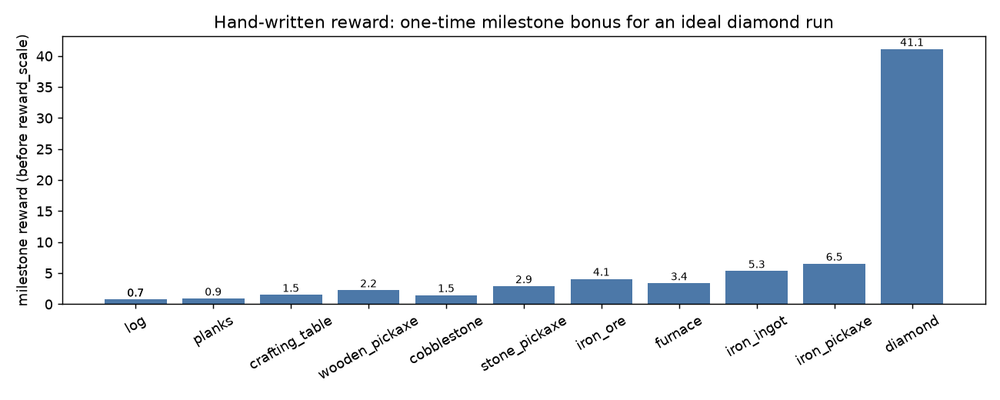

# 03 手写奖励函数

> **结论先行**：奖励函数由五部分组成：**基于势函数的物品/探索/深度形状奖励**、**带速度倍率的科技树里程碑奖励**、**生命与死亡惩罚**、**一次性饥饿/缺氧警告**、**每步时间惩罚**。全部权重手写在 `mcppo/config.py`，每一项都对应 Minecraft Wiki 里的合成配方或机制；每一项都按分量记录，可直接看出 agent 在"刷"什么。

**如果只记三件事**：

1. 物品奖励用 **最大背包量的 `log(1+x)` 势函数**，不是每捡一个给固定分：既奖励"获取量"，又天然递减边际收益，且合成消耗物品不会倒扣、重复捡同一种物品不能刷分。
2. 里程碑按 **科技树顺序** 一次性给分，并用 `1 + 0.5·(1 - t/T)` 的速度倍率奖励"获取效率"；顺序是 原木 → 木板 → 木棍 → 工作台 → 木镐 → 圆石 → 石镐 → 铁矿石 → 熔炉 → 铁锭 → 铁镐 → 钻石。
3. 生命按"回血小奖、受伤重罚、死亡 -5"处理；饥饿/缺氧只做一次性警告；探索/挖深用势函数奖励新区域与新深度，避免原地转圈刷分。

## 0. 口径

| 内容 | 出处 | 用途 |
|-|-|-|
| 合成配方 | Minecraft Wiki [Crafting](https://minecraft.wiki/w/Crafting)（Java 1.11） | 物品价值与科技树顺序 |
| 工具/矿物层级 | [Wooden Pickaxe](https://minecraft.wiki/w/Wooden_Pickaxe)、[Stone Pickaxe](https://minecraft.wiki/w/Stone_Pickaxe)、[Iron Pickaxe](https://minecraft.wiki/w/Iron_Pickaxe)、[Diamond Ore](https://minecraft.wiki/w/Diamond_Ore) | 为什么钻石需要铁镐 |
| 生命/饥饿/伤害 | [Health](https://minecraft.wiki/w/Health)、[Hunger](https://minecraft.wiki/w/Hunger)、[Damage](https://minecraft.wiki/w/Damage) | 生存项设计 |
| 势函数奖励塑形 | Ng, Harada & Russell, *Policy invariance under reward transformations*, ICML 1999 | 为什么用 `γΦ(s')-Φ(s)` |
| DreamerV3 原版奖励 | `embodied/envs/minecraft_flat.py`：`CollectReward(once=1)` + `HealthReward(0.01)` | 对照基线 |

**证据分级**：配方/机制是**Wiki 事实**；势函数性质是**论文结论**；权重取值是本仓库**手工设定/未验证最优**；奖励分量的实际行为由 `tests/test_reward.py` 与 04 页曲线验证。

## 1. 总公式

```
Φ(s) = Σ_i v_i · log(1 + M_i)              # 物品获取量（M_i = 历史最大背包数）
     + w_e · min(cap, #{新 8×8 格})          # 探索（w_e=0.01, cap=4）
     + w_d · max(0, 64 - min_y)             # 深度进度

r_shape = β · ( Φ(s') - Φ(s) )              # 无折扣势函数塑形（见 §3.1）

r_ms(m) = B_m · clip(1 + κ(1 - t/T), floor, 1+κ)   # 首次里程碑 × 速度倍率
r_hp    = 0.05·Δh⁺ + 0.10·Δh⁻               # 回血奖 / 受伤罚
r_death = -1.0
r_hunger= -0.25·(7-level)  (首次跌破 6/2)
r_breath= -0.2             (首次低于 30%)
r_depth = +0.5 / +1.0 / +1.5 (首次到达 y≤32/16/11)
r_time  = -0.0002 / 步

r = clip(r_shape + r_ms + r_hp + r_death + r_hunger + r_breath + r_depth + r_time,
         -10, +50)
```

实现：`mcppo/rewards/reward.py`；物品表：`mcppo/rewards/items.py`；配置：`mcppo/config.py` 的 `reward` 段。

## 2. 物品价值表（手写，钻石=1 为锚）

| 物品 | v_i（势函数权重） | 里程碑 B_m | MC Wiki 用途/机制 |
|-|-|-|-|
| log 原木 | 0.02 | 0.5 | 徒手撸树；1 原木 → 4 木板 |
| planks 木板 | 0.02 | 0.5 | 建筑方块；木棍/工作台/木镐的原料 |
| stick 木棍 | 0.025 | 0.6 | 每把镐需要 2 根；2 木板 → 4 木棍 |
| crafting_table 工作台 | 0.05 | 1.0 | 解锁 3×3 配方（镐、熔炉）；4 木板 |
| wooden_pickaxe 木镐 | 0.10 | 1.5 | 第一把镐；3 木板 + 2 木棍；可挖圆石 |
| cobblestone 圆石 | 0.01 | 1.0 | 石制工具/熔炉原料；木镐可挖 |
| stone_pickaxe 石镐 | 0.15 | 2.0 | 3 圆石 + 2 木棍；可挖铁矿石 |
| iron_ore 铁矿石 | 0.30 | 3.0 | 石镐可挖；烧炼成铁锭 |
| furnace 熔炉 | 0.15 | 2.5 | 8 圆石；烧炼站 |
| iron_ingot 铁锭 | 0.50 | 4.0 | 铁矿石 + 燃料烧炼；铁镐原料 |
| iron_pickaxe 铁镐 | 0.70 | 5.0 | 3 铁锭 + 2 木棍；**唯一能挖钻石矿的工具**（1.11：y≤15） |
| diamond 钻石 | 4.00 | 40.0 | 目标物品 |

> 价值不是"市价"，而是"它在科技树里解锁了多少东西"。钻石 40 分的里程碑奖励是终局信号，其余里程碑合计约 22 分（速度倍率下约 33 分），保证"到钻石"仍是最大单笔奖励。



图 1：一个理想 episode（100 步原木 → 17,000 步钻石，速度倍率按时间衰减）里每个里程碑的实际奖励；
钻石单项 41.1，其余合计 29.8。

## 3. 为什么是势函数，而不是"每捡一个 +1"

Naive 版本有三个可被策略利用的漏洞：

| 漏洞 | naive 版本 | 本设计 |
|-|-|-|
| 重复刷同一种资源 | 每捡一个原木 +1，可以砍一整天 | `log(1+M)`：第 1 个值 0.02·ln2≈0.014，第 10 个只值 0.0022；且 `M` 取历史最大值，捡了丢、丢了捡不重复计分 |
| 合成倒扣 | 捡原木 +1，合木板时原木 -1 → 倒扣 | 势函数只看"历史最大背包"，合成消耗不产生负奖励；合成本身由里程碑奖励 |
| 自残刷回血 | 受伤 -0.1，回血 +0.05 → 净负，不会刷 | 受伤权重是回血的两倍；死亡 -5 |

### 3.1 为什么用无折扣势函数

理论上策略不变性要求 `γ=1` 的势函数。如果直接用 PPO 的 `γ=0.999` 做塑形，每一步会额外产生 `-(1-γ)Φ` 的负漂移；在 18,000 步的 episode 里，一个完整科技树（Φ≈4.8）会累积 **-24 分**的塑形惩罚。实测这个漂移会把"练到铁镐"的 episode 回报压到负值（只有钻石的大额里程碑能翻正），对 PPO 的信用分配非常不利。

因此本实现用 **无折扣势函数**（`gamma_shape=1.0`）：状态不变时塑形项严格为 0，只有真正的新物品/新格子/新深度才给分。代价是理论上不再严格 policy-invariant，但奖励设计本身（里程碑、速度、生存）已经定义了目标，塑形只负责提供稠密信号。

用无折扣势函数后，一个"理想完整跑通"（100 步拿原木 → 17,000 步拿钻石）的分量为：里程碑 70.9、塑形 4.8、时间 -0.9，总计 **74.8**；钻石单项 41.1。

## 4. "获取效率"的两个来源

1. **速度倍率**：里程碑奖励 `B_m · (1 + 0.5·(1 - t/T))`。同样的"木镐"在第 0 步值 1.5 倍，在 episode 末尾值 0.75 倍（下限）。这直接奖励"早拿到"。
2. **时间惩罚 + 折扣势函数**：每步 -0.0002，且 `γΦ` 让"更早达到同样的 Φ"获得更高回报。30 分钟 episode 的时间惩罚总量约 -3.6，小于早期里程碑的收益，不会压过任务奖励。

> 没有采用"单位时间获取量"的显式除法（Δitem/Δstep）：那会让奖励在"停顿后突然捡一个"时爆炸，且对 PPO 的回报尺度不友好。速度倍率是它的稳定近似。

## 5. 生存项

| 项 | 值 | 理由 |
|-|-|-|
| 回血 | +0.05/点 | 食物回复是正向行为；满血 20 点上限 +1 |
| 受伤 | -0.10/点 | 摔落/岩浆/溺水/怪物伤害都走这条；权重是回血 2 倍，防止自残刷分 |
| 死亡 | -1.0 + episode 结束 | 死亡已经通过 episode 终止损失未来奖励；额外的 -1 只是轻推。第一轮用 -5 时观察到策略变得保守（里程碑事件归零），见 04 页的 v0 消融 |
| 饥饿 | 首次 <6：-0.25；首次 <2：-1.25 | 一次性警告，避免"每步扣分"主导回报 |
| 缺氧 | 首次 <30%：-0.2 | 溺水警告；实际伤害已由生命项惩罚 |

## 6. 探索与深度

- **探索**：把 (x,z) 按 8 格分桶，首次进入一个桶 +0.01，累计上限 +4.0（v0 用 0.005/+2.0；v0 的策略变得保守，v1 加倍）。势函数形式保证只在"新格子"给分，原地转圈不再得分。它的作用是让随机策略在早期就得到"往远处走"的信号——树和矿都在远处。
- **深度**：`0.02 × max(0, 64 - min_y)` 的势函数 + 到 y≤32/16/11 的一次性 +0.5/+1.0/+1.5。钻石在 y≤15（1.11），这个信号鼓励"往下挖"，但一次性奖励很小，不会让 agent 为了奖励跳进岩浆（死亡 -5 远大于深度收益）。

## 7. 奖励 hacking 检查表

| 可能的 hack | 是否被堵住 | 机制 |
|-|-|-|
| 砍树刷原木 | ✅ | `log(1+M)` 递减 + 只按历史最大计 |
| 反复合成/拆解 | ✅ | 合成消耗不减势函数；里程碑只一次 |
| 原地转圈探索 | ✅ | 只奖励新格子，cap +2 |
| 故意受伤再回血 | ✅ | 受伤权重 2× 回血 |
| 跳崖/挖穿岩浆 | ✅ | 死亡 -5 ≫ 深度收益 |
| 站在出生点不动 | ✅ | 时间惩罚（-0.0002/步）+ 无探索/里程碑奖励；v0 的死亡惩罚过大时策略仍会选择"少动"，v1 已调低 |
| 只挖不合成 | ⚠️ | 会拿到圆石/铁矿石的部分分数，但无钻石；里程碑设计鼓励继续合成 |
| 利用环境 bug（穿墙等） | ⚠️ | 未做显式检测；通过录像抽查 |

## 8. 与 Dreamer 原版奖励的对比

| 维度 | DreamerV3 | 本设计 |
|-|-|-|
| 物品 | 12 个里程碑各 +1（首次） | 12 个里程碑加权（0.5–40）+ 势函数数量奖励 |
| 生命 | 0.01 × Δhealth | 0.05 回血 / 0.10 受伤 / -5 死亡 |
| 探索 | 无 | 新格子势函数，cap +2 |
| 深度 | 无 | 深度势函数 + 一次性里程碑 |
| 效率 | 无 | 速度倍率 + 时间惩罚 |
| 可解释性 | 低（每项 +1） | 每项分量独立记录，曲线可归因 |

## 9. 复现与调参

```bash
# 单元测试：验证递减、一次性、死亡、速度倍率、探索、clip
python -m pytest tests/test_reward.py -q

# 只看奖励（不训练）：把 configs/smoke.json 的 reward 段改掉即可
python -m mcppo.train --config configs/smoke.json --steps 0   # 仅建 env（不推荐）
```

调参入口全部在 `mcppo/config.py::DEFAULTS["reward"]`，或用 `--set reward.item_weights.log=0.05` 覆盖。
