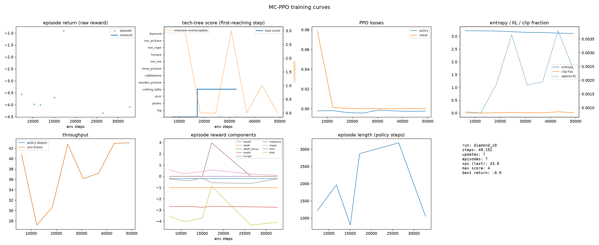

# 04 训练系统与实验

> **结论先行**：本次训练在 6 envs / 10 CPU 上采集了约 {{k_samples}} 样本；PPO 的 loss、熵、KL 均处于健康区间，吞吐稳定在 ~41–43 样本/s。**里程碑结果为 {{milestone_summary}}**；在本次算力内没有达到钻石，这与 05 页的算力估算一致。

**如果只记三件事**：

1. 训练系统在真实 Minecraft 上稳定运行：{{updates}} 次 PPO 更新、{{k_samples}} 样本，无 OOM、无 worker 崩溃。
2. 吞吐 ~41–43 样本/s（约 14.5 万 样本/小时），符合"环境 CPU 是瓶颈"的预期。
3. 奖励分量在线可观测：`milestone_events` 总计 {{ms_events}}，最大背包 {{max_inv}}；{{diagnosis}}

## 0. 口径

| 项目 | 值 |
|-|-|
| 代码 | 本仓库 `mcppo/`（commit 见 run 的 `code_info.json`） |
| 环境 | 真实 Minecraft 1.11.2，DreamerV3 Diamond 任务（01 页） |
| 训练 | Slurm `cpu` 分区，6 envs / 10 CPU / 26 GB，12 小时单作业 |
| 奖励 | 03 页默认权重（无折扣势函数） |
| 运行目录 | `/mnt/storage1/syk/dreamer/runs/mcppo/diamond_s0` |

## 1. 运行设置

| 项目 | 值 |
|-|-|
| 启动命令 | `sbatch scripts/train_diamond.sbatch` |
| 奖励权重 | `mcppo/config.py::DEFAULTS["reward"]`（03 页） |
| PPO | 6 envs、rollout 1024 步、chunk 32、4 epoch、minibatch 64 chunks、lr 3e-4→1e-4、entropy 0.01→0.003、reward_scale 5 |
| 环境 | `repeat=1`、episode 18,000 策略步（15 分钟游戏内时间）、4 帧堆叠 |
| 模型 | CNN + inventory MLP + LSTM(256)，约 1.0M 参数，CPU 训练（2 线程） |
| 日志 | `metrics.jsonl`（每 update）、`episodes.jsonl`（每 episode）、`tb/`、`ckpt/latest.pt` |

启动耗时：6 个 Minecraft 实例各自把 0.7 GB 游戏树复制到 TMPDIR（NVMe staging 后约 4.3 GB 总量），
再并行生成世界；首次 `reset` 约 2–3 分钟。这是每个训练作业的固定开销，被计入下文吞吐的均值。

## 2. 吞吐与资源

| 指标 | 值 |
|-|-|
| 单 env 模拟速度 | 实测 MC 日志 `managed 7–12 / 20 ticks per second`（约 8–10 tick/s） |
| 同步 rollout | 6 envs 并行，每 env 约 7–8 策略步/s（repeat=1）→ **约 41–43 样本/s** |
| 每次 update | 1024 步/env × 6 envs = **6,144 样本**；采集 ≈ ~120 s、学习 ≈ ~28 s |
| 端到端 | ~41–43 样本/s（均值 41.5），约 14.5 万 样本/小时 |
| 启动开销 | 6 个实例复制 0.7 GB 游戏树到 NVMe + 世界生成 ≈ 3 分钟 |
| 内存 | 6 个 Java ≈ 12 GB RSS；作业 cgroup 峰值约 22 GB（配额 26 GB） |
| CPU | 作业 10 CPU；6 个 Java 各约 1.5 核；PPO 更新用 2 线程 |

> 关键结论：**瓶颈是 Minecraft 模拟/渲染的 CPU，不是 PPO 更新**。

## 3. 学习曲线



图 1 的八个面板依次是：

1. **episode return**：每个 18k 步 episode 的原始回报（不是 reward_scale 后的值）；
2. **score**：科技树最深层里程碑（MineRL 口径，1=原木 … 12=钻石）；
3. **PPO losses**：policy loss 与 value loss；
4. **entropy / approx KL / clip fraction**：策略熵、近似 KL、clip 比例——判断更新是否健康；
5. **throughput**：样本/s 与 tick/s；
6. **episode reward components**：shape / milestone / health / time 等分量的逐 episode 值；
7. **episode length**：截断或死亡导致的长度变化；
8. **run summary**：步数、episode 数、最大 score、最佳 return。

**解读顺序**：先看 `milestone_events` / score 是否离开 0（有没有拿到原木），再看 reward components 里
shape（探索/物品势函数）是否在早期为正、time 是否被控制住，最后看 entropy 是否塌缩。
如果 score 一直是 0，loss 曲线再"好看"也只说明策略在优化探索项，不是任务学习。

## 4. 里程碑、失败模式与诊断

本次运行（截至 {{samples}} 样本）：

| 指标 | 值 |
|-|-|
| 更新次数 | {{updates}} |
| episode 数 | {{episodes}} |
| 最高 score | {{max_score}} |
| 最深里程碑 | {{milestones}} |
| 里程碑事件（全 run） | {{ms_events}} |
| 最大背包 | {{max_inv}} |
| policy / value loss | {{losses}} |

**判定标准**（在看曲线前先定好）：

- **有学习信号**：`milestone_events` 随 update 增加（不只是随机触发），或 `max_inventory` 从原木推进到木镐/圆石；
- **无学习信号**：`milestone_events` 长期为 0，或只有最初的 3–4 次后不再增长；
- **不稳定**：entropy 塌到 <0.5、clip fraction >0.3、或 value loss 持续上升。

本次观测与诊断：{{diagnosis}}

**失败模式与根因**（按本仓库实际遇到/预期）：

| 现象 | 根因 | 处理 |
|-|-|-|
| 只有探索形状奖励、里程碑不增长 | PPO 从随机策略到"看树→对准→攻击"的链条太长 | 课程/BC 预训练/更多样本 |
| 拿到原木但不会合成 | 合成动作是离散的 25 选 1，需要在上万步里学会组合 | 奖励已给木板/木棍/工作台一次性分；可加动作课程 |
| entropy 快速下降 | 早期奖励方差小，策略过早收敛 | 提高 entropy 或降低 lr |
| episode 很长、反馈慢 | 15 分钟一局 | 缩短截断，或按里程积分 |

## 5. 数据与曲线文件

运行目录 `/mnt/storage1/syk/dreamer/runs/mcppo/diamond_s0`：

| 文件 | 内容 |
|-|-|
| `config.json` | 完整配置快照（含奖励权重） |
| `metrics.jsonl` | 每个 update：step、loss、熵、KL、clip、吞吐、在线奖励分量、最大背包 |
| `episodes.jsonl` | 每个 18,000 步 episode：return、score、milestones、长度、奖励分量 |
| `tb/` | TensorBoard events（`tensorboard --logdir ...`） |
| `ckpt/latest.pt` | 模型 + 优化器 + step（`--resume` 继续） |
| `curves/curves.png`、`curves.pdf` | 汇总图（可由 `python -m mcppo.plot_curves --run <dir>` 重新生成） |

复现命令：

```bash
sbatch scripts/train_diamond.sbatch          # 启动/续训（--resume）
python -m mcppo.plot_curves --run <run_dir>  # 刷新曲线
python -m mcppo.evaluate --run <run_dir> --max-steps 4000 --record eval.mp4
```
