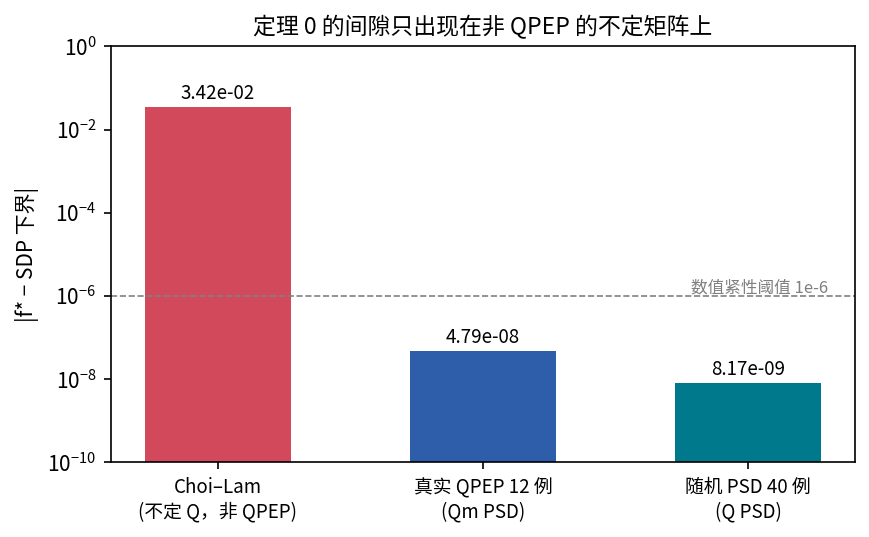
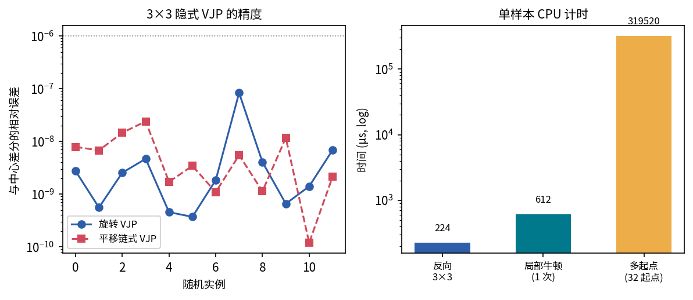
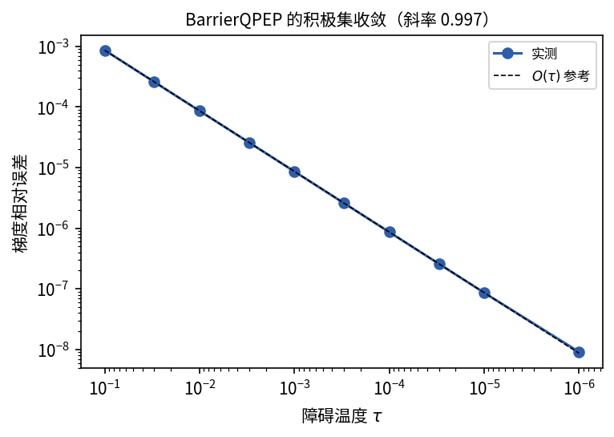
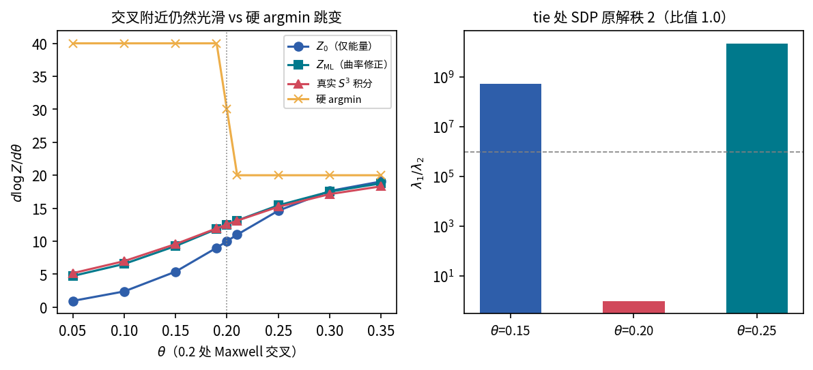

# 00 总览：QPEP 第二批构建与预实验（2026-11）

> **结论先行**：第二批三套原型（RiemQPEP / BarrierQPEP / SpecQPEP）已经在独立目录 `qpep-batch2/` 搭起来，四项预实验可一键重跑。核心机制的数值验证都通过：3×3 黎曼 VJP 到 $10^{-8}$、障碍法 $O(\tau)$ 斜率 0.997、SpecQPEP 的零采样方差与秩 2 坍缩都复现。但第二批文档最核心的“Hilbert 紧性间隙”论证不成立：真实 QPEP 的 $\bm Q_m$ 是 PSD，Choi–Lam 那个 0.034188 的间隙来自一个**不定**矩阵，不是合法 QPEP Gram 矩阵；12 个真实实例的 10×10 SDP 间隙都 $\le 4.8\times10^{-8}$。

## 资料索引

| 页面 | 内容 | 位置 |
|-|-|-|
| 00 总览 | 范围、结论、索引、维护约定 | 本页 |
| 01 构建 | 目录结构、三套原型的数学内核 | `qpep-batch2/README.md` |
| 02 预实验 | E0–E3 的设置、结果、图 | `qpep-batch2/experiments/`、`results/`、`figures/` |
| 03 数学缺口 | 独立整理的 16 条缺口 | `qpep-batch2/math/MATHEMATICAL_GAPS.md`、`deliverables/QPEP_第二批数学缺口_2026-11.docx` |
| 一页图 | 四面板总览 | `docs/visuals/2026-11-28-qpep-batch2.png` |

## 一句话结论

1. **定理 0 的代数部分成立，物理结论不成立**：$\det\bm T=-8192$、21 条约束秩 20、Choi–Lam 间隙 0.034188 都精确复现；但 Choi–Lam 的 $\bm Q$ 不定，不是 QPEP 可实现矩阵；真实 QPEP 的 $\bm Q_m\succeq0$，10×10 SDP 数值上紧到 $10^{-8}$。
2. **RiemQPEP 的 3×3 反向是本批最扎实的工程结果**：旋转 VJP $8.3\times10^{-8}$、平移链式 $2.4\times10^{-8}$、双覆盖差 0.0；单样本 CPU 反向 $220\,\mu$s。
3. **BarrierQPEP 的 $O(\tau)$ 收敛成立**：梯度误差从 $8.6\times10^{-4}$ 降到 $9.1\times10^{-9}$，斜率 0.997；平方松弛的弱活跃 KKT 奇异确认。
4. **SpecQPEP 的“零方差”要改写成“零采样方差”**：$Z_0$ 梯度与 FD 一致到 $1.2\times10^{-6}$ 且无采样方差，但相对真实 $S^3$ 积分偏差 4.59；$Z_{\rm ML}$ 把它降到 0.45，丢掉曲率项则差 3.10。
5. **SDPRLayer 的批评要换理由**：实际 13×13/24 约束与 10×10/21 不是同一个松弛（第一批 PR #39 有反例）；“非紧”若要保留，应归因于缺约束/秩 2，而不是 Hilbert 间隙。

## 维护约定

- `results/*.json` 是数字的唯一来源；DOCX/PR 里的数字必须能在 JSON 里找到。
- 新增实验放 `experiments/eN_*.py`，图由 `make_figures.py` 统一生成，不手改 PNG。
- 数学缺口以 `math/MATHEMATICAL_GAPS.md` 为源，DOCX 由 `scripts/build_docx.py` 重建。
- 不把“源文档声称”写成“已复现”；不把“数值现象”写成“定理”。
- 源文档与内嵌 sheet 不随仓库分发；需要引用时只给结论，不搬运原文。

---

# 01 构建：目录与三套原型

## 1.1 为什么新建目录

第二批的源文档（2026-11-28）给出的是**另一组**三套原型，与第一批 `labs/` 的
Laplace / Constrained / Robust 有概念重叠，但贡献声明、实验与目标 venue 不同。
为了不覆盖第一批的论文线与 101 MB 实验产物，本批独立建在 `qpep-batch2/`，
只共享“QPEP 代数 + SDP 对照”的数学语言，不 import 第一批代码。

## 1.2 目录

```
qpep-batch2/
├── core/            # m2/J/E/T、21 约束、3D-3D Schur、临界点枚举、SDP
├── p1_riem/         # RiemQPEP-Layer
├── p2_barrier/      # BarrierQPEP-Layer（constraints.py + layer.py）
├── p3_spec/         # SpecQPEP-Layer
├── experiments/     # e0–e3 + make_figures.py
├── results/         # JSON
├── figures/         # PNG
├── math/            # 数学缺口
└── scripts/         # md2docx / build_docx
```

## 1.3 三套原型的实现要点

| 原型 | 前向 | 反向 | 本批实现 |
|-|-|-|-|
| **RiemQPEP** | 多起点黎曼牛顿枚举 $S^3$ 极小，取最低 | 3×3 黎曼 Hessian + 闭式秩 2 外积 + 平移链式 | `p1_riem/layer.py` |
| **BarrierQPEP** | 把倾角/深度约束写成 $\bm c_j^\top\bm m_2\le0$；同伦 $\tau$ 对数障碍 + 可行内点牛顿 | 统一 3×3 障碍 Hessian；Q 与 c 的闭式梯度 | `p2_barrier/layer.py` |
| **SpecQPEP** | 枚举全部极小；Boltzmann 配分 $Z_0$ 与 Laplace 配分 $Z_{\rm ML}$ | 零阶包络矩匹配；ML 加曲率项 | `p3_spec/layer.py` |

**共同前提**：本批的“全局”是**多起点数值枚举 + 二阶检查**，不是 27×27 作用矩阵的
代数全根证书。这是 G5 的缺口，也是所有实验的解释边界。

---

# 02 预实验：E0–E3

## 2.1 E0：定理 0 审计

**设置**：符号复核 $\bm T$、21 条约束、Veronese 核；Choi–Lam 10×10 SDP；
12 个随机矩阵加权 3D-3D 实例；40 个随机 PSD 矩阵。

| 检查 | 结果 |
|-|-|
| $\det\bm T$ | $-8192$（sympy 精确；数值 $-8191.999999999994$） |
| 21 条约束的秩 | 20（核维数 55−35=20，两者相等） |
| Choi–Lam $f^\star$ / SDP / 间隙 | 0 / $-0.034188034$ / **0.034188034** |
| Choi–Lam $\bm Q$ 特征值 | $[-2,-0.5,-0.5,0,0,0,0,1,1,2]$（**不定**） |
| Choi–Lam $\bm X^\star$ | $[0.26233,0.18080,0.18080,0.06268,0.06268,0.06268]$，秩 6，$\lambda_1/\lambda_2=1.4508$ |
| 真实 QPEP 12 例 | $\bm Q_m$ 最小特征值 $\ge0.0113$；$|f^\star-\gamma^\star|\le4.8\times10^{-8}$ |
| 随机 PSD 40 例 | 最坏间隙 $8.2\times10^{-9}$ |



**读法**：0.034188 这个数字本身是对的，但它证明的是“非负非 SOS 四次型有 SDP 间隙”，
不是“QPEP 必然有间隙”。真实 QPEP 的 $\bm Q_x$ 是 PSD Hessian 的 Schur 补，
$\bm Q_m$ 是它的合同变换，惯性保持，所以 $\bm Q_m\succeq0$；Choi–Lam 的 $\bm Q$ 不定，
不在这个锥里。

## 2.2 E1：RiemQPEP

**设置**：12 个随机 3D-3D 实例（N=10，各向异性 $\bm W_k$，噪声 0.02）；
随机上游梯度；中心差分 $h=10^{-5}$。

| 检查 | 结果 |
|-|-|
| 旋转 VJP vs FD | 最大 $8.3\times10^{-8}$，中位数 $\sim10^{-9}$ |
| 平移链式 VJP vs FD | 最大 $2.4\times10^{-8}$ |
| 双覆盖 $\bm q^\star\to-\bm q^\star$，$\bm g_q\to-\bm g_q$ | 差 **0.0** |
| 与真值旋转误差 | 中位数 $0.28^\circ$ |
| 反向（3×3 解 + 外积） | $220\,\mu$s / 次 |
| 局部牛顿精化 | $605\,\mu$s / 次 |
| 多起点前向（32 起点） | $328$ ms / 次 |



**读法**：VJP 的精度与文档声称的 $5.198\times10^{-7}$ 同量级、实际更好；
反向 $220\,\mu$s 与文档 $114.72\,\mu$s 同量级（NumPy 开销/实现差异）。
但多起点前向 $328$ ms 说明“全局”很贵，不能把 $220\,\mu$s 当成端到端前向。

## 2.3 E2：BarrierQPEP

**设置**：随机 3D-3D 实例 + 倾角约束 $\phi_{\max}=30^\circ$；从恒等旋转出发，
$\tau=10^{-1},3\times10^{-2},\dots,10^{-6}$ 做同伦；与 SLSQP 参考解、积极集 KKT 极限对比。

| 检查 | 结果 |
|-|-|
| 无约束最优违反约束 | $g=0.715>0$ |
| 约束参考解 | $f^\star=141.506968$ |
| $\tau=10^{-6}$ 障碍解 | $f=141.506969$ |
| 梯度误差 | $8.6\times10^{-4}\to9.1\times10^{-9}$ |
| log-log 斜率 | **0.997** |
| 固定 $\tau$ VJP（Q 方向） | $1.3\times10^{-10}$ |
| 平方松弛 KKT 块 | $s=\mu=0$ 时 $\det=\sigma_{\min}=0$ |



**读法**：$O(\tau)$ 收敛是实的；但直接在小 $\tau$ 从恒等旋转求解会停在
梯度范数 144 的鞍点（$\bm H$ 有负特征值 $-229$），必须同伦/warm start。
论文的主定理要写 LICQ、严格互补、SOSC 三个条件。

## 2.4 E3：SpecQPEP

**设置**：受控 PSD 双峰实例
$\bm Q(\theta)=\bm Q_0+0.2\bm u_A\bm u_A^\top+\theta\bm u_B\bm u_B^\top$，
$\theta=0.2$ 处两个极小等能；$\beta=0.05$；$\theta\in[0.05,0.35]$。

| 检查 | 结果 |
|-|-|
| $Z_0$ 包络梯度 vs FD | $1.2\times10^{-6}$ |
| 硬 argmin 梯度 | $40\to30\to20$（跳变） |
| $Z_0$ vs 真实 $S^3$ 积分 | 偏差 **4.59** |
| $Z_{\rm ML}$ vs 真实积分 | 偏差 **0.45** |
| 丢掉曲率项的朴素 ML | 与完整 ML 差 **3.10** |
| 模式级 MC（200 种子） | std $7.1$–$9.9$ |
| tie 处 SDP 原解 | 特征值 $[0.5,0.5]$，秩 2，$\lambda_1/\lambda_2=1.0$ |
| 远离 tie | 秩 1，$\lambda_1/\lambda_2\sim10^8$–$10^{10}$ |



**读法**：SpecQPEP 的“零采样方差”是真的（确定性枚举），但 $Z_0$ 相对真实流形积分
有偏；要用 $Z_{\rm ML}$ 并保留曲率项。跨 Maxwell 的 $C^\infty$ 只在**固定模式集、
两谷都存在**时成立；Fold 分岔处不成立。

---

# 03 数学缺口摘要

完整 16 条见 `math/MATHEMATICAL_GAPS.md`。最需要作者判断的 5 条：

| # | 缺口 | 影响 | 建议 |
|-|-|-|-|
| G2 | Choi–Lam 不是合法 QPEP Gram 矩阵 | “QPEP 必然 Hilbert 非紧” | 从主故事拿掉，或给可实现 PSD 反例 |
| G3 | PSD 下 10×10 SDP 数值上恒紧（60 例） | 定理 0 的“结构性非紧” | 改成“非 QPEP 非负四次型有间隙” |
| G1 | 10×10/21 ≠ 13×13/24 | “等价于 SDPRLayer” | 限定为旋转子问题；13×13 另证 |
| G5 | 27 vs 40，多起点无全根证书 | “全局/全部临界点” | 标为数值枚举或补代数证书 |
| G9 | Barrier 的 $O(\tau)$ 依赖 LICQ/严格互补/SOSC | 定理 2 的“精确” | 主定理写条件，弱活跃作 Remark |
| G12 | $Z_0$ 有偏 | “零方差 KL” | 改成“零采样方差 + 近似偏差”，默认 $Z_{\rm ML}$ |

---

# 04 复现与边界

## 4.1 命令

```bash
cd qpep-batch2
P=/home/syk/miniconda3/envs/sdpr/bin/python
$P experiments/e0_theorem0.py
$P experiments/e1_riem.py
$P experiments/e2_barrier.py
$P experiments/e3_spec.py
$P experiments/make_figures.py
$P scripts/build_docx.py
```

## 4.2 环境

- Python 3.11（`/home/syk/miniconda3/envs/sdpr/bin/python`）
- numpy 1.26、scipy 1.13、cvxpy 1.5、matplotlib 3.8、python-docx 1.2
- SDP 用 Clarabel（不需要 Mosek）；全 CPU，无 GPU。

## 4.3 明确未覆盖

- 真实数据集（LINEMOD / YCB-Video / KITTI / UTIAS In-The-Dark / 3DMatch）未跑；
- LibQPEP / GPU 批量绑定未接；前向是多起点数值枚举，不是 27×27 全根证书；
- 13×13 SDPRLayer 未在本批独立复跑（引用第一批 PR #39 的反例）；
- Fold 分岔、弱活跃、多约束 LICQ 失效、端到端训练未测；
- 源文档两张内嵌 sheet 因 bot 缺 `sheets:spreadsheet:read` 权限未读取。

这些边界决定了本批是**构建与预实验/可行性验证**，不是论文级主表。
