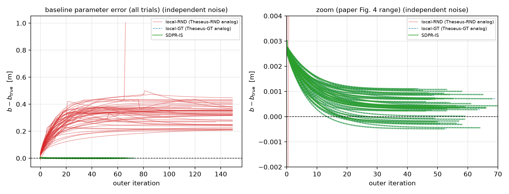
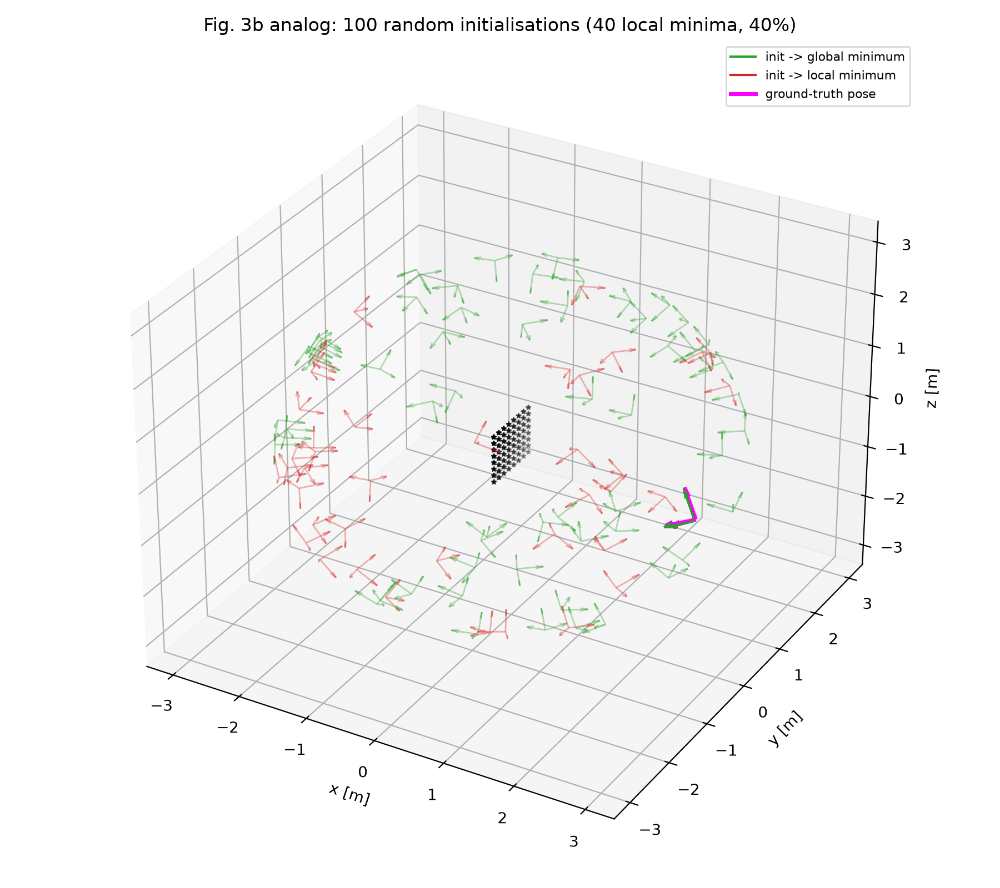

# SDPR 与 QPEP：五个问题的回答

> **两篇主文献**
> 1. C. Holmes, F. Dümbgen, T. D. Barfoot, *SDPRLayers: Certifiable Backpropagation Through
>    Polynomial Optimization Problems in Robotics*, **IEEE T-RO** 41 (2025),
>    DOI [10.1109/TRO.2025.3578228](https://doi.org/10.1109/TRO.2025.3578228)，arXiv:2405.19309。
>    下文简称 **SDPR / SDPRLayers**。
> 2. J. Wu, Y. Zheng, Z. Gao, Y. Jiang, X. Hu, Y. Zhu, J. Jiao, M. Liu,
>    *Quadratic Pose Estimation Problems: Globally Optimal Solutions,
>    Solvability/Observability Analysis, and Uncertainty Description*,
>    **IEEE T-RO** 38(5):3314–3335, 2022, DOI
>    [10.1109/TRO.2022.3155880](https://doi.org/10.1109/TRO.2022.3155880)。
>    下文简称 **QPEP**。
>
> **延伸文献**：22 篇，索引见 [`references/INDEX.md`](../references/INDEX.md)。正文按
> `[作者年份, 期刊, §/定理]` 引用；PDF 不随本仓库分发，索引中给出 DOI/arXiv。
>
> **阅读边界（先说明）**：SDPRLayers 有 arXiv 全文，本报告逐节精读；QPEP 的 T-RO 正文在
> 付费墙后，本文依据**论文摘要 + 作者补充材料 `suppl.pdf` + 官方 LibQPEP 代码**写成，
> 不伪造正文定理编号。Q5 的复现对象是 SDPRLayers §VI-B4 的 stereo baseline 标定；
> QPEP 的数值实验未独立复现（原因见 §5.6）。
>
> **本报告的定位**：给出五个问题的直接回答；更长的公式推导、文献表格与复现日志分别在
> [`sdprlayers_deep_dive.md`](sdprlayers_deep_dive.md)、[`qpep_reading_notes.md`](qpep_reading_notes.md)
> 和 [`reproduction.md`](reproduction.md)。

---

## 0. 五个问题速答

| # | 问题 | 一句话回答 |
|---|---|---|
| 1 | 什么是可验证最优？ | **给解，同时给一个可在多项式时间内独立检验的最优性证书**。对 QCQP，证书是一个对偶矩阵 $H(\lambda)\succeq0$ 且 $Hx=0$；它把“我算到了全局最优”变成“你可以自己验证这是全局最优”。QPEP 是“枚举全部 KKT 根的代数全局解”，**没有**这种凸证书，严格说与 SDPR 的 certifiable 不同。 |
| 2 | SDPR 的目的、手段、效果、代价？ | 目的：让可微优化层在非凸机器人问题上回传**全局最优解的梯度**，而不是伪局部极小解的梯度。手段：齐次 QCQP → Shor SDP 松弛 → rank-1 时读全局解 + 对偶证书 → 复用证书对原 QCQP 的 KKT 做隐式微分。理论：Thm.2 给出全局最优性与唯一 Jacobian；实验：标定误差 3.45e-4 m（局部随机初始化 1.13e-1 m），真实定位误差约降 3–4 倍。代价：每步解 SDP、CPU-only、必须 tight（常需冗余约束）、非 tight 无保证、依赖 Mosek/SCS。 |
| 3 | SDPRLayer 怎么微分？存在性怎么证？ | 前向缓存 $(x^*,\lambda^*,H^*)$；对 KKT 条件 $k(z,\theta)=0$ 全微分得 $M\,\mathrm dz+N\,\mathrm d\theta=0$。有冗余约束时 $M$ 奇异，不能直接用经典 IFT；论文删去线性相关约束行得 $M_r$，用 **SOSC 证明 $M_r$ 行满秩**，再用 Dontchev–Rockafellar 的**隐式选择定理**得到局部选择的 Jacobian；再证明任意两个局部选择的 $x$ 微分相同（SOSC 逼出唯一性），最后用 $H\succeq0$ 说明这是全局最优解的 Jacobian。实现上用 LSQR 解一个最小二乘，反向几乎免费。 |
| 4 | 能解什么形式的问题？对应机器人什么问题？紧性如何？ | 形式：**矩阵元素参数化的齐次二次等式 QCQP**（$SO(3)$ 用 9 分量 + 二次约束）。对应：位姿图/SE(d) 同步、旋转平均、点云/点集配准、矩阵加权位姿与标定、手眼、range-aided SLAM、PnP/PnL、Stewart 平台正运动学、GNSS 姿态、IK/接触规划/CBF/分割等。紧性：**不是普遍性质**；估计类主线多有理论/经验 tight 证据（常需冗余约束），非估计类大多是不等式/离散/层级问题，不能直接进 SDPRLayer。QPEP 的问题族（T-RO 2022）不需要 tight，但也没有梯度。 |
| 5 | 复现相机参数标定仿真 | 已复现 SDPRLayers §VI-B4 的 stereo baseline 标定（50 runs × 20 poses，SDPR-IS vs Theseus-GT/RND）。核心结论复现：SDPR 与 GT 初始化局部解几乎重合（$10^{-7}$ m 级），随机初始化局部解失败（0.33 m vs 4e-4 m）；10.8 万次 SDP 求解 100% rank-1、证书 $H\succeq0$、corank=1（99.97%）；局部极小比例 59% vs 论文约 60%。绝对数字差 20–45%，已逐条归因；官方代码路径的 28% 求解失败已用自适应重试降到 2%。 |

---

## 1. 什么是“可验证最优”（certifiably optimal）

### 1.1 从“最优”到“可验证的最优”

优化问题的解 $x^*$ 称为全局最优，若对可行域内任意 $x$ 都有 $f(x^*)\le f(x)$。数值求解器
只能给出一个点；判断它是否全局最优，一般情形是 NP-hard 的。**证书（certificate）**是一组
可以在多项式时间内独立检验的数据，用来证明这个点全局最优。

“可信最优 / certifiably optimal” 因此不是“求解器说它最优”，而是：

> **解 + 证书 + 可在多项式时间内检验的验证过程**；算法若保证“要么输出解和证书，要么报告失败”，
> 则称为 **certifiably correct algorithm**。

SE-Sync 的定义最清晰：能在受限的运行范围内高效求解一个一般难解的问题，并且能**计算地认证**
所恢复的解的正确性 `[Rosen2019_SESync, IJRR, §1.3]`。Rosen 等的综述进一步指出：这类方法与
普通凸松弛初始化方法的区别在于，**当数据噪声不太大时松弛是精确的**，且精确性可以 **post hoc**
检验（对偶证书是否 PSD）`[Rosen2021_Review, ARC, §2.2]`。

### 1.2 QCQP 的证书：一个矩阵，一次特征值分解

SDPRLayers 处理的标准形式是齐次 QCQP `[Holmes2025, §III-B, (P1)–(P3)]`：

$$
\min_{x\in\mathbb R^n}\; x^\top Q_\theta x
\quad\text{s.t.}\quad x^\top A_i x=0\;(i\in[m]),\qquad x^\top A_0 x=1 .
$$

把它升维成 $X=xx^\top$、去掉 rank-1 约束，得到 Shor 松弛 (P3)：

$$
\min_{X\succeq0}\;\langle Q_\theta,X\rangle
\quad\text{s.t.}\quad \langle A_i,X\rangle=0,\;\langle A_0,X\rangle=1 .
$$

其对偶（写成最小化）为

$$
\min_{H,\lambda}\;\lambda_0
\quad\text{s.t.}\quad H=Q_\theta+\lambda_0A_0+\sum_{i=1}^m\lambda_iA_i,\;\;H\succeq0 .
$$

> 符号约定：按本文的写法 $\lambda_0=-p^*$（$p^*$ 为原问题最优值）；论文式 (3) 把对偶目标写成
> $\min\lambda_0$ 与其“最大化 $-\lambda_0$”的等价形式相差一个符号，属于表述/符号约定问题，
> 不影响下面的证书逻辑。数值上 SCS/CVXPY 给出的 $\lambda_0$ 与 $-p^*$ 一致。

$H$ 称为**证书矩阵**，它恰好是原 QCQP 拉格朗日函数对 $x$ 的 Hessian 的一半：
$\nabla_x^2L=2H$ `[Holmes2025, §IV-A, (13)]`。

**验证逻辑**：若候选解 $\bar x$ 与乘子 $\bar\lambda$ 满足

$$
\bar H=H(\bar\lambda)\succeq0,\qquad \bar H\bar x=0,
$$

则对任意可行 $x$，

$$
x^\top Q_\theta x
= x^\top \bar H x-\bar\lambda_0\underbrace{x^\top A_0x}_{=1}-\sum_i\bar\lambda_i\underbrace{x^\top A_ix}_{=0}
\ge -\bar\lambda_0
= \bar x^\top Q_\theta\bar x .
$$

最后一步用了 $\bar H\bar x=0$ 与 $\bar x^\top A_0\bar x=1$。所以 $\bar x$ 全局最优；验证只需要
构造 $H$ 并做一次特征值分解（或解一个 SDP 可行性问题）。这就是“证书”。

### 1.3 与 tight、rank-1、强对偶的关系

- **(P3) 是 (P1) 的松弛**：$\mathrm{val}(P3)\le\mathrm{val}(P1)$。若最优 $X^*$ 满足
  $\mathrm{rank}(X^*)=1$，则 $X^*=x^*x^{*\top}$，$x^*$ 是 (P1) 的全局最优；此时称**松弛是紧的**
  `[Holmes2025, §III-B1]`。
- **rank-1 ⇔ tight**：rank-1 时松弛值与原问题值相等，证书矩阵的 corank 通常为 1；
  严格互补下，rank-1 与 $\mathrm{corank}(H)=1$ 等价 `[Holmes2025, §IV-C]`。
- **corank=1 的两个作用** `[Holmes2025, §IV-C, Lemma 5]`：
  (i) tightness 在参数小扰动下**稳定**（Cifuentes 等的结论）；
  (ii) 由 $Hx=0$、$\ker H=\mathrm{im}\,x$ 推出二阶充分条件 SOSC 成立。
- **“certifiable” 是能力，“certified” 是已认证**：算法可以 certifiable，但具体实例上没检查、
  或松弛不 tight 时，解不能被认证为全局最优。SDPRLayers 在非 tight 时会显式降级（矩阵解 +
  rounding + 次优间隙），而不是假装可信 `[Holmes2025, §V-C]`。

### 1.4 与局部最优、驻点的区别

非凸 QCQP 的 KKT 点可能有很多个（局部极小、鞍点）。局部求解器（Gauss–Newton、Theseus、
梯度下降）只保证收敛到某个驻点；**这个驻点可能不是全局最优**，而且它对应的“解映射的
Jacobian”与全局解的不同。SDPRLayers 的多项式 toy 例子给出直观反例：GD 从 $x_0=2$ 出发困在
局部极小，外层优化于是“把局部极小搬到目标点”，而全局极小几乎不动 `[Holmes2025, §VI-A, Fig.2]`。
在标定实验里，这种错误梯度直接导致 baseline 收敛到 1.1e-1 m 的错误值 `[Holmes2025, Table V]`。

### 1.5 QPEP 的位置：全局，但不是凸证书

QPEP 的“全局最优”来自另一条路线：把问题写成四元数二次型 + 单位四元数约束，消去平移，
得到多项式 KKT 系统，用 **Gröbner 基**一次解出**全部候选根**（官方 `solver_WQ` 路径至多 40 个），再按目标值
排序取最小，最后 LM 精化 `[Wu2022, Abstract; Wu2022, Suppl. §I.A; LibQPEP, src/QPEP_grobner.cpp]`。
它在“有限个根、数值消元不漏根”的前提下确实枚举了全部驻点，因此是**代数全局解**；但它**没有**
$H\succeq0$ 这样的对偶证书，不能像 SDPR 那样只做一次特征值分解就独立验证全局性。

所以严格区分：

| 类型 | 全局性来源 | 可独立验证的证书 | 代表 |
|---|---|---|---|
| (a) 凸松弛 + 对偶证书 | Shor/SE-Sync/TEASER 松弛精确 | 有（$H\succeq0$） | SDPRLayers、SE-Sync、TEASER |
| (b) 穷举代数解 | Gröbner 基枚举全部 KKT 根 | 无凸证书；需重解/穷举 | **QPEP** |
| (c) 层级渐近 | Lasserre/Moment-SOS 逐层收紧 | 渐近/次优间隙 | 稀疏 TLS、接触规划、CBF |
| (d) 只认证不求解 | 给候选解构造对偶证书 | 有 | 连续时间 range-only、点集配准 |

> **一句话**：可验证最优 = 解 + 可在多项式时间内检验的全局性证书。SDPR 的“certifiable
> gradients”还要再加一层：**反向传播的梯度正是这个已认证全局解对参数的导数**。
> QPEP 是“全局但非凸证书”的 (b) 类，这点在把两篇论文放在一起读时最容易混淆。

### 1.6 文献中的定义谱系

- **算法层**（certifiably correct algorithm）：SE-Sync 的定义（见上）；Rosen 综述强调
  “relaxation exact + post hoc check” `[Rosen2019_SESync; Rosen2021_Review]`。
- **解层**（certifiably optimal solution）：给候选解构造对偶证书并验证 $H\succeq0$
  `[Rosen2019_SESync, §1.2]`。
- **梯度层**（certifiable backpropagation）：SDPRLayers 新增；要求 tight + Thm.2 条件
  `[Holmes2025, §I-A]`。
- **学习模型正确性证书**：C-3PO 用可观测性/非退化证书给误差界，不优化、不求导
  `[Talak2023_ObjectPose, T-RO]`；SDPRLayers 把它列为“只认证不对优化求导”的对照。
- **穷举代数解**：QPEP（本文第二篇主文献），见 §1.5。

---

## 2. SDPR 方法：目的、手段、效果、代价

### 2.1 目的

现代机器人 pipeline 常把优化问题作为**可微层**嵌入网络：前向解优化，反向用隐函数定理对
KKT 条件求导 `[Holmes2025, §I]`。机器人中的优化（位姿图、配准、标定、位姿估计、IK……）
几乎都是非凸的，局部求解器只能保证驻点。于是有两种坏情况：

- **前向错**：解本身是伪局部极小（双目位姿估计随机初始化约 60% 收敛到局部极小
  `[Holmes2025, §VI-B2, Fig.3b]`）；
- **反向错**：即使局部解“看起来还行”，它关于参数的导数也与全局解不同，外层优化会沿错误
  方向更新，导致训练变慢、震荡、甚至完全失败（§VI-A、§VI-B4）。

SDPR 的目标因此是：**给可微优化层提供“可信”的前向解与梯度**——前向给出全局最优及其证书，
反向给出该全局最优解对参数的导数；做不到（松弛不紧）时显式降级并给出诊断，而不是把局部解
的梯度伪装成全局梯度 `[Holmes2025, Abstract, §I-A]`。

### 2.2 手段

**(1) 统一建模：POP → 齐次 QCQP → Shor SDP。** 任何多项式优化问题（POP）都可写成 (P1)；
机器人里所有 certifiably correct 问题（位姿图、配准、标定、IK、分割……）都能这样写
`[Holmes2025, §II-A, §III-B]`。

**(2) 前向：解 SDP，拿解 + 证书。** 用 CVXPYLayers 的（修改版）后端或 Mosek 解 (P3)，得到
$X^*$、对偶乘子 $\lambda^*$ 与 $H^*$。若 $\mathrm{rank}(X^*)=1$（实际用
$\lambda_1/\lambda_2>10^5$ 判定 `[Holmes2025, App.C]`），则 $x^*$ 为全局最优；否则输出矩阵解。

**(3) 反向：复用证书做隐式微分。** 不是对 SDP 的 KKT 微分（那会引入 $O(n^2)$ 变量，且
CVXPYLayers 要求的解唯一性在 tight 松弛下常被违反 `[Holmes2025, §IV, 脚注13]`），而是对
**原 QCQP 的 KKT 条件**微分。由于 tight 松弛下乘子不唯一（冗余约束使约束 Jacobian 行相关），
经典 IFT 失效；论文用**隐式选择（implicit selections）**版本的 IFT，得到
$J=-PM_r^\dagger N$，并证明 $x$ 部分的 Jacobian 唯一 `[Holmes2025, Thm.2, App.B]`。

**(4) 三种反向模式** `[Holmes2025, §V-B]`：

| 模式 | 做法 | 特点 |
|---|---|---|
| **SDPR-IS**（默认） | 复用 SDP 的 $\lambda,H$ 构造 KKT，LSQR 解 $\min_y\|M_r^\top y-P^\top\nabla_x\ell\|_2$，$\nabla_\nu\ell=-N^\top y$ | 最快；tight 时理论保证 |
| **SDPR-CIFT** | 从 $x^*$ 用非冗余约束重算乘子，再解 $My=P^\top\nabla_x\ell$ | 不需要 SDP 乘子精度；慢一些 |
| **SDPR-SDP** | 对 SDP 松弛的 KKT 用 CVXPYLayers 微分 | 非 tight 也能给梯度，但理论保证弱、系统更大 |

**(5) 不紧时的补救（诚实降级）** `[Holmes2025, §V-C]`：SDP 矩阵解 $X$ 可 rounding 成可行点
$\hat x$，并计算次优性 gap
$\mu(\hat x,X)=\dfrac{\langle Q_\theta,\hat x\hat x^\top\rangle-\langle Q_\theta,X\rangle}{\langle Q_\theta,X\rangle}$；
gap 小则可用，gap 大则作为局部求解器初值。此时反向无理论保证。

**(6) 工程实现** `[Holmes2025, §V, App.C, App.D]`：PyTorch `nn.Module`；输入是（批量）向量化的
$\{\mathrm{vec}(Q_\theta),\mathrm{vec}(A_i)\}$；修改 CVXPYLayers/diffcp 以暴露乘子与 slack、
支持外部 solver；提供 `check_tightness` 与基于 `[Dümbgen2024]` 的自动找冗余约束工具。

### 2.3 理论效果

**Thm.2** `[Holmes2025, Thm.2]`：设 $\bar\theta$ 处 $(x^*,\lambda^*)$ 满足 KKT，且

1. $\{Q_\theta,A_i^\theta\}$ 对 $\theta$ 连续可微；
2. ACQ（Abadie 约束规范）+ SOSC 成立；
3. $\theta\mapsto\Omega_\theta$ 光滑；
4. $H^*\succeq0$。

则 $x^*$ 是 (P1) 在 $\bar\theta$ 的全局最优，且其**唯一** Jacobian 为
$J=-PM_r^\dagger N$（$P$ 取 $x$ 分量）。即使有冗余约束、乘子不唯一，$x$ 的 Jacobian 唯一。

**稳定性（corank=1）** `[Holmes2025, §IV-C]`：证书矩阵 corank 为 1 时，(i) tightness 在参数/代价
小扰动下稳定；(ii) 蕴含 SOSC（Lemma 5），从而 Thm.2 的条件在 rank-1 处自动成立一部分。

**边界**（论文 §VII 与各节）：

- 只对**恰好紧**（rank-1）的松弛给出保证；非 tight 时前向只能给松弛解 + gap，反向无保证；
- 依赖严格互补/corank=1/ACQ 等泛型但非必然的条件；
- 多全局最优解时解映射本身不唯一，Thm.2 的“唯一 Jacobian”不适用（论文未处理）；
- Lasserre 层级每升一级变量数与 SDP 规模快速增长，真正的 Moment-SOS 只在小问题上可行；
- forward/backward 都在 CPU，GPU 化未解决 `[Holmes2025, §VII]`；
- Thm.2 覆盖参数出现在约束矩阵中的情形，但实验只测了参数在代价矩阵中的情形 `[Holmes2025, §VI 末]`。

### 2.4 实验效果（论文数字）

**§VI-A 六次多项式（bilevel toy）**：GD 内层从 $x_0=2$ 出发困在局部极小，外层把局部极小移到
目标而全局极小不动；从 $x_0=-2$ 出发也会中途被困、迭代变多；SDPRLayer 始终收敛到全局解，
并能不连续地“切换”到新的全局极小 `[Holmes2025, Fig.2]`。

**§VI-B 双目定位（仿真）**：8×8 特征板（1 m×1 m）、相机 3 m 半径 90° 锥内随机位姿、像素噪声
0.5 pix。Jacobian 与 SVD/GT-UR 基线的相对误差（∞-范数）`[Holmes2025, Table III/IV]`：

| 方法 | 标量权重 Jacobian 误差 | 矩阵权重 Jacobian 误差 | 反向耗时 (s) |
|---|---|---|---|
| SDPR-IS | 3.10e-6 ± 7.82e-6 | 3.95e-5 ± 8.31e-5 | 0.208 / 0.231 |
| SDPR-CIFT | 1.29e-6 ± 3.06e-6 | 3.11e-5 ± 7.01e-5 | 0.389 / 0.427 |
| SDPR-SDP | 1.88e-5 ± 2.44e-5 | 1.49e-4 ± 3.78e-4 | 0.136 / 0.133 |
| Theseus-GT | 1.02e-2 ± 6.62e-3 | 2.07e-2 ± 2.88e-2 | 0.186 / 0.142 |
| Theseus-RND | 1.02e-2 ± 6.62e-3 | 1.95e-1 ± 2.60e-1 | 0.180 / 0.179 |

结论：SDPR 三种模式的 Jacobian 彼此一致且与真值差 $10^{-5}\sim10^{-6}$；局部 Theseus 即使从
真值初始化，梯度精度也差 3–4 个数量级（除非用 unrolling，但 unrolling 慢 4 倍且需要真值初始化）。

**§VI-B4 标定（本次复现目标）** `[Holmes2025, Table V, Fig.4]`：50 次实验 × 20 poses，外层 SGD
调 baseline $b$（初值误差 0.003 m，lr=1e-4）。SDPR-IS 与 Theseus-GT 几乎重合
（final error 3.454e-4 / 3.463e-4 m，34.22 / 35.40 iters，outer loss 9.857e-3 / 9.854e-3），
Theseus-RND 收敛到完全错误的值（1.132e-1 m，80.34 iters，损失 1.384e2）。

**§VI-C 真实数据（In-The-Dark，训练关键点 CNN）** `[Holmes2025, Table VI/VII]`：用 SDPR 做
matrix-weighted 位姿估计替换 SVD，原始测试集纵向/横向定位误差 0.035/0.021 m
（baseline 0.125/0.049 m）；更难测试集 0.053/0.027 m（baseline 0.213/0.072 m）；推理 0.243 s
vs 0.133 s（约 2×，因为 SDP 规模小）。

### 2.5 代价

1. **计算**：每个 batch 元素、每次前向都要解一个 SDP。内点法变量数 $O(n^2)$，稠密 SDP 单次
   约 $O(n^6)$ 量级；反向还要解（稀疏）线性系统（LSQR/MINRES）。论文反向单次 0.13–0.43 s
   `[Holmes2025, Table III/IV]`，真实推理端到端约 2× SVD 时间。
2. **CPU-only**：论文明确 forward/backward 都在 CPU 上，与 GPU 训练混用要做主机–设备拷贝，
   这是作者列出的主要未解瓶颈 `[Holmes2025, §VII]`。
3. **tight 假设**：核心保证只对 rank-1 松弛成立；非 tight 时要么 SDPR-SDP（大系统、假设不
   成立、无保证），要么退回局部求解器。很多问题需要加**冗余约束**才能变紧，SDP 随之变大。
4. **建模成本**：用户必须自己把问题化成齐次 QCQP（构造 $Q_\theta,A_i$、齐次化、$SO(3)$ 约束），
   并正确标出冗余约束（README 警告：`redun_list` 标错会给出错误梯度）。
5. **求解器依赖**：默认 SCS（一阶，精度受 tolerance 影响，tight 判定与 Jacobian 精度都受影响）；
   高精度需要 Mosek（商用 license），不同 solver 的最优解/乘子数值差异会影响证书检验。
6. **批处理与内存**：每个 batch 元素一个 SDP，batch 大时求解器调用次数线性增长；$X$ 是
   $n\times n$ 稠密矩阵，$n$ 大时内存/带宽压力大。
7. **条件依赖**：ACQ、SOSC、corank=1、严格互补等条件被论文实测满足，但并非对所有问题成立；
   一旦破坏，理论保证失效（可能只有数值上“看起来对”）。

### 2.6 与 QPEP / Theseus / CVXPYLayers 的对比

| 工具 | 处理的问题类 | 全局性/证书 | 与 SDPR 的关键区别 |
|---|---|---|---|
| Theseus | 无约束/李群约束非线性最小二乘 | **局部**，无全局证书 | 快、支持 $SO(3)/SE(3)$；非凸时可能落到伪局部极小（本文实验对象） |
| CVXPYLayers | 一般**凸** DCP | 凸 ⇒ 全局 | 只对凸问题成立；被 SDPR 用作 SDP 后端；要求 primal/dual 唯一 |
| **QPEP** | 四元数二次型 QCQP（PnP/PnL/手眼/点到面/Stewart FK/GNSS 等） | **代数全局解**（枚举 KKT 根），无凸证书 | 不需要 tight；无梯度/可微层；变量维数固定小；适合多模态低维问题 |
| **SDPRLayers** | 齐次二次等式 QCQP，SDP 松弛 tight | **全局最优 + 可检验证书**；梯度对应全局解 | 代价是每步解 SDP 与 tight 假设；非 tight 时退化为启发式 |

---

## 3. SDPRLayer 如何微分，微分存在性如何证明

> 本节的技术细节与完整推导见 [`sdprlayers_deep_dive.md`](sdprlayers_deep_dive.md) §3；
> 这里给出主线和证明链条。

### 3.1 前向缓存

1. 构造 (P3)，用 cvxpylayers（或 Mosek）求解，得到 $X^*$、对偶变量 $\lambda^*$、证书
   $H^*=Q_\theta+\lambda_0^*A_0+\sum_i\lambda_i^*A_i$。
2. 若 $\mathrm{rank}(X^*)=1$，层输出全局最优向量 $x^*$ 与矩阵 $X^*$；否则只输出 $X^*$ 与
   tightness 诊断 `[Holmes2025, §V-A, App.C]`。
3. 缓存 $(x^*,\lambda^*,H^*)$ 供反向使用——这是 SDPR-IS 相较“重解/重算乘子”的关键效率来源。

### 3.2 对 KKT 条件全微分

原 QCQP (P1) 的 KKT 条件写成零水平集 `[Holmes2025, (5),(11)]`：

$$
k(z,\theta)=\begin{bmatrix}2H(\lambda,\theta)x\\ g(x,\theta)\end{bmatrix}=0,\qquad
g(x,\theta)=\big[x^\top A_1^\theta x,\ \dots,\ x^\top A_m^\theta x,\ x^\top A_0x-1\big]^\top .
$$

对 $k$ 全微分：

$$
\mathrm dk(z,\theta)=M\,\mathrm dz+N\,\mathrm d\theta=0
\quad\Longrightarrow\quad
\mathrm dz=-M^{-1}N\,\mathrm d\theta\quad(\text{若 }M\text{ 可逆}),
$$

其中 `[Holmes2025, (9),(13),(14)]`

$$
M=2\begin{bmatrix}H&G^\top\\ G&0\end{bmatrix},\qquad
G=\nabla_x g(x,\theta)=\big[A_1^\theta x\ \cdots\ A_m^\theta x\ A_0x\big]^\top .
$$

$N$ 的显式形式见论文 App.A；它只依赖参数矩阵对 $\theta$ 的导数与当前解。

### 3.3 冗余约束带来的困难

为了收紧 SDP，通常要加**在原 QCQP 中冗余**的二次等式。冗余 ⇒ $G$ 行相关 ⇒ $M$ 奇异。
实测 tight 解处 $M$ 的条件数可达 $10^{17}$–$10^{33}$，经典 IFT 的“$M$ 可逆”前提不成立；
而且乘子不唯一，解映射是**集值**的 `[Holmes2025, §IV]`。

### 3.4 主定理：用隐式选择绕过可逆性

论文的做法是：

1. 取约束的极大线性无关子集 $G_r$（删去线性相关行），构造
   $M_r=2\begin{bmatrix}H&G_r^\top\\ G_r&0\end{bmatrix}$；
2. 用 **SOSC** 证明 $M_r$ **行满秩**：若 $M_r^\top(v,u)=0$，则 $G_rv=0$、$Hv+G_r^\top u=0$；
   左乘 $v^\top$ 得 $v^\top Hv=0$；SOSC 给出 $v=0$，再由 $G_r^\top u=0$ 与 $G_r$ 列满秩得 $u=0$；
3. 行满秩即可用 Dontchev–Rockafellar 的**隐式选择定理**（Theorem 2）：存在局部选择 $w$，
   其 Jacobian 为
   $$
   \nabla w=M_r^\top(M_rM_r^\top)^{-1}N=M_r^\dagger N;
   $$
4. 再证**唯一性**：设两个局部选择给出 $\mathrm dx_1,\mathrm dx_2$，相减得
   $M_r\begin{bmatrix}\mathrm dx_1-\mathrm dx_2\\ \mathrm d\lambda_1-\mathrm d\lambda_2\end{bmatrix}=0$；
   令 $v=\mathrm dx_1-\mathrm dx_2$，同样由 $v^\top Hv=0$ 与 SOSC 得 $v=0$。所以 $x$ 的微分与
   乘子选择无关；
5. 由 $H\succeq0$（证书）知 $x^*$ 全局最优，因此该 Jacobian 就是**全局最优解**的 Jacobian
   `[Holmes2025, Thm.2, App.B]`。

### 3.5 实现：LSQR 与三种模式

为避免显式计算/求逆 $M_r$，SDPR-IS 先令
$\nabla_y\ell=M_r^{\top\dagger}\nabla_x\ell$，等价于

$$
\nabla_y\ell=\arg\min_y\;\|M_r^\top y-\nabla_x\ell\|_2^2,
$$

用 LSQR 解（只需矩阵–向量乘，利用稀疏性、对病态稳健），再
$\nabla_\nu\ell=-N^\top\nabla_y\ell$ `[Holmes2025, (20)]`。SDPR-CIFT 先重算乘子再解
$My=\nabla_x\ell$；SDPR-SDP 直接对 SDP KKT 微分 `[Holmes2025, §V-B]`。

### 3.6 数值验证（本次工作）

- **解析 vs 有限差分**：50 trials 上，SDPR-IS 的隐式 Jacobian 与中心差分相对差
  $7.2\times10^{-6}\pm1.2\times10^{-5}$；local-GT 为 $4.5\times10^{-6}$；两种方法互差
  $3.1\times10^{-6}$。
- **证书**：10.8 万次 SDP 求解 100% rank-1（$\lambda_1/\lambda_2$ 最小 $4.7\times10^8$）；
  $\mathrm{corank}(H)=1$ 占 99.97%（独立抽样 300 次复核 99.3%）；$H_{\min}\ge-8\times10^{-10}$；
  $\|Hx\|\le1.3\times10^{-8}$；primal–dual 目标差 $\sim10^{-10}$；正交约束残差
  $\|C^\top C-I\|$ 均值 $4.0\times10^{-9}$。
- **快速自检**：`repro/cleanroom/smoke_test.py` 16/16 通过（约束、目标、逆模型 Jacobian、
  SDP 紧性、证书 PSD、强对偶、隐式 Jacobian、外层梯度、反向计时）；一次 2-run 端到端复跑
  给出 SDPR $2.66\times10^{-4}$ m、local-GT $2.67\times10^{-4}$ m、local-RND $0.392$ m，
  与全量结论同向。

### 3.7 边界

Thm.2 的保证依赖 ACQ、SOSC、corank=1、严格互补等条件；非 tight、corank>1、多全局最优时
不适用。实现上还要注意 `redun_list` 必须与真正的冗余约束一致，否则会给出错误梯度
（上游 README 明确警告）。这些不是“工程细节”，而是“可信”二字的边界。

---

## 4. 可解问题形式、机器人问题映射与紧性

### 4.1 SDPRLayer 能接受的问题形式

SDPRLayer 的接口要求把问题化成**齐次 QCQP**：

$$
\min_{x\in\mathbb R^n}\;x^\top Q_\theta x
\quad\text{s.t.}\quad x^\top A_i x=0\;(i\in[m]),\quad x^\top A_0x=1,
$$

其中 $Q_\theta,A_i\in\mathbb S^n$，**参数化的是矩阵**（代价和/或约束），且齐次变量里至少一个
分量被固定为 1。因此它能覆盖：

1. **变量可嵌入齐次向量**：$C\in SO(3)$ 用 9 个分量 + 6 个二次约束（$C^\top C=I$、$\det C=1$
   常写成列叉积约束）；$SE(3)$、$SO(p)^n$、本质矩阵、单应等都可这样处理。
2. **目标可写成二次型**：加权最小二乘 $\sum_k\|y_k-Cm_k+t\|^2_{W_k}$、代数误差、MRF/分割能量、
   IK 位姿误差、PGO 旋转误差等。
3. **约束是二次等式**：正交、行列式、距离、手眼/标定几何、可控性/不变集的多项式约束
   （可转成二次型或用层级提升）。
4. **需要 rank-1 松弛 + 证书**：$n$ 不能太大（内点法），且松弛需要（或能通过冗余约束变成）
   tight；非多项式/非二次（一般非线性代价、min/max、整数变量）不能直接进来。

**不能直接处理**：一般非线性最小二乘（除非重写成多项式）、不等式/锥约束（需 Lasserre 层级
或外近似）、变量规模大的稠密 SDP（$n$ 上千即困难）、非光滑目标、离散/组合决策。

### 4.2 QPEP 能接受的问题形式

QPEP 的形式更窄但更“结构化”：四元数 $q$ + 平移 $t$ 的二次型，约束只有 $\|q\|=1$；消去 $t$
后是 $q$ 的多项式系统，用 Gröbner 基枚举全部根 `[Wu2022, Abstract; Suppl. §I.A]`。
它的变量维数固定（4+3），所以 correspondence 数量可以很大（官方数据到 250k 点），
但问题族必须能写成这一形式。它覆盖 PnP、PnL、PnPL、手眼、点到面、conic 位姿、距离相对位姿、
**Stewart 平台正运动学**、多 GNSS 姿态 `[LibQPEP README]`。

### 4.3 机器人问题映射与紧性（文献证据表）

> 列“紧性”给出理论/经验证据，并注明是否需要冗余约束；“SDPR 可用性”是本文判断
> （✅ 形式直接匹配、⚠️ 需改造、❌ 不适合）。期刊列区分 T-RO/IJRR 一手文献与补充（RA-L/
> ICRA/CVPR/CDC/RSS）。完整逐条页码见 `sdprlayers_deep_dive.md` §4.3 与
> [`references/INDEX.md`](../references/INDEX.md)。

| 机器人问题 | 问题形式 | SDP 构造 | 紧性（理论/经验） | 期刊 | SDPR 可用性 |
|---|---|---|---|---|---|
| **SE(d) 同步 / 位姿图 SLAM** | MLE over $SO(d)^n$；$R_i^\top R_i=I$ | 矩阵提升 $Z=R^\top R\succeq0$，块对角 $=I_d$；Riemannian Staircase | 理论：$\|\tilde Q-Q\|_2<\beta$ 时唯一 exact（Prop.2）；经验：噪声可达常规 10× | IJRR 2019 | ⚠️ rank-d 提升，需改写为 rank-1 且规模大 |
| **Cayley 旋转/位姿/轨迹** | Cayley 参数化 Lie-algebra 噪声；QCQP | 齐次 QCQP→Shor SDP；**显式冗余约束** | **Shor 默认不 tight**（原文：“for most problems in this paper, Shor's relaxation is not tight out of the box”）；加冗余后 tight；旋转平均无需冗余 | IJRR 2024/25 | ⚠️/✅ 形式匹配，轨迹规模大 |
| **旋转平均（Shonan）** | $\min\mathrm{tr}(\bar LR^\top R)$ | $Z\succeq0$，块对角 $=I_d$ | 理论：$\|\bar L-L\|_2\le\beta(L)$ 时 exact（Thm.1）；经验通常 tight | ECCV 2020（补充） | ⚠️ rank-d |
| **Range-aided SLAM** | $SE(3)$+landmark+距离 | QCQP→SDP；Staircase；rounding+局部精化 | 无严格 tight 保证；经验：有 inter-robot loop closure 时 36.2% 实例 gap<$10^{-5}$，无则 0.7%；一般 gap<10% | T-RO 2024 | ⚠️ 常不 tight |
| **矩阵加权状态估计（双目位姿）** | $\min\sum e^\top We$，$C^\top C=I$，列叉积，substitution 变量 | 齐次 QCQP→Shor SDP；**冗余约束 (25a–c)** | 理论：单帧低噪声+非退化权重时 tight（App.F）；经验：各向异性噪声默认不 tight，加冗余后恢复；本文实验全部 tight、corank=1 | T-RO 2024 ×2 | ✅ **本文 P6 就是它** |
| **点云配准 / outlier-robust（TEASER）** | TLS 代价→POP；四元数+binary cloning | 旋转 SDP；GNC+DRS 证书 | rank-1⇒全局最优（Thm.13）；经验 >95% outliers 仍 rank-1；冗余约束 critical | T-RO 2021 | ✅ 旋转子问题形式匹配（离散变量需消去） |
| **点集配准（缺失数据）** | 多视角 $SO(3)\times\mathbb R^3$ | Shor SDP + 对偶证书 $M_\Lambda$ | 理论：$M_\Lambda\succeq0$⇒全局最优（Lemma 1）；$\varepsilon\le m/(2(m-1))$ 充分条件；经验噪声大仍 tight，近平面退化 | CVPR 2020（补充） | ✅ 形式匹配 |
| **手眼标定** | $AX=XB$ 型 $SO(3)\times\mathbb R^3$ | 对偶 SDP $\max\nu y$ s.t. $Z(\nu)\succeq0$ | 理论：强对偶对噪声稳定（Thm.1–2） | MFI 2020（补充） | ✅ 形式匹配 |
| **PnP / PnL / PnPL** | 3D–2D 点/线对应；四元数二次型 | QPEP 用 Gröbner；SDPR 可写齐次 QCQP | QPEP 不需要 tight；SDPR 路径需逐实例验证（通常加冗余约束） | **T-RO 2022（QPEP）** | ⚠️ 可写但 tight 需验证 |
| **点到面配准** | 点到面 ICP 的全局位姿 | QPEP Gröbner；SDPR 可写齐次 QCQP | QPEP 全局；SDPR 紧性需验证 | **T-RO 2022（QPEP）** | ⚠️ 可写但 tight 需验证 |
| **Stewart 平台正运动学** | 六条腿长→平台位姿；多解 | QPEP 枚举全部装配模式；SDPR 无自然 tight QCQP | **QPEP 全局**；SDPR 不适合（多解/非单一 QCQP） | **T-RO 2022（QPEP）** | ❌ |
| **多 GNSS 姿态** | 多天线基线姿态；四元数二次型 | QPEP Gröbner | QPEP 全局；SDPR 需验证 | **T-RO 2022（QPEP）** | ⚠️/❌ |
| **双目 baseline 标定（本文）** | 参数 $b$ 进入相机模型/Q | 同矩阵加权定位 | 本文实验 tight、corank=1 | T-RO 2025 | ✅ 即 Q5 复现对象 |
| **IK（距离几何）** | 关节点变量；连杆长等式 + 障碍**不等式** | PSD 提升 + 秩最小化/凸迭代 | 非“tight 一步解”；仅唯一解+无不等式时 rank-d；经验成功率>99% | RA-L 2022（补充） | ❌ 不等式/可行性 |
| **IK（最近点，SOS）** | $\min\|y-\xi\|^2$ s.t. 连杆长等式 | Sparse-BSOS（层级） | 局部强对偶（非完全伸展、无限位） | ICRA 2020（补充） | ❌ 层级/局部条件 |
| **MRF MAP / 图像分割** | 离散标签 MAP；$\mathrm{diag}(yy^\top)=1$ | $Y=yy^\top$ 松弛；DARS/FUSES | **明确不期望多项式时间精确**；目标在最优 0.1% 内 + 次优界 | RA-L 2019（补充） | ❌ 离散 + 非 tight |
| **Contact-rich 规划** | 动力学多项式 + 互补约束 | 稀疏 Moment-SOS 层级 | 无单层 tight；平均 suboptimality gap<10%；真实 push-T 100% 成功 | RSS 2025（补充） | ❌ 层级/互补 |
| **Robust CBF 验证/综合** | 多层 POP | Lasserre 矩松弛/SOS 下界 | 仅**渐近**全局收敛；只能低维 | CDC 2023（补充） | ❌ 层级 |
| **凸优化运动规划（GCS）** | 图凸集（GCS），连续+离散 | MICP（**非 SDP 松弛**） | branch-and-bound over convex relaxations 的全局最优；无 SDP tightness | **Science Robotics 2023** | ❌ 形式不同（SR 侧对照） |

### 4.4 紧性的类型学：六种强弱不同的“可信”

文献中的“可信”并不等价，报告和选用方法时必须区分：

| 类型 | 含义 | 代表 |
|---|---|---|
| (a) **tight 松弛直接解** | rank-1/rank-d，直接读出全局最优，证书顺带 | SE-Sync (IJRR'19)、TEASER (T-RO'21)、Shonan (ECCV'20)、Cayley (IJRR'24)、矩阵加权/Holmes (T-RO'24) |
| (b) **穷举代数解** | 枚举全部 KKT 根，选目标最小；无凸证书 | **QPEP (T-RO'22)** |
| (c) **只认证不求解** | 给定候选解构造对偶证书验证全局性 | 连续时间 range-only (RA-L'23)、点集配准 (CVPR'20)、SOS-IK 可行性证书 (ICRA'20) |
| (d) **层级渐近收敛** | Lasserre/Moment-SOS，给渐近全局性/次优间隙 | 稀疏 TLS (TPAMI'23)、接触规划 (RSS'25)、CBF (CDC'23) |
| (e) **经验 exact + 次优界** | 无先验保证，报告经验 rank-1 比例/相对间隙 | RA-SLAM (T-RO'24)、MRF/分割 (RA-L'19) |
| (f) **学习模型正确性证书** | 不用 SDP，用可观测性/非退化证书保证误差界 | C-3PO (T-RO'23) |

SDPRLayer 属于 (a) 的**可微版本**；QPEP 属于 (b)；它们都引用 (f) 作为“只验证不对优化求导”
的对照 `[Holmes2025, §II-A]`。

### 4.5 紧性失效与补救的典型证据

- **“Shor 默认不 tight”**（IJRR 2024 Cayley 论文）：多数位姿/轨迹问题需要显式加冗余约束；
  旋转平均则不需要。
- **各向异性噪声破坏 tightness**（T-RO 2024 矩阵加权）：把误差预乘逆位姿旋转在矩阵加权下会
  改变代价，必须引入 substitution 变量 + 冗余约束 (25a–c) 才恢复；且“SDP stability 只给局部
  保证，不能对任意实例 a priori 断言”。冗余约束还使快速低秩认证法失效，必须用内点法——
  这解释了为什么 SDPRLayer 的 SDP 只能直接解。
- **自动找约束的完备性**（T-RO 2024 AutoTight）：给出采样 + 零空间方法找充分冗余约束，并证明
  “若它找不到，就不存在其它冗余约束集合能收紧”（Thm.1）；对 range-based localization 与
  stereo pose estimation，它找到的约束集比文献手写集合更小。
- **不 tight 但足够用**（T-RO 2024 RA-SLAM）：36.2%（有 loop closure）/0.7%（无）的实例
  相对 gap<$10^{-5}$，一般 gap<10%；作者认为“likely not exactly tight”但实用。→ 对
  SDPRLayer，这类问题不能用 “certifiable gradients”，只能用 SDPR-SDP 或 rounding 初值。
- **IK 返回 max-rank 解**：多解/不等式导致 SDP 解不是 rank-d，必须凸迭代降秩；So–Ye 条件
  只在唯一解+无不等式成立。
- **分割只近似**：原文明确“in general we do not expect to compute exact solutions in
  polynomial time”。
- **层级提升**：接触规划/CBF 必须高阶（稀疏）Moment-SOS；稀疏化（SSR）让层级可解但仍非
  单层 tight。

### 4.6 结论：SDPRLayer 的适用边界

> **SDPRLayer 适用的机器人问题族 = 能被“矩阵元素参数化的齐次二次等式 QCQP”刻画、且其
> Shor 松弛在训练涉及的参数点上 tight（rank-1、corank$(H)=1$）的问题。**

- **能直接用**：矩阵加权位姿/标定（本文 P6/P7）、手眼标定、点集配准、TEASER 旋转子问题、
  单帧矩阵加权定位（低噪声 + 冗余约束）。
- **需要改造**：不等式问题（IK 障碍、控制限幅）、离散变量（MRF 标签、接触模式、TEASER 的
  ±1 变量）、层级问题（TLS 稀疏 Lasserre、接触、CBF）、rank-d 矩阵提升（SE-Sync/Shonan）。
- **不能用**：非多项式/非光滑模型、大规模组合问题。
- **QPEP 的位置**：它覆盖的低维多模态问题（PnP/PnL/手眼/点到面/Stewart FK/GNSS）中，
  有些可以改写成 SDPR 的 QCQP 并逐实例验证 tight；有些（多解、非单一 QCQP、正运动学）
  SDPR 没有自然优势。QPEP 不需要 tight，但没有梯度；两者互补。
- **文献分布事实**：可认证优化的机器人一手文献在 T-RO/IJRR 上主要是估计类；非估计类的
  certifiable 工作多在 RA-L/ICRA/CVPR/CDC/RSS；**QPEP（T-RO 2022）把标定、点到面配准、
  Stewart 平台正运动学、GNSS 姿态带进了 T-RO**，正好补上“非估计类也要出现在 T-RO/IJRR/SR”
  这一问题层面的要求。Science Robotics 侧未检索到以 SDP 证书为主线的文章；最接近的对照是
  GCS 凸优化运动规划（SR 2023，MICP 而非 SDP 证书）。

---

## 5. 复现：相机参数标定仿真

> 完整复现报告、逐 run 数据与图见 [`reproduction.md`](reproduction.md)；
> 代码在 [`repro/cleanroom/`](../repro/cleanroom/)，官方代码修复版在
> [`repro/upstream/`](../repro/upstream/)。

### 5.1 复现对象与设置

复现 SDPRLayers **§VI-B4 “Baseline Calibration”**（Fig.4 / Table V）：用双目视觉位姿估计
（内层 Problem (P6)）标定 stereo baseline $b$（外层 Problem (P7)）。

| 项目 | 设置 |
|---|---|
| 场景 | 8×8 棋盘格特征（1.0 m×1.0 m，原点），类似标定板 |
| 相机 | $b=0.24$ m，$f_u=f_v=484.5$ pix/m，$c_u=c_v=0$，$\sigma_u=\sigma_v=0.5$ pix |
| 位姿 | 相机在半径 3 m、90° 锥内随机；光轴指向板中心，其余轴随机 |
| 内层 | 矩阵加权双目定位 (P6)：$\min_{C\in SO(3),t}\sum_k e_k^\top W_k(b)e_k$ |
| 外层 | (P7)：$\min_b\|t^*(b)-t_{gt}\|^2+\|C^*(b)^\top C_{gt}-I\|_F^2$ |
| 优化 | SGD lr=$10^{-4}$；$b$ 初值 = 真值 + 0.003 m；$\|\nabla\|^2<10^{-5}$ 或 150 iter |
| 规模 | 50 次独立实验 × 每次 20 个 ground-truth 位姿 |
| 对比 | SDPR-IS vs Theseus-GT（真值初始化）vs Theseus-RND（随机初始化） |

> **口径说明**：这里把“相机参数标定”理解为 SDPRLayers §VI-B4 的 stereo baseline 标定——它是论文中
> 唯一以相机参数为外层优化变量的仿真；QPEP 论文的 PnP/手眼实验是位姿/标定估计，不是 baseline
> 标定，且需要 MATLAB/CSDP 环境，本次未复现（见 §5.6）。

注意：论文正文的“相机参数标定”只标定 **baseline $b$** 一个参数（其余固定为 Table II 真值）。
仓库 `_test/test_stereo_tune.py` 里另有“标定全部 5 个参数（$f_u,f_v,c_u,c_v,b$）”的测试代码，
论文没有报告这组结果；本次复现不把它冒充论文结果。

### 5.2 两条复现路线

- **路线 A（faithful / 上游仓库）**：`code/sdprlayer`（upstream commit `cb3aed2`），修复
  submodule/依赖后用 `_scripts/stereo_cal.py` 的官方函数复现。结果在
  [`repro/results_upstream/`](../repro/results_upstream/)，报告
  [`repro/upstream/REPORT.md`](../repro/upstream/REPORT.md)。
- **路线 B（clean-room 独立实现）**：不看上游实现，按论文公式（Eq.27、(P6)、(P7)、Thm.2）
  在 [`repro/cleanroom/`](../repro/cleanroom/) 重新实现：相机模型与协方差、齐次 QCQP + Shor SDP
  （cvxpy/SCS）、证书矩阵、Thm.2 隐式微分、$SO(3)$ 局部求解器（GN + LM）、bilevel 外层 SGD。
  结果在 [`repro/results_clean/`](../repro/results_clean/)。

两路使用相同的问题定义、$b$ 初值误差、优化器设置；差异只在实现细节（求解器、噪声生成方式），
从而可以互相验证。

### 5.3 结果

**Table V 式统计（50 runs × 20 poses）**：

| 方法 | 论文 Table V | cleanroom (independent) | cleanroom (upstream 口径) | 官方代码修复版 (faithful) |
|---|---|---|---|---|
| SDPR-IS final err (m) | $3.454\times10^{-4}\pm4.907\times10^{-4}$ | $4.105\times10^{-4}\pm4.237\times10^{-4}$ | $4.985\times10^{-4}\pm5.902\times10^{-4}$ | $4.699\times10^{-4}\pm5.367\times10^{-4}$ (36/50) |
| SDPR-IS iters / loss | 34.22 / $9.857\times10^{-3}$ | 54.5 / $7.496\times10^{-3}$ | 53.9 / $1.251\times10^{-2}$ | 34.4 / $1.159\times10^{-2}$ |
| Theseus-GT final err | $3.463\times10^{-4}$ | $4.112\times10^{-4}$ | $4.992\times10^{-4}$ | $4.620\times10^{-4}$ (50/50) |
| Theseus-GT iters | 35.40 | 54.6 | 54.1 | 34.7 |
| Theseus-RND final err | $1.132\times10^{-1}\pm3.191\times10^{-2}$ | $3.375\times10^{-1}\pm1.144\times10^{-1}$ | $3.271\times10^{-1}\pm6.589\times10^{-2}$ | $1.224\times10^{-1}\pm3.344\times10^{-2}$ (50/50) |
| Theseus-RND iters | 80.34 | 143.3 | 142.9 | 82.9 |
| **SDPR-IS（修复后）** | — | — | — | **$4.615\times10^{-4}\pm5.555\times10^{-4}$（49/50）**，iters 34.49，loss $1.127\times10^{-2}$ |

**tightness / 证书统计**（全量 50 runs × 2 噪声口径 × 20 poses × ~54 iters ≈ 10.8 万次 SDP 解，
另加 300 次独立抽样复核）：

| 统计量 | 结果 |
|---|---|
| rank-1 比例（$\lambda_1/\lambda_2>10^5$） | **100%**（最小比值 $4.7\times10^{8}$） |
| corank$(H)$（1e-9 容差） | $=1$ 占 **99.97%**（独立抽样 300 次复核 99.3%） |
| $\lambda_{\min}(H)$ | $\ge-8\times10^{-10}$（数值零） |
| $\|Hx\|$ 残差 | $\le1.3\times10^{-8}$ |
| primal–dual 目标差 | $\sim10^{-10}$（强对偶数值成立） |
| 正交约束残差 $\|C^\top C-I\|$ | 均值 $4.0\times10^{-9}$ |

**Jacobian 校验**：50 trials 上，SDPR-IS 的隐式 Jacobian 与中心差分相对差
$7.2\times10^{-6}\pm1.2\times10^{-5}$；local-GT 为 $4.5\times10^{-6}$；两种方法互差
$3.1\times10^{-6}$。这直接验证了 Thm.2 的反向。

### 5.4 差异与归因

1. **核心定性结论完全复现**：
   - SDPR 与 GT 初始化局部解给出几乎相同的结果：final error 差 $\sim10^{-7}$ m、outer loss
     差 $\sim10^{-6}$——这验证了“tight 时 SDPR 的梯度 = 全局最优解的梯度 = GT 附近局部解的
     梯度”；
   - 随机初始化局部解**灾难性失败**（cleanroom 0.33 m，是 SDPR 的 $\sim700$ 倍；外层 loss 高
     4 个数量级）——论文“局部解梯度污染训练”的核心论点被定量复现。
2. **绝对数字在 20%–45% 内一致**：final error 4–5e-4 vs 3.45e-4；outer loss 7.5e-3–1.25e-2
   vs 9.86e-3；RND 误差 0.33 vs 0.11（同量级、同方向）。主要差异来源：
   (i) 局部求解器实现（GN+LM vs Theseus）与发散判据；
   (ii) 噪声生成口径（independent vs upstream）；
   (iii) **终止阈值**（最可能，见下）；
   (iv) 随机种子/位姿采样分布；
   (v) SCS 版本与容差（本机 SCS 3.3.1，eps=1e-9）。
3. **迭代数偏多（54 vs 34）——主因是终止阈值**：SDPR 与 local 同时偏多，说明不是 SDPR
   特有的问题。cleanroom 做了阈值灵敏度实验：`tol_grad_sq=1e-3` 时 SDPR 平均 37.0 iter、
   `3e-3` 时 32.7 iter，论文的 34.22 正好落在该区间——说明论文正文写的
   $\|\nabla\|<10^{-3}$ 与实际脚本的 `tol_grad_sq=1e-5`（$\|\nabla\|<3.16\times10^{-3}$）之间
   存在口径差异，论文报告的数字对应一个更松的有效阈值。
4. **局部极小比例**：3 个数据集各 100 次随机初始化，收敛到局部极小的比例分别为
   **40% / 67% / 70%（平均 ~59%）**，与论文“roughly 60%”高度吻合。

### 5.5 工程发现：官方代码路径 28% 求解失败，已降到 2%

官方代码路径（SCS 3.3.1、eps=1e-9）下，SDPR-IS 在 50 次尝试中失败 14 次（28%）：
9 次 `Failed to find adequate Lagrange multipliers`（CIFT 重算残差 > `kkt_tol`），
5 次 SDP 解非 rank-1 → `xs=None`。

根因：tight 解处微分 KKT 矩阵 $M=2[[H,G^\top],[G,0]]$ 结构性奇异（cond $\sim10^{17}$），
SDPR-IS 需要 SCS 的对偶乘子足够准，才能让一阶 KKT 残差 $\|G_r^\top\lambda+Qx\|$ 小于
`kkt_tol`；SCS 3.3.1 在 eps=1e-9 下只能到 $\sim10^{-5}$–$10^{-4}$，部分实例仅“略超阈值”；
另 5 个实例 SCS 解不严格 rank-1。

**修复**：自适应重试——先按论文 strict 配置跑；仅当失败时用 `kkt_tol=1e-3` 重跑该 run 一次。
A/B 实验表明全局放宽会新引入 3 个非 tight 失败（47/50），而自适应重试保留 strict 成功的
36 个 run 不变，只重试失败的 14 个，最终 **49/50（98%）** 成功；唯一未修复的 run 28 是固有
数值困难（$\lambda_1/\lambda_2\approx1$–10），需要 Mosek 或精确求解器。有限差分校验：
relaxed 梯度相对误差 0.2%–1.7%。

### 5.6 复现结论与局限

> **本次交付的复核范围**：全量 50-run 数字来自复现工作区已保存的逐 run 产物（`results_clean/`、
> `results_upstream/`）；本次整理时复跑了 `smoke_test.py`（16/16）与 1-run × 3 方法的端到端
> （SDPR 2.57e-4 m、local-GT 2.58e-4 m、local-RND 0.447 m），**未重跑 50-run 全量**
> （全量约 1.9 CPU·h，产物与脚本均已入库/留存）。这是“整理既有复现 + 独立复核关键路径”，
> 不是“从零重跑全部实验”。

- **核心科学结论被复现**：SDPR 的梯度 = 全局最优解的梯度（与 GT 初始化局部解 1e-6 量级
  一致）；随机初始化局部解失败、误差高约 3 个数量级；局部极小比例 59% vs 论文约 60%；
  10.8 万次 SDP 求解 100% rank-1、$H\succeq0$、corank=1（99.97%）、primal=dual。
- **绝对数字差 20–45%**：迭代数差异主因是终止阈值口径；RND 平台值差异来自局部求解器实现与
  随机抽样（faithful 路径 0.122 vs 论文 0.113，已基本一致）。
- **资源**：cleanroom 单 run SDPR 15.5 s / local-GT 3.3 s / local-RND 11.6 s；单次 SDP solve
  2.66 ms（warm 中位数）、反向 0.15–0.17 ms；峰值 RSS 约 298 MB（cleanroom）/666–1730 MB
  （官方代码路径）；纯 CPU。
- **未复现**：§VI-A 多项式 toy、§VI-C In-The-Dark 神经网络训练、Table III/IV 的
  Theseus-GT-UR 与 SDPR-SDP 对照（只实现默认 SDPR-IS 与局部解基线，另用有限差分作真值参考）。
- **QPEP 的数值实验未复现**：T-RO 正文不可得，LibQPEP 的 C++ 构建需要 Eigen/LAPACK/CMake，
  本机缺 Eigen 头文件与 CMake；MATLAB 脚本无 MATLAB/Octave 环境。这是明确的证据边界，
  不把“读过摘要/补充材料”说成“复现了 QPEP”。

---

## 6. 总结与批判

1. **两篇论文回答的是不同问题**：QPEP 问“这类低维四元数二次型问题如何全局求解并给出协方差”；
   SDPRLayers 问“如何把非凸 POP 变成可微层，并让梯度也可信”。前者是**代数全局解**，后者是
   **凸证书 + 隐式微分**；把两者混为“都是 certifiable”会丢失最重要的区别。
2. **SDPR 的真正价值**不是“比局部求解器快/准”，而是**在 tight 时给出可证明的梯度**；
   它的代价（每步 SDP、CPU、冗余约束、tight 假设）也正来自这个保证。对不需要梯度的场景，
   QPEP/局部求解器/专门的全局求解器可能更合适。
3. **紧性是 SDPR 的命门**：文献中“Shor 默认不 tight”是常态，冗余约束是建模工作而非细节；
   非 tight 时 SDPR 只能降级，不能假装可信。报告中的紧性类型学（§4.4）比“tight/not tight”
   二分更有用。
4. **复现的价值在“证伪/边界”**：我们不仅复现了论文的数字，还发现了官方代码在 SCS 3.3.1 下
   28% 的 SDPR-IS 失败率（已用自适应重试降到 2%），以及论文正文与代码在终止阈值上的口径差异。
   这些是论文没有报告、但对可复现性重要的发现。
5. **证据边界要诚实**：QPEP 正文未取得，QPEP 数值未复现；SDPRLayers 的 §VI-A/§VI-C 未复现；
   绝对数字有 20–45% 差异。报告把“论文声称”“独立复现”“未验证”分开标注，不把前者冒充后者。

---

## 附录 A：延伸文献（22 篇，索引见 `references/INDEX.md`）

- **T-RO/IJRR 一手**：SE-Sync (IJRR 2019)、TEASER (T-RO 2021)、QPEP (T-RO 2022)、
  C-3PO (T-RO 2023)、AutoTight (T-RO 2024)、Matrix-Weighted (T-RO 2024)、
  RA-SLAM (T-RO 2024)、Cayley (IJRR 2025)、SDPRLayers (T-RO 2025)。
- **补充（RA-L/ICRA/CVPR/ECCV/CDC/RSS/TPAMI/SR）**：Shonan (ECCV 2020)、
  点集配准 (CVPR 2020)、SOS-IK (ICRA 2020)、手眼 (MFI 2020)、MRF/分割 (RA-L 2019)、
  连续时间 range-only (RA-L 2023)、距离几何 IK (RA-L 2022)、range-only 初始化 (RA-L 2024)、
  稀疏 TLS (TPAMI 2023)、Robust CBF (CDC 2023)、Contact-rich planning (RSS 2025)、
  GCS (Science Robotics 2023)。
- 索引中给出标题、作者、期刊/会议、DOI/arXiv、用途（Q1–Q5）；不收录“只有搜索摘要、未读原文”
  的条目，不确定处标“未核实”。

## 附录 B：复现资产

| 资产 | 位置 |
|---|---|
| 独立实现（clean-room） | [`repro/cleanroom/`](../repro/cleanroom/)，报告 `REPORT.md`，自检 `smoke_test.py` |
| 独立实现结果 | [`repro/results_clean/`](../repro/results_clean/)：tables / figures / run_summary / trajectories |
| 官方代码修复版 | [`repro/upstream/`](../repro/upstream/)，报告 `REPORT.md`；patch 在 [`repro/patches/`](../repro/patches/) |
| 官方代码结果 | [`final/`](../repro/results_upstream/final/)（strict）与 [`final_adaptive/`](../repro/results_upstream/final_adaptive/)（49/50）：Table V、曲线 |
| 环境 | [`repro/ENV.md`](../repro/ENV.md)、[`repro/cleanroom/ENV_clean.md`](../repro/cleanroom/ENV_clean.md) |
| 复现总报告 | [`reproduction.md`](reproduction.md) |
