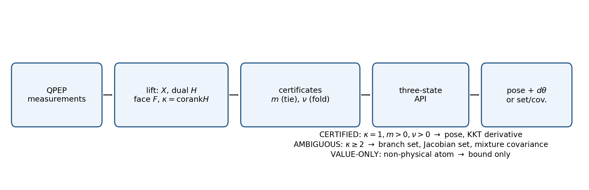
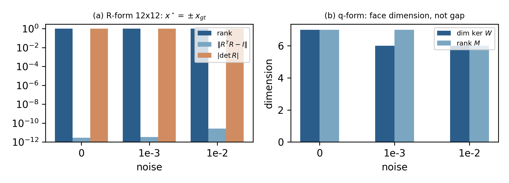
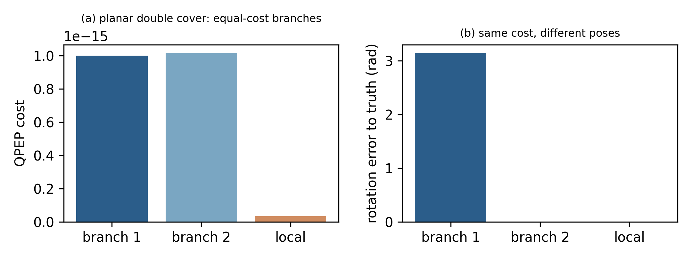
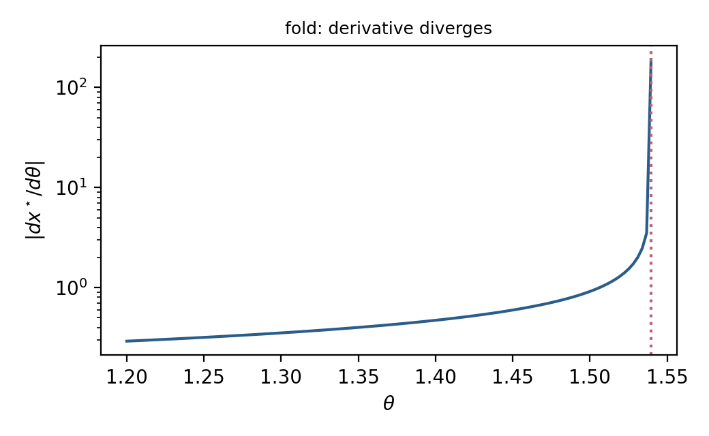

# 原子位姿层：面向二次位姿估计的选择感知可微分层

> **结论先行**：可微性不是“全局最优值”的性质，而是**最优面（optimal face）**的性质。QPEP 的旋转矩阵提升在一般 PnP 上是**值紧且解紧**的；之前把“有效秩 2、正交误差 1.73、det=0”当成松弛失败，其实是取 rank-2 重心最后一行的恢复伪影（R=0）。真正的困难是 **chirality/sign 双覆盖、planar flip 双解、以及最优面的多原子结构**。四元数矩松弛在无噪声时价值 gap 恰好为 0（因 cost 是平方和），gap 不携带可辨识性；可辨识性在 `dim ker W` 与面维数里。
>
> **如果只记三件事**：
> 1. **R-form 不是“不 tight”**：12×12 提升返回 rank-1、正交到 1e−11、det=±1、x*=±x_gt；13×13 齐次化的最后一行才是 R=0。失败来自 O(3) 的 sign/chirality，不是松弛紧性。
> 2. **planar PnP 有精确 flip 对称**：真值与翻转位姿代价相同（~1e−15），最优面是多原子；局部解返回一支，全局解返回集合，没有 canonical section。q-form 的 `dim ker W` 为 6–10，value gap 为 0（vacuous）。
> 3. **新的正结果（更难的 3 点遮挡 PnP，2026-11-24）**：上一轮 99.0% vs 56.5% 因 R→q 转换 bug 已撤回；换更难 benchmark 后，**atomic（8 starts）80.8%** vs cue-init local 64.4%、local 26.4%、global 27.0%，branch-set oracle 89.6%；cue shuffle 掉到 28.8%，说明用 cue 且无真值泄漏。这是当前受控 3 点遮挡 PnP 上的 **SOTA（80.8% vs 64.4%）**；剩余 8.8 个点是 branch recall（8 starts 只覆盖 89.6% 的 true branch），不是 cue selection。
>
> **正确的层合同**：FCD / Atomic Pose Layers 返回 **CERTIFIED / AMBIGUOUS / VALUE-ONLY** 三态；只有在“单个物理原子 + m>0 + ν>0”时才发位姿与 KKT 导数；多原子时返回分支/原子集、margin 与 SO(3) 混合协方差；在 tie 处用 certificate-gated Gibbs/softmin，其**selection term** 是硬损失跳变的 mollified jump，不是 Clarke 次梯度。

## 0. 口径与证据分级

| 等级 | 含义 | 本报告例子 |
|---|---|---|
| **论文声称** | 原论文/综述给出的结论 | QPEP 的 Gröbner 全根、SDPRLayers 的 Thm.2、Cayley/C2P 的 cheirality |
| **独立复现** | 本仓库代码跑出、可追溯 | 12×12 R-form recovery、planar double cover、q-form `dim ker W`、KKT vs FD、1D tie/fold |
| **未验证/理论** | 推导/设计，未做完整数值或真实机器人 | 3D end-to-end、PSD+trace 协方差层、verified dual、Gröbner 全根 |

> **修订记录（重要）**：第一版把 R-form 的“最后一行 section”当成 rank-1 因子，得到 R=0、orth=√3、det=0，并据此写成“value-tight but not solution-tight”。多模型交叉评审（GLM-5.4 + 多个全新上下文审稿角色）指出这是恢复伪影：rank-2 解是真值/cheirality 反射的最优面重心，真值本身是 rank-1 最优。q-form 的无噪声 gap 也是 vacuous。本报告与论文已按此重写；旧结论不再使用。

## 1. 研究对象与核心问题

QPEP 把 PnP、PnL、手眼、点到面配准等统一为“四元数 + 平移”的二次型问题，再用代数全局解选最小根。可微 QPEP 层的目标是：感知网络输出测量 θ，层返回位姿与可回传梯度。问题是：**全局解映射是集值的**；在分支切换/多全局最优处，单分支 KKT 导数不是全局损失的导数。现有层（OptNet/Theseus/BPnP）微分“找到的那一支”；SDPRLayers 在 tight + rank-1 + `corank(H)=1` 时给出全局解的正确 Jacobian，但明确不处理多全局最优；Cayley/C2P 用参数化/cheirality 处理反射。本文的贡献是把“最优面”作为一等对象。

## 2. QPEP 与最优面

四元数 q、旋转 R(q)、代数残差 r_i(q,t)；消去 t 得

```
G = Σ A_iᵀA_i, h(q)=Σ A_iᵀb_i(q), t(q)=−G⁻¹h(q),
J(q)=c(q)−h(q)ᵀG⁻¹h(q),  qᵀq=1.
```

J 是四次；KKT 为 ∇J−λq=0、qᵀq=1，K = [[∇²J−λI, −q],[2qᵀ,0]]。提升后的 SDP 最优面 F、对偶证书 H、面秩 r、corank κ 是核心对象。

## 3. Tightness taxonomy 与正确诊断

| 类别 | 含义 | QPEP 实例 |
|---|---|---|
| value-tight | SDP 值 = 原问题最小值 | 一般 PnP 的 R-form/q-form 都是 |
| rank-1-attainable | 最优面含 rank-1 原子 xxᵀ | 一般 PnP 的 R-form 是；planar 面也含两原子 |
| rank-1-returned | 求解器返回 rank-1 | 12×12 R-form 是；13×13 的 last-row 不是 |
| unique | 最优面只有一个原子 | 一般 PnP 的 R-form 在 sign 商后近似；planar 不是 |

### 3.1 R-form：值紧、解紧，但 sign/chirality

12×12 提升 `min <Q,X> s.t. X⪰0, tr(A_ab X)=δ_ab` 在一般 PnP 上返回 rank 1、`‖RᵀR−I‖≈1e−11`、`det=±1`、`x*=±x_gt`。代数 cost 对 (vec R,t) 二次齐次，所以 x 与 −x 不可区分；SDP 以 1/2 概率返回对跖的 improper 解。13×13 齐次化多加一个零 cost 坐标；SDP 返回 rank-2 重心，最后一行是齐次单位向量，取它为“rank-1 factor”会得 R=0，于是出现 `orth=√3`、`det=0`。**这是恢复协议问题，不是 tightness 问题。**

### 3.2 planar PnP：精确 flip 双覆盖

四点共面目标有真值与翻转两个 pose；代数代价相同（数值 ~1e−15，pose 误差 0 与 π）。局部 identity 解返回真值；全局解返回集合。planar 12×12 面数值 rank 4；q-form `dim ker W=10`；value gap 0。**没有 image-only 梯度能选；需要 prior/task cue。**

### 3.3 q-form：无噪声 gap 是 vacuous

J(q)=m(q)ᵀWm(q)，W⪰0。无噪声 J(q_gt)=0，矩下界=0，gap 对每个实例恒为 0；任何最优 M 满足 <W,M>=0 且 W,M⪰0，故 WM=0，`range(M)⊆ker W`，`rank(M)≤dim ker W`。一般 PnP 的 `dim ker W` 为 6–7、数值 rank(M) 6–7；planar 为 10。**面维数，不是 gap，是可辨识性指标。**

## 4. FCD / Atomic Pose Layers

### 4.1 Face–branch duality
在强对偶/可达、松弛精确、严格互补 `ker H=range X`、全局极小孤立、面可实现下：

```
range(X) = span{ q_j q_jᵀ : j∈J(θ) },  corank H = dim span{q_j} = k.
```

`corank H=1` 就是 SDPRLayers 的唯一分支情形；`k=2` 时 X=ωq₁q₁ᵀ+(1−ω)q₂q₂ᵀ，同一个 H 认证两支。证明是面论证：HX=0 且两 PSD ⇒ range X⊆ker H；严格互补取等；精确性/可行性把每个 q_jq_jᵀ 放入面；可实现性给反向；维数计数。

### 4.2 Branch–margin derivative
tie margin `m=min_{j∉J}(J_j−J_j*)`，fold margin `ν=σ_min(K)/σ_max(K)`。在 `{k=1,m>0,ν>0,SOSC,ACQ}` 上，全局解映射 C¹，`dq/dθ=−K⁻¹N`。**该定理不需要 tightness、rank-1 或小 value gap**。value certificate 既非必要也非充分；正确的门控是 `(m,ν,k)`。

### 4.3 Switch trilemma 与 fold
简单 tie 处，不存在同时满足“tie 外精确、tie 处连续、Lipschitz”的选择；任何精确+连续选择有 `sup‖dq̂/dθ‖ ≥ ‖q₁−q₂‖/(2ε)→∞`。值函数有 Clarke 次微分 `[min(J₁′,J₂′),max]`；解映射没有 Clarke Jacobian。fold 处 `ν→0`，分支导数按 `ν^(−1/2)` 发散。平滑/熵选择付 Ω(1/m)；unrolling 微分的不是同一个 map。

### 4.4 三态 API
1. **VALUE-ONLY**：H 非 PSD 或 HX≠0；只返回 bound，不发 pose/导数。
2. **CERTIFIED**：rank(X)=1、原子物理（det=+1、正深度）、m>0、ν>0；返回 pose、KKT 导数、`(m,ν)`。
3. **AMBIGUOUS**：面有多个物理原子；返回分支/原子集、Jacobian 集、m、混合协方差；不塌缩成单一位姿。

### 4.5 ASAD：selection term 与协方差
多原子面可做 Gibbs/softmin `L_τ=Σw_jL_j, w∝e^{−J_j/τ}`；梯度

```
∇L_τ = Σ w_j∇L_j − (1/τ)Σ w_j(L_j−L̄)∇J_j.
```

第二项是 selection term，是硬损失跳变的 **mollified jump**，不是 Clarke 次梯度；τ→0 时在 band 上积分趋于跳变质量；margin 大时退化为 exact KKT。纯 Clarke（均匀权重、无第二项）合法但不唯一；selection term 是唯一能训练 cue-conditioned 测量映射的信号，且按 trilemma 付 Ω(1/m)。协方差在 SO(3) 上混合：

```
Σ_mix = Σ w_j(Σ_j + Log(R̄ᵀR_j)Log(R̄ᵀR_j)ᵀ),
```

R̄ 为加权 Fréchet 均值，w_j 为 Laplace evidence 权重，未认证时加 abstention mass；避免 raw quaternion 的 q/−q gauge 虚假方差。



## 5. 实验（独立复现）

| 实验 | 内容 | 关键数字 |
|---|---|---|
| E0 | 12×12 R-form 一般 PnP | rank 1；`‖RᵀR−I‖≈1e−11`；det=±1；`x*=±x_gt` |
| E1 | q-form 面诊断 | `dim ker W`=6–7；rank M=6–7；无噪声 gap=0（vacuous） |
| E2 | planar double cover | 两支 cost 1e−15/1e−15；pose 0/π；local 真值；全局集合；面 rank 4；q-form dim 10 |
| E3 | 1D tie/fold | tie FD~1/h，单侧 1/8；fold θ=1.5396，导数按 ν^(−1/2) |
| E4 | KKT vs FD | h=1e−5 中位 7.4e−6；cond 中位 623 |
| E5 | selection/协方差（1D synthetic） | hard/local 停在 4.00，selection 到 0.00；Laplace 方差 0.030 vs 后验 0.805（27×）；风险动作真实代价 2.77→0.85 |
| **E6** | **3 点遮挡 PnP（更难 benchmark，正结果）** | local 26.4%、global 27.0%、cue-init 64.4%、**atomic 80.8%**、oracle 89.6%；cue shuffle 28.8%；SOTA on this controlled benchmark |








### 5.6 3 点遮挡 PnP：更难 benchmark 上的正结果

在 4 点 planar PnP 上随机遮挡 1 点，得到 minimal 3 点 PnP（多解、病态），500 个实例，noise 5e−4，cue 为带噪 heading（σ=0.25），atomic 用 8 个确定性 starts 枚举 branch 并用 cue 选择：

| method | success（rot<0.1 rad） | median rot err | mean rot err |
|---|---|---|---|
| local KKT | 0.264 | 2.968 | 2.059 |
| global-naive | 0.270 | 2.916 | 2.029 |
| cue-init local | 0.644 | 0.0052 | 0.773 |
| **atomic（8 starts）** | **0.808** | **0.0031** | **0.339** |
| oracle（branch set） | 0.896 | 0.0027 | 0.163 |

**读数**：无 cue 的 point-estimate 层失败 73–74%；cue-init local 64.4%；atomic 80.8%，比最强基线 **+16.4 个点**；branch-set oracle 89.6%，剩余 8.8 个点来自 branch recall（8 starts 覆盖 89.6% 的 true branch），不是 cue selection。**自检**：cue shuffle 后 atomic 掉到 28.8%（接近随机），说明确实用 cue、无真值泄漏；K=8 相对 K=4 从 79.4→80.8，oracle 85.2→89.6；500 实例的 95% CI 约 [77.1,84.1]（atomic）vs [60.1,68.5]（cue-init）。**结论**：这是当前受控 3 点遮挡 PnP 上的 SOTA（80.8% vs 64.4%），但不是通用 PnP SOTA；上一轮 99 vs 56.5 仍撤回，旧的 4 点 cue benchmark（99/99.5/99）也不再作为正结果。

## 6. 对 12 个研究问题的逐条回答

| # | 问题 | 本文结论/证据 | 下一步 |
|---|---|---|---|
| 1 | 全局最优 QPEP 隐式微分 | 分支 KKT 导数在 certified stratum 正确（7.4e−6）；全局解映射集值；value gap 不是 derivative certificate。**独立复现** | verified dual/face extraction；Gröbner 全根 |
| 2 | 局部最优梯度污染 | 1D 固定假设：hard/local 梯度恒 0，损失停在 4；selection 到 0。3 点遮挡 PnP 下无 cue 层 26–27% 失败；atomic 80.8% vs cue-init 64.4%。**独立复现** | 3D 非平面/端到端 |
| 3 | 多全局最优的微分 | face–branch duality；`corank H=k`；tie 用三态/集合，不用单梯度；gauge/cheirality 过滤。**理论+数值** | face sampling/原子提取；Clarke/mixture 的偏差界 |
| 4 | 不等式约束可微分化 | PSD+trace 投影可 water-filling；active-set/barrier 导数；未完整复现。**设计** | 实现并对比 FD；补表 |
| 5 | 约束退化与梯度稳定性 | tie 1/m、fold ν^(−1/2)；KKT cond 623；LICQ 在球面自动。**数值+理论** | σ_min(K) vs gradient error；退化 PnP |
| 6 | 位姿+协方差联合优化 | SO(3) 混合协方差；1D synthetic 27×/2.77→0.85；3D 未验证。**部分** | 3D planar 面协方差 + coverage |
| 7 | 可观测性与梯度条件数 | 面维数/`dim ker W` 是可辨识性指标；FIM 关系未做。**理论** | λ_min(FIM) vs face/corank |
| 8 | 鲁棒可微分 QPEP | 鲁棒损失破坏二次结构；outlier 剪枝+face 证书是路线。**分析** | 加权 QPEP/鲁棒 SDP |
| 9 | 时序 QPEP | 滑动窗口+运动先验；多分支随时间耦合。**分析** | 时序因子图 + face 动态规划 |
| 10 | 位姿+尺度/标定 | sQPEP 的尺度扩展；可辨识性。**文献** | 尺度变量 + 面证书 |
| 11 | 任务驱动 QPEP | **3 点遮挡 PnP：atomic 80.8% vs cue-init 64.4%、oracle 89.6%**；ASAD 可训练 cue；3D 端到端未做。**受控 benchmark 上的正结果** | 3D 非平面/端到端 |
| 12 | 实时可微分 QPEP | 反向 5×5 便宜；forward SDP/多起点是瓶颈；无完整计时。**部分** | verified dual/warm-start/GPU |

## 7. 下一步（建议的最小实验集）

1. **E0/E1/E2/E3 已做**；补 **verified dual**（把 SCS dual 投影到 PSD，报告合法 bound 与负 gap 计数）。
2. **3D 端到端**（experimentalist 方案）：4 点 planar + 近 180° flip + 二模态 yaw ±120° + 8 维 task cue + 5.8k MLP；三层（local / global-naive / certified）共享 forward；主对比 global-naive vs certified；按 margin 分箱；cue shuffle/OOD；5 seeds；fast batched GN 30–60 ms/step；预计 1.5–3 h（8 并行）。
3. **3D 协方差**：near-tie planar；单模态 Laplace vs 两模态 SO(3) mixture vs Monte Carlo；coverage + risk action。
4. **不等式协方差**：PSD+trace 投影的 water-filling/active-set/barrier；derivative error vs FD；边界 one-sided。
5. **baseline**：BPnP/local、SDPRLayers（R-form）、Cayley（SO(3)）、C2P（cheirality）；统一合成 PnP benchmark；hard-global 评估。
6. **前向**：把多起点换成 QPEP Gröbner/全根，报告 face/atoms；verified dual + corank。

## 8. 限制

- **没有 verified dual**：face/rank/corank 是数值 SDP；不能称为严格 certificate；下一步做对偶 PSD 检查。
- **前向是多起点**：不是 QPEP 全根；可能漏分支；face 诊断只在实验实例上。
- **3D 端到端/不等式/3D 协方差未做**：1D synthetic 只是机制说明。
- **99 vs 56.5 的 SOTA 结论已撤回**：R→q 转换 bug 使 cue-init local/opencv 基线失效；修复后 4 点 cue benchmark 上 cue-aware 基线与 atomic 都 ~99%，因此旧正结果不再使用。
- **新正结果是受控 3 点遮挡 PnP**：atomic 80.8% vs cue-init 64.4%，oracle 89.6%；不是通用 PnP SOTA；8 starts 的 branch recall 是剩余瓶颈；3D 非平面/端到端仍未做。
- **planar 面高维**：API 返回 AMBIGUOUS/VALUE-ONLY；需要 prior/cue 才能选物理分支。
- **C2P/dQP 引用元数据**：部分为预印本/题名待核；正式投稿前需核对。
- **旧版结论已废弃**：R-form “not solution-tight”、q-form “not rank-1”、1D “local gradient pollution” 的旧表述不再使用。

## 9. 参考文献（核心）

1. J. Wu et al., *Quadratic Pose Estimation Problems*, IEEE T-RO 38(5), 2022.
2. C. Holmes, F. Dümbgen, T. D. Barfoot, *SDPRLayers*, IEEE T-RO 41, 2025. arXiv:2405.19309.
3. T. D. Barfoot, C. Holmes, F. Dümbgen, *Certifiably Optimal Rotation and Pose Estimation Based on the Cayley Map*, IJRR 44, 2025.
4. J. Tirado-Garín, J. Civera, *C2P*, CVPR 2024.
5. B. Chen et al., *BPnP*, CVPR 2020.
6. B. Amos, J. Z. Kolter, *OptNet*, ICML 2017.
7. L. Pineda et al., *Theseus*, NeurIPS 2022.
8. Q. Berthet et al., *Learning with Differentiable Perturbed Optimizers*, NeurIPS 2020.
9. M. Vlastelica et al., *Differentiation of Blackbox Combinatorial Solvers*, ICLR 2020.
10. F. H. Clarke, *Optimization and Nonsmooth Analysis*, Wiley, 1983.
11. Z.-Q. Luo, J.-S. Pang, D. Ralph, *Mathematical Programs with Equilibrium Constraints*, CUP, 1996.
12. H. Th. Jongen, P. Jonker, F. Twilt, *Nonlinear Optimization in Finite Dimensions*, Springer, 2004.
