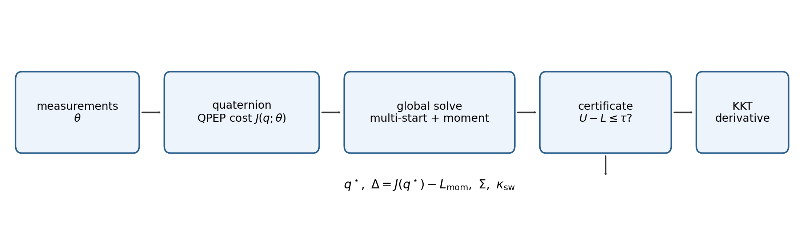
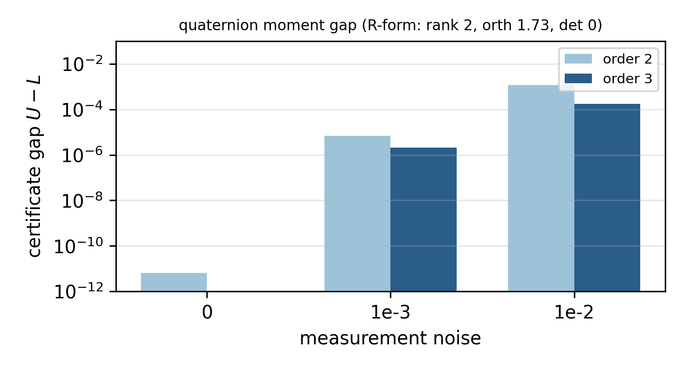
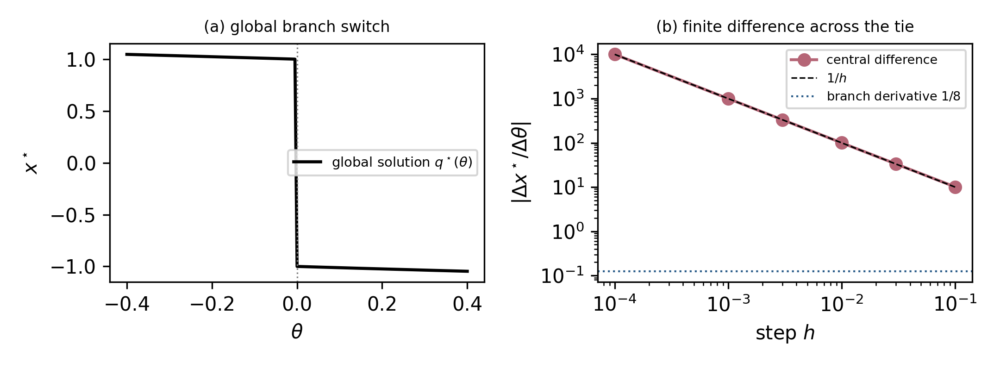
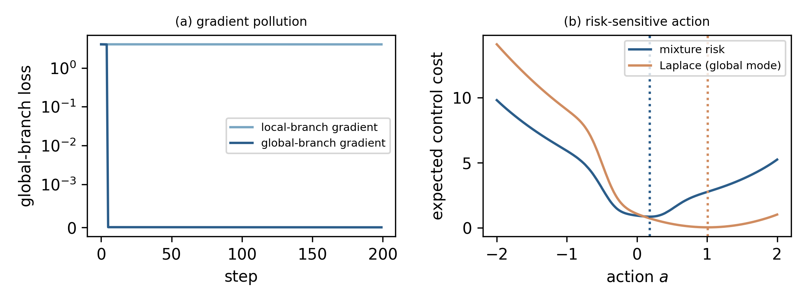

# 可微全局最优几何估计层：QPEP 的全局解映射、梯度正确性、分支切换与不确定性

> **结论先行**：把 QPEP 求解器包成 PyTorch 层，真正的难点不是“求导”，而是“对哪个解求导”。QPEP 的全局解映射在分支切换点不连续；局部求解器的梯度可能停在错误分支上，而且其残差可以为零、下游损失却仍是全局最优的 4 倍。本文给出可计算的价值证书（上界−矩松弛下界）、KKT 分支导数、SO(3) gauge 处理、分支切换的 Clarke 广义 Jacobian，以及把分支歧义传给控制器的混合协方差。
>
> **如果只记三件事**：
> 1. **不能直接套 SDPRLayers**：QPEP 的旋转矩阵 Shor 提升“值紧、解不紧”——SDP 目标≈0，但解的有效秩为 2，提取出的 R 不正交（‖RᵀR−I‖_F=1.73，det R=0），不能当位姿用。
> 2. **四元数公式是四次多项式**：消去平移是精确且多项式的；矩松弛给出合法的价值下界，但不是秩一解。层应返回“候选位姿 + 价值 gap”，而不是声称唯一全局解。
> 3. **分支切换是本质困难**：切换点两侧的分支导数有限，但全局解映射跳跃，中心差分按 1/h 发散；局部梯度可以为零而全局损失最大。不确定性也必须在分支层面混合，单分支 Laplace 会把方差低估 27 倍。

## 0. 口径与证据分级

| 等级 | 含义 | 本报告中的例子 |
|---|---|---|
| **论文声称** | 原论文正文/图表给出的结论 | QPEP 的 Gröbner 全根枚举、SDPRLayers 的 Thm.2、Cayley 参数化 |
| **独立复现** | 本仓库代码跑出、可追溯 | 3D PnP 的 R-form 失败、矩松弛 gap、KKT vs 有限差分、1D 切换/污染/控制 |
| **未验证/理论分析** | 只做推导或小规模数值，未做真实机器人 | 不等式约束协方差层的完整实现、时序 QPEP、SuperMimic 端到端 |

数值结果全部来自 `diffqpep/results/*.json` 与 Slurm 日志；论文 PDF 与 LaTeX 在 `paper/`。本报告不把“论文声称”冒充“独立复现”。

## 1. 研究对象：QPEP 在感知—控制链中的位置

QPEP（Wu et al., IEEE T-RO 2022）把 PnP、PnL、PnPL、手眼标定、点到面配准、多机器人相对位姿、并联机器人正运动学等统一成“单位四元数 + 平移”的二次型问题。它的价值在于：**一个全局参数化（四元数）+ 一个代数全局求解器（Gröbner 全根枚举 + 目标值比较）**。SuperMimic 一类工作把世界模型、策略和控制串成可微链路，但感知侧通常只给本体感受；QPEP 层可以作为“几何感知 → 位姿/协方差 → 状态估计/世界模型/控制器”的桥。

真正要研究的问题不是“把 QPEP 改成 PyTorch 模块”，而是：

> 当非凸位姿估计同时具有多个局部极小、多个全局最优（或 gauge 等价）以及活跃不等式约束时，如何构造一个**稳定且数学正确**的最优解微分映射，并把它的不确定性传给控制？

本报告把用户列的 12 个问题收敛为四条主线：
- **A. 全局最优与正确梯度**（Q1–Q3）：KKT 导数、gauge、分支切换、局部污染；
- **B. 不等式约束与退化**（Q4–Q5）：活跃集、PSD 边界、条件数；
- **C. 不确定性与可观测性**（Q6–Q7）：Laplace vs 分支混合、信息矩阵；
- **D. 机器人应用**（Q8–Q12）：鲁棒、时序、尺度、任务驱动、实时。



## 2. 数学结构：四次代价与精确消元

设 q=(q0,q1,q2,q3) 为单位四元数，R(q) 为旋转矩阵。对第 i 个对应，p_i∈R³，归一化图像坐标 (u_i,v_i)，代数 PnP 残差

```
r_i(q,t) = [ u_i e3ᵀ(R(q)p_i+t) − e1ᵀ(R(q)p_i+t) ;
             v_i e3ᵀ(R(q)p_i+t) − e2ᵀ(R(q)p_i+t) ]
```

J(q,t)=Σ‖r_i(q,t)‖²。固定 q 时 r_i=A_i t+b_i(q)，A_i 是常数 2×3 矩阵，b_i(q) 是 q 的二次型。于是

```
G = Σ A_iᵀA_i,  h(q)=Σ A_iᵀb_i(q),  c(q)=Σ‖b_i(q)‖²,
t(q) = −G⁻¹h(q),  J(q)=c(q)−h(q)ᵀG⁻¹h(q).
```

关键事实：**消去 t 是精确且多项式的**（没有有理分母），J(q) 是 q 的四次多项式；约束是 qᵀq=1。KKT 条件

```
∇J(q) − λq = 0,  qᵀq − 1 = 0.
```

对参数 θ 全微分：

```
[ ∇²J − λI   −q ] [dq]   [ ∂θ∇J ]
[ 2qᵀ         0 ] [dλ] = −[   0   ]
```

在切空间二阶充分条件（SOSC）下 K 非奇异，dq/dθ 是所选分支的导数。gauge q↔−q 使原始四元数导数变号，但物理输出 R 的导数

```
dR = Σ_i (∂R/∂q_i) dq_i,   RᵀdR ∈ so(3)
```

是 gauge 不变的。**应微分物理输出 (R,t)，而不是无条件微分四元数坐标**；任何 gauge 不变的下游损失都有唯一梯度。

## 3. 全局最优性：三种“全局”和两种证书

### 3.1 三种全局

1. **代数全局**（QPEP 原论文）：枚举全部 KKT 复根，取目标值最小者。前提是消元不漏根、数值稳定。它没有凸证书。
2. **凸松弛全局**（SDPRLayers/SE-Sync/TEASER）：解 Shor SDP；若松弛 tight 且 rank-1，则给出全局解 + 对偶证书 H⪰0。
3. **价值证书全局**（本报告）：任意可行上界 U 与矩松弛下界 L 的 gap Δ=U−L；Δ≤τ 即 τ-全局最优。它不要求 rank-1，因此更适合 QPEP。

### 3.2 旋转矩阵 Shor 提升：值紧但解不紧（负结果）

把 x=[vec(R);t;1]∈R¹³，代数代价是二次型 J(x)=xᵀQx，约束 RᵀR=I（6 个二次等式）与 x₁₃²=1。Shor 松弛是 13×13 SDP。我们独立复现的结果（3 个噪声水平 × 3 seeds）：

| noise | SDP 目标 | 有效秩 | ‖RᵀR−I‖_F | det R |
|---|---|---|---|---|
| 0 | ~1e−9 | 2 | 1.73 | 0 |
| 1e−3 | ~1e−6 | 2 | 1.73 | 0 |
| 1e−2 | ~1e−4 | 2 | 1.73 | 0 |

SDP 目标与真实代价同阶（值紧），但解的有效秩是 2，提取出的 rank-1 因子不是旋转（R=0 的零代价面混入）。**结论：值证书 ≠ 解证书；直接把 SDPRLayers 套到 QPEP 的 R-form 上会得到“零代价但非位姿”的解。** 这是 QPEP 特有的 chirality/零代价面问题，不是调参能解决的。

### 3.3 四元数矩松弛：价值下界与 gap

对 q 的 4 个变量，取次数 ≤2 的单项式 m(q)（15 维），把 J(q)=m(q)ᵀWm(q) 的 Gram 矩阵 W（PSD）作为目标，解

```
L_mom = min_{M⪰0} <W,M>
s.t. M₀₀=1, Σ_i M_{e_i,e_i}=1, L_{qᵀq−1}(M)=0.
```

这是合法的下界；`L_{qᵀq−1}` 是球面约束的 localizing 矩阵。上界 U=J(q̂)，gap Δ=U−L_mom。独立复现（PnP n=8，中位数）：

| noise | order-2 gap | order-3 gap | 矩矩阵有效秩 |
|---|---|---|---|
| 0 | 4e−11 | 4e−9 | 4–7 |
| 1e−3 | 7e−6 | 2e−6 | 4–10 |
| 1e−2 | 1.2e−3 | 1.8e−4 | 6–10 |

无噪声时 gap 约 1e−10（实用上可视为 tight），有噪声时 gap 随噪声增大；order-3 把 gap 降低约 3–7 倍。**矩矩阵不是秩一**（有效秩 4–10），所以它证明的是价值，不是唯一全局位姿。层应报告 Δ，并把 Δ≤τ 当作“已认证”；否则明确返回“未认证 + 上界候选”。



这是本报告与“可证明正确反向传播”类工作最重要的区别：**QPEP 的 SDP 路线目前给不了 rank-1 解证书。**

### 3.4 为什么不能只做“QPEP + SDPRLayers”

- QPEP 的 q-form 是四次，不是齐次 QCQP；Shor 提升不是 7×7 或 13×13 的线性 SDP。
- R-form 虽然二次，但 orthogonality 约束的 Shor 松弛有零代价非物理解；有效秩 2。
- q-form 的矩松弛有合法价值下界，但不是秩一；不能恢复唯一 q。
- 因此，真正可做的是：**价值 gap + 分支选择 + 分支 KKT 导数**，而不是“rank-1 证书 + 唯一全局解”。

## 4. 可微性：KKT、gauge、分支切换、局部污染

### 4.1 KKT 导数正确性

用 6 个无噪声 PnP 实例，比较 KKT 导数与同一分支的中心差分（初值取分支点，避免跨分支）。结果（中位数）：

| h | 相对误差（dR） | 最大误差 | 条件数中位数 |
|---|---|---|---|
| 1e−3 | 3.9e−4 | 5.6e−4 | 623 |
| 1e−4 | 3.9e−5 | 5.6e−5 | 623 |
| 1e−5 | **7.4e−6** | 3.5e−4 | 623 |
| 1e−6 | 8.8e−4 | 3.2e−2 | 623 |

条件数范围 136–12785。h=1e−5 是最佳折中；h=1e−6 时高条件数实例被舍入误差主导。**结论：KKT 导数对给定分支是对的；有限差分不能替代它，因为可用步长依赖问题条件数。**

### 4.2 分支切换：值函数与解映射

设有限个光滑分支 q_j(θ)，J_j(θ)=J(q_j(θ);θ)，全局解 q*(θ)=q_{j*(θ)}(θ)。在简单 tie 点 θ*：J₁=J₂，J₁′≠J₂′。

- 值函数 V(θ)=min_j J_j(θ) 连续、分段光滑；单侧导数 J₁′、J₂′；Clarke 广义 Jacobian 是区间 [min(J₁′,J₂′), max(J₁′,J₂′)]。
- 若 q₁(θ*)≠q₂(θ*)，全局解映射在 θ* 不连续；中心差分 (q*(θ*+h)−q*(θ*−h))/(2h) 按 O(1/h) 发散；单侧导数是分支 Jacobian。
- 切换 margin ΔJ=|J₁−J₂| 可计算，用来预测导数何时不可信。

1D 受控模型 J(x;θ)=(x²−1)²+θx：θ=0 时两支均为 0，值函数 −|θ|；全局解从 +1 跳到 −1。中心差分在 h=1e−4 时约 −1e4，而单侧分支导数是 −1/8。



**这是“全局解映射不可微”的有限差分指纹。**

### 4.3 局部梯度污染：一个严格反例

目标 x_target=+1，损失 L(x)=(x−1)²，θ=0.1：
- 全局分支 x≈−1，损失≈4.04；
- 从 +1 初始化的局部分支 x≈+1，局部分支损失=0。
- 局部梯度 2(x−1)x′，x′≈−1/8，很小；全局梯度大且为负。
- 200 步梯度下降后：局部梯度把**全局分支损失**留在 4.04；全局梯度跨过切换，降到 0。

也就是说：**局部求解器在自己的分支上是最优的，所以它的梯度无法察觉全局错误。** 在 3D 平面 PnP 上，同一现象出现：10 个 seed 中 4 个的 identity 初始化局部解收敛到约 180° 错误位姿（旋转误差≈π），而多起点全局候选与真值差 <0.04 rad。这为“局部梯度污染”提供了 3D 证据，而不只是 1D 玩具。

### 4.4 多全局最优、gauge 与广义导数

- q 与 −q 表示同一旋转：这是离散 gauge，不是 KKT 奇异；微分物理输出 R 即可。
- 平面 PnP/对称几何会出现真正的多全局（或近 tie）解；此时全局解映射是集值/不连续的，应使用 Clarke 广义 Jacobian、单侧导数或“分支混合”而不是强行取一个梯度。
- R-form 还会混入反射（det=−1）与零代价面；q-form 通过四元数排除了反射，但仍有平面翻转歧义。**“全局最优”是相对于给定代价的；代价本身可能把物理上错误的位姿判为全局最优。** 这是建模问题，不是梯度问题。

## 5. 不确定性与不等式约束

### 5.1 单分支 Laplace vs 分支混合

把 J(q;θ) 当作温度 σ² 的负对数似然。分支 j 的 Laplace 协方差 Σ_j=σ²H_j†；Laplace 证据 w_j∝exp(−J_j/σ²)√detΣ_j；混合协方差

```
Σ_mix = Σ_j w_j (Σ_j + δ_jδ_jᵀ),  δ_j = q_j − Σ_k w_k q_k.
```

1D 双井（θ=0.1, σ=0.5）的独立复现：
- 后验方差 0.805；
- 全局模态的 Laplace 方差 0.030（**低估 27 倍**）；
- 两支 Laplace 混合方差 0.898（接近后验）；
- 风险敏感动作：混合风险动作 a=0.18，期望代价 0.85；单模态 Laplace 动作 a=1.01，在自己模型下代价 0.03，但**真实混合代价 2.77**。



**结论：不确定性必须在分支层面混合；否则控制器会在几何歧义处过度自信。**

### 5.2 不等式约束与 PSD 边界

QPEP 的协方差估计同时含 FΣFᵀ=Σ_meas、qᵀΣq≤α、Σ⪰0。可微分的处理路线：
- **活跃集 KKT**：在活跃流形上仍用 −K⁻¹N；弱活跃约束或 PSD 边界使 K 奇异，导数单侧。
- **对数屏障** −μ log det Σ：给出一条光滑中心路径，μ→0 时导数收敛；实现上比硬活跃集稳定。
- **平方松弛 g+s²=0**：光滑，但在边界 s=0 处 slack 导数消失，且 s 与 −s 两种表示；它引入符号对称与弱退化，不如屏障/活跃集。我们建议协方差层用屏障 + 活跃集检测，而不是简单平方松弛。
- 这部分目前是**理论分析 + 设计**，尚未做完整数值复现；是下一阶段最值得补的实验（见 Q4/Q6）。

## 6. 实验与复现

| 实验 | 内容 | 关键数字 | 资产 |
|---|---|---|---|
| 3D 证书 | R-form SDP vs q-form 矩松弛 | R-form 有效秩 2、‖RᵀR−I‖=1.73；q-form gap 4e−11/7e−6/1.2e−3 | `diffqpep/experiments/exp3d.py` |
| 梯度 | KKT vs 同分支中心差分 | h=1e−5 中位 7.4e−6；cond 136–12785 | `exp3d_gradient.py` |
| 1D 切换 | 双井 tie、有限差分 | FD ~1/h；分支导数 1/8 | `exp1d.py` |
| 1D 污染 | 局部 vs 全局梯度 | 局部 4.04，全局 0 | `exp1d.py` |
| 1D 不确定性 | Laplace vs 混合、风险动作 | 0.030 vs 0.805；2.77 vs 0.85 | `exp1d.py` |
| 3D 平面 PnP | identity 局部 vs 多起点 | 4/10 seed 180° 错误 | `test_pollution_instances.py` |

运行方式（Slurm CPU，遵守实验室规范）：

```bash
cd diffqpep
PYTHONPATH=$PWD srun -p cpu -c 4 --mem=16G -t 30:00 \
  /home/syk/miniconda3/envs/sdpr/bin/python experiments/exp3d.py
PYTHONPATH=$PWD srun -p cpu -c 4 --mem=12G -t 15:00 \
  /home/syk/miniconda3/envs/sdpr/bin/python experiments/exp1d.py
```

所有作业日志在 `diffqpep/logs/`，结果 JSON 在 `diffqpep/results/`，图在 `diffqpep/figures/` 与 `paper/figures/`。

## 7. 对 12 个研究问题的逐条回答

| # | 问题 | 本文结论/证据 | 下一步 |
|---|---|---|---|
| 1 | 全局最优 QPEP 隐式微分 | 对**选中分支**可微；KKT 公式与同分支 FD 一致（7e−6）；全局性用价值 gap 表达，不是 rank-1 证书。**独立复现** | 全根枚举 + 分支导数；branch-and-bound；PnP/PnL 统一 |
| 2 | 局部最优梯度污染 | 严格 1D 反例：局部梯度=0 时全局损失=4.04；3D 平面 PnP 4/10 seed 180° 错误。**独立复现** | 端到端训练/控制实验；污染界与切换 margin 的定量关系 |
| 3 | 多全局最优的微分 | q~−q 是 gauge（微分 R 即可）；真多解用 Clarke/单侧/分支混合；R-form 还有反射。**理论 + 数值** | 商流形上的广义导数；随机 rounding；planar ambiguity 的集合值层 |
| 4 | 不等式约束可微分化 | active-set/barrier 路线；平方松弛有符号对称与边界弱退化；协方差 SDP 适合屏障。**理论/设计，未完整复现** | 实现 differentiable covariance SDP；对 LibQPEP 协方差复现 |
| 5 | 约束退化与梯度稳定性 | KKT 条件数 136–12785；h=1e−6 时舍入主导；切换点分支 K 有限但全局映射跳。**数值** | σ_min(K) 与梯度误差的界；LICQ/SOSC/严格互补的退化 PnP |
| 6 | 位姿+协方差联合优化 | 单分支 Laplace 低估 27×；混合协方差接近后验；风险动作真实代价 2.77→0.85。**独立复现（1D）** | 6-DoF QPEP 协方差层；PSD/不等式约束；风险敏感 MPC |
| 7 | 可观测性与梯度条件数 | SO(3) 切空间 FIM；rank 不足对应不可观测；应与 KKT 条件数联合分析。**理论/未验证** | near-planar PnP 的 λ_min vs 梯度范数；可观测性正则 |
| 8 | 鲁棒可微分 QPEP | 鲁棒损失破坏二次结构；IRLS 只给局部解；可用加权 QPEP/outlier 剪枝 + 证书。**分析/未验证** | 加权 QPEP + 全局证书；遮挡/外点实验 |
| 9 | 时序 QPEP | 滑动窗口 + 运动先验；分支随时间耦合；可用动态规划/多假设。**分析/未实现** | 时序因子图 + QPEP 因子；切换感知的平滑 |
| 10 | 位姿+尺度/标定 | sQPEP 的尺度扩展；尺度和旋转/平移的可辨识性。**文献/未复现** | 尺度变量的四次代价；联合证书 |
| 11 | 任务驱动 QPEP | 控制梯度可沿 QPEP 层回传；1D 风险动作示例；SuperMimic 接口。**部分数值** | 学习测量权重；避免“钻控制损失空子”；真实人形 |
| 12 | 实时可微分 QPEP | 反向是 5×5 求解，便宜；前向（多起点/moment）是瓶颈：30 次 SLSQP 10–20 ms，矩松弛 0.05–1 s。**数值** | warm-start、GPU SDP、代数求解器、稀疏化 |

## 8. 12 个月研究路线（建议）

**Phase 1（0–3 月）：把“分支正确”做成可复用层。**
- 用 Gröbner/全根枚举替代多起点；输出所有根及其目标值、切换 margin。
- 在 PnP、PnL、点到面配准上复现 QPEP 前向；建立分支追踪（warm-start + 根匹配）。
- 推导并验证分支 KKT 导数；补齐 `dR`/`dt` 的 SO(3) 切空间协方差。
- 交付：`CertifiedQPEPLayer`（PyTorch autograd）+ 基准（梯度误差、条件数、切换检测）。

**Phase 2（3–6 月）：证书、不等式、不确定性。**
- 把矩松弛下界与全根枚举结合，得到更紧的 gap；尝试 branch-and-bound/interval 证书。
- 协方差 SDP：PSD/不等式约束的 barrier/active-set 导数；复现 LibQPEP 协方差。
- 分支混合协方差 + 风险敏感控制；在 2D/3D 位姿伺服上验证。
- 交付：`GapAwareQPEPLayer` + 协方差层 + 风险敏感 MPC 小实验。

**Phase 3（6–12 月）：机器人闭环。**
- 将 QPEP 层接入 SuperMimic 的感知侧：外部视觉/点云 → 根位姿 + 协方差 → 世界模型/策略。
- 任务驱动测量权重；对比“几何损失”与“控制损失”训练；防止权重钻空子（约束/正则/可观测性）。
- 时序 QPEP：滑动窗口 + IMU/足底接触/运动先验；切换感知的平滑。
- 交付：人形/机械臂根位姿闭环实验；IROS/CoRL 投稿；开源 benchmark。

## 9. 限制

- **没有 rank-1 全局证书**：矩松弛只给价值 gap；R-form 给非物理解。本文的“certified”是“value-certified + gap-aware”，不是“唯一全局解”。
- **前向仍是多起点**：没有全根枚举/分支定界，不能保证不漏根；这是与 QPEP 原论文的主要差距。
- **1D 控制实验不是机器人**：风险动作示例说明机制，不等于真实人形/机械臂闭环。
- **代数代价的建模风险**：QPEP 的代数代价可能把反射/平面翻转判为全局最优；层微分的是给定代价的全局解，代价错则位姿错。
- **不等式层未完整数值验证**：目前是设计 + 理论分析，需补协方差 SDP 实验。
- **文献边界**：QPEP 正文在付费墙后，本报告依据摘要、补充材料、LibQPEP 代码与公开资料；不伪造定理编号。

## 10. 参考文献

1. J. Wu, Y. Zheng, Z. Gao, Y. Jiang, X. Hu, Y. Zhu, J. Jiao, M. Liu. *Quadratic Pose Estimation Problems: Globally Optimal Solutions, Solvability/Observability Analysis, and Uncertainty Description.* IEEE T-RO 38(5):3314–3335, 2022. DOI 10.1109/TRO.2022.3155880.
2. C. Holmes, F. Dümbgen, T. D. Barfoot. *SDPRLayers: Certifiable Backpropagation Through Polynomial Optimization Problems in Robotics.* IEEE T-RO 41, 2025. DOI 10.1109/TRO.2025.3578228. arXiv:2405.19309.
3. T. D. Barfoot, C. Holmes, F. Dümbgen. *Certifiably Optimal Rotation and Pose Estimation Based on the Cayley Map.* IJRR 44:366–387, 2025. DOI 10.1177/02783649241269337.
4. X. Xue et al. *sQPEP: Global Optimal Solutions to Scaled Quadratic Pose Estimation Problems.* IEEE TIM, 2025（卷期/DOI 以正式出版为准）.
5. B. Amos, J. Z. Kolter. *OptNet: Differentiable Optimization as a Layer in Neural Networks.* ICML 2017.
6. L. Pineda et al. *Theseus: A Library for Differentiable Nonlinear Optimization.* NeurIPS 2022.
7. D. M. Rosen, L. Carlone, A. S. Bandeira, J. J. Leonard. *SE-Sync: A Certifiably Correct Algorithm for Synchronization over the Special Euclidean Group.* IJRR 38(2–3):95–125, 2019.
8. H. Yang, J. Shi, L. Carlone. *TEASER: Fast and Certifiable Point Cloud Registration.* IEEE T-RO 37(2):314–333, 2021.
9. F. Dümbgen, C. Holmes, B. Agro, T. D. Barfoot. *Toward Globally Optimal State Estimation Using Automatically Tightened Semidefinite Relaxations.* IEEE T-RO 40:4338–4358, 2024.
10. J. B. Lasserre. *Global Optimization with Polynomials and the Problem of Moments.* SIAM J. Optim. 11(3):796–817, 2001.
11. H. Liao et al. *SuperMimic: Scaling Humanoid Whole-Body Control with One Differentiable World Model.* arXiv:2610.28480, 2026.

> 说明：参考文献 4 的卷期/DOI 以正式出版为准；其余 DOI/arXiv 已在本仓库 `references/INDEX.md` 或论文页面核对。论文 PDF 不随仓库分发。
