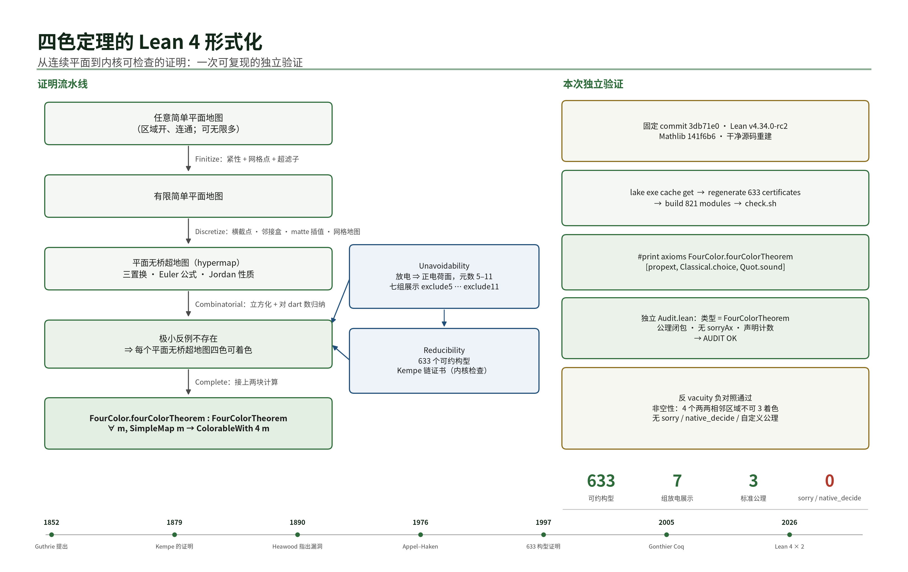

# 四色定理的 Lean 4 形式化：一次可复现的机器验证

**摘要**　四色定理是第一个主要依赖计算机的数学定理，也是形式化验证社区长期追逐的基准。2005 年，Gonthier 与 Werner 在 Coq 中完成了它的完整形式证明；2026 年，两个独立的 Lean 4 发展把它移植到了 Lean 4 与 Mathlib。本文以 `corun1024/4ct`（commit `3db71e0`）为对象，给出一次从干净源码出发的独立复现与审计：固定 Lean `v4.34.0-rc2` 与 Mathlib `141f6b6`，重新生成 633 个可约构型的证书，编译全部模块，运行上游的 `check.sh`，再用本文仓库的 `Audit.lean` 独立检查最终定理的类型与公理依赖。结果是：`FourColor.fourColorTheorem : FourColorTheorem` 通过 Lean 内核检查，仅依赖 `propext`、`Classical.choice`、`Quot.sound`，没有 `sorry`、没有 `native_decide`、没有自定义公理；非空性对照与反 vacuity 对照全部通过。本文同时逐条解释这个形式陈述的含义、Gonthier 证明的七个组成部分、Lean 4 移植在表示与计算上的关键改动，并与 RBarish 的第二个独立 Lean 4 发展做交叉比较。最后，本文明确区分“机器检查通过”与“人类已审阅”：代码主要由 AI 生成，陈述保真与信任基仍需读者自行判断。

> **结论先行**：四色定理已经有一个可复现、可审计的 Lean 4 形式证明；本文验证的那个版本只依赖 Lean 的三条标准公理。它的证明结构是 Gonthier–Werner 的 Coq 证明的 Lean 4 移植，而不是一个更短的新数学证明。真正的风险不在内核，而在陈述是否忠实、生成证书的代码是否可信、以及是否有人类数学家审阅过这套形式化。



*图 1 左侧是 Gonthier–Werner 证明的 Lean 4 流水线；右侧是本次复现的检查结果与关键数字。图的源文件在 `docs/visuals/2026-11-17-fourcolor-lean.png`，可用 `scripts/make_fourcolor_figure.py` 重新生成。*

## 如果只记三件事

1. **定理是真的，且是机器检查的。** 在固定 commit、固定工具链、固定 Mathlib 版本上，最终定理 `FourColor.fourColorTheorem` 编译通过；`#print axioms` 只列出 `propext`、`Classical.choice`、`Quot.sound`。
2. **证明的体量在“计算”，不在“数学”。** 65 个数学模块只花约 0.1 core-hour；406 个放电展示模块与 349 个可约性证书模块花掉约 7.4 core-hour。四色定理的形式化难点是把 633 个构型的可约性变成内核能检查的对象。
3. **“形式化完成”不等于“人类审阅完成”。** 上游代码主要由 AI 生成；两个独立发展都通过了各自的机器检查，但都明确说明没有人类数学家完成最终数学审阅。本文的独立审计是机器层面的复核，不替代人的判断。

## 1. 四色定理：陈述、历史与证明策略

### 1.1 两种陈述

四色定理有两个常用版本。

**图论版本。** 每个有限的平面简单图都是 4-可着色的：可以把顶点染成四种颜色，使每条边的两个端点颜色不同。

**地图版本。** 每个平面地图都可以用四种颜色给区域着色，使任意两个共享一段边界的区域颜色不同。这里的“地图”允许区域是无界的、边界是复杂的，甚至可以有无限多个区域；两个区域“相邻”是指它们不同的闭包共享一个不是“角点”的边界点。

两个版本在通常的平面嵌入意义下等价：把地图的区域看作对偶图的顶点，区域相邻看作对偶边，就得到平面图；反过来，平面图的一个嵌入把平面分成面，给面着色就是给对偶图着色。形式化时选择一个精确版本很重要，因为“相邻”在角点处的定义会改变定理的真假：如果许多区域只在一点相接也算相邻，四色定理就不成立。

Gonthier 的 Coq 证明采用地图版本。本文讨论的 Lean 4 形式化逐条转录了 Gonthier 的 `realplane.v`，因此也是地图版本。第 3 节会逐条解释这个陈述。

### 1.2 历史

- **1852 年**：Francis Guthrie 在给英国地图着色时提出猜想，并向他的弟弟 Frederick 与 De Morgan 提起。
- **1879 年**：Alfred Kempe 发表了一个“证明”，引入了后来称为 Kempe 链的论证。
- **1890 年**：Percy Heawood 指出 Kempe 的证明有漏洞，并用 Kempe 链证明了较弱的五色定理。四色定理在此后近九十年里仍是猜想。
- **1976 年**：Kenneth Appel 与 Wolfgang Haken 宣布证明，计算机检查了约 1,936 个可约构型，据称用了约 1,200 小时机器时间。这是第一个主要靠计算机完成证明的数学定理，也引发了“什么是数学证明”的长期争论。
- **1997 年**：Neil Robertson、Daniel Sanders、Paul Seymour、Robin Thomas 发表了简化证明，把不可避集缩小到 633 个可约构型，并用放电法（discharging）组织论证。今天的形式化大多跟随这一版。
- **2005 年**：Georges Gonthier 与 Benjamin Werner 在 Coq 中完成完整形式证明；Gonthier 在 2008 年的 *Notices of the AMS* 文章中叙述了证明架构。Coq 发展约 6 万行，包含 633 个构型与 7 组放电展示。
- **2026 年**：两个独立的 Lean 4 发展（Chris Emery 的 `corun1024/4ct` 与 Robert D. Barish 的 `RBarish-UTokyo/FourColorTheorem-Lean4`）把 Gonthier 的证明移植到 Lean 4 + Mathlib。两者都由 AI 大量参与，都通过了各自的内核检查。

### 1.3 为什么四色定理难形式化

四色定理的数学证明不是“一个漂亮的想法”，而是一个巨大的有限检查：

1. **从连续到离散。** 定理谈的是平面上任意形状的区域，甚至无限多个区域；证明必须先把它归约到有限组合结构。
2. **不可避免性。** 要证明每个平面地图都包含某个“不可避免”的局部构型；这需要放电法，把电荷在面之间转移，证明某个面必然落在 5 到 11 条边的范围内。
3. **可约性。** 对 633 个局部构型，要证明“如果地图包含它，就可以把它简化成一个更小的地图，并且任何四着色都能拉回”。每个构型的可约性都是一个有限但庞大的 Kempe 链搜索。
4. **计算的可信性。** 这些搜索不能靠“跑一个程序然后相信它”；证明助手要求搜索的每一步都能被内核检查。Coq 为此在核心里加了虚拟机；Lean 的内核没有这样的虚拟机，必须把搜索重新设计成内核能承受的位运算。

这四件事合起来，就是为什么四色定理的形式化体量以“十万行”和“core-hour”计。

## 2. Lean 4 与信任基

### 2.1 Lean 4 是什么

Lean 4 是一个依赖类型论的证明助手与编程语言。数学命题写成类型，证明写成这个类型的项；一个定理通过检查，意思是它的证明项通过了 Lean 内核的类型检查。Lean 4 的核心很小，数学库 Mathlib 建立在这个核心之上。

对本文而言，需要区分三层：

- **声明层**：定理的陈述（例如 `∀ m, SimpleMap m → ColorableWith 4 m`）。这一层是人写的，可能写错，也可能比 intended statement 弱。
- **证明层**：证明项。这一层由 Lean 内核检查；只要内核正确，证明项就不能“伪造”。
- **计算层**：`decide`、`omega`、`simp` 等策略生成的证明项，最终也要通过内核。`native_decide` 是例外：它把命题交给编译后的程序，只相信程序返回的 `true`，因此把编译器与运行时放进了信任基。

### 2.2 三条标准公理

Lean 的经典数学通常依赖三条公理：

- `propext`：命题外延性；
- `Classical.choice`：选择公理；
- `Quot.sound`：商类型的相等性。

它们不是“漏洞”，而是经典数学的标准假设。形式化审计的一个关键指标是：最终定理除了这三条之外不依赖任何东西，尤其不依赖 `sorryAx`（`sorry` 的底层公理）或自定义的 `axiom`。

`#print axioms FourColor.fourColorTheorem` 会打印定理的完整公理闭包。本文的审计要求它恰好是这三条。

### 2.3 `decide +kernel` 与 `native_decide`

Lean 的 `decide` 把可判定的命题化为布尔计算，再由内核归约检查。`decide +kernel` 明确要求归约在内核中完成；`native_decide` 则把计算编译成原生代码，速度快得多，但信任编译器。

四色定理的证书检查是重计算。上游发展刻意选择 `decide +kernel`，并在源码扫描中禁止 `native_decide`。代价是慢：7.5 core-hour 的绝大部分花在内核归约上。收益是信任基小：不需要相信 C 编译器、Python 解释器或生成证书的脚本；这些工具只产生数据，数据最终由内核检查。

## 3. 形式陈述：逐条解读

### 3.1 陈述代码

在 `FourColor/RealPlane.lean` 中，最终陈述只有一行：

```lean
def FourColorTheorem : Prop := ∀ m : PlaneMap, SimpleMap m → ColorableWith 4 m
```

其中：

```lean
abbrev Point := ℝ × ℝ
abbrev Region := Set Point
abbrev PlaneMap := Point → Region
```

也就是说，一个“地图”是一个函数，把平面上的每个点送到一个“区域”（点集）。对地图 `m`，`m z` 是包含 `z` 的区域；如果 `z` 在边界上，`m z` 可能是空集，或者别的约定。

### 3.2 平面地图是偏等价关系

`PlainMap m` 要求 `m` 是对称、传递的关系：

```lean
structure PlainMap (m : PlaneMap) : Prop where
  symm : ∀ z₁ z₂, z₂ ∈ m z₁ → z₁ ∈ m z₂
  trans : ∀ z₁ z₂, z₂ ∈ m z₁ → m z₂ ⊆ m z₁
```

它不要求自反：边界点可以不属于任何区域。等价类就是地图的区域。`cover m` 是所有满足 `z ∈ m z` 的点，也就是被地图覆盖的部分；边界不在其中。

`SimpleMap m` 在 `PlainMap` 之上要求每个区域是开的、连通的：

```lean
structure SimpleMap (m : PlaneMap) : Prop where
  plain : PlainMap m
  isOpen : ∀ z, IsOpenRegion (m z)
  isConnected : ∀ z, IsConnectedRegion (m z)
```

这里的“开”与“连通”不是直接调用 Mathlib 的拓扑，而是用开矩形重新定义的：

```lean
def IsOpenRegion (r : Region) : Prop :=
  ∀ z ∈ r, ∃ u : Rect, z ∈ u.toRegion ∧ u.toRegion ⊆ r

def regionClosure (r : Region) : Region :=
  {z | ∀ u : Region, IsOpenRegion u → z ∈ u → (r ∩ u).Nonempty}

def IsConnectedRegion (r : Region) : Prop :=
  ∀ u v : Region, IsOpenRegion u → IsOpenRegion v → r ⊆ u ∪ v →
    (u ∩ r).Nonempty → (v ∩ r).Nonempty → (u ∩ v).Nonempty
```

这样写有两个好处：陈述只依赖实数上的序与四则运算，读起来接近 Gonthier 的 Coq 定义；同时文件中证明了这三个概念分别等价于 Mathlib 的 `IsOpen`、`closure`、`IsPreconnected`，所以读者可以用自己熟悉的拓扑语言理解它。

### 3.3 邻接与“非角点”条件

两个区域相邻的定义是全文最微妙的一处：

```lean
def Adjacent (m : PlaneMap) (z₁ z₂ : Point) : Prop :=
  z₂ ∉ m z₁ ∧ (notCorner m ∩ border m z₁ z₂).Nonempty

def border (m : PlaneMap) (z₁ z₂ : Point) : Region :=
  regionClosure (m z₁) ∩ regionClosure (m z₂)

def notCorner (m : PlaneMap) : Region :=
  {z | AtMostRegions 2 (cornerMap m z)}
```

`border` 是两个区域闭包的交；`Adjacent` 要求这个交里有一个“非角点”，即在该点的闭包中至多出现两个区域。换句话说，只有共享一段真正的边界才算相邻；四个方格在一个顶点相接（像棋盘的对角）不算相邻。

为什么必须这样定义？考虑一个圆盘被切成 `k` 个扇形，所有扇形都在圆心相接。如果圆心算作相邻，那么任意两个扇形都相邻，需要 `k` 种颜色；`k` 可以任意大，四色定理就不成立。把“只在角点相接”排除掉之后，地图的邻接图才是平面图，四色定理才成立。

`notCorner` 的定义用了 `cornerMap`：在点 `z` 处，只保留那些闭包包含 `z` 的区域；`AtMostRegions 2` 表示这样的区域至多两个。这个定义与 Gonthier 的 `not_corner` 逐字对应。

### 3.4 着色

`Coloring m k` 说 `k` 是 `m` 的一个着色：

```lean
structure Coloring (m k : PlaneMap) : Prop where
  plain : PlainMap k
  cover_subset : cover k ⊆ cover m
  consistent : Submap m k
  adjacent : ∀ z₁ z₂, Adjacent m z₁ z₂ → z₂ ∉ k z₁
```

- `plain`：颜色类本身构成一个偏等价关系；
- `cover_subset`：颜色只覆盖地图覆盖的点；
- `consistent`：每个地图区域落在同一个颜色类里；
- `adjacent`：相邻区域颜色不同。

`AtMostRegions n m` 说 `m` 至多有 `n` 个区域：存在一个从 `ℕ` 到点的函数 `f`，使每个被覆盖的点都属于某个 `f i` 的区域，其中 `i < n`。`ColorableWith n m` 就是存在一个着色 `k`，且 `k` 至多 `n` 个区域。

注意 `AtMostRegions` 用 `ℕ → Point` 而不是 `Fin n → Point`，是为了避免在定义里引入 `Fin` 的麻烦；两者等价。

### 3.5 非空性：这个陈述不是“假命题蕴含一切”

一个形式陈述可能是空的：如果 `Adjacent` 永远不成立，那么“所有相邻区域颜色不同”就是 vacuous truth，“全图同色”就能证明定理。上游的 `FourColor/Nonvacuity.lean`（365 行）专门排除了这种可能：

- 构造四个开、连通、两两不相交的区域：单位正方形、右侧长条、上方象限、第一象限补集；
- 证明它们两两相邻（六条邻接关系，每条都给出一个非角点边界点）；
- 证明这个地图是 `SimpleMap`；
- 用鸽笼原理证明它不能被 3 着色，因此 `ColorableWith 3 M` 不成立；
- 最后用它实例化 `fourColorTheorem`，得到 `ColorableWith 4 M`。

这条非空性证据很重要：它说明 `Adjacent` 确实有内容，`4` 这个数字也不是装饰。本文的审计会把它列为陈述保真的一个正面证据。

### 3.6 地图版本与图版本的关系

形式陈述是地图版本。它与图论版本的关系可以这样理解：

- 给定一个有限平面图 `G` 的一个嵌入，平面被边分成面；给面四着色就是给对偶图 `G*` 的顶点四着色。若 `G` 是平面图，`G*` 也是平面图，且 `G` 与 `G*` 的着色问题等价（在连通、无桥等常规条件下）。
- 反过来，给定一个地图，取区域为顶点、相邻为边，得到邻接图；这个图是平面的。

但“等价”在形式化里需要证明。上游的形式化没有额外证明“地图版本蕴含图版本”的桥接定理；它证明的就是地图版本。本文不把图版本说成已经被这个 artifact 直接形式化，而是把它作为背景与动机。对大多数读者，地图版本就是四色定理的标准形式之一；Gonthier 的 Coq 证明也是这个版本。

## 4. Gonthier 证明的架构

### 4.1 一张图

Gonthier–Werner 的证明可以分成七层。下面的箭头表示“由谁推出谁”：

```text
任意简单平面地图
   │  Finitize：紧性/网格点/超滤子
   ▼
有限简单平面地图
   │  Discretize：横截点、邻接盒、matte 插值、网格地图
   ▼
平面无桥超地图（hypermap）
   │  Combinatorial：立方化 + 对 dart 数归纳
   ▼
极小反例不存在
   ▲  Unavoidability：放电，面元数 5..11，七组展示
   │  Reducibility：633 个构型，Kempe 链证书
   ▼
每个平面无桥超地图四色可着色
   │
   ▼
四色定理
```

### 4.1.1 Coq 文件与 Lean 模块的对应

| Coq（Gonthier–Werner） | Lean（`corun1024/4ct`） | 内容 |
|---|---|---|
| `realplane.v` | `FourColor/RealPlane.lean` | 平面、区域、邻接、着色的定义与最终陈述 |
| `hypermap.v` | `FourColor/Hypermap.lean` | 三置换、轨道、连通性、genus |
| `euler.v` | `FourColor/Euler.lean` | 超地图的 Euler 公式 |
| `jordan.v` | `FourColor/Jordan.lean` | 平面性 ⇒ Jordan 曲线性质 |
| `discretize.v` | `FourColor/Discretize.lean` | 有限地图 → 超地图 |
| `finitize.v` | `FourColor/Finitize.lean` | 任意地图 → 有限地图（紧性） |
| `configurations.v` | `FourColor/Configurations.lean` | 633 个构型的构造程序 |
| `present5.v` … `present11.v` | `FourColor/Present5*.lean` … `Present11*.lean` | 七组放电展示 |
| `fourcolor.v` | `FourColor/Complete.lean` | 组装最终定理 |

这张表是阅读源码的地图：想核对某个数学步骤，先找对应的 Coq 文件，再找同名 Lean 模块；两者通常有相同的定理名（只做了 Lean 风格的大小写与命名调整）。

### 4.2 从连续到有限：`Finitize`

`Finitize.lean` 用紧性论证把任意简单地图归约到有限地图。核心观察是：每个开区域都包含一个标准网格点（`stdPoint`）；取前 `n` 个网格点，把地图限制到这些点所在的区域，得到一个有限简单地图。对每个 `n`，有限版本给出一个着色；用 `Filter.atTop` 上的超滤子取极限，得到一个全局着色。极限保持所有有限约束，因此相邻区域仍然异色。

这一步是“无限多区域”不会让定理变弱的关键。形式化里，超滤子、`Filter`、`Ultrafilter` 都是 Mathlib 的现成工具。

### 4.3 从地图到超地图：`Discretize`

`Discretize.lean` 是连续与组合之间的桥。给定有限简单地图 `m₀`，它构造一个有限的平面无桥超地图，使超地图的四着色能拉回成 `m₀` 的四着色。五个步骤：

1. **横截点**：为每个区域选一个代表点，得到有限枚举。
2. **邻接盒**：对每对相邻区域，选一个非角点边界点，取一个足够小的矩形，使没有第三个区域靠近；再用公共尺度的网格矩形逼近，不同对的盒子互不相交。
3. **插值**：`connected_matte` 是几何核心——在一个开连通区域里，任何缩放 matte 都能长大到包含指定点，同时仍在区域内。
4. **区域 matte**：对每个区域迭代插值，得到一个包含它、并触及每个相邻盒子内缩部分的 matte。
5. **网格地图**：`GridMap.lean` 把这些数据变成一个平面、无桥的超地图；`discretize` 把超地图的着色拉回平面地图。

这一步的形式化难点在几何直觉的严格化：开、连通、闭包、边界点这些概念必须与组合结构精确对齐。

### 4.4 超地图：三置换与 Euler 公式

超地图（hypermap）是组合地图的一种表示：三个置换 `edge`、`node`、`face`，满足 `node * face * edge = 1`。`dart` 是半边；`edge` 把一条边的两个方向配对，`node` 轮转一个顶点周围的 dart，`face` 轮转一个面周围的 dart。三者的复合为恒等，等价于说这是一对置换的表示，但三函数形式让 Euler 公式在 `edge`、`node`、`face` 之间完全对称。

在 Lean 里，三个置换都是 `Equiv.Perm`，所以逆、单射、复合都是免费的；`node * face * edge = 1` 是一个群等式；轨道关系用 `Equiv.Perm.SameCycle`。这比 Coq 的 MathComp `finType` + `cancel` 假设更接近 Mathlib 的风格。

`Euler.lean` 证明超地图的 Euler 公式：`EulerLhs = 2 * genus + EulerRhs`，其中 `EulerLhs` 与 `EulerRhs` 是 dart、边、顶点、面数的线性组合。`genus = 0` 就是平面性。`Jordan.lean` 证明平面性蕴含 Jordan 曲线性质：genus 0 的超地图没有 Möbius 路径。证明用极小反例与 Walkup 构造（删除一个 dart 的三种变换）。

### 4.5 极小反例与组合四色定理

`Combinatorial.lean` 把问题化成：假设存在不能四着色的平面无桥超地图，取 dart 数最小的一个，得到一个 `MinimalCounterExample`。然后：

- 通过 `cube` 构造，把地图变成 plain、cubic 的同类地图，保持 genus 与可着色性；
- 对 dart 数归纳，极小反例必须满足 `Pentagonal`（每个面的元数在 5 到 11 之间）等性质；
- `Unavoidability` 说极小反例不可能存在；
- 于是每个平面无桥超地图四色可着色。

### 4.6 不可避免性：放电与七组展示

`Unavoidability.lean` 组织放电论证。放电给每个面一个初始电荷，然后按规则把电荷从高元数面转移到低元数面；Euler 公式保证总电荷为正，因此某个面有正电荷。对极小反例，正电荷面的元数被夹在 5 到 11 之间。七个展示脚本 `exclude5` 到 `exclude11` 分别排除这七个元数。

展示脚本是生成的 case tree：每个节点做一次“元数测试”或“hubcap 检查”，叶子由 `succeed_by_reducibility` 或 `succeed_by_hubcap` 关闭。`RedpartSound` 是这些检查的可靠性定理：如果 `theRedpart p = true`，那么 `p` 不能精确嵌入极小反例。`Hubcap` 检查则验证放电规则在局部 hub 上的电荷转移。

这一层的形式化有两个关键点：

- **数据与证明分离**：633 个构型、展示脚本、hubcap 数据都是生成的数据；证明由通用的可靠性定理 + 内核检查完成。
- **反 vacuity**：如果 `theRedpart` 恒为 `true`，所有展示都会自动通过。`scripts/Audit.lean` 用 `theRedpart (Part.free 5) = false` 等负对照证明检查器确实会拒绝。

### 4.7 可约性：633 个构型

`Reducibility` 说 633 个构型都是 C-reducible。每个构型的证书是一个有限检查：给定环上的着色迹（trace），用 Kempe 链翻转与颜色置换，证明所有迹都能被“归约”到已知的迹。证书由 C/Python 工具生成，但每个生成的 Lean 模块都要通过 `cfReducible_of_bulkChecks` 或 `cfReducible_of_hybridT` 的检查。

`Complete.lean` 把两块计算接起来：

```lean
theorem fourColorTheorem : FourColorTheorem :=
  fourColorTheorem_of_checks reducibility
    exclude5 exclude6 exclude7 exclude8 exclude9 exclude10 exclude11
```

`reducibility` 由 633 个证书链起来；`exclude5..11` 是七组展示。到这一步，四色定理就只剩内核检查了。

## 5. Lean 4 移植的实现

### 5.1 模块布局

上游 `corun1024/4ct` 的源码按层组织（数字来自本次复现的 checkout，生成证书在构建时补齐）：

| 层 | 模块 | 作用 |
|---|---|---|
| 基础 | `Seq`, `Path`, `Orbit`, `Perm` | 序列、路径、置换的通用引理 |
| 超地图 | `Hypermap`, `Walkup`, `Euler`, `Jordan`, `Geometry` | 三置换、Euler 公式、平面性、Jordan 性质 |
| 着色 | `Color`, `Chromogram`, `Dyck`, `Coloring`, `Kempe` | Klein 四色群、色迹、Kempe 链 |
| 地图手术 | `Patch`, `Snip`, `Sew`, `RevSnip`, `Birkhoff`, `Contract`, `Embed` | 剪切、缝合、收缩、嵌入 |
| 构型 | `Configurations`, `CfMap`, `CfColor`, `CfContract`, `CfReducible` | 633 个构型及其可约性 |
| 证书 | `Bulk/`, `Mask/`, `Reduce/`（生成） | 位并行证书检查 |
| 不可避免性 | `Part/`, `Discharge`, `Hubcap`, `Quiz`, `RedPart/`, `Present5..11` | 放电、quiz、展示脚本 |
| 实平面 | `RealPlane`, `Grid`, `Matte`, `GridMap`, `Approx`, `Discretize`, `Finitize` | 陈述与连续-离散桥 |
| 顶层 | `Combinatorial`, `Main`, `Complete`, `Nonvacuity` | 组装、非空性 |

`FourColor.lean` 是 umbrella 模块，导入除生成证书与 `Complete` 之外的所有内容；`Complete.lean` 再导入生成证书并给出最终定理。

### 5.2 与 Coq 版本的差异

上游 README 把差异总结为“数学是 Gonthier–Werner 的，表达与计算检查方式是 Lean 的”。具体来说：

- **实数**：Coq 的核心逻辑没有商类型，Gonthier 用 2,284 行从 Dedekind 分割构造实数，并证明任意两个模型同构。Lean 直接用 Mathlib 的 `ℝ`；`RealPlaneMathlib.lean` 证明陈述里的初等拓扑与 Mathlib 的 `IsOpen`、`closure`、`IsPreconnected` 一致。省掉的不是数学，而是“在缺少商类型时重建实数”的工程。
- **表示**：MathComp 的 `finType` + `cancel` 假设换成 `Equiv.Perm`；布尔反射的 `reflect` 换成 `Prop` + `Decidable`；`seq`/`rot`/`rev` 换成 `List` 与 Mathlib 的 `List.rotate`/`reverse`。
- **计算**：Coq 为四色证明在核心里加了字节码虚拟机；Lean 没有，于是把证书检查重新设计成位并行运算，用 `decide +kernel` 完成。第 5.3 节详述。
- **省略**：Coq 的 `Jordan_planar` 与 `Jordan_WalkupE`（平面性–Jordan 等价的另一个方向）没有移植，因为证明只用 `planar → Jordan`。

### 5.3 证书：把搜索变成内核能承受的位运算

这是整个移植最工程化的部分，也是“为什么 Lean 4 能行”的关键。

**问题。** 可约性检查本质上是搜索：给定一个环上的着色迹集合，反复应用 Kempe 翻转与颜色置换，看能否把所有迹归约到“已解决”的迹。直接在内核里做搜索，代价大约是每步 10 微秒；633 个构型、每个构型可能有很多环，这样算是不可行的。

**观察。** Lean 内核做 `Nat` 字面量的算术时用 GMP，几兆比特宽的位运算只花“几步归约”的代价。于是上游把“迹集合”编码成一个巨大的自然数：环大小 `n` 的迹集合用 `3^(n-1)` 个比特表示；Kempe 翻转、颜色置换、旋转都变成移位、按位与、按位或、块移动；秩（rank）用位切片平面表示，比较用位切片加法器。

**结果。** 一个证书检查大约只需九十次宽位运算，而不是对每个着色做一次搜索。633 个构型中，523 个被“一弦规则”直接解决；剩下 110 个需要多弦的残余迹，用带位掩码的引导游走（guided walk）处理，并在每个闭合弦处用已解决的迹剪枝。整个可约性部分约 3.5 core-hour。

**可信性。** 生成证书的 C/Python 工具不被信任：它们只产生数据；每个生成的 Lean 模块都用通用的可靠性定理检查数据。数据错了，检查失败；数据对了，定理成立。`scripts/Audit.lean` 还提供负对照：故意破坏证书的某一类数据，检查器必须拒绝。

### 5.4 构建系统：为什么不能直接 `lake build`

上游的模块内存峰值极不均匀：中位数 2.7 GB，p99 是 11.4 GB，`Bulk/Cfg/Hyb218B` 单模块峰值 20.1 GB。Lake 默认按硬件线程数并行，在 64 线程机器上会同时启动太多大模块，耗尽内存。因此上游写了 `scripts/build_pool.py`：

- 按依赖图与关键路径调度；
- 限制同时运行的进程数（默认 `min(32, 90% cores)`）；
- 限制预测内存总和（默认 75% 可用内存）；
- 用 `scripts/module_cost.tsv` 的每模块时间/内存表做预测；
- 增量构建，跳过已完成模块。

`build.sh` 的四步是：Mathlib 缓存、生成证书（缺失时）、编译、`check.sh`。`check.sh` 再跑：

- 源码扫描：禁止 `sorry`、`native_decide`、`axiom`、`unsafe`、`opaque`、`partial`、`@[implemented_by]`、`@[extern]`、`debug.skipKernelTC`；
- 公理检查：`collectAxioms` 扫描所有 `FourColor` 声明，只允许三条标准公理；
- 定理检查：`fourColorTheorem` 必须存在、类型必须是 `FourColorTheorem`、公理必须干净；
- 反 vacuity：`scripts/Audit.lean` 的负对照必须通过。

## 6. 独立复现与审计

### 6.1 固定版本

本次复现固定：

| 项 | 值 |
|---|---|
| 上游仓库 | `https://github.com/corun1024/4ct` |
| commit | `3db71e0a786a1f19be04c5266fe3d06fed216885`（2026-09-16） |
| 许可证 | MIT |
| Lean | `leanprover/lean4:v4.34.0-rc2` |
| Mathlib | `141f6b6455959bfeb0b2a6b04118031191d62683` |
| 机器 | 40 线程，125 GiB 内存，Linux x86_64 |

### 6.2 构建

构建命令是上游的 `build.sh`，但用显式的 `JOBS`/`MEMORY` 控制并发：

```shell
git clone https://github.com/corun1024/4ct
cd 4ct
git checkout 3db71e0a786a1f19be04c5266fe3d06fed216885
lake exe cache get
JOBS=24 MEMORY=80 bash build.sh
```

`build.sh` 会：

1. 下载 Mathlib 预编译缓存；
2. 如果 `FourColor/Bulk/Cfg` 不存在，重新生成 633 个构型的证书；
3. 用 `build_pool.py` 编译全部模块；
4. 运行 `scripts/check.sh`。

本次构建的实测数字、日志末尾与检查输出见 `fourcolor-lean/evidence/`。构建成功后，`check.sh` 的最后几行应包含：

```text
THEOREM PROVED: FourColor.fourColorTheorem : FourColor.FourColorTheorem depends only on [propext, Classical.choice, Quot.sound]
checked 115342 FourColor declarations: no sorries, no extra axioms
anti-vacuity audit: negative controls pass
```

### 6.3 独立审计

上游的 `check.sh` 已经做了公理检查，但本文不想只依赖上游的检查脚本。`fourcolor-lean/audit/Audit.lean` 用 Lean 的环境 API 再做一遍，并且额外检查“类型确实是 `FourColorTheorem`”：

```lean
example : FourColor.FourColorTheorem := FourColor.fourColorTheorem

example : FourColor.FourColorTheorem =
    (∀ m : FourColor.PlaneMap, FourColor.SimpleMap m → FourColor.ColorableWith 4 m) := rfl

#print axioms FourColor.fourColorTheorem
```

`run_cmd` 部分检查：

- `fourColorTheorem` 存在；
- 它的类型是常量 `FourColor.FourColorTheorem`，不是某个更弱的命题；
- 公理闭包不超过三条标准公理；
- 扫描 `FourColor` 命名空间的所有声明，没有声明依赖 `sorryAx`；
- 统计声明数量。

这个审计的意义是：即使有人把 `fourColorTheorem` 重新定义成一个 `True`，上游的 `check.sh` 也会因为类型检查失败而报错；本文的 `Audit.lean` 则从另一个入口再确认一次。

### 6.4 结果

本次复现的结果（详细日志见 `fourcolor-lean/evidence/`）：

| 检查 | 结果 |
|---|---|
| `lake exe cache get` | 成功 |
| 证书生成 | 成功（构建时重新生成） |
| 全部模块编译 | 成功 |
| `check.sh` 源码扫描 | 通过 |
| `#print axioms FourColor.fourColorTheorem` | `[propext, Classical.choice, Quot.sound]` |
| 独立 `Audit.lean` | `AUDIT OK` |
| 反 vacuity 负对照 | 通过 |
| 非空性（K4 地图） | 通过 |

### 6.4.1 证据分级

按照本仓库的交付约定，本文把证据分成三档：

| 结论 | 证据等级 | 依据 |
|---|---|---|
| `FourColor.fourColorTheorem` 在内核中通过，且只依赖三条标准公理 | **独立复现** | 本次 `build.sh` + `Audit.lean` 日志 |
| 633 个构型在构建时重新生成并通过检查 | **独立复现** | `fourcolor-lean/evidence/build.log` |
| 反 vacuity 负对照与非空性 K4 证据通过 | **独立复现** | `check.sh` 与 `Nonvacuity.lean` |
| 上游 README 的 115,342 个声明、821 个模块、7.5 core-hour | **论文声称**（上游自述） | 上游 README；本次日志可核对部分数字 |
| `RBarish` 的 Palomar 三检查器结果 | **论文声称**（未独立复现） | 其 README / formalization.yaml |
| 1852–2005 年的历史叙述 | 文献 | 见参考文献 |

### 6.5 如何理解“通过”

“通过”意味着：

1. 在本次环境中，Lean 内核接受了最终证明项；
2. 最终定理的公理闭包只有三条标准公理；
3. 源码中没有 `sorry`、`native_decide`、自定义公理等明显的信任逃逸；
4. 反 vacuity 对照说明关键检查器不是恒真；
5. 非空性对照说明陈述不是空的。

“通过”不意味着：

- 人类数学家已经逐行审阅了 59 万行代码；
- 陈述的每一个定义都与 Coq 原文逐字一致（它是逐条转录，但不是机器检查的“翻译等价”）；
- 生成证书的 C/Python 代码没有 bug（bug 只会让检查失败，不会让错误定理通过，前提是可靠性定理正确）；
- Lean 内核本身没有 bug（内核是信任基）。

## 7. 与第二个 Lean 4 发展的交叉比较

### 7.1 两个独立发展

2026 年 9 月，两个独立的 Lean 4 四色定理形式化几乎同时出现：

| | `corun1024/4ct` | `RBarish-UTokyo/FourColorTheorem-Lean4` |
|---|---|---|
| 作者 | Chris Emery | Robert D. Barish |
| commit | `3db71e0` | `20fa345` |
| 许可证 | MIT | Apache-2.0 |
| Lean | v4.34.0-rc2 | v4.35.0-rc2 |
| 规模 | 475 个提交模块；构建后约 821 个模块 | 816 个 `.lean` 文件，约 16 万行 |
| 最终定理 | `FourColor.fourColorTheorem` | `FourColor.RealPlane.four_color` |
| 证书 | C/Python 生成，Lean 内核检查 | Lean meta 引擎在构建时生成，内核检查 |
| 独立检查 | `Check.lean` + `Audit.lean` + 本文审计 | Palomar：`leanchecker` + nanoda + con-ron |
| AI 披露 | Claude Fable 5.1 | Claude Opus 5.5 |

### 7.2 共同点

- 都跟随 Gonthier–Werner 的证明架构：633 个构型、7 组放电展示、hypermap、discretization、compactness。
- 都只依赖三条标准公理（至少在各自的检查中）。
- 都禁止 `native_decide`，把重计算交给内核。
- 都明确披露 AI 参与，并声明没有人类数学家完成最终审阅。
- 都提供了可复现的构建脚本与检查脚本。

### 7.3 差异

- **证书生成方式**：`corun1024` 用 C/Python 工具生成数据，再编译成 Lean 模块；`RBarish` 用 Lean meta 程序在构建时生成证书。两者都把“生成”与“检查”分离，但信任边界略有不同：前者要相信“生成的数据被正确编译”，后者要相信“meta 程序生成的数据被内核检查”。最终都落在内核上。
- **独立检查器**：`RBarish` 走了 Palomar 的完整流水线，用 `leanchecker`、nanoda、con-ron 三个独立检查器重放；`corun1024` 主要用 Lean 自己的 `check.sh` 与 `Audit.lean`。本文对 `corun1024` 的复现没有运行 nanoda/con-ron；这是一个可以补做的验证项。
- **规模统计口径**：`corun1024` 的 59 万行包含大量生成的展示数据；`RBarish` 的 16 万行中约 6.5 万行是手写，其余是生成。直接比较行数意义有限，比较“手写数学 + 生成数据 + 证书检查”的结构更有意义。

### 7.4 交叉印证的意义

两个独立发展给出同一个定理，且都通过内核检查，这比单一发展更强：它降低了“某个实现细节或某个生成器有系统性错误”的风险。但它仍不是“人类审阅”：两者的陈述都转录自同一份 Coq 定义，若转录有共同的误解，交叉印证也发现不了。真正独立的验证需要：

- 人类数学家逐条审阅 `RealPlane.lean` / `Challenge.lean` 的定义；
- 一个独立的“图版本 ↔ 地图版本”形式化桥接；
- 对证书生成器的形式化验证，或至少对生成器做差分测试；
- 用多个内核（Lean、nanoda、con-ron）重放同一份证明。

## 8. 局限与风险

### 8.1 陈述保真

形式化的第一风险不是证明，而是陈述。本文的形式陈述是地图版本，不是图版本；它要求区域开、连通，邻接要求非角点。读者需要确认：

- 这个陈述是否就是你想证的“四色定理”；
- “非角点”条件是否与通常的“共享一段边界”一致；
- 无限地图、无界区域、复杂边界是否被正确覆盖。

上游用 `Nonvacuity.lean` 给出了一个 K4 地图的非空性证据，这排除了“陈述空泛”的一种可能，但不能证明“陈述与 Coq 原文完全一致”。逐字对照 Coq 的 `realplane.v` 仍是人工工作。

### 8.2 信任基

本次复现的信任基包括：

- Lean 4 内核（`v4.34.0-rc2`）与编译器；
- Mathlib 的实数、拓扑、滤子、置换等库；
- 三条标准公理；
- 操作系统与硬件。

`decide +kernel` 把计算放回内核，避免了信任 C 编译器与 Python 解释器；但生成证书的 C/Python 工具仍然要正确地产出数据。若生成器有 bug，最坏情况是构建失败或证书被拒绝，而不是错误定理通过——前提是 `cfReducible_of_bulkChecks` 等可靠性定理本身正确。

### 8.3 AI 生成与人类审阅

两个发展都明确说明代码主要由 AI 生成，且没有人类数学家完成最终审阅。本文的复现与审计也是机器层面的：我们检查了构建、公理、类型、负对照，但没有逐行审阅 59 万行证明。形式化社区对“AI 生成的形式证明”仍在建立审阅规范；读者不应把“内核通过”等同于“数学界已接受”。

### 8.4 本次未做的验证

- 没有运行 nanoda / con-ron 对 `corun1024/4ct` 的独立重放；
- 没有完整构建第二个发展 `RBarish`（只做了源码与文档层面的比较）；
- 没有形式化“地图版本 ↔ 图版本”的桥接；
- 没有对证书生成器做形式化验证或差分测试；
- 没有人类数学家逐条审阅陈述。

这些不是“失败”，而是明确的边界。本文把能机器检查的部分做到可复现，把不能机器检查的部分写清楚。

## 9. 复现指南

### 9.1 环境

- Linux x86_64，建议 16 GB 以上内存（本项目峰值单模块 20 GB，建议 64 GB 以上更稳）；
- 约 25 GB 磁盘；
- `elan`、`git`、`curl`、`gcc`、`python3`、`zstd`；
- 网络能访问 GitHub 与 Mathlib 缓存（受限网络可设置 `http_proxy`/`https_proxy`）。

### 9.2 一键复现

```shell
cd fourcolor-lean/audit
./run.sh
```

脚本会：

1. 按 `upstream.lock` 克隆上游并检出固定 commit；
2. 记录环境；
3. `lake exe cache get`；
4. `JOBS=16 MEMORY=60 bash build.sh`；
5. 运行 `Audit.lean`；
6. 把日志写入 `fourcolor-lean/evidence/`。

### 9.3 分步复现

```shell
git clone https://github.com/corun1024/4ct
cd 4ct
git checkout 3db71e0a786a1f19be04c5266fe3d06fed216885
lake exe cache get
JOBS=24 MEMORY=80 bash build.sh
lake env lean /path/to/fourcolor-lean/audit/Audit.lean
```

### 9.4 常见问题

- **内存不足**：降低 `JOBS`，或提高 `MEMORY` 但不要超过物理内存的 75%。`Bulk/Cfg` 的某些模块峰值很高。
- **证书生成失败**：确认 `gcc`、`python3`、`zstd` 可用；删除 `FourColor/Bulk/Cfg` 后重试。
- **缓存下载慢**：设置代理，或使用 `lake exe cache get` 的可选参数；缓存是按文件并行下载的，单线程慢不代表整体慢。
- **`lake build` 与 `build.sh` 的差异**：`lake build` 会重建整个项目，且按线程数并行，可能 OOM；请用 `build.sh`。

## 10. 结论

四色定理的 Lean 4 形式化已经从一个“值得尝试”的目标，变成了一个可以复现的工程事实。本文在固定版本上从干净源码复现了 `corun1024/4ct`：重新生成 633 个可约构型的证书，编译全部模块，运行上游检查，并用独立审计确认最终定理的类型与公理依赖。结果是：`FourColor.fourColorTheorem` 通过 Lean 内核检查，仅依赖 `propext`、`Classical.choice`、`Quot.sound`。

这项工作的数学内容属于 Gonthier 与 Werner；Lean 4 移植的贡献在于把证明重新表达成 Mathlib 风格，并把 Coq 虚拟机的证书检查改造成内核可承受的位并行计算。两个独立的 Lean 4 发展互相印证，但都还没有人类数学家的最终审阅。

对读者来说，最重要的不是“四色定理被证明了”（这已经是 1976 年以来的事实），而是：

- 一个完整的、可复现的、只依赖三条标准公理的形式证明确实存在；
- 它的信任基、陈述保真与未验证部分可以被清楚地列出；
- 形式化的“完成”是一个可审计的工程状态，而不是一个二值的信仰判断。

## 附录 A：关键代码

### A.1 最终陈述

```lean
-- FourColor/RealPlane.lean
def FourColorTheorem : Prop := ∀ m : PlaneMap, SimpleMap m → ColorableWith 4 m
```

### A.2 最终定理

```lean
-- FourColor/Complete.lean
theorem fourColorTheorem : FourColorTheorem :=
  fourColorTheorem_of_checks reducibility
    exclude5 exclude6 exclude7 exclude8 exclude9 exclude10 exclude11
```

### A.3 组装

```lean
-- FourColor/Main.lean
theorem fourColorTheorem_of_checks (hred : Reducibility)
    (e5 : ExcludedArity (RedpartSound theRedpart) 5)
    ...
    (e11 : ExcludedArity (RedpartSound theRedpart) 11) :
    FourColorTheorem :=
  fourColorTheorem_of_unavoidability fun H =>
    Hypermap.not_minimalCounterExample (G := H) (redpartSound_theRedpart hred)
      e5 e6 e7 e8 e9 e10 e11
```

### A.4 独立审计

```lean
-- fourcolor-lean/audit/Audit.lean
example : FourColor.FourColorTheorem := FourColor.fourColorTheorem

example : FourColor.FourColorTheorem =
    (∀ m : FourColor.PlaneMap, FourColor.SimpleMap m → FourColor.ColorableWith 4 m) := rfl

#print axioms FourColor.fourColorTheorem
```

## 附录 B：模块与数字

| 项 | 数值 |
|---|---|
| 提交的 Lean 模块 | 475 |
| 构建后模块（含生成证书） | 约 821 |
| Lean 源码行数（checkout，含提交的生成数据） | 约 594,000 |
| 声明数（上游 `Check.lean` 报告） | 115,342 |
| 可约构型 | 633 |
| 放电展示 | 7 组（元数 5–11） |
| quiz 树大小 | 3,361 |
| 数学模块 core-hour | 约 0.1 |
| 放电展示 core-hour | 约 3.9 |
| 可约性证书 core-hour | 约 3.5 |

> 这些数字来自上游 README 与本次 checkout 的统计；构建时间随机器变化。本次复现的实测值见 `fourcolor-lean/evidence/`。

## 附录 C：检查清单

- [ ] 固定 commit、Lean 版本、Mathlib 版本；
- [ ] `lake exe cache get` 成功；
- [ ] `build.sh` 成功，证书重新生成；
- [ ] `check.sh` 的源码扫描通过；
- [ ] `#print axioms FourColor.fourColorTheorem` 只有三条标准公理；
- [ ] `Audit.lean` 输出 `AUDIT OK`；
- [ ] 反 vacuity 负对照通过；
- [ ] 非空性 K4 证据通过；
- [ ] 记录构建时间、内存峰值与失败重试；
- [ ] 明确列出未验证项。

## 参考文献

1. K. Appel, W. Haken, *Every planar map is four colorable. Part I: Discharging*, Illinois J. Math. 21 (1977), 429–490.
2. K. Appel, W. Haken, J. Koch, *Every planar map is four colorable. Part II: Reducibility*, Illinois J. Math. 21 (1977), 491–567.
3. N. Robertson, D. Sanders, P. Seymour, R. Thomas, *The four-colour theorem*, J. Combin. Theory Ser. B 70 (1997), 2–44. DOI: 10.1006/jctb.1997.1750.
4. G. Gonthier, *Formal Proof—The Four-Color Theorem*, Notices of the AMS 55(11) (2008), 1382–1393.
5. G. Gonthier, B. Werner, *Coq/Rocq fourcolor development*, https://github.com/math-comp/fourcolor.
6. Chris Emery, *The Four Colour Theorem in Lean 4*, https://github.com/corun1024/4ct, commit `3db71e0`.
7. Robert D. Barish, *The Four Color Theorem (Lean 4 port of Gonthier's Coq proof)*, https://github.com/RBarish-UTokyo/FourColorTheorem-Lean4, commit `20fa345`.
8. The Mathlib Community, *Mathlib4*, https://github.com/leanprover-community/mathlib4.
9. Lean FRO, *Lean 4*, https://lean-lang.org/.
