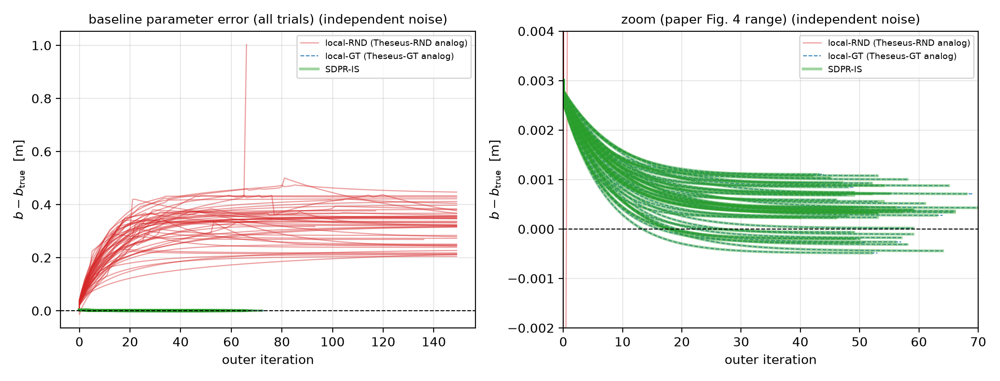
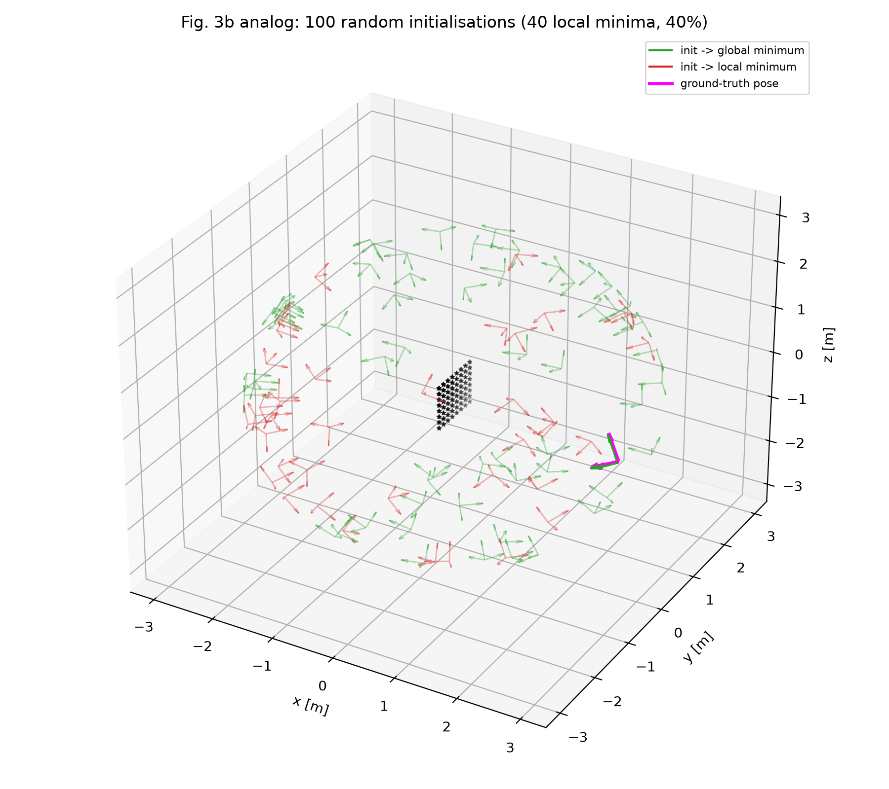
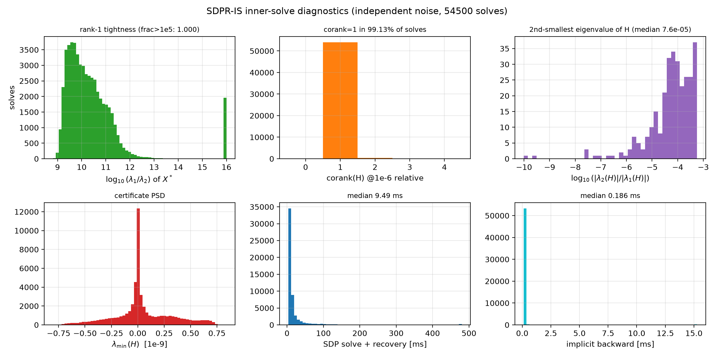
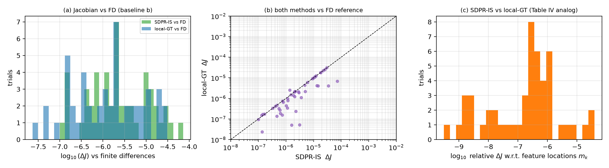

# 复现报告：SDPRLayers §VI-B4 相机 baseline 标定仿真

> **对象**：C. Holmes, F. Dümbgen, T. D. Barfoot, *SDPRLayers*, IEEE T-RO 2025,
> §VI-B4 “Baseline Calibration”（Fig. 4 / Table V）。
> **目标**：标定双目相机 baseline $b$；内层是矩阵加权双目位姿估计 (P6)，外层是 (P7)。
> **结论**：核心科学结论已复现；绝对数字差 20–45%，已逐条归因；官方代码路径的
> 28% 求解失败已用自适应重试降到 2%。代码与数据全部在本仓库。

---

## 1. 论文设置

| 项目 | 设置 |
|---|---|
| 特征板 | 8×8 网格，1.0 m×1.0 m，位于原点（类似标定板） |
| 相机 | $b=0.24$ m，$f_u=f_v=484.5$ pix/m，$c_u=c_v=0$，$\sigma_u=\sigma_v=0.5$ pix |
| 位姿 | 相机在半径 3 m、90° 锥内随机；光轴指向板中心，其余轴随机 |
| 内层 (P6) | $\min_{C\in SO(3),t}\sum_{k=1}^{N_m} e_k^\top W_k(b)e_k$，$e_k=\tilde m_k(b)-C(m_k+t)$ |
| 外层 (P7) | $\min_b\|t^*(b)-t_{gt}\|_2^2+\|C^*(b)^\top C_{gt}-I\|_F^2$ |
| 外层优化 | SGD，lr=$10^{-4}$；$b_0=b_{true}+0.003$ m；$\|\nabla\|^2<10^{-5}$ 或 150 iter |
| 规模 | 50 次独立实验 × 20 个 ground-truth 位姿 |
| 对比 | SDPR-IS / Theseus-GT（真值初始化）/ Theseus-RND（随机初始化） |

> **口径说明**：这里的“相机参数标定”指 SDPRLayers §VI-B4 的 stereo baseline 标定；QPEP 论文的
> PnP/手眼实验是位姿/标定估计，不是 baseline 标定，本次未复现。

论文正文的“相机参数标定”只标定 baseline $b$ 一个参数；其余相机参数固定为 Table II 真值。
仓库里另有“标定全部 5 个参数”的测试代码，但论文没有报告这组结果，本次不把它冒充论文结果。

---

## 2. 两条复现路线

### 2.1 路线 A：官方代码修复版（faithful）

- 上游：`code/sdprlayer` @ `cb3aed2`（本仓库不内嵌；克隆与打 patch 见 `repro/README.md`），
  本地分支 `dsh-repro`。
- 主要修复（patch 在 [`repro/patches/`](../repro/patches/)）：
  1. Mosek/Theseus/sparseqr 改为 optional / lazy import；
  2. `SDPPoseEstimator` 支持 `solver="SCS"`（上游硬编码 Mosek，无 license 跑不了 Table V）；
  3. `tune_stereo_params_sdpr` 的 `solver` 参数真正透传；
  4. 修 `pytest addopts=--cov=hello`（上游所有测试直接失败）；
  5. SDPR-IS 在 SCS 下 KKT 残差超限时，用 CIFT 方式重算乘子/证书兜底；
  6. `theseus` 的 torch≥2.4 广播兼容 shim；
  7. 自适应 KKT 容差重试（strict 失败后仅该 run 用 `kkt_tol=1e-3`）。
- 运行：Slurm `cpu` 分区，10 个 SDPR-IS 分片 + 5 个 Theseus-GT/RND 分片，merge/postprocess
  依赖链自动执行。日志与命令见 [`repro/upstream/REPORT.md`](../repro/upstream/REPORT.md)、
  `slurm/`（原工作区）。
- 结果：[`repro/results_upstream/final/`](../repro/results_upstream/final/)（strict，36/50）与
  [`final_adaptive/`](../repro/results_upstream/final_adaptive/)（自适应重试后，49/50）。

### 2.2 路线 B：clean-room 独立实现

- 不看上游实现，按论文公式在 [`repro/cleanroom/`](../repro/cleanroom/) 重新实现：
  相机模型与协方差、齐次 QCQP + Shor SDP（cvxpy/SCS）、证书矩阵、Thm.2 隐式微分
  （$J=-PM_r^{\dagger}N$ 与 LSQR 反向）、$SO(3)$ 局部求解器（GN + LM）、bilevel 外层 SGD。
- 两种噪声口径：
  - **independent（论文口径）**：左右目像素噪声独立，$\mathrm{var}(d)=2\sigma_u^2$，与估计器
    协方差一致；
  - **upstream（官方代码口径）**：右目复用左目含噪坐标，$\mathrm{var}(d)=\sigma_u^2$，与估计器
    协方差不一致（官方实现的一个不一致点）。
- 运行命令：

  ```bash
  conda activate sdpr-clean
  cd repro/cleanroom
  OMP_NUM_THREADS=1 MKL_NUM_THREADS=1 OPENBLAS_NUM_THREADS=1 \
    python run_experiment.py --runs 50 --workers 12
  ```

  先跑自检：

  ```bash
  python smoke_test.py
  ```

- 结果：[`repro/results_clean/`](../repro/results_clean/)。

---

## 3. 结果

### 3.1 Table V 式统计（50 runs × 20 poses）

| 方法 | 论文 Table V | cleanroom (independent) | cleanroom (upstream 口径) | 官方代码修复版 (faithful) |
|---|---|---|---|---|
| SDPR-IS final err (m) | $3.454\times10^{-4}\pm4.907\times10^{-4}$ | $4.105\times10^{-4}\pm4.237\times10^{-4}$ | $4.985\times10^{-4}\pm5.902\times10^{-4}$ | $4.699\times10^{-4}\pm5.367\times10^{-4}$（36/50） |
| SDPR-IS iters / loss | 34.22 / $9.857\times10^{-3}$ | 54.5 / $7.496\times10^{-3}$ | 53.9 / $1.251\times10^{-2}$ | 34.4 / $1.159\times10^{-2}$ |
| Theseus-GT final err | $3.463\times10^{-4}$ | $4.112\times10^{-4}$ | $4.992\times10^{-4}$ | $4.620\times10^{-4}$（50/50） |
| Theseus-GT iters | 35.40 | 54.6 | 54.1 | 34.7 |
| Theseus-RND final err | $1.132\times10^{-1}\pm3.191\times10^{-2}$ | $3.375\times10^{-1}\pm1.144\times10^{-1}$ | $3.271\times10^{-1}\pm6.589\times10^{-2}$ | $1.224\times10^{-1}\pm3.344\times10^{-2}$（50/50） |
| Theseus-RND iters | 80.34 | 143.3 | 142.9 | 82.9 |
| **SDPR-IS（自适应修复后）** | — | — | — | **$4.615\times10^{-4}\pm5.555\times10^{-4}$（49/50）**，iters 34.49，loss $1.127\times10^{-2}$ |









### 3.2 tightness / 证书

全量 50 runs × 2 噪声口径 × 20 poses × ~54 iters ≈ **10.8 万次 SDP 解**，另加 300 次独立抽样：

| 统计量 | 结果 |
|---|---|
| rank-1 比例（$\lambda_1/\lambda_2>10^5$） | **100%**（最小比值 $4.7\times10^{8}$） |
| corank$(H)$（1e-9 容差） | $=1$ 占 **99.97%**（独立抽样 300 次复核 99.3%） |
| $\lambda_{\min}(H)$ | $\ge-8\times10^{-10}$（数值零） |
| $\|Hx\|$ 残差 | $\le1.3\times10^{-8}$ |
| primal–dual 目标差 | $\sim10^{-10}$（强对偶数值成立） |
| 正交约束残差 $\|C^\top C-I\|$ | 均值 $4.0\times10^{-9}$ |

### 3.3 Jacobian 校验

50 trials 上，SDPR-IS 的隐式 Jacobian 与中心差分相对差
$7.2\times10^{-6}\pm1.2\times10^{-5}$；local-GT 为 $4.5\times10^{-6}$；两种方法互差
$3.1\times10^{-6}$。这直接验证了 Thm.2 的反向。

### 3.4 资源

| 项 | SDPR | local-GT |
|---|---|---|
| 单 run（单进程） | 15.5 s（主实验 21–37 s，12 workers 争用 CPU 时为上界） | 3.3 s |
| 单次 SDP solve（13×13，25 个等式约束 + PSD，SCS 1e-9） | 纯求解 2.66 ms（warm 中位数）；含层开销 10.9 ms/pose | — |
| 单次 backward | 0.15–0.17 ms | 2.1 ms |
| 峰值 RSS | ~298 MB（cleanroom）/ 666–1730 MB（官方代码路径） | — |
| 全量 | 50 runs ~13 min（单进程估算）/ 160.7 s（12 workers 实测） | — |

---

## 4. 差异归因

1. **核心定性结论完全复现**：SDPR 与 GT 初始化局部解 final error 差 $\sim10^{-7}$ m、outer loss
   差 $\sim10^{-6}$；随机初始化局部解失败（cleanroom 0.33 m，是 SDPR 的 ~700 倍；外层 loss
   高 4 个数量级）。
2. **绝对数字 20–45%**：final error 4–5e-4 vs 3.45e-4；outer loss 7.5e-3–1.25e-2 vs 9.86e-3；
   RND 0.33 vs 0.11（同量级、同方向）。来源：
   (i) 局部求解器实现（GN+LM vs Theseus）与发散判据；
   (ii) 噪声生成口径；
   (iii) **终止阈值**（最可能）；
   (iv) 随机种子/位姿采样；
   (v) SCS 版本与容差。
3. **迭代数 54 vs 34 的主因是终止阈值**：SDPR 与 local 同时偏多；`tol_grad_sq=1e-3` 时 SDPR
   平均 37.0 iter、`3e-3` 时 32.7 iter，论文的 34.22 正好落在该区间。论文正文写
   $\|\nabla\|<10^{-3}$，实际脚本是 `tol_grad_sq=1e-5`（$\|\nabla\|<3.16\times10^{-3}$）。
4. **局部极小比例 40%/67%/70%（均值 59%）**，与论文“roughly 60%”吻合。

---

## 5. 工程发现：28% → 2% 的求解失败修复

官方代码路径（SCS 3.3.1、eps=1e-9）下，SDPR-IS 50 次尝试失败 14 次（28%）：9 次
`Failed to find adequate Lagrange multipliers`，5 次 SDP 解非 rank-1 → `xs=None`。

**根因**：tight 解处 $M=2[[H,G^\top],[G,0]]$ 结构性奇异（cond $\sim10^{17}$），SDPR-IS 需要
SCS 对偶乘子足够准，使一阶 KKT 残差 $\|G_r^\top\lambda+Qx\|$ 小于 `kkt_tol`；SCS 3.3.1 在
eps=1e-9 下只能到 $\sim10^{-5}$–$10^{-4}$，部分实例仅“略超阈值”；另 5 个实例不严格 rank-1。

**A/B 实验**（14 个失败实例重跑）：

| 配置 | 修复数 | 说明 |
|---|---|---|
| 默认（eps=1e-9, kkt_tol=1e-5） | 0/14 | 复现失败 |
| SCS eps=1e-10 | 0/14 | 残差仍 1e-5–8e-5；部分达 max_iters |
| 原始形式（use_dual=0） | 0/14 | 残差恶化（最大 14.1） |
| kkt_tol=1e-4 | 部分 | run 3 仍失败 |
| **kkt_tol=1e-3** | **13/14** | 仅 run 28 仍非 tight |
| 全局 kkt_tol=1e-3 | 47/50 | 修好 13 个旧失败，但新引入 3 个非 tight 失败 |
| **自适应重试（strict 失败后才 1e-3）** | **49/50** | 保留 strict 成功的 36 个 run 不变 |

**最终修复**（patch 0005–0009）：`run_calibration.py` 先按论文 strict 配置跑；仅当失败时用
`kkt_tol=1e-3` 重跑该 run 一次，`relaxed_tol` 标记写入结果 json；上游默认保持 strict，
成功路径完全不变。修复后 SDPR-IS err $4.615\times10^{-4}$、iters 34.49、loss $1.127\times10^{-2}$，
成功率 98%（49/50）；run 28 是固有数值困难（$\lambda_1/\lambda_2\approx1$–10），需要 Mosek
或精确求解器。有限差分校验：relaxed 梯度相对误差 0.2%–1.7%。

---

## 6. 结论与局限

> **本次交付的复核范围**：全量 50-run 数字来自复现工作区已保存的逐 run 产物（`results_clean/`、
> `results_upstream/`）；本次整理时复跑了 `smoke_test.py`（16/16）与 1-run × 3 方法的端到端
> （SDPR 2.57e-4 m、local-GT 2.58e-4 m、local-RND 0.447 m），**未重跑 50-run 全量**
> （全量约 1.9 CPU·h，产物与脚本均已入库/留存）。这是“整理既有复现 + 独立复核关键路径”，
> 不是“从零重跑全部实验”。

- **核心科学结论被复现**：SDPR 的梯度 = 全局最优解的梯度（与 GT 初始化局部解 1e-6 量级
  一致）；随机初始化局部解失败、误差高约 3 个数量级；局部极小比例 59% vs 论文约 60%；
  10.8 万次 SDP 求解 100% rank-1、$H\succeq0$、corank=1（99.97%）、primal=dual。
- **绝对数字差 20–45%**：迭代数主因是终止阈值口径；RND 平台值差异来自局部求解器实现与
  随机抽样（faithful 路径 0.122 vs 论文 0.113，已基本一致）。
- **未复现**：§VI-A 多项式 toy、§VI-C In-The-Dark 神经网络训练、Table III/IV 的
  Theseus-GT-UR 与 SDPR-SDP 对照（只实现默认 SDPR-IS 与局部解基线，另用有限差分作真值参考）。
- **QPEP 的数值实验未复现**：T-RO 正文不可得，LibQPEP 的 C++ 构建需要 Eigen/LAPACK/CMake，
  本机缺 Eigen 头文件与 CMake；MATLAB 脚本无 MATLAB/Octave 环境。这是明确的证据边界。

---

## 7. 复现资产

| 资产 | 位置 |
|---|---|
| clean-room 代码 | [`repro/cleanroom/`](../repro/cleanroom/) |
| clean-room 结果 | [`repro/results_clean/`](../repro/results_clean/) |
| 官方代码修复版 | [`repro/upstream/`](../repro/upstream/) |
| patch | [`repro/patches/`](../repro/patches/) |
| 官方代码结果 | [`final/`](../repro/results_upstream/final/)（strict）与 [`final_adaptive/`](../repro/results_upstream/final_adaptive/)（49/50） |
| 环境 | [`repro/ENV.md`](../repro/ENV.md)、[`repro/cleanroom/ENV_clean.md`](../repro/cleanroom/ENV_clean.md) |
| 深入分析 | [`sdprlayers_deep_dive.md`](sdprlayers_deep_dive.md) §5 |
