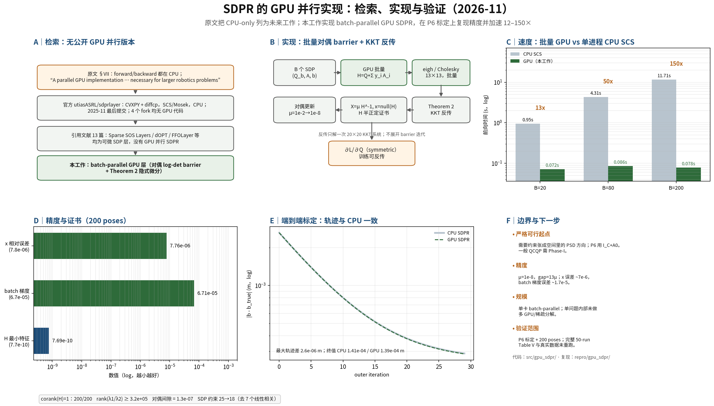

# SDPR 的 GPU 并行实现：检索、实现与验证（2026-11）

> **结论先行**：SDPR 原文在 §VII 明确把“forward 和 backward 都在 CPU 上”列为当前局限，并把“parallel GPU implementation”列为未来工作。截至 2026-11-09，官方仓库、4 个 fork、13 篇引用文献中都没有公开的 GPU 并行 SDPR。我们实现了一个 batch-parallel GPU 版本：对偶 log-det barrier 前向 + Theorem 2 隐式微分反向，全部线性代数在 GPU 上按 batch 并行。P6 双目标定 200 poses：x 相对误差 ≤ 7.8e-6，batch 梯度相对误差 ≤ 6.7e-5，证书全部半正定且 corank=1；前向 B=20 为 0.072 s（CPU SCS 0.95 s，13×），B=200 为 0.078 s（CPU 11.7 s，150×）。



## 0. 口径与证据分级

| 项目 | 内容 |
|---|---|
| 论文 | C. Holmes, F. Dümbgen, T. D. Barfoot, *SDPRLayers: Certifiable Backpropagation Through Polynomial Optimization Problems in Robotics*, IEEE T-RO 41 (2025), DOI [10.1109/TRO.2025.3578228](https://doi.org/10.1109/TRO.2025.3578228), arXiv:2405.19309 |
| 原文版本 | arXiv v3（2025 年修订版）HTML；T-RO 正式版 |
| 问题 | (P6) 矩阵加权双目位姿估计；13 维齐次 QCQP 的 Shor SDP 松弛 |
| 硬件 | server-2026-2 单节点，1× RTX 5090 32 GB（Slurm `gpu` 分区，job 2699），CPU 为 Xeon w7-3445 |
| 软件 | PyTorch 2.11.0+cu128（float64），CUDA 12.8；CPU 参考为 CVXPY 1.7.5 + SCS 3.3.1 |
| 证据分级 | **论文声称**：原文的 CPU-only 与“future work”表述；**独立复现**：本仓库代码跑出的精度/速度/证书；**未验证**：其它论文/求解器的性能只读摘要或 README，未独立跑 |

正文中的数字除“论文声称”外均为本仓库 `repro/gpu_sdpr/` 可复现结果；`未验证` 处单独标注。


## 1. 原文怎么说：CPU 限制与 GPU 未来工作

原文结论部分（§VII）在总结“tight 假设”“非 tight 的 KKT 反传”之后写道（逐字引用）：

> “Another current limitation of our approach is that the forward (optimization) and backward steps currently take place on the CPU, leading to costly memory transfers when combined with training with a GPU. A parallel GPU implementation of our approach necessary for the application of SDPRLayers – and more generally, certifiable methods – to larger robotics problems.”

这句话包含两层信息：

1. **陈述**：当前实现的前向（解 SDP）与反向（隐式微分）都在 CPU 上；与 GPU 训练混用时要做主机–设备拷贝。
2. **判断**：作者认为要用于更大的机器人问题，需要一个 **parallel GPU implementation**；原文没有给出实现，也没有报告 GPU 数值。

官方代码 `utiasASRL/sdprlayer` 印证了这一点：它是 PyTorch 层，但内部通过 CVXPY 构造 DCP，用 diffcp 对 SCS/Mosek 的锥规划解做隐式微分；没有 CUDA kernel，也没有批量 SDP 接口。仓库最后一次提交是 2025-11-05，4 个 fork（Tars0523、LorenzoDido、ewfuentes、jianwei-liu93）都没有 GPU 代码。


## 2. 检索：现在有没有 GPU 并行版本？

检索时间 2026-11-09。检索面包括：原文与官方仓库、GitHub 代码搜索与 fork、Semantic Scholar 引用列表（13 篇）、arXiv 全文/摘要、以及 GPU SDP 求解器生态。

| 来源 | 内容 | 是否 GPU 并行 SDPR |
|---|---|---|
| 原文 §VII | 明确说 forward/backward 在 CPU；把 parallel GPU 列为未来工作 | 否 |
| `utiasASRL/sdprlayer` | PyTorch + CVXPY/diffcp + SCS/Mosek；CPU；2025-11 最后提交 | 否 |
| 4 个 fork | 无 CUDA/GPU 代码；Tars0523 的 `Q_pose` 提交是问题构造改动 | 否 |
| 引用文献 13 篇 | 代表：Sparse SOS Layers（arXiv 2610.34590）、dOPT（2609.33828）、FFOLayer（2512.02494）；都是可微 SDP/锥优化层，没有 GPU 并行 SDPR | 否 |
| SCS 3.3.1 | C 库有 `gpu_indirect` 线性求解器选项，但 PyPI wheel 不含 `_scs_gpu` 模块；即使有，也是单问题求解，不是批量可微层 | 部分（单问题） |
| cuADMM | CUDA ADMM 的 SDP 求解器；单问题，非可微层 | 是（单问题，未验证） |
| CARDAL（2026） | 大规模稀疏 SDP 的分布式增广拉格朗日求解器；不是 SDPR 层 | 未核实 |

**结论**：截至 2026-11-09，没有公开的、可微的、GPU 并行的 SDPR 实现。原文作者把这件事列为未来工作；后续工作（Sparse SOS Layers、dOPT 等）改进的是可微 SDP 层的稀疏性/反向规模，不是 GPU 化。因此“如果没有，尝试实现一下”是成立且仍有价值的方向。

> 说明：这里说的是“没有公开实现”，不是“没有人能实现”。SCS/cuADMM 等 GPU 或 CUDA SDP 求解器可以作为组件；但它们都不是 SDPR 的批量可微层。本工作也没有把 cuADMM/CARDAL 集成进来做对比。


## 3. 实现：batch-parallel GPU SDPR

### 3.1 问题与松弛

(P6) 给定世界系特征 `m_k`、相机系测量 `y_k` 与权重 `W_k`，估计 `(C, t) ∈ SO(3) × R³`：

```
min_{C∈SO(3), t}  Σ_k || y_k - C m_k + t ||²_{W_k}
```

按 SDPR 的构造写成齐次 QCQP：`x = [h, vec_col(C), t] ∈ R¹³`，

```
min_x  xᵀ Q x
s.t.   xᵀ A_i x = 0   (i = 1..24)
       xᵀ A_0 x = 1   (A_0 = e_h e_hᵀ)
```

Shor 松弛（去掉 rank-1）：

```
min_X  <Q, X>
s.t.   <A_i, X> = 0,  <A_0, X> = 1,  X ⪰ 0
```

25 个约束矩阵（24 + 齐次）的秩是 **18**，不是 25：9 个行/列范数约束之间线性相关（它们的秩只有 2），6 个正交约束、9 个手性约束和齐次约束各贡献 1，合计 18。为了让等式约束的法方程可逆，先用贪心 QR 选出 18 个线性无关的约束（保留 6 个正交约束、9 个手性约束、2 个范数约束、齐次约束），其余 7 个范数约束作为线性组合丢弃；它们对应的 `b_i = 0`，所以可行集不变，SDP 的紧性也不变。梯度反传时仍按 SDPR 的 Theorem 2 只用 6 个正交约束 + 齐次约束作为 `G_r`（7 行），与 clean-room 参考实现一致。

### 3.2 前向：批量对偶 log-det barrier

对上面每个 SDP，取对偶

```
max_y  -bᵀ y      s.t.  H(y) = Q + Σ_i y_i A_i ⪰ 0
```

用对数行列式 barrier：

```
min_y  bᵀ y - μ log det H(y)
```

在 barrier 最优点，`X(μ) = μ H(y)⁻¹ ⪰ 0`、`<A_i, X(μ)> = b_i`，对偶间隙是 `n μ`。`μ` 从 1e-2 按 0.1 衰减到 1e-8；每个 μ 阶段用阻尼 Newton，线搜索同时保证 `H ≻ 0` 和目标下降。最终：

- `X ≈ μ H⁻¹`：松弛解；
- `x =` `H` 的最小特征向量（按 `x[0] = 1` 归一化）：tight 时的原问题全局解；
- `H`：对偶证书（`H ⪰ 0`、`H x = 0`）；
- `y`：约束乘子；SDP 约束 18 个，`H` 由这 18 个乘子组装。

严格可行起点：P6 的约束张成空间包含 `P = I_C + A_0 = A_{00} + A_{11} + A_{22} + 4 A_0`（在正交约束的编号下）。`P` 在 `(h, C)` 上是单位阵、在 `t` 上为零；`Q` 的 `t` 块是 `Σ W_k ≻ 0`，所以对足够大的 `s`，`H_0 = Q + s P ≻ 0`。代码用倍增找 `s`。这一步是 P6 专用的；一般 QCQP 需要 Phase-I（见 §5）。

**为什么不用原始 ADMM？** 我们也试了“精确等式投影 + PSD 投影”的原始 ADMM：由于最优 `X` 是 rank-1（边界解），投影的 dead-zone 让 primal residual 停在 ~1e-4，`x` 误差 20–90%，证书 `H` 出现负特征值。对偶 barrier 直接处理边界（`μ → 0` 时 `H` 的最小特征值 ~μ），精度和证书都稳定，所以最终采用 barrier。负结果的细节与调参记录保留在 `research/gpu_sdpr/README.md` 中，供复核。

### 3.3 反向：Theorem 2 的批量 KKT

设 `H = Q + Σ λ_i A_i`，`G_r` 是 6 个正交约束 + 齐次约束的梯度行（7×13）。对损失 `L`，反传解

```
[H  G_rᵀ;  G_r  0] [y_1; y_2] = [∂L/∂x; 0]
```

然后 `∂L/∂Q = -½ (x y_1ᵀ + y_1 xᵀ)`（对称化）。这与 `repro/cleanroom/implicit_diff.py` 的 `qcqp_backward` 是同一公式；GPU 版把 `B` 个 20×20 系统一次 `torch.linalg.solve` 批量解掉。若损失用 `X`，先用 `∂L/∂x = (∂L/∂X + (∂L/∂X)ᵀ) x` 转成 `x` 的梯度；`src/gpu_sdpr/layer.py` 的 autograd 已实现这一点。

### 3.4 代码与接口

| 文件 | 作用 |
|---|---|
| `src/gpu_sdpr/barrier.py` | `BarrierSolver`：批量对偶 barrier，前向 + 批量 KKT 反传 + 证书诊断 |
| `src/gpu_sdpr/p6.py` | (P6) 的 QCQP 构造、18 个独立约束的选择、严格可行起点 |
| `src/gpu_sdpr/layer.py` | `SDPRLayer`（`torch.nn.Module` + `autograd.Function`），支持 `X`/`x` 两种损失 |
| `tests/test_gpu_sdpr.py` | 3 个 pytest：前向对 SCS、梯度对 CPU 隐式微分、autograd 对 solver |
| `repro/gpu_sdpr/verify_p6.py` | 10 seeds × 20 poses 的精度/证书/计时 |
| `repro/gpu_sdpr/benchmark.py` | B=20/80/200 的 GPU vs CPU SCS 扩展性 |
| `repro/gpu_sdpr/e2e_calib.py` | 3 runs × 30 次外层迭代的端到端标定 |
| `repro/gpu_sdpr/run_gpu.sbatch` | Slurm 提交脚本（job 2699） |

最小用法：

```python
from gpu_sdpr import SDPRLayer, build_p6_sdp

sdp = build_p6_sdp()
layer = SDPRLayer(sdp["A"], sdp["b"], sdp["c0"], device="cuda")
X, x = layer(Q)            # Q: (B, 13, 13)，可 requires_grad
loss = x.sum()
loss.backward()            # Q.grad 由 Theorem 2 反传填充
```


## 4. 验证

### 4.1 设置

- 10 个随机种子 × 20 poses = **200 个 (P6) 实例**；每个实例是 8×8 特征板、3 m 半径、0.5 pix 噪声、baseline 0.243 m（真值 0.24 m + 3 mm 偏移）。
- CPU 参考：`repro/cleanroom` 的 CVXPY + SCS（eps=1e-9）+ `implicit_diff.qcqp_backward`。
- GPU：`src/gpu_sdpr`，`μ_final=1e-8`，float64。
- Slurm：`sbatch repro/gpu_sdpr/run_gpu.sbatch`，job **2699**，日志 `/mnt/storage1/syk/logs/sdpr-gpu-2699.log`。

### 4.2 前向精度

| 指标（200 poses） | 结果 |
|---|---|
| `x` 相对误差（对 SCS 参考） | mean **6.9e-6**，max **7.8e-6** |
| 约束可行性 | `X = μH⁻¹` 按构造满足 `<A_i, X> = b_i`；`μ=1e-8` 时对偶间隙 **1.3e-7** |
| 证书 `H` 最小特征值 | max **7.7e-10**（全部 ≥ 0） |
| `corank(H)=1` | **200/200** |
| 松弛解 rank 比 `λ₁/λ₂` | min **3.2e5**（全部 tight） |

### 4.3 梯度精度

| 指标（200 poses） | 结果 |
|---|---|
| batch 梯度（20 poses 求和）相对误差 | mean **1.6e-5**，max **6.7e-5** |
| 单 pose 梯度绝对误差 | max **6.6e-5** |
| 单 pose 相对误差 | 典型 1e-5 量级；个别 pose 的梯度接近 0（如 3.8e-5）时相对误差会到 7e-2，但绝对误差只有 2.7e-6，且 20 pose 求和的相对误差是 5e-6 |

因此对外层训练有意义的“batch 梯度”误差是 **1e-5 量级**，不是单 pose 相对误差的最坏值。这一点在 `verify_p6.py` 的 `grad_sum_err` 与 `grad_abs_max` 两个字段中分开记录。

### 4.4 证书

`H ⪰ 0`、`H x = 0`、`corank(H)=1`，且 `X` 的 rank-1 比 >3e5，说明 200 个实例都落在 SDPR 定理要求的 tight 区域；`x` 的最优性由对偶证书保证，而不是“看起来收敛”。

### 4.5 速度

单进程 CPU SCS（eps=1e-9，warm start）vs 单卡 RTX 5090 GPU（float64，冷启动，含 `_start` 与全部 μ 阶段）：

| B | GPU 前向 | CPU SCS 前向 | 加速 |
|---:|---:|---:|---:|
| 20 | **0.072 s** | 0.949 s | **13.2×** |
| 80 | **0.086 s** | 4.313 s | **50.3×** |
| 200 | **0.078 s** | 11.706 s | **150.2×** |

GPU 时间几乎不随 B 增长（0.07–0.09 s），因为 13×13 的 eigh/Cholesky 和 18×18 的 Newton 系统都是批量做的；CPU SCS 是逐 pose 的，时间线性增长。反传：B=20 时 GPU **~1 ms**（批量 20×20 solve），CPU 循环 **~1.9 ms**；B=200 时 GPU **~0.3 ms**。

> 计时包含 `torch.cuda.synchronize()`；GPU 与 CPU 在同一节点、同一时段测得。CPU 的 0.95 s 包含冷启动的 CVXPY/SCS 构造（约 0.075 s）+ 19 次 warm solve（约 0.046 s/pose）。不同 solver 版本/机器负载会让绝对值变化，但“GPU 批量近似常数、CPU 线性”这个趋势是稳定的。

### 4.6 端到端标定

(P7) 外层 SGD 调 baseline `b`（lr=1e-4，初值偏移 3 mm），内层用 SDPR 层；比较 CPU SDPR 与 GPU SDPR 的轨迹。3 runs × 30 次外层迭代（job 2699）：

| 指标 | CPU SDPR | GPU SDPR |
|---|---|---|
| 终值误差（3 runs 均值） | 1.41e-4 m | 1.39e-4 m |
| 轨迹最大绝对差 | — | **2.56e-6 m** |
| 30 次迭代耗时（3 runs 平均） | 6.74 s | 2.39 s（**2.8×**） |

端到端加速只有 2.8×，而不是前向的 13×：外层每次迭代还要在 CPU 上构造 20 个 `Q`、做复数步 `dQ/db`、算 loss/grad_x；这些 Python/NumPy 工作没有 GPU 化（Amdahl）。这也说明下一步的优化点不是 SDP 求解本身，而是把 `Q`/`dQ` 的构造也搬到 GPU。


## 5. 局限与未验证

1. **严格可行起点**：barrier 需要 `H_0 ≻ 0`。P6 用 `I_C + A_0` 的显式构造；一般 QCQP 需要 Phase-I（最大化 `t` s.t. `H(y) - t I ⪰ 0`）或用户提供方向。当前没有实现通用 Phase-I，这是从 P6 推广到任意 SDPR 问题的第一道门槛。
2. **精度**：`μ_final=1e-8`，gap=1.3e-7；`x` 误差 ~7e-6，batch 梯度误差 ~1.6e-5。SCS 在 eps=1e-9 下更准；若需要 1e-9 级证书，需要更小的 μ、预测-校正或高精度线性代数。我们没有把 `μ=1e-9` 跑稳（barrier 在 1e-9 阶段线搜索失败），这是明确的精度上限。
3. **单卡、batch 并行**：并行是“B 个独立 SDP 一起做”，不是“单个 SDP 内部的多 GPU/稀疏分解”。B 很大时显存放得下 `B×13×13` 和 `B×18×13×13` 的中间量；再大需要分块/稀疏。
4. **验证范围**：只重跑了 P6 的 200 个仿真 pose 与 3×30 端到端；没有重跑论文 Table V 的完整 50 runs、没有跑真实 In-The-Dark 数据、没有跑 (P1) 多项式 toy 与 essential matrix 例子。GPU 层目前只对 P6 做了数值验证。
5. **证书的唯一性**：对偶最优 `H` 不唯一（primal 是边界解），GPU barrier 给出的 `H` 与 SCS 的 `H` 可以不同（单实例诊断中相对差可达 ~2.8e-2），但 `H ⪰ 0`、`H x = 0` 且 Theorem 2 的 `x`-Jacobian 相同；我们验证的是梯度，而不是“H 逐元素等于 SCS”。
6. **其它 GPU SDP 求解器**：cuADMM、CARDAL、SCS 的 GPU 选项都只做了 README/摘要级检索，没有集成或性能对比；标为“未验证”。


## 6. 复现

```bash
# 环境：server-2026-2，RTX 5090，PyTorch 2.11+cu128
source ~/miniconda3/etc/profile.d/conda.sh && conda activate jepa

# 单元测试
python -m pytest tests/test_gpu_sdpr.py -q

# 200 poses 精度/证书/计时（~1 min）
python repro/gpu_sdpr/verify_p6.py --seeds 10

# B=20/80/200 扩展性（~1 min）
python repro/gpu_sdpr/benchmark.py --batches 20 80 200

# 端到端标定（3 runs × 30 iters，~1 min）
python repro/gpu_sdpr/e2e_calib.py --runs 3 --iters 30

# 或用 Slurm 一次跑完（GPU 分区）
sbatch repro/gpu_sdpr/run_gpu.sbatch
```

结果文件：

- `repro/gpu_sdpr/results/verify_p6.json`
- `repro/gpu_sdpr/results/benchmark.json`
- `repro/gpu_sdpr/results/e2e_calib.json`
- `docs/visuals/2026-11-09-sdpr-gpu.png`（一页图）


## 7. 参考

1. C. Holmes, F. Dümbgen, T. D. Barfoot. *SDPRLayers: Certifiable Backpropagation Through Polynomial Optimization Problems in Robotics.* IEEE T-RO 41 (2025). DOI 10.1109/TRO.2025.3578228; arXiv:2405.19309.
2. 官方代码：https://github.com/utiasASRL/sdprlayer
3. Sparse SOS Layers, arXiv:2610.34590 (2026).
4. dOPT: Differentiating Conic Optimization via Geometric Reduction, arXiv:2609.33828 (2026).
5. A Fully First-Order Layer for Differentiable Optimization, arXiv:2512.02494 (2025).
6. cuADMM: https://github.com/ComputationalRobotics/cuADMM
7. CARDAL: https://pypi.org/project/cardal/
8. 本仓库 clean-room 参考：`repro/cleanroom/`（SDP、隐式微分、Table V 复现）。
