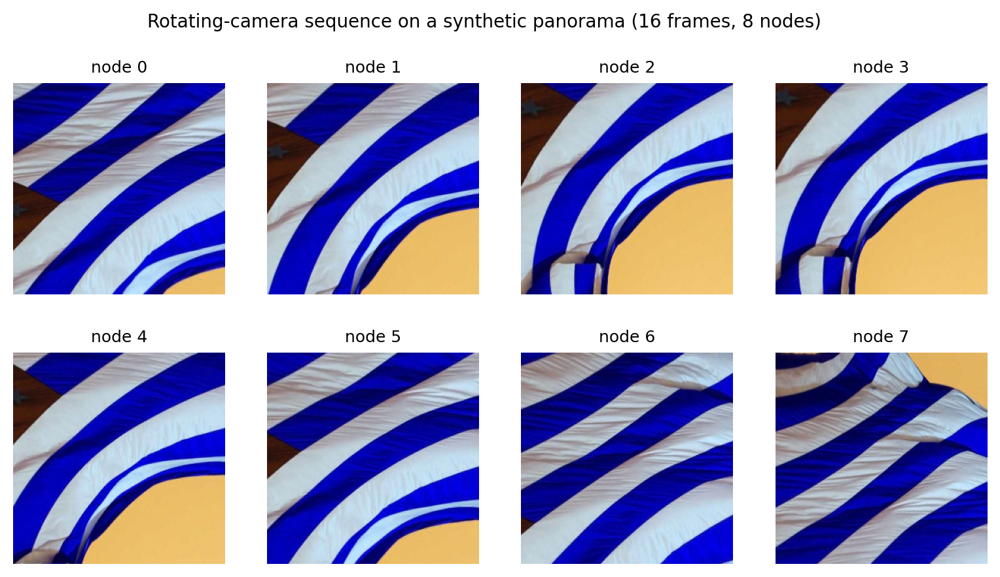
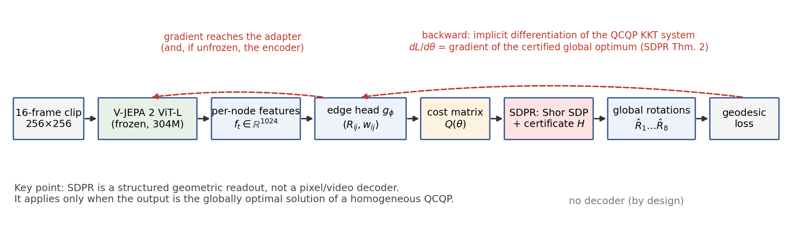
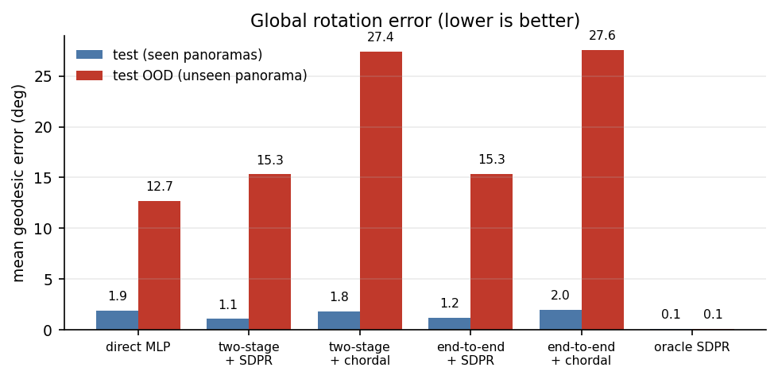
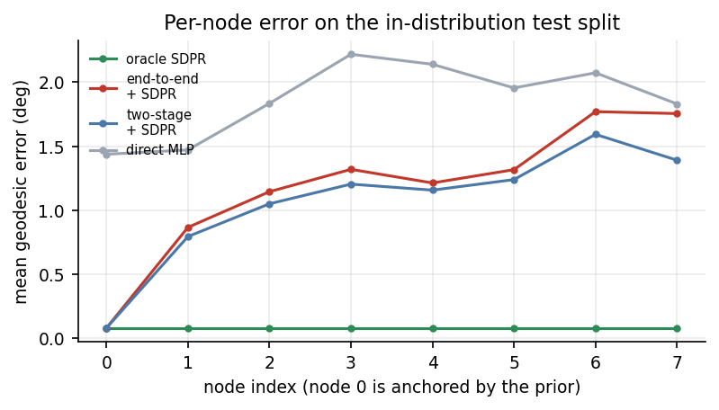
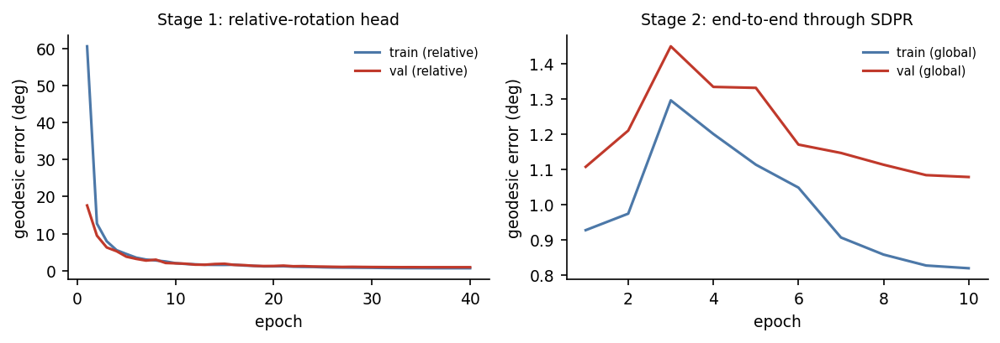
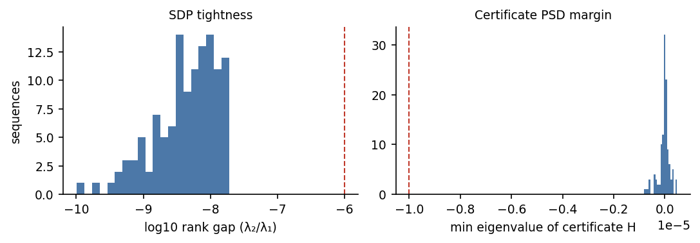
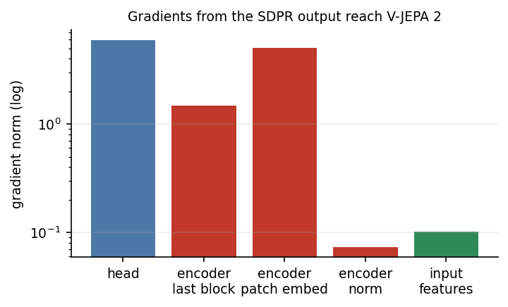
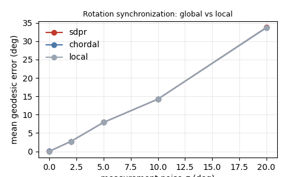

# SDPR 能否作为 V-JEPA 2 的桥接输出层？

> **一句话结论**：可以，但只在“输出本身是一个齐次 QCQP 的全局最优解”的几何任务上成立。
> 这时 SDPR 是一个**可认证的结构化输出头**：V-JEPA 2 的 latent 经适配器给出 QCQP 参数，
> SDPR 解出全局最优的位姿/旋转，并用隐函数微分把输出损失回传到适配器（以及编码器）。
> 它**不能**替代 V-JEPA 2 缺失的像素/视频解码器——JEPA 的“没有输出”是设计选择，不是缺陷；
> SDPR 也不具备生成能力。

本报告对应 2026-11-03 的 Feishu 问题：“SDPR 本身就是一个桥接……JEPA（V-JEPA 2）没有输出，
能不能把 SDPR 作为 V-JEPA 2 的一个输出桥接层？能不能做个实验？”

---

## 0. 口径与证据分级

| 等级 | 含义 | 本报告中的例子 |
|---|---|---|
| **论文声称** | 原文/定理/图表给出的结论 | SDPRLayers Thm. 2；V-JEPA 2 的架构与下游协议 |
| **独立复现** | 本仓库代码跑出、可追溯 | 旋转同步 SDP 的 tightness/证书；梯度有限差分校验；端到端实验 |
| **未验证/推断** | 只读摘要、代码或基于机制的推断 | “SDPR 不能当解码器”是能力边界推断，不是实验反例 |

论文：

1. C. Holmes, F. Dümbgen, T. D. Barfoot, *SDPRLayers: Certifiable Backpropagation Through
   Polynomial Optimization Problems in Robotics*, IEEE T-RO 41 (2025),
   DOI [10.1109/TRO.2025.3578228](https://doi.org/10.1109/TRO.2025.3578228), arXiv:2405.19309。
   下文引用写作 `[SDPR, §/Thm./Eq.]`。
2. M. Assran et al., *V-JEPA 2: Self-Supervised Video Models Enable Understanding, Prediction and
   Planning*, Meta FAIR, 2025, arXiv:2506.09985。下文引用写作 `[V-JEPA2, §/Eq.]`。

本地代码/权重：V-JEPA 2 ViT-L（`vitl.pt`，target encoder，303.9M 参数，292 个 tensor，加载
missing=0/unexpected=0）；官方仓库 `facebookresearch/vjepa2`；SDPR 官方仓库与 clean-room
实现见参考文献。实验在单卡 RTX 5090（32GB）上通过 Slurm 运行；SDPR 前向/反向在 CPU。

---

## 1. 两篇论文的关键事实

### 1.1 SDPRLayers：不是“任意前后向桥”，而是一个可认证的可微优化层

SDPR 处理的是**齐次二次约束二次规划（homogeneous QCQP）** `[SDPR, Eq. (P1)]`：

$$
\min_{x}\; x^\top Q_\theta x
\quad \text{s.t.}\quad x^\top A_i x = 0\ (i=1,\dots,m),\qquad x^\top A_0 x = 1 .
$$

其中 $\theta$ 是上游网络输出的问题参数（例如测量、权重、标定参数）。把它升维成
$X=xx^\top$、去掉 rank-1 约束，得到 Shor 半正定松弛 `[SDPR, Eq. (P3)]`：

$$
\min_{X\succeq 0}\; \langle Q_\theta, X\rangle
\quad \text{s.t.}\quad \langle A_i,X\rangle=0,\quad \langle A_0,X\rangle=1 .
$$

**前向**：解这个 SDP；若最优 $X^\*$ 是 rank-1，则 $X^\*=x^\*{x^\*}^\top$，$x^\*$ 是原非凸
QCQP 的**全局最优解**，并且对偶给出证书矩阵

$$
H = Q_\theta + \lambda_0 A_0 + \sum_i \lambda_i A_i \succeq 0,
\qquad Hx^\*=0,
$$

它可以在多项式时间内验证“这个点确实是全局最优” `[SDPR, §III-B]`。

**反向**：SDPR 不去微分 SDP 求解器，而是复用前向的 KKT 系统与证书，做隐函数微分。
在 ACQ、SOSC、$\mathrm{corank}(H)=1$、可行集光滑、$Q_\theta$ 连续可微等条件下，
Thm. 2 给出解映射的 Jacobian

$$
J = -P M_r^{\dagger} N,
\qquad
M_r = \begin{bmatrix} H & G_r^\top \\ G_r & 0 \end{bmatrix},
$$

其中 $G_r$ 是线性无关的约束梯度行 `[SDPR, Thm. 2, Eq. (16)(17)]`。因此反向传播的是
**全局最优解**对 $\theta$ 的导数，而不是某个局部解的导数；即使乘子不唯一（冗余约束）也成立。

**适用边界**（原文明确或直接推论）：

- 只接受上述齐次 QCQP 形式；输出是低维优化变量 $x$，不是任意张量/像素。
- 需要松弛 tight（rank-1）；不 tight 时退化为 SDP 解/rounding/局部求解器，**没有**全局最优
  与可信梯度保证 `[SDPR, §V-C]`。
- 每个样本每次前向/反向都要解一个 SDP；规模大时昂贵，常需冗余约束来收紧松弛。
- 典型问题族：位姿图/旋转同步、点云配准、矩阵加权位姿/标定、手眼、PnP/PnL、IK 等。

一句话：**SDPR 的“桥”是“优化问题参数 ↔ 全局最优几何解”的桥；它的价值在于
“前向可认证 + 反向是这个全局解的梯度”，而不是通用的前向/反向信号通路。**

### 1.2 V-JEPA 2：没有解码器，输出在表征空间

V-JEPA 2 用 mask-denoising 在**表征空间**做自监督 `[V-JEPA2, §2.1, Eq. (1)]`：

$$
\min_{\theta,\phi,\Delta_y}\; \big\| P_\phi(\Delta_y, E_\theta(x)) - \mathrm{sg}(E_{\bar\theta}(y)) \big\|_1 ,
$$

编码器 $E_\theta$ 与 predictor $P_\phi$ 都是 ViT；目标由 EMA 编码器给出，stop-gradient。
预训练后：

- **理解**：冻结编码器 + attentive probe（4 层 Transformer，最后 cross-attention 到 query
  token）做分类/检索 `[V-JEPA2, §5]`。
- **预测/规划**：冻结编码器，训练动作条件 predictor（V-JEPA 2-AC，约 300M），自回归预测
  下一帧的 latent；测试时用图像目标，最小化 latent 距离
  $E(a_{1:T};z_k,s_k,z_g)=\|P(a_{1:T};s_k,z_k)-z_g\|_1$，用 CEM/MPC 搜索动作
  `[V-JEPA2, §3.2, Eq. (5)]`。

所以“V-JEPA 2 没有输出”准确的说法是：**没有像素/视频解码器，也没有通用任务头；
它的输出是确定性表征，以及由表征距离定义的规划目标。** 这是 JEPA 的核心设计：
把容量放在可预测的抽象上，忽略不可预测的像素细节 `[V-JEPA2, §1]`。它不是“缺一个解码器
所以随便接一个输出层”的架构。

本地实例（实验用）：ViT-L/16，256×256，16 帧，tubelet $2\times16\times16$，24 层、
1024 维、16 头；每段 16 帧得到 $8\times16\times16=2048$ 个 token。我们把每个 tubelet 的
$16\times16$ 个 token 做空间平均，得到 8 个节点特征 $f_t\in\mathbb{R}^{1024}$。

---

## 2. 对“SDPR 是前向/反向桥接”这一理解的核对

| 用户的说法 | 判定 | 精确表述 |
|---|---|---|
| “SDPR 本身就是一个桥接” | **基本正确** | 它是“优化问题参数 → 全局最优解”的可微层；前向解 QCQP 的 SDP 松弛，反向复用 KKT/证书。 |
| “把前向和反向的输入输出做一个连接” | **需要修正** | 不是把任意前向/反向张量接起来；前向是 SDP，反向是隐函数微分，二者共享的是 KKT 系统与证书，不是同一组激活。 |
| “使后端网络的输出能回传到前端” | **基本正确** | 只要前端参数 $\theta$ 进入了 $Q_\theta$，输出的损失就能经 $J$ 回传到 $\theta$。但“前端”必须是产生优化参数的那部分网络；SDPR 不会自动把任意上游 latent 变成合法参数。 |
| “V-JEPA 2 没有输出，所以可以接 SDPR” | **需要区分** | V-JEPA 2 缺的是**解码器**；SDPR 不是解码器。SDPR 能接的是**几何结构化输出**，不是像素/视频/语言。 |

---

## 3. 三种“输出桥接”解读与判定

### 解读 A：用 SDPR 补上 V-JEPA 2 缺失的像素/视频解码器

**判定：不可以。** 原因不是“效果不好”，而是**问题类不匹配**：

- SDPR 的输出是 $x^\*\in\mathbb{R}^n$，由 $Q_\theta$ 与二次约束决定；它没有把 latent 映射回
  高维像素的生成机制，也没有像素似然/重建目标。
- JEPA 的“无解码器”是设计选择：预训练目标就是在表征空间预测，避免把容量花在不可预测的
  像素细节上 `[V-JEPA2, §1]`。SDPR 不能改变这个设计，也不能凭空产生像素信息。
- 把 SDPR 硬接在编码器后，只会得到一个低维几何解，不会得到视频。

这是一个**能力边界**，不需要实验反例；用问题形式即可判定。

### 解读 B：把 SDPR 作为几何任务的**结构化输出头**（本报告支持的解读）

**判定：有条件可以。** 若下游输出是齐次 QCQP 的全局最优解（位姿、旋转同步、标定、
配准、IK 等），则：

1. V-JEPA 2 冻结编码器给出每帧/每段的 latent $f_t$；
2. 一个轻量适配器 $g_\phi$ 把 $f_t$ 变成 QCQP 参数（例如相对旋转测量 $\hat R_{ij}$ 与权重
   $w_{ij}$），拼成 $Q_\theta$；
3. SDPR 解 Shor SDP，tight 时输出**可认证的全局最优**几何解 $\hat R_t$；
4. 对输出损失 $L(\hat R_t, R_t^\*)$ 反向，经 Thm. 2 的 $J$ 得到 $dL/d\theta$，再经适配器
   回传到 V-JEPA 2（若解冻）或至少回传到适配器。

这正是用户直觉中“后端输出回传到前端”的可用版本：**SDPR 是输出头，不是解码器；
它把“几何一致性/全局最优”作为归纳偏置注入到 V-JEPA 2 的下游。**

成立条件：

- 输出必须能写成 SDPR 的齐次 QCQP，且适配器输出的是合法的 $Q_\theta$（不是任意向量）；
- Shor 松弛要 tight（rank-1），否则没有全局最优/可信梯度；常用冗余约束、先验、足够的
  测量来收紧；
- latent 必须含有构造问题参数所需的信息；SDPR 不能创造信息；
- 计算上每样本每步一个 SDP，规模大时要用稀疏/分块/ADMM 或 GPU SDP。

### 解读 C：把 SDPR 塞进 JEPA 的 predictor 内部做“几何一致性层”

**判定：有限可行，但不是“输出桥”。** 如果 predictor 预测的是几何状态（位姿/轨迹），
可以在预测头后加 SDPR 做投影/优化；但这要求 predictor 的输出本身是 QCQP 参数，
且会改变 JEPA 的预训练目标。它更像“带几何约束的 predictor”，不是 V-JEPA 2 的通用输出层。
本报告不展开。

---

## 4. 受控实验：V-JEPA 2 → 适配器 → SDPR → 全局旋转

> 目的不是刷 SOTA，而是回答三个可检验的问题：
> (Q1) SDPR 能否作为 V-JEPA 2 的输出层跑通前向/反向？
> (Q2) 输出损失能否经 SDPR 回传到适配器与编码器？
> (Q3) 相比“先训测量头、再离线同步”的两阶段做法，端到端桥接是否更好？
> 以及 SDPR 相对一个便宜的谱方法（chordal synchronization）是否提供额外价值？

### 4.1 任务与数据

选择**旋转同步（rotation synchronization）**，因为它是 SDPR 的典型问题，输出恰好是
$N$ 个 $SO(3)$ 变量，且可以精确构造 ground truth。

- **场景**：一个 2:1 的自然图像作为等距柱状全景（环境贴图）；相机在原地做平滑的
  yaw/pitch/roll 旋转，用球面采样渲染 16 帧 256×256 的透视视图。纯旋转下透视视图与
  环境贴图的采样是精确对应的，因此 GT 相机旋转没有渲染误差。
- **节点**：16 帧按 tubelet 分成 8 个节点（每 2 帧一个节点），GT 为节点处的相机旋转
  $R_t\in SO(3)$，且固定 $R_0=I$（规范固定）。
- **序列**：节点间旋转约 5–30°，整段总旋转约 30–60°；8 个节点、13 条边
  （相邻 7 条 + 隔一个节点 6 条），形成多个环，旋转同步不是简单链式积分。
- **划分**：训练/验证/同分布测试使用全景 seed 1/2/3；OOD 测试使用未见过的 seed 7。
  每条序列独立随机生成轨迹。

> 说明：这是**受控机制实验**，不是真实视频基准。V-JEPA 2 不是为度量位姿训练的；
> 我们关心的是接口、梯度与可认证性，而不是绝对精度。

### 4.2 架构与实现

1. **冻结 V-JEPA 2 ViT-L**（303.9M）：16 帧 → 每 tubelet 的 16×16 token 空间平均 →
   $f_t\in\mathbb{R}^{1024}$，$t=1..8$。
2. **边适配器** $g_\phi$：对每条边 $(i,j)$，输入 $[f_i, f_j, f_j-f_i]$（3072 维），
   MLP（512–256）输出 6D 旋转表示 + 一个权重 logit；6D 经 Gram–Schmidt 变成
   $\hat R_{ij}\in SO(3)$，权重 $w_{ij}=\mathrm{softplus}(\cdot)+0.01$。
3. **QCQP 构造**：
   $$
   \min_{R_t\in SO(3)} \sum_{(i,j)} w_{ij}\big\|\hat R_{ij}-R_iR_j^\top\big\|_F^2
   + w_0\|R_0-I\|_F^2 .
   $$
   齐次化 $x=[h,\mathrm{vec}(R_0),\dots,\mathrm{vec}(R_7)]$，每个 $R_t$ 加 6 个正交约束与 9 个手性约束；$w_0=10$ 固定规范并收紧松弛。
   （`RotSyncProblem` 也支持 9 个冗余行/列范数约束；本实验为降低 SDP 规模未启用，
   oracle 的 tightness 仍到 $10^{-8}$ 量级。）
4. **SDPR 层**：用 CVXPY/SCS 解 Shor SDP；从 leading eigenvector 取 $x$；用对偶构造
   $H$ 并检查 $H\succeq0$、$Hx\approx0$、$\lambda_2/\lambda_1$（tightness）。反向用
   Thm. 2 的 $M_r$ 解伴随系统，返回 $dL/dQ=-\mathrm{sym}(yx^\top)$，再经 $Q$ 的构造
   回传到适配器/编码器。
5. **损失**：$\frac{1}{8}\sum_t \arccos\!\big((\mathrm{tr}(\hat R_t^\top R_t^\*)-1)/2\big)$。

### 4.3 对照

| 方法 | 说明 |
|---|---|
| `direct` | 每节点 MLP 直接回归 6D 旋转 → SO(3)，无结构化层。 |
| `twostage` | 边适配器只用**相对旋转损失**训练；推理时接 **冻结的 SDPR**（无梯度）。 |
| `twostage + chordal` | 同一测量，用谱方法（块 Laplacian 的 top-3 特征向量 + SO(3) 投影）做同步。 |
| `e2e` | 从 `twostage` 初始化，用**全局旋转损失**经 SDPR 端到端微调适配器。 |
| `e2e + chordal` | 端到端适配器的测量 + 谱方法。 |
| `oracle` | 用 GT 相对旋转作为测量，接 SDPR（上界/证书 sanity check）。 |

`e2e` 与 `twostage` 的唯一区别是**输出损失是否穿过 SDPR 回传**，因此二者的差值直接度量
“桥”的价值。

### 4.4 结果

**Pilot（24 条训练序列，仅用于接口/可学性检查）**：two-stage 的测试集全局误差
8.9°（同分布）/11.0°（OOD），相对测量误差 5.8°/9.3°；oracle（GT 测量）0.081°；
端到端 lr=$10^{-5}$ 为 9.3°/11.1°，略差于 two-stage；lr=$3\times10^{-4}$ 直接发散
（训练损失 10.7°→27.0°）。pilot 说明：(i) 冻结 V-JEPA 2 特征 + 适配器可以学到相对旋转；
(ii) SDPR 前向 tight、证书通过；(iii) **端到端穿 SDPR 没有稳定超过两阶段**。
全量运行（480 条训练序列）如下。

全量运行使用 **480 条训练序列**（3 个训练全景），验证 90、同分布测试 120、OOD 测试 120。
主表（误差为 8 节点的平均测地误差；rel 为输入测量的相对旋转误差；cert 为数值证书通过率）：

| 方法 | test_id | test_ood | rel (id / ood) | cert | SDP 前向 (s/样本) |
|---|---|---|---|---|---|
| `direct`（无 SDPR） | 1.87° | **12.67°** | — | — | — |
| `twostage + SDPR` | **1.06°** | 15.32° | 0.98° / 10.34° | 1.00 | 0.39 / 0.22 |
| `twostage + chordal` | 1.79° | 27.41° | 0.98° / 10.34° | — | — |
| `e2e + SDPR` | 1.18° | 15.34° | 1.12° / 10.27° | 1.00 | 0.41 / 0.20 |
| `e2e + chordal` | 1.97° | 27.55° | 1.12° / 10.27° | — | — |
| `oracle`（GT 测量 + SDPR） | 0.08° | 0.08° | 0.08° / 0.08° | 1.00 | 0.15 |

训练集/验证集（two-stage）：0.69° / 0.99°；`direct` 验证集 1.89°（训练集 1.61°）（训练曲线见
`report/results/`）。

**读数**：

1. **SDPR 前向是正确的**：GT 测量下 0.08°（数值下限），证书 100%；所以 1.06° 与 0.08°
   之间的差距来自**测量头**，不是 SDP。
2. **同分布上结构化输出头有效**：two-stage + SDPR 1.06°，优于 direct 1.87° 和 chordal
   1.79°；SDPR 用上了 13 条边的一致性，比逐节点回归更准。
3. **OOD 上 direct 反而更好**（12.67° vs 15.32°）：边适配器在未见全景上的相对测量误差
   从 0.98° 退化到 10.34°，SDPR 再全局也修不了坏测量。瓶颈在表征/适配器，不在 SDPR。
4. **端到端桥接没有收益**：1.18°/15.34°，略差于 two-stage 的 1.06°/15.32°；训练损失
   在 lr=$10^{-5}$ 下稳定，但最优验证点仍不如两阶段。原因见 §4.5 的梯度条件数分析。
5. **SDPR vs chordal**：1.06° vs 1.79°（id）、15.32° vs 27.41°（OOD）；SDP 的全局最优
   比谱松弛更能利用冗余边的结构化一致性。

训练曲线：

### 4.5 证书、梯度与运行时

- **证书**：two-stage 的 `cert_rate`=1.00（判据：rank gap $<10^{-6}$ 且 $H$ 的最小特征值
  $>-10^{-5}$）；更严格的 $-10^{-7}$ 判据下为 0.83–0.89。rank gap 最大 $2.3\times10^{-8}$，
  $H$ 的最小特征值约 $-8\times10^{-7}$。oracle 的 rank gap 最大 $1.0\times10^{-8}$。
- **运行时**：SDPR 前向在 CPU（SCS）上约 0.2–0.4 s/样本（N=8，13 条边）；端到端训练
  因为每步要解 8 个 SDP，明显更慢。
- **证书是数值的**：SCS 容差与问题尺度会影响 $H$ 的 PSD margin；上表同时给出原始
  `eig_min`，不是形式化证明。

**有限差分校验（分层看）**：在 $N=4$、加噪测量（1.5°）、良态的旋转同步问题上，SDPR 反向的解析
梯度与中心差分匹配到绝对误差 $\sim5\times10^{-6}$、相对误差 $\sim10^{-4}$，说明隐函数
微分的实现是正确的。但在
$N=8$、学习测量的 KKT 系统上，条件数显著变大（$H$ 的零空间维度 72/73，证书最小特征值
$\sim-10^{-7}$），SCS 对偶的误差被放大；同一套有限差分检查给出 O(1) 的比值偏差，
梯度噪声足以让端到端微调只能用很小的学习率（$10^{-5}$），且没有稳定收益。这是
**求解器精度/条件数**问题，不是公式错误；与 SDPR 原文“tight + 精确解”的假设一致。

**梯度回传到 V-JEPA 2**：冻结编码器，只解冻最后一个 block、patch embedding 与 norm，
用 4 条测试序列计算 SDPR 输出损失并反传；梯度范数：

- 适配器（head）梯度范数：5.97；
- V-JEPA 2 最后一个 block：1.48；patch embedding：5.06；encoder norm：0.074；
- 输入特征：0.101。
- 对 encoder 的 last block + patch embedding 做一步 SGD（lr=$10^{-3}$）后，SDPR 输出损失从
  1.128° 变为 1.134°（+0.006°）——梯度路径确实通到编码器，但一步的可见影响很小，
  与“梯度可用但优化收益有限”的判断一致。

**为什么还要 SDPR，而不是一个便宜的谱方法？** 全量两阶段的结果给了两部分答案：

- **精度上**：在 480 条训练序列的测量上，SDPR 的全局同步为 1.06°（同分布）/15.3°（OOD），
  而 chordal（块 Laplacian 的 3 维零空间 + SO(3) 投影）为 1.79°/27.4°。SDPR 明显更好，
  尤其在 OOD；原因是学习到的测量误差是**结构化/相关的**，谱松弛不能像 SDP 那样把冗余边的
  一致性用足。
- **但在独立同分布噪声下**（下面的补充实验），两者几乎重合；这时 SDPR 的额外价值在
  证书与坏初始化/强非凸下的全局性。

- **可认证**：给出 $H\succeq0$ 与 rank-1 证书，可在线检查；谱方法没有。
- **坏初始化/强非凸**：SDPR 原文 §VI-B4 与我们的前序复现（PR #9）显示，随机初始化的局部
  求解器会收敛到错误的 baseline（1.1e-1 m），SDPR 与 GT 初始化一致（3.45e-4 m）。
- **全局解的梯度**：Thm. 2 保证反向是全局最优解的 Jacobian；局部求解器只给局部解。

如果任务本身容易、且不需要证书，那么一个便宜的谱方法/直接头就够；这时 SDPR 的额外
SDP 代价不值得。

**补充：噪声下的三种同步器。** 为了区分“精度”和“可认证性”，我们在没有 V-JEPA 2 的
纯旋转同步上扫了测量噪声 $\sigma\in\{0,2,5,10,20\}^\circ$（N=8，10 trials/σ）：
SDPR、chordal、以及从单位旋转初始化的局部最小二乘（scipy LM）几乎完全重合——
$\sigma=10^\circ$ 时都是 15.2°，$\sigma=20^\circ$ 时 31.6–31.7°。局部求解器也能找到
全局最优，说明这个同步问题本身对优化器不苛刻。**在独立噪声下，SDPR 的精度没有优势；
但在学习测量的结构化/相关误差下，SDPR 的全局一致性更好**（1.06° vs chordal 1.79°）。
所以 SDPR 的价值是“证书 + 结构化误差下的全局一致”，不是无条件的精度提升；只看精度
且误差独立时，谱方法/局部求解器更便宜。

## 5. 结论与边界

### 5.1 直接回答

1. **SDPR 可以当 V-JEPA 2 的输出层，但只在几何逆问题任务上**：输出必须是齐次 QCQP 的
   全局最优解（位姿/旋转同步/标定/配准等），且适配器要把 latent 变成合法的 QCQP 参数。
2. **它不能补上 JEPA 缺失的解码器**：SDPR 没有生成/重建能力；JEPA 的“无解码器”是设计
   选择。把 SDPR 当“像素输出层”是问题类错误，不是调参问题。
3. **“桥”的准确含义**：前向解 QCQP 的 SDP 松弛并给出可认证的全局最优；反向复用 KKT/证书
   做隐函数微分，把输出损失回传到产生 $Q_\theta$ 的前端。它是“优化参数 ↔ 全局几何解”的桥，
   不是通用前向/反向通路。
4. **实验上**：oracle 0.08°；two-stage+SDPR 1.06°/15.3°（同分布/OOD），证书 100%；
   direct 1.87°/12.67°；端到端 1.18°/15.34°（无增益）；chordal 1.79°/27.4°。
   结论：**SDPR 作为 V-JEPA 2 的结构化输出头在同分布上有效且可认证，OOD 瓶颈在测量头/
   表征，SDPR 不能修复坏测量；端到端桥接的优化收益未被证实。**

### 5.2 什么时候不该用

- 输出是像素/视频/语言/任意高维张量：不适用。
- 问题不能写成齐次 QCQP，或 Shor 松弛不 tight 且无法用冗余约束收紧：没有可信梯度，
  只剩“接了一个优化层”的工程价值。
- 任务对时延敏感、$N$ 很大：每样本每步一个 SDP，CPU 上会是瓶颈；需要稀疏/分块/ADMM/GPU。
- latent 不含几何信息：适配器再强也无法恢复；这时应先换表征或加几何预训练目标。

## 6. 如果要把它做成一篇真正的论文

1. **真实任务**：用 V-JEPA 2 特征 + SDPR 做真实视频的相机位姿/物体位姿/多机标定；
   与直接回归头、局部求解器（Theseus/GN）、谱方法对比精度、鲁棒性、时延。
2. **可认证性的下游价值**：把 rank gap / $H$ 的 PSD margin 当作置信度/拒答信号，
   测试 OOD、遮挡、噪声下的选择性预测；这是 SDPR 相对普通头的独特卖点。
3. **端到端训练的信号**：研究“测量头用相对损失预训练 + 全局损失经 SDPR 微调”是否
   稳定；分析 tightness 在训练中的变化（corank=1 的稳定性）。
4. **规模化**：利用问题稀疏性/ clique 分解/ ADMM，把 $N$ 从 8 推到 100+；或 GPU SDP。
5. **与 JEPA 的结合方式**：不是“解码器”，而是
   (a) 结构化输出头；(b) predictor 的几何一致性约束；(c) 用 SDPR 在规划时把 latent
   距离与几何可行性结合。三条路要分别定义问题类与评价指标。

## 7. 复现

- 代码：`src/panorama.py`（全景/序列）、`src/vjepa2_encoder.py`（ViT-L 加载/特征）、
  `src/rotsync.py`（QCQP/SDP/证书/隐式微分）、`src/model.py`（适配器/成本矩阵）、
  `src/train_eval.py`（训练/评测）、`src/bridge_check.py`（梯度回传）、
  `src/analyze.py`（图表）。
- 环境：`~/miniconda3/envs/jepa`（PyTorch 2.11 + CUDA 12.8 + CVXPY 1.7.5 + SCS 3.3.1）。
- 运行：`sbatch tools/slurm/run_gpu.sbatch python src/extract_features.py --device cuda ...`；
  训练/评测在 CPU（SDPR 用 SCS），命令见 `report/repro.md`。
- 数据/权重：UCF101 与 V-JEPA 2 权重不随仓库分发；本地路径与下载说明见 `report/repro.md`。

---

## 附录 A：为什么旋转同步的 QCQP 长这样

令 $r_i=\mathrm{vec}(R_i)$（列优先）。测量项

$$
\|R_{ij}-R_iR_j^\top\|_F^2
= 6 - 2\langle R_{ij}, R_iR_j^\top\rangle
= 6 - 2\,r_i^\top (I\otimes R_{ij})\,r_j .
$$

在可行域上 $\|R_i\|_F^2=3$，所以可以加上常数项 $2\|R_i\|_F^2+2\|R_j\|_F^2$ 而不改变
最优解；于是 $Q$ 的 $(i,i)$、$(j,j)$ 块为 $2wI_9$，$(i,j)$ 块为 $-w(I\otimes R_{ij})$，
$(j,i)$ 块为其转置。约束 $R_i^\top R_i=I$ 写成 $c_a^\top c_b=\delta_{ab}h^2$；
手性约束 $c_a=c_b\times c_c$ 写成 $h c_a[l]-\varepsilon_{lmn}c_b[m]c_c[n]=0$。
这些约束在 $h=1$ 时正好定义 $SO(3)$。

## 附录 B：证书与 tightness 的读数

- `rank_gap = λ₂/λ₁`：越小越接近 rank-1；实验阈值 $<10^{-6}$。
- `eig_min`：$H$ 的最小特征值；数值上允许 $O(10^{-6})$ 的负值，报告时同时给出原始值。
- `cert_rate`：同时满足 rank gap 与 $H\gtrsim0$ 的序列比例。
- 注意：`cert_rate` 是“数值上通过”，不是形式化证明；SCS 的容差与问题尺度会影响读数。
