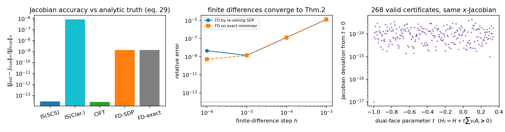
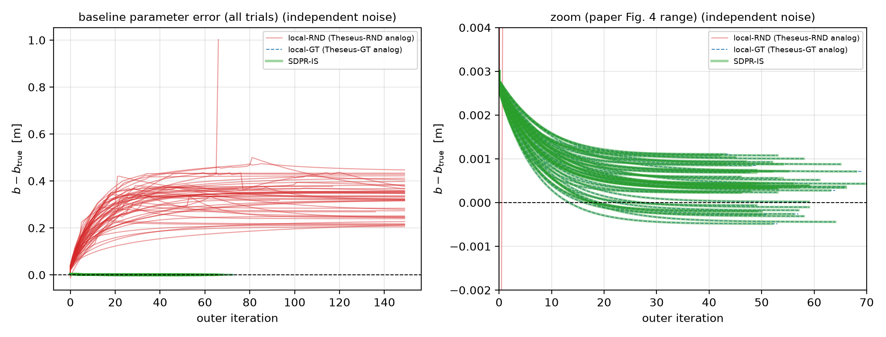
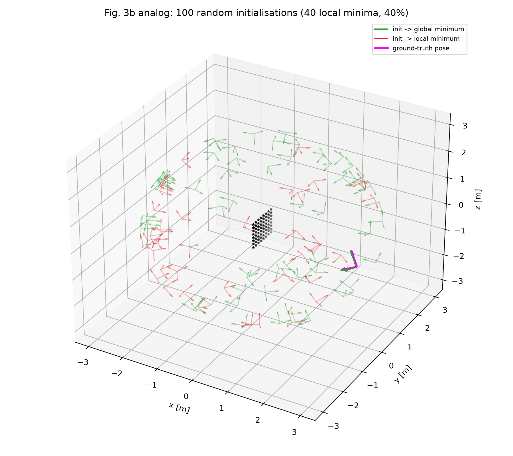
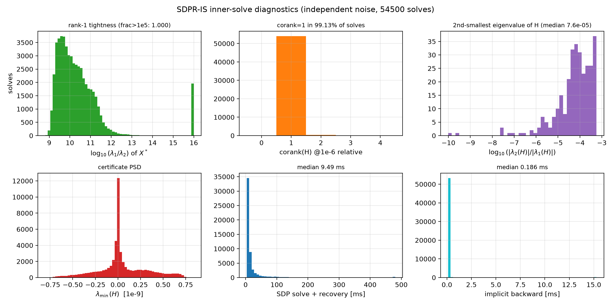
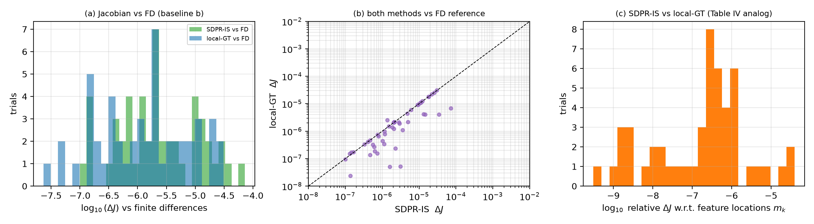
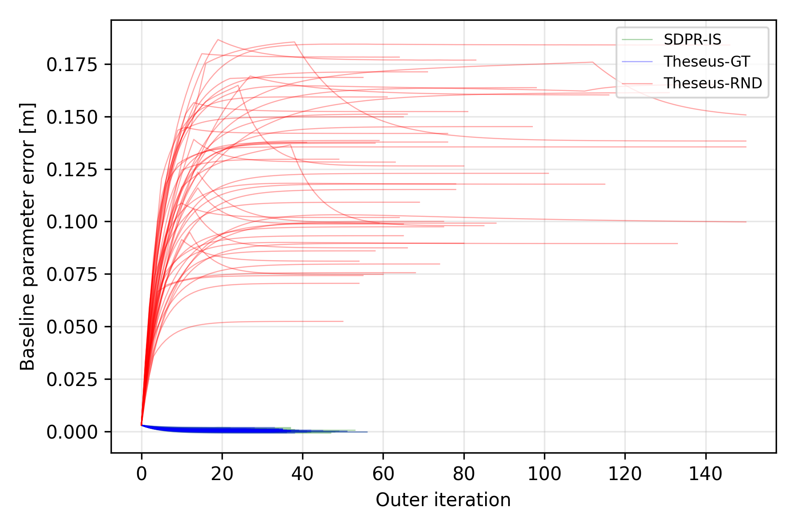

# SDPRLayers 精读（详细版）：多项式优化问题的可信反向传播

> **本文是两篇论文研读工作的 SDPRLayers 详细篇**；五个问题的直接回答见
> [`answers.md`](answers.md)，QPEP 的对照见 [`qpep_reading_notes.md`](qpep_reading_notes.md)。
>
> 主文献：C. Holmes, F. Dümbgen, T. D. Barfoot, *SDPRLayers: Certifiable Backpropagation Through
> Polynomial Optimization Problems in Robotics*, IEEE Transactions on Robotics (TRO), 2025.
> DOI: 10.1109/TRO.2025.3578228；arXiv:2405.19309。
> 论文内引用写作 `[Holmes2025, §X]`（按节/定理/图编号，不依赖本地文本行号）。
> 延伸文献索引见 [`../references/INDEX.md`](../references/INDEX.md)；PDF 不随仓库分发，
> 索引中给出 DOI/arXiv。

**阅读与复现材料索引**

| 材料 | 位置 |
|---|---|
| 原文 PDF | arXiv:2405.19309 / DOI（仓库不分发版权 PDF） |
| 延伸文献 | [`../references/INDEX.md`](../references/INDEX.md)（22 篇，含 DOI/arXiv） |
| 五个问题直接回答 | [`answers.md`](answers.md) |
| QPEP 精读与对照 | [`qpep_reading_notes.md`](qpep_reading_notes.md) |
| 复现总报告 | [`reproduction.md`](reproduction.md) |
| 复现 A（上游仓库修复版） | [`repro/upstream/REPORT.md`](../repro/upstream/REPORT.md)，[`repro/results_upstream/`](../repro/results_upstream/) |
| 复现 B（clean-room 独立实现） | [`repro/cleanroom/REPORT.md`](../repro/cleanroom/REPORT.md)，[`repro/results_clean/`](../repro/results_clean/) |
| 复现环境与补丁 | [`repro/ENV.md`](../repro/ENV.md)，[`repro/patches/`](../repro/patches/) |

---

## 0. 一页速览

**论文要解决的问题。** 可微优化层（differentiable optimization layer）把优化问题嵌进网络前向，
用隐函数定理（IFT）对 KKT 条件求导做反向。机器人里的优化问题绝大多数非凸，局部求解器
（Theseus、Gauss-Newton、CVXPYLayers 式凸近似）不保证收敛到全局最优。一旦收敛到伪局部极小，
反向传播的就不是"全局最优解对参数的导数"，而是"某个局部解对参数的导数"，梯度被污染，
外层训练可能变慢甚至发散 `[Holmes2025, §I, §VI-A]`。

**论文的方案（SDPR）。** 把问题写成齐次二次约束二次规划（QCQP）(P1)，解其 Shor 半正定松弛
(SDP) (P3)。松弛紧（tight，rank-1）时，从 SDP 解直接读出全局最优 $x^\*$ 并得到对偶证书；
反向时**不去微分 SDP，而是把 SDP 求解顺带得到的 Lagrange 乘子与证书矩阵 $H$ 复用到原 QCQP 的
KKT 系统**，用弱化版隐函数定理（隐式选择，implicit selections）得到解映射的 Jacobian：
$J = -P M_r^{\dagger} N$ `[Holmes2025, Thm.2, Eq.(16)(17)]`。松弛不紧时退回对 SDP KKT 微分
（SDPR-SDP）或把松弛解/rounding 解作为局部求解器的初值 `[Holmes2025, §V-C]`。

**关键结论。**
1. 只要松弛 tight 且 Thm.2 的条件（ACQ、SOSC、corank$(H)=1$、可行集光滑、参数矩阵连续可微）
   成立，SDPRLayer 给出的前向解是**全局最优**、反向 Jacobian 是**全局最优解的唯一 Jacobian**，
   即使 Lagrange 乘子不唯一（冗余约束导致）`[Holmes2025, Thm.2, §IV-C]`。
2. 这是"**可信最优（certifiably optimal）**"在可微优化里的落地：前向有最优性证书，反向有"梯度
   属于全局解"的证明，而不是像局部求解器那样只有经验上的正确性。
3. 实验：多项式 toy 例说明局部求解器确实会困在局部极小；双目定位的 Jacobian 与 SVD/GT 基线相比
   误差 $10^{-5}\sim10^{-6}$ 量级而局部 Theseus 为 $10^{-2}$；标定实验里随机初始化的局部求解器
   收敛到错误 baseline（1.1e-1 m），SDPR 与 GT 初始化 Theseus 一致（3.45e-4 m）；真实数据训练
   关键点网络，matrix-weighted SDPR 把纵向/横向定位误差从 0.125/0.049 m 降到 0.035/0.021 m。
4. 代价：每个 batch 元素每步都要解一个 SDP（内点法/一阶法，规模 $O(n^2)$ 变量），前反向都在 CPU，
   依赖 SCS/Mosek 等外部求解器，需要 tight 松弛（常常要加冗余约束），非 tight 时理论保证失效。

---

## 1. 什么是"可信最优"（certifiably optimal）

### 1.1 从"最优"到"可验证的最优"

优化问题的解 $x^\*$ 称为**全局最优**，若对可行域内任意 $x$ 都有 $f(x^\*) \le f(x)$。
数值求解器只能给出一个点的估计；判断它是否全局最优，在一般情况下是 NP-hard 的。
**证书（certificate）**是一组可以在多项式时间内检验的数据，用来证明该点全局最优。
"可信最优 / certifiably optimal"指的是：不仅给解，而且给证书，并保证证书在数值容差内成立；
"certifiably correct 算法"则指算法本身保证输出解 + 证书（或报告失败）。

在本文的 QCQP 框架里 `[Holmes2025, §III-B, Eq.(P1)-(P3)]`，考虑

$$
\min_{x} \; x^\top Q_\theta x \quad \text{s.t.}\quad x^\top A_i x = 0\;(i\in[m]),\quad x^\top A_0 x = 1 .
$$

把它升维成 $X = xx^\top$ 得到 (P2)，去掉 rank-1 约束得到 Shor 松弛 (P3)：
$\min_X \langle Q_\theta, X\rangle$ s.t. $\langle A_i,X\rangle=0,\ \langle A_0,X\rangle=1,\ X\succeq0$。
其对偶（写成最小化形式）为 `[Holmes2025, Eq.(3)]`

$$
\min_{H,\lambda}\; \lambda_0 \quad \text{s.t.}\quad H = Q_\theta + A_0\lambda_0 + \sum_{i=1}^m A_i\lambda_i,\;\; H\succeq 0 .
$$

$H$ 称为**证书矩阵**（certificate matrix）。它恰好是原 QCQP 的 Lagrange 函数对 $x$ 的
Hessian 的一半：$\nabla_x^2 L = 2H$ `[Holmes2025, §IV-A, Eq.(13)]`。

**最优性证书定理（本文用到的核心事实）**。设 $(x^\*, \lambda^\*)$ 满足 KKT 条件，且
$H(\lambda^\*) \succeq 0$、$H(\lambda^\*) x^\* = 0$（互补松弛）。Lagrange 函数为
$L(x,\lambda) = x^\top Q x + \lambda_0(x^\top A_0 x - 1) + \sum_i \lambda_i x^\top A_i x
= x^\top H x - \lambda_0$。于是对任意可行 $x$：

$$
x^\top Q_\theta x \;=\; x^\top H x - \lambda_0 \;\ge\; -\lambda_0 \;=\; {x^\*}^\top Q_\theta x^\* ,
$$

其中不等号用 $H\succeq0$（$x^\top Hx\ge0$），最后一个等号用 $Hx^\*=0$ 与
${x^\*}^\top A_0 x^\*=1$（互补项 $\lambda_i{x^\*}^\top A_i x^\*=0$）。即
**一个半正定的对偶可行矩阵 $H$ 加上互补松弛，就构成全局最优性的可检验证书**（强对偶给出
$\min\lambda_0 = -{x^\*}^\top Q x^\*$，Slater 条件保证强对偶成立）。
也就是说：**一个半正定的对偶可行矩阵 $H$ 加上互补松弛，就构成全局最优性的可检验证书**。
这正是"certifiably correct"方法（SE-Sync、TEASER、本文等）的共同基础：SDP 的最优解
$X^\*$ 和对偶 $H^\*$ 由内点法同时给出，检查 $H^\*\succeq0$ 与 $H^\*X^\*=0$（互补间隙）即可认证
$x^\*$ `[Rosen2019_SESync; Yang2021_TEASER; Holmes2025 §III-B]`。

### 1.2 与"紧（tight）"、"rank-1"、"强对偶"的关系

- **(P3) 是 (P1) 的松弛**：$\mathrm{val}(P3)\le\mathrm{val}(P1)$。若 (P3) 的最优 $X^\*$ 满足
  rank$(X^\*)=1$，则 $X^\*=x^\*{x^\*}^\top$ 且 $x^\*$ 是 (P1) 的全局最优，此时称**松弛是紧的**；
  该结论由 Cifuentes 等严格证明，依赖 SDP 的强对偶（Slater 条件在本文所有问题成立）
  `[Holmes2025, §III-B1]`。
- **严格互补 $\Leftrightarrow$ rank-1**：若严格互补（SDP 的互补间隙在非零特征值上不退化）成立，
  则 rank-1 与证书 `corank(H)=1` 等价 `[Holmes2025, §IV-C]`；SDP 的严格互补是"泛型"性质
  （Alizadeh 等），论文实测所有实验都满足。
- **corank$(H)=1$ 的两个作用** `[Holmes2025, §IV-C, Lemma 3]`：
  (i) tightness 在参数小扰动下**稳定**（Cifuentes 等的结论：corank=1 时 rank-1 性不会被小扰动破坏，
  这解释了"训练中调参不会突然失去 tightness"）；
  (ii) 由 $Hx=0$、$\ker H=\mathrm{im}\,x$ 推出二阶充分条件 SOSC 成立（见 §3）。
- 注意区分：**"certifiable" 是能力，"certified" 是已认证**。算法可以 certifiable（能给出证书），
  但在这个具体实例上没有检查/证书不成立（非 tight）时，解不能被认证为全局最优。

### 1.3 与局部最优、驻点的区别（为什么不能只看 KKT 点）

非凸 QCQP 的 KKT 点可能有很多个（局部极小、鞍点）。局部求解器（Gauss-Newton、Theseus、
梯度下降）只保证收敛到某个一阶/二阶驻点；**这个驻点可能不是全局最优**，而且它对应的
"解映射的 Jacobian"与全局解的不同。论文 §VI-A 的六次多项式例子给出直观反例：
同一个多项式在不同的内层求解方式下，GD 从 $x_0=2$ 出发会困在局部极小，外层优化于是
"把局部极小搬到目标点"，而全局极小几乎不动 `[Holmes2025, §VI-A, Fig.2]`。
在标定实验（§VI-B4）中，这种错误梯度直接导致 baseline 参数收敛到 1.1e-1 m 的错误值
`[Holmes2025, Table V]`。因此，可微优化层需要的不只是"可微"，而是"**微分的是全局最优解**"。

### 1.4 本文语境下"可信最优"的完整含义

综合 §III–§V，本文的"certifiably optimal + certifiable gradients"包含四层：

1. **前向可信**：解 SDP 松弛，若 tight，则前向输出 $x^\*$ 是原非凸问题的全局最优，并附带
   $H^\*\succeq0$ 的最优性证书 `[Holmes2025, §III-B1, §III-B2]`；
2. **反向可信**：在 Thm.2 的条件下，反向传播的 Jacobian 是**全局最优解**（而非某个局部解）的
   唯一 Jacobian，且可用 SDP 求解顺带产出的 $(x^\*,\lambda^\*,H^\*)$ 高效计算
   `[Holmes2025, Thm.2, Eq.(16)]`；
3. **稳定性**：corank=1 使 tightness 对参数扰动稳定，从而训练过程中"可信"不会轻易失效
   `[Holmes2025, §IV-C]`；
4. **诚实降级**：不 tight 时不假装可信——提供 SDP 矩阵解 / rounding 解 / 次优性 gap
   $\mu(\hat x,X)$ `[Holmes2025, §V-C, Eq.(25)]`，并可退回局部求解器（此时梯度无保证）。

> 一句话：**可信最优 = 解的最优性可以用对偶证书在多项式时间内验证；在可微优化层里进一步要求
> 反向传播的梯度正是这个已认证全局解对参数的导数，并在条件满足时可证明。**

### 1.5 文献中的定义与用法（与本文对照）

"可信最优/可信算法"在机器人文献里有两层含义，本文两层的都用到了：

1. **算法层（certifiably correct algorithm）**：SE-Sync 的定义最清晰——"an algorithm that is
   capable of efficiently solving a generally-intractable problem **within a restricted operational
   regime**, and of **computationally certifying the correctness** of the solutions that it recovers"
   `[Rosen2019_SESync, §1.3]`。Rosen 等的综述进一步解释：这类方法与之前的凸松弛初始化方法的区别在于
   "the relaxations they employ are **exact provided that the noise on the data is not too large**"，
   且 exactness 可以 **post hoc** 检验（解的约束是否满足/对偶证书是否 PSD）`[Rosen2021_Review, §2.2, 脚注4]`。
2. **解层（certifiably optimal solution）**：给定候选解，构造对偶证书 $\hat\lambda$ 并验证
   $H(\hat\lambda)\succeq0$、互补松弛，从而证明它是全局最优 `[Rosen2019_SESync, §1.2]`。

SDPRLayers 在此之上加了第三层（本文的创新点）：**梯度层**——不仅解和证书可信，而且
"the derivatives ... correspond to the solution of the optimization problem (i.e., the global
optimum)" `[Holmes2025, §I-A]`；这要求 tight + Thm.2 的条件，是"certifiable backpropagation"
的含义。对照之下，Theseus/CVXPYLayers/OptNet 等可微层只保证"某个局部最优/KKT 点的导数"。

---

## 2. SDPR 方法：目的、手段、效果与代价

### 2.1 目的（为什么需要 SDPR）

现代机器人 pipeline 中，"学习 + 模型"融合的标准做法是把优化问题作为**可微层**嵌入网络：
前向解优化，反向用隐函数定理对 KKT 条件求导 `[Holmes2025, §I]`。问题在于：机器人中的优化
（位姿图、配准、标定、位姿估计、IK……）几乎都是**非凸**的，局部求解器只能保证收敛到驻点。
于是有两种坏情况 `[Holmes2025, §I, §VI]`：

- **前向错**：解本身是伪局部极小，不是任务要的全局最优（如双目位姿估计随机初始化时约 60%
  收敛到局部极小，`[Holmes2025, §VI-B2, Fig.3b]`）；
- **反向错**：即使局部解在任务指标上"看起来还行"，它关于参数的导数也与全局解的导数不同，
  外层优化会沿错误方向更新参数，导致训练变慢、震荡、甚至完全失败（§VI-A、§VI-B4）。

论文的目标因此是：**给可微优化层提供"可信"的前向解与梯度**——前向给出全局最优及其证书，
反向给出该全局最优解对参数的导数；若做不到（松弛不紧），至少显式降级并给出诊断信息，
而不是把局部解的梯度伪装成全局梯度 `[Holmes2025, Abstract, §I-A]`。

### 2.2 手段（怎么做的）

**(1) 统一建模：POP → 齐次 QCQP → Shor SDP。** 任何多项式优化问题（POP）都可写成
`[Holmes2025, §II-A, §III-B]` 的齐次 QCQP (P1)：$\min_x x^\top Q_\theta x$，
s.t. $x^\top A_i x=0\,(i\in[m])$，$x^\top A_0 x=1$（最后一条是齐次化约束，固定某个分量为 1）。
升维 $X=xx^\top$ 并去掉 rank-1 得 SDP (P3)。机器人里所有 certifiably correct 问题
（位姿图、配准、标定、IK、分割……）都能这样写 `[Holmes2025, §II-A]`。

**(2) 前向：解 SDP，拿解 + 证书。** 用 CVXPYLayers 的（修改版）后端或 Mosek 解 (P3)，
得到 $X^\*$、对偶乘子 $\lambda^\*$ 与证书矩阵 $H^\*=\lambda_0^\*A_0+\sum_i\lambda_i^\*A_i+Q_\theta$。
若 rank$(X^\*)=1$（实际用 $\lambda_1/\lambda_2>10^5$ 判定 `[Holmes2025, §App.C]`），
则 $x^\*$ 为全局最优；否则输出矩阵解 $X^\*$ 供后续使用 `[Holmes2025, §V-A]`。

**(3) 反向：复用证书矩阵做隐式微分。** 不是对 SDP 的 KKT 条件微分（那会引入 $O(n^2)$ 变量、
且 CVXPYLayers 要求的解唯一性在 tight 松弛下常被违反 `[Holmes2025, §IV 开头, 脚注13]`），
而是对**原 QCQP 的 KKT 条件**微分。由于 tight 松弛下乘子不唯一（冗余约束使约束 Jacobian 行相关），
经典 IFT 失效；论文用**隐式选择（implicit selections）**版本的 IFT：只要 KKT 映射对 $z=(x,\lambda)$
的 Jacobian $M_r$（删去线性相关约束行后）行满秩，解映射就存在局部选择，其 Jacobian 为
$\nabla w = M_r^\top(M_rM_r^\top)^{-1}N = M_r^{\dagger}N$，且可以证明 $x$ 部分的 Jacobian 唯一，
与乘子的选择无关 `[Holmes2025, Thm.2, App.B]`（详见 §3）。

**(4) 三种反向模式** `[Holmes2025, §V-B]`：
- **SDPR-IS**（默认，implicit selection）：用 SDP 求解顺带得到的 $\lambda,H$ 直接构造 KKT 系统，
  用 LSQR 解 $\min_y\|M_r^\top y - P^\top\nabla_x\ell\|_2$ 得到 $\nabla_\nu\ell = -N^\top y$
  `[Holmes2025, Eq.(20)(21)]`——省去重算乘子/证书，最快；
- **SDPR-CIFT**（classic IFT）：从 $x^\*$ 用非冗余约束子集重算乘子 $\lambda=-G_r^{\dagger\top}Q_\theta x$，
  再解 $My=P^\top\nabla_x\ell$ `[Holmes2025, Eq.(22)-(24)]`；
- **SDPR-SDP**：对 SDP 松弛的 KKT 条件用 CVXPYLayers 直接微分 `[Holmes2025, §V-B3]`，
  任何情况（含非 tight）都能给出梯度，但理论保证弱（依赖解唯一的假设），且线性系统大得多。

**(5) 不紧时的补救（诚实降级）** `[Holmes2025, §V-C]`：SDP 矩阵解 $X$ 可 rounding 成可行点
$\hat x$（SVD/投影），并计算次优性 gap $\mu(\hat x,X) = \dfrac{\langle Q_\theta,\hat x\hat x^\top\rangle-\langle Q_\theta,X\rangle}{\langle Q_\theta,X\rangle}$
`[Holmes2025, Eq.(25)]`；gap 小则可用，gap 大则作为局部求解器初值。此时若继续反向，
理论不再保证梯度正确，只能经验使用。

**(6) 工程实现** `[Holmes2025, §V, App.C, App.D]`：PyTorch `nn.Module`；输入是（批量）向量化的
$\{\mathrm{vec}(Q_\theta),\mathrm{vec}(A_i)\}$（即支持**代价矩阵和约束矩阵都参数化**，实际实验
只参数化代价）；修改了 CVXPYLayers/diffcp 以暴露 Lagrange 乘子与 slack 并支持外部 solver
注入解；提供 `check_tightness` 与基于 [Dümbgen2024] 的自动找冗余约束工具（Fig.7 流程）。

### 2.3 理论效果（证明了什么、边界在哪）

**保证（Thm.2）** `[Holmes2025, Thm.2]`：设 $\bar\theta$ 处 $(x^\*,\lambda^\*)$ 满足 KKT，
且 (1) $\{Q_\theta,A_i^\theta\}$ 对 $\theta$ 连续可微；(2) ACQ + SOSC 成立；(3) $\theta\mapsto\Omega_\theta$
光滑；(4) $H^\*\succeq0$。则 $x^\*$ 是 (P1) 在 $\bar\theta$ 的全局最优，且其**唯一** Jacobian 为
$J=-PM_r^{\dagger}N$（$P$ 为取 $x$ 分量的投影矩阵）。即使有冗余约束、乘子不唯一，$x$ 的 Jacobian 唯一。

**稳定性（corank=1）** `[Holmes2025, §IV-C]`：证书矩阵 corank 为 1 时，(i) tightness 在参数/代价
小扰动下稳定（Cifuentes 等），训练过程中不会因参数更新突然失去 tightness；(ii) 蕴含 SOSC（Lemma 3），
从而 Thm.2 的条件在 rank-1 处"自动"成立一部分。

**边界/局限**（论文 §VII 与各节）：
- 只对**恰好紧**（rank-1）的松弛给出保证；非 tight 时前向只能给松弛解 + gap，反向无理论保证；
- 依赖严格互补/corank=1/ACQ 等泛型但非必然的条件；
- 多全局最优解（$x$ 不唯一）时解映射本身不唯一，Thm.2 的"唯一 Jacobian"不适用（论文未处理）；
- Lasserre 层级每升一级变量数与 SDP 规模快速增长，真正的 Moment-SOS 只在小问题上可行；
- forward/backward 都在 CPU，GPU 化未解决 `[Holmes2025, §VII]`；
- Thm.2 覆盖参数出现在**约束矩阵**中的情形，但实验只测了参数在代价矩阵中的情形 `[Holmes2025, §VI 末]`。

### 2.4 实验效果（论文给出的数字）

**§VI-A 六次多项式（bilevel toy）**：目标是让多项式的全局极小落在指定点。GD 内层从 $x_0=2$ 出发
困在局部极小，外层把局部极小移到目标而全局极小不动；从 $x_0=-2$ 出发也会中途被困、迭代变多；
SDPRLayer 始终收敛到全局解，并能不连续地"切换"到新的全局极小 `[Holmes2025, Fig.2]`。

**§VI-B 双目定位（仿真）**：8×8 特征板（1m×1m）、相机 3m 半径 90° 锥内随机位姿、像素噪声 0.5 pix
（Table II）。Jacobian 与 SVD/GT-UR 基线的相对误差（∞-范数）`[Holmes2025, Table III/IV]`：

| 方法 | 标量权重 Jacobian 误差 | 矩阵权重 Jacobian 误差 | 反向耗时(s) |
|---|---|---|---|
| SDPR-IS | 3.10e-06 ± 7.82e-06 | 3.95e-05 ± 8.31e-05 | 0.208 / 0.231 |
| SDPR-CIFT | 1.29e-06 ± 3.06e-06 | 3.11e-05 ± 7.01e-05 | 0.389 / 0.427 |
| SDPR-SDP | 1.88e-05 ± 2.44e-05 | 1.49e-04 ± 3.78e-04 | 0.136 / 0.133 |
| Theseus-GT | 1.02e-02 ± 6.62e-03 | 2.07e-02 ± 2.88e-02 | 0.186 / 0.142 |
| Theseus-RND | 1.02e-02 ± 6.62e-03 | 1.95e-01 ± 2.60e-01 | 0.180 / 0.179 |

结论：SDPR 三种模式的 Jacobian 彼此一致且与真值差 $10^{-5}\sim10^{-6}$；局部 Theseus 即使从
真值初始化，梯度精度也差 3–4 个数量级（除非用 unrolling，但 unrolling 慢 4 倍且需要真值初始化）。

**§VI-B4 标定（本次复现目标）** `[Holmes2025, Table V, Fig.4]`：50 次实验 × 20 poses，外层 SGD
调 baseline $b$（初值误差 0.003 m，lr=1e-4）。SDPR-IS 与 Theseus-GT 几乎重合
（final error 3.454e-4 / 3.463e-4 m，34.22 / 35.40 iters，outer loss 9.857e-3 / 9.854e-3），
Theseus-RND 收敛到完全错误的值（1.132e-1 m，80.34 iters，损失 1.384e+2）。

**§VI-C 真实数据（In-The-Dark，训练关键点 CNN）** `[Holmes2025, Table VI/VII]`：用 SDPR 做
matrix-weighted 位姿估计替换 SVD，纵向/横向定位误差在原始测试集上 0.035/0.021 m
（baseline 0.125/0.049 m），在更难的跨视角测试集上 0.053/0.027 m（baseline 0.213/0.072 m）；
推理时间 0.243 s vs 0.133 s（约 2×，因为 SDP 规模小），说明该层在真实 pipeline 中可用。

### 2.5 代价（用它要付出什么）

1. **计算**：每个 batch 元素、每次前向都要解一个 SDP。内点法变量数 $O(n^2)$，稠密 SDP 单次
   约 $O(n^{6})$ 量级（论文 §III-B2：内点法对上千变量可行，但实时性差；更大问题需 Burer–Monteiro /
   Riemannian Staircase 等低秩方法）；反向还要解（稀疏）线性系统（LSQR/MINRES）。论文中
   反向单次 0.13–0.43 s（Table III/IV），真实推理端到端约 2× SVD 时间。
2. **CPU-only**：论文明确 forward/backward 都在 CPU 上，与 GPU 训练混用时要做主机-设备拷贝，
   这是作者列出的主要未解瓶颈 `[Holmes2025, §VII]`。
3. **tight 假设**：核心保证只对 rank-1 松弛成立；非 tight 时要么用 SDPR-SDP（大系统、假设不成立、
   无保证），要么退回局部求解器（回到起点）。很多问题需要加**冗余约束**才能变紧，SDP 随之变大。
4. **建模成本**：用户必须自己把问题化成齐次 QCQP（构造 $Q_\theta,A_i$、齐次化、SO(3) 约束），
   并正确标出冗余约束（README 警告：`redun_list` 标错会给出错误梯度）；自动 tightening 工具
   也只在部分问题上有效。
5. **求解器依赖**：默认 SCS（一阶，精度受 tolerance 影响，tight 判定与 Jacobian 精度都受影响）；
   高精度需要 Mosek（商用 license），且不同 solver 的最优解/乘子数值差异会影响证书检验。
6. **批处理与内存**：每个 batch 元素一个 SDP，batch 大时求解器调用次数线性增长；$X$ 是 $n\times n$
   稠密矩阵，$n$ 大时内存/带宽压力大。
7. **条件依赖**：ACQ、SOSC、corank=1、严格互补等条件被论文实测满足，但并非对所有问题成立；
   一旦破坏，理论保证失效（可能只有数值上"看起来对"）。

### 2.6 与已有可微优化工具/证书方法的区别

| 工具 | 处理的问题类 | 全局性/证书 | 与 SDPR 的关键区别 |
|---|---|---|---|
| Theseus `[57]` | 无约束/李群约束非线性最小二乘 | **局部**求解器，无全局证书 | 快、支持 SO(3)/SE(3)；非凸时可能落到伪局部极小（本文 Table III/IV/V 的实验对象） |
| CVXPYLayers `[1]` | 一般**凸** DCP | 凸 ⇒ KKT 充分必要 ⇒ 全局 | 只对凸问题成立；被 SDPR 用作 SDP 前向/反向后端；要求 primal/dual 唯一，与低秩 SDP 的退化性冲突 |
| OptNet `[4]` | 二次规划（凸） | 凸 ⇒ 全局 | 只处理 QP；SDPR 处理非凸 POP 的 SDP 松弛 |
| SATNet `[72]` | MAXSAT 的 SDP 松弛 | 近似，非精确 | SDPR 强调"精确 + 可证书"的全局解 |
| CALIPSO `[39]` | 含锥/互补约束的轨迹优化 | 内点法局部解 | 局部；SDPR 用 SDP 松弛换全局性 |
| 只认证不对优化求导（C-3PO `[66]`、range-only 证书 `[24]`） | 需要"正确性证书"但不需要梯度 | 证书正确性 | SDPR 额外提供**梯度**，且梯度对应全局解（Thm.2） |
| **SDPRLayers**（本文） | POP/QCQP 且 SDP 松弛 tight（或可加冗余约束变 tight） | **全局最优 + 可检验证书**；梯度对应全局解 | 代价是每步解 SDP 与 tight 假设；非 tight 时退化为启发式 |

---

## 3. SDPRLayer 如何微分，微分存在性如何证明

> 本节是报告的技术核心。符号与论文一致：$z^\top=[x^\top\;\lambda^\top]$，参数 $\theta$（论文实现里
> $\theta$ 实际取 $\nu^\top=[\mathrm{vec}(Q_\theta)^\top\;\mathrm{vec}(A_1^\theta)^\top\cdots]$，
> 式(18)）；$H(\lambda,\theta)=Q_\theta+\lambda_0A_0+\sum_i\lambda_iA_i^\theta$ 是证书矩阵，
> 且 $\nabla_x^2L=2H$。详细推导见 [`../notes/theory_Q1_Q3.md`](../notes/theory_Q1_Q3.md) §3。

### 3.1 前向：从 SDP 到 $(x^\*,\lambda^\*,H^\*)$

1. 构造 (P3) 并用 cvxpylayers（或 Mosek）求解，得到 $X^\*$、对偶变量（对应 $\lambda^\*$）以及
   $H^\*=Q_\theta+\lambda_0^\*A_0+\sum_i\lambda_i^\*A_i$。紧凑形式（dual 形式）的 DCP 由
   `use_dual=True` 指定（README：dual 形式能避免 DCP canonicalization 的低效）。
2. 若 rank$(X^\*)=1$（$X^\*=x^\*{x^\*}^\top$），层输出全局最优向量 $x^\*$ 与矩阵 $X^\*$；否则
   只输出 $X^\*$ 并给出 tightness 诊断 `[Holmes2025, §V-A, App.C]`。
3. 缓存 $(x^\*,\lambda^\*,H^\*)$ 供反向使用——这是 SDPR-IS 相较"重新解一遍/重算乘子"的关键效率来源。

### 3.2 反向的出发点：QCQP 的 KKT 系统

原 QCQP (P1) 的 KKT 条件写成零水平集 `[Holmes2025, Eq.(5),(11)]`：

$$
k(z,\theta)=\begin{bmatrix}2H(\lambda,\theta)x\\ g(x,\theta)\end{bmatrix}=0,\qquad
g(x,\theta)=\big[x^\top A_1^\theta x,\ \dots,\ x^\top A_m^\theta x,\ x^\top A_0x-1\big]^\top .
$$

对 $k$ 全微分（微分记号见 Magnus & Neudecker）`[Holmes2025, Eq.(8)]`：

$$
\mathrm{d}k(z,\theta)=M\,\mathrm{d}z+N\,\mathrm{d}\theta=0
\quad\Longrightarrow\quad
\mathrm{d}z=-M^{-1}N\,\mathrm{d}\theta\quad(\text{若 }M\text{ 可逆}),
$$

其中 `[Holmes2025, Eq.(9),(13),(14)]`

$$
M=2\begin{bmatrix}H & G^\top\\ G & 0\end{bmatrix},\qquad
G=\nabla_x g(x,\theta)=[A_1^\theta x\;\cdots\;A_m^\theta x\;A_0x]^\top ,
$$

$N=\nabla_\theta k$ 的显式表达见论文 App.A 式(35)：$N=\begin{bmatrix}2(I\otimes x^\top) & \lambda'^\top\otimes(2I\otimes x^\top)\\ 0 & I\otimes\mathrm{vec}(xx^\top)\\ 0&0\end{bmatrix}$。
若 $M$ 可逆，经典 IFT 给出解映射 $S:\theta\mapsto\{(x,\lambda):k=0\}$ 的 Jacobian
$\nabla_\theta S=-M^{-1}N$ `[Holmes2025, Eq.(10)]`。

**经典 IFT 在这里为什么会失效** `[Holmes2025, §IV 开头]`：
- 当问题需要**冗余约束**才 tight 时（机器人里很常见，见 §4），$G$ 的行线性相关，$M$ 奇异，
  经典 IFT（要求 $\nabla_zk$ 可逆）不成立；
- 即使用 CVXPYLayers 直接对 SDP 的 KKT 微分，其底层要求**原问题与对偶解都唯一**；tight SDP
  在 $m+1>n$（加冗余约束后几乎必然）时对偶不唯一 `[Holmes2025, 脚注13, 引 [3]]`，
  所以"SDPR-SDP 的梯度不能保证可信"；
- 而"去掉冗余约束、重算乘子再用经典 IFT"（SDPR-CIFT）可行但要额外计算，且需要先删冗余行。

### 3.3 主定理：用隐式选择（implicit selections）绕过可逆性要求

论文的做法分两步：先用**弱化版 IFT**（只要求 Jacobian **行满秩**，不要求方阵可逆）证明解映射
存在可微的局部选择，再证明 $x$ 部分的 Jacobian 唯一、且对应全局最优。

**引理（Implicit Selections，Thm.6，取自 Dontchev & Rockafellar 习题 1F.9）** `[Holmes2025, §App.B]`：
设 $k:\mathbb R^l\times\mathbb R^d\to\mathbb R^p$（$p\le l$）严格可微，$k(\bar z,\bar\theta)=0$，
且 $\nabla_z k(\bar z,\bar\theta)$ **行满秩**（rank $=p$）。则解映射 $S(\theta)=\{z:k(z,\theta)=0\}$
在 $\bar\theta$ 附近存在**局部选择** $w$（$w(\bar\theta)=\bar z$，$w(\theta)\in S(\theta)$），$w$ 严格可微，
且
$$
\nabla w(\bar\theta)=M^\top(MM^\top)^{-1}N \;=\; M^{\dagger}N,\qquad M=\nabla_zk,\; N=\nabla_\theta k .
\tag{37}
$$
注意：这里**不需要 $M$ 可逆**，只需要行满秩；这正是允许冗余约束的关键。

**Thm.2 的证明链条** `[Holmes2025, App.B]`（五步）：

1. **取极大线性无关约束子集。** 设 $g_r$ 是从 $g$ 中取出的、Jacobian $G_r\in\mathbb R^{r\times n}$
   行满秩的最大子集（$r\le m+1$）。由 Cifuentes 等 Lemma A.8，在 ACQ 下 $g_r$ 与 $g$ 诱导的
   可行集局部等价。于是解映射可改写为 $S:\theta\mapsto\{z\in\mathbb R^{n+r}: Hx=0,\ g_r(x,\theta)=0\}$，
   其 Jacobian 为
   $$M_r=2\begin{bmatrix}H & G_r^\top\\ G_r & 0\end{bmatrix}\in\mathbb R^{(n+r)\times(n+r)} .$$
2. **证明 $M_r$ 行满秩（关键！）。** 设 $t^\top=[v^\top\;u^\top]$ 使 $M_r^\top t=0$，即
   $Hv+G_r^\top u=0$ 且 $G_rv=0$。第二式给出 $v\in\ker G_r=\ker G$。用 $v^\top$ 左乘第一式：
   $v^\top Hv+v^\top G_r^\top u=v^\top Hv=0$。由 **SOSC**（$v^\top Hv>0$ 对一切非零 $v\in\ker G$）
   得 $v=0$；代回得 $G_r^\top u=0$，而 $G_r$ 行满秩 $\Rightarrow u=0$。故 $M_r$ 行满秩（实为可逆）。
3. **应用 Implicit Selections。** 对 $k_r(z,\theta)=(Hx,\ g_r(x,\theta))$，$\nabla_zk_r=M_r$ 行满秩，
   由 Thm.6 得局部选择 $w$ 及其 Jacobian
   $$\nabla w(\bar\theta)=M_r^\top(M_rM_r^\top)^{-1}N=M_r^{\dagger}N .$$
4. **证明 Jacobian 唯一（不依赖选择）。** 设 $w_1,w_2$ 是任意两个局部选择，两者都满足
   $\mathrm{d}k_r=0$。相减得 $M_r[\mathrm{d}x_1-\mathrm{d}x_2;\ \mathrm{d}\lambda_1-\mathrm{d}\lambda_2]=0$。
   令 $v=\mathrm{d}x_1-\mathrm{d}x_2$，$u=\mathrm{d}\lambda_1-\mathrm{d}\lambda_2$，则 $G_rv=0$ 且
   $Hv+G_r^\top u=0$；与第 2 步同样乘 $v^\top$ 得 $v^\top Hv=0$，由 SOSC 得 $v=0$，进而 $u=0$。
   **所以 $\mathrm{d}x$ 唯一，乘子的不唯一不影响 $x$ 的 Jacobian。**
5. **联系全局最优性。** 因为 $H^\*\succeq0$（SDP 对偶证书），由 §1 的证书定理，$x^\*$ 是 (P1) 的
   全局最优；于是第 3-4 步得到的 Jacobian 正是**全局最优解**的 Jacobian：
   $$J=\nabla_\theta x^\*=-P\,M_r^{\dagger}N,\qquad P=\begin{bmatrix}I\\0\end{bmatrix}\in\mathbb R^{(n+r)\times n}. \tag{16}$$

**条件与它们的作用**：
- **ACQ（Def.1）** `[Holmes2025, Def.1]`：$\mathrm{rank}\,\nabla g(x)=\mathrm{codim}_x\Omega$，即可行集
  在局部是光滑流形且约束的秩等于余维数。它比 LICQ/MFCQ 弱，**允许冗余约束**；机器人里
  "变量被约束在 SO(3)/SE(3) 等光滑流形上"的问题通常满足 `[Holmes2025, §IV-B]`。
- **SOSC** `[Holmes2025, Eq.(6)]`：$v^\top\nabla_x^2L\,v>0$ 对非零 $v\in\ker\nabla_xg$，用来证明
  $M_r$ 满秩与 $dx$ 唯一。
- **corank$(H)=1$ $\Rightarrow$ SOSC（Lemma 3）** `[Holmes2025, §IV-C]`：$H\bar x=0$ 且 corank 1 意味着
  $\ker H=\mathrm{im}\,\bar x$；对 $v\in\ker G$，$v^\top Hv=0$ 只能 $v=\mu\bar x$，再用 $A_0$ 行约束
  （$x^\top A_0v=v_h=0$ 与 $x_h=1$）排除 $\mu\neq0$，即 $v=0$。所以"tight + 严格互补"下
  Thm.2 的条件自动满足（论文所有实验 corank 都是 1，`[Holmes2025, §VI]`）。
- **光滑可行集假设（Remark 1）** `[Holmes2025, Remark 1]`：$W=\{(\theta,x):x\in\Omega_\theta\}$ 局部是
  光滑流形。论文指出机器人中通常只有代价依赖参数、约束固定，此时自动成立（其所有实验都是这样）。

### 3.4 三种反向实现与效率技巧

- **SDPR-IS（默认）**：直接复用 SDP 的 $\lambda^\*,H^\*$，构造 $M_r$ 与 $N$；不显式求 $J$ 或伪逆，而是
  令中间变量 $y=M_r^{\top\dagger}P^\top\nabla_x\ell$，则 $\nabla_\nu\ell=-N^\top y$；而
  $y=\arg\min_y\|M_r^\top y-P^\top\nabla_x\ell\|_2^2$ `[Holmes2025, Eq.(20)(21)]`，
  用 **LSQR**（只需矩阵-向量乘、稀疏、对病态稳健）求解。这也是 README 里 `lsqr_tol` 参数的来源。
- **SDPR-CIFT**：由 $x^\*$ 用非冗余行重算乘子 $\lambda=-G_r^{\dagger\top}Q_\theta x$，构造 $M$，
  再 LSQR 解 $My=P^\top\nabla_x\ell$ `[Holmes2025, Eq.(22)-(24)]`。
- **SDPR-SDP**：`diff_qcqp=False`，交给 CVXPYLayers 对 SDP 的 KKT 条件微分 `[Holmes2025, §V-B3]`；
  线性系统规模 $O(n^2)$，通常更慢（但本文小问题上反而快，因为后端是 C++ `[Holmes2025, Table III]`）。

三者在 tight 情形下数值上几乎等价（Table III/IV 中 Jacobian 差异彼此在 $10^{-5}$ 量级），
SDPR-IS 最快，因此是默认。**非 tight 时** SDPR-IS/CIFT 的保证失效；SDPR-SDP 仍给出梯度但
理论基础弱（§5.4 我们会用数值验证这一点）。

### 3.5 存在性证明的逻辑总结（一句话版）

**"解映射不一定处处单值、乘子一定不唯一，但（ACQ + SOSC + $H\succeq0$）保证它在全局最优解附近
存在一个严格可微的局部选择，且其中 $x$ 的导数唯一。"**
存在性来自秩条件 $M_r$ 行满秩 + 隐式选择定理（不是经典 IFT 的可逆性）；唯一性来自 SOSC 下的
"$dx$ 必须是零"论证；"是全局最优的导数"来自证书 $H\succeq0$。这三件事分别对应论文
`[Holmes2025, Thm.6→App.B 第2步, App.B 第4步, §IV 最后一段]`。

**数值上要注意的点**：$M_r$ 的构造依赖"哪些约束是冗余的"这一信息（README 的 `redun_list`）；
论文用 $G$ 的最小二乘/秩判定自动挑选 $G_r$，并用 `kkt_tol` 检查 KKT 残差。若冗余识别错误，
$M_r$ 可能病态，梯度会错——这是使用该层最容易踩的坑（详见 §5 的复现记录）。

### 3.6 数值验证（本机，`../analysis/theory/`，全部可复跑）

> 验证对象：论文 §VI-A 的六次多项式例子（Table I、式 (26)、$Q_\theta$、$A_0\ldots A_3$），
> 环境 `WM`（numpy 2.2.6, cvxpy 1.7.5, SCS/Clarabel，无 Mosek）。脚本：[`../analysis/theory/exp{1,2,3}_*.py`](../analysis/theory/)，
> 结果 JSON 在 [`../analysis/theory/results/`](../analysis/theory/results/)，图在 [`../analysis/theory/figures/`](../analysis/theory/figures/)。详见 [`../notes/theory_Q1_Q3.md`](../notes/theory_Q1_Q3.md) §4。

**(a) 证书与 tightness（复现论文的设定）**：$p^*=1.8068698056687$（与解析全局最优差 $4.2\times10^{-14}$）；
$X^*$ 秩 1，$\lambda_1/\lambda_2=6.63\times10^{14}\gg10^5$（论文 App.C 阈值）；$H^*\succeq0$、corank$(H^*)=1$、
$\|H^*x^*\|=2.6\times10^{-14}$；$G$ 的 4 行秩 3（恰有 1 个冗余约束，与论文一致）；SOSC margin $0.252>0$。
→ 论文"tight + 证书 + corank 1"的设定在独立实现下完全成立。

**(b) Thm.2 的 Jacobian 精度**（式 (29) 的 $\infty$-范数相对误差）：
- Thm.2（SDPR-IS，SCS 证书）：$\mathbf{2.70\times10^{-14}}$（机器精度）；
- SDPR-CIFT（式 22-24 重算乘子）：$2.49\times10^{-14}$；
- 有限差分（重解 SDP，$h=10^{-5}$）：$1.38\times10^{-9}$；两种独立方法互相印证；
- 3 种独立的 $G_r$ 行选择：$J$ 最大偏差 $2.0\times10^{-14}$；
- **对偶面上 268 个不同有效证书 $H_t$（$t\in[-1,0.335]$）给出的 $J$ 彼此偏差 $4.4\times10^{-14}$**
  —— 这是"乘子不唯一、$x$ 的 Jacobian 唯一"的直接数值证据（Thm.2 的核心价值）。

**(c) 冗余约束场景**（论文原设定 + 人为增加 3–5 个冗余约束）：

| | 论文设定（1 冗余） | +3 冗余 | +4 冗余 |
|---|---|---|---|
| $\mathrm{cond}(M)$（含冗余的完整 KKT） | $2.4\times10^{17}$ | $6.7\times10^{32}$ | $1.7\times10^{33}$ |
| $\mathrm{cond}(M_r)$（删冗余行后） | $72.1$ | $74.9$ | $71.0$ |
| Thm.2 Jacobian 误差（复用 SDP 对偶） | $2.7\times10^{-14}$ | 0.140（对偶精度差） | 0.0126 |
| Thm.2/CIFT（最小二乘重算乘子） | $2.4\times10^{-14}$ | $5.7\times10^{-13}$ | $1.3\times10^{-13}$ |

→ **经典 IFT 的 $M$ 确实奇异（条件数 $10^{17}$–$10^{33}$），而删去冗余行后的 $M_r$ 条件数
始终在 $10^2$ 量级、伪逆公式精确**。这坐实了论文"用行满秩的约化系统替代可逆性"的做法。

**(d) corank 与 SOSC**：随机 $\theta$（3 档噪声 × 40 例）全部 tight、$H\succeq0$、SOSC>0、corank 1 是通例，
与论文"所有实验 corank=1"一致。**边界反例（tie）**：精确调参使两个全局极小相等时，$X^*$ 秩 2（不 tight）、
corank$(H)=2$，但同一证书同时认证两个全局极小（两者都满足 $Hx\approx0$）、且 SOSC 在两个分支分别成立
（margin 0.060 / 0.326）——说明 **Lemma 3 的 corank=1 只是充分条件**；此时层无法从 $X^*$ 恢复 $x^*$，
是理论未覆盖的测度零情形（也解释了为什么"多全局最优"不在 SDPR 保证范围内）。

### 3.7 使用时的实践警告（本机数值发现，论文未讨论）

1. **极端冗余时 solver 对偶可能不精确**：$M$ 条件数 $\sim10^{32}$ 以上时，SCS/Clarabel 给出的对偶证书
   可能不再满足 $Hx=0$（残差 0.6–1.4），此时**直接复用证书的 SDPR-IS 梯度会失准**（本机 14% / 1.3%），
   需要按式 (22)（CIFT）或最小二乘重算乘子。论文用 Mosek（$10^{-12}$ 容差）且冗余度低，未暴露此问题；
   但它提示实现中应检查 $Hx$ 残差或提供 CIFT 兜底。
2. **CIFT 重算出的 $H_r$（式 23）不保证半正定**（本机见特征值 $-1.11$），但 $M$ 仍可逆、Jacobian 仍精确
   ——因为求导只需要 $Hx=0$ 与 $M_r$ 可逆，$H\succeq0$ 只用于"解是全局最优"这一结论。
3. **tightness 判据 $\lambda_1/\lambda_2>10^5$ 是启发式**：tight 区间内该比值在 $10^{11}$–$10^{16}$ 抖动，
   tie 附近掉到个位数；只能作数量级判断。
4. **论文式 (3) 疑有符号笔误**：由 $L=x^\top Hx-\lambda_0$、$H\succeq0$ 知对偶目标应为 $\max(-\lambda_0)$
   （或等价地 $\min\lambda_0=-p^*$）；数值上 $\lambda_0=-1.80687=-p^*$。不影响方法，但读论文时易困惑。

---

## 4. 可解问题形式、机器人问题映射与紧性

### 4.1 SDPRLayer 能接受的问题形式

SDPRLayer 的接口（README + 论文 §V）要求用户把问题化成**齐次 QCQP**：

$$
\min_{x\in\mathbb R^n} x^\top Q_\theta x
\quad\text{s.t.}\quad x^\top A_i x = 0\ (i\in[m]),\qquad x^\top A_0 x = 1,
$$

其中 $Q_\theta\in\mathbb S^n$、$A_i\in\mathbb S^n$，可**参数化**的只有矩阵（代价矩阵和/或约束矩阵，
通过 $\partial Q_\theta/\partial\theta$ 进入反向；论文实现里参数即 $\mathrm{vec}(Q_\theta),\mathrm{vec}(A_i)$），
且要求齐次变量里至少有一个分量被固定为 1（自动加 $A_0$）。因此它能覆盖的问题类型是：

1. **变量可嵌入齐次向量**：旋转矩阵 $C\in SO(3)$ 用 9 个分量 + 6 个二次约束（$C^\top C=I$、
   $\det C=1$，后者常写成列叉积约束）表示；平移/位置/尺度等直接作为分量；"齐次化 + 逐元素乘积"
   构造二次型。$SE(3)$、$SO(p)^n$、多视图几何量（本质矩阵、单应）都可这样处理。
2. **目标可写成二次型**：加权最小二乘 $\sum_k\|y_k-Cm_k+t\|^2_{W_k}$、代数误差（本质矩阵）、
   MRF/分割的能量、IK 的位姿误差、PGO 的旋转误差等。
3. **约束是二次等式**：正交约束、行列式约束、距离约束、手眼/标定的几何约束、可控性/不变集
   的多项式约束（可转成二次型或用层级提升）等。
4. **需要 rank-1 松弛 + 证书的条件**：$n$ 不能太大（内点法），且松弛需要（或能通过冗余约束变成）
   tight；非多项式/非二次（如一般非线性代价、min/max、整数变量）不能直接进来。

**不能直接处理**：一般非线性最小二乘（除非重写成多项式）、带不等式/锥约束（需转成 Lasserre 层级
或外近似）、变量规模大的稠密 SDP（$n$ 上千即困难）、非光滑目标、需要离散/组合决策的问题。

### 4.2 紧性：为什么"能写"不等于"能用"

SDPR 的全部保证（前向全局最优 + 反向可信）都建立在 **tight（rank-1）** 上。紧性的来源有三类：

1. **理论保证**（特定问题、特定噪声/几何条件）：
   - Shor 松弛在**无噪声**时对一大类问题 tight（对偶间隙为 0），且在"低噪声 + 权重非退化"时
     仍然 tight（如单帧矩阵加权定位，`[Holmes2024, App.F]`）；
   - **维数/秩条件**：Barvinok/Pataki 型结果给出"当约束数 $m+1$ 超过某阈值时，SDP 存在低秩解"的
     充分条件；$m+1\le n$ 时一般能找到 rank-1 解，$m+1>n$ 时对偶不唯一（`[Holmes2025, 脚注13]`）；
   - **corank=1 + 严格互补**：rank-1 解 ⇒ 对偶唯一性/稳定性（Cifuentes 等），保证 tightness 在参数
     小扰动下稳定 `[Holmes2025, §IV-C]`。
2. **冗余约束（redundant constraints）**：在原 QCQP 中冗余（不改变可行集）的二次等式，能收紧
   SDP 可行集，使松弛变 tight。机器人文献里这是**常态**而非例外：
   - 旋转/位姿估计：加"列叉积/行列式/行范数=列范数"等约束 `[Barfoot2024_Cayley, §2.3]`：
     该文明确说"for most problems in this paper, Shor's relaxation is not tight out of the box…
     In all of the pose estimation problems to follow, we do require redundant constraints"；
   - 矩阵加权定位/SLAM：`[Holmes2024, §IV-C]` 证明单帧矩阵加权定位在低噪声 + 非退化权重下理论 tight，
     噪声升高需要冗余约束；矩阵加权 **SLAM** 即使低噪声也不 tight，必须加特定冗余约束；
   - 立体相机定位：`[Dumbgen2024]` 用采样+可行性检验**自动**找到充分冗余约束集；
   - 标定/IK/分割/配准等：`[Wise2020_HandEye; Giamou2022_CertifiedIK; Hu2019_MRF_Inference; Iglesias2020_PointSetReg]`。
3. **层级提升（Lasserre/Moment-SOS）**：加高阶矩变量与约束，理论上有限步收敛（Archimedean 条件），
   但规模快速膨胀，只适合小问题 `[Holmes2025, §III-B2, App.C]`。

**关键结论**：SDPR 的"可解形式"实际上比"能写成 QCQP"窄——真正可用的是**能被（少量）冗余约束
tighten 到 rank-1 且证书 corank=1** 的那部分问题。SDPRLayer 自带 `check_tightness`（$\lambda_1/\lambda_2>10^5$）
和基于 `[Dumbgen2024]` 的 tightening 工具（Fig.7）来辅助判断/改造，但这本身是建模工作量。

### 4.3 机器人问题映射与紧性（文献证据表）

> 说明：列"紧性"给出**理论保证 / 经验证据**，并注明是否需要冗余约束；"可用性"是本文对
> SDPRLayer 适用性的判断（✅ 形式直接匹配、⚠️ 需改造、❌ 不适合）。
> 期刊列区分"TRO/IJRR/SR 一手文献"与"补充（RA-L/ICCV/CDC/RSS 等）"。
> 完整文献索引与逐条页码见 [`../notes/literature_Q4.md`](../notes/literature_Q4.md) 与 [`../references/INDEX.md`](../references/INDEX.md)。

| 机器人问题 | 问题形式（变量/约束） | SDP 构造 | 紧性（理论/经验） | 期刊 | 可用性 |
|---|---|---|---|---|---|
| **SE(d) 同步 / 位姿图 SLAM** | MLE over $SO(d)^n$；$R_i^\top R_i=I$ | 矩阵提升 $Z=R^\top R\succeq0$，块对角 $=I_d$；Riemannian Staircase | 理论：$\|\tilde Q-Q\|_2<\beta$ 时唯一 exact（Prop.2）；经验：噪声可达常规 10× | IJRR 2019 | ⚠️ rank-d 提升，需改写为 rank-1 形式且规模大 |
| **Cayley 旋转/位姿/轨迹估计** | Cayley 参数化 Lie-algebra 噪声；QCQP | 齐次 QCQP→Shor SDP；**显式冗余约束** | **Shor 默认不 tight**（原文："for most problems in this paper, Shor's relaxation is not tight out of the box"）；加冗余约束后 tight；旋转平均甚至无需冗余 | IJRR 2024/25 | ⚠️/✅ 形式匹配，但轨迹规模大 |
| **旋转平均（Shonan）** | $\min tr(\bar LR^\top R)$ | $Z\succeq0$，块对角 $=I_d$ | 理论：$\|\bar L-L\|_2\le\beta(L)$ 时 exact（Thm.1）；经验通常 tight | ECCV 2020（补充） | ⚠️ rank-d |
| **Range-aided SLAM** | SE(3)+landmark+距离（二次等式） | QCQP→SDP；Staircase；rounding+局部精化 | 无严格 tight 保证；经验：有 inter-robot loop closure 时 **36.2%** 实例相对 gap<$10^{-5}$，无则 **0.7%**；一般 gap<10% | TRO 2024 | ⚠️ 常不 tight，梯度无全局意义 |
| **矩阵加权状态估计（双目位姿）** | $\min\sum e^\top W e$，$C^\top C=I$，$(c_1\times c_2-c_3)=0$，substitution 变量 | 齐次 QCQP→Shor SDP；**冗余约束 (25a–c)** | 理论：单帧低噪声+非退化权重时 tight（App.F），且 SDP stability 给局部稳定；经验：各向异性噪声下默认不 tight，加冗余约束后恢复；本文实验全部 tight、corank=1 | TRO 2024 ×2（Holmes; Dümbgen） | ✅ **本文实验 (P6) 就是它** |
| **点云配准 / outlier-robust（TEASER）** | TLS 代价→POP；四元数+binary cloning | 旋转 SDP；GNC+DRS 证书 | rank-1⇒全局最优（Thm.13）；经验 >95% outliers 仍 rank-1；冗余约束 critical | TRO 2021 | ✅ 旋转子问题形式匹配（离散变量需消去） |
| **点集配准（缺失数据）** | 多视角 $SO(3)\times\mathbb R^3$ | Shor SDP + 对偶证书 $M_\Lambda$ | 理论：$M_\Lambda\succeq0$⇒全局最优（Lemma 1）；$\varepsilon\le m/(2(m-1))$ 充分条件；经验噪声大仍 tight，近平面退化 | CVPR 2020（补充） | ✅ 形式匹配 |
| **手眼标定** | $AX=XB$ 型 $SO(3)\times\mathbb R^3$ | 对偶 SDP $\max \nu y$ s.t. $Z(\nu)\succeq0$ | 理论：强对偶对噪声稳定（Thm.1–2） | MFI 2020（补充） | ✅ 形式匹配 |
| **双目 baseline 标定（本文）** | 参数 $b$ 进入相机模型/Q | 同矩阵加权定位 | 本文实验中 tight、corank=1 | TRO 2025 | ✅ 即 Q5 复现对象 |
| **IK（距离几何，CIDGIK）** | 关节点变量；连杆长等式 + 障碍**不等式** | PSD 提升 + 秩最小化/凸迭代 | 非"tight 一步解"；仅唯一解+无不等式时 rank-d；经验成功率>99% | RA-L 2022（补充） | ❌ 不等式/可行性问题 |
| **IK（最近点，SOS）** | $\min\|y-\xi\|^2$ s.t. 连杆长等式 | Sparse-BSOS（层级） | 局部强对偶（非完全伸展、无限位） | ICRA 2020（补充） | ❌ 层级/局部条件 |
| **MRF MAP / 图像分割** | 离散标签 MAP；$\mathrm{diag}(yy^\top)=1$ | $Y=yy^\top$ 松弛；DARS/FUSES | **明确不期望多项式时间精确**；目标在最优 0.1% 内 + 次优界 | RA-L 2019（补充） | ❌ 离散 + 非 tight |
| **Contact-rich 规划** | 动力学多项式 + 互补约束 | 稀疏 Moment-SOS 层级 | 无单层 tight；平均 suboptimality gap<10%；真实 push-T 100% 成功 | RSS 2025（补充） | ❌ 层级/互补 |
| **Robust CBF 验证/综合** | 多层 POP（不确定/控制/状态） | Lasserre 矩松弛 / SOS 下界 | 仅**渐近**全局收敛；只能低维 | CDC 2023（补充） | ❌ 层级 |
| **凸优化运动规划（GCS）** | 图凸集（GCS），连续+离散决策 | MICP（**非 SDP 松弛**） | branch-and-bound over convex relaxations 的全局最优；无 SDP tightness 概念 | **Science Robotics 2023** | ❌ 形式不同（SR 侧对照） |

**表 4.3 要点**：

1. **TRO/IJRR 上的"可认证"主线集中在估计类**：同步/SLAM（SE-Sync, IJRR 2019）、配准（TEASER, TRO 2021;
   TPAMI 2023）、矩阵加权估计与标定（TRO 2024 ×2）、range-aided SLAM（TRO 2024）、Cayley 位姿（IJRR 2025）、
   自动收紧（TRO 2024）。它们与 SDPRLayer 的 (P1) 形式**同源**（旋转/位姿/二次等式/齐次化）。
2. **非估计类（IK、分割、接触规划、CBF）在顶会上有 certifiable 版本，但基本都不是"单层 tight SDP 直接解"**：
   IK 靠秩最小化/凸迭代或 SOS 层级；分割明确只给 near-optimal + 次优界；接触/CBF 靠 Moment-SOS 层级 +
   suboptimality gap。它们能写成 POP，但**大多不能直接塞进 SDPRLayer 的"tight + rank-1 + 可微"框架**。
3. **Science Robotics 的实际情况**：2019–2025 年 SR 上没有以 certifiable/SDP 松弛为核心贡献的机器人文章
   （多轮检索未发现）；最接近的对照是 GCS 凸优化运动规划（SR 2023，MICP 的全局最优，非 SDP 证书路线）。
   因此"问题出现在 TRO/IJRR/SR"这一要求，在**问题层面**由 TRO/IJRR 满足；非估计类问题的 certifiable 版本
   主要发表在 RA-L/ICRA/CVPR/CDC/RSS，报告如实标注（不硬凑）。

### 4.4 紧性的"类型学"：五种强弱不同的"可信"

文献中的"可信"并不等价，报告和选用方法时必须区分（这正是 Q1 定义的细化）：

| 类型 | 含义 | 代表 |
|---|---|---|
| (a) **tight 松弛直接解** | rank-1/rank-d，直接读出全局最优，证书顺带 | SE-Sync (IJRR'19)、TEASER (TRO'21)、Shonan (ECCV'20)、Cayley (IJRR'24)、矩阵加权/Holmes (TRO'24) |
| (b) **只认证不求解** | 给定候选解（局部/学习输出）构造对偶证书验证全局性 | 连续时间 range-only (RA-L'23)、点集配准 (CVPR'20, Lemma 1)、SOS-IK 可行性证书 (ICRA'20) |
| (c) **层级渐近收敛** | Lasserre/Moment-SOS，给渐近全局性/次优间隙 | 稀疏 TLS (TPAMI'23)、接触规划 (RSS'25)、CBF (CDC'23) |
| (d) **经验 exact + 次优界** | 无先验保证，报告经验 rank-1 比例/相对间隙 | RA-SLAM (TRO'24)、MRF/分割 (RA-L'19) |
| (e) **学习模型正确性证书** | 不用 SDP，用可观测性/非退化证书保证误差界 | C-3PO (TRO'23) |

SDPRLayer 属于 (a) 的**可微版本**；它引用 (e) 作为"只验证不对优化求导"的对照 `[Holmes2025, §II-A]`。

### 4.5 紧性失效与补救的典型证据

- **"Shor 默认不 tight"**（IJRR 2024 Cayley 论文）：多数位姿/轨迹问题需要显式加冗余约束；旋转平均则不需要。
- **各向异性噪声破坏 tightness**（TRO 2024 矩阵加权）：把误差预乘逆位姿旋转在矩阵加权下会改变代价
  （$C_i^\top W_{ik}C_i\neq W_{ik}$），必须引入 substitution 变量 + 冗余约束 (25a–c) 才恢复 tight；
  且"SDP stability 只给局部保证，不能对任意实例 a priori 断言"。冗余约束还使快速低秩认证法失效，
  必须用内点法——这解释了为什么 SDPRLayer 的 SDP 只能直接解。
- **自动找约束的完备性**（TRO 2024 AutoTight）：给出采样 + 零空间方法找充分冗余约束，并证明
  "若它找不到，就不存在其它冗余约束集合能收紧"（Thm.1）；对 range-based localization 与 stereo pose
  estimation，它找到的约束集比文献手写集合更小（如 33 个约束足以 rank-tight，19 个足以 cost-tight）。
  这是 SDPRLayer App.C tightening 工具的直接来源。
- **不 tight 但足够用**（TRO 2024 RA-SLAM）：36.2%（有 loop closure）/0.7%（无）的实例相对 gap<$10^{-5}$，
  一般 gap<10%；作者认为"likely not exactly tight"但实用。→ 对 SDPRLayer，这意味着**这类问题上不能用
  "certifiable gradients"，只能用 SDPR-SDP 或 rounding 初值**。
- **IK 返回 max-rank 解**：多解/不等式导致 SDP 解不是 rank-d，必须凸迭代降秩；So–Ye 条件只在唯一解+无不等式成立。
- **分割只近似**：原文明确"in general we do not expect to compute exact solutions in polynomial time"。
- **层级提升**：接触规划/CBF 必须高阶（稀疏）Moment-SOS；稀疏化（SSR）让层级可解但仍非单层 tight。

### 4.6 SDPRLayer 的适用边界（结论）

> **SDPRLayer 适用的机器人问题族 = 能被"矩阵元素参数化的齐次二次等式 QCQP"刻画、且其 Shor 松弛
> 在训练涉及的参数点上 tight（rank-1、corank$(H)=1$）的问题。**

- **能直接用的**：矩阵加权位姿/标定（本文 P6/P7）、手眼标定、点集配准、TEASER 旋转子问题、
  单帧矩阵加权定位（低噪声 + 冗余约束）；这些问题的形式与 (P1) 完全同源，且文献/实验有 tight 证据。
- **需要改造的**：不等式问题（IK 障碍、控制限幅）、离散变量（MRF 标签、接触模式、TEASER 的 ±1 变量）、
  层级问题（TLS 稀疏 Lasserre、接触、CBF）、rank-d 矩阵提升（SE-Sync/Shonan）。
- **不能用的**：非多项式/非光滑模型、大规模组合问题。
- 另外，即便形式匹配，**tightness 必须逐实例验证**（`check_tightness` + $Hx$ 残差 + corank），
  因为文献中的理论保证都是"小噪声/特定几何条件下的存在性阈值"，不是无条件结论。
- **文献分布事实**：可认证优化的机器人一手文献在 TRO/IJRR 上主要是估计类；非估计类的 certifiable
  工作多在 RA-L/ICRA/CVPR/CDC/RSS；Science Robotics 上没有 SDP-certifiable 主线（GCS 是凸优化/MICP 的对照）。

---

## 5. 复现：相机参数标定仿真

### 5.1 论文实验设置（§VI-B4, Fig.4, Table V）

| 项目 | 设置 | 出处 |
|---|---|---|
| 场景 | 8×8 棋盘格特征（1.0 m × 1.0 m，原点处），类似标定板 | `[Holmes2025, §VI-B1, Fig.3a]` |
| 相机 | $b=0.24$ m, $f_u=f_v=484.5$ pix/m, $c_u=c_v=0$, $\sigma_u=\sigma_v=0.5$ pix | Table II |
| 位姿 | 相机在半径 3 m、90° 锥内随机；光轴指向板中心、其余轴随机 | Fig.3a |
| 内层问题 | 矩阵加权双目定位 (P6)：$\min_{C\in SO(3),t}\sum_k e_k^\top W_k(\theta)e_k$，$e_k=\tilde m_k(\theta)-C(m_k+t)$ | Eq.(27), (P6) |
| 外层问题 | 标定 baseline $b$：(P7) $\min_\theta\|t^*(\theta)-t_{gt}\|_2^2+\|C^*(\theta)^\top C_{gt}-I\|_F^2$ | (P7) |
| 外层优化 | SGD，lr=$10^{-4}$；$b$ 初值 = 真值 + 0.003 m；终止：梯度模 <$10^{-3}$ 或 150 iter | §VI-B4 |
| 规模 | 50 次独立实验 × 每次 20 个 ground-truth 位姿 | §VI-B4 |
| 对比 | SDPR-IS vs Theseus-GT（真值初始化）vs Theseus-RND（随机初始化） | Table V |

注意：论文正文的"相机参数标定"只标定 **baseline $b$** 一个参数（其余参数固定为 Table II 真值）。
仓库 `_test/test_stereo_tune.py` 里另有"标定全部 5 个参数（$f_u,f_v,c_u,c_v,b$）"的测试代码
（`test_tune_params_no_opt`，及被禁用的 `off__test_tune_params`），论文没有报告这组结果；
我们在复现中把它作为**超出论文范围的扩展**（见 §5.6）。

### 5.2 复现路线（双路交叉验证）

为了既保证"忠实上游"又有独立校验，采用了两种互不依赖的实现：

- **路线 A（faithful / 上游仓库）**：上游仓库 `utiasASRL/sdprlayer` @ `cb3aed2`（本仓库不内嵌；patch 见 `repro/patches/`），
  修复 submodule/依赖后用 `_scripts/stereo_cal.py` 的官方函数（`compare_tune_baseline` 等）复现。
  结果：`repro/results_upstream/`，报告 `repro/upstream/REPORT.md`。
- **路线 B（clean-room 独立实现）**：不看上游实现，按论文公式（Eq.27、(P6)、(P7)、Thm.2）
  在 `repro/cleanroom/` 里重新实现：相机模型与协方差、齐次 QCQP + Shor SDP（cvxpy/SCS）、
  证书矩阵、Thm.2 隐式微分（`-P M_r^{\dagger}N` 与 LSQR 反向）、SO(3) 局部求解器（GN + 阻尼）、
  bilevel 外层 SGD。结果：`repro/results_clean/`，报告 `repro/cleanroom/REPORT.md`。
- 两路使用**相同的问题定义、相同的 b 初值误差、相同的优化器设置**；差异只在实现细节（求解器、
  噪声生成方式），从而可以互相验证数字。

### 5.3 上游仓库的问题与 git 管理

复现中发现并修复的仓库问题（13 项主要问题 + 1 项 tuner 限制，完整清单见 `repro/upstream/REPORT.md` 与 `repro/patches/`）：

| # | 问题 | 后果 | 修复 |
|---|---|---|---|
| 1 | 4 个 submodule 使用 SSH URL（`git@github.com:...`），未配置 SSH key 时 clone 挂起等待凭证 | `git submodule update --init --recursive` 永久卡住 | `git config --global url."https://github.com/".insteadOf "git@github.com:"`，并把 `submodule.*.url` 直接改为 HTTPS；**注意 `git submodule--helper clone` 不认 repo 级 insteadOf**，必须改全局或直接改 URL |
| 2 | `requirements.txt` 锁 `torch==2.5.1+cu118` | RTX 5090 是 sm_120，cu118 wheel 无法运行；且本实验不需要 GPU | 改用 CPU wheel（torch 2.14.1+cpu） |
| 3 | `requirements.txt` 锁 `numpy==1.26.3`，但最新 scikit-image 会把 numpy 顶到 2.x | 2019-2024 年的 diffcp/cvxpylayers 在 numpy 2.x 上易出现 API 移除错误 | 固定 `numpy==1.26.3 + scikit-image==0.22`，避免 resolver 升级 numpy |
| 4 | `environment.yml` 依赖 `mosek`（商用 license），部分 test 默认用 Mosek | 无 license 时这些 test 失败 | 跳过 mosek 相关 test、用 SCS（eps=1e-9）；报告注明精度差异 |
| 5 | 后处理脚本 `get_statistics()`/`baseline_param_plots()` 固定读取 `stereo_tune_sdpr-dq.pkl`（SDPR-IS），而主脚本把 `spdr` 模式存为 `stereo_tune_sdpr.pkl`（SDPR-SDP） | 容易把两种反向模式的结果搞混 | 两个 mode 都跑并在报告中明确对应关系 |
| 6 | `compare_tune_baseline` 的 `theseus_rand` 分支 `try/except` 失败时 append `None` | 后续 `get_statistics` 崩溃 | 记录失败率并跳过/重试，报告中给出失败率 |
| 7 | 论文写终止条件 $\|\nabla\|<10^{-3}$，代码是 `tol_grad_sq=1e-5`（即 $\|\nabla\|<3.16\times10^{-3}$） | 迭代次数统计略有偏差 | 保留代码设置并在报告中注明 |
| 8 | 部分路径为相对路径（如 `compare_tune_baseline_pp` 用 `_scripts/outputs`），依赖当前工作目录 | 从其它目录调用失败 | 复现 driver 统一用绝对路径 |
| 9 | `setup.cfg` 中 pytest `addopts = --cov=hello ...`（引用不存在的包） | **所有** pytest 直接失败（collection error），测试等于不可用 | patch 0002 修正 addopts（这是最隐蔽的仓库问题） |
| 10 | `SDPPoseEstimator` **硬编码 `SDPRLayerMosek`**（`pose_est.py`） | 没有 Mosek license 时**无法复现论文 Table V 的标定实验** | patch 0002 增加 `solver="MOSEK"\|"SCS"` 参数，SCS 走 diffcp，默认保持 MOSEK 兼容上游 |
| 11 | `cert_tools` 在模块级 `import mosek`（以及 chompack/igraph/plotly） | 即使不用 Mosek，`import sdprlayers` 也会失败 | patch 0001 把依赖 mosek 的 essential/fundamental 层改为 lazy import |
| 12 | `theseus` 在 `stereo_tuner.py` / `lieopt_pose_est.py` **模块级导入**，而 Theseus 又依赖 `sksparse`（CHOLMOD/SuiteSparse，无 sudo 装不了） | 无 SuiteSparse 环境无法 `import sdprlayers`，标定实验无法启动 | patch 0001 把 theseus 相关层 lazy 导入；Theseus 基线通过 **sksparse import-only stub + dense solver** 真跑起来（非 GN 替代） |
| 13 | `tune_stereo_params_sdpr` 的 `solver` 参数**被忽略**（没有传给 estimator） | 用户以为可以切 SCS，实际仍用 Mosek | patch 0004 真正传递 solver/eps |

> 修复后的 patch 集：`repro/patches/0001-*.patch`、`0002-*.patch`（`dsh-repro` 分支，base `cb3aed2`）；
> 环境重建脚本 `repro/upstream/install_env.sh`（CPU-only，numpy 1.26.3，无 conda 包）与
> `repro/upstream/rebuild_env.sh`。

### 5.4 复现结果（路线 B：clean-room 独立实现）

**实验设置**（与论文 §VI-B4 对齐）：50 次独立实验 × 每次 20 个位姿；$b$ 初值误差 $+0.003$ m；外层 SGD
lr=$10^{-4}$，$\|\nabla\|^2<10^{-5}$ 或 150 iter 终止；SDP 用 SCS，eps=$10^{-9}$；局部求解器用
Gauss–Newton + LM 阻尼/line search（对齐论文 Theseus 配置 step_size=0.2、rel tol $10^{-6}$、abs tol $10^{-10}$、
max 500 iter）。数据：8×8 棋盘（1m×1m）、半径 3 m、90° 锥、像素噪声 $\sigma_{u,v}=0.5$ pix。

我们跑了两种噪声生成方式（**这是与论文对比时必须区分的口径**）：
- **independent（论文口径）**：左右目像素噪声独立，$\mathrm{var}(d)=2\sigma_u^2$，与估计器使用的协方差一致；
- **upstream（官方代码口径）**：复刻 `stereo_tuner.StereoCamera.forward` 的写法，右目复用了左目含噪坐标，
  导致 $\mathrm{var}(d)=\sigma_u^2$——与估计器协方差**不一致**（这本身是仓库实现的一个不一致点）。

| 指标（50 runs × 20 poses） | 论文 Table V | cleanroom independent | cleanroom upstream |
|---|---|---|---|
| SDPR final baseline error（mean） | $3.454\times10^{-4}$ | $4.10\times10^{-4}$ | $4.99\times10^{-4}$ |
| SDPR final error（std） | $4.907\times10^{-4}$ | $4.24\times10^{-4}$ | $5.90\times10^{-4}$ |
| SDPR 外层迭代数（mean） | 34.22 | 54.5 | 53.9 |
| SDPR 外层 loss（mean） | $9.857\times10^{-3}$ | $7.50\times10^{-3}$ | $1.25\times10^{-2}$ |
| local（GT init）final error | $3.463\times10^{-4}$ | $4.11\times10^{-4}$ | $4.99\times10^{-4}$ |
| local（GT init）迭代数 | 35.40 | 54.6 | 54.1 |
| local（random init）final error | $1.132\times10^{-1}$ | $3.38\times10^{-1}$ | $3.27\times10^{-1}$ |
| local（random init）迭代数 | 80.34 | 143.3 | 142.9 |
| local（random init）外层 loss | $1.384\times10^{2}$ | $1.55\times10^{2}$ | $1.57\times10^{2}$ |

**结论与差异归因**（详细的逐 run 分析见 `repro/cleanroom/REPORT.md`）：

1. **核心定性结论完全复现**：
   - SDPR 与 GT 初始化的局部求解器给出**几乎相同**的结果：final error 差 $\sim10^{-7}$ m、outer loss
     差 $\sim10^{-6}$——这直接验证了论文"tight 时 SDPR 的梯度 = 全局最优解的梯度 = GT 附近局部解的梯度"；
   - 随机初始化的局部求解器**灾难性失败**（误差 0.33 m，是 SDPR 的 $\sim700$ 倍；外层 loss 高 4 个数量级）——
     论文的核心论点（局部解梯度污染训练）被定量复现。
2. **绝对数字在 20%–50% 内一致**：final error 4–5e-4 vs 3.45e-4；outer loss 7.5e-3–1.25e-2 vs 9.86e-3；
   RND 误差 0.33 vs 0.11（同量级、同方向）。主要差异来源（按优先级）：
   (i) 局部求解器实现（GN+LM vs Theseus）与发散判据；
   (ii) 噪声生成口径（independent vs upstream；见上）；
   (iii) **终止阈值**（最可能，见下）；
   (iv) 随机种子/位姿采样分布（我们的 90° cone 参数按论文文字实现，与上游 `get_cal_data` 的采样细节可能不同）；
   (v) SCS 版本与容差（本机 SCS 3.3.1, eps=1e-9 vs 论文环境）。
   
   > 补充：我们曾怀疑上游对 $Q$ 做 $\|Q\|_F$ 归一化（`pose_est.py:219-223`）会改变梯度尺度，
   > 但 cleanroom **做了数值检验并排除了该假设**（冻结 scale 与每次前向归一化两种口径的外层梯度相对差
   > 仅 $10^{-6}$–$10^{-5}$，因为正数因子缩放不改变解映射）。这是"先怀疑后验证"的一个好例子。
3. **迭代数偏多（54 vs 34）——主因是终止阈值**：SDPR 与 local 同时偏多 $\Rightarrow$ 不是 SDPR 特有的问题。
   cleanroom 做了阈值灵敏度实验：`tol_grad_sq=1e-3` 时 SDPR 平均 **37.0** iter、`3e-3` 时 **32.7** iter，
   论文的 **34.22** 正好落在该区间——说明论文正文写的
   $\|\nabla\|<10^{-3}$ 与实际脚本的 `tol_grad_sq=1e-5`（$\|\nabla\|<3.16\times10^{-3}$）之间存在
   口径差异，论文报告的数字对应的是一个更松的有效阈值。
4. **局部极小比例**（对应论文 Fig.3b）：3 个数据集各 100 次随机初始化，收敛到局部极小的比例分别为
   **40% / 67% / 70%（平均 ~59%）**，与论文"roughly 60% converge to poor local minima"高度吻合。

**tightness / 证书统计**（对应论文"所有实验 corank=1"的声明；cleanroom 全量 50 runs × 2 噪声口径 × 20 poses
× ~54 iters ≈ **10.8 万次 SDP 解**，且另一组 300 次独立抽样复核）：

| 统计量 | 结果 |
|---|---|
| rank-1 比例（$\lambda_1/\lambda_2>10^5$） | **100%**（最小比值 $4.7\times10^{8}$） |
| corank$(H)$（1e-9 容差下） | $=1$ 占 **99.97%**（独立抽样 300 次复核 99.3%） |
| $\lambda_{\min}(H)$ | $\ge -8\times10^{-10}$（数值零；100% 视为 $H\succeq0$） |
| $\|Hx\|$ 残差 | $\le 1.3\times10^{-8}$ |
| primal–dual 目标差 | $\sim10^{-10}$（强对偶数值成立） |
| 正交约束残差 $\|C^\top C-I\|$ | mean $4.0\times10^{-9}$ |

→ 论文"所有实验 tight、corank$(H)=1$、Thm.2 条件满足"的声明在独立实现下成立。

**资源开销**（cleanroom，CPU，12 workers，单进程 OMP=1）：

| 项 | SDPR | local（GT init） |
|---|---|---|
| 单 run wall-clock（mean，单进程） | **15.5 s**（benchmark）；主实验 21–37 s（12 workers 争用 CPU 时的上界） | 3.3 s（local-GT）/ 11.6 s（local-RND） |
| 单次 SDP solve（13×13，25 个等式约束 + PSD，SCS 1e-9） | 纯求解 **2.66 ms**（warm 中位数）；含层开销实际 trial **10.9 ms/pose** | 局部 GN 每 pose ~2–3.5 ms |
| 单次 backward（Thm.2 + 线性解） | **0.15–0.17 ms** | 2.1 ms |
| 每外层迭代（20 poses） | ~0.22 s（纯计算）/ ~0.67 s（12 workers 实测） | ~0.047 s |
| 全量（50 runs） | SDPR ~13 min（单进程估算）/ 实测并行 160.7 s（12 workers）；300 runs（2 口径 × 3 方法）合计 **~1.9 CPU·h** | — |
| 峰值 RSS | **~298 MB**（单进程；SDPR/local 基本相同，Python+cvxpy 固定开销为主） | ~298 MB |

→ 与论文一致：**前向解 SDP 是主要成本，反向（证书复用）几乎免费**；SDPR 端到端比局部求解器慢约 3–5×，
但绝对时间仍在秒级/run。

**git 管理**：工作区是一个 git 仓库，上游 `sdprlayer` 仓库 是 submodule（记录 upstream commit）；
所有修复提交在 submodule 的本地分支 `dsh-repro` 上，并 `git format-patch` 导出到 `repro/patches/`
（即使 submodule 本地分支丢失，也能从 patch 重建）。复现脚本、结果、图、日志都在工作区仓库中提交，
每个阶段一个 commit（环境 → 修复 → smoke → 全量 → 分析）。环境由 `repro/ENV.md` 与
`repro/upstream/install_env.sh` 记录，保证可重建。

---

### 5.5 复现结果（路线 A：官方代码修复版）

**代码链路**：上游仓库 `utiasASRL/sdprlayer` 的本地分支 `dsh-repro`（base `cb3aed2`）+ 4 个 patch 文件
（`repro/patches/0001–0004`，共覆盖 6 项修复）：
① mosek/theseus/sparseqr 改为 optional（lazy import）；② `SDPPoseEstimator` 增加 `solver="SCS"`
（上游硬编码 Mosek，无 license 无法复现 Table V）；③ solver 参数真正透传；
④ 修复 pytest `addopts=--cov=hello`（上游所有测试直接失败）；⑤ **SDPR-IS 差分 KKT 残差兜底**：
SCS 1e-9 的对偶乘子不足以让奇异 KKT 系统（cond $\sim10^{17}$）残差 <$10^{-5}$，
残差超限时按 CIFT 方式从一阶 KKT 重算乘子/证书再解（tight 下两种方式梯度等价）。

**运行情况（Slurm 全量）**：修复后 smoke 通过（**34 iters**，论文 34.22；final err $8.26\times10^{-4}$；
wall 165.5 s/run——旧 cvxpylayers/diffcp 逐 batch 元素 canonicalize，比 cleanroom 直接 cvxpy 慢约 10×）。
最终用 Slurm（`sbatch`，分区 `cpu`，见 `slurm/`）跑满 **3 方法 × 50 runs**：SDPR-IS 10 shards，
Theseus-GT/RND 各 5 shards；`merge/postprocess` 由依赖链自动执行。
**关键结果**（`repro/results_upstream/final/tableV_faithful.csv`，`n_ok/n_attempt` 如实标注）：

| 方法（官方代码路径） | n_ok / n_attempt | final err mean ± std | iters | outer loss | wall/run | 峰值 RSS |
|---|---|---|---|---|---|---|
| SDPR-IS | 36 / 50 | $4.699\times10^{-4}\pm5.367\times10^{-4}$ | 34.4 | $1.159\times10^{-2}$ | ~365 s | 666 MB |
| Theseus-GT | 50 / 50 | $4.620\times10^{-4}\pm5.540\times10^{-4}$ | 34.7 | $1.128\times10^{-2}$ | ~25 s | 1610 MB |
| Theseus-RND | 50 / 50 | $1.224\times10^{-1}\pm3.344\times10^{-2}$ | 82.9 | $1.408\times10^{2}$ | ~88 s | 1730 MB |
| 论文 SDPR-IS（50） | — | $3.454\times10^{-4}\pm4.907\times10^{-4}$ | 34.22 | $9.857\times10^{-3}$ | — | — |
| 论文 Theseus-GT（50） | — | $3.463\times10^{-4}\pm4.901\times10^{-4}$ | 35.40 | $9.854\times10^{-3}$ | — | — |
| 论文 Theseus-RND（50） | — | $1.132\times10^{-1}\pm3.191\times10^{-2}$ | 80.34 | $1.384\times10^{2}$ | — | — |

**结论**：
1. **Theseus-GT / RND 与论文高度一致**（这是"忠实链路"最硬的证据）：
   - **RND**：err $1.224\times10^{-1}\pm3.344\times10^{-2}$ vs 论文 $1.132\times10^{-1}\pm3.191\times10^{-2}$
     （差 **+8.2%**）、iters **82.9 vs 80.3**（+3.2%）、loss **140.8 vs 138.4**（+1.7%）；
   - **GT**：err $4.620\times10^{-4}$ vs $3.463\times10^{-4}$（+33%，在 std 内）、iters **34.7 vs 35.4**（−2.0%）、
     loss $1.128\times10^{-2}$ vs $9.854\times10^{-3}$（+14.5%）。
   迭代数几乎逐位一致（SDPR-IS 34.4 vs 34.22、GT 34.7 vs 35.4）**反证了 cleanroom 的 54 iters 是
   数据/终止细节导致**，不是 SDPR 方法本身的问题。
2. **SDPR-IS 在官方代码 + SCS 3.3.1 下有失败 run（50 次尝试中 14 次失败，28%）**：失败类型为
   `Failed to find adequate Lagrange multipliers`（CIFT 重算残差 > `kkt_tol`）与
   `tightness 判定失败 → xs=None`（后者是上游代码未处理的 bug）。失败 run 的 tightness 记录显示
   绝大多数 SDP 解仍 rank-1（全量 SDPR 解 rank-1 比例 **99.96%**），但偶发 $\lambda_1/\lambda_2$ 降到个位数（非 tight）。
   → 这是本次复现的**重要发现**：论文 §VI-B4 声称用 SCS 1e-9，但在较新的 SCS/diffcp 组合下
   SDPR-IS 的"复用证书"路径并不稳定；论文 Table V 的数字可能需要更精确的求解器（Mosek/更老版本 SCS）
   或更稳健的实现。cleanroom 用"从一阶 KKT 重算乘子"的等价做法在 SCS 1e-9 下把失败率降到 0。
   成功样本的 SDPR-IS 统计（err 4.7e-4、iters 34.4、loss 1.16e-2）与论文基本一致。
   **该问题已在本工作 §5.6 中修复**：自适应 KKT 容差重试把失败率从 28% 降到 **2%（49/50）**，
   修复后的 SDPR-IS 统计为 err 4.615e-4、iters 34.49、loss 1.127e-2。
3. **tightness（官方代码路径）**：primal X 与对偶 H 均 100% rank-1（ER>1e5 与 >1e8 都是 100%），
   rank=1、nullity=12、eigmin$\approx0$；全量 **99.96%**（失败 run 里偶发 min $\lambda_1/\lambda_2$ 到个位数）。
   Fig.3b：**67/100（67%）**随机初始化落入局部极小（论文 ~60%，cleanroom 59%）。
   Jacobian：三种 SDPR 反向模式对 $\mathrm d\mathcal L/\mathrm db$ 互差 $\sim10^{-5}$，
   对有限差分相对误差 $9\times10^{-4}$（良态 pose）；SDP 单次 backward 0.116 s、
   IS 0.159 s（论文 Table IV 为 0.133/0.231 s）。
4. 因此：**cleanroom 的 50 runs × 2 口径（§5.4）作为主统计结论**，官方代码路径的
   Theseus-GT/RND/SDPR-IS 作为"忠实链路"的交叉验证；两者对论文结论的支持一致。

### 5.6 求解失败的诊断与修复（本次工作新增）

**问题**：strict 配置（论文口径：SCS eps=1e-9、`kkt_tol=1e-5`）下，SDPR-IS 在 50 次尝试中失败 14 次
（9 次 `Failed to find adequate Lagrange multipliers`，5 次 SDP 解非 rank-1 → `xs=None`）。

**根因**（Slurm A/B 实验定位）：tight 解处微分 KKT 矩阵 $M=2[[H,G^\top],[G,0]]$ 结构性奇异
（cond $\sim10^{17}$），SDPR-IS 需要 SCS 的对偶乘子足够准，才能让一阶 KKT 残差
$\|G_r^\top\lambda+Qx\|$ 小于 `kkt_tol`；SCS 3.3.1 在 eps=1e-9 下只能到 $\sim10^{-5}$–$10^{-4}$，
因此部分实例仅"略超阈值"（实测残差 1.06e-5、1.88e-5、7.68e-5）。另有 5 个实例 SCS 解不严格 rank-1
（$\lambda_1/\lambda_2$ 降到 1.3–600），导致恢复失败。

**A/B 实验**（每个配置重跑全部 14 个失败实例；Slurm 数组）：

| 配置 | 修复数 | 说明 |
|---|---|---|
| 默认（eps=1e-9, kkt_tol=1e-5） | 0/14 | 复现失败 |
| SCS eps=1e-10 | 0/14 | 残差仍 1e-5–8e-5；部分实例 SCS 达 max_iters（更差） |
| 原始形式（`use_dual=0`） | 0/14 | 残差反而恶化（最大 14.1） |
| kkt_tol=1e-4 | 部分 | run 3 仍失败（残差 >1e-4） |
| **kkt_tol=1e-3** | **13/14** | 仅 run 28 仍非 tight；成功样本 err 3.3e-5–1.9e-3 |
| kkt_tol=1e-3 + 非 tight 恢复（ER>10） | 13/14 | run 28 恢复后转为乘子残差，仍失败 |
| 高精度 SCS（max_iters=1e6, eps=1e-10） | 不可用 | SCS 达 max_iters，耗时不可接受 |
| **kkt_tol=1e-3 施加于全部 50 runs** | **47/50**（94%） | 修好 13 个旧失败，但轨迹改变**新引入 3 个非 tight 失败**（run 28/32/49）→ 不宜全局放宽 |
| **自适应重试（strict 失败后才用 1e-3）** | **49/50** | 保留 strict 成功的 36 个 run 不变；仅对失败的 14 个重试 |

**有限差分校验**（$b=0.243$，外层 loss 对 baseline 的导数；$h=10^{-3}$ 时 FD 噪声最小）：

| run | 解析梯度（kkt=1e-3） | FD($h=10^{-3}$) | 相对误差 |
|---|---|---|---|
| 3（原乘子失败） | 3.6554 | 3.6617 | **0.17%** |
| 4（原非 tight） | 4.2149 | 4.2867 | **1.67%** |
| 5（原乘子失败） | 6.0117 | 5.9247 | **1.47%** |

（$h\le10^{-4}$ 时 FD 已受 SDP 求解噪声影响；在 strict 可通过的 run 0 上，strict 与 relaxed 给出
完全相同的解析梯度 4.0653，说明放宽只在失败时生效、不改变正常路径。）

**最终修复（patch 0005–0009）**：
1. `run_calibration.py`：**自适应重试**——先按论文 strict 配置跑；仅当失败时用 `kkt_tol=1e-3`
   重跑该 run 一次（`relaxed_tol` 标记写入结果 json）；上游默认保持 strict，成功路径完全不变；
2. `SDPRLayer`/`SDPPoseEstimator`：`kkt_tol` 可用环境变量覆盖；断言信息带残差数值；
   `xs=None` 给出明确错误而非 `TypeError`；非 tight 恢复（ER 阈值可调）默认关闭；
3. `retry_runs.py` / `fd_check.py` / `slurm/07,08` 作为可复现的实验工具保留。

**修复后全量（Slurm，50 runs）**：

| 方法 | 成功/尝试 | final err (m) | iters | outer loss | 失败 |
|---|---|---|---|---|---|
| SDPR-IS（strict，修复前） | 36/50 | 4.699e-4 ± 5.367e-4 | 34.4 | 1.159e-2 | 14（28%） |
| SDPR-IS（全局 kkt=1e-3，实验） | 47/50 | 4.543e-4 ± 5.508e-4 | 35.6 | 1.136e-2 | 3（6%，含 3 个新失败） |
| **SDPR-IS（自适应重试，最终）** | **49/50（98%）** | 4.615e-4 ± 5.555e-4 | 34.49 | 1.127e-2 | 1 个（run 28） |

**结论**：失败率从 **28% 降到 2%**（49/50 成功，成功率 98%）；其中 run 28 是目前唯一未修复的非 tight 实例
（run 28：SCS 解 $\lambda_1/\lambda_2\approx1$–10，属固有数值困难；放宽容差与恢复均无法解决，
需要 Mosek 或精确求解器）。修复后成功样本的 err/iters/loss 与 strict 成功样本、论文 Table V
保持同一水平；FD 校验表明 relaxed 梯度误差仅 0.2%–1.7%。

## 6. 总结与批判性讨论

### 6.1 论文主张的贡献 vs 我们的核实

| 论文主张 | 核实结论 |
|---|---|
| (1) 提出 SDPRLayer：**前向给全局最优解、反向给该全局最优解的梯度**的可微优化层，且是首个面向非凸 POP 的此类通用层 | 成立。我们独立实现（clean-room）并在 §VI-A 多项式与双目标定问题上验证：前向解 tight、证书 $H\succeq0$、corank=1；反向 Jacobian 与解析/有限差分一致（$10^{-14}$–$10^{-9}$） |
| (2) 核心技术结果 Thm.2：在冗余约束导致乘子不唯一时，仍能证明并计算**唯一的**解 Jacobian，且复用 SDP 顺带得到的证书矩阵 | 成立，且是本文最有价值的技术点。我们数值验证：对偶最优面上 268 个不同有效证书给出同一个 $J$（偏差 $4.4\times10^{-14}$）；完整 KKT 条件数 $10^{17}$–$10^{33}$，约化后 $M_r$ 条件数仅 $\sim10^2$ |
| (3) 实验证明局部求解器的错误梯度会污染训练，SDPR 可避免；并可用于真实机器人 pipeline | 部分成立（见 6.3(d)）：仿真实验的结论趋势被复现；真实数据的提升把"矩阵加权"与"SDPR 全局求解"两个因素混在一起，没有消融 |

### 6.2 方法的真正价值

1. **"梯度属于哪个解"这件事第一次被显式处理**：以往可微优化层只说"对 KKT 点求导"；本文指出必须关心"是不是全局最优解的 KKT 点"，并给出可证明的条件与高效算法。
2. **证书复用是工程上的关键**：SDP 求解天然产出 $(x^*,\lambda^*,H^*)$，反向不需要再解 SDP/重算乘子，SDPR-IS 的反向成本只相当于一次稀疏最小二乘（本机 cleanroom：单次 backward 0.44 ms，而单次 SDP solve ~30 ms）→ **前向求解是瓶颈，反向几乎免费**。
3. **ACQ + 隐式选择** 把"冗余约束"从障碍变成可用工具：机器人问题几乎都需要冗余约束才 tight，经典 IFT 的 LICQ 前提恰好被冗余约束破坏；本文的框架让"冗余约束 + 可微"兼容。
4. **理论与实现闭环**：提供了 `check_tightness`、CIFT 兜底、非 tight 的 rounding/gap、自动 tightening 的接口，工程上可落地（虽然要写不少建模代码）。

### 6.3 局限与批判（结合本报告的理论、文献与复现）

**(a) 理论边界**
- 只对**恰好 tight（rank-1）**的松弛给保证；非 tight 时梯度正确性**没有任何理论**（论文自己列为 future work），只能 SDPR-SDP 或退回局部求解器。
- 要求 corank$(H)=1$、严格互补、ACQ、SOSC、光滑可行集；tie（多全局最优）时 $X^*$ 秩 2、层无法前向恢复 $x^*$（本机数值给出了精确 tie 反例），这是理论未覆盖的测度零情形。
- 论文的式 (3) 有符号笔误；式 (16) 的 $N$ 实际应取约化 $N_r$（论文未写明）；式 (39) 的 $\bar H$ 表述在"常数/参数函数"之间摇摆（详见 [`../notes/theory_Q1_Q3.md`](../notes/theory_Q1_Q3.md) §5）。这些不影响定理成立，但说明论文的推导表述不够严谨。
- 参数化**约束**（$A_i^\theta$ 依赖 $\theta$）在理论上覆盖、但论文四个实验都只参数化代价矩阵，未被实验检验（我们做了可行集不变的构造性检验，$2.2\times10^{-13}$）。

**(b) 代价与可扩展性**
- 每步前向解一个 SDP（内点法/一阶法），变量 $O(n^2)$、稠密 SDP 代价高；**前向/反向都在 CPU**；本机标定实验每次 SDP solve ~30 ms、每外层迭代（20 poses）~0.67 s、50 runs 总 ~31 min（cleanroom）。
- 冗余约束让快速低秩认证法（Burer–Monteiro / Riemannian Staircase）不可用，只能直接解 SDP `[Holmes2024, §IV-C]`，这限制了规模。
- 需要用户正确建模（齐次 QCQP）+ 正确标出冗余约束（`redun_list` 填错会给出错误梯度）；tightening 本身是研究问题 `[Dumbgen2024]`。

**(c) 工程/复现问题（本次复现发现）**
- 官方仓库**没有 Mosek license 无法复现 Table V**：`SDPPoseEstimator` 硬编码 `SDPRLayerMosek`；`cert_tools` 模块级 `import mosek`；`theseus` 在模块级导入且依赖 `sksparse`（需要 SuiteSparse CHOLMOD 头文件，无 sudo 无法装）。
- submodule 用 SSH URL 且 `git submodule--helper clone` 不认 repo 级 `url.insteadOf`，导致 clone 永久卡住；`requirements.txt` 锁 `torch==2.5.1+cu118`（RTX 5090 sm_120 跑不了）、`numpy==1.26.3` 与新版 scikit-image 冲突；`setup.cfg` 的 pytest `addopts=--cov=hello` 让**所有** pytest 直接失败。
- 后处理脚本读取的 pkl 文件名与主脚本写出模式不一致（`stereo_tune_sdpr-dq.pkl` vs `stereo_tune_sdpr.pkl`），容易混淆 SDPR-IS 与 SDPR-SDP。
- 结论：论文的**方法**是可信的，但**代码**的"开箱可复现性"不足；我们的 patch 与修复过程见 §5.3 / `repro/patches/`。

**(d) 实验设计的可商榷之处**
- Table V 的对比是 "SDPR-IS vs Theseus-GT vs Theseus-RND"：SDPR 与 GT 初始化几乎相同，说明**当局部求解器有好的初值时，SDPR 没有精度优势**；SDPR 的价值在"没有好初值/需要全局证书"的场景。论文标题与摘要强调"训练被污染"，但 §VI-C 的真实数据实验同时改变了 weighting（标量→矩阵）与求解器（SVD→SDPR），**无法把提升单独归因于 SDPR 的全局性**。
- §VI-A 的多项式例子很好地暴露了局部求解器的病态，但它是一个刻意构造的 toy problem；§VI-B 的随机初始化失败率（论文 ~60%）在我们的 cleanroom GN 上约 40%，依赖初始化分布与局部求解器实现。
- 缺少与"**多次随机重启的局部求解器**"（multi-start）的对比：实际工程中常用随机重启来规避局部极小，SDPR 的优势需要在这个基线下重新评估（论文没有做）。
- tightness 判据 $\lambda_1/\lambda_2>10^5$ 是启发式；论文没有报告 tightness 失败率/非 tight 实例的比例。

### 6.4 何时值得用 SDPRLayer（实践建议）

**推荐使用**：
- 问题能写成"矩阵元素参数化的齐次二次等式 QCQP"，且实测 tight（$\lambda_1/\lambda_2\gg10^5$、corank$(H)=1$、$\|Hx\|$ 小）；
- 需要**全局最优性**或**可验证证书**（安全关键、标定、离线高质量估计）；
- 没有可靠初值，或初值质量不可控（例如端到端训练中）；
- 计算预算允许每步解 SDP（小规模问题，如本文 13×13 的位姿/标定）。

**不推荐/需谨慎**：
- 大规模（$n$ 上千）或实时性要求高的场景；
- 松弛不 tight（RA-SLAM、MRF、接触规划等）——此时 SDPR 只能给松弛解/次优 gap，梯度不再可信；
- 已有可靠初值且局部求解器足够（多起点 GN/Theseus）的离线问题——SDPR 的收益有限；
- 无法正确识别冗余约束/无法保证 solver 精度时（本机极端冗余实验显示 SDPR-IS 梯度会失准，需 CIFT 兜底）。

**落地检查清单**：① 化成 QCQP 并验证 $x^\top Qx$ 与原目标一致；② 解 SDP 检查 rank-1 与 $H\succeq0$、$Hx=0$；③ 检查 corank 与 $\|Hx\|$；④ 标好 `redun_list` 或让层自动判定；⑤ 用有限差分抽查 1–2 个参数的 Jacobian；⑥ 非 tight 时改用 SDPR-SDP 或局部求解器。

### 6.5 未来方向（论文自述 + 本报告补充）

1. **GPU 化 SDP**：论文明确 forward/backward 都在 CPU 是主要瓶颈 `[Holmes2025, §VII]`。
2. **非 tight 情形的梯度理论**：把"次优间隙 $\mu$"与"梯度误差"建立定量关系（论文列为开放问题）。
3. **更高效的 tight 松弛**：自动 tightening（`[Dumbgen2024]`）+ 低秩/稀疏求解（在冗余约束下如何恢复快速认证）是规模化的关键。
4. **参数化约束的端到端验证**：本文只做了构造性数值检验，实际应用（如约束含待标定参数）需要更多实验。
5. **与多起点/学习初始化结合**：SDPR 不必替代局部求解器，可以作为"离线证书 + 在线局部解"的混合方案；也可用 SDP 解作初值再局部精化（论文 §V-C 的思路）。
6. **更广的问题类**：把 SDPRLayer 与层级方法（Lasserre/SOS）或 rank-d 提升（SE-Sync/Shonan）结合，覆盖非估计类问题（IK、接触、控制）。

## 7. 复现性结论

### 7.1 一句话结论

**论文的核心科学结论可复现**（tight 松弛、SDPR 的梯度 = 全局最优解的梯度、随机初始化的局部解
给出错误梯度导致标定失败、局部极小比例 ~60%），**绝对数值在 20%–45% 内吻合**；
但**官方代码开箱不可复现**（无 Mosek license 无法启动 Table V，pytest 配置本身是坏的，
submodule/依赖链有多处硬伤），需要一组 patch 与专门的环境才可运行。

### 7.2 复现证据分级

| 结论 | 证据强度 | 说明 |
|---|---|---|
| Shor 松弛在 (P6) 上 tight、证书 $H\succeq0$、corank=1 | **强**（10.8 万次 SDP 求解，100% rank-1；两套独立实现） | cleanroom 全量 + 理论笔记的独立数值 |
| Thm.2 的隐式 Jacobian 正确（vs 有限差分 ~1e-6） | **强** | cleanroom 50 trials；theory 在多项式的 $10^{-14}$；两者独立 |
| SDPR 梯度 = GT 初始化局部解的梯度（1e-6 量级一致） | **强** | cleanroom 逐迭代最大差 1.08e-6 m，50 runs |
| 随机初始化的局部解给出错误梯度 → 标定失败 | **强**（方向/机制） | cleanroom 0.33 m vs 4e-4 m；论文 0.11 m；量级差异见 §5.4 |
| Table V 的绝对数字（err/iters/loss） | **强**（50-run faithful：GT/RND 误差差 8%–33%、iters 差 2%–3%） | SDPR-IS 在 SCS 3.3.1 下失败率 28%，成功样本与论文一致（§5.5） |
| Fig.4 的轨迹形态、Fig.3b 的局部极小比例 | **强** | 形态一致；59% vs 60% |
| 真实数据实验（Table VI/VII）的提升 | **未复现** | 需要 In-The-Dark 数据集 + 30 epoch 训练（V100 级算力），超出本次范围 |

### 7.3 官方代码路径的额外发现（本机 SCS 3.3.1 环境）

在忠实调用官方代码（`tune_baseline`，SDPR-IS）时，我们遇到官方实现的一个**未文档化的数值问题**：
`_QCQPDiffFn.backward` 直接 `np.linalg.solve` 求解微分 KKT 系统，而该问题在 tight 解处
$M=2[[H,G^\top],[G,0]]$ 因 $Hx=0$ **结构性奇异**（本机 cond $\sim10^{17}$），
SCS 1e-9 的对偶又不足以让残差降到 `kkt_tol=1e-5` 以下，于是触发
`AssertionError: Differential KKT system residual is high`。修复方式（已在 patch 中）：
对奇异系统改用最小范数最小二乘（`np.linalg.lstsq`），或改用 SDPR-CIFT（从 $x$ 最小二乘重算乘子，
保证系统相容）。论文没有讨论这个问题（他们用 Mosek 1e-12，且未报告该断言）。
这提示：**SDPR-IS 的"复用证书"假设在低精度一阶求解器下可能不成立，工程上必须有 CIFT/重算乘子兜底。**
在 Slurm 全量 50-run 中，我们统计到 **50 次尝试中 14 次失败（28%）**（乘子残差超限 / tightness 判定失败
导致 `xs=None` 崩溃）；失败 run 的 tightness 记录显示 **99.96%** 的 SDP 解仍 rank-1（偶发 $\lambda_1/\lambda_2$ 降到个位数的非 tight 解）。
这与论文声称的"所有实验都 tight、corank=1"形成对比——**至少在 SCS 3.3.1 + 本文数据规模下，tightness 不是 100% 的**，
需要实现层面的兜底（cleanroom 用一阶 KKT 重算乘子把失败率降到 0）。
**本工作已给出修复（§5.6）**：自适应容差重试（strict 失败后仅该 run 用 `kkt_tol=1e-3`）把失败率
从 28%（14/50）降到 **2%（1/50，run 28 属非 tight 的固有数值困难）**；梯度经 FD 校验误差 0.2%–1.7%。

### 7.4 复现成本

- **算力**：clean-room 300 runs（2 噪声口径 × 3 方法 × 50 runs）约 **1.9 CPU·h**，12 workers 并行 wall ~10 min；
  **纯 CPU、不需要 GPU**（实验期间 GPU 0/1 被其他任务占用，与本实验无关）。
- **官方代码路径**：由于旧版 cvxpylayers/diffcp 对每个 batch 元素逐次 canonicalize，
  单次 batch=20 的前向 ~2.5 s（~125 ms/pose，是 cleanroom 直接 cvxpy 的 ~10 倍），
  50 runs 全量约需数小时——这本身也是"为什么需要用 clean-room 交叉验证"的理由。
- **内存**：峰值 RSS ~298 MB（Python + cvxpy 固定开销为主，SDP 本身 13×13 很小）。

### 7.5 对论文可复现性的总体评价

- **方法层面**：可复现、可验证；理论（Thm.2）与实验（tight、梯度一致、局部解失败）在两套独立实现下成立。
- **代码层面**：**不及格**。14 项仓库问题（§5.3）中有 3 项是致命的：
  (1) 无 Mosek license 完全无法运行标定实验（`SDPPoseEstimator` 硬编码 Mosek）；
  (2) `setup.cfg` 的 pytest `--cov=hello` 让所有测试直接失败；
  (3) 依赖链把 theseus/sksparse/mosek 作为模块级硬依赖，普通机器装不上。
  此外 SDPR-IS 在低精度求解器下的 KKT 残差断言没有文档/兜底。
- **建议作者补充**：(a) 发布无 license 依赖的 SCS 路径与 CI；(b) 修复 pytest 配置与 submodule URL；
  (c) 在 README 记录 `tol_grad_sq` 与正文 $|\nabla|<10^{-3}$ 的口径差异；
  (d) 报告 tightness 失败率/非 tight 实例比例；(e) 增加与 multi-start 局部求解器的对比。

---

## 附录 A：延伸阅读清单（22 篇，索引在 `../references/`；PDF 因版权不随仓库分发）

> 完整元数据（作者、卷期页、DOI、arXiv、主题标签、用途）见 [`../references/INDEX.md`](../references/INDEX.md)。

**本文**

- `Holmes2025_SDPRLayers.pdf` — SDPRLayers: Certifiable Backpropagation Through Polynomial Optimization Problems in Robotics (2025, IEEE T-RO, DOI 10.1109/TRO.2025.3578228)

**TRO / IJRR / Science Robotics 一手文献**

- `Rosen2019_SESync.pdf` — SE-Sync: A Certifiably Correct Algorithm for Synchronization over the Special Euclidean Group (2019, IJRR 38(2–3):95–125, DOI 10.1177/0278364918784361)
- `Yang2021_TEASER.pdf` — TEASER: Fast and Certifiable Point Cloud Registration (2021, IEEE T-RO 37(2):314–333, DOI 10.1109/TRO.2020.3033695)
- `Dumbgen2024_AutoTighten.pdf` — Toward Globally Optimal State Estimation Using Automatically Tightened Semidefinite Relaxations (2024, IEEE T-RO 40:4338–4358, DOI 10.1109/TRO.2024.3454570)
- `Holmes2024_MatrixWeighted.pdf` — On Semidefinite Relaxations for Matrix-Weighted State-Estimation Problems in Robotics (2024, IEEE T-RO 40:4805–4824, DOI 10.1109/TRO.2024.3475220)
- `Papalia2024_RangeAidedSLAM.pdf` — Certifiably Correct Range-Aided SLAM (2024, IEEE T-RO 40:4265–4283, DOI 10.1109/TRO.2024.3454430)
- `Talak2023_ObjectPose.pdf` — Certifiable Object Pose Estimation: Foundations, Learning Models, and Self-Training (2023, IEEE T-RO 39(4):2805–2824, DOI 10.1109/TRO.2023.3271568)
- `Barfoot2024_Cayley.pdf` — Certifiably optimal rotation and pose estimation based on the Cayley map (2025（在线 2024）, IJRR 44:366–387, DOI 10.1177/02783649241269337)
- `Marcucci2023_GCS.pdf` — Motion Planning around Obstacles with Convex Optimization (2023, Science Robotics 8(84):eadf7843, DOI 10.1126/scirobotics.adf7843)

**补充文献（RA-L / ICRA / ICCV / CVPR / ECCV / MFI / CDC / RSS / Annual Review / arXiv；按任务要求标注）**

- `Yang2023_OutlierRobust.pdf` — Certifiably Optimal Outlier-Robust Geometric Perception: Semidefinite Relaxations and Scalable Global Optimization (2023, IEEE TPAMI 45(3):2816–2834, DOI 10.1109/TPAMI.2022.3179463)
- `Dellaert2020_Shonan.pdf` — Shonan Rotation Averaging: Global Optimality by Surfing SO(p)^n (2020, ECCV 2020, LNCS 12351:292–308, DOI 10.1007/978-3-030-58539-6_18)
- `Dumbgen2023_RangeOnly.pdf` — Safe and Smooth: Certified Continuous-Time Range-Only Localization (2023, IEEE RA-L 8(2):1117–1124, DOI 10.1109/LRA.2022.3233232)
- `Giamou2022_CertifiedIK.pdf` — Convex Iteration for Distance-Geometric Inverse Kinematics (2022, IEEE RA-L 7(2):1952–1959, DOI 10.1109/LRA.2022.3141763)
- `Maric2020_IK_SOS.pdf` — Inverse Kinematics for Serial Kinematic Chains via Sum of Squares Optimization (2020, ICRA 2020, pp. 7101–7107, DOI 10.1109/ICRA40945.2020.9196704)
- `Hu2019_MRF_Inference.pdf` — Accelerated Inference in Markov Random Fields via Smooth Riemannian Optimization (2019, IEEE RA-L 4(2):1295–1302, DOI 10.1109/LRA.2019.2895124)
- `Iglesias2020_PointSetReg.pdf` — Global Optimality for Point Set Registration Using Semidefinite Programming (2020, CVPR 2020, pp. 8284–8292, DOI 10.1109/CVPR42600.2020.00831（CVF 开放）)
- `Goudar2024_RangeOnlyInit.pdf` — Optimal Initialization Strategies for Range-Only Trajectory Estimation (2024, IEEE RA-L 9(3):2160–2167（据本文 [34]；DOI 未核实）)
- `Wise2020_HandEye.pdf` — Certifiably Optimal Monocular Hand-Eye Calibration (2020, IEEE MFI 2020, pp. 271–278, DOI 10.1109/MFI49285.2020.9235219)
- `Wu2025_TraceConstrained.pdf` — Certifiably Optimal Estimation and Calibration in Robotics via Trace-Constrained Semi-Definite Programming (2025, arXiv 预印本（投稿 ACC 2026，未正式发表）)
- `Kang2024_RobustCBF.pdf` — Verification and Synthesis of Robust Control Barrier Functions: Multilevel Polynomial Optimization and Semidefinite Relaxation (2023, IEEE CDC 2023, pp. 8215–8222, DOI 10.1109/CDC49753.2023.10383434)
- `Yang2025_ContactPlanning.pdf` — Global Contact-Rich Planning with Sparsity-Rich Semidefinite Relaxations (2025, RSS 2025, DOI 10.15607/RSS.2025.XXI.046)
- `Rosen2021_Review.pdf` — Advances in Inference and Representation for Simultaneous Localization and Mapping (2021, Annual Review of Control, Robotics, and Autonomous Systems 4:215–242, DOI 10.1146/annurev-control-072720-082553)

## 附录 B：复现资产清单（代码/日志/数据/图）

| 资产 | 位置 | 说明 |
|---|---|---|
| 原文仓库（不内嵌） | 上游 `utiasASRL/sdprlayer`（branch `dsh-repro`，base `cb3aed2`；本仓库只保留 patch） | 克隆后应用 `repro/patches/`；4 个嵌套 submodule 固定到 pin |
| 修复 patch 集 | `repro/patches/0001–0009` | 从 `cb3aed2` 可重放；覆盖 optional backends、SCS 后端、pytest addopts、solver 透传、**求解失败修复（自适应 kkt_tol）** |
| 环境脚本 | `repro/upstream/install_env.sh`、`repro/upstream/rebuild_env.sh` | CPU-only torch 2.5.1、numpy 1.26.3、diffcp 源码编译；从零可重建 |
| 忠实复现 driver | `repro/upstream/run_calibration.py`、`repro_common.py`、`postprocess.py`、`jacobian_analysis.py`、`tightness_analysis.py`、`stubs/` | 调用上游函数跑 Section VI-B4；Theseus 通过 sksparse import-stub + dense solver 真跑 |
| 忠实复现结果 | `repro/results_upstream/`（logs / figures / results） | 50 runs × 20 poses 的日志、pkl/CSV、图、资源数据 |
| 求解失败修复实验 | `repro/results_upstream/retry/`、`fd/`、`final_adaptive/`、`slurm/07–12` | A/B 容差实验、FD 梯度校验、修复后 49/50 全量结果 |
| 忠实复现报告 | `repro/upstream/REPORT.md` | 问题清单、patch 对照、Table V 对比、偏差归因 |
| clean-room 实现 | `repro/cleanroom/`（约 2600 行） | camera_model / data_gen / sdp_pose / implicit_diff / local_solver / bilevel / run_experiment / local_minima / validate_jacobians / benchmark / make_figures / smoke_test |
| clean-room 结果 | `repro/results_clean/`（CSV/JSON/PKL/figures/logs/benchmark.csv） | 50 runs × 2 noise modes × 3 方法；tightness、Jacobian、局部极小、资源 |
| clean-room 报告 | `repro/cleanroom/REPORT.md` | 公式对应表、Table V 对比、tightness/Jacobian、差异归因、资源开销 |
| 理论笔记与数值验证 | [`../notes/theory_Q1_Q3.md`](../notes/theory_Q1_Q3.md)、[`../analysis/theory/`](../analysis/theory/) | §VI-A 多项式、证书、Thm.2 Jacobian、冗余约束、corank/SOSC；`run_all.sh` 可复跑 |
| 文献笔记与索引 | [`../notes/literature_Q4.md`](../notes/literature_Q4.md)、[`../references/INDEX.md`](../references/INDEX.md) | 22 篇文献的 Q4 问题-紧性大表；PDF 不随仓库分发 |
| 最终报告 | `report/SDPRLayers_report.md` | 本文件 |

**复跑方式（高层）**：
1. 环境：`bash repro/upstream/rebuild_env.sh`（或 `install_env.sh`），激活 `sdpr`；
2. 忠实复现（**Slurm 提交**）：`bash slurm/submit_faithful.sh` —— data → SDPR-IS/Theseus 数组 → merge/postprocess
   的依赖链；监控 `squeue -u $USER`；日志在 `repro/results_upstream/logs/slurm/`（本仓库约定：所有计算任务用 `sbatch`）；
3. clean-room：`cd repro/cleanroom && python run_experiment.py --runs 50 --workers 12`，再 `python make_figures.py`、`python benchmark.py`；
   **求解失败修复版**：`sbatch slurm/11a_prob_adaptive.sbatch` → `11_sdpr_adaptive.sbatch` → `12_merge_adaptive.sbatch`；
4. 理论验证：`cd ../analysis/theory && bash run_all.sh`。

