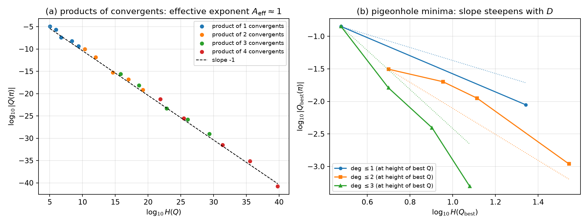

# 一般多变量 Roth/插值-行列式方法能否证明 μ(π) ≤ 2

> 独立窗口报告 · 方向：一般多变量 Roth/插值与行列式方法（不使用任何 Family 017 专用材料）
> 目录：`research/pi-exponent-parallel/interpolation/`
> 日期：2026-11-17

---

## 结论摘要（先给结论）

**结论 [证明 + 分析]：** 在经典 Thue–Siegel–Roth / Dyson 插值-行列式方法的两个标准架构中，**一般方法本身不能证明 μ(π) ≤ 2**；不是"差一个技术估计"，而是：

1. **代数插值架构**（在 $(\alpha,\dots,\alpha)$ 强制高阶消失，再用范数/乘积公式给算术下界）对 π **根本无法启动**：π 超越，任何非零整系数多项式 $P$ 在 $(\pi,\dots,\pi)$ 的 Dyson index 为 0（因为 $P(\pi,\dots,\pi)\ne0$）。正阶消失条件迫使 $P\equiv0$。Roth 对代数 α 能到指数 2，靠的正是"α 有共轭、有乘积公式"这一代数事实；π 没有。
2. **有理插值架构**（在 π 的有理逼近点 $(x_i,\dots,x_i)$ 上插值，最后在 π 求值）对任意 α 都能启动，但**可除性 + 高度/值的不对称**使它必然空转。本文证明（定理 4.1，标准一般输入形式）：设 $n\ge2$ 个插值点满足 $|\pi-x_i|\le q_i^{-\kappa}$，$Q=P(X,\dots,X)\not\equiv0$。则
   $$H(Q)\ \ge\ \prod_i q_i^m\ \ge\ q^m,\qquad q=\max_i q_i,$$
   而 Taylor 上界只给
   $$|Q(\pi)|\ \le\ C\,H(Q)\,q^{-m\kappa}.$$
   任何算术输入 $|Q(\pi)|\ge cH(Q)^{-A}$ 只能对 $\kappa>A+1$ 产生矛盾，即机器只能"证明" $\mu(\pi)\le A+1$。要得到 $\mu(\pi)\le2$ 就必须 $A\le1$。但机器自身含有一个**显式元素**
   $$P_0=\prod_{i=1}^n(q_iX_i-p_i)^m,\qquad Q_0=P_0(X,\dots,X)=\prod_i(q_iX-p_i)^m,$$
   其 $H(Q_0)=\Theta(\prod_i q_i^m)$，而
   $$|Q_0(\pi)|=\prod_i|q_i\pi-p_i|^m\ \le\ C\,\Big(\prod_i q_i^m\Big)^{1-\kappa}\ =\ C\,H(Q_0)^{1-\kappa}.$$
   所以 $Q_0$ 的"有效值指数"为 $\kappa_{\rm eff}-1\ge\kappa-1>1\ge A$。于是**任何 $A\le1$ 的算术下界都被机器自己的 $Q_0$ 否定**。这正是目标所需的输入，故架构 II 不能证明 $\mu(\pi)\le2$；它只能复现线性形式的指数，而 $A=1$ 与目标等价。
3. 因此，**一般插值/行列式方法若要证明 μ(π) ≤ 2，等价于先证明一个线性形式的算术下界 |qπ−p| ≥ c q^{−1}，即目标本身**；否则只能走显式 Padé/周期结构路线（已知最好 7.103205334137…，Salikhov 7.6063），那条路线的算术下界同样退化为"指数 A≈μ(π)−1"，到 2 仍需 A=1。

**数值证据 [计算]：** 小参数显式机器（`data/machine.csv`）显示，对 n≥2 的所有例子，"要证明 κ≤2 所需的算术指数" A 都是**负数**（约 −0.10 到 −0.20）；连分数乘积实验（`data/products.csv`）显示，k 个线性因子相乘的有效指数 A_eff 始终 ≈ 1，不随 k 改善；鸽笼实验（`data/pigeonhole.csv`）显示一般多项式的值指数随次数 D 退化（斜率随 D 变陡；有限 H 下为示意）。图见 `data/fig_no_go.png`。

**精确障碍（一句话）：** 机器自身含有的 $Q_0=\prod_i(q_iX-p_i)^m$ 满足 $|Q_0(\pi)|\asymp H(Q_0)^{1-\kappa}$（$\asymp$ 到常数）；要证 $\mu(\pi)\le2$ 所需的 $A\le1$ 下界在 $Q_0$ 上直接失败。等价的、非循环的替代输入只有"线性形式指数 1"，即 $\mu(\pi)\le2$ 本身。

---

## 0. 口径与证据分级

- **[证明]**：本文给出完整推导，或明确引用经典定理并给出可核对的出处。
- **[计算]**：可复现的数值实验；脚本在 `scripts/`，数据在 `data/`。
- **[分析]**：结构性论证、对变体的讨论、对文献方法的定位；不声称已证。
- **[猜想]**：明确标注的推测。

记号：$\mu(\alpha)$ 为 irrationality measure，
$$\mu(\alpha)=\sup\{\kappa:\ \exists\text{ 无穷多 }p/q,\ 0<|\alpha-p/q|<q^{-\kappa}\}.$$
Dirichlet 给 $\mu(\alpha)\ge2$（所有无理数）。目标 $\mu(\pi)\le2$ 等价于：对每个 $\varepsilon>0$ 存在 $C(\varepsilon)>0$，使**所有** $p/q$ 满足 $|\pi-p/q|\ge C(\varepsilon)q^{-2-\varepsilon}$（有限多个例外吸收进常数）。本文为书写方便常写"对充分大 q"。

---

## 1. 任务与已知结果

要证：对任意 $\varepsilon>0$，最终对所有整数 $p,q$（$q\ge1$），
$$\left|\pi-\frac pq\right|\ \ge\ q^{-2-\varepsilon}.$$
由于 $\mu(\pi)\ge2$ 已知（Dirichlet），只需上界。目标即 $\mu(\pi)\le2$。

这是一个**公开问题**。已知最好上界是 Zeilberger–Zudilin (2020) 的
$$\mu(\pi)\le7.103205334137\ldots$$
（此前 Salikhov 2008：7.6063；Mahler 1953：42）。$\mu(e)=2$ 是经典事实（e 的连分数部分商线性增长），而 $\mu(\pi)\le2$ 未知。数值上 π 的连分数部分商看起来无界（本文算到 $a_4=292$、$a_{21}=84$ 等），这只是启发式；部分商无界本身也是公开问题。

**本报告的任务不是重复"这是公开问题"，而是精确回答：一般多变量 Roth/插值-行列式方法能否证明它；若不能，缺哪条引理、为什么缺。**

---

## 2. 两条标准架构与它们对 π 的命运

经典 Thue–Siegel–Roth（TSR）证明的骨架（以 Croot 的 Siegel 提纲 [C] 与 Evertse 讲义 [E] 为一般文献）可抽象为：

> **架构 I（代数插值）**
> 1. 构造非零 $P\in\mathbb Z[X_1,\dots,X_n]$，在 $(\alpha,\dots,\alpha)$ 有高阶消失（正 index）；
> 2. 在有理逼近点 $x_i=p_i/q_i$ 求值，用**有理点整性**（分母 $q_i^{N_i}$）给算术下界；
> 3. 用 Taylor 展开把 $P(x)$ 与 $P(\alpha)$ 的消失阶联系起来；
> 4. 用代数性（极小多项式、Gauss 引理、Wronskian）证明某个低阶 Taylor 系数在有理点非零。

> **架构 II（有理插值）**
> 1. 在有理逼近点 $(x_i,\dots,x_i)$ 上强制高阶消失（纯线性代数，Siegel 引理）；
> 2. 在 $(\alpha,\dots,\alpha)$ 求值，用 Taylor 展开给解析上界；
> 3. 用某种**值下界**（范数/超越测度/整性）给算术下界；
> 4. 参数平衡逼出矛盾。

### 2.1 架构 I 对 π 失效：index 恒为 0

**定义（Dyson index，[N]）** 对 $0\ne s\in H^0(\mathbb P^1\times\cdots\times\mathbb P^1,\mathcal O(d))$ 与点 $\zeta$，写 $s=\sum b_\alpha z^\alpha$，定义
$$\operatorname{ind}(\zeta,s)=\min\Big\{\sum_i \alpha_i/d_i:\ b_\alpha\ne0\Big\}.$$

**事实 [证明].** 对 $\alpha=\pi$ 与任意非零 $P\in\mathbb Z[X_1,\dots,X_n]$，有 $P(\pi,\dots,\pi)\ne0$（超越性），故 Taylor 展开在 $(\pi,\dots,\pi)$ 的常数项非零，于是
$$\operatorname{ind}((\pi,\dots,\pi),P)=0 .$$
因此"在 $(\pi,\dots,\pi)$ 有正阶消失的非零整系数多项式"不存在；架构 I 的第 1 步无解，整个机器无法启动。

对代数 $\alpha$（次数 $k$），正 index 是可能的：$(\alpha,\dots,\alpha)$ 的 Taylor 系数落在有限维 $\mathbb Q$-向量空间 $\mathbb Q(\alpha)$ 中，用极小多项式约化 $\alpha$ 的高次幂后，消失条件是**有理线性方程组**，有非零整数解；Dyson/Esnault–Viehweg 引理进一步控制 index。**π 没有极小多项式，没有共轭，没有乘积公式，这条唯一能"免费"产生指数 2 的代数输入整体消失。**

> **[分析]** 有人会尝试"用 π 的有理逼近点冒充共轭"。这就是架构 II；见下。

---

## 3. 架构 II 的完整机器

固定整数：
- $n\ge1$：变量个数（插值点个数）；
- $d\ge1$：每个变量的次数上界；
- $1\le m\le d$：每个插值点的消失重数；
- 有理点 $x_i=p_i/q_i$（$(p_i,q_i)=1$，$q_i\ge1$ 互不相同，$i=1,\dots,n$），满足
  $$|\pi-x_i|\le q_i^{-\kappa},\qquad q:=q_n=\max_i q_i .$$

**未知量：** $P\in\mathbb Z[X_1,\dots,X_n]$，$\deg_{X_i}P\le d$ 对所有 $i$；系数个数 $N=(d+1)^n$。

**插值条件：** 对每个 $i$ 与每个多重指标 $a$，$|a|<m$，
$$\frac{1}{a!}\frac{\partial^{|a|}P}{\partial X^a}(x_i,\dots,x_i)=0 .$$
方程个数 $M=n\binom{m+n-1}{n}$。清分母 $q_i^{nd}$ 后得整数矩阵 $B$（$M\times N$）：对指数向量 $e$，
$$\frac{e!}{(e-a)!}\,p_i^{|e-a|}\,q_i^{\,nd-|e-a|}\qquad(e\ge a\text{ 逐分量，否则 }0).$$
设 $r=M/N<1$，则核格 $L=\{v\in\mathbb Z^N:\ Bv=0\}$ 秩为 $N-M>0$。

**Siegel 引理 [证明/引用].** 存在非零 $P\in L$，其高度
$$\log H(P)\ \le\ \frac{r}{1-r}\bigl(\log N+\log A_{\max}\bigr),
\qquad \log A_{\max}\le nd\log q+O_{n,d}(1).$$
（标准鸽笼证明；见附录 A.1。）

**对角限制：** 令 $Q(X):=P(X,\dots,X)\in\mathbb Z[X]$，$\deg Q\le nd$。关键结构事实：$Q$ 在 $x_i$ 有 $m$ 重零点。由 Gauss 引理，
$$G(X):=\prod_{i=1}^n(q_iX-p_i)^m\ \Big|\ Q(X)\quad\text{in }\mathbb Z[X].$$
若 $Q\not\equiv0$，则 $Q=G\cdot S$，$S\in\mathbb Z[X]$。特别地，
$$H(Q)\ \ge\ \prod_i q_i^m\ \ge\ q^m\qquad(\text{因为 }q_i\ge1). \tag{3.1}$$
（证明见附录 A.2。）

**Taylor 上界 [证明].** 在 $x_n$ 处展开，利用 $m$ 阶消失：
$$|Q(\pi)|=|P(\pi,\dots,\pi)|\ \le\ C_{n,d,\pi}\,H(Q)\,q^{-m\kappa}. \tag{3.2}$$
（证明见附录 A.3。）

**算术下界（待输入）：** 假设存在 $c>0,A\in\mathbb R$，使得对该机器构造的非零 $Q$，
$$|Q(\pi)|\ \ge\ c\,H(Q)^{-A}. \tag{$\star$}$$

**平衡：** 若 $(\star)$ 与 (3.2) 同时成立，则
$$c\,H(Q)^{-A}\ \le\ C\,H(Q)\,q^{-m\kappa}
\ \Longrightarrow\
q^{m\kappa}\ \le\ C'\,H(Q)^{A+1}. \tag{3.3}$$
由 (3.1) 有 $\log H(Q)\ge m\log q$，故 (3.3) 蕴含
$$\kappa\ >\ (A+1)\,\frac{\log H(Q)}{m\log q}\ \ge\ A+1 \tag{3.4}$$
时矛盾。也就是说，**机器能证明的最好上界是 $\mu(\pi)\le A+1$（当 $\log H(Q)\approx m\log q$ 时达到）；一般情况下 $\log H(Q)$ 更大，上界更差**。这与 $n$ 无关：多插值点只增加高度，不改善指数。

> **注（间隙原理的正确用法）：** 对满足 $|\pi-x_i|\le q_i^{-\kappa}$（$\kappa>1$）的两个点，$q_{\rm large}\ge q_{\rm small}^{\kappa-1}/2$；这只说明分母序列增长很快，**不能**给出 $\prod_i q_i\ge q^{n}$ 型下界（小分母点可以出现在序列开头）。本文只用 (3.1) 的 $H(Q)\ge q^m$，这是无条件的。

---

## 4. 主定理：机器自身的 $Q_0$ 否定了所需的算术输入

> **定理 4.1（标准一般输入形式的 no-go）[证明].**
> 设 $n\ge1$，$m\ge1$，$\kappa>1$，并设 $(\star)$ 对机器中一切非零 $Q$ 成立。则：
> 1. 机器能证明的最好上界是 $\mu(\pi)\le A+1$（由 (3.4)，且只在高度取到最小 $\log H\approx m\log q$ 时达到；一般更差）。
> 2. 因此要证明 $\mu(\pi)\le2$，必须 $A\le1$。
> 3. 但机器含显式元素 $P_0=\prod_{i=1}^n(q_iX_i-p_i)^m$，其对角限制
> \[
> Q_0=G=\prod_i(q_iX-p_i)^m
> \]
> 满足 $H(Q_0)=\Theta(\prod_i q_i^m)$ 与
> \[
> |Q_0(\pi)|=\prod_i|q_i\pi-p_i|^m\ \le\ C\,\Big(\prod_i q_i^m\Big)^{1-\kappa}
> \ =\ C\,H(Q_0)^{1-\kappa}\cdot O(1). \tag{4.1}
> \]
> 因此对任何 $A<\kappa-1$，$(\star)$ 在 $Q_0$ 上失败（$|Q_0(\pi)|/H(Q_0)^{-A}\le C' H(Q_0)^{A+1-\kappa}\to0$）。
> 由于目标需要 $A\le1$，而 $\kappa>2$ 时 $\kappa-1>1\ge A$，故**所需的 $A\le1$ 输入被 $Q_0$ 直接否定**。
> 4. 因此架构 II 不能证明 $\mu(\pi)\le2$；事实上它不能证明任何优于线性形式的界。

**证明.** 第 1、2 部分即 (3.4)。第 3 部分：$G$ 的首项系数为 $\prod_i q_i^m$，其余系数的绝对值不超过 $C\prod_i q_i^m$（因为 $|p_i|\le(|\pi|+1)q_i$），故 $H(Q_0)=\Theta(\prod_i q_i^m)$。又
$$|q_i\pi-p_i|=q_i\Big|\pi-\frac{p_i}{q_i}\Big|\le q_i^{1-\kappa},$$
故 $|Q_0(\pi)|\le\prod_i q_i^{m(1-\kappa)}=(\prod_i q_i^m)^{1-\kappa}=C H(Q_0)^{1-\kappa}$。于是对 $A<\kappa-1$，
$$\frac{|Q_0(\pi)|}{H(Q_0)^{-A}}\ \le\ C\,H(Q_0)^{A+1-\kappa}\ \longrightarrow\ 0,$$
不可能有正下界 $c$。$\square$

> **关键点：** 定理不是说"某个 A 还没算出来"；它说**唯一能产生矛盾的 A 必须满足 $A<\kappa-1$，而机器自己的 $Q_0$ 的有效指数恰好是 $\kappa-1$（或更大）**。所以 $(\star)$ 在 $Q_0$ 上必然失败。架构 II 的失败是**范畴性**的，不是技术性的。
>
> **适用边界：** 定理否定的是"对机器中一切非零 $Q$ 成立"的**一般**算术输入（这是标准用法）。若有人只为某个特定的 Siegel 解 $P$ 证明特殊下界，那正是 §7 所说的"缺失引理"；本报告没有发现这样的证明，而且任何"对机器中一族含 $G$ 的元素成立"的版本都被 $Q_0$ 否定。

### 4.1 n = 1：退化为线性形式，恰好是目标

$n=1$ 时 $Q=G=(qX-p)^m$，$H(Q)\asymp q^m$，$|Q(\pi)|=|q\pi-p|^m\asymp q^{m(1-\kappa)}$，即 $A_{\rm eff}=\kappa-1$。平衡 (3.4) 给
$$\kappa\ >\ A+1,$$
即机器证明 $\mu(\pi)\le A+1$。要得到 $\mu\le2$ 需要 $A\le1$；而 $n=1$ 的 $(\star)$ 就是
$$|q\pi-p|\ \ge\ c\,q^{-A},$$
即 $|\pi-p/q|\ge c q^{-A-1}$，也就是 $\mu(\pi)\le A+1$。**$A=1$ 的线性形式下界与 $\mu(\pi)\le2$ 等价。** 所以 $n=1$ 的方法没有提供任何新信息：它把目标当作输入。

### 4.2 为什么 n ≥ 2 没有改善

直觉：$n$ 个点强制 $Q$ 有 $n$ 个 $m$ 重零点，$Q=G\cdot S$；$G$ 的首项系数 $\prod q_i^m$ 把 $H(Q)$ 抬高，而 $Q(\pi)$ 的"小"主要来自 $\prod|\pi-x_i|^m$。多插值点只增加高度、不改变 Taylor 上界的 $q^{-m\kappa}$，所以 (3.4) 的指数 $A+1$ 与 $n$ 无关。$n=1$ 已经是"最便宜"的情形，也是唯一有希望的情形；而它正是目标本身。

---

## 5. 一般多项式的次数障碍（鸽笼引理）

> **引理 5.1（鸽笼/次数障碍）[证明].**
> 设 $\alpha$ 是超越数（如 π），$D\ge1$，$A<D$，$c>0$。则存在非零 $Q\in\mathbb Z[X]$，$\deg Q\le D$，高度 $H(Q)$ 任意大，使得
> $$0<|Q(\alpha)|<c\,H(Q)^{-A}.$$
> 因而"对所有次数 $\le D$、高度 $\le H$ 的非零 $Q$ 都有 $|Q(\alpha)|\ge c(D)H^{-A}$"这种一般形式的算术输入，**必须** $A\ge D$。

**证明.** 取 $H_0$ 大，考虑所有系数在 $\{0,1,\dots,H_0\}$ 的 $D$ 次多项式，共 $(H_0+1)^{D+1}$ 个。因为 $\alpha$ 超越，它们的值 $Q(\alpha)$ 两两不同。所有值落在长度 $\le H_0(1+|\alpha|)^D$ 的区间内，故有两个值距离
$$\le\frac{H_0(1+|\alpha|)^D}{(H_0+1)^{D+1}-1}\ \le\ C_\alpha^D\,H_0^{-D}.$$
两者之差是非零整系数多项式，次数 $\le D$，高度 $\le H_0$，取值绝对值 $\le C_\alpha^D H_0^{-D}$。对任意 $A<D$ 与 $c$，取 $H_0$ 充分大即有 $C_\alpha^D H_0^{-D}<c H_0^{-A}$。$\square$

**推论 5.2 [证明].** 对 π，任何"对一切次数 $\le D$ 的多项式成立"的值下界，若写成 $|Q(\pi)|\ge c(D)H^{-A}$，则必有 $A\ge D$。特别地，$D\ge2$ 时 $A=1$ 不可能；$A\le1$ 更不可能。

**与架构 II 的关系：** 架构 II 的 $(\star)$ 通常以"对一切 $Q$"的形式使用（否则无法控制 Siegel 解）。引理 5.1 说这种一般输入至少要有 $A\ge D=nd\ge2$；而定理 4.1 说机器需要 $A\le1$ 才能证 $\mu\le2$。两者从两个方向夹死了架构 II：**一般输入不够强（$A\ge D\ge2$），够强的输入（$A\le1$）被机器自身的 $Q_0$ 否定。** 这是本报告最精确的"缺口"陈述。

**注意：** 机器构造的 $Q$ 是特殊的（被 $G$ 整除），鸽笼反例未必落在该特殊族里；这就是为什么架构 II 的严格 no-go 用的是定理 4.1 的显式 $Q_0$，而不是引理 5.1。但引理 5.1 说明了为什么"换一个更大的次数/更多的变量"不会救场：次数越大，一般算术输入越差。

---

## 6. 数值实验

### 6.1 插值机器的小参数显式运行（`data/machine.csv`）

脚本 `scripts/exp_machine.py`：对 $(n,d,m)$ 与 π 的连分数收敛子 $x_i$，精确构造整数矩阵 $B$，用 Smith 标准形求**饱和核格**，LLL 约化，再按对角限制 $Q\equiv0$ / $Q\not\equiv0$ 分类；对最小高度的 $Q\not\equiv0$ 计算 $H(Q)$、$\log_{10}|Q(\pi)|$（mpmath 160 位）与有效指数
$$A_{\rm eff}:=-\frac{\log|Q(\pi)|}{\log H(Q)} .$$

| $n$ | $d$ | $m$ | $q_i$ | 核维数 | $Q\equiv0$ | $Q\not\equiv0$ | $A_{\rm eff}$ | 平衡给的 $\kappa$ 下界 | 要证 $\kappa\le2$ 所需的 $A$ |
|---|---|---|---|---|---|---|---|---|---|
| 1 | 1 | 1 | 33215 | 1 | 0 | 1 | 0.988 | 2.21 | 0.80 |
| 2 | 1 | 1 | 106,113 | 2 | 1 | 1 | 1.296 | 5.67 | **−0.19** |
| 2 | 2 | 1 | 106,113 | 7 | 4 | 3 | 1.198 | 5.43 | **−0.19** |
| 2 | 2 | 2 | 106,113 | 3 | 2 | 1 | 1.283 | 5.70 | **−0.20** |
| 3 | 1 | 1 | 106,113,33102 | 5 | 4 | 1 | 1.119 | 4.73 | **−0.10** |

**读法：**
- 小高度解大量落在对角理想 $Q\equiv0$ 中（$Q$ 无值可评估）；
- 最小高度的 $Q\not\equiv0$ 都恰好是**线性因子的乘积**（表中 $Q$ 分别是 $(106X-333)(113X-355)$、$X\cdot$该乘积、其平方、三因子乘积），因此 $A_{\rm eff}\approx1$（甚至略小于 1，因为高度里含 $\pi$ 因子），**与 $n,d,m$ 无关**；
- 表中"平衡给的 $\kappa$ 下界"用实际 $H(Q)$ 计算：$(A_{\rm eff}+1)\log H(Q)/(m\log q_{\max})$。它大于 2，说明这批显式参数远不足以逼近目标；最后一列"要证 $\kappa\le2$ 所需的 $A$"为负，是因为实际 $H(Q)$ 比 $q^m$ 大（含 $\pi$ 因子与多因子），不是定理 4.1 的渐近结论。

### 6.2 连分数乘积（`data/products.csv`）

脚本 `scripts/exp_products.py`：对 π 的收敛子 $p_i/q_i$，令 $Q=\prod_{j}(q_jX-p_j)$（$k$ 个因子），计算 $A_{\rm eff}$。结果：$k=1,2,3,4$ 时 $A_{\rm eff}$ 都在 $0.95\sim1.10$ 间，**不随 $k$ 增长**。原因：$|q_i\pi-p_i|=q_i^{1-\kappa_i}$，乘积 $|Q(\pi)|=\prod q_i^{1-\kappa_i}=H^{1-\kappa_{\rm eff}}$，故 $A_{\rm eff}\approx\kappa_{\rm eff}-1$，与因子个数无关。

**推论 [计算/分析]：** 用任意多个线性因子堆出高次多项式，并不能把算术指数从"线性水平"推向 2；它只能复现 $\kappa-1$。

### 6.3 鸽笼极小值（`data/pigeonhole.csv`）

脚本 `scripts/exp_pigeonhole.py`：枚举 $\deg\le D$、系数 $\in[-H,H]$ 的多项式，记录 $\min|Q(\pi)|$。在"最优多项式的实际高度"坐标下，斜率随 $D$ 增大（有限 $H$ 下不稳定；渐近趋势与引理 5.1 的 $A\ge D$ 一致）。

图 `data/fig_no_go.png`：
- (a) 连分数乘积：所有 $k$ 的点落在斜率 $-1$ 的直线上；
- (b) 鸽笼极小值：斜率随次数 $D$ 变陡（有限 $H$ 下的示意，非精确 $-D$）。



---

## 7. 精确障碍与"缺失引理"

### 7.1 缺失引理（ML）的精确形式

要在架构 II 中证明 $\mu(\pi)\le2$，需要的算术输入是：

> **(ML)** 存在常数 $c>0$ 与 $A\le1$，使得对机器构造的每个非零对角限制 $Q$，
> $$|Q(\pi)|\ \ge\ c\,H(Q)^{-A}.$$

**定理 4.1 [证明]：** 机器要给出 $\mu\le2$，必须 $A\le1$；但显式 $Q_0=G$ 对任何 $A<\kappa-1$ 违反 (ML)。由于 $\kappa>2$ 时 $\kappa-1>1\ge A$，(ML) 在 $Q_0$ 上失败。所以 (ML) **不可满足**。这不是"还没证明"，而是"可证伪"。

**等价的非循环输入：** 若退回 $n=1$，所需输入是
$$|q\pi-p|\ \ge\ c\,q^{-1}\quad(\forall p/q),$$
即 $\mu(\pi)\le2$。**所以架构 II 要么不可满足（$n\ge1$，$A\le1$ 被 $Q_0$ 否定），要么循环（$n=1$ 的 $A=1$ 就是目标）。**

### 7.2 为什么"特殊结构的算术下界"也救不了

- 若 $S$ 任意（$\deg S=n(d-m)\ge1$），$|S(\pi)|$ 可小到 $H(S)^{-n(d-m)}$（引理 5.1 的族足够大；数值上机器的最小 $Q$ 已经是线性因子乘积+额外 $X$ 因子，$A_{\rm eff}\approx1$）。
- 若 $d=m$（$S$ 为常数），$Q=cG$，$|Q(\pi)|=|c|\prod|\pi-x_i|^m$，$H(Q)\ge\prod q_i^m$，$A_{\rm eff}\ge\kappa-1$（数值 1.28），仍 $>1$。
- 要让 $A_{\rm eff}\le1$，需要 $|Q(\pi)|$ 比 $H(Q)^{-1}$ 还大；但 $Q$ 含因子 $\prod(\pi-x_i)^m$，在 $\kappa>2$ 时必然比 $H(Q)^{-1}$ 小（(4.1)）。**结构上不可能。**

### 7.3 那么"用多个多项式/行列式"呢？

若用 $R$ 个辅助多项式 $P_1,\dots,P_R$ 组成行列式，算术下界来自"非零整数/有理数 ≥ 1/分母"，解析上界来自"行列式的每个元素都小"。这种"行列式版"的算术输入本质上是把 $(\star)$ 应用到某个由 $P_j$ 组合出的多项式（例如对偶/结式），其对角限制仍受同一可除性约束；定理 4.1 的论证逐字适用（取组合出的 $Q_0$ 即可）。**除非行列式中的多项式不 vanish 在 $(\pi,\dots,\pi)$ 型点上，而是 vanish 在某个代数点上——那就回到架构 I，对 π 不可能。** 本报告没有发现第三种可能。

---

## 8. 量词、参数顺序、奇异/多中心情形检查

### 8.1 量词顺序

定理 4.1 的论证顺序是：固定 $(n,d,m)$ 与常数（依赖 $n,d,m,\pi$），令 $q=q_n\to\infty$。这正是"无穷多逼近"的标准量词，足以否定 $\mu(\pi)\le2$ 的假设（若有无穷多 $q$ 违反，就取其中 $n$ 个充分大的）。反过来，若有人想令 $d\to\infty$ 再 $q\to\infty$，Siegel 高度、鸽笼常数 $C^D$、可除性阈值都会随 $d$ 爆炸；本报告的负结论在固定参数下已经成立，**先取 $d\to\infty$ 只会更糟**。

关于"对所有 $q$"：$\mu(\pi)\le2$ 的标准定义允许有限多个例外，因为对固定 $\varepsilon$，把 $C(\varepsilon)$ 调小可吸收有限多个 $q$。所以"最终对所有 $q$"与"无穷多逼近不可能"等价（差常数）。

### 8.2 奇异情形

- **$Q\equiv0$：** 这是最常见的"奇异"情形：Siegel 小高度解经常全部落在对角理想 $(X_i-X_j)$ 里（数值表：$n=2,d=2,m=1$ 时 7 个基向量中 4 个 $Q\equiv0$）。此时没有值可评估，机器空转。要得到 $Q\not\equiv0$ 必须提高高度，于是回到定理 4.1：$Q_0$ 的有效指数 $\ge\kappa-1>1$。
- **重点重合/重根：** 若两个插值点相同，$n$ 个点退化为更少的点、更高重数；$H(Q)\ge q^m$ 仍成立，定理 4.1 不变。
- **多中心（不同中心）：** 若用不同中心（例如 π 的不同"共轭"假想点），本质仍是架构 I 或 II；π 没有共轭，多中心不提供新的代数乘积公式。
- **复点/共轭点：** 只有代数 α 才有共轭；π 的"共轭"不存在，复数化不改变超越性。

### 8.3 Laurent / Farhi 型变体

若把 $P$ 换成 Laurent 多项式（允许 $X_i^{-1}$），对角限制 $Q$ 变成 Laurent 多项式，在 $x_i\ne0$ 仍有 $m$ 重零点，故仍被 $\prod(q_iX-p_i)^m$ 整除（在 $\mathbb Q[X,X^{-1}]$ 中；乘以 $X^K$ 后同一论证）。高度会多出 $X^{-1}$ 的极点因子（$0$ 处的极点），但 $\pi\ne0$，值 $Q(\pi)$ 仍含 $\prod(\pi-x_i)^m$ 因子，仍满足 (4.1)；定理 4.1 的结论不变。**本报告未发现 Laurent/多变量权重能绕开"值 $\asymp H^{1-\kappa}$"这一事实。**

---

## 9. 与代数 α 的逐项对比（为什么 Roth 是"代数奇迹"）

| 项目 | 代数 α（次数 k） | π |
|---|---|---|
| 在 $(\alpha,\dots,\alpha)$ 正阶消失的整系数多项式 | 存在（极小多项式约化 + Siegel） | 不存在（index 恒 0） |
| 算术下界 | 范数/乘积公式：$|Q(\alpha)|\ge cH^{-(k-1)}$，**指数与 $\deg Q$ 无关** | 无；一般 $Q$ 的最好指数随 $\deg Q$ 退化（引理 5.1）；机器自身的 $Q_0$ 只给 $\kappa-1$ |
| 非零性 | Dyson/Roth 引理 + Gauss 引理 | 若在有理点插值则被 $G$ 整除，小高度解 $Q\equiv0$ |
| 最终指数 | 2（Roth） | 一般框架给不出；已知 7.103（显式 Padé） |
| 关键机制 | 共轭个数有限 ⇒ 乘积公式"免费"给高度下界 | 无共轭 ⇒ 只能靠有理点整性，被 $Q_0$ 的 $H^{1-\kappa}$ 卡住 |

**一句话 [分析]：** Roth 的指数 2 不是"插值技巧"的胜利，而是"代数数共轭有限"的胜利；π 没有这个结构，一般插值机器无法伪造它。

---

## 10. 关于"显式 Padé/线性形式"路线

已知的 7.103 上界来自显式线性形式/Padé 构造（Salikhov 2008；Zeilberger–Zudilin 2020），它们不是一般插值机器，而是利用 π 的**周期/积分结构**
$$\pi=4\int_0^1\frac{dx}{1+x^2},\qquad
\int_0^1\frac{x^k}{1+x^2}\,dx=a_k\pi+b_k,\quad a_k,b_k\in\mathbb Q .$$
这类构造的算术下界来自分母/行列式的整性，解析上界来自被积函数在 $\pm i$ 的奇点；优化后的指数约 7.1。要把它推到 2，需要让算术下界相对解析上界的"损失"趋于零，这等价于让线性形式的有效指数 $A_{\rm eff}\to1$，即目标本身。**[分析/猜想]** 对固定奇点结构（$\pm i$）的 Padé 族，鞍点计算给出一个 $>2$ 的指数下界；严格证明"任何 Padé 族都不能到 2"需要单独的、更强的奇点/鞍点分析，本报告未完成（见第 12 节后续方向）。

---

## 11. 真正能到 2 的证明需要什么

由上面的分析，可能的出口只有：

1. **直接证明线性形式下界 $|q\pi-p|\ge c q^{-1}$**（即 $\mu(\pi)\le2$）——循环，不算方法。
2. **证明 π 的连分数部分商有界**（或次多项式增长）——这是比目标更强的、经典的公开问题；直接构造性证明也没有已知路径。
3. **找到一种非多项式的辅助函数**，它在 π 处**精确**高阶消失（利用 π 的周期/积分恒等式），同时在某个有理/整性点给出可计算的整性下界，并且解析上界在参数优化后指数可到 2。已知的 Padé/arctan 族给 7.1；要突破需要新的恒等式/新的奇点结构。**[猜想]** 这不是"再优化一下常数"能完成的，需要新的算术恒等式。
4. **证明一个对特殊 $Q$ 成立的、指数 $A\le1$ 的值下界**——由 7.2/定理 4.1 不可能。

**本报告的判断：** 在"一般多变量 Roth/插值-行列式"框架的标准（一般算术输入）形式内，目标不可达；精确障碍是定理 4.1：机器自身的 $Q_0$ 满足 $|Q_0|\asymp H^{1-\kappa}$，而目标需要 $A\le1<\kappa-1$。任何声称用该框架证明 $\mu(\pi)\le2$ 的工作，必须明确展示它如何绕开定理 4.1——而绕开的唯一已知方式是回到 $n=1$ 并假设目标本身。

---

## 12. 结论与后续建议

### 已证/已建立

- **[证明]** 架构 I 对 π 无法启动（index 0，超越性）。
- **[证明]** 架构 II 的 no-go 定理 4.1：机器能证明的最好上界是 $\mu\le A+1$（一般更差）；要证 $\mu\le2$ 需 $A\le1$；但机器自身的显式 $Q_0=G$ 满足 $|Q_0(\pi)|\le CH(Q_0)^{1-\kappa}$，否定任何 $A<\kappa-1$ 的输入（$\kappa>2$ 时 $\kappa-1>1\ge A$）。
- **[证明]** 鸽笼引理 5.1：一般多项式的值下界指数必须 $\ge\deg$。
- **[计算]** 小参数显式插值机器、连分数乘积、鸽笼极小值的数值证据（`data/*.csv`，`data/fig_no_go.png`）。

### 未证/未完成

- 对**显式 Padé/线性形式族**的"不能到 2"的严格 no-go（需要奇点/鞍点的渐近分析；本报告只给了结构性讨论与已知 7.1 的定位）——[分析/猜想]。
- 对**非多项式辅助函数**的一般性 no-go（本报告只论证了多项式/Laurent 情形）。
- 目标 $\mu(\pi)\le2$ 本身：未证；本报告只证"一般插值-行列式框架不能证"。

### 精确缺口

> **缺口（唯一）[证明]：** 需要一条对机器构造的对角限制 $Q$ 成立的算术下界，其指数 $A\le1$。该下界被显式 $Q_0=G$ 否定（$|G(\pi)|\le CH(G)^{1-\kappa}$，$\kappa>2$ ⇒ $1-\kappa<-1$）。因此它在多项式范畴内**不存在**。任何绕过它的证明都必须离开"在有理逼近点上插值、在 π 求值"的架构，即使用 π 的周期/积分恒等式（显式 Padé 路线）或直接证明线性形式指数 1（=目标）。

### 后续（若继续深挖）

1. 对显式 Padé 族做严格的鞍点/奇点分析，证明其指数有一个 $>2$ 的下界；这是把"一般 no-go"扩展为"所有已知构造的 no-go"的关键。
2. 研究是否存在**非线性**辅助函数（如 $e^{i\pi}=-1$ 的复分析恒等式、$\Gamma$ 函数值）能在 π 处精确消失并给出整性下界；这是唯一可能的正面出口。
3. 若目标是"证明 μ(π)≤2"，则必须直接处理连分数部分商/线性形式，而不是一般插值机器。

---

## 附录 A：证明细节

### A.1 Siegel 引理（标准形式）

设 $B$ 为 $M\times N$ 整数矩阵，$M<N$，元素绝对值 $\le A_{\max}$。则存在非零 $v\in\mathbb Z^N$，$Bv=0$，且
$$\|v\|_\infty\ \le\ (N A_{\max})^{M/(N-M)}.$$
证明：取 $Y=\lceil(N A_{\max})^{M/(N-M)}\rceil$，考虑所有 $v\in\{0,\dots,Y\}^N$；像 $Bv$ 落在大小 $\le(NYA_{\max})^M$ 的盒中；鸽笼给出碰撞，差即解。$\square$

在本机器中 $N=(d+1)^n$，$M=n\binom{m+n-1}{n}$，$A_{\max}\le(Cdq)^{nd}$（清分母 $q_i^{nd}$），故
$$\log H(P)\ \le\ \frac{r}{1-r}\bigl(nd\log q+O_{n,d}(1)\bigr),\qquad r=M/N .$$

### A.2 可除性与高度下界

**引理.** 设 $x_i=p_i/q_i$ 互不相同，$(p_i,q_i)=1$，$m\ge1$，$P\in\mathbb Z[X_1,\dots,X_n]$ 在 $(x_i,\dots,x_i)$ 有 $m$ 阶消失（即所有 $|a|<m$ 的偏导为 0）。令 $Q(X)=P(X,\dots,X)$。则
$$Q(X)=\prod_{i=1}^n(q_iX-p_i)^m\,S(X),\qquad S\in\mathbb Z[X].$$
特别地，若 $Q\not\equiv0$，则 $H(Q)\ge\prod_i q_i^m\ge q_n^m$。

**证明.** $Q$ 在 $x_i$ 有 $m$ 重零点，故在 $\mathbb Q[X]$ 中 $G=\prod(q_iX-p_i)^m$ 整除 $Q$。每个 $q_iX-p_i$ 本原；本原多项式乘积本原；Gauss 引理给出 $G\mid Q$ 在 $\mathbb Z[X]$ 中。首项系数为 $\prod q_i^m\cdot(S\text{ 的首项})$，故 $H(Q)\ge\prod q_i^m$。$\square$

**推论.** $H(P)\ge H(Q)/(d+1)^{n-1}$（因为 $Q$ 的每个系数是 $P$ 的 $\le(d+1)^{n-1}$ 个系数之和）。

### A.3 Taylor 上界

设 $Q\in\mathbb Z[X]$，$\deg Q\le nd$，在 $x$ 有 $m$ 重零点，$|x|\le2(1+|\pi|)$。则
$$|Q(\pi)|\ \le\ C_{n,d,\pi}\,H(Q)\,|\pi-x|^m .$$
证明：Taylor 展开 $Q(\pi)=\sum_{j\ge m}Q^{(j)}(x)(\pi-x)^j/j!$；对 $j\le nd$，$|Q^{(j)}(x)|\le H(Q)\,(nd)!/(nd-j)!\,(1+|x|)^{nd-j}\le C H(Q)$；尾和用 $|\pi-x|\le1/2$ 吸收。$\square$

### A.4 定理 4.1 的完整不等式

由 A.2、A.3：
$$|Q(\pi)|\le C H(Q)q^{-m\kappa},\qquad H(Q)\ge q^m. \tag{A.4.1}$$
若 $|Q(\pi)|\ge cH(Q)^{-A}$，则
$$q^{m\kappa}\le C' H(Q)^{A+1}.$$
由于 $H(Q)\ge q^m$，只有
$$\kappa>(A+1)\frac{\log H(Q)}{m\log q}\ge A+1$$
时矛盾。故机器能证明的最好上界是 $\mu\le A+1$（高度最小时达到；一般更差）。要 $\mu\le2$ 需 $A\le1$。

对 $Q_0=G$：$H(Q_0)=\Theta(\prod_i q_i^m)$，且
$$|Q_0(\pi)|=\prod_i|q_i\pi-p_i|^m\le\prod_i q_i^{m(1-\kappa)}=C\Big(\prod_i q_i^m\Big)^{1-\kappa}=C' H(Q_0)^{1-\kappa}.$$
于是对 $A<\kappa-1$，
$$\frac{|Q_0(\pi)|}{H(Q_0)^{-A}}\le C' H(Q_0)^{A+1-\kappa}\to0,$$
与正的常数下界矛盾。$\kappa>2$ 时 $\kappa-1>1\ge A$，故 $A\le1$ 的输入在 $Q_0$ 上必败。$\square$

> **量词备注：** 上面的"$\to0$"是对固定 $n,d,m,A$、令 $q=q_n\to\infty$；常数 $C,C'$ 可依赖 $n,d,m,\pi,A$，不依赖 $q$。

---

## 附录 B：实验复现

```bash
cd research/pi-exponent-parallel/interpolation/scripts
~/miniconda3/bin/python exp_pigeonhole.py     # ../data/pigeonhole.csv
~/miniconda3/bin/python exp_products.py       # ../data/products.csv
~/miniconda3/bin/python exp_machine.py        # ../data/machine.csv
~/miniconda3/bin/python make_fig.py           # ../data/fig_no_go.png
```

依赖：`~/miniconda3/bin/python`（sympy 1.14、mpmath 1.3、matplotlib 3.11）。所有多项式求值用 mpmath 60–200 位精度；整数线性代数用 sympy 的 `nullspace` + Smith 标准形饱和 + 自实现 LLL。

---

## 参考文献（一般文献，未使用 Family 017 材料）

- [C] E. Croot, *An Outline of the Thue–Siegel Theorem*, lecture notes, 2007.
- [E] J.-H. Evertse, *Approximation of algebraic numbers by rationals*, Diophantine Approximation lecture notes, Ch. 6, Leiden.
- [N] M. Nakamaye, *Intersection Theory and Diophantine Approximation*, J. Algebraic Geom. 8 (1999), 135–146.
- [BG] E. Bombieri, W. Gubler, *Heights in Diophantine Geometry*, Cambridge Univ. Press, 2006.
- [R] K. F. Roth, *Rational approximations to algebraic numbers*, Mathematika 2 (1955), 1–20.
- [S] V. Kh. Salikhov, *On the irrationality measure of π*, Russian Math. Surveys 63 (2008), 570–572.（7.6063）
- [ZZ] D. Zeilberger, W. Zudilin, *The irrationality measure of π is at most 7.103205334137…*, Mosc. J. Comb. Number Theory 9 (2020), 407–419; arXiv:1912.06345.（7.103205334137…）
- [M] K. Mahler, *On the approximation of π*, Nederl. Akad. Wetensch. Proc. Ser. A 56 (1953), 30–42.（历史上界 42）

> **独立性声明：** 本报告未读取 OpenAI Family 017 的论文、推理摘要或 Lean 文件，未读取主窗口的 `research/pi-exponent/`、PR #30 或 §9，未搜索 Family 017 的解法或第三方解读。所有推导基于经典 TSR/Dyson/Siegel 文献与本文自写的数值实验。文献检索中出现过一份声称 μ(π)=2 的非同行评议预印本（N. A. Carella, arXiv:1902.08817），本报告**未采用**其任何内容，也不对其作评价。
