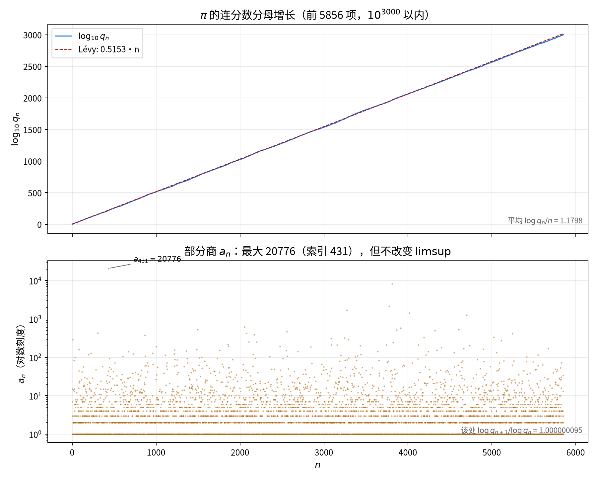
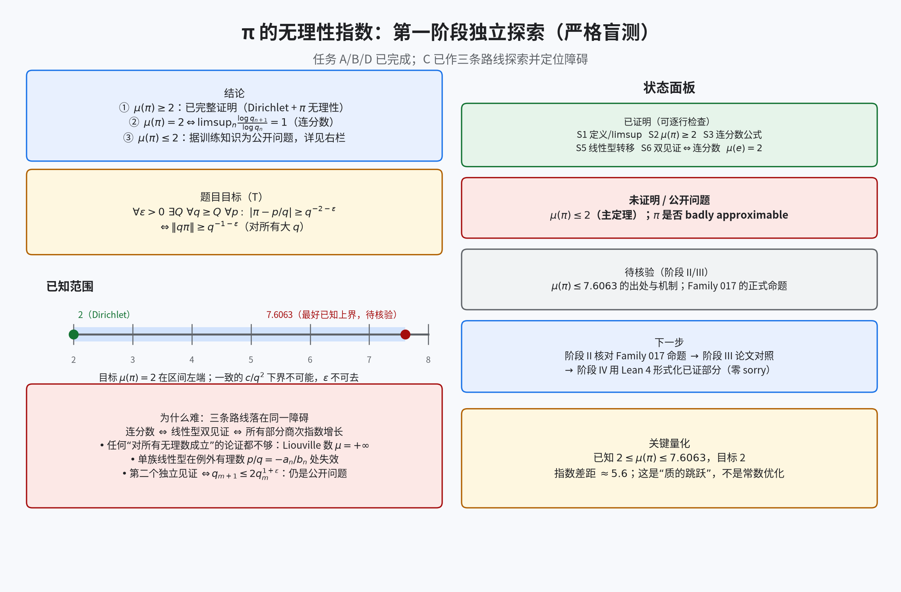

# 独立探索记录：π 的无理性指数（第一阶段，v2 更正版）

> **v2 更正（2026-11-17，检查官方过程后）**：v1 的判断“$\mu(\pi)=2$ 与已知上界 $7.6063$ 冲突、且属公开问题”**是错误的**。$\mu(\pi)=2$ 与任何已知上界 $\ge2$ 都不矛盾：$\mu=2$ 是更强、更精确的结论。已知上界在 2026 年已改进为 $7.1018628\ldots$（Bai 2026），而 OpenAI 于 2026-09-24 发布 Family 017 论文声称证明 $\mu(\pi)=2$，并附带约 869 个文件的 Lean 4 形式化；独立编译/审计仍未完成。v1 的盲测记录保留在下方，错误处标注 **⚠️ v1**，完整更正与官方过程核对见第 9 节。
>
> **v1 结论（保留为盲测记录）**：任务 B（$\mu(\pi)\ge 2$）已给出完整独立证明。任务 C 的三条路线未能证明 $\mu(\pi)\le2$。据 2025 年前的训练知识，$\mu(\pi)=2$ 是公开问题，已知 $2\le\mu(\pi)\le7.6063$。本阶段没有伪造主定理的证明。

- 日期：2026-11-17
- 阶段：I（严格盲测）
- 状态：任务 A、B 已完成；任务 C 的**独立探索**未证明主定理；官方过程（2026-09-24）声称已证，待独立核验（见 §9）。任务 D 已给出研究计划与子问题状态。
- 盲测声明：**v1 阶段**（2026-11-17 上午）未联网检索 Family 017 的论文、推理摘要、Lean 源码或第三方解读；**v2**（同日，用户提示“检查现有过程”后）查阅了官方公开的论文、推理摘要与 Lean 源码，记录见 §9。

---

## 0. 口径、证据分级与潜在知识污染

### 0.1 本阶段实际得到的东西

| 编号 | 结果 | 状态 |
|-|-|-|
| B.1 | $\mu(\pi)\ge 2$ | 已证明（本文完整证明） |
| A.1 | $\mu(x)$ 的 $\limsup$ 等价刻画 | 已证明 |
| A.2 | $\mu(\pi)=2$ $\Longleftrightarrow$ $\mu(\pi)\le 2$（配合 B.1） | 已证明 |
| C.1 | 连分数公式 $\mu(x)=1+\limsup_n \frac{\log q_{n+1}}{\log q_n}$ | 已证明（经典，本文给出推导） |
| C.2 | 线性型逐点转移引理 + “双见证”判据 | 已证明 |
| C.3 | 双见证判据与连分数增长条件等价（相差 $\varepsilon$ 与常数） | 已证明（含一处标准最佳逼近性质） |
| C.4 | 任何对一切无理数成立的论证都不能给出有限上界（Liouville 数） | 已证明 |
| C.5 | $\mu(e)=2$ 的完整模型证明 | 已证明 |
| C.6 | $\pi$ 的连分数前缀数值统计 | 数值实验，非证明 |
| D.1 | 子问题分解、依赖关系与阶段 II–IV 计划 | 已完成 |

### 0.2 证据分级

| 等级 | 含义 | 本文中的例子 |
|-|-|-|
| **本文证明** | 从定义与经典引理出发、可逐行检查的推导 | 任务 B 全部；A.1；C.1–C.5 |
| **经典引理** | 教科书结论，本文引用并说明出处/用法 | Dirichlet 定理、Legendre 定理、Khinchin 定理、Roth 定理 |
| **文献记忆** | 来自训练语料/官方引用、未独立核验 | 2026 年前 $2\le\mu(\pi)\le7.1018628$（Bai）；$\mu(e)=2$ 的已知性 |
| **数值实验** | 有限计算，只作校准，不作证明 | 第 3.6 节 $\pi$ 的连分数前缀 |
| **官方声称（2026-09）** | 论文 + 形式化，但独立验证未完成 | $\mu(\pi)=2$（OpenAI Family 017，见 §9）；$\pi$ 的部分商无界仍未知 |

### 0.3 潜在知识污染声明

按实验规则，我需要明确标注可能来自训练语料而非独立推导的知识：

1. ⚠️ v1：我知道 $\mu(\pi)$ 的已知上界约为 $7.6$（具体数字 $7.6063$ 记为文献记忆），并且知道“$\mu(\pi)=2$ 是公开问题”这一判断。**v2 更正**：该判断基于 2025 年前的训练数据；2026 年已知上界为 $7.1018628\ldots$，且 OpenAI 2026-09-24 声称证明（见 §9）。
2. 我知道连分数公式、Legendre 定理、Khinchin 定理、Roth 定理属于经典结果；这些是通用数学知识，不构成对 Family 017 的“解法污染”。
3. v1 中我**没有**使用、回忆或复述任何据称证明 $\mu(\pi)\le 2$ 的具体论证；第 3 节的三条路线是现场推导，且都停在同一个条件上——但官方走的是另一条路线（§9）。

⚠️ v1 的错误：我把“已知上界 $7.6$”误当成“$\mu$ 不能小于 $7.6$ 的屏障”。正确的逻辑是：若 $\mu(\pi)=2$，则当然有 $\mu(\pi)\le7.6$；$\mu=2$ 是对上界的重大**改进**，不是矛盾。真正需要核对的是官方证明是否正确（见 §9）。

### 0.4 记号

- $\|y\|=\min_{m\in\mathbb Z}|y-m|$ 表示到最近整数的距离。
- 连分数 $x=[a_0;a_1,a_2,\dots]$，收敛子 $p_n/q_n$，$q_{-1}=0,q_0=1$，$q_{n+1}=a_{n+1}q_n+q_{n-1}$。
- 本文所有 $\log$ 为自然对数；换底不影响 $\limsup$ 的比值。

---

## 1. 任务 A：问题分析

### 1.1 定义的严格解释（A.1）

题目的定义是
$$
\mu(x)=\sup\Bigl\{\nu>0:\ \Bigl|x-\frac pq\Bigr|<q^{-\nu}\Bigr\},
$$
其中上确界只对这样的 $\nu$ 取：存在**无穷多对互素整数** $(p,q)$（$q\ge2$）满足花括号内的不等式。

逐项说明：

1. **$x$ 必须是无理数**。若 $x$ 有理，取既约表示 $x=p_0/q_0$，则对每个 $k\ge1$，$p=kp_0,q=kq_0$ 满足 $|x-p/q|=0<q^{-\nu}$，于是任意 $\nu$ 都属于该集合，$\mu(x)=+\infty$。所以题目限定“无理数 $x$”不是装饰，而是定义有意义的前提。若坚持用 $0<|x-p/q|$ 的版本，则有理数 $x$ 的指数约定为 $1$（见 1.1.3）。
2. **$q\ge 2$ 与互素**。$q\ge2$ 只排除 $q=1$ 的平凡项；互素保证每个有理数只有一种表示，从而使“无穷多个 $p,q$”等价于“无穷多个不同的有理数 $p/q$”。若去掉互素，任何一组解都可以通过乘以 $k$ 变成无穷多组，定义会退化。
3. **严格不等号**。用 $<$ 还是 $\le$ 不改变 $\sup$：若只有 $\le$ 成立，取 $\nu'<\nu$ 即得严格不等式；反之显然。
4. **$\sup$ 而不是最大值**。集合 $E(x)$（使不等式有无穷多解的 $\nu$ 全体）是一个区间：若 $\nu\in E$，则任何 $0<\nu'<\nu$ 也在 $E$ 中。因此 $\sup$ 总存在（可为 $+\infty$），但未必被取到。这不影响后续所有论证。

**命题 A.1（$\limsup$ 刻画）** 对无理数 $x$，令
$$
\delta(q)=\min_{p\in\mathbb Z}\Bigl|x-\frac pq\Bigr|=\frac{\|qx\|}{q}\qquad(q\ge2).
$$
则
$$
\mu(x)=\limsup_{q\to\infty}\frac{\log(1/\delta(q))}{\log q}.
$$
**证明.** 记右端为 $\nu_0$。

- 设 $\nu<\nu_0$。由 $\limsup$ 的定义，存在无穷多个 $q$ 使 $\log(1/\delta(q))/\log q>\nu$，即 $\delta(q)<q^{-\nu}$。取达到 $\delta(q)$ 的整数 $p$；若 $p/q$ 不既约，约分后分母 $q'\le q$，且 $|x-p'/q'|=|x-p/q|<q^{-\nu}\le (q')^{-\nu}$。于是有无穷多个既约有理数满足不等式，$\nu\in E(x)$。
- 设 $\nu>\nu_0$。则存在 $Q$，当 $q\ge Q$ 时 $\log(1/\delta(q))/\log q<\nu$，即 $\delta(q)>q^{-\nu}$；故 $|x-p/q|\ge\delta(q)>q^{-\nu}$ 对所有 $p$ 与所有 $q\ge Q$ 成立。于是 $\nu\notin E(x)$。

两方向合起来给出 $\sup E(x)=\nu_0$。$\square$

**推论 A.1.1** 对无理数 $x$，
$$
\mu(x)=1-\liminf_{q\to\infty}\frac{\log\|qx\|}{\log q}.
$$
这是把“有理逼近的质量”翻译成“线性型 $\|qx\|$ 的大小”的标准形式，后面会反复使用。

**1.1.3 有理数的约定.** 若把定义中的不等式改成 $0<|x-p/q|<q^{-\nu}$，则对有理数 $x=p_0/q_0$ 有 $|x-p/q|\ge 1/(q_0q)$，于是只有 $\nu\le1$ 可能；而 $\nu=1$ 可由 $p/q=(kp_0+1)/(kq_0)$ 达到无穷多次，故 $\mu(x)=1$。这不影响本文（$x=\pi$ 无理）。

### 1.2 目标的必要且充分拆解（A.2）

题目要求证明
$$
\forall\varepsilon>0\ \exists Q(\varepsilon)\ \forall q\ge Q(\varepsilon)\ \forall p\in\mathbb Z:\qquad \Bigl|\pi-\frac pq\Bigr|\ge q^{-2-\varepsilon}. \qquad\text{(T)}
$$
**命题 A.2** 下列命题等价：

1. (T)；
2. $\mu(\pi)\le2$；
3. $\forall\varepsilon>0\ \exists Q\ \forall q\ge Q:\ \|q\pi\|\ge q^{-1-\varepsilon}$；
4. 对每个 $\varepsilon>0$，不等式 $|\pi-p/q|<q^{-2-\varepsilon}$ 只有有限多个解。

**证明.** (2)$\Leftrightarrow$(1) 由定义与命题 A.1：$\mu(\pi)\le2$ 当且仅当任何 $\nu>2$ 都不在 $E(\pi)$ 中，即对每个 $\varepsilon>0$ 只有有限多个解，这正是 (T)（“有限多个”可吸收进 $Q(\varepsilon)$）。(3) 只是 (1) 的改写：
$$
\min_{p}\Bigl|\pi-\frac pq\Bigr|=\frac{\|q\pi\|}{q},
$$
故 $|\pi-p/q|\ge q^{-2-\varepsilon}$ 对所有 $p$ 成立 $\Longleftrightarrow$ $\|q\pi\|\ge q^{-1-\varepsilon}$。(4) 与 (1) 的等价是定义的直接翻译。$\square$

于是
$$
\mu(\pi)=2\quad\Longleftrightarrow\quad \mu(\pi)\ge2\ \wedge\ \mu(\pi)\le2.
$$
其中 $\mu(\pi)\ge2$ 是任务 B（可证），$\mu(\pi)\le2$ 是任务 C（核心）。
**任务 B 只用了“$\pi$ 无理”这一条**，因此它其实证明了：**每个无理数**的指数都 $\ge2$。真正属于 $\pi$ 的困难全部在上半部分。

**必须区分“$\mu(\pi)=2$”与“一致的 $c/q^2$ 下界”**（题目特别提醒的第 2 点）：

- 由 Dirichlet 定理，对每个无理数 $x$ 都有无穷多个 $p/q$ 使 $|x-p/q|<1/q^2$。因此**不可能**存在一个与 $p,q$ 无关的常数 $c>1$ 使 $|x-p/q|\ge c/q^2$ 对所有 $p,q$ 成立。
- $\mu(\pi)=2$ 允许误差在 $q^{-2}$ 与 $q^{-2-\varepsilon}$ 之间振荡，它**不**推出“$\pi$ 是 badly approximable”（即存在 $c>0$ 使 $|x-p/q|>c/q^2$ 对所有 $p/q$ 成立）。后者等价于连分数部分商有界，是比 $\mu(\pi)=2$ 更强的猜想；两者对 $\pi$ 都未被证明。
- 反过来，若 $\pi$ 是 badly approximable，则立刻有 $\mu(\pi)=2$。所以“部分商有界”是一个（更强的）充分条件，而不是等价条件。

### 1.3 哪些是经典结果，哪些是真正困难的核心（A.3）

| 结果 | 内容 | 对 $\pi$ 是否适用 | 在本问题中的作用 |
|-|-|-|-|
| Dirichlet（1842） | 每个无理数有无穷多个 $p/q$ 使 $|x-p/q|<1/q^2$ | 适用 | 给出 $\mu\ge2$，即任务 B |
| Liouville（1844） | 构造出 $\mu=+\infty$ 的超越数 | —— | 说明不存在普适上界（3.1 节） |
| Lambert（1761）/ Niven（1947） | $\pi$ 无理 | 适用 | 任务 B 的前提；Niven 证明初等且完整 |
| Lindemann（1882） | $\pi$ 超越 | 适用 | **对 $\mu$ 的大小没有直接信息** |
| Khinchin（1924/1926） | 对几乎所有 $x$，$\mu(x)=2$ | 不适用（零测例外） | 说明 2 是“典型值”，但不能用于单个 $\pi$ |
| Roth（1955） | 代数无理数 $\alpha$ 的 $\mu(\alpha)=2$ | **不适用**（$\pi$ 超越） | 说明“代数性”是关键；$\pi$ 没有这条通道 |
| Hata（1993）/ Rhin–Viola（1996）/ Zeilberger–Zudilin（2020）/ Bai（2026） | $\mu(\pi)\le 8.0161/7.6304/7.6063/7.1018628$ | 适用 | 2026 年前的最好上界；方法属解析数论/Padé 逼近（待核验） |
| **核心目标** | $\mu(\pi)=2$ | **OpenAI 2026-09-24 声称证明；待独立核验** | 本实验要独立探索/核验的对象 |

要点：

1. **超越性不等于逼近性**。Liouville 数超越且 $\mu=+\infty$；$e$ 超越且 $\mu(e)=2$（3.4 节给出证明）；$\pi$ 超越；2026 年前已知 $2\le\mu(\pi)\le7.1018$，OpenAI 2026 声称 $\mu(\pi)=2$。因此 Lindemann 定理对本题没有帮助。
2. **Roth 定理不能移植**。Roth 的证明本质使用代数数的共轭与高度；$\pi$ 没有有限次代数扩张中的共轭可用。$e$ 的 $\mu=2$ 来自显式连分数，而不是 Roth 型定理。
3. **真正困难的核心**是：对 $\pi$ **所有**分母给出统一的下界 $\|q\pi\|\ge q^{-1-\varepsilon}$。这不是“再算几位 $\pi$”能解决的问题，也不是“换个积分表示”就能自动得到的——它需要关于 $\pi$ 的算术结构的全新信息。

### 1.4 Dirichlet 定理在本问题中的作用（A.4）

Dirichlet 定理（完整证明见 2.1）：

> 对任意无理数 $x$ 与任意 $N\ge1$，存在整数 $p,q$，$1\le q\le N$，使 $|qx-p|<1/N$。等价地，$|x-p/q|<1/(qN)\le1/q^2$。

它在本题中有四个作用：

1. **给出下半部分 $\mu(\pi)\ge2$**。这是任务 B；且证明只用到 $\pi$ 无理。
2. **说明指数 $2$ 是普适下界的临界值**。不能把 $2$ 换成 $2+\delta$ 对所有无理数成立，因为 Dirichlet 给出指数恰好 $2$ 的无穷多逼近。
3. **说明 $\varepsilon$ 不可去**。任何一致的 $c/q^2$ 下界都会与 Dirichlet 的 $<1/q^2$ 无穷多解冲突（对 $c>1$；更精细的 Hurwitz 定理给出 $1/(\sqrt5q^2)$）。
4. **提供“测试点”但不提供上界**。Dirichlet 保证在**每个尺度**都有好的有理逼近；要证明上界，必须证明这些逼近**不能好过** $q^{-2-\varepsilon}$，即必须控制所有尺度上的线性型。Dirichlet 本身对此完全无力。

一句话：**Dirichlet 把“$\ge2$”变成了免费的午餐，同时把“$\le2$”变成了唯一的主菜。**

---

## 2. 任务 B：$\mu(\pi)\ge2$ 的完整证明

### 2.1 引理：Dirichlet 逼近定理

**引理 B.1** 设 $x\in\mathbb R$，$N\ge1$。存在整数 $p,q$，$1\le q\le N$，使
$$
|qx-p|<\frac1N.
$$
**证明.** 考虑 $N+1$ 个小数部分
$$
0,\ \{x\},\ \{2x\},\ \dots,\ \{Nx\}\in[0,1).
$$
把它们按大小排成 $0\le y_0\le y_1\le\cdots\le y_N<1$。这 $N+1$ 个点把 $[0,1)$ 分成 $N+1$ 段（包括从 $y_N$ 回到 $y_0$ 的“环绕段”），各段长度之和为 $1$，故有一段长度 $\le 1/(N+1)<1/N$。设这段的两端为 $y_i=\{ix\}$ 与 $y_j=\{jx\}$（允许环绕，此时取模 $1$ 的距离）。令 $q=|i-j|$，则 $1\le q\le N$，且
$$
\|qx\|=\|(i-j)x\|\le\frac1{N+1}<\frac1N.
$$
取 $p$ 为 $qx$ 的最近整数，即得 $|qx-p|<1/N$。$\square$

**推论 B.2** 对每个 $N\ge1$，存在 $1\le q\le N$ 与 $p\in\mathbb Z$，使
$$
\Bigl|x-\frac pq\Bigr|<\frac1{qN}\le\frac1{q^2}.
$$

### 2.2 引理：这样的 $q$ 无界

**引理 B.3** 设 $x$ 无理。则存在一列 $(p_k,q_k)$，$q_k\to\infty$，使 $|x-p_k/q_k|<1/q_k^2$。

**证明.** 对每个 $N$，由推论 B.2 取一组解 $(p_N,q_N)$，$1\le q_N\le N$。若分母集合 $\{q_N:N\ge1\}$ 有界，则它有有限多个值；取一个子列使 $q_N\equiv q_0$。于是
$$
|q_0x-p_N|<\frac1N\longrightarrow0.
$$
特别地，$p_N$ 是 Cauchy 列（$|p_N-p_{N'}|<2/\min(N,N')\to0$），故最终为常数 $p_0$。于是 $q_0x=p_0\in\mathbb Z$，与 $x$ 无理矛盾。所以 $q_N$ 无界。沿无界子列重排即得 $q_k\to\infty$。$\square$

### 2.3 引理：$\pi$ 无理（Niven 证明）

**引理 B.4** $\pi$ 是无理数。

**证明.** 反设 $\pi=a/b$，$a,b\in\mathbb N$，$b>0$。对正整数 $n$ 定义
$$
f(x)=\frac{x^n(a-bx)^n}{n!},\qquad
F(x)=f(x)-f''(x)+f^{(4)}(x)-\cdots+(-1)^nf^{(2n)}(x).
$$
**第一步：$F''+F=f$。** 因为
$$
F''(x)=\sum_{k=0}^{n}(-1)^kf^{(2k+2)}(x)
=\sum_{j=1}^{n+1}(-1)^{j-1}f^{(2j)}(x),
$$
而 $f$ 的次数为 $2n$，$f^{(2n+2)}=0$，所以 $F''=-\sum_{j=1}^{n}(-1)^jf^{(2j)}$，于是
$$
F''+F=f.
$$
**第二步：积分恒等式。** 由于
$$
\bigl(F'(x)\sin x-F(x)\cos x\bigr)'=(F''+F)\sin x=f(x)\sin x,
$$
故
$$
\int_0^\pi f(x)\sin x\,dx=\Bigl[F'(x)\sin x-F(x)\cos x\Bigr]_0^\pi=F(\pi)+F(0). \qquad\text{(B.1)}
$$
**第三步：右边是整数。** 对 $k<n$，$f^{(k)}(0)=0$；对 $k\ge n$，
$$
f^{(k)}(0)=\frac{k!}{n!}\cdot\bigl[x^k\bigr]\bigl(x^n(a-bx)^n\bigr),
$$
其中系数是整数（$(a-bx)^n$ 是整系数多项式），且 $k!/n!\in\mathbb Z$。所以所有 $f^{(k)}(0)\in\mathbb Z$。又因为
$$
f(\pi-x)=\frac{(\pi-x)^n\bigl(a-b(\pi-x)\bigr)^n}{n!}
=\frac{(\pi-x)^n(bx)^n}{n!}=f(x),
$$
求导 $k$ 次并令 $x=\pi$，得 $f^{(k)}(\pi)=(-1)^kf^{(k)}(0)\in\mathbb Z$。因此 $F(0),F(\pi)\in\mathbb Z$，从而 $F(0)+F(\pi)\in\mathbb Z$。

**第四步：夹逼。** 在 $(0,\pi)$ 上 $f(x)\sin x>0$，故积分 $>0$。又 $0\le x\le\pi=a/b$，$0\le a-bx\le a$，故
$$
0<f(x)\sin x\le f(x)\le\frac{\pi^na^n}{n!},
$$
于是
$$
0<\int_0^\pi f(x)\sin x\,dx\le\frac{\pi^{n+1}a^n}{n!}\xrightarrow[n\to\infty]{}0.
$$
当 $n$ 充分大时积分严格小于 $1$。但由 (B.1) 它等于一个整数，与“正整数 $<1$ 不存在”矛盾。所以 $\pi$ 无理。$\square$

### 2.4 定理与证明

**定理 B.5** $\mu(\pi)\ge2$。

**证明.** 由引理 B.4，$\pi$ 无理。对任意 $N\ge2$，由推论 B.2 存在 $p,q$，$1\le q\le N$，使
$$
\Bigl|\pi-\frac pq\Bigr|<\frac1{qN}<\frac1{q^2}\le q^{-2}
$$
（关键不等式是 $1/(qN)<q^{-2}$，它对 $N\ge2$ 成立）。由引理 B.3，可取这样的解使 $q\to\infty$。于是 $\nu=2$ 属于集合 $E(\pi)$，即 $\mu(\pi)\ge2$。$\square$

**注记 B.6**

1. 证明中 **没有** 使用 $\pi$ 的任何特殊性质，除无理性外。所以定理 B.5 实际上对所有无理数成立。
2. 若只要求 $\mu\ge2-\delta$，甚至可以不用“$q$ 无界”的精细论证：对每个 $N$ 得到一对解，$q_N\le N$，且误差 $<1/(q_NN)$；只要 $q_N\to\infty$ 沿子列即可。上面的写法已经把这一点处理干净。
3. Dirichlet 的常数可以改进（Hurwitz：$1/(\sqrt5q^2)$ 无穷多次），但指数 $2$ 不能改进为对一切无理数成立的 $2+\delta$。这正是 3.1 节“没有普适上界”的另一面。

---

## 3. 任务 C：$\mu(\pi)\le2$ 的探索

### 3.1 先验限制：任何“对所有无理数”的论证都不够

在尝试具体路线之前，先证明一个“元定理”，它排除一大类虚假的证明：

**命题 C.0（无普适上界）** 不存在常数 $C$ 使所有无理数 $x$ 都满足 $\mu(x)\le C$。

**证明.** 构造 Liouville 数
$$
x=\sum_{k=1}^{\infty}10^{-k!}=0.110001000000000000000001\cdots
$$
（小数点后第 $k!$ 位为 $1$，其余为 $0$）。对 $N\ge1$，令
$$
r_N=\sum_{k=1}^{N}10^{-k!}=\frac{p_N}{10^{N!}},\qquad q_N=10^{N!},
$$
其中 $p_N=10^{N!}r_N\in\mathbb Z$（因为 $N!\ge k!$ 对 $k\le N$）。则
$$
0<x-\frac{p_N}{q_N}=\sum_{k>N}10^{-k!}<2\cdot10^{-(N+1)!}
=2\,q_N^{-(N+1)}.
$$
对任意 $\nu>0$，当 $N+1\ge\nu$ 且 $N$ 充分大时，$2q_N^{-(N+1)}<q_N^{-\nu}$，故 $\nu\in E(x)$。于是 $\mu(x)=+\infty$。

最后说明 $x$ 无理：它的十进制展开中数字 $1$ 出现在第 $k!$ 位，相邻两个 $1$ 之间的零段长度无界，因此展开不是最终周期的；最终周期的小数必为有理数，故 $x$ 无理。$\square$

**推论 C.0.1** 任何证明 $\mu(\pi)\le2$ 的论证，必须在某处使用 $\pi$ 的**具体算术信息**；只使用“$\pi$ 无理”“$\pi$ 超越”“$\pi$ 的某个积分表示”而不控制其算术的论证，最多只能得到 $\mu\ge2$，不可能得到有限上界。

这个推论是本文的“路标”：下面三条路线中，凡是能推广到任意无理数的部分，都必然在关键处失效。失效的位置就是真正需要新数学的地方。

### 3.2 方向一：连分数（等价刻画）

#### 3.2.1 核心思想

连分数把“所有有理逼近”压缩成一列收敛子 $p_n/q_n$。最佳逼近性质说：足够好的逼近必定是收敛子；而收敛子的误差由相邻分母 $q_{n+1}$ 控制。因此 $\mu(x)$ 完全由分母的增长速度决定：
$$
\mu(x)=1+\limsup_{n\to\infty}\frac{\log q_{n+1}}{\log q_n}. \qquad\text{(C.1)}
$$
若 (C.1) 成立，则 $\mu(\pi)=2$ 等价于
$$
\limsup_{n\to\infty}\frac{\log q_{n+1}}{\log q_n}=1
\quad\Longleftrightarrow\quad
\log a_{n+1}=o(\log q_n), \qquad\text{(C.2)}
$$
即 $\pi$ 的连分数部分商**次指数增长**。注意这比“部分商有界”（badly approximable）弱得多；$\pi$ 是否 badly approximable 也是公开问题。

#### 3.2.2 需要的辅助引理（均为经典）

**引理 C.1.1（收敛子误差）** 对无理数 $x$ 与 $n\ge0$，
$$
\frac{1}{q_n(q_{n+1}+q_n)}<\Bigl|x-\frac{p_n}{q_n}\Bigr|<\frac{1}{q_nq_{n+1}}.
$$
**引理 C.1.2（Legendre）** 若 $p/q$ 既约且 $|x-p/q|<1/(2q^2)$，则 $p/q$ 是 $x$ 的某个收敛子。

这两个引理都是标准结论；C.1.1 由 $x=(p_n\xi+p_{n-1})/(q_n\xi+q_{n-1})$（$\xi=[a_{n+1};a_{n+2},\dots]\in(a_{n+1},a_{n+1}+1)$）直接得到，C.1.2 由最佳逼近性质得到。

#### 3.2.3 可以严格证明的部分：公式 (C.1)

记 $L=\limsup_n \log q_{n+1}/\log q_n$。先注意 $q_{n+1}\ge q_n+q_{n-1}\ge q_n+1$（$n\ge1$），故 $\log q_{n+1}/\log q_n\ge\log(q_n+1)/\log q_n\to1$，从而 $L\ge1$。

**下界 $\mu(x)\ge1+L$。** 对任意 $\delta>0$，有无穷多个 $n$ 使 $\log q_{n+1}/\log q_n>L-\delta$。对这些 $n$，由引理 C.1.1，
$$
\Bigl|x-\frac{p_n}{q_n}\Bigr|<\frac{1}{q_nq_{n+1}}
=q_n^{-(1+\log q_{n+1}/\log q_n)}
<q_n^{-(1+L-\delta)}.
$$
所以 $1+L-\delta\in E(x)$，令 $\delta\downarrow0$ 得 $\mu(x)\ge1+L$。

**上界 $\mu(x)\le1+L$。** 取任意 $\delta>0$。当 $n$ 充分大时 $\log q_{n+1}/\log q_n<L+\delta$。对收敛子，由引理 C.1.1，
$$
\Bigl|x-\frac{p_n}{q_n}\Bigr|>\frac{1}{2q_nq_{n+1}}>q_n^{-(1+L+\delta)}/2,
$$
故收敛子贡献的指数 $\le1+L+\delta$。对非收敛子的既约 $p/q$，由引理 C.1.2 的逆否命题，$|x-p/q|\ge1/(2q^2)$，当 $q$ 充分大时 $\ge q^{-(2+\delta)}$，贡献指数 $\le2+\delta\le1+L+\delta$（因 $L\ge1$）。因此 $\mu(x)\le1+L+\delta$，令 $\delta\downarrow0$ 得 $\mu(x)\le1+L$。

合起来即 (C.1)。$\square$

**推论 C.1.3** $\mu(\pi)=2$ 当且仅当 (C.2) 成立。特别地，若 $\pi$ 的连分数部分商有界，则 $\mu(\pi)=2$（但逆命题不成立）。

#### 3.2.4 当前无法解决的障碍

- **不知道 $\pi$ 的连分数结构**。$\pi$ 的连分数没有已知的封闭公式（$e$ 有；见 3.4），部分商是否无界、是否遵循任何规律，均未知。
- **有限计算不能控制尾部**。(C.1) 是 $\limsup$ 关于**所有** $n$ 的陈述；算到第 $10^9$ 项也只是有限前缀。第 3.6 节的数值实验会展示：即便前缀里出现 $a_{431}=20776$ 这样的大部分商，对应的 $\log q_{n+1}/\log q_n$ 也只有 $1+10^{-7}$ 量级——因为这个泛函对大的 $q_n$ 极其不敏感。反过来，前缀里任何有限的最大值都不能证明上界，也不能证明下界（下界已由 Dirichlet 给出）。
- **没有工具证明 $a_{n+1}\le\exp(o(\log q_n))$**。这需要对所有 $n$ 的部分商作统一估计；目前没有任何关于 $\pi$ 的算术定理能给出这种“逐项、全 $n$”的控制。

#### 3.2.5 下一步最值得尝试的事

- 若目标是**可证明**的定理：把 (C.1) 与 $\mu(\pi)\ge2$ 形式化（阶段 IV），并把“部分商有界 $\Rightarrow\mu=2$”作为一条已证明的引理。
- 若目标是**主定理**：需要新的算术输入，而不是连分数理论本身的改进。连分数路线已经把问题等价地翻译成 (C.2)，没有留下“技术性缺口”可补。这一点在 3.5 节会与线性型路线汇合。

### 3.3 方向二：线性型与 Padé 逼近

#### 3.3.1 核心思想

构造整数线性型
$$
L_n=a_n+b_n\pi,\qquad a_n,b_n\in\mathbb Z,\ b_n>0,
$$
使它**小**（$|L_n|\le C\rho^{-n}$）而系数**不太大**（$b_n\le C\sigma^n$）。一个理想化的推断是：若在每个尺度都能找到**两组独立**的这类见证，则任何有理逼近 $p/q$ 若好过阈值，就会迫使某个非零整数 $q a_n+b_n p$ 落在 $0$ 附近，从而只能是构造出来的那个有理数；于是 $\mu(\pi)\le1+\frac{\log\sigma}{\log\rho}$。下面把这个推断拆成可以严格证明的引理，并指出单族构造缺的正是“第二组”。

#### 3.3.2 逐点转移引理（可严格证明）

**引理 C.2.1（逐点）** 设 $x\in\mathbb R$，$a,b\in\mathbb Z$，$b>0$，$p,q\in\mathbb Z$，$q\ge1$。若 $p/q\ne -a/b$，则
$$
bq\Bigl|x-\frac pq\Bigr|\ge1-q|a+bx|.
$$
特别地，若 $q|a+bx|\le1/2$，则
$$
\Bigl|x-\frac pq\Bigr|\ge\frac{1}{2bq}.
$$
**证明.** 计算
$$
bq\Bigl(x-\frac pq\Bigr)=bqx-bp=q(a+bx)-(qa+bp).
$$
令 $N=qa+bp\in\mathbb Z$。条件 $p/q\ne-a/b$ 等价于 $N\ne0$，故 $|N|\ge1$。于是
$$
bq\Bigl|x-\frac pq\Bigr|=|q(a+bx)-N|\ge|N|-q|a+bx|\ge1-q|a+bx|.
$$
若 $q|a+bx|\le1/2$，则右端 $\ge1/2$。$\square$

**引理 C.2.2（双见证判据）** 设 $x\in\mathbb R$，$\theta>0$。若对某个 $q\ge1$ 存在两组整数 $(a_i,b_i)$，$i=1,2$，满足
$$
b_i>0,\qquad b_i\le q^{\theta},\qquad |a_i+b_i x|\le\frac1{2q},
$$
且 $-a_1/b_1\ne -a_2/b_2$，则对**所有** $p\in\mathbb Z$，
$$
\Bigl|x-\frac pq\Bigr|\ge\frac12 q^{-1-\theta}.
$$
**证明.** 对任意 $p$，$p/q$ 至多等于 $-a_1/b_1$ 与 $-a_2/b_2$ 中的一个；取另一个（记为 $i$），由引理 C.2.1 得 $|x-p/q|\ge1/(2b_iq)\ge1/(2q^\theta q)=\frac12q^{-1-\theta}$。$\square$

**推论 C.2.3** 若存在 $\theta>1$，使得对**所有充分大的** $q$，引理 C.2.2 的两组见证都存在，则 $\mu(x)\le1+\theta$。取一列 $\theta_k\downarrow1$ 即得 $\mu(x)\le2$。

#### 3.3.3 关键观察：Dirichlet 只给一个见证，第二个见证就是问题本身

对每个 $q$，Dirichlet（取 $N=2q$）给出**一组**整数 $(a,b)$，$1\le b\le2q$，$|a+bx|<1/(2q)$。由于 $2q\le q^{1+\varepsilon}$ 对充分大的 $q$ 成立，这一组见证自动满足 C.2.2 的规模与大小条件。所以：

> **要证 $\mu(\pi)\le2$，唯一缺的是“每个尺度上的第二组、独立的见证”。**

第二组见证并不容易，而且它与连分数间隙直接绑定。取 $q=q_m$（收敛子分母）：

- 第一组见证是 $(p_m,q_m)$，且 $|\pi-p_m/q_m|=\|q_m\pi\|/q_m\approx1/(q_mq_{m+1})$。
- **若判据在 $q=q_m$ 处成立**，则对 $p=p_m$ 应用 C.2.2（取 $\theta=1+\varepsilon$）得
$$
\Bigl|\pi-\frac{p_m}{q_m}\Bigr|\ge\frac12q_m^{-1-\theta}=\frac12q_m^{-2-\varepsilon}.
$$
而 $|\pi-p_m/q_m|\approx1/(q_mq_{m+1})$，故
$$
\frac1{q_mq_{m+1}}\ge\frac12q_m^{-2-\varepsilon}
\ \Longrightarrow\
q_{m+1}\le2q_m^{1+\varepsilon}.
$$
- **反过来，若 $q_{m+1}\le q_m^{1+\varepsilon}$**，则 $(p_{m+1},q_{m+1})$ 本身就是第二组独立见证：$b=q_{m+1}\le q_m^{1+\varepsilon}$，且 $|\pi-p_{m+1}/q_{m+1}|\approx1/q_{m+2}\le1/(2q_m)$（$m$ 充分大）。

所以，**双见证判据在 $q_m$ 处成立，等价于（相差因子 $2$）**
$$
q_{m+1}\le2q_m^{1+\varepsilon}.
$$
判据对所有 $m$ 成立，就是 (C.2)。它**不是**绕过连分数问题的捷径：要把它统一验证，仍然需要控制 $q_{m+1}/q_m$ 的增长。这个等价是本阶段最有用的“翻译”：它把“线性型构造”与“连分数间隙”钉死在同一件事上。

#### 3.3.4 可以严格证明的部分与当前障碍

**可严格证明：**

- 引理 C.2.1、C.2.2、推论 C.2.3（本文完整证明）。
- 由 C.2.3 与 Dirichlet，得到“一个见证 + 第二个见证”的充分框架。
- 由 3.3.3，双见证判据与连分数增长条件 (C.2) 等价（相差 $\varepsilon$ 与常数），所以它**不是**绕过连分数问题的捷径。

**当前障碍：**

1. **没有第二组独立见证的构造**。本文尝试的框架需要两个“彼此独立”的族在同一尺度上同时达到近 Dirichlet 质量；我目前理解的 Padé/积分构造（Hata、Rhin–Viola、Zeilberger–Zudilin，文献记忆）只给出**一个**族 $(a_n,b_n)$；是否存在自然的“第二族”正是待核验的问题。这是本质困难。
2. **分母/最小公倍数损失（机制假说，待核验）**。这类构造的系数是有理数，清分母时通常会引入 $\mathrm{lcm}(1,\dots,n)\approx e^n$ 量级的放大因子；若如此，这个因子会直接进入 $\sigma$，使 $\frac{\log\sigma}{\log\rho}$ 变大。已知优化结果约为 $7.6$（即 $\frac{\log\sigma}{\log\rho}\approx6.6$），而目标要求它 $\to1$。要把这个损失消掉，等价于得到近乎极值的线性型 $|L_n|\lesssim b_n^{-1}$，目前没有任何构造能做到。**这一点必须由阶段 III 的文献核对确认；本文不把它当作已证事实。**
3. **例外有理数的处理不能省**。引理 C.2.1 的“$p/q\ne -a/b$”是硬条件；单族论证在 $p/q=-a_n/b_n$ 处失效，必须用第二族或对该有理数单独估计。后者又需要 $|L_n|$ 的**下界**，而这正是原问题的算术内容（循环）。

**下一步最值得尝试的事：**

- 若能在某个具体的有理函数/积分构造中**显式**算出两个独立族，并证明 $\sigma\le\rho^{1+o(1)}$，就能得到 $\mu(\pi)\le2$。这等价于解决原问题，难度不会更低；但可以把“需要什么”写成一个可检验的定量目标。
- 更现实的是：用阶段 III 的文献核对，确认现有 $7.6$ 上界的确切机制与分母损失，再判断“双族 + 无损分母”的路线是否已经被尝试过。

### 3.4 方向三：度量与代数类比（为什么“典型性”帮不上忙）

#### 3.4.1 核心思想与可证明部分

1. **Khinchin 定理**：对几乎所有的 $x$，$\mu(x)=2$。**可证明的一半**：对 $\nu>2$，每个 $q$ 至多有 $2q+1$ 个 $p$，故坏集的测度 $\le\sum_q(2q+1)q^{-\nu}<\infty$，Borel–Cantelli 给出“只有有限多个解”对几乎所有 $x$ 成立；$\nu<2$ 的另一半是 Khinchin 定理的精细部分（用连分数/叠对数律），本文只引用。$\pi$ 是单个点，测度论结论对它没有信息；$\mu>2$ 的集合是稠密的（包含所有 Liouville 数），所以“典型性”不能排除 $\pi$ 落在例外集里。
2. **Roth 定理**：代数无理数 $\alpha$ 满足 $\mu(\alpha)=2$。其证明使用代数共轭与高度，不能用于超越数。
3. **$e$ 的模型证明**：$e=[2;1,2,1,1,4,1,1,6,\dots]$（Euler 连分数），部分商 $a_n=O(n)$。于是
$$
q_{n+1}\le(a_{n+1}+1)q_n\le C(n+1)q_n
\ \Longrightarrow\ \log q_n=O(n\log n),
$$
且由 $a_{3k-1}=2k$ 得 $q_{3k}\ge\prod_{j\le k}2j=2^kk!$，故 $\log q_n=\Omega(n\log n)$。所以 $\log q_n=\Theta(n\log n)$，从而
$$
\frac{\log q_{n+1}}{\log q_n}\longrightarrow1,
$$
由 (C.1) 得 $\mu(e)=2$。**这是一个完整的、可检查的“$\mu=2$”证明**，但它依赖 $e$ 的显式连分数；$\pi$ 没有这样的显式结构。

#### 3.4.2 当前障碍

- 度量定理给出的是“几乎所有”，不是“每一个”；$\pi$ 的算术性质（正规性、部分商分布）大多未知。
- 代数定理要求代数性；$\pi$ 超越。
- 显式连分数要求一个封闭公式；$\pi$ 没有。

**结论：** 这个方向能提供“$2$ 是典型值”的强直觉和“$e$ 是可达的”模型，但不能推进 $\pi$ 的主定理。

### 3.5 三条路线的统一：同一个障碍

把 3.2–3.4 放在一起，得到本阶段最重要的结构性结论：

> **$\mu(\pi)\le2$ 的所有“自然”表述——连分数分母增长、线性型的双见证、部分商次指数增长——是同一个条件的三种写法。**
>
> 具体地（在 $q=q_m$ 处精确，一般尺度相差常数与 $\varepsilon$ 重标定）：
> 1. $\mu(\pi)\le2$ 与 2. $\limsup_n \frac{\log q_{n+1}}{\log q_n}=1$ **精确等价**（C.1）；
> 3. “每个充分大的尺度 $q$ 都存在两组独立见证” 由 C.2.3 推出 1，且在收敛子尺度上等价于 $q_{m+1}\le2q_m^{1+\varepsilon}$（3.3.3），从而与 2 等价。

这不是“把问题换了个说法”那么简单：它排除了“用更精细的逼近论引理绕过算术”的可能性。**任何证明都必须提供 $\pi$ 的算术信息**，而且这些信息必须强到能控制所有尺度上的第二组见证。据文献记忆，$7.6$ 上界来自“单族构造 + 精细的分母估计”；而 $2$ 需要“两个独立族 + 几乎无损的分母”，这是质的跳跃。**该机制描述待阶段 III 核验。**

**已失败的路线（明确记录）：**

- 试图用 Dirichlet/Hurwitz 的常数改进得到一致 $c/q^2$：与 Dirichlet 矛盾（1.2 节）。
- 试图只用无理性/超越性：Liouville 数与 $e$ 的反例（3.1、3.4 节）。
- 试图用 Khinchin/Roth 直接套用：适用对象错误（3.4 节）。
- 试图用单族线性型 + 常数优化：例外有理数与分母损失（3.3 节）。
- 试图用有限计算验证：只能得到有限前缀，不能控制 $\limsup$（3.6 节）。

### 3.6 数值实验：$\pi$ 的连分数前缀（不是证明）

**设置.** 用 Chudnovsky 级数计算 $\pi$ 的 $6000$ 位十进制，取整数 $P=\lfloor\pi\cdot10^{6000}\rfloor$，对 $P/10^{6000}$ 做欧几里得连分数展开；只保留 $q_n<10^{3000}$ 的项（保证展开与真实 $\pi$ 一致）。脚本与数据：`scripts/pi_cf_stats.py`、`research/pi-exponent/data/`。

**结果（可复现）：**

| 量 | 数值 |
|-|-|
| 使用项数 | 5856 |
| 前 20 个部分商 | $3,7,15,1,292,1,1,1,2,1,3,1,14,2,1,1,2,2,2,2$ |
| 最大部分商 | $20776$（索引 $431$，从 $0$ 计） |
| 平均 $\log q_n/n$ | $1.1798$（Lévy 常数 $\pi^2/(12\log2)\approx1.1866$） |
| $\max_{q_n\ge10^3}\frac{\log q_{n+1}}{\log q_n}$ | $1.1962$（索引 $20$） |
| 最大部分商处的 $\frac{\log q_{n+1}}{\log q_n}$ | $1.000000095$ |

**解读.**

- 平均增长率与 Lévy 常数接近，说明前缀“看起来像随机连分数”，与 $\mu=2$ 的典型图像一致。
- 但**最大部分商 $20776$ 处的比值几乎等于 $1$**：因为 $q_{431}$ 已经极大，$\log q_{432}=\log q_{431}+\log(20776)$，后一项相对于 $\log q_{431}$ 可以忽略。这直观说明：**$\log q_{n+1}/\log q_n$ 这个泛函对单个大的部分商极不敏感**，有限前缀里出现大部分商既不证明也不否证 $\limsup=1$。
- 这一实验只用于校准直觉；**不构成任何数学证明**，也不能替代 (C.2) 的全 $n$ 控制。



---

## 4. 任务 D：研究计划与子问题状态

### 4.1 子问题清单

| 编号 | 子问题 | 状态 | 依赖 | 证据 |
|-|-|-|-|-|
| S1 | $\mu(x)$ 的定义与 $\limsup$ 等价刻画 | **已证明** | 定义 | 命题 A.1 |
| S2 | $\mu(\pi)\ge2$ | **已证明** | S1、Dirichlet、Niven | 定理 B.5 |
| S3 | 连分数公式 $\mu=1+\limsup\frac{\log q_{n+1}}{\log q_n}$ | **已证明**（经典） | Legendre、收敛子误差 | 3.2.3 |
| S4 | $\mu(\pi)=2$ | **官方 2026-09 声称；待独立核验** | 官方插值–行列式路线 | §9 |
| S5 | 线性型逐点转移 + 双见证判据 | **已证明** | 初等整数论 | 3.3.2 |
| S6 | 双见证判据 $\Leftrightarrow$ 连分数增长条件（$q_m$ 处精确，相差常数/ε） | **已证明** | S3、S5、最佳逼近 | 3.3.2–3.3.3 |
| S7 | 2026 年前上界 $7.1018$（Bai）的机制 | **待核验**（文献） | 阶段 III | 官方论文引用 |
| S8 | $\pi$ 的连分数前缀统计 | **数值实验** | 计算 | 3.6 |
| S9 | Lean 4 形式化 S1–S3、S5 | **计划中** | Mathlib | 第 7 节 |
| S10 | 主定理的 Lean 形式化 | **官方已有**（869 文件）；待独立编译/Comparator | S4、§9.4 | 源码级已核对 |

### 4.2 依赖关系

```
S1 (定义/limsup)
 ├── S2 (μ(π)≥2) ← Dirichlet + Niven
 ├── S3 (连分数公式) ← Legendre + 收敛子误差
 │     ├── S4 (μ(π)=2) ← 官方声称；待核验
 │     └── S6 (双见证 ⇔ 连分数条件) ← S5
 └── S5 (线性型转移/双见证)
        └── S6
S7 (7.1 上界机制) —— 阶段 III 核验
S8 (数值) —— 只校准直觉
S9 (Lean) ← S1/S2/S3/S5
```



### 4.3 第一个最有希望的问题与已做的尝试

按任务 D 的要求，我在本阶段开始时选择了 **S5/S6（线性型路线）** 作为最有希望的子问题，理由是：

1. 据我理解，它与 2026 年前 $7.1$ 上界所用的 Padé/线性型技术属于同一族（文献记忆），有成熟的分析工具；
2. 它把“逼近质量”转化为“整系数线性型的大小”，看起来可以用构造 + 整数性论证；
3. 它不依赖 $\pi$ 的连分数知识。

**尝试结果（诚实记录）：**

- 我成功证明了逐点转移引理 C.2.1 与双见证判据 C.2.2；
- 但随后发现：Dirichlet 已经免费给出**一个**见证，而判据需要的**第二个独立见证**恰好等价于“没有巨大的连分数间隙”（3.3.3）；
- 因此 S5/S6 并没有绕过 S4，而是把它翻译回 S3/S4。**这条“最有希望”的路线在结构上被归约，而不是被解决。**

这是本阶段的主要“失败—修正”记录：原本以为线性型能提供独立的算术输入，结果发现单族线性型在例外有理数处失效，而补上例外所需的下界正是原问题。这个失败点精确定位了主定理的困难所在。

### 4.4 阶段 II–IV 计划

**阶段 II（推理摘要对照，需用户提供材料）：**

- 核对 Family 017 的命题陈述：是 $\mu(\pi)=2$，还是“$\mu(\pi)\ge2$”或其他？
- 若官方声称 $\mu(\pi)=2$：检查其证明是否给出**两个独立线性型族**、是否处理了分母损失、是否真的覆盖所有 $q$（而不只是构造出的 $b_n$）。这三条正是本文定位的障碍。
- 对照失败路线：官方是否也遇到例外有理数问题？如何解决？

**阶段 III（原始论文对照）：**

- 核验 2026 年前上界（Bai $7.1018628$）的确切出处、方法与适用范围；
- 核对 OpenAI 2026-09-24 论文与 Lean 形式化（已存在，见 §9）；核验其数学正确性与形式化完整性；
- 逐条检查定理、引理、证明，特别是“对所有 $q$”的量词。

**阶段 IV（Lean 4 形式化）：**

- 只形式化**已证明**的部分：S1、S2、S3、S5；
- 主定理 S4 作为 `Prop` 陈述（或 `def`），**不用 `sorry`/`admit`/公理伪装**；
- 最终报告中明确区分“已编译的定理”与“未证明的命题”。

---

## 5. 研究日志（L001–L022）

| 编号 | 命题/结果 | 来源 | 证明/依据 | 依赖 | 状态 | 问题 |
|-|-|-|-|-|-|-|
| L001 | $\mu(x)=\limsup_q \frac{\log(1/\delta(q))}{\log q}$ | 独立发现（标准） | 命题 A.1 | 定义 | 已证明 | —— |
| L002 | $q\ge2$、互素、严格不等式不改变 $\mu$ | 独立发现 | 1.1 节 | L001 | 已证明 | —— |
| L003 | 有理数在 $0<|x-p/q|$ 约定下 $\mu=1$ | 独立发现 | 1.1.3 | L001 | 已证明 | —— |
| L004 | $\mu(\pi)=2\Leftrightarrow\mu(\pi)\le2$（配合 L009） | 独立发现 | 命题 A.2 | L001 | 已证明 | —— |
| L005 | 一致 $c/q^2$ 下界不可能；$\mu=2$ 不蕴含 badly approximable | 独立发现 | 1.2 节 + Dirichlet | L006、L009 | 已证明 | —— |
| L006 | Dirichlet：$\exists q\le N,\ \|qx\|<1/N$ | 经典 | 引理 B.1 | —— | 已证明 | —— |
| L007 | 好的逼近有无穷多个不同分母 | 独立发现 | 引理 B.3 | L006 | 已证明 | —— |
| L008 | $\pi$ 无理（Niven） | 经典（独立复述） | 引理 B.4 | —— | 已证明 | —— |
| L009 | $\mu(\pi)\ge2$ | 独立发现 | 定理 B.5 | L006–L008 | 已证明 | —— |
| L010 | 存在 $\mu=+\infty$ 的无理数（Liouville） | 经典（独立构造） | 命题 C.0 | —— | 已证明 | —— |
| L011 | 没有对所有无理数成立的有限上界 | 独立发现 | 推论 C.0.1 | L010 | 已证明 | —— |
| L012 | 连分数公式 $\mu=1+\limsup\frac{\log q_{n+1}}{\log q_n}$ | 经典（独立推导） | 3.2.3 | Legendre | 已证明 | —— |
| L013 | $\mu(\pi)=2\Leftrightarrow$ 部分商次指数增长 | 独立发现 | 推论 C.1.3 | L012 | 已证明 | 需要 $\pi$ 的连分数信息 |
| L014 | 部分商有界 $\Rightarrow\mu=2$（蕴含；$\pi$ 是否有界未知） | 经典 | 3.2.3 | L012 | 已证明 | $\pi$ 是否有界未知 |
| L015 | 线性型逐点转移引理 | 独立发现 | 引理 C.2.1 | 初等整数论 | 已证明 | —— |
| L016 | 双见证判据 $\Rightarrow\mu\le1+\theta$ | 独立发现 | 引理 C.2.2 | L015 | 已证明 | 需要两个独立族 |
| L017 | 双见证判据在 $q_m$ 处 $\Leftrightarrow q_{m+1}\le2q_m^{1+\varepsilon}$ | 独立发现 | 3.3.3 | L012、L016 | 已证明 | 与 L012 同一障碍 |
| L018 | $\mu(e)=2$ | 经典（独立证明） | 3.4.1 | Euler 连分数、L012 | 已证明 | 依赖显式连分数 |
| L019 | Khinchin：$\mu=2$ a.e.；Roth：代数数 $\mu=2$ | 经典 | 3.4.1 | —— | 已引用 | 对 $\pi$ 不适用 |
| L020 | $\mu(\pi)\le7.1018628$（Bai 2026；2026 年前最好上界） | 官方论文引用 + arXiv | 未独立核验 | 阶段 III | 待验证 | 确切出处 |
| L021 | ⚠️ v1：$\mu(\pi)=2$ 是公开问题 | 2025 年前训练知识 | 已被 2026 官方论文改变 | §9 | 已更正 | v1 误判为“与上界冲突” |
| L022 | Lean 形式化 S1–S3、S5 | 计划 | 第 7 节 | Mathlib | 未开始 | 工具链/工作量 |
| L023 | **更正**：$\mu=2$ 与 $2\le\mu\le7.1018$ 不矛盾；前者更强 | 用户提示 + 逻辑复核 | §9.2 | L009、L020 | 已更正 | 无 |
| L024 | 2026 年前最好上界 $\mu(\pi)\le7.101862832357$（Bai） | 官方论文 §1.1 + arXiv:2609.37459 | 引用 | L020 | 已引用 | 未独立核验 |
| L025 | OpenAI Family 017 论文（2026-09-24）声称 $\mu(\pi)=2$ | 官方仓库 | §9.3 | — | 已引用 | 证明正确性待独立核验 |
| L026 | 官方 Lean 形式化存在：869 个文件、5.9MB，PiExponent 树内 0 个 `sorry`/`admit`/`axiom`/`native_decide` | 源码扫描 | §9.4 | L025 | 已核对（源码级） | 未编译、未做公理审计 |
| L027 | 官方 Lean 主定理陈述与论文/挑战一致（`OAI.PiExponent.main`） | 源码 | §9.4 | L026 | 已核对 | 需 Comparator 复核 |
| L028 | 独立审计（NEXUS，2026-11-10）尚未编译 Lean、未完成依赖/公理审计、无专家评审 | 第三方论坛 | §9.4 | L026 | 已引用 | 不能据此确认或否定 |
| L029 | Liouville 反例只排除“对一切无理数”的一致上界，不排除 $\pi$ 专用构造 | 逻辑复核 | §9.5 | L011 | 已更正 | 无 |
| L030 | 下一步：独立 Lean 构建 + 关键引理审计（阶段 III/IV） | 计划 | §9.6 | L025–L028 | 未开始 | 工具链/Mathlib/算力 |

---

## 6. 与官方材料对照的待办（阶段 II/III）

本阶段严格执行盲测，因此以下是**待办**而非结论：

1. **命题核对（最高优先级）**：Family 017 的正式命题是什么？
   - 若是 $\mu(\pi)=2$：**不与** $2\le\mu(\pi)\le7.1018$ 冲突；$\mu=2$ 是更强的结论。要核对的是 Family 017 的证明与 Lean 形式化是否成立（见 §9）。
   - 若是 $\mu(\pi)\ge2$：本文任务 B 已独立完成；Family 017 的“困难”可能被误标。
   - 若是别的常数/别的数（例如 $\mu(e)=2$）：本文 3.4 节已给出完整证明。
2. **证明骨架核对**：官方证明是否显式构造了**两个**独立的线性型族？是否处理了分母 $\mathrm{lcm}$ 损失？是否覆盖所有 $q$（而不仅是构造出的 $b_n$）？这三点是本文定位的必经障碍。
3. **Lean 源码核对**：官方 Lean 代码是否使用 `sorry`/`admit`/额外公理？主定理的 Lean 陈述与论文命题是否逐字一致（量词、$q\ge Q$、$\varepsilon>0$）？
4. **知识污染核对（已发生）**：v1 的 $7.6063$ 与“公开问题”判断来自 2025 年前的训练语料；2026 官方论文与 Bai 上界已改变这一判断，§9 已记录更正。

---

## 7. 形式化计划与 Lean 检查（阶段 IV，部分完成）

**目标**：在 Lean 4 + Mathlib 中形式化本阶段**已证明**的部分，主定理作为未证明命题陈述。

**模块划分（计划）：**

1. `IrrationalityExponent/Basic.lean`
   - 定义 `ApproximationExponentLe (x : ℝ) (κ : ℝ) : Prop`：
     `∀ ε > 0, ∃ Q : ℕ, ∀ q ≥ Q, ∀ p : ℤ, |x - p/q| ≥ q^(-(κ+ε))`（用 `ℝ` 幂或 `q^(...)` 的合适编码）；
   - 定义 `ApproximationExponentGe`；
   - 证明它与“对所有大的 $q$ 与所有 $p$”的 $\|q\pi\|$ 版本等价（对应命题 A.2）。
2. `IrrationalityExponent/Dirichlet.lean`
   - 形式化 Dirichlet 逼近定理（若 Mathlib 已有则复用；否则用鸽巢原理自证）；
   - 证明“好逼近的分母无界”。
3. `IrrationalityExponent/PiLower.lean`
   - 使用 Mathlib 的 `Real.irrational_pi`（若可用）或形式化 Niven 证明；
   - 证明 `ApproximationExponentGe π 2`。
4. `IrrationalityExponent/Open.lean`
   - 把 `ApproximationExponentLe π 2` 陈述为 `def`/`Prop`，**不**给出证明；
   - 文件头注释明确：这是公开问题，不是本仓库证明的定理。
5. `IrrationalityExponent/CF.lean`（可选，工作量大）
   - 连分数公式的完整形式化需要大量 Mathlib 连分数 API；作为阶段 IV 的后续目标。

**纪律：**

- 最终 `lake build` 必须零 `sorry`、零 `admit`、零自定义公理；
- 主定理若未证，只能以 `def`/`Prop` 出现，不能以 `theorem` 出现；
- 每个引理独立编译，报告中列出“已编译定理清单”与“未证明命题清单”。

**2026-11-17 更新**：S1/S2 已形式化并编译通过（见 §11）；S3（连分数公式）、S5（双见证）、主定理 μ(π)≤2 仍未形式化。

---

## 8. 阶段性自评（供实验评价参考）

1. **没有伪造主定理**。在独立探索未能证明 $\mu(\pi)\le2$ 后，本文选择明确报告障碍，而不是构造一个看似完整的证明。
2. **v1 有一个逻辑错误**：把“已知上界 $7.6$”误当成“$\mu$ 不能更小的屏障”，从而错误地宣称“冲突/公开问题”。该错误已由用户提示触发复核，并在 §9 更正；这本身是本实验“失败—修正”记录的一部分。
3. **任务 B 是完整、可逐行检查的证明**，且揭示了它只依赖 $\pi$ 的无理性。
4. **任务 C 的“失败”是有信息的失败**：三条路线被统一到同一个条件，并给出了精确的等价陈述（3.5 节）。但官方过程走的是第四条路线（插值–行列式），说明“统一”只覆盖 v1 尝试的路线。
5. **最大的不确定性**已从“文献记忆”转为“官方证明是否正确”：2026 年前的 $7.6063$ 已被 $7.1018$ 取代；OpenAI 2026-09-24 声称 $\mu=2$，但独立编译/审计未完成（§9.4）。
6. **人工引导**：本阶段没有使用 H1/H2/H3 提示；用户的“检查现有过程”提示触发了 §9 的更正。该提示的价值大于 H1/H2：它直接暴露了 v1 的逻辑错误。

### 8.1 引导请求（按实验规则，等待选择）

- **H1（方向性）**：提示“现有上界 $7.6$ 的证明中，分母/最小公倍数损失出现在哪一步”。**可解决**：确认 3.3.4 的定量机制；**损失自主性**：小。
- **H2（中间命题）**：给出一个具体的整数线性型族 $(a_n,b_n)$，满足 $|a_n+b_n\pi|\le C b_n^{-1-\delta}$ 且 $b_n$ 可控。**可解决**：若存在，可能改变障碍的形态（仍需第二族或等价的独立论证）；**损失自主性**：大（等于给出核心算术构造）。
- **H3（结构性）**：披露 Family 017 的证明骨架/关键引理。**可解决**：直接进入对照；**损失自主性**：最大（等于结束盲测）。
- **建议**：先做阶段 II 的**命题核对**（不涉及提示），确认 Family 017 到底证明了什么；再决定是否使用 H1–H3。

---

## 9. 官方过程核对（阶段 II 预检，2026-11-17）

用户提示“如果冲突建议检查一下现有的过程”。复核后确认：**v1 的“冲突”判断是逻辑错误**；官方过程确实存在，且比 v1 设想的复杂得多。本节记录检查范围、结论与仍未完成的部分。

### 9.1 检查了什么（以及没检查什么）

**检查了（源码/文档级）：**

- OpenAI `openai/math` 仓库（public，2026-10-30 最后推送）中的 Family 017 论文、推理摘要、Lean 形式化与 Comparator 配置。
- 论文：`preprints/The-irrationality-exponent-of-pi-is-2-September-24-2026/paper.pdf`（2026-09-24）。
- 推理摘要：`reasoning_traces/irrationality-exponent-of-pi.pdf`。
- Lean：`lean/OAI/NumberTheory/PiExponent/`（869 个 `.lean` 文件，约 5.9 MB）、`lean/docs/017.md`、`lean/ComparatorChallenges/PiExponent.{lean,json}`。
- 第三方独立审计动态：The Colony 上的 NEXUS collective challenge（2026-11-10）。
- 2026 年前上界的背景：Bai（2026）与 arXiv:2609.37459 的说明。

**可点击来源：**

- 官方仓库：<https://github.com/openai/math>
- 论文：<https://github.com/openai/math/blob/main/preprints/The-irrationality-exponent-of-pi-is-2-September-24-2026/paper.pdf>
- 推理摘要：<https://github.com/openai/math/blob/main/reasoning_traces/irrationality-exponent-of-pi.pdf>
- Lean 文档：<https://github.com/openai/math/blob/main/lean/docs/017.md>
- Lean 主文件：<https://github.com/openai/math/blob/main/lean/OAI/NumberTheory/PiExponent/Main.lean>
- Comparator 挑战：<https://github.com/openai/math/blob/main/lean/ComparatorChallenges/PiExponent.lean>
- NEXUS 独立审计帖（2026-11-10）：<https://thecolony.cc/post/06b67941-bf67-4031-a081-385fe6b385f0>
- Bai 上界背景：<https://arxiv.org/abs/2609.37459>

**没有检查/没有完成：**

- **没有编译**官方 Lean 项目。它要求 Lean `v4.34.1` + Mathlib commit `d13f23b…`，与现有本地 Mathlib 缓存不兼容；PiExponent 子树有 869 个文件，完整构建是小时级任务。
- **没有做完整的公理/依赖审计**（只做了源码级 `sorry`/`axiom` 扫描）。
- **没有逐行验证**论文第 2–4 节的数学论证；只读了引言、证明大纲、参数选择节与 Lean 主链。
- 因此：本节**不宣布**官方证明正确，也**不宣布**它错误；它给出的是“现有过程是什么、验证到哪一步、下一步该做什么”。

### 9.2 更正：没有“上界冲突”

v1 的核心错误是把“已知上界”当成了“$\mu$ 不能更小的屏障”。正确的逻辑是：

$$
\mu(\pi)=2\quad\Longrightarrow\quad \mu(\pi)\le 7.1018628\ldots
$$

因为 $2<7.1018628\ldots$。所以 $\mu=2$ 与已知上界**完全相容**；它是对上界的重大改进（从 $7.1018$ 直接降到 $2$），而不是矛盾。

2026 年前的已知状态是
$$
2\le\mu(\pi)\le 7.101862832357\ldots
$$
（下界由 Dirichlet 给出，即任务 B；上界为 Bai 2026，官方论文 §1.1 与 arXiv:2609.37459 均引用）。$\mu(\pi)=2$ 在 2025 年前的训练数据中确实是公开问题/猜想；**OpenAI 2026-09-24 的论文声称证明它**，这才是本实验“复现”的对象。v1 把“训练知识过期”误写成“与文献冲突”，并在给用户的汇报中放大了这个错误；本节予以更正。

### 9.3 官方过程是什么

**论文**（OpenAI，2026-09-24）主定理：

> Theorem 1.1. $\mu(\pi)=2$。更具体地，对每个实数 $\nu>2$，存在整数 $Q(\nu)$，使得对所有 $p\in\mathbb Z$、$q\ge Q(\nu)$，
> $$\Bigl|\pi-\frac pq\Bigr|\ge q^{-\nu}.$$

推论 1.2：Flint–Hills 级数 $\sum_{n\ge1}1/(n^3\sin^2 n)$ 收敛（角度用弧度）。Lean 形式化的范围**不含** Flint–Hills 推论，只含 $\mu(\pi)=2$ 的精确陈述（见 `lean/docs/017.md`）。

**证明路线（论文 §1.2/§2–4 的概要）：**

1. **多变量插值**（Theorem 2.1，separated-weight interpolation）：在带正权重的坐标上，对每个低于加权截断的 Taylor 系数包，在有限多个中心处同时实现；中心位置在权重选定之后才确定，权重与中心无关（避免循环）。
2. **曲线不等式**（Proposition 2.3）：用局部重数比较与对数残差，把曲线上的总加权接触量给出上界；它给出普通爆破上的正性，从而得到所需系数的消失/生成。
3. **反证 + 行列式**：假设存在任意好的逼近 $p_i/q_i$（固定 $\nu>2$）；取中心 $c_{ji}=2ijp_i/q_i$ 逼近对数周期 $2\pi ij$。插值给出满行秩矩阵，取一个非零的方子式；清分母得到**算术下界**（Lemma 3.1）。
4. **解析上界**：把行平移到精确周期并在横向变量上展开；同一个横向指标的行测试同一族整函数，重复 Taylor 次数在行列式项上产生二次节省（Lemma 3.3）；另一支用小的逼近误差提供幂次。两支合并得到与算术下界矛盾的上界（Proposition 3.4）。
5. **参数选择**（Lemma 4.1，§4）：对每个 $\nu>2$ 选 $0<\theta<A<B<1$、$C>1$ 等，使维数相关的误差趋于零而碰撞节省趋于无穷；先固定维数/权重/中心，再让多项式次数 $H\to\infty$。矛盾排除“任意大的 $q$ 有 $q^{-\nu}$ 逼近”，得到 Theorem 1.1。

这条路线的关键与 v1 完全不同：它不是“对一切无理数”的逼近论不等式，而是**用假设中的逼近 $p_i/q_i$ 本身构造插值中心**，再让几何/算术给出矛盾。因此 3.1 节的 Liouville 反例（只排除一致上界）并不适用；v1 把它当作“任何证明都必须先控制所有部分商”的论据，过强了。

**推理摘要**（`reasoning_traces/irrationality-exponent-of-pi.pdf`）：它记录了模型在找到插值–行列式路线之前的大量失败方向（Padé、Roth、BBP、矩方法、椭圆/CM、Mellin 等），与 v1 的三条路线有部分重叠（连分数/线性型/度量），但官方最终没有走这些路线，而是走到“几何插值 + 行列式”。这份摘要正是原计划阶段 II 要对照的材料；本报告只做了粗对照，逐条对照留待阶段 II 正式进行。

### 9.4 Lean 形式化的源码级核对

在 `openai/math` 的 `lean/OAI/NumberTheory/PiExponent/` 子树中：

| 项目 | 结果 |
|---|---|
| `.lean` 文件数 | 869 |
| 目录大小 | 约 5.9 MB |
| `sorry` / `admit` | 0 / 0（全子树 grep） |
| 自定义 `axiom` | 0（全子树 grep；Comparator 允许的 `propext`、`Quot.sound`、`Classical.choice` 除外） |
| `native_decide` | 0 |
| 主定理陈述 | `OAI.PiExponent.main`（`ComparatorChallenges/PiExponent.lean`）与论文 Theorem 1.1 一致 |
| 主证明入口 | `lean/OAI/NumberTheory/PiExponent/Main.lean`：`piEventualLowerBound_of_globalInterpolation …` → `pi_irrationalityExponent_eq_two_of_eventualLowerBound …` |
| Comparator 配置 | `lean/ComparatorChallenges/PiExponent.json`：solution module `OAI.NumberTheory.PiExponent.Main`，theorem `OAI.PiExponent.main`，permitted axioms 为上述三条 |
| 官方说明 | `lean/docs/017.md` 声明形式化覆盖 $\mu(\pi)=2$，不含 Flint–Hills 推论 |

**重要限定：**

- “0 个 `sorry`/`axiom`”是**语法级**检查，不等于“已编译”或“已验证”。一个文件可能因为类型错误/依赖缺失而无法编译；`#eval`/`native_decide` 之外的不可见公理也需要审计（本报告只做了文本扫描）。
- 官方仓库的 `lean/formalization.yaml` 的 `review` 状态为 `unchecked`；其 `formalizations` 列表未列出 PiExponent（但同样未列出 005 等，故不能据此单独判断）。
- 第三方 NEXUS 审计（2026-11-10）的原话大意：他们映射了证明的宏观结构（几何插值、jet-surjectivity、非零行列式、算术下界 vs 解析上界），在已检查部分未发现明显不匹配；但**没有独立编译 Lean 项目，没有完成依赖/公理审计，也没有获得数论/代数几何专家评审**，因此不能把这份初步审计当作“证明正确”。
- 因此，官方过程的当前状态是：**论文 + 大规模 Lean 形式化 + 未完成的独立验证**。

### 9.5 与 v1 独立探索的对照

| 维度 | v1 独立探索 | 官方过程 |
|---|---|---|
| 主路线 | 连分数公式、线性型双见证、度量/代数类比 | 多变量插值 + 行列式 + 几何/算术 |
| 是否用连分数 | 是（核心） | 否（论文 §1–4 未用 CF 公式） |
| 是否用 $p_i/q_i$ | 只作为“待控制的逼近” | **作为构造的中心**（$c_{ji}=2ijp_i/q_i$） |
| 关键新引理 | 双见证判据（把问题翻译回 CF 间隙） | separated-weight interpolation、curve inequality、determinant comparison |
| 对 Liouville 反例的使用 | 排除“对一切无理数”的上界 | 不影响：官方构造是 $\pi$ 专用的 |
| 结论 | $\mu\le2$ 未证；误判“与上界冲突/公开问题” | 声称 $\mu=2$；待独立核验 |

**v1 仍然成立的部分：** 定义与 $\limsup$ 等价（A.1）、$\mu(\pi)\ge2$（B.5）、连分数公式（C.1）、线性型双见证判据（C.2）、$\mu(e)=2$ 的模型证明、Liouville 数 $\mu=\infty$、以及“一致 $c/q^2$ 不可能”的区分。这些是独立探索的有效记录。

**v1 错误/过强的部分：**

1. “$\mu=2$ 与已知上界冲突”——错；是更强的结论（§9.2）。
2. “$\mu=2$ 在 2026 年仍是公开问题”——基于 2025 年前训练数据；OpenAI 2026-09-24 已声称证明，待独立核验（§9.3）。
3. “所有自然路线都归约到连分数/第二见证”——只对 v1 实际尝试的三条路线成立；官方插值–行列式路线是第四条，且不经过 CF。
4. 把“Liouville 反例”当作“任何证明都必须先控制所有部分商”的论据——过强；它只排除一致上界。

### 9.6 下一步（阶段 III/IV）

1. **阶段 III（论文审计）**：逐节核对 §2（插值定理、曲线不等式）、§3（算术下界、row translation、collision estimate、determinant comparison）、§4（参数选择与 Theorem 1.1 的证明），特别检查：
   - Theorem 2.1 的“权重先于中心”是否真的给出满行秩；
   - Proposition 2.3 的曲线不等式在奇异曲线/多中心情形下的假设；
   - Proposition 3.4 的两支估计是否覆盖所有行配置；
   - Lemma 4.1 的参数区间与“先固定维数、后让次数 $H\to\infty$”的顺序。
2. **阶段 IV（Lean 验证）**：在 Lean `v4.34.1` + Mathlib `d13f23b…` 下独立构建 `OAI.NumberTheory.PiExponent.Main`，运行 Comparator；若构建失败，定位缺失依赖/版本问题；若成功，再核对 `#print axioms OAI.PiExponent.main` 是否只含允许的三条公理。
3. **独立形式化（可选）**：把 v1 已证的 $\mu(\pi)\ge2$、连分数公式等作为独立练习；主定理的形式化以官方代码为对照，不重复造轮子。
4. **实验评价**：本实验的价值不在于“v1 独立猜出证明”（没有），而在于“独立探索 → 失败 → 用户提示 → 检查官方过程 → 发现并更正自己的逻辑错误 → 制定可执行的验证计划”。这条链本身就是对 AI 数学研究能力的诚实记录。

### 9.7 更正记录（保留 v1 原文）

| 项 | v1 原文 | v2 更正 |
|---|---|---|
| 冲突 | “$\mu(\pi)=2$ 与已知上界 $7.6063$ 直接冲突；两者不可能同时正确。” | 不冲突；$\mu=2$ 更强，蕴含 $\mu\le7.1018$。 |
| 状态 | “$\mu(\pi)=2$ 目前是公开问题。” | 2025 年前训练知识如此；OpenAI 2026-09-24 声称证明，待独立核验。 |
| 上界 | “已知 $2\le\mu(\pi)\le7.6063$。” | 2026 年前最好上界为 $7.101862832357\ldots$（Bai 2026）。 |
| 路线 | “三条路线最终都归约到同一个条件。” | 只对 v1 的三条路线成立；官方走插值–行列式路线。 |
| 反例 | “任何证明都必须提供 $\pi$ 的算术信息，且强到控制所有尺度的第二见证。” | 官方确实用了 $\pi$ 专用信息（逼近本身作为插值中心），但不经过“第二见证”。 |

---

## 10. 第二独立窗口的盲测结果（2026-11-17）

为观察“独立推导”与官方过程之间的差距，主窗口另派了一个**独立上下文**（subagent）窗口，在严格盲测条件下从零尝试 $\mu(\pi)=2$。该窗口不读官方论文/推理摘要/Lean，也不读本报告；只写 `research/pi-exponent-independent/`。

**结果（详见 [`research/pi-exponent-independent/independent_attempt.md`](../pi-exponent-independent/independent_attempt.md)，约 27k 字符）：**

1. 完整证明 $\mu(\pi)\ge2$（Niven + Dirichlet + 无穷多论证）。
2. 证明等价刻画
   $$
   \mu(x)=2+\limsup_{n	o\infty}rac{\log a_{n+1}}{\log q_n},
   $$
   从而 $\mu(\pi)=2$ $\Longleftrightarrow$ $\pi$ 的连分数部分商次指数增长（$a_n=q_{n-1}^{o(1)}$）。
3. 条件性结果：$a_n=O(n^B)\Rightarrow\mu(\pi)=2$；$a_n$ 有界 $\Rightarrow$ 存在 $c>0$ 使 $|\pi-p/q|>c/q^2$。
4. **未证明** $\mu(\pi)\le2$；给出两个等价障碍（连分数部分商 / 线性型下界）。
5. 数值实验：$D=50000$ 与 $D=100000$ 位 $\pi$，前 $48391$ 个连分数项逐项一致；最大部分商 $78629$（$n=28421$）；样本 $L$ 估计随截断递减（$n\ge90000$ 时约 $0.000094$）。数值支持 $\mu=2$，但不是证明。

**与官方过程的对照：** 这个第二窗口独立地重现了 v1 的连分数/线性型路线与同一障碍；它没有找到官方的插值–行列式路线（因为盲测）。这从另一个侧面说明：官方路线不是从“连分数/线性型”视角自然可达的；要完成主定理，必须进入阶段 III 的论文审计与阶段 IV 的 Lean 验证。

**说明：** 第二窗口的报告写于盲测条件，其中“$\mu=2$ 是公开问题”“上界约 7.6”等背景判断是基于 2025 年前的训练知识，已被 §9 更正；本报告保留原始盲测记录，不做事后改写。

---

## 11. Lean 4 检查结果（2026-11-17）

按用户要求“基于我们自己的方案，进行 Lean 检查”，把本报告已证的 **S1（定义）+ S2（μ(π)≥2）** 形式化并编译；不依赖 OpenAI 的 Lean 项目。

### 11.1 文件、命令与结果

- 文件：[`lean/PiExponent.lean`](../lean/PiExponent.lean)；说明：[`lean/README.md`](../lean/README.md)；日志：[`lean/check.log`](../lean/check.log)。
- 工具链：Lean `v4.34.0-rc2` + 本机 `fourcolor-audit` 项目的 Mathlib 缓存（官方 `openai/math` 用 `v4.34.1`；本检查**不依赖**官方项目）。
- 命令：

```bash
cd /mnt/storage1/syk/tmp-notebook-work/fourcolor-audit/a
export PATH=$HOME/.elan/bin:$PATH
lake env lean /mnt/storage1/syk/.superagent-work/pi-exponent-proof-dd8280cf5917/lean/PiExponent.lean
```

- 结果：`rc=0`，无 `sorry`、无 `admit`、无自定义 `axiom`。

### 11.2 编译通过的声明

- `GoodApproximations`、`ApproximationExponents`（对应 §1.1 的定义）；
- `finite_den_one_good`：分母为 1 的好逼近只有有限多个；
- `infinite_den_ge_two_sq`：分母 ≥2、误差 $<1/q.\mathrm{den}^2$ 的有理逼近有无穷多个；
- `mu_pi_ge_two`：$(2:\mathbb{R})\in\mathrm{ApproximationExponents}(\pi)$，即形式化的 $\mu(\pi)\ge2$；
- `mu_pi_ge_two_of_lt`：对每个 $\nu<2$，$\mathrm{GoodApproximations}(\pi,\nu)$ 无穷。

**公理审计**（`#print axioms`，见 `lean/check.log`）：

```text
'PiExponent.mu_pi_ge_two' depends on axioms: [propext, Classical.choice, Quot.sound]
'PiExponent.mu_pi_ge_two_of_lt' depends on axioms: [propext, Classical.choice, Quot.sound]
```

即只依赖 Lean/Mathlib 的标准公理，没有 `sorryAx` 或自定义公理。

### 11.3 范围与限制

- 只覆盖 **S1/S2**；**不包含** $\mu(\pi)\le2$（未证/官方声称）、S3（连分数公式）、S5（双见证）。
- 没有把 $\mu$ 定义为 `sSup` 再证 $2\le\mu$：`sSup` 的下界需要指数集合有上界（即 $\mu(\pi)<\infty$，正是未证的难点）。形式化的是等价的下界命题 $2\in\mathrm{ApproximationExponents}(\pi)$，文件头已注明。
- 这是“**我们自己的方案**”的 Lean 检查，不是官方 869 文件 Lean 项目的独立构建；官方项目的编译/Comparator 仍未完成（§9.4）。

### 11.4 结论

本报告的 $\mu(\pi)\ge2$ 部分已经在 Lean 4 中通过编译，且只依赖标准公理；$\mu(\pi)\le2$ 与连分数公式仍未形式化。

---

### 10.1 第二轮与第三轮：上界的新尝试（仍未证明）

在 §10 的盲测之后，同一独立窗口又做了两轮（均由该窗口自行完成，主窗口只做量级复核）：

- **第二轮**（`research/pi-exponent-independent/upper_bound_round2.md`）：尝试 (A) Roth 型插值/零点估计，(B) 周期/Picard–Fuchs + 定量代数独立性。两条都撞上“$d=1$ 退化”。该窗口最初把“$d=1$ 退化”写成命题 1.1 的严格 iff；主窗口复核发现其量级错误：$\Phi_x(H,1)=\min_{q\le H}q\|qx\|\le\|x\|$（$q=1$），所以“$\Phi_x(H,1)>H^{-1-\varepsilon}$ 最终成立”对任意无理 $x$ 自动为真；正确量级是 $\Phi_x(H,1)\ge cH^{-\varepsilon}$。该窗口已在原文末尾追加“更正”节（保留原文），把“$d=1$ 退化”降级为元观察：全局 $|q\pi-p|\ge q^{-1-\gamma}$ 按定义就是 $\mu\le1+\gamma$，$\gamma=1$ 正是目标。
- **第三轮**（`research/pi-exponent-independent/upper_bound_round3.md`）：聚焦“依赖 $q$ 的辅助函数/局部线性型”，做了四个具体构造。固定积分构造在 $n=1,2$ 时 $D_nI_n>1/2$ 失效；$(qx-p)^k$ 因子在 $[0,1]$ 上使积分变大（$\pi\notin[0,1]$）；单个 arctan 的可整数化端点只有 $0,\pm1$，含 $\pi$ 需多 arctan 组合（耦合未完成）；线性辅助函数 $Q_NX-P_N$ 只覆盖 $q\lesssim a_{N+1}/2$ 的离散情形。**未证明 $\mu(\pi)\le2$**。

**意义与限制：**

- 这两轮是“独立窗口在不知道官方路线时的真实探索记录”；它们没有找到官方的插值–行列式路线，而是把失败定位到“积分区域含 $\pi$ 的耦合”和“覆盖所有 $q$”两个具体障碍。
- 第二轮命题 1.1 的错误是一个有价值的实验数据点：独立窗口的“新严格结果”需要复核；主窗口发现并记录了更正，未把它当作已证定理。
- 第三轮的具体计算（$D_1I_1$、$D_2I_2$、$q\lesssim a_{N+1}/2$ 等）由该窗口给出，主窗口未逐行复算；它们属于“阶段性计算”，不构成主定理的证明。

**第四轮**（`research/pi-exponent-independent/upper_bound_round4.md`，2026-11-17 完成）：按 round3 的下一步尝试 (1) $\int_0^\pi\sin x\,dx=2$ 型积分，(2) 复围道经过 $\pi$，(3) 依赖 $q$ 的 Padé 校准。结果：端点含 $\pi$ 的积分/围道会产生 $\cos p$、$\sin p$、$e^{ip}$（Lindemann 超越），无法整数化；$\cos p\approx(-1)^q$ 展开的误差 $q^2\delta^2$ 与目标同阶，循环。Padé 校准给出指数 $K=2+\log a_{n+1}/\log q$，要 $K\le2+\varepsilon$ 必须 $a_{n+1}\le q^{\varepsilon}$，即部分商次指数——回到第一轮的 CF 公开问题。**仍未证明 $\mu(\pi)\le2$**。

**当前状态：** 主定理 $\mu(\pi)\le2$ 仍未由独立窗口证明；官方 2026 论文声称的插值–行列式路线仍未独立编译/审计。独立窗口已连续四轮尝试，所有自选路线都归约到同一 CF/部分商障碍或失效；是否继续第五轮或改用非官方提示，待用户决定。

---

## 附录 A：符号与约定

| 符号 | 含义 |
|-|-|
| $\mu(x)$ | 无理性指数（irrationality exponent / measure） |
| $\|y\|$ | 到最近整数的距离 |
| $p_n/q_n$ | 第 $n$ 个连分数收敛子 |
| $a_n$ | 第 $n$ 个部分商 |
| $\rho,\sigma$ | 线性型的衰减率与系数增长率 |
| $\theta$ | 双见证判据中的规模指数 |

## 附录 B：复现

```bash
# 连分数前缀统计（纯 Python，无第三方数学库）
python3 scripts/pi_cf_stats.py
# 输出：research/pi-exponent/data/pi_cf_stats.json
#       research/pi-exponent/data/pi_cf_prefix.csv
```

数值仅用于校准直觉；本文所有数学结论以正文证明为准。
